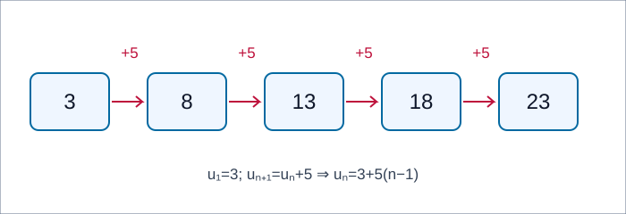
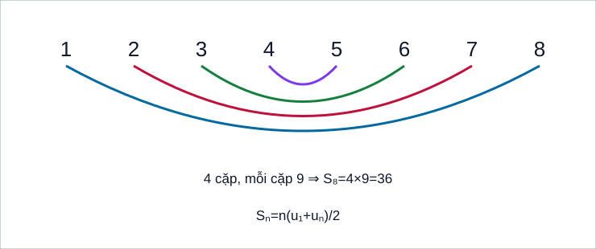
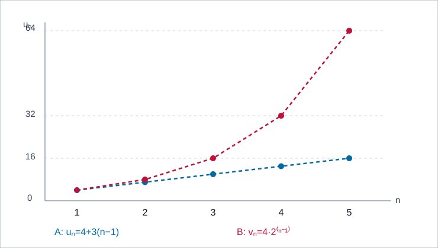

# Dãy số, cấp số cộng, cấp số nhân · R02 biên tập

<!-- AUTHORING_R02_EDITORIAL_NOT_CONTENT_READY; FROZEN_R01_SOURCE_BLOB:ff5b58b012432a2cd7151d2f217bf7ac2e8bd50c; no website, merge/deploy -->

<!-- TOPIC_KNOWLEDGE_BEGIN -->
## 1. Kiến thức

Hành trình gồm 9 mô-đun: định nghĩa dãy số, truy hồi/đơn điệu/chặn, công sai/số hạng/tổng, công bội/số hạng/tổng, lãi kép có điều kiện và phân biệt mô hình. Vận dụng rồi mới tự mở Đối chiếu. Các kiến thức bắt buộc nằm ngay trong Topic, không phải nhảy sang SGK.

### 1. Dãy số và quy luật truy hồi

#### 1.1. Dãy số, miền chỉ số và công thức tường minh

        **WHY – Bài toán:** Số lượt truy cập trong ngày thứ n được biểu diễn bằng \(u_n\). Khác với một đoạn đường liên tục, dãy số cho mỗi *chỉ số nguyên* một giá trị; chỉ số phải được hiểu trước khi thay công thức.

        **PRE & MEANING:** Dãy số là một hàm trên \(\mathbb N^*=\{1,2,\ldots\}\) hoặc \(\{1,\ldots,N\}\) với dãy hữu hạn. Có thể cho bằng bảng, công thức \(u_n=f(n)\) hay truy hồi với giá trị khởi đầu. Dãy vô hạn không được khẳng định quy luật chỉ từ ba số đầu.

        **WORKED EXAMPLE / WHY THIS METHOD:** Cho \(u_n=n^2-2n\). Ta tính trực tiếp \(u_1=-1,u_2=0,u_3=3,u_5=15\). Vì có công thức số hạng tổng quát nên không cần liệt kê mọi số hạng trung gian. \(n=0\) không thuộc miền đang xét nên không thể tự đặt “số hạng đầu” là \(u_0\).

        **LIMIT:** Phân biệt chỉ số n, giá trị \(u_n\) và số lượng số hạng; nếu đề là một tập chỉ số hữu hạn thì không ngoại suy tới n lớn hơn N.

        **Outcome chi tiết:**

        - **G11-B05-SEQUENCE-DEFINITION:** Nêu định nghĩa và miền áp dụng, không phỏng đoán từ vài dữ kiện.

        - **G11-B05-EXPLICIT-TERM:** Chọn biểu thức tường minh/hiệu liên tiếp theo dữ kiện, giữ n−1 bước.

        
> **ĐỊNH NGHĨA · Dãy số và miền chỉ số**
>
> Dãy số là một hàm xác định trên tập chỉ số nguyên liên tiếp như \(\{1,2,\dots\}\) hoặc một tập hữu hạn tương ứng; \(u_n\) là số hạng chỉ số n. Cần ghi rõ bắt đầu từ n=0 hay n=1, không thay số thập phân vào chỉ số nếu không có mô hình nội suy.

**Vận dụng trước Core (M01-TRY01, không tạo item_id):** Cho (u_n=3n-4) với n≥1. Viết u₁,u₂,u₃ và u₈. Có thể lấy n=0 làm số hạng đầu không?

        

Đối chiếu sau khi tự thử

        (u_1=-1,u_2=2,u_3=5,u_8=20). Không; miền chỉ số đã bắt đầu từ n=1.

        

        **D6:** Viết bảng n=1,2,3 dưới các số hạng và thay trực tiếp vào công thức để sửa lỗi lệch chỉ số. Sau đó làm bài canonical tương ứng, không ghi Mastery.

#### 1.2. Truy hồi, tăng giảm và tính bị chặn

        **WHY:** Một hiện tượng có thể được mô tả chỉ bằng quy tắc “ngày sau tính từ ngày trước”, nên cần phương pháp truy hồi. Nhưng một truy hồi không có \(u_1\) thì chưa định nghĩa duy nhất dãy.

        **MEANING BEFORE FORMULA:** \(u_1=3,u_{n+1}=u_n+5\) cho 3,8,13,18,... Dãy tăng khi \(u_{n+1}>u_n\) mọi n hợp lệ; xét hiệu để chứng minh, không chỉ nhìn vài số đầu. Bị chặn trên nghĩa là tồn tại M sao cho \(u_n\le M\) mọi n; bị chặn dưới tương tự.

        **WORKED EXAMPLE / PROOF:** \(u_n=n/(n+1)\). Lấy hiệu \(u_{n+1}-u_n=1/[(n+1)(n+2)]>0\) nên tăng. Đồng thời \(0<u_n<1\), chứng minh bị chặn. Dãy tăng có thể vẫn bị chặn, không mâu thuẫn. Ngược lại \(u_n=(-1)^n\) bị chặn nhưng không tăng/giảm đơn điệu.

        **READ FIGURE:** Ở sơ đồ truy hồi 3→8→13→18→23, bốn mũi tên +5 là bốn bước, không phải năm. Đường mũi tên không tạo hàm liên tục giữa các số nguyên.

        **Outcome chi tiết:**

        - **G11-B05-RECURRENCE:** Dùng đúng giá trị khởi đầu và chỉ số để dựng dãy.

        - **G11-B05-MONOTONICITY:** Kiểm dấu hiệu liên tiếp với mọi n.

        - **G11-B05-BOUNDS:** Chứng minh bất đẳng thức chặn mọi n thay vì nhìn đồ thị ngắn.

        
> **TÍNH CHẤT · Truy hồi và tính bị chặn**
>
> Công thức truy hồi nêu số hạng đầu và quy tắc tính từ số hạng đã biết; tính tăng/giảm phải so các số hạng liên tiếp (và điều kiện mỗi n). Bị chặn trên/dưới yêu cầu có một chặn đúng với **mọi** chỉ số trong miền.

**Hướng dẫn đọc:** tại n=1,2,3,4,5 các giá trị là 3,8,13,18,23. Mỗi mũi tên cộng 5. Các ô là số hạng rời rạc, không phải đồ thị thời gian liên tục.

**Vận dụng trước Core (M02-TRY01, không tạo item_id):** Cho u₁=2, uₙ₊₁=uₙ+4. Tính u₄; chứng minh dãy tăng và xét có bị chặn trên không.

        

Đối chiếu sau khi tự thử

        u₂=6,u₃=10,u₄=14; mọi hiệu bằng 4>0 nên tăng. (u_n=2+4(n-1)) tăng không giới hạn, không bị chặn trên.

        

        **D6:** Nếu chỉ thấy bốn số đầu hữu hạn mà kết luận bị chặn, thử tìm M áp dụng cho **mọi** n. Sau đó làm bài canonical tương ứng, không ghi Mastery.

#### 1.3. Công sai và số hạng tổng quát của cấp số cộng

        **WHY:** Trong sơ đồ xếp ghế, mỗi hàng *thêm đúng ba chiếc*; đó là sự thay đổi theo hiệu, không phải theo tỉ số.

        **MEANING:** CSC thỏa \(u_{n+1}-u_n=d\) cố định mọi n. Để từ \(u_1\) đến \(u_n\), thực hiện n−1 bước cộng d nên \(u_n=u_1+(n-1)d\). d có thể âm, dương hoặc bằng 0. CSC với d âm là dãy giảm.

        **WORKED EXAMPLES / METHOD:** \(10,7,4,1,\ldots\) có d=−3 nên \(u_6=10+5(-3)=-5\). Nếu \(u_4=13,u_9=28\), chênh lệch năm bước là \(15=5d\) ⇒ d=3 và u₁=4. Chọn lấy hiệu giữa hai số hạng đã biết vì nhanh và tránh tính từng số trung gian.

        **LIMIT:** Việc 3 số đầu trông như CSC không đủ để chứng minh cả dãy vô hạn theo đúng quy tắc.

        **Outcome chi tiết:**

        - **G11-B06-AP-DEFINITION:** Nêu định nghĩa và miền áp dụng, không phỏng đoán từ vài dữ kiện.

        - **G11-B06-AP-NTH:** Chọn biểu thức tường minh/hiệu liên tiếp theo dữ kiện, giữ n−1 bước.

        
> **ĐỊNH NGHĨA · Cấp số cộng**
>
> \[u_{n+1}=u_n+d,\qquad u_n=u_1+(n-1)d\quad(n\ge1).\] d là **công sai cố định**, không nhất thiết dương. Không kết luận CSC chỉ vì ba số đầu tình cờ phù hợp.

**Vận dụng trước Core (M03-TRY01, không tạo item_id):** CSC có u₂=7, u₆=23. Tìm d,u₁,u₁₀.

        

Đối chiếu sau khi tự thử

        (d=(23-7)/(6-2)=4), (u_1=7-4=3); (u_{10}=3+9cdot4=39).

        

        **D6:** Hãy ghi dãy chỉ số 2→3→4→5→6 để thấy chỉ có bốn bước, không phải sáu. Sau đó làm bài canonical tương ứng, không ghi Mastery.

### 2. Cấp số cộng và sang cấp số nhân

#### 2.1. Ba số hạng liền nhau và tổng cấp số cộng

        **WHY:** Nếu có hàng trăm hàng ghế, cộng từng hàng rất mất công; vì sao có thể ghép cặp hai đầu để tính tổng nhanh?

        **MEANING / DERIVATION BEFORE FORMULA:** Ba số CSC liền nhau \(a,b,c\) thỏa \(b-a=c-b\), nên \(2b=a+c\). Viết tổng \(S_n=u_1+\cdots+u_n\) từ đầu và lại từ cuối: mỗi cột có \(u_1+u_n\). Do đó \(2S_n=n(u_1+u_n)\) và \(S_n=n(u_1+u_n)/2=\frac n2[2u_1+(n-1)d]\).

        **WORKED EXAMPLE:** CSC u₁=5,d=3. u₈=5+7·3=26, S₈=8(5+26)/2=124. Ghép (5,26),(8,23),(11,20),(14,17) cho bốn cặp có tổng 31, tổng đúng bằng 124. **Hướng dẫn đọc SVG Gauss:** các cặp đầu-cuối cộng bằng nhau, không phải đồ họa trang trí.

        **LIMIT:** Công thức tổng CSC không dùng cho dãy có tỉ số cố định nhưng hiệu thay đổi; n phải là số số hạng đang cộng.

        **Hướng dẫn cho từng outcome:**

        - **G11-B06-AP-THREE-TERMS:** Ba số hạng liên tiếp thỏa 2b=a+c, phải là ba chỉ số liền nhau.

        - **G11-B06-AP-SUM:** S_n=n(u₁+u_n)/2 suy từ hai lượt ghép cặp, không là tổng CSN.

        
> **CÔNG THỨC · Tổng CSC hữu hạn**
>
> \[S_n=\frac{n(u_1+u_n)}2=\frac n2\bigl(2u_1+(n-1)d\bigr).\] Chỉ cộng các số hạng thuộc cùng CSC, n là số hạng đã cộng.

**Hướng dẫn đọc:** cặp 1+8, 2+7, 3+6, 4+5 đều là 9 nên S_8=4×9=36; làm rõ vì sao tổng CSC n số hạng bằng n lần trung bình hai đầu.

**Vận dụng trước Core (M04-TRY01):** Ba số x−2,x,x+2 có là ba số hạng liên tiếp của một CSC không? Với u₁=1,d=2 tính S₆.

        

Đối chiếu — chỉ mở sau khi tự giải

        Hai hiệu bằng 2 nên tạo 3 số liên tiếp CSC. u₆=11; S₆=6(1+11)/2=36.

        

        **D6:** Nếu quên chia 2, viết lại hai tổng tiến/ngược để thấy mỗi số bị đếm hai lần. Tự quay lại bài canonical cùng outcome, không ghi Mastery.

#### 2.2. Ứng dụng cấp số cộng theo hàng hoặc tầng

        **WHY:** Để tính tổng sức chứa hoặc số sản phẩm trên các tầng, không thể lấy số ở tầng cuối nhân số tầng.

        **MODEL / METHOD:** Hàng đầu 12 ghế, mỗi hàng thêm 3. Số ghế hàng n là \(u_n=12+3(n-1)\). Có 8 hàng thì \(u_8=33\), \(S_8=8(12+33)/2=180\) ghế. Mô hình phù hợp vì **hiệu giữa hai hàng liên tiếp không đổi**.

        **LIMIT & UNIT:** Số hàng là n nguyên dương. Nếu hàng thứ 6 đổi quy luật thêm ghế, cần tách giai đoạn; không áp một d cho toàn bộ. Số cuối có đơn vị ghế/hàng, tổng có đơn vị ghế.

        **Hướng dẫn cho từng outcome:**

        - **G11-B06-AP-APPLICATION:** Chọn mô hình có hiệu không đổi và giải thích đơn vị cùng điều kiện ngoại suy.

        
> **PHƯƠNG PHÁP · Tình huống tăng đều**
>
> Lượng thay đổi thêm một lượng không đổi qua mỗi bước được mô hình hóa bằng CSC. Dữ kiện hàng/tầng cần chỉ rõ giá trị đầu, công sai, số bước. Nếu thực tế có giới hạn về người/vật, kiểm tính nguyên của kết quả.

**Vận dụng trước Core (M05-TRY01):** Tầng 1 có 10 sản phẩm; mỗi tầng trên thêm 4; tất cả 6 tầng. Số sản phẩm ở tầng cuối và tổng bao nhiêu?

        

Đối chiếu — chỉ mở sau khi tự giải

        u₆=10+5·4=30 sản phẩm; S₆=6(10+30)/2=120 sản phẩm.

        

        **D6:** Liệt kê 10,14,18,22,26,30 để thấy phép lấy 6·30 sẽ đếm sai các tầng đầu. Tự quay lại bài canonical cùng outcome, không ghi Mastery.

#### 2.3. Công bội và số hạng tổng quát của cấp số nhân

        **WHY:** Một quá trình sau mỗi chu kỳ gấp đôi cần dùng phép *nhân cùng tỉ lệ*, không phải cộng một lượng.

        **MEANING:** CSN được định nghĩa bởi \(u_{n+1}=q u_n\) cho cùng q mọi n. Khi \(u_n\ne0\), tỉ số \(u_{n+1}/u_n=q\); không chia cho 0. Từ số thứ nhất đến thứ n có n−1 lần nhân nên \(u_n=u_1q^{n-1}\). q có thể âm và dãy sẽ đổi dấu. q=1 là dãy hằng; q=0 thì từ số thứ hai bằng 0, phải xem \(u_1\) riêng để tránh hiểu sai 0⁰.

        **WORKED EXAMPLE:** u₁=3,q=−2: các số 3,−6,12,−24,48,...; u₅=3(−2)⁴=48. Ta **không** coi hiệu giữa 3 và −6 là công sai vì hiệu kế tiếp khác.

        **LIMIT:** CSN q âm không nhất thiết tăng/giảm và không nhất thiết có tất cả số hạng dương.

        **Hướng dẫn cho từng outcome:**

        - **G11-B07-GP-DEFINITION:** Chọn truy hồi nhân q cố định, không lấy tỉ số khi số trước bằng 0.

        - **G11-B07-GP-NTH:** u_n=u₁q^(n−1), n−1 bước; q âm đổi dấu, q=0 xét khởi đầu.

        
> **ĐỊNH NGHĨA · Cấp số nhân**
>
> \[u_{n+1}=qu_n,\qquad u_n=u_1q^{n-1}\quad(n\ge1).\] q là công bội cố định. Chỉ tính q bằng tỉ số khi mẫu \(u_n\ne0\); q có thể âm hoặc bằng 0 theo mô hình.

**Vận dụng trước Core (M06-TRY01):** CSN u₁=2, q=−3. Tìm u₂,u₃,u₄; dãy có tăng không?

        

Đối chiếu — chỉ mở sau khi tự giải

        u₂=−6,u₃=18,u₄=−54. Dãy không tăng/giảm đơn điệu vì đổi dấu.

        

        **D6:** Viết từng phép nhân q âm và kiểm (u_2>u_1) rồi (u_3>u_2); đừng dựa vào chữ “cấp số nhân” để đoán tăng. Tự quay lại bài canonical cùng outcome, không ghi Mastery.

### 3. Tổng cấp số nhân, ứng dụng và mô hình

#### 3.1. Ba số hạng và tổng hữu hạn cấp số nhân

        **WHY:** Dãy tăng theo tỉ lệ không có hiệu không đổi, vì vậy công thức tổng CSC không phù hợp.

        **MEANING:** Ba số hạng CSN liên tiếp \(a,b,c\) thỏa \(b=qa,c=qb\), nên \(b^2=ac\). Tuy nhiên đây là điều kiện cần; vẫn phải kiểm \(u_{n+1}=qu_n\), nhất là khi có số 0.

        **DERIVATION:** \(S_n=u_1(1+q+\cdots+q^{n-1})\). Nhân q rồi trừ: \((1-q)S_n=u_1(1-q^n)\). Với \(q\ne1\), \(S_n=u_1(1-q^n)/(1-q)\); **riêng q=1**, \(S_n=nu_1\). Nếu q âm, giữ dấu của từng lũy thừa; n là số số hạng đầu.

        **WORKED EXAMPLE:** u₁=3,q=−2 cho 3,−6,12,−24. Tổng bốn số bằng −15. Công thức \(3[1-(-2)^4]/[1-(-2)]=-15\), phù hợp cộng trực tiếp.

        **WHEN NOT:** Không chia cho 1−q tại q=1; không áp tổng vô hạn nếu không có điều kiện hội tụ.

        **Hướng dẫn riêng theo outcome:**

        - **G11-B07-GP-THREE-TERMS:** b²=ac là hệ quả, chưa đủ khi chưa kiểm định nghĩa và số 0.

        - **G11-B07-GP-SUM:** q≠1 dùng công thức hữu hạn; q=1 dùng n u₁; dấu q âm phải giữ.

        
> **CÔNG THỨC · Tổng CSN hữu hạn**
>
> \[S_n=\frac{u_1(1-q^n)}{1-q}\quad(q\ne1),\qquad S_n=nu_1\quad(q=1).\] Nếu q âm, dấu các số hạng luân phiên; kiểm đúng n và điều kiện công bội.

**Vận dụng trước khi đối chiếu M07-TRY01:** Với CSN u₁=5,q=2, tìm u₄,S₄. Nếu cùng u₁ nhưng q=1 thì S₄ bằng bao nhiêu?

        

Đối chiếu — chỉ mở sau khi tự thử

        u₄=5×2³=40; S₄=5(2⁴−1)/(2−1)=75. Với q=1, S₄=4×5=20.

        

        **D6:** Liệt kê 5,10,20,40 để sửa sai lệch số mũ và dùng nhánh riêng q=1. Luyện thêm một câu canonical đúng outcome; xem lời giải không ghi Mastery.

#### 3.2. Lãi kép và giới hạn của mô hình nhân

        **WHY:** Khi lãi được nhập vào gốc, số tiền kỳ sau nhân với cùng một hệ số nếu lãi suất không đổi.

        **MODEL:** Với khoản tiền ban đầu P tại thời điểm 0, r là lãi suất mỗi kỳ, không nộp/rút thêm, phí hoặc thuế: \(A_0=P,\ A_{n+1}=(1+r)A_n\), nên sau n kỳ \(A_n=P(1+r)^n\). Đếm đúng n **số kỳ**; không nhầm chỉ số \(A_0\) với số hạng \(u_1\) của các bài trước.

        **WORKED EXAMPLE:** P=10.000.000 đồng, r=1%/tháng; 3 tháng: \(A_3=10\,000\,000(1.01)^3=10\,303\,010\) đồng, vì mỗi tháng nhân 1.01.

        **WHEN NOT:** Nếu cuối mỗi kỳ thêm D, \(A_{n+1}=(1+r)A_n+D\) không là CSN thuần nữa. Nếu r thay đổi, không dùng một q cố định. Mô hình không là cam kết thị trường.

        **Hướng dẫn riêng theo outcome:**

        - **G11-B07-GP-APPLICATION:** Lãi kép theo kỳ chỉ là CSN thuần khi không có khoản nộp/rút và r cố định.

        
> **CÔNG THỨC · Lãi kép**
>
> \[A_n=A_0(1+r)^n\] khi số dư được nhập lãi đều từng kỳ, không rút/nộp giữa kỳ và cùng lãi suất r. Thời gian n tính bằng số kỳ nguyên, r dùng dạng thập phân; đây là mô hình giả định, không phải báo giá thực tế.

**Vận dụng trước khi đối chiếu M08-TRY01:** 2.000.000 đồng tăng 5% mỗi kỳ không nộp/rút. Sau 2 kỳ là bao nhiêu? Nếu nộp thêm 100.000 cuối mỗi kỳ còn dùng công thức cũ không?

        

Đối chiếu — chỉ mở sau khi tự thử

        A₂=2.000.000×1.05²=2.205.000 đồng. Có khoản nộp thêm thì truy hồi Aₙ₊₁=1.05Aₙ+100.000; không dùng công thức CSN thuần ban đầu.

        

        **D6:** Viết A₀,A₁,A₂ để đếm đúng kỳ; có khoản thêm cần mô hình truy hồi mới. Luyện thêm một câu canonical đúng outcome; xem lời giải không ghi Mastery.

#### 3.3. So sánh bản chất CSC và CSN

        **WHY:** Hai dãy có số đầu giống nhau có thể khác biệt rất lớn; chọn công thức từ bản chất hiệu không đổi hay tỉ số không đổi.

        **MEANING:** CSC có \(u_{n+1}-u_n=d\) cố định; CSN thỏa \(u_{n+1}=qu_n\) với q cố định, phép chia tỉ số chỉ khi \(u_n\ne0\). Dãy hằng \(u_n\equiv5\) vừa CSC d=0 vừa CSN q=1. Dãy \(3,-3,3,-3,\ldots\) là CSN q=−1 nhưng không CSC; với dãy toàn 0, phép chia 0/0 không xác định.

        **WORKED EXAMPLE:** A từ 4 cộng 3: 4,7,10,13,16, tổng 50. B từ 4 nhân 2: 4,8,16,32,64, tổng 124. Các điểm trên SVG là rời rạc tại n nguyên, không gán giá trị cho n=2.5. ADD01 kiểm quy luật và tổng; ADD02 kiểm ngoại lệ hằng và q âm.

        **LIMIT:** Ba số đầu tình cờ giống một CSC/CSN không đủ để chứng minh toàn dãy vô hạn thuộc loại đó khi không có giả thiết mọi n.

        **Hướng dẫn riêng theo outcome:**

        - **G11-CHII-STRUCTURAL-COMPARISON:** Chọn hiệu hoặc tỉ số, nhận diện ngoại lệ dãy hằng và công bội âm.

        
> **GHI NHỚ · CSC so với CSN**
>
> CSC có **hiệu** \(u_{n+1}-u_n=d\) không đổi; CSN có **quan hệ nhân** \(u_{n+1}=qu_n\) không đổi. Dãy hằng khác 0 thỏa cả hai với d=0, q=1; tỉ số 0/0 không có nghĩa. Đồ thị tại chỉ số n nguyên gồm các điểm rời rạc.

**Hướng dẫn đọc:** A có 4,7,10,13,16 và B có 4,8,16,32,64; tới chỉ số 5 hai dãy khác biệt 16 và 64; đường nét đứt không là nội suy giá trị giữa các chỉ số.

**Vận dụng trước khi đối chiếu M09-TRY01:** A bắt đầu 3, mỗi bước cộng 3; B bắt đầu 3, mỗi bước nhân 3. Tìm số thứ tư và giải thích vì sao B không CSC.

        

Đối chiếu — chỉ mở sau khi tự thử

        A: 3,6,9,12 ⇒ a₄=12; B: 3,9,27,81 ⇒ b₄=81. Hiệu B là 6,18,54 không cố định.

        

        **D6:** Nếu nhầm cả hai là CSC vì đều tăng, lập bảng hiệu/tỉ số. Nếu là dãy hằng, kiểm cả d=0 và q=1. Luyện thêm một câu canonical đúng outcome; xem lời giải không ghi Mastery.

### Nguồn SGK/SBT — cuối trang Kiến thức

- **SGK Toán 11 KNTT Tập Một:** Bài 5 trang in 42–47, Bài 6 48–51, Bài 7 52–55, bài tập cuối chương 56–57. **SBT Toán 11 Tập Một:** B05 31–34, B06 35–36, B07 37–39, cuối chương 40–43.

<!-- AUTHORING_SOURCE_SCOPE: frozen baseline R01 Git blob ff5b58b012432a2cd7151d2f217bf7ac2e8bd50c; new formal maths require targeted Q18. -->

<!-- TOPIC_KNOWLEDGE_END -->

<!-- TOPIC_PRACTICE_BEGIN -->
## 2. Luyện tập

**Một ngân hàng canonical, nhiều placement:** 42 câu SGK public gốc tại prototypes/thpt/shared-items/Temp_TOPIC_SEQUENCES_G11_CANONICAL_SOURCE_INDEX_R00_20261112.md (Git blob 19415049b78891955ce13ce3c10ea7279eceb2c7), 2 câu bổ sung công khai tại prototypes/thpt/shared-items/Temp_TOPIC_SEQUENCES_G11_PUBLIC_EXTENSION_02ITEM_R00_20261112.md (Git blob e64d7addbc5659618fc1a2c6296f075d62ee96bd), 44 unique IDs toàn Topic. Sáu câu Written/Anchor gốc dùng rubric một nguồn, không clone sang Topic.

| Mảng | Chọn phương pháp |
|---|---|
| M01–M02 | Miền n, dãy tường minh và truy hồi, dấu hiệu tăng/bị chặn có chứng minh mọi n |
| M03–M05 | Hiệu không đổi, CSC: số hạng thứ n, tính chất 3 số, tổng n số và mô hình hàng ghế |
| M06–M08 | Tỉ số/truy hồi q, CSN gồm q âm/q=1, tổng hữu hạn, lãi kép có điều kiện |
| M09 | Hai câu ADD01/ADD02: chọn CSC/CSN theo bản chất, dãy hằng và phản ví dụ |

**Luyện có chiều sâu:** mỗi kết quả phải có giải thích điều kiện, miền chỉ số và lý do dùng phương pháp. Đáp án, lời giải và rubric mở từ **cùng item_id** gốc. Practice và tự đối chiếu không ghi Mastery.

<!-- TOPIC_PRACTICE_END -->

<!-- TOPIC_SELF_CHECK_BEGIN -->
## 3. Tự kiểm tra

**Chỉ tự đối chiếu công khai** `CLIENT_SELF_CHECK_NO_MASTERY`. 9 câu công khai đã luyện được tái sử dụng làm placement, không phải held-out TOPIC_READINESS. Trong sản phẩm website RELEASE phải khóa đáp án, gợi ý, đúng/sai và Tutor tới **sau Final Submit** toàn lượt, không có ghi Mastery.

| Mảng | Item IDs reused | Trở về |
|---|---|---|
| Dãy số và truy hồi | `THPT-G11-B05-P01`, `THPT-G11-B05-P02` | M01–M02 |
| Tính chất dãy số | `THPT-G11-B05-P03` | M02 |
| CSC | `THPT-G11-B06-P01`, `THPT-G11-B06-P03` | M03–M05 |
| CSN | `THPT-G11-B07-P02`, `THPT-G11-B07-P04`, `THPT-G11-B07-P06` | M06–M08 |
| So sánh quy luật | `THPT-G11-TOPSEQ-ADD01` | M09 |

**Private RD1:** 19 câu Chương II gốc owner-held không nhập source Git. Public placement đã xem không thể dùng như đánh giá độc lập hay Mastery.

<!-- TOPIC_SELF_CHECK_END -->

