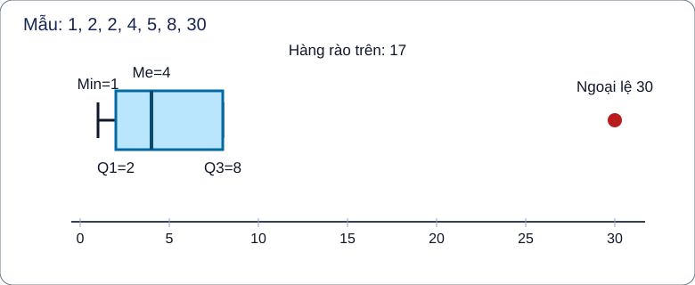
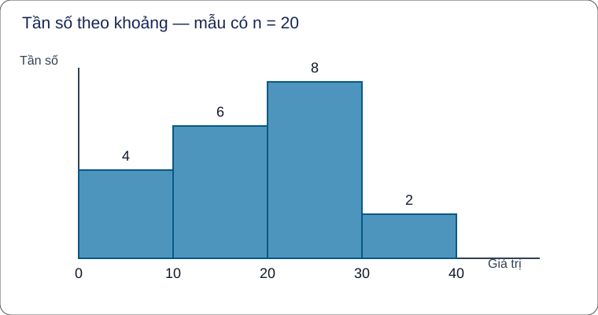

# Chuyên đề 22 · Thống kê mô tả và phân tích số liệu (rời rạc, ghép nhóm)

## 1. Kiến thức

**Vì sao học?** Dữ liệu có thể nói lên mức trung tâm, mức dao động và sự khác nhau giữa các nhóm, nhưng một số duy nhất không mô tả tất cả. Khi số liệu được đo gần đúng hoặc ghép thành khoảng, kết quả tính cũng có giới hạn chính xác. Chuyên đề này học liền mạch từ dữ liệu thô tới dữ liệu ghép nhóm và cách diễn giải có trách nhiệm.

**Tiền đề tại chỗ:** Biết cộng, chia, căn bậc hai, sắp xếp số thực, đọc bảng; số đo cần kèm đơn vị. Mẫu có \(n\) quan sát; tần số là số lần xuất hiện. Không cần mở lại bài SGK bắt buộc khác. Phân biệt các công thức trên **dữ liệu thô** với các đại lượng **ước lượng từ bảng ghép nhóm**.

**Cách học:** Mỗi mục đánh số gồm giải thích, khung kiến thức có tên và điều kiện, từng outcome cần nhớ, một bài **Vận dụng** rồi tự mở **Đối chiếu**; khi sai dùng D6 quay về cùng mạch. Không dùng bài đã mở lời giải làm kiểm tra độc lập.

### 1. Dữ liệu thô, độ chính xác và các số đặc trưng

#### 1.1. Dữ liệu đo và sai số

##### 1.1.1. Khám phá và lý do chọn thước đo

Một giá trị đọc từ dụng cụ có thể là **số gần đúng**, không phải số đúng. Khi biết số đúng \(\bar a\) và số ghi \(a\), sai số tuyệt đối \(\Delta=|\bar a-a|\); sai số tương đối theo số gần đúng \(a\ne0\) là \(\delta_a=\Delta/|a|\). Nếu chỉ biết độ chính xác \(d\), ta biết \(\Delta\le d\), **không** biết chắc sai số thực bằng \(d\). Quy tròn đến hàng phần mười theo quy tắc thông thường có chặn sai số \(0{,}05\) đơn vị. Ví dụ giá trị thật \(12{,}47\) mm và bản ghi \(12{,}5\) mm: \(\Delta=0{,}03\) mm, \(\delta_a=0{,}03/12{,}5=0{,}24\%\).

##### 1.1.2. Định nghĩa, công thức và điều kiện cần ghi nhớ

> **ĐỊNH NGHĨA · CÔNG THỨC — Sai số của số gần đúng**
>
> \[\Delta=|\bar a-a|,\qquad \delta_a=\frac{\Delta}{|a|}\quad(a\ne0).\] Nếu chỉ biết chặn \(d\), kết luận \(\Delta\le d\), không khẳng định \(\Delta=d\). Dữ liệu phải nêu đơn vị và vị trí làm tròn.

##### 1.1.3. Những kết quả quan trọng và lỗi dễ mắc

- **G10-B12-APPROX_CONCEPT** — Hỏi trước: số này do **đếm** hay do **đo**? Đếm đủ 25 học sinh cho số đúng trong tình huống đã xác định; thước ghi 120,3 cm cho một giá trị gần đúng. Số chữ số dài không biến số đo thành giá trị chính xác. Nếu còn nghi ngờ, viết rõ đối tượng, đơn vị, dụng cụ và độ chính xác.
- **G10-B12-ABS_ERROR** — Muốn tính **sai số tuyệt đối thực**, cần biết cả giá trị đúng và gần đúng. Ví dụ \(a=7{,}2,\bar a=7{,}16\) cho \(\Delta=0{,}04\). Nếu chỉ biết \(d=0{,}1\), điều đúng là \(\Delta\le0{,}1\); không khẳng định \(\Delta=0{,}1\).
- **G10-B12-REL_ERROR** — Sai số \(0{,}1\) ở vật dài 1 đơn vị đáng kể hơn ở vật dài 100 đơn vị. Vì vậy chia sai số tuyệt đối cho \(|a|>0\), rồi nhân 100% nếu muốn tỷ lệ phần trăm. Khi \(a=0\), tỷ lệ theo \(|a|\) không xác định; hãy trở về sai số tuyệt đối.
- **G10-B12-ROUNDING** — Làm tròn là thay giá trị bởi số thuận tiện hơn ở một hàng xác định. Quy tắc chặn bằng nửa đơn vị hàng làm tròn cho phép **ước lượng sai số tối đa**, chứ không cho sai số thật khi chưa biết số gốc. Sau khi làm tròn, viết lại số và so giá trị trước–sau; không chỉ dừng ở quy tắc nhìn chữ số tiếp theo.

##### 1.1.4. Vận dụng

**Vận dụng M01.** Giá trị thật 9,68 mm ghi 9,7 mm: tìm sai số tuyệt đối và phần trăm tương đối.

Đối chiếu Vận dụng M01 — chỉ mở sau khi làm

\(\Delta=0{,}02\) mm; \(\delta_a=(0{,}02/9{,}7)\cdot100\%\approx0{,}206\%\).

**Khắc phục khi sai (D6):** Đừng lấy độ chính xác làm sai số thật; kiểm đơn vị và việc nhân 100 để ra phần trăm. Sau đó làm một câu tương đương trong ngân hàng public theo outcome.

#### 1.2. Số trung bình và mốt

##### 1.2.1. Khám phá và lý do chọn thước đo

Khi cần mô tả một mẫu, **số trung bình** cho biết mức chia đều: \(\bar x=(x_1+\cdots+x_n)/n\). Bảng tần số dùng \(\bar x=\sum f_iv_i/\sum f_i\). **Mốt** là giá trị xuất hiện nhiều nhất, có thể có nhiều mốt. Với 2,2,3,5,8, số trung bình là \(20/5=4\) nhưng mốt là 2. Chọn mốt khi hỏi giá trị phổ biến, trung bình khi quan tâm tổng mức phân bổ; trung bình nhạy với giá trị lớn bất thường.

##### 1.2.2. Định nghĩa, công thức và điều kiện cần ghi nhớ

> **ĐỊNH NGHĨA · CÔNG THỨC — Trung bình và mốt mẫu**
>
> \[\bar x=\frac{x_1+\cdots+x_n}{n}=\frac{\sum f_iv_i}{\sum f_i}.\] Mốt là giá trị có tần số lớn nhất, có thể nhiều mốt. Dữ liệu định lượng dùng số trung bình cho mức chia đều, nhưng trung bình nhạy với giá trị bất thường.

##### 1.2.3. Những kết quả quan trọng và lỗi dễ mắc

- **G10-B13-MEAN** — Trung bình là mức chia đều, không nhất thiết thuộc danh sách số liệu. Nếu giá trị 5 có tần số 3, phải cộng 5 **ba lần** hoặc nhân (5cdot3); đừng lấy trung bình các giá trị khác nhau mà quên tần số. Khi có số cực đoan, so thêm trung vị để giải thích.
- **G10-B13-MODE** — Mốt trả lời 'giá trị gặp thường nhất' chứ không đo vị trí trung tâm hay tổng. Khi tần số cao nhất xuất hiện ở hai giá trị, ta có **hai mốt**, không tự chọn một. Kiểm bằng cách viết bảng hai cột 'giá trị–số lần xuất hiện' trước khi kết luận.

##### 1.2.4. Vận dụng

**Vận dụng M02.** Mẫu 1,3,3,5,8 có trung bình và mốt nào?

Đối chiếu Vận dụng M02 — chỉ mở sau khi làm

Trung bình 4, mốt 3. Năm số có tổng bằng 20.

**Khắc phục khi sai (D6):** Nếu nhầm mốt với trung vị, lập bảng số lần xuất hiện trước khi kết luận. Sau đó làm một câu tương đương trong ngân hàng public theo outcome.

#### 1.3. Trung vị và tứ phân vị

##### 1.3.1. Khám phá và lý do chọn thước đo

Phải **sắp dãy theo thứ tự**. Trung vị là phần tử ở giữa khi \(n\) lẻ, hoặc trung bình của hai phần tử giữa khi \(n\) chẵn. \(Q_2\) là trung vị; theo cách chia nửa mẫu KNTT, khi \(n\) lẻ loại trung vị rồi lấy trung vị của hai nửa để có \(Q_1,Q_3\). Ví dụ dãy 1,2,2,4,5,8,10 có \(Me=4,Q_1=2,Q_3=8\). Đây là phân vị **dữ liệu thô**, không dùng công thức nội suy ghép nhóm.

##### 1.3.2. Định nghĩa, công thức và điều kiện cần ghi nhớ

> **ĐỊNH NGHĨA · QUY ƯỚC — Trung vị và tứ phân vị trên dãy thô**
>
> Trước hết **sắp xếp dữ liệu**. Trung vị \(Me=Q_2\) là giá trị giữa (n lẻ) hoặc trung bình hai giá trị giữa (n chẵn). Theo cách chia nửa dãy KNTT: n lẻ **loại trung vị** rồi lấy trung vị hai nửa để có \(Q_1,Q_3\). Đây không phải nội suy trên bảng ghép nhóm.

##### 1.3.3. Những kết quả quan trọng và lỗi dễ mắc

- **G10-B13-MEDIAN** — Muốn tìm trung vị, bước không được bỏ là **xếp lại dãy tăng dần**. Với số phần tử chẵn, hai giá trị ở giữa cần lấy trung bình, dù trung vị có thể không có trong dãy quan sát. Nếu kết quả thay đổi khi hoán vị thứ tự nhập dữ liệu, cách làm đã sai.
- **G10-B13-QUARTILES** — Trên dãy thô, dùng đúng quy ước chia nửa mẫu của SGK KNTT. Với dãy lẻ, tách phần tử trung vị ra rồi mới lấy (Q_1,Q_3) từ hai nửa; với dãy chẵn, chia đôi theo vị trí. Đây **không phải** phép nội suy tần số ghép nhóm sẽ học sau.

##### 1.3.4. Vận dụng

**Vận dụng M03.** Tìm Me, Q1, Q3 của 2,4,6,8,10,12.

Đối chiếu Vận dụng M03 — chỉ mở sau khi làm

Có 6 số: \(Me=(6+8)/2=7\); nửa dưới 2,4,6 có \(Q_1=4\), nửa trên 8,10,12 có \(Q_3=10\).

**Khắc phục khi sai (D6):** Đánh dấu vị trí giữa và chia hai nửa sau khi đã sắp; không đoán từ thứ tự đề liệt kê. Sau đó làm một câu tương đương trong ngân hàng public theo outcome.

#### 1.4. Khoảng biến thiên, IQR và ngoại lệ

##### 1.4.1. Khám phá và lý do chọn thước đo

Khoảng biến thiên \(R=x_{\max}-x_{\min}\) phản ánh độ trải từ đầu tới cuối nhưng rất nhạy với cực trị. Khoảng tứ phân vị \(IQR=Q_3-Q_1\) tập trung vào nửa giữa. Quy ước hàng rào \(Q_1-1{,}5IQR\) và \(Q_3+1{,}5IQR\) giúp **đánh dấu để xem xét**, không chứng minh dữ liệu sai. Với 1,2,2,4,5,8,30: \(Me=4,Q_1=2,Q_3=8,IQR=6\); hàng rào trên 17, nên 30 là ngoại lệ theo quy tắc này. Trung bình \(52/7\approx7{,}43\) chịu ảnh hưởng mạnh hơn trung vị.

##### 1.4.2. Định nghĩa, công thức và điều kiện cần ghi nhớ

> **CÔNG THỨC · GHI NHỚ — Độ trải và hàng rào ngoại lệ**
>
> \[R=x_{\max}-x_{\min},\quad IQR=Q_3-Q_1.\] Hàng rào tham khảo \(Q_1-1{,}5IQR\) và \(Q_3+1{,}5IQR\) giúp nhận diện điểm đáng xem xét, **không chứng minh quan sát bị sai**.

##### 1.4.3. Những kết quả quan trọng và lỗi dễ mắc

- **G10-B13-INTERPRETATION** — Nếu hầu hết thu nhập khoảng 5 nhưng một giá trị là 50, số trung bình bị kéo lên, còn trung vị vẫn mô tả người ở giữa. Không có một số đặc trưng luôn tốt nhất: muốn nói mức chia đều dùng trung bình, còn muốn một mức ít nhạy ngoại lệ hãy cân nhắc trung vị. Nêu lý do chọn.
- **G10-B14-RANGE_IQR** — Khoảng biến thiên chỉ dùng hai cực trị nên nhạy với một số rất lớn, còn IQR dùng (Q_3-Q_1) để đo độ trải trung tâm. Khi hai mẫu cùng trung bình, hãy dùng thêm R/IQR thay vì kết luận mức ổn định như nhau. IQR và R đều cùng đơn vị với dữ liệu.
- **G10-B14-OUTLIERS** — Hàng rào (Q_1-1{,}5IQR) và (Q_3+1{,}5IQR) là quy tắc **phát hiện điểm đáng kiểm tra**. Một điểm vượt hàng rào có thể là quan sát hợp lệ. Nêu đúng ngưỡng và chiều so sánh trước khi gắn nhãn; không xóa dữ liệu chỉ vì bị đánh dấu.

##### 1.4.4. Vận dụng

**Vận dụng M04.** Mẫu 2,3,4,5,6,7,25 có IQR và hàng rào trên bao nhiêu?

Đối chiếu Vận dụng M04 — chỉ mở sau khi làm

\(Q_1=3,Q_3=7,IQR=4\); hàng rào trên \(7+1{,}5\cdot4=13\). Số 25 vượt hàng rào.

**Khắc phục khi sai (D6):** Đọc đúng Q1/Q3 trước khi gán nhãn ngoại lệ; đừng loại bỏ điểm dữ liệu chỉ vì trông khác. Sau đó làm một câu tương đương trong ngân hàng public theo outcome.

##### 1.4.5. Hình minh họa: đọc biểu đồ hộp và ngoại lệ

**Đọc hình:** Đọc \(Q_1=2\), trung vị \(Me=4\), \(Q_3=8\); \(IQR=6\), hàng rào trên \(8+1{,}5\cdot6=17\). Điểm 30 vượt 17 nên được đánh dấu để kiểm tra **chứ không tự xóa** khỏi mẫu. Hình phải được đặt tại đây, không chuyển xuống sau tất cả các mục.

#### 1.5. Phương sai và độ lệch chuẩn

##### 1.5.1. Khám phá và lý do chọn thước đo

Để so sánh hai nhóm có cùng trung bình, xét sai lệch từng giá trị so với \(\bar x\). **Phương sai mô tả** \(s^2=\frac1n\sum_{i=1}^n(x_i-\bar x)^2\), **độ lệch chuẩn** \(s=\sqrt{s^2}\). Dữ liệu đo bằng phút thì \(s\) tính phút, \(s^2\) tính phút bình phương. Ví dụ A=3,4,5 và B=1,4,7 đều có trung bình 4; \(s_A^2=2/3\), \(s_B^2=6\) nên A ổn định hơn. Không tự thay mẫu số \(n\) bằng \(n-1\) trong công thức SGK này.

##### 1.5.2. Định nghĩa, công thức và điều kiện cần ghi nhớ

> **CÔNG THỨC — Phương sai mô tả và độ lệch chuẩn (dữ liệu thô)**
>
> \[s^2=\frac1n\sum_{i=1}^{n}(x_i-\bar x)^2,\qquad s=\sqrt{s^2}.\] Đây là **phương sai mô tả dùng mẫu số n** theo học liệu SGK, không tự thay bằng \(n-1\). \(s\) cùng đơn vị với dữ liệu, \(s^2\) bình phương đơn vị.

##### 1.5.3. Những kết quả quan trọng và lỗi dễ mắc

- **G10-B14-VARIANCE** — Bình phương sai lệch giúp các độ lệch âm/dương không triệt tiêu. Theo phương sai mô tả SGK, chia **cho \(n\)** chứ không tự đổi sang \(n-1\). Khi tính \(s^2\), hãy kiểm \(\sum(x_i-\bar x)^2\ge0\); nếu phương sai âm, chắc chắn có lỗi số học.
- **G10-B14-STDDEV** — Độ lệch chuẩn là căn bậc hai của phương sai, giúp thước đo trở lại cùng **đơn vị** với dữ liệu. Nếu số đo tính bằng cm, (s) tính cm nhưng (s^2) tính cm². So sánh độ lệch chuẩn có ý nghĩa khi các mẫu dùng cùng đơn vị và bối cảnh.
- **G10-B14-COMPARISON** — Hai dãy có cùng số trung bình không nhất thiết phân tán như nhau. Với A=3,4,5 và B=1,4,7, trung bình đều là 4, nhưng B biến động mạnh hơn. Hãy ghi rõ bạn đang so theo phương sai, độ lệch chuẩn hay IQR; không kết luận nguyên nhân chỉ từ khác biệt thống kê.

##### 1.5.4. Vận dụng

**Vận dụng M05.** So sánh phương sai A=4,5,6 và B=2,5,8.

Đối chiếu Vận dụng M05 — chỉ mở sau khi làm

Trung bình cùng bằng 5; \(s_A^2=2/3\), \(s_B^2=6\). A ít phân tán hơn.

**Khắc phục khi sai (D6):** Lập bảng x−x̄ rồi bình phương và chia đúng n; kiểm phương sai không âm. Sau đó làm một câu tương đương trong ngân hàng public theo outcome.

### 2. Dữ liệu ghép nhóm và các ước lượng vị trí

#### 2.1. Ghép nhóm: biên, độ rộng, tần số

##### 2.1.1. Khám phá và lý do chọn thước đo

Khi có quá nhiều quan sát, gom thành các khoảng **trái đóng, phải mở** \([a,b)\) để một số ở ranh giới chỉ thuộc **một** nhóm. Độ rộng nhóm \(h=b-a\); tần số \(f_i\) là số phần tử thuộc nhóm, tổng \(\sum f_i=n\). Ví dụ dữ liệu 0,9,10,19,20 ghép \([0,10),[10,20),[20,30)\) có tần số 2,2,1. Sau ghép nhóm, thông tin từng quan sát mất đi: không thể khẳng định mọi số ở nhóm [10,20) đều bằng 15.

##### 2.1.2. Định nghĩa, công thức và điều kiện cần ghi nhớ

> **ĐỊNH NGHĨA · TÍNH CHẤT — Bảng tần số ghép nhóm**
>
> Các nhóm dạng \([a_i,b_i)\) **trái đóng, phải mở**, không trùng và phủ các quan sát. Độ rộng \(h_i=b_i-a_i>0\); tần số \(f_i\) là số quan sát trong nhóm; \(\sum_i f_i=n\). Gán điểm biên vào một nhóm duy nhất.

##### 2.1.3. Những kết quả quan trọng và lỗi dễ mắc

- **G11-B08-GROUPED-DEFINITION** — Bảng ghép nhóm thay các số đo riêng lẻ bằng số phần tử nằm trong các khoảng. Được lợi khả năng đọc tổng quan nhưng **mất độ chính xác từng cá thể**. Khi nhóm [10,20) có tần số 5, ta biết có năm quan sát từ 10 đến dưới 20, không biết mỗi người bằng 15.
- **G11-B08-CLASS-BOUNDARIES** — Trong ký hiệu [10,20), 10 được lấy nhưng 20 không; số 20 chuyển sang [20,30). Điều này bảo đảm một điểm biên không bị đếm hai lần. Trước khi lập bảng, hãy kiểm nhóm có liền nhau, không trùng và không bỏ lọt số đo cần xét.
- **G11-B08-GROUP-WIDTH** — Độ rộng nhóm (h=b-a) phải dương. Nhóm [0,10) có độ rộng 10, khác nhóm [10,30) rộng 20. Với độ rộng không đều, chỉ so chiều cao cột tần số hoặc dùng công thức mốt cho nhóm bằng nhau có thể gây sai; phải kiểm điều kiện nhóm của bài.
- **G11-B08-FREQUENCY-TABLE** — Mỗi quan sát được gán đúng **một** khoảng, rồi đếm tần số. Tổng (sum f_i) cần bằng số quan sát gốc (n); nếu thiếu hoặc dư, kiểm ngay các số ở ranh giới. Sau khi tạo bảng, đọc tỷ lệ (f_i/n) thay vì tự gán xác suất hay giá trị trung điểm cho mọi cá thể.
- **G11-B08-INTERPRETATION** — Tần số 8 trên tổng 20 nghĩa là 40% mẫu nằm trong khoảng đó. Điều này **không** cho biết bao nhiêu người đúng bằng trung điểm, và cũng không suy thẳng tỷ lệ tổng thể từ một mẫu thiếu thông tin chọn mẫu. Khi báo cáo, hãy gọi đúng là tỷ lệ trong mẫu.

##### 2.1.4. Vận dụng

**Vận dụng M06.** Tần số của các nhóm [0,10), [10,20), [20,30) với dữ liệu 3,10,10,20,29?

Đối chiếu Vận dụng M06 — chỉ mở sau khi làm

1,2,2; tổng 5. Hai số 10 thuộc nhóm thứ hai.

**Khắc phục khi sai (D6):** Khoanh từng quan sát theo biên trái đóng–phải mở, rồi đối chiếu tổng tần số với n. Sau đó làm một câu tương đương trong ngân hàng public theo outcome.

#### 2.2. Đại diện, trung bình nhóm và tích lũy

##### 2.2.1. Khám phá và lý do chọn thước đo

Trung điểm \(c_i=(a_i+b_i)/2\) đại diện nhóm, không phải giá trị đo của từng cá thể. Ước lượng trung bình nhóm \(\bar x_g=\sum f_i c_i/n\); tần số tích lũy \(F_i=\sum_{j\le i}f_j\). Với \([0,10):2,[10,20):3,[20,30):1\), trung điểm 5,15,25, tổng trọng số 80, \(n=6\): \(\bar x_g=80/6=40/3\). Tích lũy 2,5,6. Số trung bình này chỉ là **ước lượng từ bảng nhóm**.

##### 2.2.2. Định nghĩa, công thức và điều kiện cần ghi nhớ

> **CÔNG THỨC · GHI NHỚ — Trung điểm, trung bình và tần số tích lũy**
>
> \[c_i=\frac{a_i+b_i}{2},\quad \bar x_g=\frac{\sum_i f_ic_i}{n},\quad F_i=\sum_{j\le i}f_j.\] \(\bar x_g\) là **ước lượng** từ trung điểm, không phải trung bình chính xác của dữ liệu thô.

##### 2.2.3. Những kết quả quan trọng và lỗi dễ mắc

- **G11-B09-REPRESENTATIVE** — Trung điểm khoảng ([10,20)) là 15, được dùng thay thế khi chỉ còn số nhóm. Nó đại diện cho phép **ước lượng**, không phải số đo gốc của từng người. Nếu khoảng không đều, trung điểm tính riêng cho từng nhóm; không dùng cùng một trung điểm cho các nhóm.
- **G11-B09-GROUPED-MEAN** — Số trung bình ghép nhóm dùng \(\sum f_ic_i/n\) vì nhóm nhiều quan sát phải có trọng số lớn hơn. Nếu nhóm 1 có tần số 9 và nhóm 2 là 1, trung bình hai trung điểm đơn thuần sẽ sai. Kết quả là ước lượng từ bảng nhóm; hãy viết rõ dấu xấp xỉ khi so với trung bình gốc.
- **G11-B09-CUMULATIVE** — Tần số tích lũy nối lần lượt các nhóm từ trái sang phải; nhóm chứa vị trí (p) là nhóm đầu tiên đạt tới hoặc vượt (p) theo quy ước nội suy đang dùng. Nếu số tích lũy cuối khác (n), cần sửa bảng tần số trước khi tìm trung vị hay tứ phân vị.

##### 2.2.4. Vận dụng

**Vận dụng M07.** Nhóm [0,10):1, [10,20):2, [20,30):1: ước lượng trung bình, tích lũy.

Đối chiếu Vận dụng M07 — chỉ mở sau khi làm

Trung điểm 5,15,25; trung bình (5+30+25)/4=15, tích lũy 1,3,4.

**Khắc phục khi sai (D6):** Không lấy trung bình ba trung điểm nếu nhóm có tần số khác nhau. Sau đó làm một câu tương đương trong ngân hàng public theo outcome.

##### 2.2.5. Hình minh họa: tần số và tích lũy

**Đọc hình:** Bốn cột có tần số \(4,6,8,2\) trên tổng \(20\). Cộng tích lũy lần lượt \(4,10,18,20\). Trục/cột biểu diễn **số quan sát trong mỗi khoảng**, không khẳng định tất cả số trong một khoảng đều bằng trung điểm.

#### 2.3. Nội suy trung vị và tứ phân vị ghép nhóm

##### 2.3.1. Khám phá và lý do chọn thước đo

Với bảng nhóm, tìm nhóm chứa vị trí \(p\) từ **tần số tích lũy**, rồi nội suy: \(\mathrm{estimate}=L+(p-F_{\mathrm{trước}})h/f\) khi tần số nhóm \(f>0\). Với trung vị dùng \(p=n/2\), tứ phân vị \(p=n/4,3n/4\). Ví dụ nhóm [0,10):4, [10,20):6, [20,30):8, [30,40):2 có \(n=20\), tích lũy 4,10,18,20. \(Me=20\), \(Q_1=10+(5-4)10/6=35/3\), \(Q_3=20+(15-10)10/8=26{,}25\). Đều là **ước lượng** từ bảng, không là số gốc chính xác.

##### 2.3.2. Định nghĩa, công thức và điều kiện cần ghi nhớ

> **CÔNG THỨC · ĐIỀU KIỆN — Nội suy các phân vị của bảng ghép nhóm**
>
> \[Q_p\approx L+\frac{(p-F_{\rm trước})h}{f},\qquad f>0.\] Chọn \(p=n/4,n/2,3n/4\) cho \(Q_1,Me,Q_3\); trước đó phải định vị đúng lớp chứa p bằng tần số tích lũy. Đây là **ước lượng**, không phải dữ liệu gốc.

##### 2.3.3. Những kết quả quan trọng và lỗi dễ mắc

- **G11-B09-GROUPED-MEDIAN** — Trung vị ghép nhóm là **ước lượng**: đánh dấu vị trí (n/2), tìm nhóm dựa tích lũy, rồi nội suy từ cận trái (L) với tần số nhóm (f>0). Nếu lấy sai (F_{mathrm{trước}}) hoặc nhầm với tần số nhóm hiện tại, kết quả sẽ lệch. Đặt hai giá trị lên cùng trục để kiểm phạm vi nhóm.
- **G11-B09-GROUPED-QUARTILES** — Với (Q_1,Q_3), thay vị trí (p) bằng (n/4) hoặc (3n/4) trong quy tắc nội suy nhóm. Hai phân vị có thể nằm trong hai nhóm khác nhau; phải tìm nhóm riêng **trước** khi dùng công thức. Cuối cùng kiểm (Q_1le Mele Q_3).

##### 2.3.4. Vận dụng

**Vận dụng M08.** Nhóm [0,10):5, [10,20):5, [20,30):10: ước lượng Me, Q1, Q3.

Đối chiếu Vận dụng M08 — chỉ mở sau khi làm

Tích lũy 5,10,20. \(Me=20,Q_1=10,Q_3=25\).

**Khắc phục khi sai (D6):** Nếu chọn nhầm nhóm, tô cột tích lũy đến n/4,n/2,3n/4 trước khi nội suy. Sau đó làm một câu tương đương trong ngân hàng public theo outcome.

#### 2.4. Mốt ghép nhóm và giới hạn áp dụng

##### 2.4.1. Khám phá và lý do chọn thước đo

Với nhóm **cùng độ rộng**, nhóm tần số lớn nhất là nhóm mốt. Nếu \(f_m\) là tần số nhóm mốt và \(f_-,f_+\) là hai tần số kề, ước lượng \(Mo=L+\frac{f_m-f_-}{(f_m-f_-)+(f_m-f_+)}h\) khi mẫu dương. Hai ví dụ giải riêng dưới đây minh họa tình huống ở biên và điều kiện độ rộng nhóm. Nếu nhiều nhóm cùng cực đại, nhóm không đều hoặc thiếu nhóm kề, không dùng máy móc công thức.

**Ví dụ giải có lập luận 1 — nhóm mốt ở biên trái.** Bảng gồm ba nhóm cùng độ rộng 10: \([0,10)\): 12, \([10,20)\): 7, \([20,30)\): 3. **Bước 1:** nhóm thứ nhất có tần số lớn nhất 12 nên là nhóm mốt, cận dưới \(L=0\), độ rộng \(h=10\). **Bước 2:** vì không có nhóm phía trước trong bảng, theo *quy ước biên của mô hình* đặt \(f_-=0\), còn \(f_+=7\). **Bước 3:** mẫu số \((12-0)+(12-7)=17>0\), nên \(M_o\approx 0+\frac{12-0}{17}\cdot10=\frac{120}{17}\approx7{,}06\). **Đối chiếu:** số này nằm trong nhóm mốt \([0,10)\), là một **ước lượng nội suy**, không phải phép đo chính xác hay một quan sát nhất thiết có trong mẫu. Không tự đặt \(f_-=0\) cho một *nhóm bị thiếu dữ liệu* ở giữa bảng.

**Ví dụ giải có lập luận 2 — khi nào không dùng cùng công thức.** Hai nhóm \([0,5)\) có 6 quan sát và \([5,20)\) có 12 quan sát. Dù tần số nhóm sau lớn hơn, độ rộng hai nhóm lần lượt là 5 và 15: mật độ tần số tương ứng là \(6/5=1{,}2\) và \(12/15=0{,}8\) quan sát trên một đơn vị. **Vì sao phải đổi cách đọc?** Nếu vẽ histogram đúng diện tích, nhóm đầu có cột cao hơn; chỉ so tần số rồi thế vào công thức mốt dành cho các nhóm **cùng độ rộng** là sai điều kiện. Cần dùng cách phân tích phù hợp nhóm có độ rộng khác nhau, không tuyên bố ngay một mốt chính xác.

**Lưu ý trường hợp đồng hạng:** nếu hai nhóm cùng có tần số lớn nhất, bảng không xác định duy nhất một nhóm mốt để áp công thức nội suy thông thường. Hãy nêu sự đồng hạng và giới hạn của mô hình, thay vì tự chọn một nhóm để cho ra một số có vẻ chính xác.

##### 2.4.2. Định nghĩa, công thức và điều kiện cần ghi nhớ

> **CÔNG THỨC · ĐIỀU KIỆN — Mốt ước lượng cho nhóm cùng độ rộng**
>
> \[M_o\approx L+\frac{f_m-f_-}{(f_m-f_-)+(f_m-f_+)}\,h.\] Trong đó \(L\) là cận dưới nhóm mốt, \(h>0\) là độ rộng nhóm, \(f_m\) là tần số nhóm mốt, \(f_-\) và \(f_+\) lần lượt là tần số nhóm liền trước và liền sau. **Quy ước biên:** Nếu nhóm mốt đứng đầu thì lấy \(f_-=0\); nếu đứng cuối thì lấy \(f_+=0\). Chỉ áp dụng cho các nhóm **cùng độ rộng**, nhóm mốt được chọn rõ và **mẫu số dương**; nếu nhiều nhóm cùng đạt cực đại cần xét lại tình huống thay vì thế máy móc.

##### 2.4.3. Những kết quả quan trọng và lỗi dễ mắc

- **G11-B09-GROUPED-MODE** — Nhóm mốt có tần số lớn nhất khi **các khoảng cùng độ rộng**. Sau khi xác định nhóm, dùng tần số nhóm trước/nhóm sau để nội suy vị trí mốt; đáp số không nhất thiết là một số đã được quan sát. Mốt ghép nhóm khác mốt của dãy số thô.
- **G11-B09-MODE-CONDITIONS** — Nếu nhóm cao nhất nằm ở biên, nhiều nhóm cùng cao nhất hoặc độ rộng nhóm khác nhau, không thế chỗ điều kiện bằng thói quen máy móc. Với nhóm khác độ rộng, cách đọc biểu đồ tần số cần chú ý diện tích/mật độ; không chỉ nhìn số tần số lớn mà áp dụng công thức nhóm đều.
- **G11-B09-INTERPRETATION** — Từ bảng nhóm, trung bình, trung vị, tứ phân vị và mốt đều được suy qua đại diện/nội suy, nên chỉ báo **ước lượng**. Không suy kết quả chính xác của dữ liệu gốc hoặc kết luận nhóm có 'mọi người như nhau'. Dùng bảng nhóm thích hợp cho mô tả tổng quan, không thay dữ liệu cá nhân.

##### 2.4.4. Vận dụng

**Vận dụng M09.** Nhóm [0,10):4,[10,20):10,[20,30):6, cùng độ rộng: ước lượng mốt.

Đối chiếu Vận dụng M09 — chỉ mở sau khi làm

Nhóm mốt [10,20); \(Mo=10+(6/(6+4))10=16\).

**Khắc phục khi sai (D6):** Kiểm mẫu số dương, tần số các nhóm kề và điều kiện cùng độ rộng. Sau đó làm một câu tương đương trong ngân hàng public theo outcome.

### 3. Độ phân tán ghép nhóm và phân tích số liệu

#### 3.1. Khoảng biến thiên ghép nhóm

##### 3.1.1. Khám phá và lý do chọn thước đo

Khi dữ liệu chỉ còn nhóm, ta không biết số nhỏ nhất/lớn nhất thật. Độ rộng phủ nhóm không rỗng từ \([a_1,b_1)\) tới \([a_k,b_k)\) cho ước lượng \(R_g=b_k-a_1\), **không** đồng nhất với khoảng biến thiên thật. Ví dụ [0,10):2,[10,20):4,[20,30):3 cho \(R_g=30\). Đây là khoảng phủ theo biên nhóm; các quan sát có thể nằm cách xa cận.

##### 3.1.2. Định nghĩa, công thức và điều kiện cần ghi nhớ

> **GHI NHỚ · GIỚI HẠN — Khoảng biến thiên ghép nhóm**
>
> \[R_g=b_k-a_1\] là **độ phủ theo biên các nhóm không rỗng** từ nhóm đầu đến nhóm cuối, không nhất thiết bằng khoảng biến thiên thực của các quan sát.

##### 3.1.3. Những kết quả quan trọng và lỗi dễ mắc

- **G12-CHIII-B09-O01** — Trước khi tính độ phân tán, đọc xem bảng là số liệu ghép nhóm với tần số hay dữ liệu thô. Phải kiểm tổng tần số, nhóm cực biên có tần số dương và cận nhóm. Không gọi trung điểm và cận là giá trị gốc chính xác của mẫu.
- **G12-CHIII-B09-O02** — Khoảng biến thiên ghép nhóm dựa cận thấp nhất và cận cao nhất của nhóm có số liệu. Vì không biết giá trị thực trong các nhóm, kết quả mô tả **độ rộng phủ** của bảng. Nêu rõ sự khác nhau với khoảng biến thiên của dữ liệu chưa ghép.
- **G12-CHIII-B09-O03** — Chỉ một nhóm cực biên có vài quan sát cũng có thể khiến độ phủ nhóm rất rộng. Khi so sánh, thước đo R nhạy với cực trị, nên cần xem thêm IQR. Không khẳng định hai mẫu 'ổn định như nhau' chỉ vì chúng có trung bình bằng nhau.

##### 3.1.4. Vận dụng

**Vận dụng M10.** Nhóm [5,15):3,[15,25):4,[25,35):1: ước lượng độ rộng phủ theo nhóm.

Đối chiếu Vận dụng M10 — chỉ mở sau khi làm

35−5=30 đơn vị; không kết luận R thực chắc chắn bằng 30.

**Khắc phục khi sai (D6):** Nếu nhầm đầu mút nhóm với quan sát thực, thử đặt hai bộ số liệu khác nhau vào cùng nhóm. Sau đó làm một câu tương đương trong ngân hàng public theo outcome.

#### 3.2. IQR ghép nhóm và so sánh

##### 3.2.1. Khám phá và lý do chọn thước đo

Ước lượng \(Q_1,Q_3\) từ tần số tích lũy và nội suy như mảng trước, sau đó \(IQR_g=Q_3-Q_1\). Mẫu nhóm [0,10):4,[10,20):8,[20,30):8 có \(n=20\), tích lũy 4,12,20: \(Q_1=10+(5-4)10/8=11{,}25\), \(Q_3=20+(15-12)10/8=23{,}75\), \(IQR_g=12{,}5\). IQR nhóm là ước lượng, không dùng để xác định chắc chắn cá thể ngoại lệ khi thiếu dữ liệu thô.

##### 3.2.2. Định nghĩa, công thức và điều kiện cần ghi nhớ

> **CÔNG THỨC · GHI NHỚ — IQR ước lượng của dữ liệu ghép nhóm**
>
> \[IQR_g=Q_{3,g}-Q_{1,g}.\] Hai tứ phân vị được **nội suy** từ tần số tích lũy; không dùng hàng rào nhóm để khẳng định chắc chắn một cá thể là ngoại lệ nếu đã mất dữ liệu thô.

##### 3.2.3. Những kết quả quan trọng và lỗi dễ mắc

- **G12-CHIII-B09-O04** — Để tìm nhóm chứa phân vị, xây tần số tích lũy trước rồi đánh dấu hai vị trí (n/4) và (3n/4). Khi vị trí đúng ở ranh tích lũy, dùng quy ước SGK thống nhất; giá trị nội suy nằm ở cận chung của hai nhóm kề. Không dùng nhóm có tần số 0 làm mẫu số.
- **G12-CHIII-B09-O05** — Sau khi tìm (Q_1,Q_3) từ bảng nhóm, lấy (IQR_g=Q_3-Q_1). Đó là **ước lượng** mức trải của 50% dữ liệu trung tâm, không phải IQR chính xác của mẫu thô đã mất. Kiểm dấu không âm; nếu ra âm, hãy kiểm lại thứ tự hai vị trí nội suy.
- **G12-CHIII-B09-O06** — Khi so độ ổn định hai mẫu, R cho biết độ phủ từ cực thấp đến cực cao còn IQR mô tả phần giữa. Nêu rõ thước đo chọn theo mục tiêu: tìm thay đổi cực trị dùng R, tìm phần trung tâm dùng IQR. Luôn kiểm đơn vị, cách ghép và cỡ mẫu trước kết luận.

##### 3.2.4. Vận dụng

**Vận dụng M11.** Nhóm [0,10):4,[10,20):10,[20,30):6: Q1,Q3,IQR ước lượng?

Đối chiếu Vận dụng M11 — chỉ mở sau khi làm

\(Q_1=11\), \(Q_3=20+10/6=65/3\), \(IQR_g=32/3\approx10{,}67\).

**Khắc phục khi sai (D6):** Nếu sai Q1/Q3, tự kiểm nhóm chứa vị trí n/4 và 3n/4, luôn kiểm Q1≤Q3. Sau đó làm một câu tương đương trong ngân hàng public theo outcome.

#### 3.3. Phương sai và độ lệch chuẩn ghép nhóm

##### 3.3.1. Khám phá và lý do chọn thước đo

Dữ liệu gốc đã ẩn nên dùng trung điểm \(c_i\) để ước lượng: \(\bar x_g=\sum f_ic_i/n\), \(s_g^2=\sum f_i(c_i-\bar x_g)^2/n=\sum f_ic_i^2/n-\bar x_g^2\), \(s_g=\sqrt{s_g^2}\). Nếu nhóm [0,10):2,[10,20):2 thì \(c=5,15\), \(\bar x_g=10\), \(s_g^2=(50+50)/4=25\), \(s_g=5\). Phương sai có **bình phương đơn vị**, độ lệch chuẩn có đơn vị gốc. Đây là ước lượng theo trung điểm.

##### 3.3.2. Định nghĩa, công thức và điều kiện cần ghi nhớ

> **CÔNG THỨC · ĐIỀU KIỆN — Phương sai và độ lệch chuẩn ghép nhóm**
>
> \[s_g^2=\frac{\sum_i f_i(c_i-\bar x_g)^2}{n}=\frac{\sum_i f_ic_i^2}{n}-\bar x_g^2,\qquad s_g=\sqrt{s_g^2}.\] Trung điểm là đại diện nên đây là **ước lượng**, không đo được độ lệch thật trong mỗi nhóm.

##### 3.3.3. Những kết quả quan trọng và lỗi dễ mắc

- **G12-CHIII-B10-O01** — Muốn ước lượng trung bình ghép nhóm, sử dụng trung điểm (c_i) của từng khoảng và trọng số (f_i). Nếu có nhóm không quan sát nào ((f_i=0)), nhóm đó không góp vào tổng trung bình. Phải chia đúng (n=sum f_i>0) và ghi kết quả là ước lượng.
- **G12-CHIII-B10-O02** — Phương sai là trung bình **bình phương** khoảng cách đến giá trị trung bình, nên không âm. Với bảng nhóm, dùng trung điểm thay số liệu gốc để ước lượng độ phân tán. Không chỉ đọc sự khác nhau giữa các cận nhóm rồi suy phương sai như số liệu thô.
- **G12-CHIII-B10-O03** — Có hai cách kiểm chéo: (sum f_i(c_i-ar x_g)^2/n) và (sum f_i c_i^2/n-ar x_g^2). Hai cách phải bằng nhau (sai khác nhỏ khi làm tròn). Nếu công thức rút gọn cho số âm rõ rệt, kiểm số học và bước ước lượng trung bình.
- **G12-CHIII-B10-O04** — Độ lệch chuẩn là căn của phương sai ước lượng, giúp diễn giải theo đơn vị **gốc**. Phương sai dữ liệu tính bằng phút có đơn vị phút²; độ lệch chuẩn tính bằng phút. Nếu báo cáo ngược đơn vị, người đọc khó hiểu mức biến động thực tế.

##### 3.3.4. Vận dụng

**Vận dụng M12.** Nhóm [0,10):1,[10,20):2,[20,30):1: phương sai/std nhóm?

Đối chiếu Vận dụng M12 — chỉ mở sau khi làm

Các trung điểm 5,15,25; \(\bar x_g=15\); \(s_g^2=(100+0+100)/4=50\), \(s_g=5\sqrt2\approx7{,}071\).

**Khắc phục khi sai (D6):** Đừng chia n−1 hoặc bỏ trọng số f; dùng hai công thức kiểm chéo để tránh phương sai âm. Sau đó làm một câu tương đương trong ngân hàng public theo outcome.

#### 3.4. So sánh phân phối và giới hạn suy luận

##### 3.4.1. Khám phá và lý do chọn thước đo

Hai mẫu có cùng trung bình vẫn có độ ổn định khác nhau. Trên các nhóm [0,10),[10,20),[20,30) với trung điểm 5,15,25: A tần số 1,2,1 và B 2,0,2 cùng \(\bar x_g=15\), nhưng \(s_A^2=50<s_B^2=100\). Vì vậy A ổn định hơn **theo độ phân tán nhóm**, không phải kết luận về mọi biến cố tương lai. Chỉ so sánh khi hai mẫu dùng cùng thang đo, đơn vị và cách nhóm hợp lí.

##### 3.4.2. Định nghĩa, công thức và điều kiện cần ghi nhớ

> **TÍNH CHẤT · GHI NHỚ — So sánh hai phân phối có cùng trung bình**
>
> Hai mẫu có thể có \(\bar x_g\) bằng nhau mà \(s_g^2\) khác nhau. Mẫu có độ lệch chuẩn nhỏ hơn **ít phân tán hơn theo thước đo và cách nhóm đang dùng**, không mặc nhiên tốt hơn hay gây ra kết quả nào. Chỉ so khi đơn vị/thang đo/cách nhóm hợp lý.

##### 3.4.3. Những kết quả quan trọng và lỗi dễ mắc

- **G12-CHIII-B10-O05** — So sánh hai mẫu có cùng thang đo bằng (s_g) hoặc (s_g^2). Số nhỏ hơn phản ánh mẫu tập trung hơn quanh trung bình theo mô hình nhóm, **không** có nghĩa mẫu đó luôn tốt hơn trong mọi mục tiêu. Trước khi so, ghi rõ hai mẫu có cùng cách chia khoảng và đơn vị.
- **G12-CHIII-B10-O06** — Thống kê mô tả chỉ mô tả dữ liệu đã quan sát, không chứng minh nguyên nhân hoặc rủi ro tương lai. Khi cần khuyến nghị, nêu giả định về mẫu, độ mất thông tin do ghép nhóm, thước đo và mục tiêu ra quyết định. Tránh biến 'phân tán cao' thành kết luận chắc chắn 'rủi ro cao' thiếu bối cảnh.

##### 3.4.4. Vận dụng

**Vận dụng M13.** A có tần số 1,4,1 và B 2,2,2 trên ba nhóm trên: so sánh phương sai nhóm.

Đối chiếu Vận dụng M13 — chỉ mở sau khi làm

Cùng \(\bar x_g=15\). \(s_A^2=100/3\), \(s_B^2=200/3\), nên A ít phân tán hơn.

**Khắc phục khi sai (D6):** Không suy nhân quả từ các số mô tả; kiểm cỡ mẫu, đơn vị và cách ghép nhóm. Sau đó làm một câu tương đương trong ngân hàng public theo outcome.

<!-- TOPIC_PRACTICE_BEGIN -->
## 2. Luyện tập

Dùng một thư viện canonical công khai, **không nhân bản** câu, key hoặc rubric. Ngân hàng luyện tập dùng 114 câu công khai canonical, phân từ nhận biết đến vận dụng theo 39 mục tiêu năng lực; bộ đề/đáp án/rubric chỉ có một bản nguồn dùng chung. Chọn từ dễ đến vận dụng, giải thích vì sao dùng thống kê **thô** hay **ghép nhóm**, rồi mới mở đối chiếu khi được phép. Written/Anchor chung một bản ghi, Anchor chỉ là nhãn.

| Chặng | Mảng | Điều kiện cần kiểm |
|---|---|---|
| G10 | M01–M05 | Sai số/độ chính xác, median n chẵn/lẻ, phân vị đúng quy tắc, mẫu số n trong phương sai |
| G11 | M06–M09 | Cận trái đóng/phải mở, trung điểm có trọng số, tích lũy, nội suy, nhóm mốt |
| G12 | M10–M13 | R/IQR và phương sai ghép nhóm đều là ước lượng, so sánh cùng đơn vị và cách ghép |

**Cách luyện:** Chọn câu thuộc mảng G10 (độ chính xác, trung bình, trung vị và phân tán thô), G11 (bảng ghép nhóm, trung điểm, nội suy) hoặc G12 (độ phân tán và phân tích ghép nhóm). Ghi điều kiện mô hình, đơn vị và lý do chọn thước đo. Làm trước, sau đó mới mở lời giải công khai, không dùng để ghi Mastery.

<!-- AUTHORING_SHARED_CANONICAL: 114 unique PUBLIC IDs, 107 original refs via original R01 source index blob 51a6e99587187838aea61c5c72108adae7874d1d and 7 extension records blob c222f9c8ef2c3b34caf4f6d6c33fa88f960471c3. One stem/key/solution/rubric per canonical ID. -->

<!-- TOPIC_PRACTICE_END -->

<!-- TOPIC_SELF_CHECK_BEGIN -->
## 3. Tự kiểm tra

Đây là một lượt **tự đối chiếu công khai** `CLIENT_SELF_CHECK_NO_MASTERY`, không phải `TOPIC_READINESS` độc lập. Trước **Final Submit**, không gợi ý, đáp án, đánh dấu đúng/sai hoặc AI Tutor. Sau Final Submit mới mở phần đối chiếu và đường sửa sai D6; không dùng câu Practice đã xem để cấp Mastery.

| Chặng | Item public đã có thể dùng lại bằng placement | Ôn sau sai |
|---|---|---|
| Mẫu G10 | **3 bài ôn dữ liệu thô** (các mã canonical được RELEASE lấy từ ma trận) | Trở lại mục 1.1–1.5 |
| Mẫu ghép G11 | **3 bài ôn ghép nhóm** | Trở lại mục 2.1–2.4 |
| Phân tán G12 | **3 bài ôn phân tán ghép nhóm** | Trở lại mục 3.1–3.4 |

Bộ RD1 kín của từng chương SGK là nguồn đánh giá riêng ngoài GitHub, không được chuyển thành Topic RD1 và không xuất hiện trong source này.

<!-- TOPIC_SELF_CHECK_END -->

<!-- AUTHORING_PUBLIC_SELF_CHECK_PLACEMENTS_SAME_ID: THPT-G10-B12-P01, THPT-G10-B13-P03, THPT-G10-B14-P05, THPT-G11-B08-P03, THPT-G11-B09-P02, THPT-G11-B09-P04, THPT-G12-B09-P04, THPT-G12-B10-P04, THPT-G12-B10-P08; NO_MASTERY; NOT_RD1 -->

### Nguồn tài liệu (cuối học liệu)

- **SGK Toán 10 Kết nối tri thức, Tập Một:** Chương V, Bài 12–14, trang in 73–88.
- **SGK Toán 11 Kết nối tri thức, Tập Một:** Chương III, Bài 8–9, trang in 58–68.
- **SGK Toán 12 Kết nối tri thức, Tập Một:** Chương III, Bài 9–10, trang in 75–84.
- **SBT Kết nối tri thức (tham khảo dạng bài):** Toán 10 Tập Một trang in 72–80; Toán 11 Tập Một trang in 44–49; Toán 12 Tập Một trang in 59–69.

