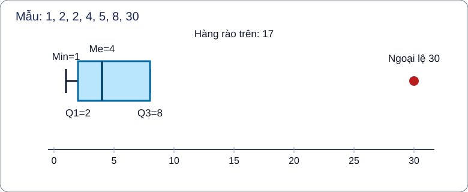
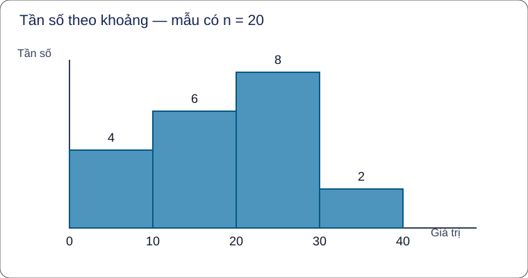

# Thống kê mô tả và phân tích số liệu

# Kiến thức

Thống kê giúp ta mô tả mức điển hình và mức dao động của một tập dữ liệu. Nhưng kết quả đo có thể gần đúng và số tính từ bảng ghép nhóm chỉ là ước lượng. Chúng ta sẽ đi từ dữ liệu thô tới dữ liệu theo khoảng, tìm hiểu lúc nào nên dùng mỗi thước đo và kết luận nào không thể rút ra.

Để bắt đầu, em chỉ cần biết các phép tính cơ bản, căn bậc hai, sắp xếp số và đọc bảng. Những kiến thức nền khác sẽ được nhắc ngay ở đoạn cần dùng.

## 1. Dữ liệu thô, độ chính xác và các số đặc trưng

### 1.1. Dữ liệu đo và sai số

**Khám phá kiến thức**

Một bạn đếm đủ học sinh trong lớp, một bạn đo chiều dài bàn. Vì sao số đếm và số đo không có cùng mức chắc chắn?

Một giá trị đọc từ dụng cụ có thể là **số gần đúng**, không phải số đúng. Khi biết số đúng \(\bar a\) và số ghi \(a\), sai số tuyệt đối \(\Delta=|\bar a-a|\); sai số tương đối theo số gần đúng \(a\ne0\) là \(\delta_a=\Delta/|a|\). Nếu chỉ biết độ chính xác \(d\), ta biết \(\Delta\le d\), **không** biết chắc sai số thực bằng \(d\). Quy tròn đến hàng phần mười theo quy tắc thông thường có chặn sai số \(0{,}05\) đơn vị. Ví dụ giá trị thật \(12{,}47\) mm và bản ghi \(12{,}5\) mm: \(\Delta=0{,}03\) mm, \(\delta_a=0{,}03/12{,}5=0{,}24\%\).

> **ĐỊNH NGHĨA · CÔNG THỨC — Sai số của số gần đúng**
>
> \[\Delta=|\bar a-a|,\qquad \delta_a=\frac{\Delta}{|a|}\quad(a\ne0).\] Nếu chỉ biết chặn \(d\), kết luận \(\Delta\le d\), không khẳng định \(\Delta=d\). Dữ liệu phải nêu đơn vị và vị trí làm tròn.

<!-- OUTCOME_REF: G10-B12-APPROX_CONCEPT -->

Hỏi trước: số này do **đếm** hay do **đo**? Đếm đủ 25 học sinh cho số đúng trong tình huống đã xác định; thước ghi 120,3 cm cho một giá trị gần đúng. Số chữ số dài không biến số đo thành giá trị chính xác. Nếu còn nghi ngờ, viết rõ đối tượng, đơn vị, dụng cụ và độ chính xác.
<!-- OUTCOME_REF: G10-B12-ABS_ERROR -->

Muốn tính **sai số tuyệt đối thực**, cần biết cả giá trị đúng và gần đúng. Ví dụ \(a=7{,}2,\bar a=7{,}16\) cho \(\Delta=0{,}04\). Nếu chỉ biết \(d=0{,}1\), điều đúng là \(\Delta\le0{,}1\); không khẳng định \(\Delta=0{,}1\).
<!-- OUTCOME_REF: G10-B12-REL_ERROR -->

Sai số \(0{,}1\) ở vật dài 1 đơn vị đáng kể hơn ở vật dài 100 đơn vị. Vì vậy chia sai số tuyệt đối cho \(|a|>0\), rồi nhân 100% nếu muốn tỷ lệ phần trăm. Khi \(a=0\), tỷ lệ theo \(|a|\) không xác định; hãy trở về sai số tuyệt đối.
<!-- OUTCOME_REF: G10-B12-ROUNDING -->

Làm tròn là thay giá trị bởi số thuận tiện hơn ở một hàng xác định. Quy tắc chặn bằng nửa đơn vị hàng làm tròn cho phép **ước lượng sai số tối đa**, chứ không cho sai số thật khi chưa biết số gốc. Sau khi làm tròn, viết lại số và so giá trị trước–sau; không chỉ dừng ở quy tắc nhìn chữ số tiếp theo.

**Ví dụ**

**Đề bài.** Một chi tiết dài thật \(12{,}47\) mm nhưng số đo được ghi là \(12{,}5\) mm. Tính sai số tuyệt đối, sai số tương đối theo số gần đúng.

**Lời giải.** \(\Delta=|12{,}47-12{,}5|=0{,}03\) mm. Vì \(12{,}5\ne0\), \(\delta_a=0{,}03/12{,}5=0{,}24\%\). Có số đúng mới tính được sai số thực.

**Vận dụng** Giá trị thật 9,68 mm ghi 9,7 mm: tìm sai số tuyệt đối và phần trăm tương đối.

Đối chiếu

\(\Delta=0{,}02\) mm; \(\delta_a=(0{,}02/9{,}7)\cdot100\%\approx0{,}206\%\).

**Nếu còn vướng:** Đừng lấy độ chính xác làm sai số thật; kiểm đơn vị và việc nhân 100 để ra phần trăm.

### 1.2. Số trung bình và mốt

**Khám phá kiến thức**

Hai lớp có cùng điểm trung bình nhưng điểm xuất hiện nhiều nhất có thể khác. Em chọn đại lượng nào để mô tả giá trị phổ biến?

Khi cần mô tả một mẫu, **số trung bình** cho biết mức chia đều: \(\bar x=(x_1+\cdots+x_n)/n\). Bảng tần số dùng \(\bar x=\sum f_iv_i/\sum f_i\). **Mốt** là giá trị xuất hiện nhiều nhất, có thể có nhiều mốt. Với 2,2,3,5,8, số trung bình là \(20/5=4\) nhưng mốt là 2. Chọn mốt khi hỏi giá trị phổ biến, trung bình khi quan tâm tổng mức phân bổ; trung bình nhạy với giá trị lớn bất thường.

> **ĐỊNH NGHĨA · CÔNG THỨC — Trung bình và mốt mẫu**
>
> \[\bar x=\frac{x_1+\cdots+x_n}{n}=\frac{\sum f_iv_i}{\sum f_i}.\] Mốt là giá trị có tần số lớn nhất, có thể nhiều mốt. Dữ liệu định lượng dùng số trung bình cho mức chia đều, nhưng trung bình nhạy với giá trị bất thường.

<!-- OUTCOME_REF: G10-B13-MEAN -->

Trung bình là mức chia đều, không nhất thiết thuộc danh sách số liệu. Nếu giá trị 5 có tần số 3, phải cộng 5 **ba lần** hoặc nhân (\(5\cdot3\)); đừng lấy trung bình các giá trị khác nhau mà quên tần số. Khi có số cực đoan, so thêm trung vị để giải thích.
<!-- OUTCOME_REF: G10-B13-MODE -->

Mốt trả lời 'giá trị gặp thường nhất' chứ không đo vị trí trung tâm hay tổng. Khi tần số cao nhất xuất hiện ở hai giá trị, ta có **hai mốt**, không tự chọn một. Kiểm bằng cách viết bảng hai cột 'giá trị–số lần xuất hiện' trước khi kết luận.

**Ví dụ**

**Đề bài.** Với dãy \(2,2,3,5,8\), tính số trung bình và mốt.

**Lời giải.** Tổng là \(20\), có năm quan sát nên \(\bar x=4\). Giá trị \(2\) xuất hiện hai lần, các giá trị khác một lần, nên mốt bằng \(2\).

**Vận dụng** Mẫu 1,3,3,5,8 có trung bình và mốt nào?

Đối chiếu

Trung bình 4, mốt 3. Năm số có tổng bằng 20.

**Nếu còn vướng:** Nếu nhầm mốt với trung vị, lập bảng số lần xuất hiện trước khi kết luận.

### 1.3. Trung vị và tứ phân vị

**Khám phá kiến thức**

Nếu đảo thứ tự nhập các giá trị trong mẫu, trung vị có thay đổi không? Hãy tự sắp xếp một dãy trước khi tính.

Phải **sắp dãy theo thứ tự**. Trung vị là phần tử ở giữa khi \(n\) lẻ, hoặc trung bình của hai phần tử giữa khi \(n\) chẵn. \(Q_2\) là trung vị; theo cách chia nửa mẫu KNTT, khi \(n\) lẻ loại trung vị rồi lấy trung vị của hai nửa để có \(Q_1,Q_3\). Ví dụ dãy 1,2,2,4,5,8,10 có \(Me=4,Q_1=2,Q_3=8\). Đây là phân vị **dữ liệu thô**, không dùng công thức nội suy ghép nhóm.

> **ĐỊNH NGHĨA · QUY ƯỚC — Trung vị và tứ phân vị trên dãy thô**
>
> Trước hết **sắp xếp dữ liệu**. Trung vị \(Me=Q_2\) là giá trị giữa (n lẻ) hoặc trung bình hai giá trị giữa (n chẵn). Theo cách chia nửa dãy KNTT: n lẻ **loại trung vị** rồi lấy trung vị hai nửa để có \(Q_1,Q_3\). Đây không phải nội suy trên bảng ghép nhóm.

<!-- OUTCOME_REF: G10-B13-MEDIAN -->

Muốn tìm trung vị, bước không được bỏ là **xếp lại dãy tăng dần**. Với số phần tử chẵn, hai giá trị ở giữa cần lấy trung bình, dù trung vị có thể không có trong dãy quan sát. Nếu kết quả thay đổi khi hoán vị thứ tự nhập dữ liệu, cách làm đã sai.
<!-- OUTCOME_REF: G10-B13-QUARTILES -->

Trên dãy thô, dùng đúng quy ước chia nửa mẫu của SGK KNTT. Với dãy lẻ, tách phần tử trung vị ra rồi mới lấy \(Q_1,Q_3\) từ hai nửa; với dãy chẵn, chia đôi theo vị trí. Đây **không phải** phép nội suy tần số ghép nhóm sẽ học sau.

**Ví dụ**

**Đề bài.** Tìm trung vị và \(Q_1,Q_3\) của \(1,2,2,4,5,8,10\).

**Lời giải.** Có bảy số đã sắp tăng; trung vị ở vị trí bốn là \(4\). Bỏ số giữa, hai nửa \(1,2,2\) và \(5,8,10\) có trung vị \(2\) và \(8\), nên \(Q_1=2,Q_3=8\).

**Vận dụng** Tìm Me, Q1, Q3 của 2,4,6,8,10,12.

Đối chiếu

Có 6 số: \(Me=(6+8)/2=7\); nửa dưới 2,4,6 có \(Q_1=4\), nửa trên 8,10,12 có \(Q_3=10\).

**Nếu còn vướng:** Đánh dấu vị trí giữa và chia hai nửa sau khi đã sắp; không đoán từ thứ tự đề liệt kê.

### 1.4. Khoảng biến thiên, IQR và ngoại lệ

**Khám phá kiến thức**

Một số rất lớn tác động thế nào đến độ trải toàn mẫu và độ trải của nửa số liệu ở giữa?

Khoảng biến thiên \(R=x_{\max}-x_{\min}\) phản ánh độ trải từ đầu tới cuối nhưng rất nhạy với cực trị. Khoảng tứ phân vị \(IQR=Q_3-Q_1\) tập trung vào nửa giữa. Quy ước hàng rào \(Q_1-1{,}5IQR\) và \(Q_3+1{,}5IQR\) giúp **đánh dấu để xem xét**, không chứng minh dữ liệu sai. Với 1,2,2,4,5,8,30: \(Me=4,Q_1=2,Q_3=8,IQR=6\); hàng rào trên 17, nên 30 là ngoại lệ theo quy tắc này. Trung bình \(52/7\approx7{,}43\) chịu ảnh hưởng mạnh hơn trung vị.

> **CÔNG THỨC · GHI NHỚ — Độ trải và hàng rào ngoại lệ**
>
> \[R=x_{\max}-x_{\min},\quad IQR=Q_3-Q_1.\] Hàng rào tham khảo \(Q_1-1{,}5IQR\) và \(Q_3+1{,}5IQR\) giúp nhận diện điểm đáng xem xét, **không chứng minh quan sát bị sai**.

<!-- OUTCOME_REF: G10-B13-INTERPRETATION -->

Nếu hầu hết thu nhập khoảng 5 nhưng một giá trị là 50, số trung bình bị kéo lên, còn trung vị vẫn mô tả người ở giữa. Không có một số đặc trưng luôn tốt nhất: muốn nói mức chia đều dùng trung bình, còn muốn một mức ít nhạy ngoại lệ hãy cân nhắc trung vị. Nêu lý do chọn.
<!-- OUTCOME_REF: G10-B14-RANGE_IQR -->

Khoảng biến thiên chỉ dùng hai cực trị nên nhạy với một số rất lớn, còn IQR dùng \(Q_3-Q_1\) để đo độ trải trung tâm. Khi hai mẫu cùng trung bình, hãy dùng thêm R/IQR thay vì kết luận mức ổn định như nhau. IQR và R đều cùng đơn vị với dữ liệu.
<!-- OUTCOME_REF: G10-B14-OUTLIERS -->

Hàng rào \(Q_1-1{,}5IQR\) và \(Q_3+1{,}5IQR\) là quy tắc **phát hiện điểm đáng kiểm tra**. Một điểm vượt hàng rào có thể là quan sát hợp lệ. Nêu đúng ngưỡng và chiều so sánh trước khi gắn nhãn; không xóa dữ liệu chỉ vì bị đánh dấu.

**Ví dụ**

**Đề bài.** Xét \(1,2,2,4,5,8,30\). Giá trị \(30\) có vượt hàng rào ngoại lệ không?

**Lời giải.** \(Q_1=2,Q_3=8\), \(IQR=6\). Hàng rào trên \(8+1{,}5\cdot6=17\). Vì \(30>17\), đây là giá trị cần xem xét, không tự coi là sai số đo.

**Vận dụng** Mẫu 2,3,4,5,6,7,25 có IQR và hàng rào trên bao nhiêu?

Đối chiếu

\(Q_1=3,Q_3=7,IQR=4\); hàng rào trên \(7+1{,}5\cdot4=13\). Số 25 vượt hàng rào.

**Nếu còn vướng:** Đọc đúng Q1/Q3 trước khi gán nhãn ngoại lệ; đừng loại bỏ điểm dữ liệu chỉ vì trông khác.

**Đọc hình:**

**Đọc hình:** Đọc \(Q_1=2\), trung vị \(Me=4\), \(Q_3=8\); \(IQR=6\), hàng rào trên \(8+1{,}5\cdot6=17\). Điểm 30 vượt 17 nên được đánh dấu để kiểm tra **chứ không tự xóa** khỏi mẫu. Hãy tìm \(Q_1,Me,Q_3\) trên hình và so với vị trí các điểm nằm ngoài hàng rào.

### 1.5. Phương sai và độ lệch chuẩn

**Khám phá kiến thức**

Hai nhóm cùng trung bình nhưng mức ổn định khác nhau. Làm thế nào đo độ lệch mà các số âm và dương không triệt tiêu?

Để so sánh hai nhóm có cùng trung bình, xét sai lệch từng giá trị so với \(\bar x\). **Phương sai mô tả** \(s^2=\frac1n\sum_{i=1}^n(x_i-\bar x)^2\), **độ lệch chuẩn** \(s=\sqrt{s^2}\). Dữ liệu đo bằng phút thì \(s\) tính phút, \(s^2\) tính phút bình phương. Ví dụ A=3,4,5 và B=1,4,7 đều có trung bình 4; \(s_A^2=2/3\), \(s_B^2=6\) nên A ổn định hơn. Không tự thay mẫu số \(n\) bằng \(n-1\) trong công thức SGK này.

> **CÔNG THỨC — Phương sai mô tả và độ lệch chuẩn (dữ liệu thô)**
>
> \[s^2=\frac1n\sum_{i=1}^{n}(x_i-\bar x)^2,\qquad s=\sqrt{s^2}.\] Đây là **phương sai mô tả dùng mẫu số n** theo học liệu SGK, không tự thay bằng \(n-1\). \(s\) cùng đơn vị với dữ liệu, \(s^2\) bình phương đơn vị.

<!-- OUTCOME_REF: G10-B14-VARIANCE -->

Bình phương sai lệch giúp các độ lệch âm/dương không triệt tiêu. Theo phương sai mô tả SGK, chia **cho \(n\)** chứ không tự đổi sang \(n-1\). Khi tính \(s^2\), hãy kiểm \(\sum(x_i-\bar x)^2\ge0\); nếu phương sai âm, chắc chắn có lỗi số học.
<!-- OUTCOME_REF: G10-B14-STDDEV -->

Độ lệch chuẩn là căn bậc hai của phương sai, giúp thước đo trở lại cùng **đơn vị** với dữ liệu. Nếu số đo tính bằng cm, \(s\) tính cm nhưng \(s^2\) tính cm². So sánh độ lệch chuẩn có ý nghĩa khi các mẫu dùng cùng đơn vị và bối cảnh.
<!-- OUTCOME_REF: G10-B14-COMPARISON -->

Hai dãy có cùng số trung bình không nhất thiết phân tán như nhau. Với A=3,4,5 và B=1,4,7, trung bình đều là 4, nhưng B biến động mạnh hơn. Hãy ghi rõ bạn đang so theo phương sai, độ lệch chuẩn hay IQR; không kết luận nguyên nhân chỉ từ khác biệt thống kê.

**Ví dụ**

**Đề bài.** So độ phân tán của \(A=(3,4,5)\) và \(B=(1,4,7)\) bằng phương sai mô tả.

**Lời giải.** Cả hai có \(\bar x=4\). \(s_A^2=(1+0+1)/3=2/3\); \(s_B^2=(9+0+9)/3=6\). Do \(2/3<6\), A ít phân tán hơn.

**Vận dụng** So sánh phương sai A=4,5,6 và B=2,5,8.

Đối chiếu

Trung bình cùng bằng 5; \(s_A^2=2/3\), \(s_B^2=6\). A ít phân tán hơn.

**Nếu còn vướng:** Lập bảng x−x̄ rồi bình phương và chia đúng n; kiểm phương sai không âm.

## 2. Dữ liệu ghép nhóm và các ước lượng vị trí

### 2.1. Ghép nhóm: biên, độ rộng, tần số

**Khám phá kiến thức**

Khi số đo nằm đúng ranh giới hai khoảng, ta phải đếm thế nào để không tính hai lần?

Khi có quá nhiều quan sát, gom thành các khoảng **trái đóng, phải mở** \([a,b)\) để một số ở ranh giới chỉ thuộc **một** nhóm. Độ rộng nhóm \(h=b-a\); tần số \(f_i\) là số phần tử thuộc nhóm, tổng \(\sum f_i=n\). Ví dụ dữ liệu 0,9,10,19,20 ghép \([0,10),[10,20),[20,30)\) có tần số 2,2,1. Sau ghép nhóm, thông tin từng quan sát mất đi: không thể khẳng định mọi số ở nhóm [10,20) đều bằng 15.

> **ĐỊNH NGHĨA · TÍNH CHẤT — Bảng tần số ghép nhóm**
>
> Các nhóm dạng \([a_i,b_i)\) **trái đóng, phải mở**, không trùng và phủ các quan sát. Độ rộng \(h_i=b_i-a_i>0\); tần số \(f_i\) là số quan sát trong nhóm; \(\sum_i f_i=n\). Gán điểm biên vào một nhóm duy nhất.

<!-- OUTCOME_REF: G11-B08-GROUPED-DEFINITION -->

Bảng ghép nhóm thay các số đo riêng lẻ bằng số phần tử nằm trong các khoảng. Được lợi khả năng đọc tổng quan nhưng **mất độ chính xác từng cá thể**. Khi nhóm [10,20) có tần số 5, ta biết có năm quan sát từ 10 đến dưới 20, không biết mỗi người bằng 15.
<!-- OUTCOME_REF: G11-B08-CLASS-BOUNDARIES -->

Trong ký hiệu [10,20), 10 được lấy nhưng 20 không; số 20 chuyển sang [20,30). Điều này bảo đảm một điểm biên không bị đếm hai lần. Trước khi lập bảng, hãy kiểm nhóm có liền nhau, không trùng và không bỏ lọt số đo cần xét.
<!-- OUTCOME_REF: G11-B08-GROUP-WIDTH -->

Độ rộng nhóm \(h=b-a\) phải dương. Nhóm [0,10) có độ rộng 10, khác nhóm [10,30) rộng 20. Với độ rộng không đều, chỉ so chiều cao cột tần số hoặc dùng công thức mốt cho nhóm bằng nhau có thể gây sai; phải kiểm điều kiện nhóm của bài.
<!-- OUTCOME_REF: G11-B08-FREQUENCY-TABLE -->

Mỗi quan sát được gán đúng **một** khoảng, rồi đếm tần số. Tổng \(\sum f_i\) phải bằng số quan sát gốc \(n\); nếu thiếu hoặc dư, kiểm ngay các số ở ranh giới. Sau khi tạo bảng, đọc tỷ lệ \(f_i/n\) thay vì tự gán xác suất hay giá trị trung điểm cho mọi cá thể.
<!-- OUTCOME_REF: G11-B08-INTERPRETATION -->

Tần số 8 trên tổng 20 nghĩa là 40% mẫu nằm trong khoảng đó. Điều này **không** cho biết bao nhiêu người đúng bằng trung điểm, và cũng không suy thẳng tỷ lệ tổng thể từ một mẫu thiếu thông tin chọn mẫu. Khi báo cáo, hãy gọi đúng là tỷ lệ trong mẫu.

**Ví dụ**

**Đề bài.** Ghép \(0,9,10,19,20\) vào \([0,10),[10,20),[20,30)\); tìm tần số.

**Lời giải.** Nhóm đầu có \(0,9\), nhóm thứ hai có \(10,19\), nhóm cuối có \(20\). Tần số \(2,2,1\), tổng đúng bằng năm; không đếm điểm cận phải vào nhóm trước.

**Vận dụng** Tần số của các nhóm [0,10), [10,20), [20,30) với dữ liệu 3,10,10,20,29?

Đối chiếu

1,2,2; tổng 5. Hai số 10 thuộc nhóm thứ hai.

**Nếu còn vướng:** Khoanh từng quan sát theo biên trái đóng–phải mở, rồi đối chiếu tổng tần số với n.

### 2.2. Đại diện, trung bình nhóm và tích lũy

**Khám phá kiến thức**

Nếu hai nhóm có số quan sát khác nhau, khi tính trung bình từ trung điểm, hai nhóm có được đóng góp ngang nhau không?

Trung điểm \(c_i=(a_i+b_i)/2\) đại diện nhóm, không phải giá trị đo của từng cá thể. Ước lượng trung bình nhóm \(\bar x_g=\sum f_i c_i/n\); tần số tích lũy \(F_i=\sum_{j\le i}f_j\). Với \([0,10):2,[10,20):3,[20,30):1\), trung điểm 5,15,25, tổng trọng số 80, \(n=6\): \(\bar x_g=80/6=40/3\). Tích lũy 2,5,6. Số trung bình này chỉ là **ước lượng từ bảng nhóm**.

> **CÔNG THỨC · GHI NHỚ — Trung điểm, trung bình và tần số tích lũy**
>
> \[c_i=\frac{a_i+b_i}{2},\quad \bar x_g=\frac{\sum_i f_ic_i}{n},\quad F_i=\sum_{j\le i}f_j.\] \(\bar x_g\) là **ước lượng** từ trung điểm, không phải trung bình chính xác của dữ liệu thô.

<!-- OUTCOME_REF: G11-B09-REPRESENTATIVE -->

Trung điểm của khoảng \([10,20)\) là \(15\), được dùng thay thế khi chỉ còn số nhóm. Nó đại diện cho phép **ước lượng**, không phải số đo gốc của từng người. Nếu khoảng không đều, trung điểm tính riêng cho từng nhóm; không dùng cùng một trung điểm cho các nhóm.
<!-- OUTCOME_REF: G11-B09-GROUPED-MEAN -->

Số trung bình ghép nhóm dùng \(\sum f_ic_i/n\) vì nhóm nhiều quan sát phải có trọng số lớn hơn. Nếu nhóm 1 có tần số 9 và nhóm 2 là 1, trung bình hai trung điểm đơn thuần sẽ sai. Kết quả là ước lượng từ bảng nhóm; hãy viết rõ dấu xấp xỉ khi so với trung bình gốc.
<!-- OUTCOME_REF: G11-B09-CUMULATIVE -->

Tần số tích lũy nối lần lượt các nhóm từ trái sang phải; nhóm chứa vị trí \(p\) là nhóm đầu tiên có tần số tích lũy đạt tới hoặc vượt \(p\) theo quy ước nội suy đang dùng. Nếu số tích lũy cuối khác \(n\), cần sửa bảng tần số trước khi tìm trung vị hay tứ phân vị.

**Ví dụ**

**Đề bài.** Với bảng \([0,10):2,[10,20):3,[20,30):1\), ước lượng trung bình và tần số tích lũy.

**Lời giải.** Trung điểm \(5,15,25\); tổng trọng số \(2\cdot5+3\cdot15+1\cdot25=80\), \(n=6\), nên \(\bar x_g=40/3\approx13{,}33\). Tích lũy \(2,5,6\). Trung bình là ước lượng theo trung điểm.

**Vận dụng** Nhóm [0,10):1, [10,20):2, [20,30):1: ước lượng trung bình, tích lũy.

Đối chiếu

Trung điểm 5,15,25; trung bình (5+30+25)/4=15, tích lũy 1,3,4.

**Nếu còn vướng:** Không lấy trung bình ba trung điểm nếu nhóm có tần số khác nhau.

**Đọc hình:**

**Đọc hình:** Bốn cột có tần số \(4,6,8,2\) trên tổng \(20\). Cộng tích lũy lần lượt \(4,10,18,20\). Trục/cột biểu diễn **số quan sát trong mỗi khoảng**, không khẳng định tất cả số trong một khoảng đều bằng trung điểm.

### 2.3. Nội suy trung vị và tứ phân vị ghép nhóm

**Khám phá kiến thức**

Sau khi chỉ còn bảng tần số theo khoảng, ta biết trung vị thật hay phải ước lượng qua tần số tích lũy?

Với bảng nhóm, tìm nhóm chứa vị trí \(p\) từ **tần số tích lũy**, rồi nội suy: \(\mathrm{estimate}=L+(p-F_{\mathrm{trước}})h/f\) khi tần số nhóm \(f>0\). Với trung vị dùng \(p=n/2\), tứ phân vị \(p=n/4,3n/4\). Ví dụ nhóm [0,10):4, [10,20):6, [20,30):8, [30,40):2 có \(n=20\), tích lũy 4,10,18,20. \(Me=20\), \(Q_1=10+(5-4)10/6=35/3\), \(Q_3=20+(15-10)10/8=26{,}25\). Đều là **ước lượng** từ bảng, không là số gốc chính xác.

> **CÔNG THỨC · ĐIỀU KIỆN — Nội suy các phân vị của bảng ghép nhóm**
>
> \[Q_p\approx L+\frac{(p-F_{\rm trước})h}{f},\qquad f>0.\] Chọn \(p=n/4,n/2,3n/4\) cho \(Q_1,Me,Q_3\); trước đó phải định vị đúng lớp chứa p bằng tần số tích lũy. Đây là **ước lượng**, không phải dữ liệu gốc.

<!-- OUTCOME_REF: G11-B09-GROUPED-MEDIAN -->

Trung vị ghép nhóm là **ước lượng**: đánh dấu vị trí \(n/2\), tìm nhóm dựa tích lũy, rồi nội suy từ cận trái \(L\) với tần số nhóm \(f>0\). Nếu lấy sai \(F_{\mathrm{trước}}\) hoặc nhầm với tần số nhóm hiện tại, kết quả sẽ lệch. Đặt hai giá trị lên cùng trục để kiểm phạm vi nhóm.
<!-- OUTCOME_REF: G11-B09-GROUPED-QUARTILES -->

Với \(Q_1,Q_3\), thay vị trí \(p\) bằng \(n/4\) hoặc \(3n/4\) trong quy tắc nội suy nhóm. Hai phân vị có thể nằm trong hai nhóm khác nhau; phải tìm nhóm riêng **trước** khi dùng công thức. Cuối cùng kiểm \(Q_1\le Me\le Q_3\).

**Ví dụ**

**Đề bài.** Bốn nhóm liên tiếp rộng 10 từ \([0,10)\) đến \([30,40)\) có tần số \(4,6,8,2\). Ước lượng \(Me,Q_1,Q_3\).

**Lời giải.** \(n=20\), tích lũy \(4,10,18,20\). Nội suy tại vị trí \(10\) cho \(Me\approx20\); \(Q_1\approx10+(5-4)10/6=35/3\), \(Q_3\approx20+(15-10)10/8=26{,}25\). Không gọi các số này là số liệu gốc chính xác.

**Vận dụng** Nhóm [0,10):5, [10,20):5, [20,30):10: ước lượng Me, Q1, Q3.

Đối chiếu

Tích lũy 5,10,20. \(Me=20,Q_1=10,Q_3=25\).

**Nếu còn vướng:** Nếu chọn nhầm nhóm, tô cột tích lũy đến n/4,n/2,3n/4 trước khi nội suy.

### 2.4. Mốt ghép nhóm và giới hạn áp dụng

**Khám phá kiến thức**

Một nhóm có nhiều quan sát nhất có chắc cho biết mốt chính xác? Điều gì thay đổi nếu các nhóm rộng khác nhau?

Với nhóm **cùng độ rộng**, nhóm tần số lớn nhất là nhóm mốt. Nếu \(f_m\) là tần số nhóm mốt và \(f_-,f_+\) là hai tần số kề, ước lượng \(Mo=L+\frac{f_m-f_-}{(f_m-f_-)+(f_m-f_+)}h\) khi mẫu dương. Khi nhóm mốt ở biên hoặc các khoảng có độ rộng khác nhau, cần kiểm điều kiện mô hình trước khi tính. Nếu nhiều nhóm cùng cực đại, nhóm không đều hoặc thiếu nhóm kề, không dùng máy móc công thức.

> **CÔNG THỨC · ĐIỀU KIỆN — Mốt ước lượng cho nhóm cùng độ rộng**
>
> \[M_o\approx L+\frac{f_m-f_-}{(f_m-f_-)+(f_m-f_+)}\,h.\] Trong đó \(L\) là cận dưới nhóm mốt, \(h>0\) là độ rộng nhóm, \(f_m\) là tần số nhóm mốt, \(f_-\) và \(f_+\) lần lượt là tần số nhóm liền trước và liền sau. **Quy ước biên:** Nếu nhóm mốt đứng đầu thì lấy \(f_-=0\); nếu đứng cuối thì lấy \(f_+=0\). Chỉ áp dụng cho các nhóm **cùng độ rộng**, nhóm mốt được chọn rõ và **mẫu số dương**; nếu nhiều nhóm cùng đạt cực đại cần xét lại tình huống thay vì thế máy móc.

<!-- OUTCOME_REF: G11-B09-GROUPED-MODE -->

Nhóm mốt có tần số lớn nhất khi **các khoảng cùng độ rộng**. Sau khi xác định nhóm, dùng tần số nhóm trước/nhóm sau để nội suy vị trí mốt; đáp số không nhất thiết là một số đã được quan sát. Mốt ghép nhóm khác mốt của dãy số thô.
<!-- OUTCOME_REF: G11-B09-MODE-CONDITIONS -->

Nếu nhóm cao nhất nằm ở biên, nhiều nhóm cùng cao nhất hoặc độ rộng nhóm khác nhau, không thế chỗ điều kiện bằng thói quen máy móc. Với nhóm khác độ rộng, cách đọc biểu đồ tần số cần chú ý diện tích/mật độ; không chỉ nhìn số tần số lớn mà áp dụng công thức nhóm đều.
<!-- OUTCOME_REF: G11-B09-INTERPRETATION -->

Từ bảng nhóm, trung bình, trung vị, tứ phân vị và mốt đều được suy qua đại diện/nội suy, nên chỉ báo **ước lượng**. Không suy kết quả chính xác của dữ liệu gốc hoặc kết luận nhóm có 'mọi người như nhau'. Dùng bảng nhóm thích hợp cho mô tả tổng quan, không thay dữ liệu cá nhân.

**Ví dụ**

**Đề bài.** Ba nhóm cùng rộng 10 có tần số \([0,10):12,[10,20):7,[20,30):3\). Ước lượng mốt nhóm ở biên trái.

**Lời giải.** Quy ước nhóm ở biên lấy \(f_-=0\). Khi đó \(L=0,h=10,f_m=12,f_+=7\) và mẫu số \(12+5=17>0\), nên \(M_o\approx(12/17)\cdot10=120/17\approx7{,}06\). Đây chỉ là ước lượng nội suy.

**Lưu ý.** Với nhóm không đều độ rộng, cần xem mật độ tần số, không tự áp công thức nhóm đều. Ví dụ \([0,5):6,[5,20):12\) có mật độ \(1{,}2\) và \(0{,}8\) nên chỉ so tần số thô dễ sai.

**Vận dụng** Nhóm [0,10):4,[10,20):10,[20,30):6, cùng độ rộng: ước lượng mốt.

Đối chiếu

Nhóm mốt [10,20); \(Mo=10+(6/(6+4))10=16\).

**Nếu còn vướng:** Kiểm mẫu số dương, tần số các nhóm kề và điều kiện cùng độ rộng.

## 3. Độ phân tán ghép nhóm và phân tích số liệu

### 3.1. Khoảng biến thiên ghép nhóm

**Khám phá kiến thức**

Từ bảng ghép nhóm, ta còn biết giá trị nhỏ nhất/lớn nhất thật hay chỉ biết chúng nằm trong khoảng nào?

Khi dữ liệu chỉ còn nhóm, ta không biết số nhỏ nhất/lớn nhất thật. Độ rộng phủ nhóm không rỗng từ \([a_1,b_1)\) tới \([a_k,b_k)\) cho ước lượng \(R_g=b_k-a_1\), **không** đồng nhất với khoảng biến thiên thật. Ví dụ [0,10):2,[10,20):4,[20,30):3 cho \(R_g=30\). Đây là khoảng phủ theo biên nhóm; các quan sát có thể nằm cách xa cận.

> **GHI NHỚ · GIỚI HẠN — Khoảng biến thiên ghép nhóm**
>
> \[R_g=b_k-a_1\] là **độ phủ theo biên các nhóm không rỗng** từ nhóm đầu đến nhóm cuối, không nhất thiết bằng khoảng biến thiên thực của các quan sát.

<!-- OUTCOME_REF: G12-CHIII-B09-O01 -->

Trước khi tính độ phân tán, đọc xem bảng là số liệu ghép nhóm với tần số hay dữ liệu thô. Phải kiểm tổng tần số, nhóm cực biên có tần số dương và cận nhóm. Không gọi trung điểm và cận là giá trị gốc chính xác của mẫu.
<!-- OUTCOME_REF: G12-CHIII-B09-O02 -->

Khoảng biến thiên ghép nhóm dựa cận thấp nhất và cận cao nhất của nhóm có số liệu. Vì không biết giá trị thực trong các nhóm, kết quả mô tả **độ rộng phủ** của bảng. Nêu rõ sự khác nhau với khoảng biến thiên của dữ liệu chưa ghép.
<!-- OUTCOME_REF: G12-CHIII-B09-O03 -->

Chỉ một nhóm cực biên có vài quan sát cũng có thể khiến độ phủ nhóm rất rộng. Khi so sánh, thước đo R nhạy với cực trị, nên cần xem thêm IQR. Không khẳng định hai mẫu 'ổn định như nhau' chỉ vì chúng có trung bình bằng nhau.

**Ví dụ**

**Đề bài.** Bảng \([0,10):2,[10,20):4,[20,30):3\). Tính khoảng phủ theo nhóm.

**Lời giải.** Nhóm đầu và cuối đều có quan sát; khoảng phủ bằng \(30-0=30\). Không suy khoảng biến thiên thật cũng bằng 30 khi không có dữ liệu thô.

**Vận dụng** Nhóm [5,15):3,[15,25):4,[25,35):1: ước lượng độ rộng phủ theo nhóm.

Đối chiếu

35−5=30 đơn vị; không kết luận R thực chắc chắn bằng 30.

**Nếu còn vướng:** Nếu nhầm đầu mút nhóm với quan sát thực, thử đặt hai bộ số liệu khác nhau vào cùng nhóm.

### 3.2. IQR ghép nhóm và so sánh

**Khám phá kiến thức**

Vì sao muốn mô tả nửa mẫu ở giữa phải dùng hai tứ phân vị thay vì chỉ nhìn biên xa nhất?

Ước lượng \(Q_1,Q_3\) từ tần số tích lũy và nội suy như mảng trước, sau đó \(IQR_g=Q_3-Q_1\). Mẫu nhóm [0,10):4,[10,20):8,[20,30):8 có \(n=20\), tích lũy 4,12,20: \(Q_1=10+(5-4)10/8=11{,}25\), \(Q_3=20+(15-12)10/8=23{,}75\), \(IQR_g=12{,}5\). IQR nhóm là ước lượng, không dùng để xác định chắc chắn cá thể ngoại lệ khi thiếu dữ liệu thô.

> **CÔNG THỨC · GHI NHỚ — IQR ước lượng của dữ liệu ghép nhóm**
>
> \[IQR_g=Q_{3,g}-Q_{1,g}.\] Hai tứ phân vị được **nội suy** từ tần số tích lũy; không dùng hàng rào nhóm để khẳng định chắc chắn một cá thể là ngoại lệ nếu đã mất dữ liệu thô.

<!-- OUTCOME_REF: G12-CHIII-B09-O04 -->

Để tìm nhóm chứa phân vị, xây tần số tích lũy trước rồi đánh dấu hai vị trí \(n/4\) và \(3n/4\). Khi vị trí đúng ở ranh tích lũy, dùng quy ước SGK thống nhất; giá trị nội suy nằm ở cận chung của hai nhóm kề. Không dùng nhóm có tần số 0 làm mẫu số.
<!-- OUTCOME_REF: G12-CHIII-B09-O05 -->

Sau khi tìm \(Q_1,Q_3\) từ bảng nhóm, lấy \(IQR_g=Q_3-Q_1\). Đó là **ước lượng** mức trải của 50% dữ liệu trung tâm, không phải IQR chính xác của mẫu thô đã mất. Kiểm dấu không âm; nếu ra âm, hãy kiểm lại thứ tự hai vị trí nội suy.
<!-- OUTCOME_REF: G12-CHIII-B09-O06 -->

Khi so độ ổn định hai mẫu, R cho biết độ phủ từ cực thấp đến cực cao còn IQR mô tả phần giữa. Nêu rõ thước đo chọn theo mục tiêu: tìm thay đổi cực trị dùng R, tìm phần trung tâm dùng IQR. Luôn kiểm đơn vị, cách ghép và cỡ mẫu trước kết luận.

**Ví dụ**

**Đề bài.** Bảng \([0,10):4,[10,20):8,[20,30):8\). Ước lượng IQR.

**Lời giải.** \(n=20\), tích lũy \(4,12,20\). \(Q_1\approx10+(5-4)10/8=11{,}25\), \(Q_3\approx20+(15-12)10/8=23{,}75\); \(IQR_g\approx12{,}5\).

**Vận dụng** Nhóm [0,10):4,[10,20):10,[20,30):6: Q1,Q3,IQR ước lượng?

Đối chiếu

\(Q_1=11\), \(Q_3=20+10/6=65/3\), \(IQR_g=32/3\approx10{,}67\).

**Nếu còn vướng:** Nếu sai Q1/Q3, tự kiểm nhóm chứa vị trí n/4 và 3n/4, luôn kiểm Q1≤Q3.

### 3.3. Phương sai và độ lệch chuẩn ghép nhóm

**Khám phá kiến thức**

Sau khi thay các quan sát bằng trung điểm nhóm, phương sai tính được có còn chính xác cho dữ liệu gốc không?

Dữ liệu gốc đã ẩn nên dùng trung điểm \(c_i\) để ước lượng: \(\bar x_g=\sum f_ic_i/n\), \(s_g^2=\sum f_i(c_i-\bar x_g)^2/n=\sum f_ic_i^2/n-\bar x_g^2\), \(s_g=\sqrt{s_g^2}\). Nếu nhóm [0,10):2,[10,20):2 thì \(c=5,15\), \(\bar x_g=10\), \(s_g^2=(50+50)/4=25\), \(s_g=5\). Phương sai có **bình phương đơn vị**, độ lệch chuẩn có đơn vị gốc. Đây là ước lượng theo trung điểm.

> **CÔNG THỨC · ĐIỀU KIỆN — Phương sai và độ lệch chuẩn ghép nhóm**
>
> \[s_g^2=\frac{\sum_i f_i(c_i-\bar x_g)^2}{n}=\frac{\sum_i f_ic_i^2}{n}-\bar x_g^2,\qquad s_g=\sqrt{s_g^2}.\] Trung điểm là đại diện nên đây là **ước lượng**, không đo được độ lệch thật trong mỗi nhóm.

<!-- OUTCOME_REF: G12-CHIII-B10-O01 -->

Muốn ước lượng trung bình ghép nhóm, sử dụng trung điểm \(c_i\) của từng khoảng và trọng số \(f_i\). Nếu có nhóm không quan sát nào \(f_i=0\), nhóm đó không góp vào tổng trung bình. Phải chia đúng \(n=\sum f_i>0\) và ghi kết quả là ước lượng.
<!-- OUTCOME_REF: G12-CHIII-B10-O02 -->

Phương sai là trung bình **bình phương** khoảng cách đến giá trị trung bình, nên không âm. Với bảng nhóm, dùng trung điểm thay số liệu gốc để ước lượng độ phân tán. Không chỉ đọc sự khác nhau giữa các cận nhóm rồi suy phương sai như số liệu thô.
<!-- OUTCOME_REF: G12-CHIII-B10-O03 -->

Có hai cách kiểm chéo: \(\sum f_i(c_i-\bar x_g)^2/n\) và \(\sum f_i c_i^2/n-\bar x_g^2\). Hai cách phải bằng nhau (sai khác nhỏ khi làm tròn). Nếu công thức rút gọn cho số âm rõ rệt, kiểm số học và bước ước lượng trung bình.
<!-- OUTCOME_REF: G12-CHIII-B10-O04 -->

Độ lệch chuẩn là căn của phương sai ước lượng, giúp diễn giải theo đơn vị **gốc**. Phương sai dữ liệu tính bằng phút có đơn vị phút²; độ lệch chuẩn tính bằng phút. Nếu báo cáo ngược đơn vị, người đọc khó hiểu mức biến động thực tế.

**Ví dụ**

**Đề bài.** Hai nhóm \([0,10):2,[10,20):2\) có trung điểm 5 và 15. Tính phương sai và độ lệch chuẩn ước lượng.

**Lời giải.** \(\bar x_g=(2\cdot5+2\cdot15)/4=10\); \(s_g^2=(2\cdot25+2\cdot25)/4=25\); \(s_g=5\). Phương sai theo bình phương đơn vị, độ lệch chuẩn theo đơn vị gốc.

**Vận dụng** Nhóm [0,10):1,[10,20):2,[20,30):1: phương sai/std nhóm?

Đối chiếu

Các trung điểm 5,15,25; \(\bar x_g=15\); \(s_g^2=(100+0+100)/4=50\), \(s_g=5\sqrt2\approx7{,}071\).

**Nếu còn vướng:** Đừng chia n−1 hoặc bỏ trọng số f; dùng hai công thức kiểm chéo để tránh phương sai âm.

### 3.4. So sánh phân phối và giới hạn suy luận

**Khám phá kiến thức**

Một mẫu phân tán hơn có nhất thiết là lựa chọn tệ hơn? Cần biết mục tiêu so sánh nào trước khi nhận xét?

Hai mẫu có cùng trung bình vẫn có độ ổn định khác nhau. Trên các nhóm [0,10),[10,20),[20,30) với trung điểm 5,15,25: A tần số 1,2,1 và B 2,0,2 cùng \(\bar x_g=15\), nhưng \(s_A^2=50<s_B^2=100\). Vì vậy A ổn định hơn **theo độ phân tán nhóm**, không phải kết luận về mọi biến cố tương lai. Chỉ so sánh khi hai mẫu dùng cùng thang đo, đơn vị và cách nhóm hợp lí.

> **TÍNH CHẤT · GHI NHỚ — So sánh hai phân phối có cùng trung bình**
>
> Hai mẫu có thể có \(\bar x_g\) bằng nhau mà \(s_g^2\) khác nhau. Mẫu có độ lệch chuẩn nhỏ hơn **ít phân tán hơn theo thước đo và cách nhóm đang dùng**, không mặc nhiên tốt hơn hay gây ra kết quả nào. Chỉ so khi đơn vị/thang đo/cách nhóm hợp lý.

<!-- OUTCOME_REF: G12-CHIII-B10-O05 -->

So sánh hai mẫu có cùng thang đo bằng \(s_g\) hoặc \(s_g^2\). Số nhỏ hơn phản ánh mẫu tập trung hơn quanh trung bình theo mô hình nhóm, **không** có nghĩa mẫu đó luôn tốt hơn trong mọi mục tiêu. Trước khi so, ghi rõ hai mẫu có cùng cách chia khoảng và đơn vị.
<!-- OUTCOME_REF: G12-CHIII-B10-O06 -->

Thống kê mô tả chỉ mô tả dữ liệu đã quan sát, không chứng minh nguyên nhân hoặc rủi ro tương lai. Khi cần khuyến nghị, nêu giả định về mẫu, độ mất thông tin do ghép nhóm, thước đo và mục tiêu ra quyết định. Tránh biến 'phân tán cao' thành kết luận chắc chắn 'rủi ro cao' thiếu bối cảnh.

**Ví dụ**

**Đề bài.** Ở ba nhóm có trung điểm \(5,15,25\), mẫu A có tần số \(1,2,1\), mẫu B có \(2,0,2\). So phương sai ước lượng.

**Lời giải.** Cả hai trung bình \(15\). \(s_A^2=(100+0+100)/4=50\); \(s_B^2=(200+0+200)/4=100\). A ít phân tán hơn theo bảng nhóm và cùng cách chia nhóm.

**Vận dụng** A có tần số 1,4,1 và B 2,2,2 trên ba nhóm trên: so sánh phương sai nhóm.

Đối chiếu

Cùng \(\bar x_g=15\). \(s_A^2=100/3\), \(s_B^2=200/3\), nên A ít phân tán hơn.

**Nếu còn vướng:** Không suy nhân quả từ các số mô tả; kiểm cỡ mẫu, đơn vị và cách ghép nhóm.

<!-- TOPIC_PRACTICE_BEGIN -->
# Luyện tập

Hãy tự làm bài, ghi rõ lý do chọn cách tính, điều kiện và đơn vị rồi mới mở lời giải. Các bài được sắp theo ba mạch dữ liệu thô, ghép nhóm và độ phân tán.

## 1. Dữ liệu thô và sai số

<!-- DISPLAY_ONLY: THPT-G10-B12-C01; CANONICAL_BLOB: 49502fe39cf0a67f6a3e973a77f94164150637a7; NOT_CANONICAL -->

**Bài 1.**

Biết số đúng \(\bar a=14{,}37\), số gần đúng \(a=14{,}4\). Sai số tuyệt đối là bao nhiêu?

A. \(0{,}3\)  
B. \(0{,}03\)  
C. \(0{,}003\)  
D. \(14{,}37\)

Lời giải

\(\Delta=|14{,}37-14{,}4|=0{,}03\).

<!-- DISPLAY_ONLY: THPT-G10-B12-C02; CANONICAL_BLOB: 49502fe39cf0a67f6a3e973a77f94164150637a7; NOT_CANONICAL -->

**Bài 2.**

Kết quả đo \(12{,}3\,\mathrm{cm}\) có độ chính xác \(d=0{,}2\,\mathrm{cm}\). Kết luận chắc chắn nào đúng?

A. \(\bar a=12{,}5\)  
B. \(\Delta=0{,}2\) chắc chắn  
C. \(\bar a\in[12{,}1;12{,}5]\)  
D. \(\bar a=12{,}3\) chắc chắn

Lời giải

\(|\bar a-12{,}3|\le0{,}2\) nên \(12{,}1\le\bar a\le12{,}5\). Không suy sai số thực bằng 0,2.

<!-- DISPLAY_ONLY: THPT-G10-B12-P01; CANONICAL_BLOB: 49502fe39cf0a67f6a3e973a77f94164150637a7; NOT_CANONICAL -->

**Bài 3.**

Số đúng \(\bar a=80\), dùng số gần đúng \(a=78\). Tính sai số tương đối theo phần trăm.

Lời giải

\(\Delta_a=|80-78|=2\); \(\delta_a=2/78=1/39\approx2{,}5641\%\). Không dùng mẫu số 80.

<!-- DISPLAY_ONLY: THPT-G10-B12-P02; CANONICAL_BLOB: 49502fe39cf0a67f6a3e973a77f94164150637a7; NOT_CANONICAL -->

**Bài 4.**

Quy tròn số đúng 4286 đến hàng chục. Hãy cho số quy tròn và sai số tuyệt đối thực.

Lời giải

4286 làm tròn đến hàng chục được 4290; sai số thực \(|4290-4286|=4\), không quá 5.

<!-- DISPLAY_ONLY: THPT-G10-B12-P03; CANONICAL_BLOB: 49502fe39cf0a67f6a3e973a77f94164150637a7; NOT_CANONICAL -->

**Bài 5.**

Số đúng là 2500 người, số gần đúng a=2475 người. Sai số tương đối là bao nhiêu?

Lời giải

\(\Delta_a=25\), \(\delta_a=25/2475=1/99\approx1{,}0101\%\). Không dùng mẫu 2500.

<!-- DISPLAY_ONLY: THPT-G10-B12-P04; CANONICAL_BLOB: 49502fe39cf0a67f6a3e973a77f94164150637a7; NOT_CANONICAL -->

**Bài 6.**

Bản ghi \(3{,}20\,\mathrm{m}\) với độ chính xác \(0{,}05\,\mathrm{m}\). Khoảng nào **chắc chắn chứa** giá trị đúng?

Lời giải

\(3{,}20-0{,}05\le\bar a\le3{,}20+0{,}05\), tức \(\bar a\in[3{,}15;3{,}25]\,\mathrm{m}\).

<!-- DISPLAY_ONLY: THPT-G10-B12-P05; CANONICAL_BLOB: 49502fe39cf0a67f6a3e973a77f94164150637a7; NOT_CANONICAL -->

**Bài 7.**

Làm tròn 10,06 đến hàng phần mười. Sai số tuyệt đối của phép làm tròn là bao nhiêu?

Lời giải

\(10{,}06\to10{,}1\); \(\Delta=|10{,}06-10{,}1|=0{,}04\).

<!-- DISPLAY_ONLY: THPT-G10-B12-P06; CANONICAL_BLOB: 49502fe39cf0a67f6a3e973a77f94164150637a7; NOT_CANONICAL -->

**Bài 8.**

Hai phép đo cùng cho giá trị gần đúng \(10{,}0\,\mathrm{cm}\), nhưng độ chính xác lần lượt \(d_1=0{,}2\) cm và \(d_2=0{,}05\) cm. So sánh **cận trên** sai số tương đối \(d/|a|\).

Lời giải

\(0{,}2/10=2\%\); \(0{,}05/10=0{,}5\%\). Lần 2 có giới hạn trên sai số tương đối nhỏ hơn; sai số thực từng phép đo chưa biết.

<!-- DISPLAY_ONLY: THPT-G10-B13-C01; CANONICAL_BLOB: 49502fe39cf0a67f6a3e973a77f94164150637a7; NOT_CANONICAL -->

**Bài 9.**

Mẫu \(3,5,7,9\) có số trung bình bằng bao nhiêu?

A. \(5\)  
B. \(6\)  
C. \(7\)  
D. \(8\)

Lời giải

\((3+5+7+9)/4=24/4=6\).

<!-- DISPLAY_ONLY: THPT-G10-B13-C02; CANONICAL_BLOB: 49502fe39cf0a67f6a3e973a77f94164150637a7; NOT_CANONICAL -->

**Bài 10.**

Mẫu đã sắp \(1,2,4,8,12\) có trung vị bằng bao nhiêu?

A. \(2\)  
B. \(3\)  
C. \(4\)  
D. \(8\)

Lời giải

Trung vị là phần tử giữa: 4.

<!-- DISPLAY_ONLY: THPT-G10-B13-P01; CANONICAL_BLOB: 49502fe39cf0a67f6a3e973a77f94164150637a7; NOT_CANONICAL -->

**Bài 11.**

Trong bảng tần số, giá trị 2 xuất hiện 2 lần, 4 xuất hiện 3 lần, 8 xuất hiện 1 lần. Tính số trung bình.

Lời giải

\(n=2+3+1=6\), tổng \(2\cdot2+4\cdot3+8\cdot1=24\); \(\bar x=4\).

<!-- DISPLAY_ONLY: THPT-G10-B13-P02; CANONICAL_BLOB: 49502fe39cf0a67f6a3e973a77f94164150637a7; NOT_CANONICAL -->

**Bài 12.**

Mẫu đã sắp \(1,3,4,8,9,10\). Tìm \(Q_1,Q_2,Q_3\) theo KNTT.

Lời giải

\(Q_2=(4+8)/2=6\); nửa trái trung vị 3, nửa phải trung vị 9.

<!-- DISPLAY_ONLY: THPT-G10-B13-P03; CANONICAL_BLOB: 49502fe39cf0a67f6a3e973a77f94164150637a7; NOT_CANONICAL -->

**Bài 13.**

Mẫu \(1,1,3,3,5,7\). Mốt của mẫu là gì?

Lời giải

Giá trị 1 và 3 mỗi giá trị xuất hiện 2 lần, các giá trị khác chỉ 1; do đó mẫu có hai mốt 1 và 3.

<!-- DISPLAY_ONLY: THPT-G10-B13-P04; CANONICAL_BLOB: 49502fe39cf0a67f6a3e973a77f94164150637a7; NOT_CANONICAL -->

**Bài 14.**

Thu nhập ngày (đơn vị thống nhất) là \(4,5,5,6,30\). Tính trung bình và trung vị; số nào ít bị số 30 chi phối hơn?

Lời giải

\(\bar x=(4+5+5+6+30)/5=10\), trung vị 5. Giá trị 30 kéo tăng trung bình nhưng không thay đổi vị trí phần tử giữa.

<!-- DISPLAY_ONLY: THPT-G10-B13-P05; CANONICAL_BLOB: 49502fe39cf0a67f6a3e973a77f94164150637a7; NOT_CANONICAL -->

**Bài 15.**

Mẫu đã sắp \(1,2,3,4,6,8,9\) có \(Q_1,Q_2,Q_3\) là gì?

Lời giải

\(Q_2=4\); nửa trái 1,2,3 có trung vị 2; nửa phải 6,8,9 có trung vị 8.

<!-- DISPLAY_ONLY: THPT-G10-B13-P06; CANONICAL_BLOB: 49502fe39cf0a67f6a3e973a77f94164150637a7; NOT_CANONICAL -->

**Bài 16.**

Hai nhóm \(A=(6,7,8,9,10)\), \(B=(6,7,8,9,30)\). So sánh số trung bình và trung vị của từng nhóm.

Lời giải

\(\bar x_A=40/5=8,\bar x_B=60/5=12\); cả hai trung vị 8. Số trung bình bị giá trị 30 làm tăng, trung vị giữ nguyên.

<!-- DISPLAY_ONLY: THPT-G10-B14-C01; CANONICAL_BLOB: 49502fe39cf0a67f6a3e973a77f94164150637a7; NOT_CANONICAL -->

**Bài 17.**

Mẫu \(3,7,9\) có khoảng biến thiên là bao nhiêu?

A. \(3\)  
B. \(6\)  
C. \(7\)  
D. \(9\)

Lời giải

\(R=9-3=6\).

<!-- DISPLAY_ONLY: THPT-G10-B14-C02; CANONICAL_BLOB: 49502fe39cf0a67f6a3e973a77f94164150637a7; NOT_CANONICAL -->

**Bài 18.**

Mẫu \(1,3,5\) có phương sai (chia cho \(n\), theo SGK) bằng bao nhiêu?

A. \(8\)  
B. \(4\)  
C. \(8/3\)  
D. \(2\)

Lời giải

\(s^2=[(1-3)^2+0+(5-3)^2]/3=(4+4)/3=8/3\).

<!-- DISPLAY_ONLY: THPT-G10-B14-P01; CANONICAL_BLOB: 49502fe39cf0a67f6a3e973a77f94164150637a7; NOT_CANONICAL -->

**Bài 19.**

Mẫu \(2,4,6,8,10\) có khoảng tứ phân vị bao nhiêu (theo cách chia nửa của KNTT)?

Lời giải

\(Q_1=(2+4)/2=3\), \(Q_3=(8+10)/2=9\); \(\Delta_Q=9-3=6\).

<!-- DISPLAY_ONLY: THPT-G10-B14-P02; CANONICAL_BLOB: 49502fe39cf0a67f6a3e973a77f94164150637a7; NOT_CANONICAL -->

**Bài 20.**

Mẫu \(1,1,5,5\). Tính phương sai và độ lệch chuẩn.

Lời giải

\(\bar x=3\), bốn bình phương độ lệch bằng 4; \(s^2=16/4=4\) và \(s=2\).

<!-- DISPLAY_ONLY: THPT-G10-B14-P03; CANONICAL_BLOB: 49502fe39cf0a67f6a3e973a77f94164150637a7; NOT_CANONICAL -->

**Bài 21.**

Mẫu \(1,2,2,3,3,4,4,30\). Theo hàng rào 1,5·IQR, giá trị nào bất thường?

Lời giải

\(Q_1=2,Q_3=4,\Delta_Q=2\); ngưỡng trên 7, dưới −1. 30 lớn hơn 7 nên bất thường; số 1 không nhỏ hơn −1.

<!-- DISPLAY_ONLY: THPT-G10-B14-P04; CANONICAL_BLOB: 49502fe39cf0a67f6a3e973a77f94164150637a7; NOT_CANONICAL -->

**Bài 22.**

\(A=(5,5,8)\), \(B=(2,7,9)\). Cùng trung bình 6. Nhóm nào có phương sai lớn hơn?

Lời giải

\(s_A^2=(1+1+4)/3=2\); \(s_B^2=(16+1+9)/3=26/3\), nên B phân tán lớn hơn.

<!-- DISPLAY_ONLY: THPT-G10-B14-P05; CANONICAL_BLOB: 49502fe39cf0a67f6a3e973a77f94164150637a7; NOT_CANONICAL -->

**Bài 23.**

Độ dài (cm) của 4 vật: \(5,7,7,9\). Tính phương sai và độ lệch chuẩn; ghi đúng đơn vị.

Lời giải

\(s^2=(4+0+0+4)/4=2\,\mathrm{cm}^2\). \(s=\sqrt2\,\mathrm{cm}\). Không gán đơn vị cm² cho độ lệch chuẩn.

<!-- DISPLAY_ONLY: THPT-G10-B14-P06; CANONICAL_BLOB: 49502fe39cf0a67f6a3e973a77f94164150637a7; NOT_CANONICAL -->

**Bài 24.**

Mẫu \(2,6,6,10\). Tính khoảng biến thiên, IQR và phương sai theo SGK.

Lời giải

\(R=10-2=8\); \(Q_1=4,Q_3=8\) nên IQR=4; \(s^2=[16+0+0+16]/4=8\).

<!-- DISPLAY_ONLY: THPT-G10-CHV-W12; CANONICAL_BLOB: 49502fe39cf0a67f6a3e973a77f94164150637a7; NOT_CANONICAL -->

**Bài 25.**

Đường kính thật của một chi tiết là \(\bar a=2{,}486\,\mathrm{cm}\), bảng đo ghi số gần đúng \(a=2{,}49\,\mathrm{cm}\). (a) Tính sai số tuyệt đối và tương đối thực, làm tròn tỷ lệ % đến 3 chữ số thập phân. (b) Xác nhận \(a\) là kết quả quy tròn \(\bar a\) đến hàng phần trăm và đánh giá sai số với giới hạn \(0{,}005\,\mathrm{cm}\). (c) Giả sử chỉ biết bảng ghi có độ chính xác \(d=0{,}005\,\mathrm{cm}\), viết khoảng có thể chứa số đúng \(\bar a\) và giải thích vì sao không xác định được sai số thực.

Lời giải và rubric

(a) \(\Delta=|2{,}486-2{,}49|=0{,}004\,\mathrm{cm}\), \(\delta_a=0{,}004/2{,}49\approx0{,}16064\%\approx0{,}161\%\). (b) Số đúng 2,486 làm tròn tới hàng phần trăm → a=2,49; sai số 0,004 không vượt 0,005. (c) Nếu không biết số đúng \(\bar a\), chỉ có \(2{,}485\le\bar a\le2{,}495\); \(d\) là mức chặn, không phải giá trị \(\Delta\) thực.

**Các bước tự đối chiếu:** tìm đúng \(\Delta\), đơn vị (1,5); \(\delta_a\), dùng mẫu số **a gần đúng** và % (1,5); làm tròn đúng hàng (1); kiểm giới hạn làm tròn (1); khoảng bất định (1); giải thích độ chính xác khác sai số thật (1).

<!-- DISPLAY_ONLY: THPT-G10-CHV-W13; CANONICAL_BLOB: 49502fe39cf0a67f6a3e973a77f94164150637a7; NOT_CANONICAL -->

**Bài 26.**

Số cuốn sách học sinh đọc trong tháng có bảng: 1 cuốn (1 bạn), 2 cuốn (3 bạn), 3 cuốn (4 bạn), 4 cuốn (2 bạn). (a) Viết đủ dãy tăng dần và tính số trung bình. (b) Tìm trung vị, \(Q_1,Q_3\), mốt. (c) Nếu một bạn thuộc nhóm đọc 4 cuốn thực tế đọc 20 cuốn, tính trung bình mới và cho biết trung vị có đổi không, giải thích.

Lời giải và rubric

Dãy \(1,2,2,2,3,3,3,3,4,4\), \(n=10\); tổng \(1+6+12+8=27\), \(\bar x=2{,}7\). Trung vị \((3+3)/2=3\), nửa trái \(1,2,2,2,3\) nên \(Q_1=2\), nửa phải \(3,3,3,4,4\) nên \(Q_3=3\); mốt 3 (4 lần). Mẫu mới thay 4 bằng 20, tổng \(27-4+20=43\), \(\bar x'=4{,}3\); hai phần tử thứ 5–6 vẫn là 3 nên \(\mathrm{Me}'=3\). Trung bình bị kéo lên trong khi trung vị không đổi.

**Các bước tự đối chiếu:** dãy đúng và n (1); trung bình ban đầu (1,5); trung vị (1); Q1/Q3 đúng quy tắc (1,5); mốt (0,5); trung bình sau (1); trung vị/giải thích sau (0,5).

<!-- DISPLAY_ONLY: THPT-G10-CHV-W14-ANCHOR; CANONICAL_BLOB: 49502fe39cf0a67f6a3e973a77f94164150637a7; NOT_CANONICAL -->

**Bài 27.**

Hai nhóm có thời gian thực hành (phút): A: \(4,5,5,6,5\); B: \(1,5,5,5,9\). (a) Sắp xếp mỗi nhóm, tính số trung bình và trung vị. (b) Tính khoảng biến thiên và khoảng tứ phân vị. (c) Tính phương sai chia cho \(n\) và độ lệch chuẩn, so sánh nhóm ổn định hơn. Nêu rõ đơn vị phương sai và độ lệch chuẩn.

Lời giải và rubric

A sắp \(4,5,5,5,6\), B sắp \(1,5,5,5,9\); trung bình cả hai =5 phút, trung vị cả hai =5. \(R_A=2,R_B=8\); A n lẻ bỏ median: \(Q_1=4{,}5,Q_3=5{,}5\) nên IQR=1; B \(Q_1=3,Q_3=7\), IQR=4. \(s_A^2=[1+0+0+0+1]/5=2/5=0{,}4\,\mathrm{phút}^2\), \(s_B^2=[16+0+0+0+16]/5=32/5=6{,}4\,\mathrm{phút}^2\). \(s_A=\sqrt{0{,}4}\approx0{,}632\,\mathrm{phút}\), \(s_B=\sqrt{6{,}4}\approx2{,}530\,\mathrm{phút}\). A ổn định hơn. Không dùng n−1.

**Các bước tự đối chiếu:** dãy và trung bình/trung vị đúng (1); hai R (1); Q1/Q3 và IQR mỗi mẫu (1,5); 2 phương sai chia n (1,5); 2 độ lệch chuẩn/đơn vị (1); so sánh có căn cứ (1).

<!-- DISPLAY_ONLY: THPT-G10-TOPSTAT-ADD01; CANONICAL_BLOB: c222f9c8ef2c3b34caf4f6d6c33fa88f960471c3; NOT_CANONICAL -->

**Bài 28.**

Một lớp có chính xác 25 học sinh. Một bạn đo chiều dài bàn là 120,3 cm bằng thước có độ phân giải hữu hạn. Số nào là số đúng theo ý nghĩa bài toán và số nào là gần đúng?

Lời giải

Số đếm 25 học sinh là số đúng trong tình huống đếm đầy đủ; 120,3 cm là số đo gần đúng vì dụng cụ/quan sát có sai số.

**Các bước tự đối chiếu:** 1 điểm mô hình/khái niệm đúng; 1 điểm tính hoặc lý giải đúng; 1 điểm giải thích giới hạn/điều kiện. Không tự chấm tự luận hoặc ghi Mastery.

<!-- DISPLAY_ONLY: THPT-G10-TOPSTAT-ADD02; CANONICAL_BLOB: c222f9c8ef2c3b34caf4f6d6c33fa88f960471c3; NOT_CANONICAL -->

**Bài 29.**

Mẫu số sách đọc trong tháng: 1,1,2,2,3,4. Tìm mốt và giải thích vì sao không thể viết một mốt duy nhất.

Lời giải

Giá trị 1 và 2 cùng xuất hiện 2 lần, lớn hơn các giá trị khác, nên mẫu có hai mốt: 1 và 2.

**Các bước tự đối chiếu:** 1 điểm mô hình/khái niệm đúng; 1 điểm tính hoặc lý giải đúng; 1 điểm giải thích giới hạn/điều kiện. Không tự chấm tự luận hoặc ghi Mastery.

<!-- DISPLAY_ONLY: THPT-G10-TOPSTAT-ADD03; CANONICAL_BLOB: c222f9c8ef2c3b34caf4f6d6c33fa88f960471c3; NOT_CANONICAL -->

**Bài 30.**

Dữ liệu thời gian (phút) là 9,2,4,7,1,5. Tính trung vị và cho biết vì sao phải sắp trước khi lấy hai số giữa.

Lời giải

Sắp tăng dần: 1,2,4,5,7,9. Có 6 số nên trung vị (4+5)/2=4,5 phút.

**Các bước tự đối chiếu:** 1 điểm mô hình/khái niệm đúng; 1 điểm tính hoặc lý giải đúng; 1 điểm giải thích giới hạn/điều kiện. Không tự chấm tự luận hoặc ghi Mastery.

<!-- DISPLAY_ONLY: THPT-G10-TOPSTAT-ADD04; CANONICAL_BLOB: c222f9c8ef2c3b34caf4f6d6c33fa88f960471c3; NOT_CANONICAL -->

**Bài 31.**

Mẫu đã sắp 2,3,3,4,5,6,20. Tính Q1,Q3,IQR và kiểm số 20 theo hàng rào 1,5 IQR.

Lời giải

Me=4; nửa dưới 2,3,3 cho Q1=3; nửa trên 5,6,20 cho Q3=6. IQR=3, hàng rào trên 6+1,5·3=10,5, nên 20 là ngoại lệ theo quy tắc này.

**Các bước tự đối chiếu:** 1 điểm mô hình/khái niệm đúng; 1 điểm tính hoặc lý giải đúng; 1 điểm giải thích giới hạn/điều kiện. Không tự chấm tự luận hoặc ghi Mastery.

<!-- DISPLAY_ONLY: THPT-G10-TOPSTAT-ADD05; CANONICAL_BLOB: c222f9c8ef2c3b34caf4f6d6c33fa88f960471c3; NOT_CANONICAL -->

**Bài 32.**

Hai nhóm A=2,4,6 và B=3,4,5 có cùng đơn vị đo. Tính trung bình và phương sai mô tả chia n rồi chọn nhóm ổn định hơn.

Lời giải

Cả hai có trung bình 4. Phương sai A=(4+0+4)/3=8/3; B=(1+0+1)/3=2/3. Nhóm B ổn định hơn.

**Các bước tự đối chiếu:** 1 điểm mô hình/khái niệm đúng; 1 điểm tính hoặc lý giải đúng; 1 điểm giải thích giới hạn/điều kiện. Không tự chấm tự luận hoặc ghi Mastery.

## 2. Dữ liệu ghép nhóm

<!-- DISPLAY_ONLY: THPT-G11-B08-C01; CANONICAL_BLOB: 4ea8df2ca2682d9fac8b1556852334af336930a5; NOT_CANONICAL -->

**Bài 1.**

Trong bảng các khoảng [0;5), [5;10), [10;15) với tần số 3,7,5, n là bao nhiêu?

Lời giải

Cộng tần số: 3+7+5=15. Đây là cỡ mẫu, không phải số nhóm.

<!-- DISPLAY_ONLY: THPT-G11-B08-C02; CANONICAL_BLOB: 4ea8df2ca2682d9fac8b1556852334af336930a5; NOT_CANONICAL -->

**Bài 2.**

Trong cách chia [0;10),[10;20), số liệu đúng bằng 10 thuộc nhóm nào?

Lời giải

Khoảng trái đóng nhận 10, khoảng trước mở tại 10 nên không nhận.

<!-- DISPLAY_ONLY: THPT-G11-B08-C03; CANONICAL_BLOB: 4ea8df2ca2682d9fac8b1556852334af336930a5; NOT_CANONICAL -->

**Bài 3.**

Độ dài nhóm [12;18) là bao nhiêu?

Lời giải

Lấy đầu mút phải trừ đầu mút trái: 18-12=6.

<!-- DISPLAY_ONLY: THPT-G11-B08-C04; CANONICAL_BLOB: 4ea8df2ca2682d9fac8b1556852334af336930a5; NOT_CANONICAL -->

**Bài 4.**

Các tần số 2,4,5,3 ứng với 4 nhóm. Tần số nhóm thứ ba là gì, cỡ mẫu?

Lời giải

Tần số đọc tại cột thứ ba; n=2+4+5+3=14.

<!-- DISPLAY_ONLY: THPT-G11-B08-C05; CANONICAL_BLOB: 4ea8df2ca2682d9fac8b1556852334af336930a5; NOT_CANONICAL -->

**Bài 5.**

Từ bảng ghép nhóm [0;10),[10;20) có tần số 4 và 6, có biết chính xác 10 giá trị ban đầu không?

Lời giải

Bảng chỉ lưu khoảng và số lượng trong khoảng, không cho biết vị trí chính xác của từng giá trị.

<!-- DISPLAY_ONLY: THPT-G11-B08-P01; CANONICAL_BLOB: 4ea8df2ca2682d9fac8b1556852334af336930a5; NOT_CANONICAL -->

**Bài 6.**

Ghép các số 5,10,10,19,20,29 vào [0;10),[10;20),[20;30). Lập bảng tần số.

Lời giải

5 ở nhóm 1; 10,10,19 nhóm 2; 20,29 nhóm 3; tổng 6.

<!-- DISPLAY_ONLY: THPT-G11-B08-P02; CANONICAL_BLOB: 4ea8df2ca2682d9fac8b1556852334af336930a5; NOT_CANONICAL -->

**Bài 7.**

Với 4 nhóm [7;11),[11;15),[15;19),[19;23), có cùng độ rộng? Có chồng lấn?

Lời giải

Mỗi nhóm rộng 11-7=4; hai nhóm kề nhau cùng biên nhưng một bên mở, một bên đóng.

<!-- DISPLAY_ONLY: THPT-G11-B08-P03; CANONICAL_BLOB: 4ea8df2ca2682d9fac8b1556852334af336930a5; NOT_CANONICAL -->

**Bài 8.**

Điểm [1,2,3,4,5,6,7,8,9,10] chia [1;4),[4;7),[7;11). Bảng tần số?

Lời giải

Nhóm 1 gồm 1,2,3; nhóm 2 gồm 4,5,6; nhóm 3 gồm 7,8,9,10.

<!-- DISPLAY_ONLY: THPT-G11-B08-P04; CANONICAL_BLOB: 4ea8df2ca2682d9fac8b1556852334af336930a5; NOT_CANONICAL -->

**Bài 9.**

Tần số các khoảng điểm [0;4),[4;8),[8;12) là 6,9,5. Tỉ lệ lớp [4;8) bằng?

Lời giải

n=6+9+5=20, chia 9 cho 20. Tỉ lệ chỉ phản ánh số liệu trong khoảng.

<!-- DISPLAY_ONLY: THPT-G11-B08-P05; CANONICAL_BLOB: 4ea8df2ca2682d9fac8b1556852334af336930a5; NOT_CANONICAL -->

**Bài 10.**

Cho 20 quan sát và các nhóm có tần số [4,8,6,?]. Điền tần số cuối.

Lời giải

20-(4+8+6)=2, kiểm n=20.

<!-- DISPLAY_ONLY: THPT-G11-B08-P06; CANONICAL_BLOB: 4ea8df2ca2682d9fac8b1556852334af336930a5; NOT_CANONICAL -->

**Bài 11.**

Hai bộ dữ liệu 2,3,4 và 2,2,4 cùng thuộc các nhóm [0;3),[3;6). Có thể có bảng ghép giống nhau?

Lời giải

Đếm phần tử dưới 3 và từ 3 đến dưới 6 cho từng bộ; không giả định các bộ có cùng bảng chỉ vì cùng miền.

<!-- DISPLAY_ONLY: THPT-G11-B08-P07; CANONICAL_BLOB: 4ea8df2ca2682d9fac8b1556852334af336930a5; NOT_CANONICAL -->

**Bài 12.**

Bảng chiều dài [150;155),[155;160),[160;165) có tần số 6,10,4. Có thể kết luận đúng 10 người cao 157,5 cm không?

Lời giải

157,5 là trung điểm đại diện, không phải chiều cao thực tế của từng người trong nhóm.

<!-- DISPLAY_ONLY: THPT-G11-B08-P08; CANONICAL_BLOB: 4ea8df2ca2682d9fac8b1556852334af336930a5; NOT_CANONICAL -->

**Bài 13.**

Giải thích vì sao nhóm “dưới 15 tuổi” là nhóm ghép, nhưng không có trung điểm hữu hạn khi thiếu đầu mút trái.

Lời giải

Ghép nhóm không nhất thiết khoảng đóng cả hai phía. Các phép tính dựa trên trung điểm cần có nhóm được lượng hóa thích hợp.

<!-- DISPLAY_ONLY: THPT-G11-B09-C01; CANONICAL_BLOB: 4ea8df2ca2682d9fac8b1556852334af336930a5; NOT_CANONICAL -->

**Bài 14.**

Nhóm [20;30) có giá trị đại diện bằng?

Lời giải

Trung điểm (20+30)/2=25.

<!-- DISPLAY_ONLY: THPT-G11-B09-C02; CANONICAL_BLOB: 4ea8df2ca2682d9fac8b1556852334af336930a5; NOT_CANONICAL -->

**Bài 15.**

Bảng [0;10),[10;20) có tần số 2,6. Số trung bình ghép nhóm?

Lời giải

Giá trị đại diện 5,15; (2·5+6·15)/8=100/8=12,5.

<!-- DISPLAY_ONLY: THPT-G11-B09-C03; CANONICAL_BLOB: 4ea8df2ca2682d9fac8b1556852334af336930a5; NOT_CANONICAL -->

**Bài 16.**

Tần số [3,5,2,4] có các tần số tích lũy nào?

Lời giải

Cộng dồn từ trái sang phải: 3, 3+5, 3+5+2, 3+5+2+4.

<!-- DISPLAY_ONLY: THPT-G11-B09-C04; CANONICAL_BLOB: 4ea8df2ca2682d9fac8b1556852334af336930a5; NOT_CANONICAL -->

**Bài 17.**

Với A: các nhóm [0;10),[10;20),[20;30),[30;40), tần số [4,8,6,2], trung vị nằm trong nhóm nào?

Lời giải

n=20, n/2=10; tích lũy 4,12,18,20, nên nhóm 2 chứa vị trí 10.

<!-- DISPLAY_ONLY: THPT-G11-B09-C05; CANONICAL_BLOB: 4ea8df2ca2682d9fac8b1556852334af336930a5; NOT_CANONICAL -->

**Bài 18.**

Các nhóm không cùng độ rộng, có được áp dụng trực tiếp công thức mốt của SGK Toán 11 không?

Lời giải

Công thức mốt với các hiệu tần số được SGK đưa ra cho nhóm bằng độ rộng. Không áp dụng máy móc cho độ rộng khác nhau.

<!-- DISPLAY_ONLY: THPT-G11-B09-P01; CANONICAL_BLOB: 4ea8df2ca2682d9fac8b1556852334af336930a5; NOT_CANONICAL -->

**Bài 19.**

Mẫu A: [0;10)→4 | [10;20)→8 | [20;30)→6 | [30;40)→2. Tìm số trung bình ghép nhóm.

Lời giải

Midpoint 5,15,25,35; (4·5+8·15+6·25+2·35)/20=360/20=18.

<!-- DISPLAY_ONLY: THPT-G11-B09-P02; CANONICAL_BLOB: 4ea8df2ca2682d9fac8b1556852334af336930a5; NOT_CANONICAL -->

**Bài 20.**

Mẫu A: [0;10)→4 | [10;20)→8 | [20;30)→6 | [30;40)→2. Ước lượng trung vị bằng nội suy.

Lời giải

n=20; nhóm [10;20) chứa vị trí n/2=10; Me=10+(10-4)·10/8=17,5.

<!-- DISPLAY_ONLY: THPT-G11-B09-P03; CANONICAL_BLOB: 4ea8df2ca2682d9fac8b1556852334af336930a5; NOT_CANONICAL -->

**Bài 21.**

Mẫu A: [0;10)→4 | [10;20)→8 | [20;30)→6 | [30;40)→2. Tính Q1, Q3 theo nội suy SGK.

Lời giải

Vị trí 5: Q1=10+(5-4)/8·10=11,25. Vị trí 15: Q3=20+(15-12)/6·10=25.

<!-- DISPLAY_ONLY: THPT-G11-B09-P04; CANONICAL_BLOB: 4ea8df2ca2682d9fac8b1556852334af336930a5; NOT_CANONICAL -->

**Bài 22.**

Mẫu A: [0;10)→4 | [10;20)→8 | [20;30)→6 | [30;40)→2. Tìm mốt ước lượng.

Lời giải

Nhóm mốt [10;20) m=8, trước 4, sau 6. Mo=10+[(8-4)/((8-4)+(8-6))]·10=50/3.

<!-- DISPLAY_ONLY: THPT-G11-B09-P05; CANONICAL_BLOB: 4ea8df2ca2682d9fac8b1556852334af336930a5; NOT_CANONICAL -->

**Bài 23.**

Mẫu B: [10;15)→3 | [15;20)→6 | [20;25)→9 | [25;30)→2. Tính số trung bình ghép nhóm.

Lời giải

Trung điểm 12,5;17,5;22,5;27,5. Tổng trọng số 400; n=20, x̄=20.

<!-- DISPLAY_ONLY: THPT-G11-B09-P06; CANONICAL_BLOB: 4ea8df2ca2682d9fac8b1556852334af336930a5; NOT_CANONICAL -->

**Bài 24.**

Mẫu B: [10;15)→3 | [15;20)→6 | [20;25)→9 | [25;30)→2. Lập bảng tần số tích lũy, nhóm chứa Q3.

Lời giải

n=20; 3n/4=15; tích lũy lần đầu ≥15 tại nhóm thứ 3.

<!-- DISPLAY_ONLY: THPT-G11-B09-P07; CANONICAL_BLOB: 4ea8df2ca2682d9fac8b1556852334af336930a5; NOT_CANONICAL -->

**Bài 25.**

Mẫu B: [10;15)→3 | [15;20)→6 | [20;25)→9 | [25;30)→2. Tính trung vị.

Lời giải

n/2=10; trước nhóm 3 tích lũy 9, tần số nhóm 9 và h=5: Me=20+(10-9)·5/9=185/9.

<!-- DISPLAY_ONLY: THPT-G11-B09-P08; CANONICAL_BLOB: 4ea8df2ca2682d9fac8b1556852334af336930a5; NOT_CANONICAL -->

**Bài 26.**

Mẫu C: [40;50)→2 | [50;60)→5 | [60;70)→8 | [70;80)→5. Tìm Q1 và Q3.

Lời giải

n=20; tích lũy [2,7,15,20]. Q1=50+(5-2)·10/5=56. Q3=60+(15-7)·10/8=70 (biên chung của hai nhóm).

<!-- DISPLAY_ONLY: THPT-G11-B09-P09; CANONICAL_BLOB: 4ea8df2ca2682d9fac8b1556852334af336930a5; NOT_CANONICAL -->

**Bài 27.**

Bốn nhóm [0;2),[2;4),[4;6),[6;8) đều có tần số 7. Có mốt theo quy ước SGK không?

Lời giải

Khi tần số các nhóm bằng nhau, SGK quy ước mẫu ghép nhóm không có mốt.

<!-- DISPLAY_ONLY: THPT-G11-B09-P10; CANONICAL_BLOB: 4ea8df2ca2682d9fac8b1556852334af336930a5; NOT_CANONICAL -->

**Bài 28.**

Hai bộ số liệu gốc khác nhau nhưng cho cùng bảng ghép nhóm. Số trung bình thực chính xác có bắt buộc giống nhau?

Lời giải

Các giá trị bên trong mỗi nhóm có thể khác nhau, nên trung bình gốc khác; trung bình nhóm chỉ là ước lượng.

<!-- DISPLAY_ONLY: THPT-G11-CHIII-W08-01; CANONICAL_BLOB: 4ea8df2ca2682d9fac8b1556852334af336930a5; NOT_CANONICAL -->

**Bài 29.**

Dữ liệu quãng đường (km): 1,2,2,3,3,4,5,5,6,7,8,9. Lập bảng tần số ghép nhóm [0;3),[3;6),[6;9),[9;12), kiểm cỡ mẫu.

Lời giải và rubric

[0;3) nhận 1,2,2; [3;6) nhận 3,3,4,5,5; [6;9) nhận 6,7,8; [9;12) nhận 9. Tổng 12.

**Các bước tự đối chiếu:** (1) Xác định bốn nhóm đúng — 1đ; (2) Đếm đúng hai nhóm đầu — 1đ; (3) Đếm đúng hai nhóm cuối — 1đ; (4) Cộng tổng và giải thích biên — 1đ

<!-- DISPLAY_ONLY: THPT-G11-CHIII-W08-02-ANCHOR; CANONICAL_BLOB: 4ea8df2ca2682d9fac8b1556852334af336930a5; NOT_CANONICAL -->

**Bài 30.**

Bảng khoảng thời gian [0;15),[15;30),[30;45) có tần số 8,12,4. (a) Tỉ lệ từ 15 tới dưới 30 phút? (b) Có thể nói mọi người nhóm 2 mất đúng 22,5 phút không?

Lời giải và rubric

Tổng 24; 12/24=50%. 22,5 là giá trị đại diện theo trung điểm, không xác định từng thời gian thực.

**Các bước tự đối chiếu:** (1) Tính cỡ mẫu — 1đ; (2) Tỉ lệ phân số — 1đ; (3) Quy đổi phần trăm — 1đ; (4) Nhận xét mất thông tin/không gán mọi cá thể — 1đ

<!-- DISPLAY_ONLY: THPT-G11-CHIII-W09-01; CANONICAL_BLOB: 4ea8df2ca2682d9fac8b1556852334af336930a5; NOT_CANONICAL -->

**Bài 31.**

Với mẫu D [2;4)→4 | [4;6)→6 | [6;8)→8 | [8;10)→2, tính số trung bình, trung vị và giải thích đây là các ước lượng.

Lời giải và rubric

n=20; trung điểm 3,5,7,9; tổng 4·3+6·5+8·7+2·9=116, x̄=116/20=5,8. Tích lũy [4,10,18,20]; n/2=10 thuộc nhóm [4;6); Me=4+(10-4)·2/6=6. Đây là hai ước lượng khi chỉ biết bảng ghép nhóm, không phải giá trị gốc chính xác.

**Các bước tự đối chiếu:** (1) Giá trị đại diện — 1đ; (2) Tổng trọng số và n — 1đ; (3) Nội suy Me đúng — 1đ; (4) Nêu tính xấp xỉ — 1đ

<!-- DISPLAY_ONLY: THPT-G11-CHIII-W09-02-ANCHOR; CANONICAL_BLOB: 4ea8df2ca2682d9fac8b1556852334af336930a5; NOT_CANONICAL -->

**Bài 32.**

Với mẫu E [100;110)→5 | [110;120)→10 | [120;130)→3 | [130;140)→2, tìm Q1,Q3,Mo và ý nghĩa.

Lời giải và rubric

n=20; tích lũy [5,15,18,20]. Q1=100+(5-0)·10/5=110; Q3=110+(15-5)·10/10=120 (không phải 117,5). Mốt nhóm [110;120), m=10, trước 5, sau 3: Mo=110+[5/(5+7)]·10=685/6≈114,17. Cả Q1, Q3 và Mo chỉ ước lượng vị trí trung tâm của mẫu gốc, không xác định giá trị gốc chính xác.

**Các bước tự đối chiếu:** (1) Chọn đúng nhóm Q1 — 1đ; (2) Nội suy Q1 — 1đ; (3) Chọn nhóm Q3 và Q3 — 1đ; (4) Mốt và giải thích xấp xỉ — 1đ

<!-- DISPLAY_ONLY: THPT-G11-TOPSTAT-ADD06; CANONICAL_BLOB: c222f9c8ef2c3b34caf4f6d6c33fa88f960471c3; NOT_CANONICAL -->

**Bài 33.**

Một bảng ghép nhóm có [10,20):4 người và [20,30):6 người. Chọn giá trị đại diện, ước lượng trung bình và giải thích có thể kết luận 4 người đầu đều bằng 15 không.

Lời giải

Trung điểm là 15 và 25; trung bình ước lượng (4×15+6×25)/10=21. Không thể kết luận bốn người nhóm đầu đều có giá trị đúng 15; bảng nhóm mất thông tin thô.

**Các bước tự đối chiếu:** 1 điểm mô hình/khái niệm đúng; 1 điểm tính hoặc lý giải đúng; 1 điểm giải thích giới hạn/điều kiện. Không tự chấm tự luận hoặc ghi Mastery.

<!-- DISPLAY_ONLY: THPT-G11-TOPSTAT-ADD07; CANONICAL_BLOB: c222f9c8ef2c3b34caf4f6d6c33fa88f960471c3; NOT_CANONICAL -->

**Bài 34.**

Mẫu ghép [0,10):3 và [10,20):7 có n=10. Ước lượng trung vị và đánh giá phát biểu “trung vị dữ liệu gốc chắc chắn bằng số ước lượng”.

Lời giải

Tích lũy là 3,10; nhóm trung vị thứ hai có L=10,h=10,f=7,F trước=3. Me≈10+(5−3)×10/7=90/7≈12,86. Không thể khẳng định trung vị dữ liệu thô đúng bằng 90/7.

**Các bước tự đối chiếu:** 1 điểm mô hình/khái niệm đúng; 1 điểm tính hoặc lý giải đúng; 1 điểm giải thích giới hạn/điều kiện. Không tự chấm tự luận hoặc ghi Mastery.

## 3. Độ phân tán và phân tích

<!-- DISPLAY_ONLY: THPT-G12-B09-C01; CANONICAL_BLOB: 4e8e462a5c2243583be8c71625a9be3095e48c7b; NOT_CANONICAL -->

**Bài 1.**

Các nhóm [0;10), [10;20), [20;30) có tần số 0,5,7. Cỡ mẫu là bao nhiêu?

Lời giải

Cộng tần số 0+5+7=12; lớp rỗng không làm tăng cỡ mẫu.

<!-- DISPLAY_ONLY: THPT-G12-B09-P01; CANONICAL_BLOB: 4e8e462a5c2243583be8c71625a9be3095e48c7b; NOT_CANONICAL -->

**Bài 2.**

Bảng gồm các nhóm [5;10), [10;15), [15;20) với f=(2,0,6). Nhóm giữa có giá trị gốc không?

Lời giải

Tần số lớp giữa bằng 0 nên không có quan sát nằm ở lớp ấy.

<!-- DISPLAY_ONLY: THPT-G12-B09-P02; CANONICAL_BLOB: 4e8e462a5c2243583be8c71625a9be3095e48c7b; NOT_CANONICAL -->

**Bài 3.**

Có hai bảng ghép nhóm cùng tần số (3,4,3). Có thể khẳng định các số liệu gốc của chúng bằng nhau không?

Lời giải

Tần số chỉ cho biết số quan sát thuộc nhóm, không giữ từng giá trị gốc.

<!-- DISPLAY_ONLY: THPT-G12-B09-W01; CANONICAL_BLOB: 4e8e462a5c2243583be8c71625a9be3095e48c7b; NOT_CANONICAL -->

**Bài 4.**

Trình bày bảng [0;5),[5;10),[10;15),[15;20) với f=(0,3,7,0): cỡ mẫu, hai nhóm có quan sát và điều ta không thể biết chính xác về mẫu gốc.

Lời giải và rubric

Tổng f=10; loại hai nhóm có f=0; trong các nhóm còn lại không biết từng quan sát cụ thể.

**Các bước tự đối chiếu:**
- 1 điểm — Tính n
- 2 điểm — Xác định hai lớp có dữ liệu
- 2 điểm — Nêu giới hạn suy luận từ bảng ghép nhóm

<!-- DISPLAY_ONLY: THPT-G12-B09-C02; CANONICAL_BLOB: 4e8e462a5c2243583be8c71625a9be3095e48c7b; NOT_CANONICAL -->

**Bài 5.**

Các nhóm [0;5),[5;10),[10;15),[15;20) có f=(0,5,10,0). R là bao nhiêu?

Lời giải

Nhóm đầu có dữ liệu là [5;10), cuối [10;15), nên R=15−5=10.

<!-- DISPLAY_ONLY: THPT-G12-B09-P03; CANONICAL_BLOB: 4e8e462a5c2243583be8c71625a9be3095e48c7b; NOT_CANONICAL -->

**Bài 6.**

Các nhóm [10;20),[20;30),[30;40),[40;50) có f=(2,0,7,1). R ghép nhóm?

Lời giải

Nhóm đầu [10;20), cuối [40;50): R=50−10=40.

<!-- DISPLAY_ONLY: THPT-G12-B09-P04; CANONICAL_BLOB: 4e8e462a5c2243583be8c71625a9be3095e48c7b; NOT_CANONICAL -->

**Bài 7.**

Một mẫu gốc có min=13, max=47; bảng ghép lớp [10;20) đến [40;50) ở hai biên. So R gốc với R ghép nhóm.

Lời giải

R gốc=47−13=34; nhóm biên có f>0 nên R ghép=50−10=40.

<!-- DISPLAY_ONLY: THPT-G12-B09-W02; CANONICAL_BLOB: 4e8e462a5c2243583be8c71625a9be3095e48c7b; NOT_CANONICAL -->

**Bài 8.**

Đọc bảng nhóm [2;4),[4;6),[6;8),[8;10),[10;12), tần số 0,3,4,2,0; tính R ghép và giải thích vì sao không được lấy 12−2.

Lời giải và rubric

Loại các lớp có tần số 0 ở hai biên; lấy cận lớp đầu có dữ liệu là 4 và cận cuối là 10; nêu R chỉ xấp xỉ dữ liệu gốc.

**Các bước tự đối chiếu:**
- 1 điểm — Chỉ ra nhóm có tần số dương
- 2 điểm — Chọn đúng hai cận
- 1 điểm — Tính R=6
- 1 điểm — Giải thích lỗi 12−2

<!-- DISPLAY_ONLY: THPT-G12-B09-C03; CANONICAL_BLOB: 4e8e462a5c2243583be8c71625a9be3095e48c7b; NOT_CANONICAL -->

**Bài 9.**

R thay đổi nhiều nếu thêm một quan sát vào lớp rất xa lớp cuối hiện tại. Đúng hay sai?

Lời giải

R dựa vào hai cận nhóm có dữ liệu ở xa nhất; một quan sát có thể đổi biên.

<!-- DISPLAY_ONLY: THPT-G12-B09-P05; CANONICAL_BLOB: 4e8e462a5c2243583be8c71625a9be3095e48c7b; NOT_CANONICAL -->

**Bài 10.**

Phân bố ban đầu có nhóm dương đầu [10;20), cuối [30;40). Sau thêm 1 số liệu ở [60;70), R tăng bao nhiêu?

Lời giải

R cũ=40−10=30; R mới=70−10=60; tăng 30.

<!-- DISPLAY_ONLY: THPT-G12-B09-P06; CANONICAL_BLOB: 4e8e462a5c2243583be8c71625a9be3095e48c7b; NOT_CANONICAL -->

**Bài 11.**

Mẫu A có R=20, mẫu B có R=30 (cùng đơn vị). Có thể suy B có IQR lớn hơn không?

Lời giải

Khoảng biến thiên không quyết định mức phân tán ở 50% giữa mẫu.

<!-- DISPLAY_ONLY: THPT-G12-B09-W03; CANONICAL_BLOB: 4e8e462a5c2243583be8c71625a9be3095e48c7b; NOT_CANONICAL -->

**Bài 12.**

Một bảng ban đầu có lớp đầu [0;10), lớp cuối [20;30), tần số dương. Sau thêm 1 quan sát trong [50;60), tính R trước/sau và giải thích điều chưa thể kết luận về IQR.

Lời giải và rubric

Cùng đầu 0; biên cuối đổi 30→60; IQR cần toàn bộ tần số tích lũy chứ không chỉ hai lớp biên.

**Các bước tự đối chiếu:**
- 1 điểm — Xác định R trước
- 1 điểm — Xác định R sau
- 1 điểm — Xác định tăng 30
- 2 điểm — Giải thích giới hạn với IQR

<!-- DISPLAY_ONLY: THPT-G12-B09-C04; CANONICAL_BLOB: 4e8e462a5c2243583be8c71625a9be3095e48c7b; NOT_CANONICAL -->

**Bài 13.**

Với f=(6,14,12,8), n=40; lớp chứa Q₁ thuộc vị trí nào?

Lời giải

n/4=10; cộng dồn 6<10≤20 nên nằm lớp 2.

<!-- DISPLAY_ONLY: THPT-G12-B09-P07; CANONICAL_BLOB: 4e8e462a5c2243583be8c71625a9be3095e48c7b; NOT_CANONICAL -->

**Bài 14.**

Với f=(6,14,12,8), lớp chứa Q₃ là lớp mấy?

Lời giải

3n/4=30; cộng dồn 6,20,32 nên lớp 3.

<!-- DISPLAY_ONLY: THPT-G12-B09-P08; CANONICAL_BLOB: 4e8e462a5c2243583be8c71625a9be3095e48c7b; NOT_CANONICAL -->

**Bài 15.**

Tần số (2,6,10,6) có n=24. Nêu vị trí n/4 và 3n/4 và hai lớp tương ứng.

Lời giải

Cộng dồn 2,8,18,24; vị trí 6 nằm lớp 2; vị trí 18 ở biên trên lớp 3.

<!-- DISPLAY_ONLY: THPT-G12-B09-W04; CANONICAL_BLOB: 4e8e462a5c2243583be8c71625a9be3095e48c7b; NOT_CANONICAL -->

**Bài 16.**

Bảng tần số 4 nhóm liên tiếp f=(4,8,12,8): lập tần số cộng dồn, tìm vị trí n/4,3n/4 và hai nhóm chứa Q.

Lời giải và rubric

Lập n=32; hai vị trí 8 và 24; dùng cộng dồn nhận đúng lớp. Ở mốc biên trên, nội suy lớp kề cho cùng giá trị nếu lớp liền nhau.

**Các bước tự đối chiếu:**
- 1 điểm — Tính n
- 1 điểm — Vị trí hai tứ phân vị
- 1 điểm — Dãy tích lũy
- 2 điểm — Chọn lớp và giải thích biên

<!-- DISPLAY_ONLY: THPT-G12-B09-C05; CANONICAL_BLOB: 4e8e462a5c2243583be8c71625a9be3095e48c7b; NOT_CANONICAL -->

**Bài 17.**

Nhóm [15;20) chứa Q₁ của mẫu n=40, C=6, f=14. Tính Q₁ (2 chữ số).

Lời giải

Q₁≈15+((10−6)/14)·5=16,42857≈16,43.

<!-- DISPLAY_ONLY: THPT-G12-B09-P09; CANONICAL_BLOB: 4e8e462a5c2243583be8c71625a9be3095e48c7b; NOT_CANONICAL -->

**Bài 18.**

Nhóm [20;25) chứa Q₃ của mẫu n=40, C=20, f=12. Tính Q₃ (2 chữ số).

Lời giải

Q₃≈20+((30−20)/12)·5=24,1667≈24,17.

<!-- DISPLAY_ONLY: THPT-G12-B09-P10; CANONICAL_BLOB: 4e8e462a5c2243583be8c71625a9be3095e48c7b; NOT_CANONICAL -->

**Bài 19.**

Với Bảng f=(6,14,12,8) trên các lớp [10;15),[15;20),[20;25),[25;30), IQR bằng bao nhiêu (2 chữ số)?

Lời giải

Tính Q₁≈16,4286; Q₃≈24,1667; Δ_Q≈7,7381≈7,74.

<!-- DISPLAY_ONLY: THPT-G12-B09-W05; CANONICAL_BLOB: 4e8e462a5c2243583be8c71625a9be3095e48c7b; NOT_CANONICAL -->

**Bài 20.**

Bảng [0;20),[20;40),[40;60),[60;80) có f=(5,10,10,5). Xác định Q₁, Q₃, Δ_Q và giới hạn phương pháp.

Lời giải và rubric

n=30; Q₁ ở lớp 2, Q₁=20+((7,5−5)/10)20=25; Q₃ ở lớp 3, Q₃=40+((22,5−15)/10)20=55; trừ được 30; nội suy từ bảng ghép nên chỉ xấp xỉ.

**Các bước tự đối chiếu:**
- 1 điểm — Xác định vị trí và nhóm
- 1 điểm — Tính Q₁
- 1 điểm — Tính Q₃
- 1 điểm — IQR
- 1 điểm — Nêu giới hạn xấp xỉ

<!-- DISPLAY_ONLY: THPT-G12-B09-C06; CANONICAL_BLOB: 4e8e462a5c2243583be8c71625a9be3095e48c7b; NOT_CANONICAL -->

**Bài 21.**

Muốn bớt nhạy với các nhóm cực trị khi so sánh nửa giữa của hai mẫu, nên ưu tiên R hay IQR?

Lời giải

IQR dựa trên Q₁ và Q₃, phản ánh 50% giữa; R dựa hai biên.

<!-- DISPLAY_ONLY: THPT-G12-B09-P11; CANONICAL_BLOB: 4e8e462a5c2243583be8c71625a9be3095e48c7b; NOT_CANONICAL -->

**Bài 22.**

Hai mẫu cùng đơn vị có R_A=50, IQR_A=14; R_B=30, IQR_B=9. Nhận xét chính xác?

Lời giải

R_A>R_B và IQR_A>IQR_B; chỉ nhận xét trên 2 số đặc trưng, không suy mọi đặc điểm phân bố.

<!-- DISPLAY_ONLY: THPT-G12-B09-P12; CANONICAL_BLOB: 4e8e462a5c2243583be8c71625a9be3095e48c7b; NOT_CANONICAL -->

**Bài 23.**

Nếu IQR của A nhỏ hơn B nhưng R_A lớn hơn R_B thì kết luận “A luôn ít phân tán hơn B” có đúng không?

Lời giải

Hai chỉ số đo các phần khác nhau; dữ liệu có thể có biên xa nhưng nửa giữa tập trung.

<!-- DISPLAY_ONLY: THPT-G12-B09-W06; CANONICAL_BLOB: 4e8e462a5c2243583be8c71625a9be3095e48c7b; NOT_CANONICAL -->

**Bài 24.**

Các nhóm [0;10),…,[40;50) có A f=(1,9,12,9,1), B f=(0,7,18,7,0). So sánh R và IQR (làm tròn hai chữ số); giải thích.

Lời giải và rubric

Tính 2 R từ cận nhóm dương, n=32 mỗi mẫu; nội suy Q₁ và Q₃ bằng cộng dồn rồi trừ; A lớn hơn B theo cả R và IQR, với giới hạn xấp xỉ.

**Các bước tự đối chiếu:**
- 1 điểm — Hai khoảng biến thiên
- 1 điểm — Q₁ của hai mẫu
- 1 điểm — Q₃ của hai mẫu
- 1 điểm — Hai IQR
- 1 điểm — Nhận xét có điều kiện

<!-- DISPLAY_ONLY: THPT-G12-B10-C01; CANONICAL_BLOB: 4e8e462a5c2243583be8c71625a9be3095e48c7b; NOT_CANONICAL -->

**Bài 25.**

Giá trị đại diện của nhóm [10;20) là số nào?

Lời giải

Trung điểm (10+20)/2=15.

<!-- DISPLAY_ONLY: THPT-G12-B10-P01; CANONICAL_BLOB: 4e8e462a5c2243583be8c71625a9be3095e48c7b; NOT_CANONICAL -->

**Bài 26.**

Các nhóm [0;10),[10;20),[20;30),[30;40), f=(2,6,6,2). Tính x̄ ghép nhóm.

Lời giải

Giá trị đại diện 5,15,25,35; tổng trọng số=320, n=16 ⇒ x̄=20.

<!-- DISPLAY_ONLY: THPT-G12-B10-P02; CANONICAL_BLOB: 4e8e462a5c2243583be8c71625a9be3095e48c7b; NOT_CANONICAL -->

**Bài 27.**

Lớp [0;20) có f=1, [20;40) có f=9. Trung bình ghép nhóm?

Lời giải

Giá trị đại diện 10 và 30; (1·10+9·30)/10=28, không phải (10+30)/2.

<!-- DISPLAY_ONLY: THPT-G12-B10-W01; CANONICAL_BLOB: 4e8e462a5c2243583be8c71625a9be3095e48c7b; NOT_CANONICAL -->

**Bài 28.**

Bảng [0;10),[10;20),[20;30) có f=(2,3,5). Tìm cỡ mẫu, ba giá trị đại diện và x̄; giải thích tính xấp xỉ.

Lời giải và rubric

n=2+3+5=10; các trung điểm 5,15,25; Σfc=2·5+3·15+5·25=180; x̄=18, phụ thuộc việc đại diện lớp.

**Các bước tự đối chiếu:**
- 1 điểm — Cỡ mẫu
- 1 điểm — Ba trung điểm
- 1 điểm — Tổng fc
- 1 điểm — Trung bình
- 1 điểm — Giới hạn xấp xỉ

<!-- DISPLAY_ONLY: THPT-G12-B10-C02; CANONICAL_BLOB: 4e8e462a5c2243583be8c71625a9be3095e48c7b; NOT_CANONICAL -->

**Bài 29.**

Các trung điểm (1,3,5,7) có f=(1,3,3,1). Phương sai s² theo mẫu số n là bao nhiêu?

Lời giải

x̄=4, tổng f(c−4)²=24; n=8; s²=24/8=3.

<!-- DISPLAY_ONLY: THPT-G12-B10-P03; CANONICAL_BLOB: 4e8e462a5c2243583be8c71625a9be3095e48c7b; NOT_CANONICAL -->

**Bài 30.**

Nếu 10 quan sát đại diện đều bằng 6, s² bằng bao nhiêu?

Lời giải

Mỗi độ lệch c−x̄ bằng 0 nên tổng bình phương bằng 0.

<!-- DISPLAY_ONLY: THPT-G12-B10-P04; CANONICAL_BLOB: 4e8e462a5c2243583be8c71625a9be3095e48c7b; NOT_CANONICAL -->

**Bài 31.**

Đơn vị dữ liệu là giờ. Đơn vị phương sai là gì?

Lời giải

Phương sai lấy bình phương sai lệch nên đơn vị bình phương.

<!-- DISPLAY_ONLY: THPT-G12-B10-W02; CANONICAL_BLOB: 4e8e462a5c2243583be8c71625a9be3095e48c7b; NOT_CANONICAL -->

**Bài 32.**

Các nhóm [5;15),[15;25),[25;35) có f=(2,6,2). Tính x̄, s² với mẫu số n và giải thích dấu/đơn vị nếu số liệu tính bằng phút.

Lời giải và rubric

c=(10,20,30), n=10; x̄=(20+120+60)/10=20; s²=(2·100+6·0+2·100)/10=40; không âm và đơn vị phút².

**Các bước tự đối chiếu:**
- 1 điểm — Trung điểm và n
- 1 điểm — Trung bình
- 2 điểm — Tổng bình phương/10
- 1 điểm — Đơn vị và tính không âm

<!-- DISPLAY_ONLY: THPT-G12-B10-C03; CANONICAL_BLOB: 4e8e462a5c2243583be8c71625a9be3095e48c7b; NOT_CANONICAL -->

**Bài 33.**

Dữ liệu có E(c²)=19 và x̄=4. s² bằng bao nhiêu?

Lời giải

Áp dụng s²=E(c²)−x̄²=19−16=3.

<!-- DISPLAY_ONLY: THPT-G12-B10-P05; CANONICAL_BLOB: 4e8e462a5c2243583be8c71625a9be3095e48c7b; NOT_CANONICAL -->

**Bài 34.**

Có f=(2,6,2), c=(10,20,30). Tính E(c²).

Lời giải

(2·100+6·400+2·900)/10=440.

<!-- DISPLAY_ONLY: THPT-G12-B10-P06; CANONICAL_BLOB: 4e8e462a5c2243583be8c71625a9be3095e48c7b; NOT_CANONICAL -->

**Bài 35.**

Nếu tính được s²≈−0,000001 do làm tròn, có kết luận phương sai âm thật không?

Lời giải

Phương sai theo định nghĩa luôn không âm; kiểm độ chính xác trung gian và công thức.

<!-- DISPLAY_ONLY: THPT-G12-B10-W03; CANONICAL_BLOB: 4e8e462a5c2243583be8c71625a9be3095e48c7b; NOT_CANONICAL -->

**Bài 36.**

Cho c=(1,3,5,7), f=(1,3,3,1). Tính Σfc², x̄, s² bằng công thức rút gọn và giải thích kiểm bằng công thức gốc.

Lời giải và rubric

n=8; Σfc=32, x̄=4; Σfc²=1+27+75+49=152; s²=19−16=3; khớp tổng f(c−4)²/8=3.

**Các bước tự đối chiếu:**
- 1 điểm — Tính n,Σfc
- 1 điểm — x̄
- 1 điểm — Σfc²
- 1 điểm — s²
- 1 điểm — Kiểm chéo hai cách

<!-- DISPLAY_ONLY: THPT-G12-B10-C04; CANONICAL_BLOB: 4e8e462a5c2243583be8c71625a9be3095e48c7b; NOT_CANONICAL -->

**Bài 37.**

Nếu s²=9 cm², độ lệch chuẩn s là bao nhiêu?

Lời giải

s=√9=3 và đơn vị trở lại cm.

<!-- DISPLAY_ONLY: THPT-G12-B10-P07; CANONICAL_BLOB: 4e8e462a5c2243583be8c71625a9be3095e48c7b; NOT_CANONICAL -->

**Bài 38.**

Phương sai 75 phút² cho độ lệch chuẩn xấp xỉ bao nhiêu phút?

Lời giải

s=√75≈8,66 phút.

<!-- DISPLAY_ONLY: THPT-G12-B10-P08; CANONICAL_BLOB: 4e8e462a5c2243583be8c71625a9be3095e48c7b; NOT_CANONICAL -->

**Bài 39.**

Câu “s=16 giờ²” khi s²=16 giờ² sai ở đâu?

Lời giải

Phải lấy căn √16=4, đơn vị giờ.

<!-- DISPLAY_ONLY: THPT-G12-B10-W04; CANONICAL_BLOB: 4e8e462a5c2243583be8c71625a9be3095e48c7b; NOT_CANONICAL -->

**Bài 40.**

Bảng [0;10),[10;20),[20;30),[30;40) có f=(2,6,6,2). Tính n, x̄, s², s và đơn vị nếu biến là phút.

Lời giải và rubric

c=(5,15,25,35); Σfc/16=20; Σf(c−20)²=1200; s²=75; s=√75≈8,66 phút.

**Các bước tự đối chiếu:**
- 1 điểm — Trung điểm và n
- 1 điểm — x̄
- 1 điểm — s²
- 1 điểm — s
- 1 điểm — Phân biệt đơn vị

<!-- DISPLAY_ONLY: THPT-G12-B10-C05; CANONICAL_BLOB: 4e8e462a5c2243583be8c71625a9be3095e48c7b; NOT_CANONICAL -->

**Bài 41.**

Hai mẫu cùng trung bình/cùng đơn vị có s_A=2, s_B=5. Mẫu nào ít phân tán quanh trung bình theo s?

Lời giải

2<5; với cùng bối cảnh, A ổn định hơn theo tiêu chí độ lệch chuẩn.

<!-- DISPLAY_ONLY: THPT-G12-B10-P09; CANONICAL_BLOB: 4e8e462a5c2243583be8c71625a9be3095e48c7b; NOT_CANONICAL -->

**Bài 42.**

Tần số A=(2,6,2), B=(4,2,4) trên c=(10,20,30). So s²_A và s²_B.

Lời giải

Cả hai x̄=20; A: (2·100+2·100)/10=40; B: (4·100+4·100)/10=80.

<!-- DISPLAY_ONLY: THPT-G12-B10-P10; CANONICAL_BLOB: 4e8e462a5c2243583be8c71625a9be3095e48c7b; NOT_CANONICAL -->

**Bài 43.**

Nếu A có s thấp nhưng điểm trung bình cũng thấp hơn mục tiêu tối thiểu, có thể kết luận A tốt hơn không?

Lời giải

Độ phân tán và độ đạt mục tiêu là hai tiêu chí khác nhau.

<!-- DISPLAY_ONLY: THPT-G12-B10-W05; CANONICAL_BLOB: 4e8e462a5c2243583be8c71625a9be3095e48c7b; NOT_CANONICAL -->

**Bài 44.**

Hai máy có cùng mức đo trung bình 20, mẫu A tần số (2,6,2), B (4,2,4), cùng trung điểm 10,20,30. Tính hai s, đưa ra nhận xét có điều kiện.

Lời giải và rubric

Hai trung bình bằng 20; phương sai A=40, B=80; lấy căn; so cùng đơn vị và chỉ nói độ ổn định trong mẫu.

**Các bước tự đối chiếu:**
- 1 điểm — Hai trung bình
- 1 điểm — s²_A
- 1 điểm — s²_B
- 1 điểm — Hai s
- 1 điểm — Nhận xét giới hạn

<!-- DISPLAY_ONLY: THPT-G12-B10-C06; CANONICAL_BLOB: 4e8e462a5c2243583be8c71625a9be3095e48c7b; NOT_CANONICAL -->

**Bài 45.**

A có x̄=20, s=4; B có x̄=200, s=20. So s trực tiếp 20>4 để kết luận B có rủi ro tương đối lớn hơn có đủ không?

Lời giải

Mức trung bình khác xa; s tuyệt đối không đủ đánh giá rủi ro tương đối.

<!-- DISPLAY_ONLY: THPT-G12-B10-P11; CANONICAL_BLOB: 4e8e462a5c2243583be8c71625a9be3095e48c7b; NOT_CANONICAL -->

**Bài 46.**

Trong ô tham khảo “Em có biết”, CV=s/x̄. Nếu x̄=20,s=4, CV là bao nhiêu?

Lời giải

Khi x̄>0, CV=4/20=0,2=20%; đây là tham khảo, không phải Core.

<!-- DISPLAY_ONLY: THPT-G12-B10-P12; CANONICAL_BLOB: 4e8e462a5c2243583be8c71625a9be3095e48c7b; NOT_CANONICAL -->

**Bài 47.**

Nếu x̄=0, có được dùng CV=s/x̄ không?

Lời giải

Mẫu số bằng 0; không xác định. Trước đó cần xem lại mô hình và phạm vi áp dụng.

<!-- DISPLAY_ONLY: THPT-G12-B10-W06; CANONICAL_BLOB: 4e8e462a5c2243583be8c71625a9be3095e48c7b; NOT_CANONICAL -->

**Bài 48.**

Hai phương án thu nhập có x̄_A=30 triệu, s_A=6 triệu; x̄_B=300 triệu, s_B=18 triệu. Giải thích vì sao không so “rủi ro tương đối” chỉ theo s, và nêu một lựa chọn thước đo có điều kiện.

Lời giải và rubric

Nhận ra trung bình lệch xa; s tuyệt đối 18>6 không đủ kết luận; CV chỉ là công cụ tham khảo SGK: 6/30=0,2, 18/300=0,06; nêu giả định thu nhập dương và cùng bối cảnh.

**Các bước tự đối chiếu:**
- 1 điểm — Chỉ ra hai trung bình khác xa
- 1 điểm — Nêu giới hạn so s tuyệt đối
- 1 điểm — Giới thiệu CV là tham khảo có điều kiện
- 1 điểm — Tính hai tỷ số
- 1 điểm — Nhận xét không vượt chứng cứ

<!-- TOPIC_PRACTICE_END -->

<!-- TOPIC_SELF_CHECK_BEGIN -->
# Tự kiểm tra

Chín câu dưới đây giúp em ôn lại từ dữ liệu thô đến bảng ghép nhóm và độ phân tán. Hãy viết lời giải và tự kiểm tra đơn vị, điều kiện cho **cả chín câu** trước khi xem đáp án. Khi đã làm xong, em có thể mở lời giải của các bài tương ứng trong phần Luyện tập để tự đối chiếu; nếu làm sai, hãy quay lại mảng Kiến thức liên quan và thử giải lại.

<!-- REUSE_PUBLIC: THPT-G10-B12-P01 NO_MASTERY NOT_RD1 -->

**Câu 1.** Số đúng \(\bar a=80\), dùng số gần đúng \(a=78\). Tính sai số tương đối theo phần trăm.

<!-- REUSE_PUBLIC: THPT-G10-B13-P03 NO_MASTERY NOT_RD1 -->

**Câu 2.** Mẫu \(1,1,3,3,5,7\). Mốt của mẫu là gì?

<!-- REUSE_PUBLIC: THPT-G10-B14-P05 NO_MASTERY NOT_RD1 -->

**Câu 3.** Độ dài (cm) của 4 vật: \(5,7,7,9\). Tính phương sai và độ lệch chuẩn; ghi đúng đơn vị.

<!-- REUSE_PUBLIC: THPT-G11-B08-P03 NO_MASTERY NOT_RD1 -->

**Câu 4.** Điểm [1,2,3,4,5,6,7,8,9,10] chia [1;4),[4;7),[7;11). Bảng tần số?

<!-- REUSE_PUBLIC: THPT-G11-B09-P02 NO_MASTERY NOT_RD1 -->

**Câu 5.** Mẫu A: [0;10)→4 | [10;20)→8 | [20;30)→6 | [30;40)→2. Ước lượng trung vị bằng nội suy.

<!-- REUSE_PUBLIC: THPT-G11-B09-P04 NO_MASTERY NOT_RD1 -->

**Câu 6.** Mẫu A: [0;10)→4 | [10;20)→8 | [20;30)→6 | [30;40)→2. Tìm mốt ước lượng.

<!-- REUSE_PUBLIC: THPT-G12-B09-P04 NO_MASTERY NOT_RD1 -->

**Câu 7.** Một mẫu gốc có min=13, max=47; bảng ghép lớp [10;20) đến [40;50) ở hai biên. So R gốc với R ghép nhóm.

<!-- REUSE_PUBLIC: THPT-G12-B10-P04 NO_MASTERY NOT_RD1 -->

**Câu 8.** Đơn vị dữ liệu là giờ. Đơn vị phương sai là gì?

<!-- REUSE_PUBLIC: THPT-G12-B10-P08 NO_MASTERY NOT_RD1 -->

**Câu 9.** Câu “s=16 giờ²” khi s²=16 giờ² sai ở đâu?

<!-- TOPIC_SELF_CHECK_END -->

<!-- AUTHORING_PUBLIC_SELF_CHECK_PLACEMENTS_SAME_ID: THPT-G10-B12-P01, THPT-G10-B13-P03, THPT-G10-B14-P05, THPT-G11-B08-P03, THPT-G11-B09-P02, THPT-G11-B09-P04, THPT-G12-B09-P04, THPT-G12-B10-P04, THPT-G12-B10-P08; NO_MASTERY; NOT_RD1 -->

Học liệu được xây dựng dựa trên Chương V SGK Toán 10 Tập Một, Chương III SGK Toán 11 Tập Một và Chương III SGK Toán 12 Tập Một – Kết nối tri thức với cuộc sống.
