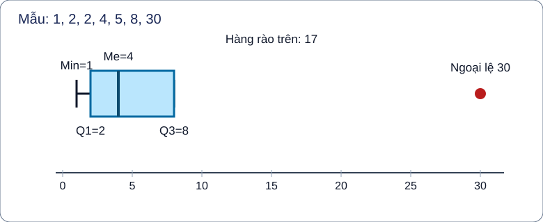
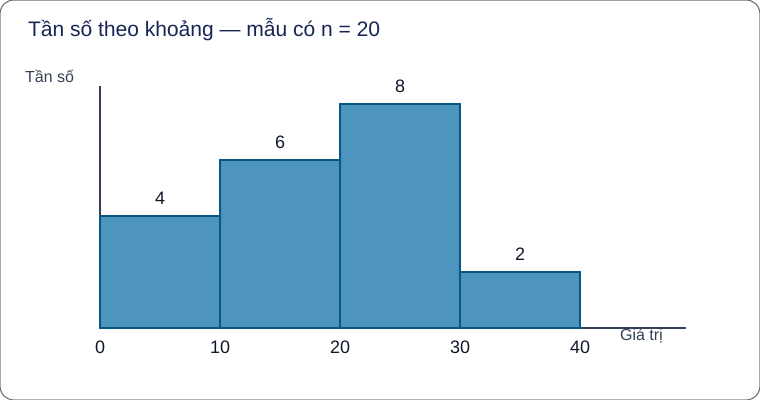

# Thống kê mô tả và phân tích số liệu G10–G12 — AUTHORING R00

**Trạng thái:** nguồn ứng viên `ACADEMIC_DRAFT_NOT_CONTENT_READY`. Danh mục 22 chuyên đề ngày 09/11 là đề xuất chưa khóa; đây là gói sản xuất tiếp theo sau Xác suất, không tự cấp TOPIC_ID. Số gần đúng và sai số là tiền đề cho chất lượng dữ liệu. **Không** nhập Xác suất đã có gói riêng.

**Hành trình học độc lập:** Kiến thức / Luyện tập / Tự kiểm tra. Không có trang Core chuyên đề. Kiến thức từ SGK/SBT KNTT 10–12 và các nguồn snapshot đã khóa theo `prototypes/thpt/shared-items/Temp_TOPIC_STATISTICS_G10_G12_CANONICAL_SOURCE_INDEX_R00_20261111.md`. Phần kiến thức mới R00 chưa có verdict NotebookLM độc lập hoặc signoff Q18.

<!-- TOPIC_KNOWLEDGE_BEGIN -->
# Kiến thức

Hãy đọc vì sao cần học, nắm điều kiện áp dụng và giới hạn mô hình, sau đó Tự thử **trước** khi mở lời giải. D6 giúp quay về đúng kiến thức nếu sai. Số đặc trưng từ dữ liệu **thô** có thể chính xác theo mẫu, còn số suy từ bảng **ghép nhóm** thường chỉ là ước lượng.

=== "I · Mẫu không ghép nhóm và sai số"

    === "1. Dữ liệu đo và sai số"

        #### Dữ liệu đo và sai số

        **Kiến thức, vì sao và cách áp dụng:** Một giá trị đọc từ dụng cụ có thể là **số gần đúng**, không phải số đúng. Khi biết số đúng \(\bar a\) và số ghi \(a\), sai số tuyệt đối \(\Delta=|\bar a-a|\); sai số tương đối theo số gần đúng \(a\ne0\) là \(\delta_a=\Delta/|a|\). Nếu chỉ biết độ chính xác \(d\), ta biết \(\Delta\le d\), **không** biết chắc sai số thực bằng \(d\). Quy tròn đến hàng phần mười theo quy tắc thông thường có chặn sai số \(0{,}05\) đơn vị. Ví dụ giá trị thật \(12{,}47\) mm và bản ghi \(12{,}5\) mm: \(\Delta=0{,}03\) mm, \(\delta_a=0{,}03/12{,}5=0{,}24\%\).

        **Tự thử trước khi xem lời giải (M01):** Giá trị thật 9,68 mm ghi 9,7 mm: tìm sai số tuyệt đối và phần trăm tương đối.

        

Đối chiếu sau khi tự giải

        \(\Delta=0{,}02\) mm; \(\delta_a=(0{,}02/9{,}7)\cdot100\%\approx0{,}206\%\).

        

        **D6 – Khi sai:** Đừng lấy độ chính xác làm sai số thật; kiểm đơn vị và việc nhân 100 để ra phần trăm. Sau đó làm một câu tương đương trong ngân hàng public theo outcome.

    === "2. Số trung bình và mốt"

        #### Số trung bình và mốt

        **Kiến thức, vì sao và cách áp dụng:** Khi cần mô tả một mẫu, **số trung bình** cho biết mức chia đều: \(\bar x=(x_1+\cdots+x_n)/n\). Bảng tần số dùng \(\bar x=\sum f_iv_i/\sum f_i\). **Mốt** là giá trị xuất hiện nhiều nhất, có thể có nhiều mốt. Với 2,2,3,5,8, số trung bình là \(20/5=4\) nhưng mốt là 2. Chọn mốt khi hỏi giá trị phổ biến, trung bình khi quan tâm tổng mức phân bổ; trung bình nhạy với giá trị lớn bất thường.

        **Tự thử trước khi xem lời giải (M02):** Mẫu 1,3,3,5,8 có trung bình và mốt nào?

        

Đối chiếu sau khi tự giải

        Trung bình 4, mốt 3. Năm số có tổng bằng 20.

        

        **D6 – Khi sai:** Nếu nhầm mốt với trung vị, lập bảng số lần xuất hiện trước khi kết luận. Sau đó làm một câu tương đương trong ngân hàng public theo outcome.

    === "3. Trung vị và tứ phân vị"

        #### Trung vị và tứ phân vị

        **Kiến thức, vì sao và cách áp dụng:** Phải **sắp dãy theo thứ tự**. Trung vị là phần tử ở giữa khi \(n\) lẻ, hoặc trung bình của hai phần tử giữa khi \(n\) chẵn. \(Q_2\) là trung vị; theo cách chia nửa mẫu KNTT, khi \(n\) lẻ loại trung vị rồi lấy trung vị của hai nửa để có \(Q_1,Q_3\). Ví dụ dãy 1,2,2,4,5,8,10 có \(Me=4,Q_1=2,Q_3=8\). Đây là phân vị **dữ liệu thô**, không dùng công thức nội suy ghép nhóm.

        **Tự thử trước khi xem lời giải (M03):** Tìm Me, Q1, Q3 của 2,4,6,8,10,12.

        

Đối chiếu sau khi tự giải

        Có 6 số: \(Me=(6+8)/2=7\); nửa dưới 2,4,6 có \(Q_1=4\), nửa trên 8,10,12 có \(Q_3=10\).

        

        **D6 – Khi sai:** Đánh dấu vị trí giữa và chia hai nửa sau khi đã sắp; không đoán từ thứ tự đề liệt kê. Sau đó làm một câu tương đương trong ngân hàng public theo outcome.

    === "4. Khoảng biến thiên, IQR và ngoại lệ"

        #### Khoảng biến thiên, IQR và ngoại lệ

        **Kiến thức, vì sao và cách áp dụng:** Khoảng biến thiên \(R=x_{\max}-x_{\min}\) phản ánh độ trải từ đầu tới cuối nhưng rất nhạy với cực trị. Khoảng tứ phân vị \(IQR=Q_3-Q_1\) tập trung vào nửa giữa. Quy ước hàng rào \(Q_1-1{,}5IQR\) và \(Q_3+1{,}5IQR\) giúp **đánh dấu để xem xét**, không chứng minh dữ liệu sai. Với 1,2,2,4,5,8,30: \(Me=4,Q_1=2,Q_3=8,IQR=6\); hàng rào trên 17, nên 30 là ngoại lệ theo quy tắc này. Trung bình \(52/7\approx7{,}43\) chịu ảnh hưởng mạnh hơn trung vị.

        **Tự thử trước khi xem lời giải (M04):** Mẫu 2,3,4,5,6,7,25 có IQR và hàng rào trên bao nhiêu?

        

Đối chiếu sau khi tự giải

        \(Q_1=3,Q_3=7,IQR=4\); hàng rào trên \(7+1{,}5\cdot4=13\). Số 25 vượt hàng rào.

        

        **D6 – Khi sai:** Đọc đúng Q1/Q3 trước khi gán nhãn ngoại lệ; đừng loại bỏ điểm dữ liệu chỉ vì trông khác. Sau đó làm một câu tương đương trong ngân hàng public theo outcome.

    === "5. Phương sai và độ lệch chuẩn"

        #### Phương sai và độ lệch chuẩn

        **Kiến thức, vì sao và cách áp dụng:** Để so sánh hai nhóm có cùng trung bình, xét sai lệch từng giá trị so với \(\bar x\). **Phương sai mô tả** \(s^2=\frac1n\sum_{i=1}^n(x_i-\bar x)^2\), **độ lệch chuẩn** \(s=\sqrt{s^2}\). Dữ liệu đo bằng phút thì \(s\) tính phút, \(s^2\) tính phút bình phương. Ví dụ A=3,4,5 và B=1,4,7 đều có trung bình 4; \(s_A^2=2/3\), \(s_B^2=6\) nên A ổn định hơn. Không tự thay mẫu số \(n\) bằng \(n-1\) trong công thức SGK này.

        **Tự thử trước khi xem lời giải (M05):** So sánh phương sai A=4,5,6 và B=2,5,8.

        

Đối chiếu sau khi tự giải

        Trung bình cùng bằng 5; \(s_A^2=2/3\), \(s_B^2=6\). A ít phân tán hơn.

        

        **D6 – Khi sai:** Lập bảng x−x̄ rồi bình phương và chia đúng n; kiểm phương sai không âm. Sau đó làm một câu tương đương trong ngân hàng public theo outcome.

=== "II · Dữ liệu ghép nhóm và xu thế trung tâm"

    === "6. Ghép nhóm: biên, độ rộng, tần số"

        #### Ghép nhóm: biên, độ rộng, tần số

        **Kiến thức, vì sao và cách áp dụng:** Khi có quá nhiều quan sát, gom thành các khoảng **trái đóng, phải mở** \([a,b)\) để một số ở ranh giới chỉ thuộc **một** nhóm. Độ rộng nhóm \(h=b-a\); tần số \(f_i\) là số phần tử thuộc nhóm, tổng \(\sum f_i=n\). Ví dụ dữ liệu 0,9,10,19,20 ghép \([0,10),[10,20),[20,30)\) có tần số 2,2,1. Sau ghép nhóm, thông tin từng quan sát mất đi: không thể khẳng định mọi số ở nhóm [10,20) đều bằng 15.

        **Tự thử trước khi xem lời giải (M06):** Tần số của các nhóm [0,10), [10,20), [20,30) với dữ liệu 3,10,10,20,29?

        

Đối chiếu sau khi tự giải

        1,2,2; tổng 5. Hai số 10 thuộc nhóm thứ hai.

        

        **D6 – Khi sai:** Khoanh từng quan sát theo biên trái đóng–phải mở, rồi đối chiếu tổng tần số với n. Sau đó làm một câu tương đương trong ngân hàng public theo outcome.

    === "7. Đại diện, trung bình nhóm và tích lũy"

        #### Đại diện, trung bình nhóm và tích lũy

        **Kiến thức, vì sao và cách áp dụng:** Trung điểm \(c_i=(a_i+b_i)/2\) đại diện nhóm, không phải giá trị đo của từng cá thể. Ước lượng trung bình nhóm \(\bar x_g=\sum f_i c_i/n\); tần số tích lũy \(F_i=\sum_{j\le i}f_j\). Với \([0,10):2,[10,20):3,[20,30):1\), trung điểm 5,15,25, tổng trọng số 80, \(n=6\): \(\bar x_g=80/6=40/3\). Tích lũy 2,5,6. Số trung bình này chỉ là **ước lượng từ bảng nhóm**.

        **Tự thử trước khi xem lời giải (M07):** Nhóm [0,10):1, [10,20):2, [20,30):1: ước lượng trung bình, tích lũy.

        

Đối chiếu sau khi tự giải

        Trung điểm 5,15,25; trung bình (5+30+25)/4=15, tích lũy 1,3,4.

        

        **D6 – Khi sai:** Không lấy trung bình ba trung điểm nếu nhóm có tần số khác nhau. Sau đó làm một câu tương đương trong ngân hàng public theo outcome.

    === "8. Nội suy trung vị và tứ phân vị ghép nhóm"

        #### Nội suy trung vị và tứ phân vị ghép nhóm

        **Kiến thức, vì sao và cách áp dụng:** Với bảng nhóm, tìm nhóm chứa vị trí \(p\) từ **tần số tích lũy**, rồi nội suy: \(\mathrm{estimate}=L+(p-F_{\mathrm{trước}})h/f\) khi tần số nhóm \(f>0\). Với trung vị dùng \(p=n/2\), tứ phân vị \(p=n/4,3n/4\). Ví dụ nhóm [0,10):4, [10,20):6, [20,30):8, [30,40):2 có \(n=20\), tích lũy 4,10,18,20. \(Me=20\), \(Q_1=10+(5-4)10/6=35/3\), \(Q_3=20+(15-10)10/8=26{,}25\). Đều là **ước lượng** từ bảng, không là số gốc chính xác.

        **Tự thử trước khi xem lời giải (M08):** Nhóm [0,10):5, [10,20):5, [20,30):10: ước lượng Me, Q1, Q3.

        

Đối chiếu sau khi tự giải

        Tích lũy 5,10,20. \(Me=20,Q_1=10,Q_3=25\).

        

        **D6 – Khi sai:** Nếu chọn nhầm nhóm, tô cột tích lũy đến n/4,n/2,3n/4 trước khi nội suy. Sau đó làm một câu tương đương trong ngân hàng public theo outcome.

    === "9. Mốt ghép nhóm và giới hạn áp dụng"

        #### Mốt ghép nhóm và giới hạn áp dụng

        **Kiến thức, vì sao và cách áp dụng:** Với nhóm **cùng độ rộng**, nhóm tần số lớn nhất là nhóm mốt. Nếu \(f_m\) là tần số nhóm mốt và \(f_-,f_+\) là hai tần số kề, ước lượng \(Mo=L+\frac{f_m-f_-}{(f_m-f_-)+(f_m-f_+)}h\) khi mẫu dương. Ví dụ nhóm [0,10):3,[10,20):9,[20,30):5 cho \(Mo=10+(6/(6+4))10=16\). Nếu nhiều nhóm cùng cực đại, nhóm không đều hoặc thiếu nhóm kề, không dùng máy móc công thức.

        **Tự thử trước khi xem lời giải (M09):** Nhóm [0,10):4,[10,20):10,[20,30):6, cùng độ rộng: ước lượng mốt.

        

Đối chiếu sau khi tự giải

        Nhóm mốt [10,20); \(Mo=10+(6/(6+4))10=16\).

        

        **D6 – Khi sai:** Kiểm mẫu số dương, tần số các nhóm kề và điều kiện cùng độ rộng. Sau đó làm một câu tương đương trong ngân hàng public theo outcome.

=== "III · Độ phân tán ghép nhóm"

    === "10. Khoảng biến thiên ghép nhóm"

        #### Khoảng biến thiên ghép nhóm

        **Kiến thức, vì sao và cách áp dụng:** Khi dữ liệu chỉ còn nhóm, ta không biết số nhỏ nhất/lớn nhất thật. Độ rộng phủ nhóm không rỗng từ \([a_1,b_1)\) tới \([a_k,b_k)\) cho ước lượng \(R_g=b_k-a_1\), **không** đồng nhất với khoảng biến thiên thật. Ví dụ [0,10):2,[10,20):4,[20,30):3 cho \(R_g=30\). Đây là khoảng phủ theo biên nhóm; các quan sát có thể nằm cách xa cận.

        **Tự thử trước khi xem lời giải (M10):** Nhóm [5,15):3,[15,25):4,[25,35):1: ước lượng độ rộng phủ theo nhóm.

        

Đối chiếu sau khi tự giải

        35−5=30 đơn vị; không kết luận R thực chắc chắn bằng 30.

        

        **D6 – Khi sai:** Nếu nhầm đầu mút nhóm với quan sát thực, thử đặt hai bộ số liệu khác nhau vào cùng nhóm. Sau đó làm một câu tương đương trong ngân hàng public theo outcome.

    === "11. IQR ghép nhóm và so sánh"

        #### IQR ghép nhóm và so sánh

        **Kiến thức, vì sao và cách áp dụng:** Ước lượng \(Q_1,Q_3\) từ tần số tích lũy và nội suy như mảng trước, sau đó \(IQR_g=Q_3-Q_1\). Mẫu nhóm [0,10):4,[10,20):8,[20,30):8 có \(n=20\), tích lũy 4,12,20: \(Q_1=10+(5-4)10/8=11{,}25\), \(Q_3=20+(15-12)10/8=23{,}75\), \(IQR_g=12{,}5\). IQR nhóm là ước lượng, không dùng để xác định chắc chắn cá thể ngoại lệ khi thiếu dữ liệu thô.

        **Tự thử trước khi xem lời giải (M11):** Nhóm [0,10):4,[10,20):10,[20,30):6: Q1,Q3,IQR ước lượng?

        

Đối chiếu sau khi tự giải

        \(Q_1=11\), \(Q_3=20+10/6=65/3\), \(IQR_g=32/3\approx10{,}67\).

        

        **D6 – Khi sai:** Nếu sai Q1/Q3, tự kiểm nhóm chứa vị trí n/4 và 3n/4, luôn kiểm Q1≤Q3. Sau đó làm một câu tương đương trong ngân hàng public theo outcome.

    === "12. Phương sai và độ lệch chuẩn ghép nhóm"

        #### Phương sai và độ lệch chuẩn ghép nhóm

        **Kiến thức, vì sao và cách áp dụng:** Dữ liệu gốc đã ẩn nên dùng trung điểm \(c_i\) để ước lượng: \(\bar x_g=\sum f_ic_i/n\), \(s_g^2=\sum f_i(c_i-\bar x_g)^2/n=\sum f_ic_i^2/n-\bar x_g^2\), \(s_g=\sqrt{s_g^2}\). Nếu nhóm [0,10):2,[10,20):2 thì \(c=5,15\), \(\bar x_g=10\), \(s_g^2=(50+50)/4=25\), \(s_g=5\). Phương sai có **bình phương đơn vị**, độ lệch chuẩn có đơn vị gốc. Đây là ước lượng theo trung điểm.

        **Tự thử trước khi xem lời giải (M12):** Nhóm [0,10):1,[10,20):2,[20,30):1: phương sai/std nhóm?

        

Đối chiếu sau khi tự giải

        Các trung điểm 5,15,25; \(\bar x_g=15\); \(s_g^2=(100+0+100)/4=50\), \(s_g=5\sqrt2\approx7{,}071\).

        

        **D6 – Khi sai:** Đừng chia n−1 hoặc bỏ trọng số f; dùng hai công thức kiểm chéo để tránh phương sai âm. Sau đó làm một câu tương đương trong ngân hàng public theo outcome.

    === "13. So sánh phân phối và giới hạn suy luận"

        #### So sánh phân phối và giới hạn suy luận

        **Kiến thức, vì sao và cách áp dụng:** Hai mẫu có cùng trung bình vẫn có độ ổn định khác nhau. Trên các nhóm [0,10),[10,20),[20,30) với trung điểm 5,15,25: A tần số 1,2,1 và B 2,0,2 cùng \(\bar x_g=15\), nhưng \(s_A^2=50<s_B^2=100\). Vì vậy A ổn định hơn **theo độ phân tán nhóm**, không phải kết luận về mọi biến cố tương lai. Chỉ so sánh khi hai mẫu dùng cùng thang đo, đơn vị và cách nhóm hợp lí.

        **Tự thử trước khi xem lời giải (M13):** A có tần số 1,4,1 và B 2,2,2 trên ba nhóm trên: so sánh phương sai nhóm.

        

Đối chiếu sau khi tự giải

        Cùng \(\bar x_g=15\). \(s_A^2=100/3\), \(s_B^2=200/3\), nên A ít phân tán hơn.

        

        **D6 – Khi sai:** Không suy nhân quả từ các số mô tả; kiểm cỡ mẫu, đơn vị và cách ghép nhóm. Sau đó làm một câu tương đương trong ngân hàng public theo outcome.

**Đọc hình hộp:** Q1=2, Me=4, Q3=8, IQR=6; hàng rào trên là 17, điểm 30 vượt hàng rào. Không loại dữ liệu chỉ vì là ngoại lệ.

**Đọc hình nhóm:** Bốn cột có tần số 4,6,8,2; tích lũy là 4,10,18,20. Trung điểm nhóm chỉ là đại diện, không phải giá trị đúng của mọi số đo.

<!-- TOPIC_KNOWLEDGE_END -->

<!-- TOPIC_PRACTICE_BEGIN -->
# Luyện tập

Dùng một thư viện canonical công khai, **không nhân bản** câu, key hoặc rubric. Nguồn `prototypes/thpt/shared-items/Temp_TOPIC_STATISTICS_G10_G12_CANONICAL_SOURCE_INDEX_R00_20261111.md` khóa 107 item của G10 (27), G11 (32), G12 (48) và ma trận 39 outcome. Chọn từ dễ đến vận dụng, giải thích vì sao dùng thống kê **thô** hay **ghép nhóm**, rồi mới mở đối chiếu khi được phép. Written/Anchor chung một bản ghi, Anchor chỉ là nhãn.

| Chặng | Mảng | Điều kiện cần kiểm |
|---|---|---|
| G10 | M01–M05 | Sai số/độ chính xác, median n chẵn/lẻ, phân vị đúng quy tắc, mẫu số n trong phương sai |
| G11 | M06–M09 | Cận trái đóng/phải mở, trung điểm có trọng số, tích lũy, nội suy, nhóm mốt |
| G12 | M10–M13 | R/IQR và phương sai ghép nhóm đều là ước lượng, so sánh cùng đơn vị và cách ghép |

Các outcome chỉ có một câu nguồn cần được bổ sung họ dạng mới sau khi QA toán; **107 câu không tự động bảo đảm sâu 39 outcome**. Luyện tập không tự ghi Skill Mastery.

<!-- TOPIC_PRACTICE_END -->

<!-- TOPIC_SELF_CHECK_BEGIN -->
# Tự kiểm tra

Đây là một lượt **tự đối chiếu công khai** `CLIENT_SELF_CHECK_NO_MASTERY`, không phải `TOPIC_READINESS` độc lập. Trước **Final Submit**, không gợi ý, đáp án, đánh dấu đúng/sai hoặc AI Tutor. Sau Final Submit mới mở phần đối chiếu và đường sửa sai D6; không dùng câu Practice đã xem để cấp Mastery.

| Chặng | Item public đã có thể dùng lại bằng placement | Ôn sau sai |
|---|---|---|
| Mẫu G10 | `THPT-G10-B12-P01` · `THPT-G10-B13-P03` · `THPT-G10-B14-P05` | M01–M05 |
| Mẫu ghép G11 | `THPT-G11-B08-P03` · `THPT-G11-B09-P02` · `THPT-G11-B09-P04` | M06–M09 |
| Phân tán G12 | `THPT-G12-B09-P04` · `THPT-G12-B10-P04` · `THPT-G12-B10-P08` | M10–M13 |

Bộ RD1 kín của từng chương SGK là nguồn đánh giá riêng ngoài GitHub, không được chuyển thành Topic RD1 và không xuất hiện trong source này.

<!-- TOPIC_SELF_CHECK_END -->

<!-- AUTHOR_ONLY_METADATA_BEGIN -->
# Phụ lục tác giả (không hiển thị trên UI học sinh)

STANDARD_ID: SLM-THPT-QUALITY-ONE
STANDARD_VERSION: 3.0.1
LEARNING_PATH: TOPIC
RELEASE_SCOPE: FULL_TOPIC_LEARNING_PATH
SOURCE_INDEX_PATH: prototypes/thpt/shared-items/Temp_TOPIC_STATISTICS_G10_G12_CANONICAL_SOURCE_INDEX_R00_20261111.md
SOURCE_INDEX_BLOB: 51a6e99587187838aea61c5c72108adae7874d1d
PUBLIC_ITEM_COUNT: 107
OUTCOMES: 39
MODULES: 13
FIRST_TRIES: 13
ASSESSMENT_MODE: CLIENT_SELF_CHECK_NO_MASTERY
PRIVATE_RD1_IMPORTED: 0
Q18_VERIFICATION_MODE: PENDING_AUTHOR_SELF_QA
ACADEMIC_VERDICT: NOT_CLAIMED
PEDAGOGICAL_VERDICT: NOT_CLAIMED
TOPIC_ID: UNASSIGNED_OWNER_DECISION

## MODULE_OUTCOME_MATRIX

| Module | Outcome | Canonical item count |
|---|---|---|
| M01 | `G10-B12-APPROX_CONCEPT` | 1 |
| M01 | `G10-B12-ABS_ERROR` | 3 |
| M01 | `G10-B12-REL_ERROR` | 3 |
| M01 | `G10-B12-ROUNDING` | 2 |
| M02 | `G10-B13-MEAN` | 3 |
| M02 | `G10-B13-MODE` | 1 |
| M03 | `G10-B13-MEDIAN` | 1 |
| M03 | `G10-B13-QUARTILES` | 2 |
| M04 | `G10-B13-INTERPRETATION` | 2 |
| M04 | `G10-B14-RANGE_IQR` | 2 |
| M04 | `G10-B14-OUTLIERS` | 1 |
| M05 | `G10-B14-VARIANCE` | 3 |
| M05 | `G10-B14-STDDEV` | 2 |
| M05 | `G10-B14-COMPARISON` | 1 |
| M06 | `G11-B08-GROUPED-DEFINITION` | 2 |
| M06 | `G11-B08-CLASS-BOUNDARIES` | 2 |
| M06 | `G11-B08-GROUP-WIDTH` | 2 |
| M06 | `G11-B08-FREQUENCY-TABLE` | 4 |
| M06 | `G11-B08-INTERPRETATION` | 5 |
| M07 | `G11-B09-REPRESENTATIVE` | 1 |
| M07 | `G11-B09-GROUPED-MEAN` | 3 |
| M07 | `G11-B09-CUMULATIVE` | 2 |
| M08 | `G11-B09-GROUPED-MEDIAN` | 4 |
| M08 | `G11-B09-GROUPED-QUARTILES` | 2 |
| M09 | `G11-B09-GROUPED-MODE` | 2 |
| M09 | `G11-B09-MODE-CONDITIONS` | 2 |
| M09 | `G11-B09-INTERPRETATION` | 1 |
| M10 | `G12-CHIII-B09-O01` | 4 |
| M10 | `G12-CHIII-B09-O02` | 4 |
| M10 | `G12-CHIII-B09-O03` | 4 |
| M11 | `G12-CHIII-B09-O04` | 4 |
| M11 | `G12-CHIII-B09-O05` | 4 |
| M11 | `G12-CHIII-B09-O06` | 4 |
| M12 | `G12-CHIII-B10-O01` | 4 |
| M12 | `G12-CHIII-B10-O02` | 4 |
| M12 | `G12-CHIII-B10-O03` | 4 |
| M12 | `G12-CHIII-B10-O04` | 4 |
| M13 | `G12-CHIII-B10-O05` | 4 |
| M13 | `G12-CHIII-B10-O06` | 4 |

## ITEM_OUTCOME_MATRIX

| item_id | outcome_id | role | source blob |
|---|---|---|---|
| `THPT-G10-B12-C01` | `G10-B12-ABS_ERROR` | TOPIC_PRACTICE | `49502fe39cf0a67f6a3e973a77f94164150637a7` |
| `THPT-G10-B12-C02` | `G10-B12-ABS_ERROR` | TOPIC_PRACTICE | `49502fe39cf0a67f6a3e973a77f94164150637a7` |
| `THPT-G10-B12-P01` | `G10-B12-REL_ERROR` | TOPIC_PRACTICE | `49502fe39cf0a67f6a3e973a77f94164150637a7` |
| `THPT-G10-B12-P02` | `G10-B12-ROUNDING` | TOPIC_PRACTICE | `49502fe39cf0a67f6a3e973a77f94164150637a7` |
| `THPT-G10-B12-P03` | `G10-B12-REL_ERROR` | TOPIC_PRACTICE | `49502fe39cf0a67f6a3e973a77f94164150637a7` |
| `THPT-G10-B12-P04` | `G10-B12-APPROX_CONCEPT` | TOPIC_PRACTICE | `49502fe39cf0a67f6a3e973a77f94164150637a7` |
| `THPT-G10-B12-P05` | `G10-B12-ROUNDING` | TOPIC_PRACTICE | `49502fe39cf0a67f6a3e973a77f94164150637a7` |
| `THPT-G10-B12-P06` | `G10-B12-REL_ERROR` | TOPIC_PRACTICE | `49502fe39cf0a67f6a3e973a77f94164150637a7` |
| `THPT-G10-B13-C01` | `G10-B13-MEAN` | TOPIC_PRACTICE | `49502fe39cf0a67f6a3e973a77f94164150637a7` |
| `THPT-G10-B13-C02` | `G10-B13-MEDIAN` | TOPIC_PRACTICE | `49502fe39cf0a67f6a3e973a77f94164150637a7` |
| `THPT-G10-B13-P01` | `G10-B13-MEAN` | TOPIC_PRACTICE | `49502fe39cf0a67f6a3e973a77f94164150637a7` |
| `THPT-G10-B13-P02` | `G10-B13-QUARTILES` | TOPIC_PRACTICE | `49502fe39cf0a67f6a3e973a77f94164150637a7` |
| `THPT-G10-B13-P03` | `G10-B13-MODE` | TOPIC_PRACTICE | `49502fe39cf0a67f6a3e973a77f94164150637a7` |
| `THPT-G10-B13-P04` | `G10-B13-INTERPRETATION` | TOPIC_PRACTICE | `49502fe39cf0a67f6a3e973a77f94164150637a7` |
| `THPT-G10-B13-P05` | `G10-B13-QUARTILES` | TOPIC_PRACTICE | `49502fe39cf0a67f6a3e973a77f94164150637a7` |
| `THPT-G10-B13-P06` | `G10-B13-INTERPRETATION` | TOPIC_PRACTICE | `49502fe39cf0a67f6a3e973a77f94164150637a7` |
| `THPT-G10-B14-C01` | `G10-B14-RANGE_IQR` | TOPIC_PRACTICE | `49502fe39cf0a67f6a3e973a77f94164150637a7` |
| `THPT-G10-B14-C02` | `G10-B14-VARIANCE` | TOPIC_PRACTICE | `49502fe39cf0a67f6a3e973a77f94164150637a7` |
| `THPT-G10-B14-P01` | `G10-B14-RANGE_IQR` | TOPIC_PRACTICE | `49502fe39cf0a67f6a3e973a77f94164150637a7` |
| `THPT-G10-B14-P02` | `G10-B14-STDDEV` | TOPIC_PRACTICE | `49502fe39cf0a67f6a3e973a77f94164150637a7` |
| `THPT-G10-B14-P03` | `G10-B14-OUTLIERS` | TOPIC_PRACTICE | `49502fe39cf0a67f6a3e973a77f94164150637a7` |
| `THPT-G10-B14-P04` | `G10-B14-COMPARISON` | TOPIC_PRACTICE | `49502fe39cf0a67f6a3e973a77f94164150637a7` |
| `THPT-G10-B14-P05` | `G10-B14-STDDEV` | TOPIC_PRACTICE | `49502fe39cf0a67f6a3e973a77f94164150637a7` |
| `THPT-G10-B14-P06` | `G10-B14-VARIANCE` | TOPIC_PRACTICE | `49502fe39cf0a67f6a3e973a77f94164150637a7` |
| `THPT-G10-CHV-W12` | `G10-B12-ABS_ERROR` | TOPIC_WRITTEN | `49502fe39cf0a67f6a3e973a77f94164150637a7` |
| `THPT-G10-CHV-W13` | `G10-B13-MEAN` | TOPIC_WRITTEN | `49502fe39cf0a67f6a3e973a77f94164150637a7` |
| `THPT-G10-CHV-W14-ANCHOR` | `G10-B14-VARIANCE` | TOPIC_WRITTEN | `49502fe39cf0a67f6a3e973a77f94164150637a7` |
| `THPT-G11-B08-C01` | `G11-B08-GROUPED-DEFINITION` | TOPIC_PRACTICE | `4ea8df2ca2682d9fac8b1556852334af336930a5` |
| `THPT-G11-B08-C02` | `G11-B08-CLASS-BOUNDARIES` | TOPIC_PRACTICE | `4ea8df2ca2682d9fac8b1556852334af336930a5` |
| `THPT-G11-B08-C03` | `G11-B08-GROUP-WIDTH` | TOPIC_PRACTICE | `4ea8df2ca2682d9fac8b1556852334af336930a5` |
| `THPT-G11-B08-C04` | `G11-B08-FREQUENCY-TABLE` | TOPIC_PRACTICE | `4ea8df2ca2682d9fac8b1556852334af336930a5` |
| `THPT-G11-B08-C05` | `G11-B08-INTERPRETATION` | TOPIC_PRACTICE | `4ea8df2ca2682d9fac8b1556852334af336930a5` |
| `THPT-G11-B08-P01` | `G11-B08-CLASS-BOUNDARIES` | TOPIC_PRACTICE | `4ea8df2ca2682d9fac8b1556852334af336930a5` |
| `THPT-G11-B08-P02` | `G11-B08-GROUP-WIDTH` | TOPIC_PRACTICE | `4ea8df2ca2682d9fac8b1556852334af336930a5` |
| `THPT-G11-B08-P03` | `G11-B08-FREQUENCY-TABLE` | TOPIC_PRACTICE | `4ea8df2ca2682d9fac8b1556852334af336930a5` |
| `THPT-G11-B08-P04` | `G11-B08-INTERPRETATION` | TOPIC_PRACTICE | `4ea8df2ca2682d9fac8b1556852334af336930a5` |
| `THPT-G11-B08-P05` | `G11-B08-FREQUENCY-TABLE` | TOPIC_PRACTICE | `4ea8df2ca2682d9fac8b1556852334af336930a5` |
| `THPT-G11-B08-P06` | `G11-B08-INTERPRETATION` | TOPIC_PRACTICE | `4ea8df2ca2682d9fac8b1556852334af336930a5` |
| `THPT-G11-B08-P07` | `G11-B08-INTERPRETATION` | TOPIC_PRACTICE | `4ea8df2ca2682d9fac8b1556852334af336930a5` |
| `THPT-G11-B08-P08` | `G11-B08-GROUPED-DEFINITION` | TOPIC_PRACTICE | `4ea8df2ca2682d9fac8b1556852334af336930a5` |
| `THPT-G11-B09-C01` | `G11-B09-REPRESENTATIVE` | TOPIC_PRACTICE | `4ea8df2ca2682d9fac8b1556852334af336930a5` |
| `THPT-G11-B09-C02` | `G11-B09-GROUPED-MEAN` | TOPIC_PRACTICE | `4ea8df2ca2682d9fac8b1556852334af336930a5` |
| `THPT-G11-B09-C03` | `G11-B09-CUMULATIVE` | TOPIC_PRACTICE | `4ea8df2ca2682d9fac8b1556852334af336930a5` |
| `THPT-G11-B09-C04` | `G11-B09-GROUPED-MEDIAN` | TOPIC_PRACTICE | `4ea8df2ca2682d9fac8b1556852334af336930a5` |
| `THPT-G11-B09-C05` | `G11-B09-MODE-CONDITIONS` | TOPIC_PRACTICE | `4ea8df2ca2682d9fac8b1556852334af336930a5` |
| `THPT-G11-B09-P01` | `G11-B09-GROUPED-MEAN` | TOPIC_PRACTICE | `4ea8df2ca2682d9fac8b1556852334af336930a5` |
| `THPT-G11-B09-P02` | `G11-B09-GROUPED-MEDIAN` | TOPIC_PRACTICE | `4ea8df2ca2682d9fac8b1556852334af336930a5` |
| `THPT-G11-B09-P03` | `G11-B09-GROUPED-QUARTILES` | TOPIC_PRACTICE | `4ea8df2ca2682d9fac8b1556852334af336930a5` |
| `THPT-G11-B09-P04` | `G11-B09-GROUPED-MODE` | TOPIC_PRACTICE | `4ea8df2ca2682d9fac8b1556852334af336930a5` |
| `THPT-G11-B09-P05` | `G11-B09-GROUPED-MEAN` | TOPIC_PRACTICE | `4ea8df2ca2682d9fac8b1556852334af336930a5` |
| `THPT-G11-B09-P06` | `G11-B09-CUMULATIVE` | TOPIC_PRACTICE | `4ea8df2ca2682d9fac8b1556852334af336930a5` |
| `THPT-G11-B09-P07` | `G11-B09-GROUPED-MEDIAN` | TOPIC_PRACTICE | `4ea8df2ca2682d9fac8b1556852334af336930a5` |
| `THPT-G11-B09-P08` | `G11-B09-GROUPED-QUARTILES` | TOPIC_PRACTICE | `4ea8df2ca2682d9fac8b1556852334af336930a5` |
| `THPT-G11-B09-P09` | `G11-B09-MODE-CONDITIONS` | TOPIC_PRACTICE | `4ea8df2ca2682d9fac8b1556852334af336930a5` |
| `THPT-G11-B09-P10` | `G11-B09-INTERPRETATION` | TOPIC_PRACTICE | `4ea8df2ca2682d9fac8b1556852334af336930a5` |
| `THPT-G11-CHIII-W08-01` | `G11-B08-FREQUENCY-TABLE` | TOPIC_WRITTEN | `4ea8df2ca2682d9fac8b1556852334af336930a5` |
| `THPT-G11-CHIII-W08-02-ANCHOR` | `G11-B08-INTERPRETATION` | TOPIC_WRITTEN | `4ea8df2ca2682d9fac8b1556852334af336930a5` |
| `THPT-G11-CHIII-W09-01` | `G11-B09-GROUPED-MEDIAN` | TOPIC_WRITTEN | `4ea8df2ca2682d9fac8b1556852334af336930a5` |
| `THPT-G11-CHIII-W09-02-ANCHOR` | `G11-B09-GROUPED-MODE` | TOPIC_WRITTEN | `4ea8df2ca2682d9fac8b1556852334af336930a5` |
| `THPT-G12-B09-C01` | `G12-CHIII-B09-O01` | TOPIC_PRACTICE | `4e8e462a5c2243583be8c71625a9be3095e48c7b` |
| `THPT-G12-B09-P01` | `G12-CHIII-B09-O01` | TOPIC_PRACTICE | `4e8e462a5c2243583be8c71625a9be3095e48c7b` |
| `THPT-G12-B09-P02` | `G12-CHIII-B09-O01` | TOPIC_PRACTICE | `4e8e462a5c2243583be8c71625a9be3095e48c7b` |
| `THPT-G12-B09-W01` | `G12-CHIII-B09-O01` | TOPIC_WRITTEN | `4e8e462a5c2243583be8c71625a9be3095e48c7b` |
| `THPT-G12-B09-C02` | `G12-CHIII-B09-O02` | TOPIC_PRACTICE | `4e8e462a5c2243583be8c71625a9be3095e48c7b` |
| `THPT-G12-B09-P03` | `G12-CHIII-B09-O02` | TOPIC_PRACTICE | `4e8e462a5c2243583be8c71625a9be3095e48c7b` |
| `THPT-G12-B09-P04` | `G12-CHIII-B09-O02` | TOPIC_PRACTICE | `4e8e462a5c2243583be8c71625a9be3095e48c7b` |
| `THPT-G12-B09-W02` | `G12-CHIII-B09-O02` | TOPIC_WRITTEN | `4e8e462a5c2243583be8c71625a9be3095e48c7b` |
| `THPT-G12-B09-C03` | `G12-CHIII-B09-O03` | TOPIC_PRACTICE | `4e8e462a5c2243583be8c71625a9be3095e48c7b` |
| `THPT-G12-B09-P05` | `G12-CHIII-B09-O03` | TOPIC_PRACTICE | `4e8e462a5c2243583be8c71625a9be3095e48c7b` |
| `THPT-G12-B09-P06` | `G12-CHIII-B09-O03` | TOPIC_PRACTICE | `4e8e462a5c2243583be8c71625a9be3095e48c7b` |
| `THPT-G12-B09-W03` | `G12-CHIII-B09-O03` | TOPIC_WRITTEN | `4e8e462a5c2243583be8c71625a9be3095e48c7b` |
| `THPT-G12-B09-C04` | `G12-CHIII-B09-O04` | TOPIC_PRACTICE | `4e8e462a5c2243583be8c71625a9be3095e48c7b` |
| `THPT-G12-B09-P07` | `G12-CHIII-B09-O04` | TOPIC_PRACTICE | `4e8e462a5c2243583be8c71625a9be3095e48c7b` |
| `THPT-G12-B09-P08` | `G12-CHIII-B09-O04` | TOPIC_PRACTICE | `4e8e462a5c2243583be8c71625a9be3095e48c7b` |
| `THPT-G12-B09-W04` | `G12-CHIII-B09-O04` | TOPIC_WRITTEN | `4e8e462a5c2243583be8c71625a9be3095e48c7b` |
| `THPT-G12-B09-C05` | `G12-CHIII-B09-O05` | TOPIC_PRACTICE | `4e8e462a5c2243583be8c71625a9be3095e48c7b` |
| `THPT-G12-B09-P09` | `G12-CHIII-B09-O05` | TOPIC_PRACTICE | `4e8e462a5c2243583be8c71625a9be3095e48c7b` |
| `THPT-G12-B09-P10` | `G12-CHIII-B09-O05` | TOPIC_PRACTICE | `4e8e462a5c2243583be8c71625a9be3095e48c7b` |
| `THPT-G12-B09-W05` | `G12-CHIII-B09-O05` | TOPIC_WRITTEN | `4e8e462a5c2243583be8c71625a9be3095e48c7b` |
| `THPT-G12-B09-C06` | `G12-CHIII-B09-O06` | TOPIC_PRACTICE | `4e8e462a5c2243583be8c71625a9be3095e48c7b` |
| `THPT-G12-B09-P11` | `G12-CHIII-B09-O06` | TOPIC_PRACTICE | `4e8e462a5c2243583be8c71625a9be3095e48c7b` |
| `THPT-G12-B09-P12` | `G12-CHIII-B09-O06` | TOPIC_PRACTICE | `4e8e462a5c2243583be8c71625a9be3095e48c7b` |
| `THPT-G12-B09-W06` | `G12-CHIII-B09-O06` | TOPIC_WRITTEN | `4e8e462a5c2243583be8c71625a9be3095e48c7b` |
| `THPT-G12-B10-C01` | `G12-CHIII-B10-O01` | TOPIC_PRACTICE | `4e8e462a5c2243583be8c71625a9be3095e48c7b` |
| `THPT-G12-B10-P01` | `G12-CHIII-B10-O01` | TOPIC_PRACTICE | `4e8e462a5c2243583be8c71625a9be3095e48c7b` |
| `THPT-G12-B10-P02` | `G12-CHIII-B10-O01` | TOPIC_PRACTICE | `4e8e462a5c2243583be8c71625a9be3095e48c7b` |
| `THPT-G12-B10-W01` | `G12-CHIII-B10-O01` | TOPIC_WRITTEN | `4e8e462a5c2243583be8c71625a9be3095e48c7b` |
| `THPT-G12-B10-C02` | `G12-CHIII-B10-O02` | TOPIC_PRACTICE | `4e8e462a5c2243583be8c71625a9be3095e48c7b` |
| `THPT-G12-B10-P03` | `G12-CHIII-B10-O02` | TOPIC_PRACTICE | `4e8e462a5c2243583be8c71625a9be3095e48c7b` |
| `THPT-G12-B10-P04` | `G12-CHIII-B10-O02` | TOPIC_PRACTICE | `4e8e462a5c2243583be8c71625a9be3095e48c7b` |
| `THPT-G12-B10-W02` | `G12-CHIII-B10-O02` | TOPIC_WRITTEN | `4e8e462a5c2243583be8c71625a9be3095e48c7b` |
| `THPT-G12-B10-C03` | `G12-CHIII-B10-O03` | TOPIC_PRACTICE | `4e8e462a5c2243583be8c71625a9be3095e48c7b` |
| `THPT-G12-B10-P05` | `G12-CHIII-B10-O03` | TOPIC_PRACTICE | `4e8e462a5c2243583be8c71625a9be3095e48c7b` |
| `THPT-G12-B10-P06` | `G12-CHIII-B10-O03` | TOPIC_PRACTICE | `4e8e462a5c2243583be8c71625a9be3095e48c7b` |
| `THPT-G12-B10-W03` | `G12-CHIII-B10-O03` | TOPIC_WRITTEN | `4e8e462a5c2243583be8c71625a9be3095e48c7b` |
| `THPT-G12-B10-C04` | `G12-CHIII-B10-O04` | TOPIC_PRACTICE | `4e8e462a5c2243583be8c71625a9be3095e48c7b` |
| `THPT-G12-B10-P07` | `G12-CHIII-B10-O04` | TOPIC_PRACTICE | `4e8e462a5c2243583be8c71625a9be3095e48c7b` |
| `THPT-G12-B10-P08` | `G12-CHIII-B10-O04` | TOPIC_PRACTICE | `4e8e462a5c2243583be8c71625a9be3095e48c7b` |
| `THPT-G12-B10-W04` | `G12-CHIII-B10-O04` | TOPIC_WRITTEN | `4e8e462a5c2243583be8c71625a9be3095e48c7b` |
| `THPT-G12-B10-C05` | `G12-CHIII-B10-O05` | TOPIC_PRACTICE | `4e8e462a5c2243583be8c71625a9be3095e48c7b` |
| `THPT-G12-B10-P09` | `G12-CHIII-B10-O05` | TOPIC_PRACTICE | `4e8e462a5c2243583be8c71625a9be3095e48c7b` |
| `THPT-G12-B10-P10` | `G12-CHIII-B10-O05` | TOPIC_PRACTICE | `4e8e462a5c2243583be8c71625a9be3095e48c7b` |
| `THPT-G12-B10-W05` | `G12-CHIII-B10-O05` | TOPIC_WRITTEN | `4e8e462a5c2243583be8c71625a9be3095e48c7b` |
| `THPT-G12-B10-C06` | `G12-CHIII-B10-O06` | TOPIC_PRACTICE | `4e8e462a5c2243583be8c71625a9be3095e48c7b` |
| `THPT-G12-B10-P11` | `G12-CHIII-B10-O06` | TOPIC_PRACTICE | `4e8e462a5c2243583be8c71625a9be3095e48c7b` |
| `THPT-G12-B10-P12` | `G12-CHIII-B10-O06` | TOPIC_PRACTICE | `4e8e462a5c2243583be8c71625a9be3095e48c7b` |
| `THPT-G12-B10-W06` | `G12-CHIII-B10-O06` | TOPIC_WRITTEN | `4e8e462a5c2243583be8c71625a9be3095e48c7b` |

## Q18 DRAFT AUDIT

- G10 S1 B12–B14 source R01 was NOT NotebookLM-reviewed on same material; do not inherit G11/G12 review. G11 R03 and G12 R00 keep their respective historic source-scoped verdicts.
- R00 pedagogy, thirteen Tự thử, math checks and two SVGs are DELTA_C material needing scoped Q18 author verification on the exact current source. P0/P1 verdict still NOT_ISSUED.
- Q15 107 original canonical items remain at three source SHA files; this file references IDs/outcomes only. Written/Anchor share one library, no duplicate.
- Q16 public self-check is a voluntary comparison, no official RD1, no Mastery; Final Submit must be tested separately by RELEASE on the browser.
- Q17 exactly three Topic pages; no Core. Q18 source/receipt/V2/ready/REGISTER cannot be declared until all academic blockers closed.
- No merge/deploy, no website or learner/Firebase data changed.
<!-- AUTHOR_ONLY_METADATA_END -->
