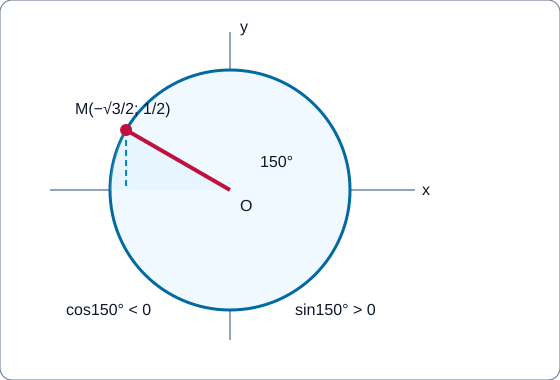
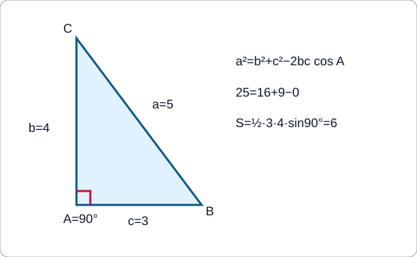
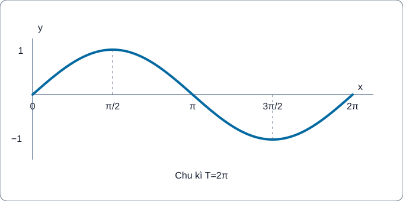

# Lượng giác và giải tam giác (G10–G11) — AUTHORING PUBLIC FULL R00

**Trạng thái:** `ACADEMIC_DRAFT_NOT_CONTENT_READY` cho tới khi hoàn thành author self-QA Q01–Q18 trên snapshot và ký receipt/hand-off V2. Đây là gói thứ năm theo **trình tự biên soạn**; nghiên cứu PLAN22-06 (lượng giác) và PLAN22-12 (hệ thức lượng) là **hai ứng viên**, còn nội dung dưới đây là một hành trình tích hợp thử nghiệm. Không mặc định chủ dự án đã duyệt việc gộp hoặc gán mã website.

**Học độc lập qua ba trang** Kiến thức / Luyện tập / Tự kiểm tra; không có Core riêng. Có đủ SGK Toán 10 tập 1 B05–B06 và Toán 11 tập 1 B01–B04, bao gồm hàm lượng giác **và phương trình lượng giác**, không chỉ công thức góc. KNTT S1 theo biên nhận trang ở canonical index; bản học liệu mới không thay thế nguồn đã review và không tự nhận NotebookLM PASS mới.

<!-- TOPIC_KNOWLEDGE_BEGIN -->
# Kiến thức

Mạch tự học: **hình và góc** → giá trị lượng giác trên đường tròn → phép biến đổi → đồ thị → phương trình và ứng dụng. Trong mỗi mục, tự giải Tự thử **trước** khi bấm Đối chiếu. Nếu sai, dùng D6 và làm bài canonical cùng outcome. Không cần rời hành trình Topic để đọc kiến thức bắt buộc.

=== "I · Nền tảng hình học và hệ thức lượng trong tam giác (G10)"

    === "1. Đơn vị nửa đường tròn và góc đặc biệt G10"

        #### Đơn vị nửa đường tròn và góc đặc biệt G10

        **Vì sao cần học?** Khi quay một vật quanh tâm, tọa độ điểm cuối thay đổi theo góc. Trên nửa đường tròn đơn vị (0° đến 180°), điểm \(M=(\cos\alpha,\sin\alpha)\) nên **cos là hoành độ**, **sin là tung độ**; sin không âm, cos đổi dấu khi qua 90°. Đây là lý do bảng góc đặc biệt không chỉ là danh sách phải học thuộc.

        **Hình thành bản chất.** Dựng tam giác vuông với bán kính bằng 1 để suy ra ở 30°, 45°, 60° các giá trị 1/2, √2/2, √3/2. Góc \(120^\circ\) nằm phía trái trục Oy nên \(\cos120^\circ=-1/2\), còn \(\sin120^\circ=\sqrt3/2\). **Đọc hình:** hình đường tròn bên dưới có điểm 150° ở phía trên bên trái, hoành độ âm và tung độ dương. Không suy dấu từ giá trị tuyệt đối của góc tham chiếu.

        **Ví dụ có suy luận.** Nếu điểm M có \(\sin\alpha=1/2\) và \(\alpha\) là góc tù, \(\cos\alpha=-\sqrt3/2\) (không lấy căn dương vì hoành độ phía trái). Từ đó \(M=(-\sqrt3/2,1/2)\).

        **Năng lực cụ thể cần tự đạt:**
        - **G10-B05-UNIT_SEMICIRCLE:** Hoành độ cos, tung độ sin của điểm M trên nửa đường tròn; cần đọc hình thay vì chỉ ghi nhớ góc.
        - **G10-B05-SPECIAL_ANGLES:** Tái dựng sin/cos góc 0,30,45,60,90,120,135,150,180 bằng góc tham chiếu và dấu.

        **Tự thử trước khi xem lời giải (`TOPIC-TRIG-M01-TRY01`):** Trên nửa đường tròn đơn vị, góc α=135°. Hãy xác định sinα, cosα và cho biết vì sao cos âm.

        

Đối chiếu — chỉ mở sau khi tự thử

        \(\sin135^\circ=\sqrt2/2\), \(\cos135^\circ=-\sqrt2/2\); điểm ở góc phần tư II, hoành độ âm.

        

        **D6 – Khắc phục ngay tại đây:** Nếu nhầm vị trí, vẽ hai trục Ox/Oy và đánh dấu hình chiếu điểm M; xác định dấu trước khi thay số. Sau đó luyện câu mới ở bộ PUBLIC; không suy Mastery từ lượt tự mở.

    === "2. Dấu, góc bù, miền xác định và hệ thức G10"

        #### Dấu, góc bù, miền xác định và hệ thức G10

        **Bản chất.** Mỗi điểm trên đường tròn đơn vị thỏa \(x^2+y^2=1\), nên \(\sin^2\alpha+\cos^2\alpha=1\). Với góc \(180^\circ-\alpha\), điểm đối xứng qua Oy nên sin giữ nguyên và cos đổi dấu. \(\tan\alpha=\sin\alpha/\cos\alpha\) chỉ khi cos khác 0; \(\cot\alpha=\cos\alpha/\sin\alpha\) chỉ khi sin khác 0. Không được viết công thức mà bỏ miền xác định.

        **Ví dụ lựa chọn cách giải.** Với \(\alpha\) tù và \(\cos\alpha=-5/13\), tính \(\sin\alpha\) bằng hệ thức căn: \(\sin^2\alpha=1-25/169=144/169\), sin dương nên \(12/13\); từ đó tan = \(-12/5\). Nếu chỉ biết \(\cos^2\alpha\) mà không biết khoảng góc, dấu không xác định duy nhất.

        **Giới hạn.** \(\tan90^\circ\) không tồn tại, \(\cot0^\circ\) không tồn tại; không điền 0 như một đáp án mặc định.

        **Năng lực cụ thể cần tự đạt:**
        - **G10-B05-SIGN_DOMAIN:** Sin/cos dấu theo góc và miền; tan/cot phải xét mẫu cos/sin khác 0.
        - **G10-B05-SUPPLEMENTARY:** Hai góc bù có sin bằng nhau, cos đối nhau; hình học đối xứng qua Oy.
        - **G10-B05-IDENTITIES:** Từ sin²+cos²=1 suy giá trị còn thiếu nhưng phải chọn dấu theo phần tư.

        **Tự thử trước khi xem lời giải (`TOPIC-TRIG-M02-TRY01`):** Góc α tù có cosα=−8/17. Tìm sinα, tanα và nêu điều kiện dùng tan.

        

Đối chiếu — chỉ mở sau khi tự thử

        \(\sin\alpha=\sqrt{1-64/289}=15/17>0\); \(\tan\alpha=-15/8\); dùng được vì \(\cos\alpha\ne0\).

        

        **D6 – Khắc phục ngay tại đây:** Nếu lấy dấu sai, vẽ góc phần tư II và kiểm kết quả bằng sin²+cos²=1; nếu có phân thức, xét mẫu trước. Sau đó luyện câu mới ở bộ PUBLIC; không suy Mastery từ lượt tự mở.

    === "3. Định lý côsin, diện tích và góc kẹp"

        #### Định lý côsin, diện tích và góc kẹp

        **Vì sao cần học?** Đo được hai khoảng cách từ một điểm đến hai vật và góc giữa hai hướng nhìn, ta có thể tính khoảng cách giữa hai vật mà không cần đi tới đó. Định lý côsin mở rộng định lý Pythagoras: nếu \(b=CA,c=AB,A=\angle BAC\), thì \(a^2=b^2+c^2-2bc\cos A\). Khi \(A=90^\circ\), số hiệu chỉnh bằng 0.

        **Bản chất diện tích.** Chiều cao ứng với một cạnh là cạnh kề nhân \(\sin\) góc kẹp, do đó \(S=\frac12bc\sin A\). Chỉ dùng \(\sin A\) khi hai cạnh đang cho kẹp tại **A**; không chọn góc khác để dễ bấm máy.

        **Ví dụ có suy luận.** Với b=7,c=9,A=60°, định lý côsin cho \(a^2=49+81-2\cdot7\cdot9\cdot(1/2)=67\), \(a=\sqrt{67}\). Diện tích \(S=(1/2)\cdot7\cdot9\cdot\sin60^\circ=63\sqrt3/4\). Một dữ kiện (góc kẹp) cung cấp cả cạnh thứ ba lẫn diện tích.

        **Năng lực cụ thể cần tự đạt:**
        - **G10-B06-COSINE_RULE:** Biết hai cạnh và góc kẹp: sử dụng định lý côsin; góc nằm đối diện đúng cạnh.
        - **G10-B06-AREA_SIN:** Diện tích với hai cạnh phải dùng sin **góc xen giữa**; kết quả đơn vị diện tích.

        **Tự thử trước khi xem lời giải (`TOPIC-TRIG-M03-TRY01`):** Tam giác ABC có b=6,c=8,A=90°. Tính a và diện tích.

        

Đối chiếu — chỉ mở sau khi tự thử

        \(a=\sqrt{36+64}=10\), \(S=\tfrac12\cdot6\cdot8\cdot1=24\) (đv²).

        

        **D6 – Khắc phục ngay tại đây:** Nhầm cạnh đối diện góc thì gắn a↔A, b↔B, c↔C lên hình; sai đơn vị diện tích thì kiểm bình phương đơn vị. Sau đó luyện câu mới ở bộ PUBLIC; không suy Mastery từ lượt tự mở.

    === "4. Định lý sin, Heron và đo đạc thực tế"

        #### Định lý sin, Heron và đo đạc thực tế

        **Vì sao cần học?** Có tình huống biết góc và một cạnh, và tình huống chỉ biết ba cạnh. Cần chọn **phương pháp theo dữ kiện**, không áp công thức theo thói quen.

        **Định lý sin.** Với tam giác không suy biến, \(a/\sin A=b/\sin B=c/\sin C=2R\). Nếu biết một cạnh đối diện một góc và thêm góc thứ hai, tính góc còn lại rồi dùng tỉ số sin để tìm cạnh. Nếu chỉ biết \(A,a,b\) (SSA), phương trình sin có thể cho **hai nghiệm góc**; cần kiểm tổng ba góc và hình học thật.

        **Heron và bán kính.** Ba cạnh dương phải thỏa bất đẳng thức tam giác. Đặt \(p=(a+b+c)/2\), \(S=\sqrt{p(p-a)(p-b)(p-c)}\), \(r=S/p\), \(R=abc/(4S)\). Ví dụ các cạnh 13,14,15 có p=21, \(S=\sqrt{21\cdot8\cdot7\cdot6}=84\), \(r=4\), \(R=13\cdot14\cdot15/(4\cdot84)=65/8\). Không tính r,R khi dữ kiện không tạo tam giác.

        **Đo đạc:** Vẽ tam giác A–B–C từ các vị trí khảo sát, ghi góc và đơn vị thực, sau đó mới suy độ dài từ định lý sin/côsin. Kết quả đo thực tế chịu sai số, không khẳng định chính xác vô hạn.

        **Năng lực cụ thể cần tự đạt:**
        - **G10-B06-SINE_RULE:** Biết một cặp góc/cạnh đối diện cùng góc thứ hai: dùng định lý sin; cảnh giác trường hợp hai nghiệm SSA.
        - **G10-B06-HERON:** Ba cạnh phải thỏa bất đẳng thức tam giác trước khi dùng Heron; tìm r=S/p, R=abc/(4S).
        - **G10-B06-APPLICATION:** Vẽ mô hình đo đạc và kiểm đơn vị/độ chính xác; chọn luật sin hay côsin theo dữ kiện.

        **Tự thử trước khi xem lời giải (`TOPIC-TRIG-M04-TRY01`):** Tam giác ABC có A=30°, B=45°, a=6 cm. Tính góc C, cạnh b và bán kính ngoại tiếp R.

        

Đối chiếu — chỉ mở sau khi tự thử

        \(C=105^\circ\); \(b=6\sin45^\circ/\sin30^\circ=6\sqrt2\) cm; \(2R=a/\sin A=12\) nên \(R=6\) cm.

        

        **D6 – Khắc phục ngay tại đây:** Nếu sử dụng SSA, kiểm nghiệm góc tù có thể xảy ra; nếu dùng nhầm Heron cho dữ kiện góc, ưu tiên định lý sin. Sau đó luyện câu mới ở bộ PUBLIC; không suy Mastery từ lượt tự mở.

=== "II · Góc lượng giác và công thức (G11 B01–B02)"

    === "5. Góc có hướng, radian, chu kì và độ dài cung"

        #### Góc có hướng, radian, chu kì và độ dài cung

        **Vì sao cần học?** Một bánh xe có thể quay hơn 360° hoặc quay ngược chiều kim đồng hồ. Góc lượng giác ghi cả hướng và số vòng, không chỉ tia cuối. \(180^\circ=\pi\) rad; đổi độ→rad bằng nhân \(\pi/180\). Hai góc có cùng tia cuối khi chênh \(2k\pi\) rad (\(k\in\mathbb Z\)), nhưng quãng chuyển động vẫn khác nhau.

        **Độ dài cung.** Nếu bán kính R>0 và vật thực sự quay góc \(\alpha\) rad, quãng đường dọc cung \(s=R|\alpha|\). **Không** dùng góc đã rút về một vòng nếu câu hỏi là tổng quãng đường nhiều vòng.

        **Ví dụ chọn cách.** Góc −450° tương ứng −5π/2 rad, tia cuối cùng hướng với 270° nhưng hành trình thực là quay âm 450°. Một bánh xe R=6 cm quay 5π/3 rad đi theo cung \(s=6\cdot5\pi/3=10\pi\) cm. Đổi chế độ rad trước khi dùng công thức cung.

        **Năng lực cụ thể cần tự đạt:**
        - **G11-B01-DEG_RAD:** Góc có hướng đổi độ–radian theo π/180, không đồng nhất số vòng quay với tia cuối.
        - **G11-B01-PERIODIC_REDUCTION:** Rút tia cuối góc modulo2π, vẫn giữ góc quay thật nếu tính quãng cung.
        - **G11-B01-ARC_LENGTH:** s=R|α| chỉ khi α theo radian, R>0; không thay góc đã rút nếu hỏi nhiều vòng.

        **Tự thử trước khi xem lời giải (`TOPIC-TRIG-M05-TRY01`):** Bánh xe R=2 cm quay dương 810°. Đổi góc sang rad, tìm tia cuối và độ dài quãng cung đã thực sự đi.

        

Đối chiếu — chỉ mở sau khi tự thử

        \(810^\circ=9\pi/2\) rad; tia cuối như \(90^\circ\), hướng Oy dương. Quãng cung \(s=2\cdot9\pi/2=9\pi\) cm, không phải \(\pi\) cm.

        

        **D6 – Khắc phục ngay tại đây:** Nếu nhầm góc đồng vị thành số vòng, phân biệt 'tia cuối' và 'đường đã đi'; kiểm Radian/Độ. Sau đó luyện câu mới ở bộ PUBLIC; không suy Mastery từ lượt tự mở.

    === "6. Đường tròn lượng giác, góc liên quan và dấu"

        #### Đường tròn lượng giác, góc liên quan và dấu

        **Bản chất.** Trên đường tròn lượng giác tâm O bán kính 1, điểm cuối của góc α có tọa độ \((\cos\alpha,\sin\alpha)\). Vì vậy tan/cot là tỉ số hoành-tung trên miền xác định, không phải tọa độ mới. Dấu hai tọa độ theo góc phần tư là chìa khóa rút căn và tính các góc liên quan.

        **Đối xứng trước công thức.** \(\sin(-\alpha)=-\sin\alpha\), \(\cos(-\alpha)=\cos\alpha\); \(\sin(\pi-\alpha)=\sin\alpha\), \(\cos(\pi-\alpha)=-\cos\alpha\), \(\sin(\pi+\alpha)=-\sin\alpha\). Từ đối xứng không tự suy tan/cot xác định ở mọi góc.

        **Ví dụ đầy đủ.** \(\alpha=7\pi/6\) ở phần tư III, \(\sin\alpha=-1/2\), \(\cos\alpha=-\sqrt3/2\); \(\tan\alpha=1/\sqrt3\) vì cả tử và mẫu đều âm. Chọn phương pháp góc tham chiếu thay vì bấm máy rad rồi học kết quả.

        **Năng lực cụ thể cần tự đạt:**
        - **G11-B01-TRIG_UNIT_CIRCLE:** Điểm cuối trên đường tròn đầy đủ M=(cos,sin), xét bốn góc phần tư và miền tan/cot.
        - **G11-B01-TRIG_IDENTITIES:** Hệ thức sin²+cos²=1, 1+tan²=1/cos² chỉ trên miền cos≠0.
        - **G11-B01-RELATED_ANGLES:** Dấu sin/cos của −α, π−α, π+α từ đối xứng; tan/cot cần xét miền.

        **Tự thử trước khi xem lời giải (`TOPIC-TRIG-M06-TRY01`):** Góc α có sinα=−3/5 và cosα>0. Tính cosα, tanα và cos(π+α).

        

Đối chiếu — chỉ mở sau khi tự thử

        \(\cos\alpha=4/5\), \(\tan\alpha=-3/4\); \(\cos(\pi+\alpha)=-\cos\alpha=-4/5\).

        

        **D6 – Khắc phục ngay tại đây:** Nếu căn âm sai, kiểm phần tư trước khi tìm căn; nếu tan/cot, kiểm mẫu khác 0. Sau đó luyện câu mới ở bộ PUBLIC; không suy Mastery từ lượt tự mở.

    === "7. Công thức cộng, hiệu và góc nhân đôi"

        #### Công thức cộng, hiệu và góc nhân đôi

        **Vì sao cần học?** Giá trị lượng giác của một tổng góc không bằng tổng hai giá trị. Từ phép quay và phép chiếu, ta có \(\sin(u+v)=\sin u\cos v+\cos u\sin v\) và \(\cos(u+v)=\cos u\cos v-\sin u\sin v\). Đổi dấu v cho công thức hiệu; đặt u=v cho \(\sin2u=2\sin u\cos u\), \(\cos2u=\cos^2u-\sin^2u=2\cos^2u-1=1-2\sin^2u\).

        **Ví dụ suy luận.** \(\sin75^\circ=\sin(45^\circ+30^\circ)=(\sqrt6+\sqrt2)/4\). Dùng công thức cộng vì 75° không nằm bảng góc đặc biệt nhưng tách được thành 45+30. \(\cos120^\circ=\cos(2\cdot60^\circ)=2(1/2)^2-1=-1/2\). Công thức tan(u+v) chỉ được dùng khi \(\tan u,\tan v\) tồn tại và \(1-\tan u\tan v\ne0\).

        **Năng lực cụ thể cần tự đạt:**
        - **G11-B02-SUM_DIFFERENCE:** Sin(u+v) không bằng sin u+sin v; áp dụng phép cộng/hiệu đúng dấu cos.
        - **G11-B02-DOUBLE_ANGLE:** Công thức 2u suy từ công thức cộng, chọn biểu diễn cos2u theo sin² hoặc cos² theo dữ kiện.

        **Tự thử trước khi xem lời giải (`TOPIC-TRIG-M07-TRY01`):** Tính sin(π/3+π/6) bằng công thức cộng và cos(2π/3) bằng công thức nhân đôi.

        

Đối chiếu — chỉ mở sau khi tự thử

        \(\sin(\pi/2)=1\) vì \(\sin\pi/3\cos\pi/6+\cos\pi/3\sin\pi/6=3/4+1/4\); \(\cos(2\pi/3)=2(1/2)^2-1=-1/2\).

        

        **D6 – Khắc phục ngay tại đây:** Nếu biến sin(u+v) thành sin u+sin v, so với u=v=π/6 để thấy sai; kiểm dấu trừ trong cos cộng. Sau đó luyện câu mới ở bộ PUBLIC; không suy Mastery từ lượt tự mở.

    === "8. Tích thành tổng và tổng thành tích"

        #### Tích thành tổng và tổng thành tích

        **Bản chất.** Cộng/trừ các công thức cos(u±v), sin(u±v) giúp biến tích thành tổng để tính giá trị hoặc biến tổng thành tích để phân tích nhân tử. Chẳng hạn \(2\sin u\sin v=\cos(u-v)-\cos(u+v)\) và \(\sin u-\sin v=2\cos\frac{u+v}{2}\sin\frac{u-v}{2}\).

        **Ví dụ lý do chọn.** Muốn tính \(2\sin75^\circ\sin15^\circ\), tích thành tổng cho \(\cos60^\circ-\cos90^\circ=1/2\), tránh nhân hai căn dài. Muốn giải phương trình ở bài sau, tổng thành tích có thể tạo phương trình tích bằng 0; không được áp khi chưa có đúng hai tổng sin/cos tương ứng.

        **Giới hạn.** Với công thức nửa tổng/nửa hiệu, chia cả hai góc cho 2 **sau** khi cộng/trừ, và giữ đơn vị cùng loại (độ hoặc rad).

        **Năng lực cụ thể cần tự đạt:**
        - **G11-B02-PRODUCT_TO_SUM:** Dùng các tổ hợp cộng/trừ để chuyển tích thành tổng, đặc biệt 2sin u sin v.
        - **G11-B02-SUM_TO_PRODUCT:** Đổi tổng thành tích bằng nửa tổng/nửa hiệu; kiểm nhầm sin/cos và dấu.

        **Tự thử trước khi xem lời giải (`TOPIC-TRIG-M08-TRY01`):** Dùng tổng thành tích tính sin75°−sin15° mà không dùng máy.

        

Đối chiếu — chỉ mở sau khi tự thử

        \(2\cos45^\circ\sin30^\circ=2(\sqrt2/2)(1/2)=\sqrt2/2\).

        

        **D6 – Khắc phục ngay tại đây:** Nếu đổi tích/tổng sai chiều, viết công thức tổng quát rồi thay u,v; kiểm giá trị bằng tính gần đúng. Sau đó luyện câu mới ở bộ PUBLIC; không suy Mastery từ lượt tự mở.

=== "III · Hàm lượng giác và đồ thị (G11 B03)"

    === "9. Miền xác định và tính chẵn lẻ của hàm lượng giác"

        #### Miền xác định và tính chẵn lẻ của hàm lượng giác

        **Vì sao cần học?** Một đường biểu diễn không thể có giá trị ở nơi hàm chưa được xác định. Sin/cos xác định với mọi số thực và nhận giá trị trong [−1,1], tan xác định khi cosx≠0, cot xác định khi sinx≠0. Đồ thị tan/cot có tiệm cận đứng ở các điểm mẫu bằng 0; không nối nét qua đó.

        **Tính chẵn lẻ.** Hàm f chẵn khi \(f(-x)=f(x)\), lẻ khi \(f(-x)=-f(x)\), đồng thời miền xác định đối xứng qua 0. Sin là hàm lẻ, cos là hàm chẵn, tan/cot là hàm lẻ trên miền tương ứng. Tổng của sin và cos nhìn chung không chẵn hay lẻ.

        **Ví dụ.** \(f(x)=\sin x+\cos x\) có f(0)=1 nên không lẻ, nhưng f(π/2)=1 khác f(−π/2)=−1 nên không chẵn. Đây là phản ví dụ cụ thể, không chỉ liệt kê loại hàm.

        **Năng lực cụ thể cần tự đạt:**
        - **G11-B03-DOMAIN_RANGE:** Định miền sin/cos (R) so với tan/cot (loại các điểm mẫu0), range sin/cos [−1,1].
        - **G11-B03-PARITY:** Chẵn/lẻ phải kiểm f(−x) với miền đối xứng; sin+cos không chẵn hoặc lẻ.

        **Tự thử trước khi xem lời giải (`TOPIC-TRIG-M09-TRY01`):** Hàm y=tan x có miền xác định nào? Hàm chẵn hay lẻ? Nêu một điểm không xác định.

        

Đối chiếu — chỉ mở sau khi tự thử

        \(D=\mathbb R\setminus\{\pi/2+k\pi:k\in\mathbb Z\}\); tan(−x)=−tanx nên lẻ; x=π/2 là điểm không xác định.

        

        **D6 – Khắc phục ngay tại đây:** Nếu quên loại mẫu bằng 0, vẽ đường tròn và xét cosx; kiểm miền đối xứng trước khi xét chẵn lẻ. Sau đó luyện câu mới ở bộ PUBLIC; không suy Mastery từ lượt tự mở.

    === "10. Chu kì, đồ thị sin và cos"

        #### Chu kì, đồ thị sin và cos

        **Bản chất.** Khi x tăng một vòng 2π, vị trí cuối trên đường tròn trở lại như cũ, nên sin và cos có chu kì cơ bản 2π. Biên độ của \(A\sin(\omega x+\phi)\) (với \(\omega\ne0\)) là |A|, chu kì dương nhỏ nhất \(T=2\pi/|\omega|\). Dấu A âm làm phản chiếu qua trục ngang; \(\phi\) gây dịch pha, không tự đổi chu kì.

        **Ví dụ có suy luận.** \(y=3\sin2x\) có biên độ 3, chu kì π, cực đại tại x=π/4+kπ vì 2x=π/2+2kπ. Đường cos đồng dạng dịch pha π/2 so với sin: \(\cos x=\sin(x+\pi/2)\). **Đọc hình:** xem điểm 0,π/2,π,3π/2,2π trên đồ thị sin; các điểm cực trị và nghiệm là dữ liệu toán, không phải nét trang trí.

        **Giới hạn:** Không đọc trực tiếp giá trị của \(y=3\sin2x\) từ đồ thị sin chuẩn khi chưa điều chỉnh biên độ và trục ngang.

        **Năng lực cụ thể cần tự đạt:**
        - **G11-B03-PERIOD:** Chu kì dương nhỏ nhất của sin(ωx+φ) là 2π/|ω| khi ω≠0; tan/cot dùng π/|ω|.
        - **G11-B03-SIN_GRAPH:** Biên độ, pha, điểm cắt và cực trị đọc từ đồ thị sin chuẩn, có biến đổi tỉ lệ.
        - **G11-B03-COS_GRAPH:** Cos x=sin(x+π/2), đồ thị cos lệch pha; đừng nhầm dịch pha đổi chu kì.

        **Tự thử trước khi xem lời giải (`TOPIC-TRIG-M10-TRY01`):** Với y=−2sin(3x), tìm biên độ, chu kì dương nhỏ nhất và một cực tiểu trong [0,2π).

        

Đối chiếu — chỉ mở sau khi tự thử

        Biên độ 2, chu kì \(2\pi/3\); tại \(x=\pi/6\), \(\sin3x=\sin\pi/2=1\), nên \(y=-2\) (cực tiểu).

        

        **D6 – Khắc phục ngay tại đây:** Nếu nhầm 2π/3 với 6π, giải điều kiện 3(x+T)=3x+2π; nếu nhầm dấu A, thử điểm có sin=1. Sau đó luyện câu mới ở bộ PUBLIC; không suy Mastery từ lượt tự mở.

    === "11. Đồ thị tan, cot và mô hình dao động"

        #### Đồ thị tan, cot và mô hình dao động

        **Đọc đồ thị tan/cot.** Tan có chu kì π, tăng trên từng khoảng \((-\pi/2+k\pi,\pi/2+k\pi)\), không xác định tại x=π/2+kπ. Cot có chu kì π, giảm trên từng khoảng \((k\pi,(k+1)\pi)\), không xác định tại x=kπ. Các tiệm cận đứng là giới hạn của giá trị hàm, không phải điểm thuộc đồ thị.

        **Ví dụ có suy luận.** Trên \((-\pi/2,\pi/2)\), tan từ âm vô hạn qua (0,0) tới dương vô hạn; trên \((0,\pi)\), cot từ dương vô hạn qua (π/2,0) tới âm vô hạn. Mô hình \(h(t)=5+2\sin(\pi t/4)\) có đường trung bình 5, biên độ 2, chu kì \(8\); cực đại 7 tại t=2, cực tiểu 3 tại t=6 trong một chu kì. Mô hình chỉ mang ý nghĩa theo miền t và đơn vị bài toán khai báo.

        **Giới hạn:** Không đi qua đường tiệm cận hay lấy một chu kì cộng thêm kπ của tan để biến thành chu kì sin. Không gán phương trình mô hình như một dự báo chắc chắn ngoài khoảng dữ liệu.

        **Năng lực cụ thể cần tự đạt:**
        - **G11-B03-TAN_GRAPH:** Tan tăng trên từng nhánh, có các đường x=π/2+kπ bị loại; chu kì π.
        - **G11-B03-COT_GRAPH:** Cot giảm trên từng nhánh (kπ,(k+1)π) và không xác định tại kπ.
        - **G11-B03-MODELING:** Biên độ, đường trung bình, pha và chu kì của mô hình sóng chỉ có ý nghĩa trong miền thời gian/đơn vị đã cho.

        **Tự thử trước khi xem lời giải (`TOPIC-TRIG-M11-TRY01`):** Mực nước h(t)=5+2sin(πt/4) (m), 0≤t≤8 (giờ). Tìm mức lớn nhất/nhỏ nhất và thời điểm đạt đầu tiên.

        

Đối chiếu — chỉ mở sau khi tự thử

        Mức lớn nhất 7 m tại t=2 giờ; mức nhỏ nhất 3 m tại t=6 giờ. Chu kì 8 giờ.

        

        **D6 – Khắc phục ngay tại đây:** Nếu nhầm đường trung bình với biên độ, viết h=mid+A·sin; tìm thời điểm bằng góc đại diện, kiểm giới hạn t. Sau đó luyện câu mới ở bộ PUBLIC; không suy Mastery từ lượt tự mở.

=== "IV · Phương trình lượng giác và ứng dụng (G11 B04)"

    === "12. Phương trình sin và cos cơ bản"

        #### Phương trình sin và cos cơ bản

        **Vì sao học?** Ta đã học giá trị của sin/cos khi biết góc; phương trình lượng giác đi theo chiều ngược: biết giá trị, tìm **tất cả** góc. Trên đường tròn, một giá trị sin trong (−1,1) thường ứng với hai tia cuối mỗi vòng; sinh họ nghiệm có bội \(2k\pi\), \(k\in\mathbb Z\).

        **Ví dụ có suy luận.** \(\sin x=1/2\) trên [0,2π) có nghiệm \(x=\pi/6,5\pi/6\); \(\cos x=-1/2\) cho \(x=2\pi/3,4\pi/3\). Để giải toàn trục, thêm \(2k\pi\) vào các nghiệm cơ bản. Với \(\cos(2x)=0\), phải giải theo đối số t=2x rồi **chia toàn bộ** họ nghiệm cho 2.

        **Giới hạn.** Nếu \(|a|>1\), phương trình \(\sin x=a\) hoặc \(\cos x=a\) vô nghiệm thực; không bấm arcsin rồi tạo nghiệm ảo.

        **Năng lực cụ thể cần tự đạt:**
        - **G11-B04-SIN_EQ:** Phương trình sin x=a có hai họ nghiệm trong trường hợp |a|<1; kiểm khoảng.
        - **G11-B04-COS_EQ:** Phương trình cos x=a nhìn theo hoành độ hai điểm trên đường tròn; có điều kiện |a|≤1.

        **Tự thử trước khi xem lời giải (`TOPIC-TRIG-M12-TRY01`):** Giải cos x=√2/2 trên [0,2π).

        

Đối chiếu — chỉ mở sau khi tự thử

        \(x=\pi/4\) hoặc \(x=7\pi/4\). Hai nghiệm thuộc phần tư I,IV.

        

        **D6 – Khắc phục ngay tại đây:** Nếu quên họ nghiệm đối xứng, đánh dấu hai điểm có cùng hoành/tung trên đường tròn, rồi lọc khoảng. Sau đó luyện câu mới ở bộ PUBLIC; không suy Mastery từ lượt tự mở.

    === "13. Phương trình tan, cot và biến đổi biểu thức"

        #### Phương trình tan, cot và biến đổi biểu thức

        **Bản chất.** Tan/cot có chu kì cơ bản π nên phương trình \(\tan x=a\) có họ \(x=\arctan a+k\pi\) khi xác định; \(\cot x=a\) cũng một nghiệm đại diện rồi cộng kπ, nhớ loại sin x=0. Khi đối số là 2x hoặc biểu thức tuyến tính khác, phải chia **toàn bộ phương trình** sau khi thêm kπ.

        **Ví dụ chọn phương pháp.** \(\tan(2x)=1\) → \(2x=\pi/4+k\pi\) → \(x=\pi/8+k\pi/2\). Trong [0,π), giữ x=π/8 và 5π/8. Nếu phương trình ban đầu chứa phân thức tan, điều kiện cos(2x)≠0 phải được kiểm (ở các nghiệm đúng).

        **Biến đổi.** Khi \(\sin x+\sin3x=0\), đổi tổng thành tích \(2\sin2x\cos x=0\). Nghiệm từ hai nhánh nhưng phải **hợp** lại loại trùng và kiểm miền xác định đề gốc.

        **Năng lực cụ thể cần tự đạt:**
        - **G11-B04-TAN_EQ:** Giải tan theo họ kπ, chỉ trong miền cosx≠0.
        - **G11-B04-COT_EQ:** Giải cot theo họ kπ, chỉ trong miền sinx≠0.
        - **G11-B04-TRANSFORM:** Đổi biểu thức bằng công thức lượng giác trước khi nhân/tách; ghi điều kiện mẫu gốc.

        **Tự thử trước khi xem lời giải (`TOPIC-TRIG-M13-TRY01`):** Giải cot x=√3 trên [0,2π).

        

Đối chiếu — chỉ mở sau khi tự thử

        Cot dương với góc tham chiếu \(\pi/6\), họ \(x=\pi/6+k\pi\); trên [0,2π) có \(x=\pi/6,7\pi/6\).

        

        **D6 – Khắc phục ngay tại đây:** Nếu nhầm chu kì 2π với π, so hai nghiệm trong một vòng; đừng bỏ điều kiện mẫu sinx≠0. Sau đó luyện câu mới ở bộ PUBLIC; không suy Mastery từ lượt tự mở.

    === "14. Lọc nghiệm, nghiệm ngoại lai và bài toán ứng dụng"

        #### Lọc nghiệm, nghiệm ngoại lai và bài toán ứng dụng

        **Vì sao cần học?** Một họ nghiệm trên toàn trục không tự là danh sách nghiệm đúng trong một khoảng thời gian hoặc góc vật lý. Phải bắt đầu từ miền xác định, giải theo công thức, lọc nghiệm vào khoảng **đúng dấu ngoặc** và thử lại phương trình gốc.

        **Ví dụ.** Với \(\sin x/(1+\cos x)=0\) trên [0,2π), điều kiện \(1+\cos x\ne0\) loại x=π; tử bằng 0 tại x=0,π nhưng chỉ x=0 hợp lệ. Một phép nhân chéo thiếu điều kiện sẽ tạo nghiệm ngoại lai. Với \(h(t)=2+\sin(\pi t/6)\) trên 0≤t≤12, cực đại 3 tại t=3, cực tiểu 1 tại t=9; hãy nêu đơn vị m/giờ và giới hạn mô hình.

        **Giới hạn:** Không tự bật AI Tutor/gợi ý/đúng-sai trong Final Submit của phần Tự kiểm tra. Bài Practice đã xem không được coi là đề held-out độc lập.

        **Năng lực cụ thể cần tự đạt:**
        - **G11-B04-INTERVAL:** Lọc k vào khoảng, giữ dấu ngoặc [) đúng; nghiệm biên được kiểm riêng.
        - **G11-B04-EXTRANEOUS:** Nghiệm tử bằng0 chưa đủ; phải kiểm mẫu và thế vào phương trình gốc.
        - **G11-B04-APPLICATION:** Mô hình sin/cos cho thời điểm/giá trị thực, nhưng không suy chính xác ngoài dữ kiện đầu vào.

        **Tự thử trước khi xem lời giải (`TOPIC-TRIG-M14-TRY01`):** Giải (2cos x−1)/sin x=0 trên [0,2π). Có nghiệm nào phải loại vì mẫu bằng 0?

        

Đối chiếu — chỉ mở sau khi tự thử

        Điều kiện \(\sin x\ne0\). Tử bằng 0 ⇒ \(\cos x=1/2\), cho \(x=\pi/3,5\pi/3\). Tại hai góc này sin khác 0, không loại nghiệm nào.

        

        **D6 – Khắc phục ngay tại đây:** Nếu bỏ qua nghiệm ở phần tư IV, vẽ đường tròn; nếu quên mẫu, lập điều kiện trước khi xử lý tử. Sau đó luyện câu mới ở bộ PUBLIC; không suy Mastery từ lượt tự mở.

**Cách đọc:** Điểm M(−√3/2,1/2) ở bên trái trục Oy và phía trên Ox; chính **tọa độ** giải thích dấu, không phải một mẹo học thuộc.

**Cách đọc:** a=5 đối diện A=90°, b=4,c=3 kề góc A. (cos90^circ=0) làm định lý côsin rút về (5^2=4^2+3^2); diện tích (S=6) vuông đơn vị.

**Cách đọc:** Trục x ghi 0,π/2,π,3π/2,2π. Sin đạt 1 ở π/2, −1 ở 3π/2, bằng 0 tại 0,π,2π. Chu kì là 2π; đồ thị tan/cot **không có** cùng tính liên tục/chu kì này.

<!-- TOPIC_KNOWLEDGE_END -->

<!-- TOPIC_PRACTICE_BEGIN -->
# Luyện tập

**Một thư viện canonical cho cả SGK/Topic:** Sổ nguồn `prototypes/thpt/shared-items/Temp_TOPIC_TRIG_G10_G11_CANONICAL_SOURCE_INDEX_R00_20261112.md` (blob `ab53adbb38f988e2478d98d4f888f2ba1b2d9e0e`) trỏ tới **64 bài gốc** đã review theo đúng hai snapshot; không tạo bản sao đề/key/rubric. File mới `prototypes/thpt/shared-items/Temp_TOPIC_TRIG_G10_G11_PUBLIC_EXTENSION_16ITEM_R00_20261112.md` (blob `526d98d427e165d86a8f21e3ed0701d2ed6d1094`) có **16 câu bổ sung đúng các outcome trước chỉ có một câu**, mỗi câu chỉ có một lời giải và rubric. Tổng **80 canonical public item IDs** cho 36 outcomes; sáu Written gốc/Anchor dùng chung.

| Chặng | Mô-đun | Luyện kỹ năng theo độ sâu |
|---|---|---|
| G10 · giá trị và tam giác | M01–M04 | Đọc dấu từ hình, chứng minh miền xác định, phân biệt định lý sin/côsin/Heron, đo đạc có đơn vị và góc |
| G11 · phép quay & công thức | M05–M08 | Radian và cung thực, công thức cộng/trừ, góc đôi, tích→tổng và tổng→tích |
| G11 · đồ thị | M09–M11 | Miền/xác định, chẵn lẻ, biên độ và pha, đường tiệm cận tan/cot, mô hình định kì |
| G11 · phương trình | M12–M14 | Tập nghiệm tổng quát, lọc vào khoảng, điều kiện mẫu và nghiệm ngoại lai, bài toán thời gian |

**Cách tự luyện:** Giải câu nguồn theo outcome, giải thích *vì sao chọn công cụ*, tự kiểm miền và đơn vị trước khi mở lời giải; nếu tự luận, chỉ đối chiếu với rubric thủ công đã kiểm, không tự chấm điểm mastery. Có thể trở về đúng mảng Kiến thức theo ID, nhưng không phải nhảy sang SGK để học phần bắt buộc.

<!-- TOPIC_PRACTICE_END -->

<!-- TOPIC_SELF_CHECK_BEGIN -->
# Tự kiểm tra

**Chỉ là Tự kiểm tra công khai** `CLIENT_SELF_CHECK_NO_MASTERY`. Chọn 12 placement của các item public đã dùng ở Practice để tự đối chiếu; **không** phải held-out Topic Readiness. Học sinh chỉ được xem gợi ý, đáp án, đúng/sai hoặc AI Tutor **sau thao tác Final Submit cho toàn lượt** (phải được RELEASE chứng minh trong browser). Không ghi Skill Mastery từ Practice, giải thích AI hoặc phần tự luận tự chấm.

| Mảng | Public canonical ID dùng lại, không clone | Ôn khi sai |
|---|---|---|
| Góc nửa đường tròn / dấu | `THPT-G10-B05-P01` · `THPT-G10-B05-P02` | M01–M02 |
| Giải tam giác / đo đạc | `THPT-G10-B06-P01` · `THPT-G10-B06-P05` | M03–M04 |
| Radian / phép biến đổi | `THPT-G11-B01-P02` · `THPT-G11-B02-P04` · `THPT-G11-B02-P05` | M05–M08 |
| Đồ thị / mô hình | `THPT-G11-B03-P03` · `THPT-G11-B03-P06` | M09–M11 |
| Phương trình / điều kiện | `THPT-G11-B04-P06` · `THPT-G11-B04-P08` · `THPT-G11-B04-P09` | M12–M14 |

**Q16:** 12 câu public đã xem không trở thành chứng cứ đo năng lực độc lập. Không có private RD1 được đưa lên GitHub, JavaScript hoặc trong gói này; giữ nguyên 20 private RD1 Chương I lớp 11 ngoài phạm vi.

<!-- TOPIC_SELF_CHECK_END -->

<!-- AUTHOR_ONLY_METADATA_BEGIN -->
# Phụ lục tác giả — tuyệt đối không render trên UI học sinh

STANDARD_ID: SLM-THPT-QUALITY-ONE
STANDARD_VERSION: 3.0.1
LEARNING_PATH: TOPIC
RELEASE_SCOPE: FULL_TOPIC_LEARNING_PATH
CONTENT_STATE: ACADEMIC_DRAFT_NOT_CONTENT_READY
TOPIC_ID: UNASSIGNED_OWNER_DECISION
SOURCE_INDEX_PATH: prototypes/thpt/shared-items/Temp_TOPIC_TRIG_G10_G11_CANONICAL_SOURCE_INDEX_R00_20261112.md
SOURCE_INDEX_BLOB: ab53adbb38f988e2478d98d4f888f2ba1b2d9e0e
PUBLIC_EXTENSION_PATH: prototypes/thpt/shared-items/Temp_TOPIC_TRIG_G10_G11_PUBLIC_EXTENSION_16ITEM_R00_20261112.md
PUBLIC_EXTENSION_BLOB: 526d98d427e165d86a8f21e3ed0701d2ed6d1094
PUBLIC_ITEM_COUNT: 80
OUTCOMES: 36
KNOWLEDGE_MODULES: 14
FIRST_TRIES: 14
PRIVATE_RD1_IMPORTED: 0
ASSESSMENT_MODE: CLIENT_SELF_CHECK_NO_MASTERY

## LESSON_OUTCOME_MATRIX

| Module | Outcome | Canonical count |
|---|---|---:|
| M01 | `G10-B05-UNIT_SEMICIRCLE` | 2 |
| M01 | `G10-B05-SPECIAL_ANGLES` | 2 |
| M02 | `G10-B05-SIGN_DOMAIN` | 2 |
| M02 | `G10-B05-SUPPLEMENTARY` | 2 |
| M02 | `G10-B05-IDENTITIES` | 2 |
| M03 | `G10-B06-COSINE_RULE` | 2 |
| M03 | `G10-B06-AREA_SIN` | 2 |
| M04 | `G10-B06-SINE_RULE` | 2 |
| M04 | `G10-B06-HERON` | 2 |
| M04 | `G10-B06-APPLICATION` | 2 |
| M05 | `G11-B01-DEG_RAD` | 2 |
| M05 | `G11-B01-PERIODIC_REDUCTION` | 2 |
| M05 | `G11-B01-ARC_LENGTH` | 2 |
| M06 | `G11-B01-TRIG_UNIT_CIRCLE` | 2 |
| M06 | `G11-B01-TRIG_IDENTITIES` | 2 |
| M06 | `G11-B01-RELATED_ANGLES` | 2 |
| M07 | `G11-B02-SUM_DIFFERENCE` | 5 |
| M07 | `G11-B02-DOUBLE_ANGLE` | 2 |
| M08 | `G11-B02-PRODUCT_TO_SUM` | 2 |
| M08 | `G11-B02-SUM_TO_PRODUCT` | 2 |
| M09 | `G11-B03-DOMAIN_RANGE` | 2 |
| M09 | `G11-B03-PARITY` | 2 |
| M10 | `G11-B03-PERIOD` | 2 |
| M10 | `G11-B03-SIN_GRAPH` | 3 |
| M10 | `G11-B03-COS_GRAPH` | 2 |
| M11 | `G11-B03-TAN_GRAPH` | 2 |
| M11 | `G11-B03-COT_GRAPH` | 2 |
| M11 | `G11-B03-MODELING` | 2 |
| M12 | `G11-B04-SIN_EQ` | 2 |
| M12 | `G11-B04-COS_EQ` | 2 |
| M13 | `G11-B04-TAN_EQ` | 2 |
| M13 | `G11-B04-COT_EQ` | 2 |
| M13 | `G11-B04-TRANSFORM` | 6 |
| M14 | `G11-B04-INTERVAL` | 2 |
| M14 | `G11-B04-EXTRANEOUS` | 2 |
| M14 | `G11-B04-APPLICATION` | 2 |

## ITEM_OUTCOME_MATRIX

| item_id | outcome_id | role | source_type | exact_source_blob |
|---|---|---|---|---|
| `THPT-G10-B05-C01` | `G10-B05-SPECIAL_ANGLES` | TOPIC_PRACTICE | SGK_CANONICAL_REUSE | `6320aeaa89bd51c514b07461e01fad5e3aca833f` |
| `THPT-G10-B05-C02` | `G10-B05-SIGN_DOMAIN` | TOPIC_PRACTICE | SGK_CANONICAL_REUSE | `6320aeaa89bd51c514b07461e01fad5e3aca833f` |
| `THPT-G10-B05-P01` | `G10-B05-SUPPLEMENTARY` | TOPIC_PRACTICE | SGK_CANONICAL_REUSE | `6320aeaa89bd51c514b07461e01fad5e3aca833f` |
| `THPT-G10-B05-P02` | `G10-B05-IDENTITIES` | TOPIC_PRACTICE | SGK_CANONICAL_REUSE | `6320aeaa89bd51c514b07461e01fad5e3aca833f` |
| `THPT-G10-B05-P03` | `G10-B05-SPECIAL_ANGLES` | TOPIC_PRACTICE | SGK_CANONICAL_REUSE | `6320aeaa89bd51c514b07461e01fad5e3aca833f` |
| `THPT-G10-B05-P04` | `G10-B05-SIGN_DOMAIN` | TOPIC_PRACTICE | SGK_CANONICAL_REUSE | `6320aeaa89bd51c514b07461e01fad5e3aca833f` |
| `THPT-G10-B05-P05` | `G10-B05-SUPPLEMENTARY` | TOPIC_PRACTICE | SGK_CANONICAL_REUSE | `6320aeaa89bd51c514b07461e01fad5e3aca833f` |
| `THPT-G10-B05-P06` | `G10-B05-IDENTITIES` | TOPIC_PRACTICE | SGK_CANONICAL_REUSE | `6320aeaa89bd51c514b07461e01fad5e3aca833f` |
| `THPT-G10-B06-C01` | `G10-B06-COSINE_RULE` | TOPIC_PRACTICE | SGK_CANONICAL_REUSE | `6320aeaa89bd51c514b07461e01fad5e3aca833f` |
| `THPT-G10-B06-C02` | `G10-B06-AREA_SIN` | TOPIC_PRACTICE | SGK_CANONICAL_REUSE | `6320aeaa89bd51c514b07461e01fad5e3aca833f` |
| `THPT-G10-B06-P01` | `G10-B06-SINE_RULE` | TOPIC_PRACTICE | SGK_CANONICAL_REUSE | `6320aeaa89bd51c514b07461e01fad5e3aca833f` |
| `THPT-G10-B06-P02` | `G10-B06-HERON` | TOPIC_PRACTICE | SGK_CANONICAL_REUSE | `6320aeaa89bd51c514b07461e01fad5e3aca833f` |
| `THPT-G10-B06-P03` | `G10-B06-SINE_RULE` | TOPIC_PRACTICE | SGK_CANONICAL_REUSE | `6320aeaa89bd51c514b07461e01fad5e3aca833f` |
| `THPT-G10-B06-P04` | `G10-B06-HERON` | TOPIC_PRACTICE | SGK_CANONICAL_REUSE | `6320aeaa89bd51c514b07461e01fad5e3aca833f` |
| `THPT-G10-B06-P05` | `G10-B06-APPLICATION` | TOPIC_PRACTICE | SGK_CANONICAL_REUSE | `6320aeaa89bd51c514b07461e01fad5e3aca833f` |
| `THPT-G10-B06-P06` | `G10-B06-COSINE_RULE` | TOPIC_PRACTICE | SGK_CANONICAL_REUSE | `6320aeaa89bd51c514b07461e01fad5e3aca833f` |
| `THPT-G10-CHIII-W05` | `G10-B05-UNIT_SEMICIRCLE` | TOPIC_WRITTEN | SGK_CANONICAL_REUSE | `6320aeaa89bd51c514b07461e01fad5e3aca833f` |
| `THPT-G10-CHIII-W06-ANCHOR` | `G10-B06-APPLICATION` | TOPIC_WRITTEN | SGK_CANONICAL_REUSE | `6320aeaa89bd51c514b07461e01fad5e3aca833f` |
| `THPT-G11-B01-C01` | `G11-B01-DEG_RAD` | TOPIC_PRACTICE | SGK_CANONICAL_REUSE | `256ceb5edc5e02aec320e83e99c8e08e035654f3` |
| `THPT-G11-B01-C02` | `G11-B01-TRIG_UNIT_CIRCLE` | TOPIC_PRACTICE | SGK_CANONICAL_REUSE | `256ceb5edc5e02aec320e83e99c8e08e035654f3` |
| `THPT-G11-B01-P01` | `G11-B01-TRIG_IDENTITIES` | TOPIC_PRACTICE | SGK_CANONICAL_REUSE | `256ceb5edc5e02aec320e83e99c8e08e035654f3` |
| `THPT-G11-B01-P02` | `G11-B01-PERIODIC_REDUCTION` | TOPIC_PRACTICE | SGK_CANONICAL_REUSE | `256ceb5edc5e02aec320e83e99c8e08e035654f3` |
| `THPT-G11-B01-P03` | `G11-B01-ARC_LENGTH` | TOPIC_PRACTICE | SGK_CANONICAL_REUSE | `256ceb5edc5e02aec320e83e99c8e08e035654f3` |
| `THPT-G11-B01-P04` | `G11-B01-TRIG_IDENTITIES` | TOPIC_PRACTICE | SGK_CANONICAL_REUSE | `256ceb5edc5e02aec320e83e99c8e08e035654f3` |
| `THPT-G11-B02-C01` | `G11-B02-SUM_DIFFERENCE` | TOPIC_PRACTICE | SGK_CANONICAL_REUSE | `256ceb5edc5e02aec320e83e99c8e08e035654f3` |
| `THPT-G11-B02-C02` | `G11-B02-DOUBLE_ANGLE` | TOPIC_PRACTICE | SGK_CANONICAL_REUSE | `256ceb5edc5e02aec320e83e99c8e08e035654f3` |
| `THPT-G11-B02-P01` | `G11-B02-SUM_DIFFERENCE` | TOPIC_PRACTICE | SGK_CANONICAL_REUSE | `256ceb5edc5e02aec320e83e99c8e08e035654f3` |
| `THPT-G11-B02-P02` | `G11-B02-SUM_DIFFERENCE` | TOPIC_PRACTICE | SGK_CANONICAL_REUSE | `256ceb5edc5e02aec320e83e99c8e08e035654f3` |
| `THPT-G11-B02-P03` | `G11-B02-SUM_DIFFERENCE` | TOPIC_PRACTICE | SGK_CANONICAL_REUSE | `256ceb5edc5e02aec320e83e99c8e08e035654f3` |
| `THPT-G11-B02-P04` | `G11-B02-PRODUCT_TO_SUM` | TOPIC_PRACTICE | SGK_CANONICAL_REUSE | `256ceb5edc5e02aec320e83e99c8e08e035654f3` |
| `THPT-G11-B02-P05` | `G11-B02-SUM_TO_PRODUCT` | TOPIC_PRACTICE | SGK_CANONICAL_REUSE | `256ceb5edc5e02aec320e83e99c8e08e035654f3` |
| `THPT-G11-B02-P06` | `G11-B02-DOUBLE_ANGLE` | TOPIC_PRACTICE | SGK_CANONICAL_REUSE | `256ceb5edc5e02aec320e83e99c8e08e035654f3` |
| `THPT-G11-B01-P05` | `G11-B01-RELATED_ANGLES` | TOPIC_PRACTICE | SGK_CANONICAL_REUSE | `256ceb5edc5e02aec320e83e99c8e08e035654f3` |
| `THPT-G11-B02-P07` | `G11-B02-SUM_DIFFERENCE` | TOPIC_PRACTICE | SGK_CANONICAL_REUSE | `256ceb5edc5e02aec320e83e99c8e08e035654f3` |
| `THPT-G11-CHI-W01` | `G11-B01-ARC_LENGTH` | TOPIC_WRITTEN | SGK_CANONICAL_REUSE | `256ceb5edc5e02aec320e83e99c8e08e035654f3` |
| `THPT-G11-CHI-W02-ANCHOR` | `G11-B02-PRODUCT_TO_SUM` | TOPIC_WRITTEN | SGK_CANONICAL_REUSE | `256ceb5edc5e02aec320e83e99c8e08e035654f3` |
| `THPT-G11-B03-C01` | `G11-B03-DOMAIN_RANGE` | TOPIC_PRACTICE | SGK_CANONICAL_REUSE | `256ceb5edc5e02aec320e83e99c8e08e035654f3` |
| `THPT-G11-B03-C02` | `G11-B03-PARITY` | TOPIC_PRACTICE | SGK_CANONICAL_REUSE | `256ceb5edc5e02aec320e83e99c8e08e035654f3` |
| `THPT-G11-B03-C03` | `G11-B03-PERIOD` | TOPIC_PRACTICE | SGK_CANONICAL_REUSE | `256ceb5edc5e02aec320e83e99c8e08e035654f3` |
| `THPT-G11-B03-C04` | `G11-B03-SIN_GRAPH` | TOPIC_PRACTICE | SGK_CANONICAL_REUSE | `256ceb5edc5e02aec320e83e99c8e08e035654f3` |
| `THPT-G11-B03-P01` | `G11-B03-DOMAIN_RANGE` | TOPIC_PRACTICE | SGK_CANONICAL_REUSE | `256ceb5edc5e02aec320e83e99c8e08e035654f3` |
| `THPT-G11-B03-P02` | `G11-B03-SIN_GRAPH` | TOPIC_PRACTICE | SGK_CANONICAL_REUSE | `256ceb5edc5e02aec320e83e99c8e08e035654f3` |
| `THPT-G11-B03-P03` | `G11-B03-PERIOD` | TOPIC_PRACTICE | SGK_CANONICAL_REUSE | `256ceb5edc5e02aec320e83e99c8e08e035654f3` |
| `THPT-G11-B03-P04` | `G11-B03-SIN_GRAPH` | TOPIC_PRACTICE | SGK_CANONICAL_REUSE | `256ceb5edc5e02aec320e83e99c8e08e035654f3` |
| `THPT-G11-B03-P05` | `G11-B03-COS_GRAPH` | TOPIC_PRACTICE | SGK_CANONICAL_REUSE | `256ceb5edc5e02aec320e83e99c8e08e035654f3` |
| `THPT-G11-B03-P06` | `G11-B03-TAN_GRAPH` | TOPIC_PRACTICE | SGK_CANONICAL_REUSE | `256ceb5edc5e02aec320e83e99c8e08e035654f3` |
| `THPT-G11-B03-P07` | `G11-B03-COT_GRAPH` | TOPIC_PRACTICE | SGK_CANONICAL_REUSE | `256ceb5edc5e02aec320e83e99c8e08e035654f3` |
| `THPT-G11-B03-P08` | `G11-B03-MODELING` | TOPIC_PRACTICE | SGK_CANONICAL_REUSE | `256ceb5edc5e02aec320e83e99c8e08e035654f3` |
| `THPT-G11-B04-C01` | `G11-B04-SIN_EQ` | TOPIC_PRACTICE | SGK_CANONICAL_REUSE | `256ceb5edc5e02aec320e83e99c8e08e035654f3` |
| `THPT-G11-B04-C02` | `G11-B04-COS_EQ` | TOPIC_PRACTICE | SGK_CANONICAL_REUSE | `256ceb5edc5e02aec320e83e99c8e08e035654f3` |
| `THPT-G11-B04-C03` | `G11-B04-TAN_EQ` | TOPIC_PRACTICE | SGK_CANONICAL_REUSE | `256ceb5edc5e02aec320e83e99c8e08e035654f3` |
| `THPT-G11-B04-C04` | `G11-B04-COT_EQ` | TOPIC_PRACTICE | SGK_CANONICAL_REUSE | `256ceb5edc5e02aec320e83e99c8e08e035654f3` |
| `THPT-G11-B04-P01` | `G11-B04-TRANSFORM` | TOPIC_PRACTICE | SGK_CANONICAL_REUSE | `256ceb5edc5e02aec320e83e99c8e08e035654f3` |
| `THPT-G11-B04-P02` | `G11-B04-TRANSFORM` | TOPIC_PRACTICE | SGK_CANONICAL_REUSE | `256ceb5edc5e02aec320e83e99c8e08e035654f3` |
| `THPT-G11-B04-P03` | `G11-B04-TRANSFORM` | TOPIC_PRACTICE | SGK_CANONICAL_REUSE | `256ceb5edc5e02aec320e83e99c8e08e035654f3` |
| `THPT-G11-B04-P04` | `G11-B04-TRANSFORM` | TOPIC_PRACTICE | SGK_CANONICAL_REUSE | `256ceb5edc5e02aec320e83e99c8e08e035654f3` |
| `THPT-G11-B04-P05` | `G11-B04-TRANSFORM` | TOPIC_PRACTICE | SGK_CANONICAL_REUSE | `256ceb5edc5e02aec320e83e99c8e08e035654f3` |
| `THPT-G11-B04-P06` | `G11-B04-INTERVAL` | TOPIC_PRACTICE | SGK_CANONICAL_REUSE | `256ceb5edc5e02aec320e83e99c8e08e035654f3` |
| `THPT-G11-B04-P07` | `G11-B04-INTERVAL` | TOPIC_PRACTICE | SGK_CANONICAL_REUSE | `256ceb5edc5e02aec320e83e99c8e08e035654f3` |
| `THPT-G11-B04-P08` | `G11-B04-EXTRANEOUS` | TOPIC_PRACTICE | SGK_CANONICAL_REUSE | `256ceb5edc5e02aec320e83e99c8e08e035654f3` |
| `THPT-G11-B04-P09` | `G11-B04-APPLICATION` | TOPIC_PRACTICE | SGK_CANONICAL_REUSE | `256ceb5edc5e02aec320e83e99c8e08e035654f3` |
| `THPT-G11-B04-P10` | `G11-B04-SIN_EQ` | TOPIC_PRACTICE | SGK_CANONICAL_REUSE | `256ceb5edc5e02aec320e83e99c8e08e035654f3` |
| `THPT-G11-CHI-W03` | `G11-B03-MODELING` | TOPIC_WRITTEN | SGK_CANONICAL_REUSE | `256ceb5edc5e02aec320e83e99c8e08e035654f3` |
| `THPT-G11-CHI-W04-ANCHOR` | `G11-B04-TRANSFORM` | TOPIC_WRITTEN | SGK_CANONICAL_REUSE | `256ceb5edc5e02aec320e83e99c8e08e035654f3` |
| `THPT-G10-TOPTRIG-ADD01` | `G10-B06-AREA_SIN` | TOPIC_PRACTICE | TOPIC_NEW_CANDIDATE | `526d98d427e165d86a8f21e3ed0701d2ed6d1094` |
| `THPT-G10-TOPTRIG-ADD02` | `G10-B05-UNIT_SEMICIRCLE` | TOPIC_PRACTICE | TOPIC_NEW_CANDIDATE | `526d98d427e165d86a8f21e3ed0701d2ed6d1094` |
| `THPT-G11-TOPTRIG-ADD03` | `G11-B01-DEG_RAD` | TOPIC_PRACTICE | TOPIC_NEW_CANDIDATE | `526d98d427e165d86a8f21e3ed0701d2ed6d1094` |
| `THPT-G11-TOPTRIG-ADD04` | `G11-B01-TRIG_UNIT_CIRCLE` | TOPIC_PRACTICE | TOPIC_NEW_CANDIDATE | `526d98d427e165d86a8f21e3ed0701d2ed6d1094` |
| `THPT-G11-TOPTRIG-ADD05` | `G11-B01-PERIODIC_REDUCTION` | TOPIC_PRACTICE | TOPIC_NEW_CANDIDATE | `526d98d427e165d86a8f21e3ed0701d2ed6d1094` |
| `THPT-G11-TOPTRIG-ADD06` | `G11-B02-SUM_TO_PRODUCT` | TOPIC_PRACTICE | TOPIC_NEW_CANDIDATE | `526d98d427e165d86a8f21e3ed0701d2ed6d1094` |
| `THPT-G11-TOPTRIG-ADD07` | `G11-B01-RELATED_ANGLES` | TOPIC_PRACTICE | TOPIC_NEW_CANDIDATE | `526d98d427e165d86a8f21e3ed0701d2ed6d1094` |
| `THPT-G11-TOPTRIG-ADD08` | `G11-B03-PARITY` | TOPIC_PRACTICE | TOPIC_NEW_CANDIDATE | `526d98d427e165d86a8f21e3ed0701d2ed6d1094` |
| `THPT-G11-TOPTRIG-ADD09` | `G11-B03-COS_GRAPH` | TOPIC_PRACTICE | TOPIC_NEW_CANDIDATE | `526d98d427e165d86a8f21e3ed0701d2ed6d1094` |
| `THPT-G11-TOPTRIG-ADD10` | `G11-B03-TAN_GRAPH` | TOPIC_PRACTICE | TOPIC_NEW_CANDIDATE | `526d98d427e165d86a8f21e3ed0701d2ed6d1094` |
| `THPT-G11-TOPTRIG-ADD11` | `G11-B03-COT_GRAPH` | TOPIC_PRACTICE | TOPIC_NEW_CANDIDATE | `526d98d427e165d86a8f21e3ed0701d2ed6d1094` |
| `THPT-G11-TOPTRIG-ADD12` | `G11-B04-COS_EQ` | TOPIC_PRACTICE | TOPIC_NEW_CANDIDATE | `526d98d427e165d86a8f21e3ed0701d2ed6d1094` |
| `THPT-G11-TOPTRIG-ADD13` | `G11-B04-TAN_EQ` | TOPIC_PRACTICE | TOPIC_NEW_CANDIDATE | `526d98d427e165d86a8f21e3ed0701d2ed6d1094` |
| `THPT-G11-TOPTRIG-ADD14` | `G11-B04-COT_EQ` | TOPIC_PRACTICE | TOPIC_NEW_CANDIDATE | `526d98d427e165d86a8f21e3ed0701d2ed6d1094` |
| `THPT-G11-TOPTRIG-ADD15` | `G11-B04-EXTRANEOUS` | TOPIC_PRACTICE | TOPIC_NEW_CANDIDATE | `526d98d427e165d86a8f21e3ed0701d2ed6d1094` |
| `THPT-G11-TOPTRIG-ADD16` | `G11-B04-APPLICATION` | TOPIC_PRACTICE | TOPIC_NEW_CANDIDATE | `526d98d427e165d86a8f21e3ed0701d2ed6d1094` |

## AUTHORING_Q18_PRE_SIGNOFF

- Q01/Q02: KNTT G10 B05–B06 and G11 B01–B04 only; 36/36 outcomes in 14 concept-first modules. Sources are historically scoped independent receipt blobs, not automatically Topic PASS.
- Q03–Q08: 14 modules with example reasoning, 14 first tries, 3 original math-checked SVG assets, 16 new public problems with independent solutions/D6, 6 existing Written/Anchor refs. Each outcome has ≥2 canonical public items, but count alone doesn't prove depth.
- Q09–Q14: WHY→PRE→MEANING→WHEN/FORMAL→VISUAL→TRY→D6 per module plus 36 per-outcome distinct guides; author QA still needs final signoff on exact R00 blob.
- Q15: 64 immutable source item IDs (18 G10/46 G11) plus 16 new original public IDs in one extension; never clone question/key/rubric; 12 Self Check IDs reused placements.
- Q16: no private bank imported, no OFFICIAL_READINESS, no Mastery. Browser Final Submit and guarded assessment are RELEASE-only gates.
- Q17: three independent Topic outer pages, no Core; SGK not required as external prerequisite content.
- Q18: neither independent NotebookLM PASS nor CONTENT_READY is claimed on this R00 snapshot; source-lock receipt, V2/ready/REGISTER only after authored verification. Do not merge/deploy or rename catalog.
<!-- AUTHOR_ONLY_METADATA_END -->
