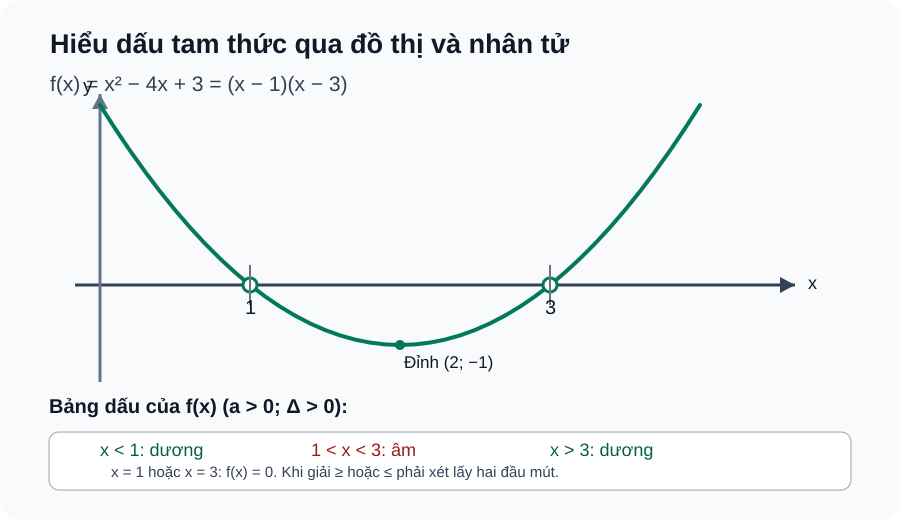

# Chuyên đề 02 · Bất đẳng thức, dấu tam thức bậc hai và miền nghiệm

Một phương án hợp lệ cần thỏa mọi điều kiện, từ bất phương trình một ẩn tới miền khả thi hai ẩn. Hãy đọc lần lượt bốn mạch: kiểm ràng buộc, xét dấu tam thức, biểu diễn miền nghiệm và chọn phương án tốt nhất.

# Kiến thức

## 1. Từ một ràng buộc đến tập nghiệm

Một xưởng chỉ được sử dụng tối đa một lượng vật liệu nhất định, nhưng vẫn phải làm ra đủ số sản phẩm. Mỗi phương án có thể đạt một mục tiêu mà vi phạm mục tiêu khác. Toán học giúp chúng ta đặt đúng các điều kiện “không quá”, “ít nhất”, “không âm” và tìm **tất cả** phương án hợp lệ, chứ không chỉ thử ngẫu nhiên vài phương án.

Nếu bài toán chỉ có một đại lượng chưa biết, ta giải bất phương trình để tìm một tập số. Khi biểu thức có dạng bậc hai, nghiệm của tam thức chia trục số thành những khoảng cần xét dấu. Khi phải quyết định đồng thời hai đại lượng, một nghiệm là một **điểm** trong mặt phẳng; nhiều ràng buộc tạo nên **miền khả thi**. Sau khi biết miền khả thi, ta mới có căn cứ chọn phương án tối ưu. Đó là một mạch suy luận liên tục từ điều kiện tới quyết định.

Trong chuyên đề này, \(\mathbb R\) chỉ các số thực; \(\mathbb Z_{\ge0}\) chỉ các số nguyên không âm; dấu \(\le\) nhận cả trường hợp bằng. Em sẽ gặp cặp tọa độ \((x;y)\), phép giao của các tập phương án, và biệt thức \(\Delta\) của tam thức bậc hai. Các ký hiệu được giải thích tại chỗ khi cần dùng.

Trước hết, mỗi bước biến đổi bất phương trình phải giữ **đúng tập các giá trị được phép chọn**. Đó là lý do ta cần hiểu bản chất của việc đổi chiều dấu khi chia cho số âm, thay vì chỉ nhớ một mẹo chuyển vế.

<!-- LESSON_ID: TOP02-M01; OUTCOME_ID: TOP02-O01; R04_BASE_BLOB: 907af796ff6f61dee518f7d25e5ff99cb23467f1 -->

### 1.1. Biến đổi bất phương trình

Khi kiểm tra một phương án có hợp lệ hay không, ta thường phải biết một đại lượng **lớn hơn**, **nhỏ hơn** hoặc **ít nhất** một mức nào đó. Khác với phương trình tìm giá trị bằng nhau, bất phương trình chọn ra **tập các giá trị thỏa điều kiện**. Mỗi phép biến đổi vì thế phải giữ đúng tập này. 

> **TÍNH CHẤT — Biến đổi bất phương trình.** Cộng cùng một số vào hai vế không đổi chiều bất đẳng thức; nhân hoặc chia hai vế với cùng một số dương cũng không đổi chiều. Khi nhân hoặc chia với **số âm**, phải đảo chiều. Nếu hệ số chứa biến chưa biết dấu, cần xét dấu hoặc chia trường hợp trước.

Vì sao nhân với số âm lại đổi chiều? Nếu \(u<v\), thì \(v-u>0\). Với \(c<0\), ta có \(c(v-u)<0\), tức \(cv-cu<0\), hay \(cv<cu\). Do đó \(cu>cv\): thứ tự đã đảo. Chia cho số âm cũng vậy, vì tương đương nhân với nghịch đảo âm.

Chẳng hạn, từ \(-4x+1>9\) suy ra \(-4x>8\). Chia cho \(-4\) khiến dấu đổi thành \(x<-2\). Ta có thể tự kiểm bằng cách chọn \(x=-3\): vế trái \(13>9\) đúng; còn \(x=-1\) cho \(5>9\) sai. Phép thử không thay thế chứng minh, nhưng giúp phát hiện sai dấu ngay khi tính.

**Ví dụ**

**Đề bài.** Giải \(-5x+2>12\).

**Lời giải.** Trừ 2, được \(-5x>10\). Chia cho \(-5<0\) phải **đổi chiều**, nên \(x<-2\). Thử \(x=-3\) thỏa, \(x=0\) không thỏa.

**Vận dụng**

Giải \(-3(x-2)\ge6\). Hãy giải thích bước nào buộc đổi chiều dấu bất đẳng thức.

Đối chiếu

Khai triển \(-3x+6\ge6\), suy ra \(-3x\ge0\). Chia cho \(-3<0\), ta được \(x\le0\), kể cả \(x=0\) vì dấu ban đầu có bằng. Nếu em viết \(x\ge0\), hãy thử \(x=1\) trong đề gốc để thấy kết luận sai.

**Kiểm lỗi**

Nếu em quên đổi chiều khi chia cho số âm, thử thế một giá trị vào bất phương trình ban đầu để phát hiện sai miền nghiệm. Đọc lại **Kiến thức 1.1** rồi làm **Bài 1** trong Luyện tập; phải nêu rõ hệ số âm ở bước chia.

## 2. Tại sao nghiệm của tam thức chia trục số thành các khoảng?

Sau khi biết cách giữ nguyên tập nghiệm khi biến đổi, ta gặp một khó khăn mới: biểu thức \(ax^2+bx+c\) có thể **đổi dấu** khi \(x\) thay đổi. Để chọn đúng các giá trị làm nó dương hay âm, cần biết những điểm biểu thức bằng 0 và điều gì xảy ra ở hai phía các điểm ấy. Đồ thị parabol và phép phân tích nhân tử cho ta hai cách nhìn nhất quán; biệt thức \(\Delta\) giúp nhận diện liệu có không, một hay hai điểm cắt/chạm trục.

<!-- LESSON_ID: TOP02-M02; OUTCOME_ID: TOP02-O02; R04_BASE_BLOB: 907af796ff6f61dee518f7d25e5ff99cb23467f1 -->

### 2.1. Biệt thức và nghiệm của tam thức

Muốn xét dấu một biểu thức bậc hai, trước tiên ta phải biết nó bằng \(0\) ở đâu. Biểu thức \(f(x)=ax^2+bx+c\), trong đó \(a,b,c\) là các số thực, **\(a\ne0\)**, gọi là **tam thức bậc hai đối với \(x\)**. Dù \(b=0\) hoặc \(c=0\), biểu thức vẫn là tam thức bậc hai vì hệ số \(a\) không bằng \(0\); ngược lại, \(a=0\) thì không còn là bậc hai.

> **ĐỊNH NGHĨA — Tam thức bậc hai.** \(f(x)=ax^2+bx+c\) với \(a,b,c\in\mathbb R,\ a\ne0\). Biệt thức của phương trình \(f(x)=0\) cho biết đồ thị \(y=f(x)\) cắt, chạm hay không cắt trục hoành. Các điểm cắt hoặc chạm ấy sẽ trở thành mốc xét dấu.

> **CÔNG THỨC — Biệt thức của tam thức bậc hai.** Với \(f(x)=ax^2+bx+c\), \(a\ne0\), đặt \(\Delta=b^2-4ac\). Phương trình \(f(x)=0\) không có nghiệm thực khi \(\Delta<0\), có một nghiệm kép \(x=-\frac{b}{2a}\) khi \(\Delta=0\), và có hai nghiệm thực phân biệt \(x_1=\frac{-b-\sqrt{\Delta}}{2a}\), \(x_2=\frac{-b+\sqrt{\Delta}}{2a}\) khi \(\Delta>0\) (hai ký hiệu này không quy định thứ tự lớn nhỏ). Nếu \(a=0\), phải xét phương trình bậc nhất hoặc trường hợp suy biến, không dùng công thức bậc hai.

Khi hệ số của \(x\) là số chẵn, ta có thể dùng **biệt thức thu gọn** để tính ngắn hơn. Viết \(b=2b'\) (nghĩa là \(b'=\frac b2\)); khi đó phương trình \(ax^2+bx+c=0\) với \(a\ne0\) chính là \(ax^2+2b'x+c=0\). Không được tính \(\Delta'\) bằng cách thay nhầm \(b\) cho \(b'\), vì \(\Delta=4\Delta'\).

> **CÔNG THỨC — Biệt thức thu gọn và nghiệm tương ứng.** Với \(a\ne0\), \(b=2b'\), đặt \(\Delta'=(b')^2-ac\). Nếu \(\Delta'>0\) thì phương trình có hai nghiệm \(x=\dfrac{-b'\pm\sqrt{\Delta'}}{a}\); nếu \(\Delta'=0\) thì có một nghiệm kép \(x=-\dfrac{b'}{a}\); nếu \(\Delta'<0\) thì không có nghiệm thực. Hai biệt thức \(\Delta=b^2-4ac\) và \(\Delta'=(b')^2-ac\) đưa ra **cùng một tập nghiệm**, chỉ khác cách tính.

Chẳng hạn, \(2x^2-8x+6=0\) có \(a=2,b'=-4,c=6\) nên \(\Delta'=16-12=4\), nghiệm \(x=\dfrac{4\pm2}{2}\), tức \(x=1\) hoặc \(x=3\); thế lại đều cho giá trị 0. Trong xét dấu tam thức, chính những nghiệm này là các mốc chia khoảng, không vì dùng \(\Delta'\) mà đổi quy tắc xét dấu.

Chẳng hạn, \(x^2-5x+6\) có \(\Delta=1\) và hai nghiệm 2, 3; \(f(x)=(x-2)(x-3)\), nhân tử cho phép đọc dấu.

**Ví dụ**

**Đề bài.** Tìm nghiệm của \(2x^2-7x+3=0\).

**Lời giải.** \(a=2,b=-7,c=3\) cho \(\Delta=49-24=25\). Thay vào công thức nghiệm, \(x=\frac{-(-7)\pm\sqrt{25}}{2\cdot2}=\frac{7\pm5}{4}\), được \(x=\frac12\) hoặc \(x=3\); do đó \(2x^2-7x+3=(2x-1)(x-3)\).

**Vận dụng**

Tam thức \(x^2+2x+1\) có biệt thức và nghiệm nào?

Đối chiếu

\(\Delta=0\), nghiệm kép \(x=-1\) vì \(x^2+2x+1=(x+1)^2\).

Quên 2a hoặc sai dấu b thì thử nhân tích để kiểm nghiệm.

**Kiểm lỗi**

Nếu em nhầm hệ số \(b\) với \(b'=\frac b2\), nghiệm tính được sẽ sai dù quy trình xét dấu trông đúng. Xem **Kiến thức 2.1**, làm **Bài 3** rồi **Bài 4** để so trường hợp hai nghiệm và nghiệm kép; thế nghiệm ngược vào tam thức để kiểm.

<!-- LESSON_ID: TOP02-M03; OUTCOME_ID: TOP02-O03; R04_BASE_BLOB: 907af796ff6f61dee518f7d25e5ff99cb23467f1 -->

### 2.2. Tam thức luôn cùng dấu

Nhưng biết nghiệm của tam thức vẫn chưa đủ: cần hiểu dấu của nó khi không có nghiệm thực. Có tam thức luôn dương hoặc luôn âm với mọi số thực. Ta bắt đầu từ tính không âm của bình phương và Δ. 

> **TÍNH CHẤT — Dấu tam thức khi \(\Delta<0\).** Với \(a\ne0\) và \(\Delta<0\), tam thức \(f(x)=ax^2+bx+c\) luôn cùng dấu với \(a\) với mọi \(x\in\mathbb R\): dương nếu \(a>0\), âm nếu \(a<0\). Không có nghiệm của **phương trình** \(f(x)=0\) không đồng nghĩa với việc bất phương trình \(f(x)>0\) hoặc \(f(x)<0\) vô nghiệm.

Xét ví dụ: \(2x^2+2x+3\) có \(\Delta=-20<0,\ a=2>0\), nên luôn dương; hoàn phương thành \(2(x+\frac12)^2+\frac52>0\) để xác minh.

**Ví dụ**

**Đề bài.** Chứng minh \(x^2+2x+5>0\) với mọi \(x\in\mathbb R\).

**Lời giải.** Hoàn phương thành \((x+1)^2+4\ge4>0\). Cũng có \(a>0,\Delta=-16<0\), tam thức cùng dấu a.

**Vận dụng**

Tam thức \(-x^2+2x-3\) có dấu gì?

Đối chiếu

\(-x^2+2x-3=-[(x-1)^2+2]<0\) với mọi x.

Nếu kết luận “không có nghiệm vì \(\Delta<0\)”, thử \(x=0\) trước khi quyết định.

**Kiểm lỗi**

Nếu thấy \(\Delta<0\) rồi kết luận biểu thức không dương hay âm ở đâu cả, em đã nhầm **không có nghiệm bằng 0** với **không có dấu**. Đọc **Kiến thức 2.2**, thử **Bài 5** và **Bài 6** bằng cách hoàn phương.

<!-- LESSON_ID: TOP02-M04; OUTCOME_ID: TOP02-O04; R04_BASE_BLOB: 907af796ff6f61dee518f7d25e5ff99cb23467f1 -->

### 2.3. Nghiệm kép và dấu bằng

> **TÍNH CHẤT — Nghiệm kép và dấu bằng.** Khi biệt thức bằng không, đồ thị chạm trục hoành tại nghiệm kép nhưng **không đổi dấu khi đi qua nghiệm kép**. Nếu \(\Delta=0\), thì \(f(x)=a(x-x_0)^2\), với \(x_0=-\frac{b}{2a}\). Tam thức cùng dấu với a ngoài \(x_0\) và bằng 0 tại \(x_0\). Dấu không nghiêm có thể nhận nghiệm kép, dấu nghiêm phải bỏ.

Hãy kiểm tra trường hợp sau: \(-2(x-3)^2\le0\) với mọi x; bằng 0 khi \(x=3\), âm khi \(x\ne3\). Muốn giải \(f(x)\ge0\) chỉ nhận tập nghiệm \(\{3\}\).

**Ví dụ**

**Đề bài.** Giải \(-3(x-2)^2\ge0\).

**Lời giải.** Bình phương không âm, nên biểu thức \(\le0\). Để \(\ge0\) chỉ có thể bằng 0: \(x=2\).

**Vận dụng**

Giải \((x+4)^2\le0\).

Đối chiếu

Chỉ \(x=-4\) vì bình phương luôn không âm.

Nếu viết một khoảng, thử \(x=-3\) để bác bỏ.

**Kiểm lỗi**

Nếu em vẽ bảng dấu đổi từ dương sang âm khi gặp nghiệm kép, hãy thử ở hai phía: \(3(1-2)^2=3\) và \(3(3-2)^2=3\). Đọc lại **Kiến thức 2.3**, rồi làm **Bài 7** và **Bài 8** để phân biệt nghiệm kép, dấu bằng và dấu của hệ số \(a\).

<!-- LESSON_ID: TOP02-M05; OUTCOME_ID: TOP02-O05; R04_BASE_BLOB: 907af796ff6f61dee518f7d25e5ff99cb23467f1 -->

### 2.4. Ba khoảng của bảng dấu

> **TÍNH CHẤT — Ba khoảng của bảng dấu.** Nếu biệt thức dương, hai nghiệm thực chia trục số thành ba miền xét dấu. Với \(x_1<x_2\), \(f(x)=a(x-x_1)(x-x_2)\) cùng dấu với a bên ngoài, trái dấu với a ở giữa; bằng 0 tại \(x_1,x_2\). Đây là lý do của bảng dấu chứ không phải quy tắc học thuộc.

Chẳng hạn, với \(f(x)=x^2-4x+3=(x-1)(x-3)\) như trên hình bên dưới, parabol cắt trục hoành tại \(1\) và \(3\). Do hệ số \(a=1>0\), \(f(x)>0\) khi \(x<1\) hoặc \(x>3\), còn \(f(x)<0\) khi \(1<x<3\). Đổi dấu toàn bộ tam thức sẽ đổi dấu hai miền này. Hình giúp quan sát, còn phép phân tích nhân tử giải thích vì sao dấu thay đổi.

*Quan sát hình:* So vị trí nghiệm trên trục hoành với các khoảng đồ thị nằm trên và dưới trục; dấu nghiệm và dấu hệ số a phải được xét trước khi kết luận.

**Ví dụ**

**Đề bài.** Xét dấu \(x^2-5x+4\).

**Lời giải.** \(f(x)=(x-1)(x-4)\), \(a>0\); f dương ngoài đoạn \([1;4]\), âm trong \((1;4)\), bằng 0 tại 1 và 4. Hình trong bài dùng tam thức tương tự có nghiệm 1, 3.

**Vận dụng**

Giải \(-(x+1)(x-4)>0\).

Đối chiếu

Tập nghiệm là \((-1;4)\), tức \(-1<x<4\); không lấy hai đầu mút.

Nếu sai, thử một x nằm giữa nghiệm để đối chiếu dấu của hai thừa số.

**Kiểm lỗi**

Nếu chọn khoảng sai dấu, hãy thử mỗi miền bằng một giá trị cụ thể rồi nhìn dấu của từng thừa số, không chỉ nhìn sơ đồ. Ôn **Kiến thức 2.4**, làm **Bài 9** và **Bài 10** trong Luyện tập, nhớ tách hẳn hai nghiệm với các khoảng.

<!-- LESSON_ID: TOP02-M06; OUTCOME_ID: TOP02-O06; R04_BASE_BLOB: 907af796ff6f61dee518f7d25e5ff99cb23467f1 -->

### 2.5. Giải bất phương trình bậc hai

Bất phương trình bậc hai một ẩn có thể đưa về một trong bốn dạng \(ax^2+bx+c>0\), \(ax^2+bx+c\ge0\), \(ax^2+bx+c<0\) hoặc \(ax^2+bx+c\le0\), với \(a\ne0\). **Giải bất phương trình** nghĩa là tìm tất cả số thực \(x\) khiến bất đẳng thức đúng, tức là tìm tập nghiệm; chẳng hạn \(x^2-1<0\) chọn các số \(x\) nằm giữa hai nghiệm \(-1\) và \(1\).

> **ĐỊNH NGHĨA — Bất phương trình bậc hai một ẩn.** Bất phương trình có vế chứa tam thức \(ax^2+bx+c\), \(a\ne0\), so sánh với \(0\) bằng một trong bốn dấu \(>,\ge,<,\le\). Nếu \(a=0\), phải xét lại như bất phương trình bậc nhất hoặc suy biến.

> **PHƯƠNG PHÁP — Giải bất phương trình bậc hai.** Đưa về dạng tam thức so sánh với 0, kiểm \(a\ne0\), xét ba trường hợp của \(\Delta\), chọn khoảng theo dấu và xét có hay không dấu bằng để lấy hoặc loại đầu mút. Với \(\Delta<0\), tập nghiệm có thể là \(\mathbb R\) hoặc \(\varnothing\).

Chẳng hạn, \(x^2-5x+6\le0\iff(x-2)(x-3)\le0\), suy ra \(x\in[2;3]\). Chọn nhân tử vì nghiệm là số nguyên.

**Ví dụ**

**Đề bài.** Giải \(x^2-6x+8\ge0\).

**Lời giải.** Từ \((x-2)(x-4)\ge0\), hai thừa số cùng dấu khi \(x\le2\) hoặc \(x\ge4\). Nhận đầu mút vì \(\ge\).

**Vận dụng**

Giải \(-x^2+4x-3>0\).

Đối chiếu

\(1<x<3\) vì \(-(x-1)(x-3)>0\) đúng trên khoảng đó.

Nếu em lấy nhầm hai đầu mút \(x=1\) hoặc \(x=3\) cho bất phương trình \(-x^2+4x-3>0\), hãy thế lại: ở cả hai điểm, vế trái bằng \(0\), nên **không thỏa dấu \(>0\)**. Dấu \(\ge0\) mới cho phép lấy hai đầu mút.

**Kiểm lỗi**

Nếu em lấy \(x=1\) hoặc \(x=3\) cho dấu \(>0\), hãy thế vào đề gốc để thấy cả hai cho giá trị 0. Đọc **Kiến thức 2.5**, rồi so **Bài 11** (dấu nghiêm) với **Bài 12** (dấu có bằng).

<!-- LESSON_ID: TOP02-M07; OUTCOME_ID: TOP02-O07; R04_BASE_BLOB: 907af796ff6f61dee518f7d25e5ff99cb23467f1 -->

### 2.6. Bất phương trình đúng với mọi x

> **TÍNH CHẤT — Bất phương trình đúng với mọi x.** Nếu hệ số chứa tham số, kết luận 'đúng với mọi x' phải kiểm tra mọi trường hợp hợp lệ. Một vài phép thử x không chứng minh ‘đúng với mọi x’. Điểm xuất phát là biệt thức và nghiệm kép. Với \(a>0\) **cố định**, \(f(x)>0\) với mọi \(x\in\mathbb R\) khi và chỉ khi \(\Delta<0\); \(f(x)\ge0\) với mọi \(x\in\mathbb R\) khi và chỉ khi \(\Delta\le0\). Với a<0 cố định dùng điều kiện âm tương ứng. Không âm thầm áp dụng cho a(m) có thể bằng 0.

Chẳng hạn, \(x^2+2(m-1)x+(m+1)>0\) với mọi x khi \(\Delta=4m(m-3)<0\), tức \(0<m<3\); hai biên làm tam thức chạm 0 nên bị loại.

**Ví dụ**

**Đề bài.** Tìm \(m\) để \(x^2+2(m-1)x+(m+1)>0\) với mọi x thực.

**Lời giải.** Vì a=1 cố định dương, điều kiện dương nghiêm trên \(\mathbb R\) là \(\Delta=4m(m-3)<0\), suy ra \(0<m<3\); hai biên có nghiệm kép nên loại.

**Vận dụng**

Tìm m để \(x^2-2mx+1\ge0\) với mọi x.

Đối chiếu

\(\Delta=4(m^2-1)\le0\), suy ra \(m\in[-1;1]\).

Ở bài Vận dụng, hai biên \(m=-1\) và \(m=1\) đều được nhận vì tam thức lần lượt là \((x+1)^2\) và \((x-1)^2\), luôn không âm. Nếu đề yêu cầu dương nghiêm ngặt thì hai biên này phải loại, vì tại nghiệm kép tam thức bằng 0.

**Kiểm lỗi**

Trong Ví dụ, nếu em nhận \(m=0\) hoặc \(m=3\), hãy thử tại nghiệm kép: lần lượt là \(x=1\) và \(x=-2\), nơi tam thức bằng 0. Hai giá trị tham số này không thỏa yêu cầu dương nghiêm ngặt. Trái lại, bài Vận dụng yêu cầu không âm nên nhận hai biên \(m=\pm1\). Xem lại **Kiến thức 2.6**, giải **Bài 13** và **Bài 14**, rồi tự luận **Bài 17** để kiểm trực tiếp giá trị tại nghiệm kép.

<!-- LESSON_ID: TOP02-M08; OUTCOME_ID: TOP02-O08; R04_BASE_BLOB: 907af796ff6f61dee518f7d25e5ff99cb23467f1 -->

### 2.7. Miền nghiệm có điều kiện vật lý

> **PHƯƠNG PHÁP — Miền nghiệm có điều kiện vật lý.** Một miền nghiệm đại số còn có thể bị thu hẹp bởi đơn vị và điều kiện vật lý của mô hình. Nghiệm đại số có thể không dùng được nếu độ dài âm, thời gian âm. Ta bắt đầu từ diện tích chữ nhật và phương trình bậc hai. Đặt biến, nêu miền vật lý, lập bất phương trình, giải, giao tập nghiệm với miền ban đầu rồi kiểm ý nghĩa. “Ít nhất” là ≥; “không quá” là ≤.

Xét ví dụ: 20 m rào ba cạnh sát tường. Điều kiện \(0<x<10\); từ \(S=x(20-2x)\ge32\) suy ra \((x-2)(x-8)\le0\), hay \(x\in[2;8]\) (m), đúng miền vật lý.

**Ví dụ**

**Đề bài.** Rào ba cạnh một vườn sát tường bằng 20 m dây; hai cạnh rộng x (m). Diện tích ít nhất \(32\,\mathrm{m}^2\). Tìm x.

**Lời giải.** Chiều còn lại \(20-2x>0\) cho \(0<x<10\). \(x(20-2x)\ge32\) tương đương \((x-2)(x-8)\le0\). Vậy \(x\in[2;8]\) m, nằm đúng miền vật lý.

**Vận dụng**

Độ cao của một vật so với mặt đất được mô hình hóa bởi \(h(t)=-t^2+6t\) (m), trong đó \(t\) tính bằng giây và \(0\le t\le6\). Trong khoảng thời gian nào vật cao ít nhất 8 m?

Đối chiếu

\(h(t)\ge8\) tương đương \((t-2)(t-4)\le0\), nên \(t\in[2;4]\). Khoảng này nằm trong miền thời gian \([0;6]\). Vậy vật cao ít nhất 8 m từ giây thứ 2 đến giây thứ 4, kể cả hai đầu mút.

Nếu có nghiệm âm, kiểm lại điều kiện khi đặt biến thay vì nhận tất cả.

**Kiểm lỗi**

Nếu em cho nghiệm âm hoặc bỏ qua đơn vị thời gian/độ dài, kết quả đại số có thể không là phương án thực tế. Đọc **Kiến thức 2.7**, làm **Bài 15** và **Bài 16** trong Luyện tập; lấy giao với miền vật lý trước khi kết luận.

## 3. Từ khoảng nghiệm trên trục số đến miền khả thi trong mặt phẳng

Trên trục số, một số \(x\) hoặc thuộc tập nghiệm hoặc không. Với hai đại lượng \(x,y\), mỗi phương án là một điểm \((x;y)\); bất phương trình bậc nhất chia mặt phẳng bởi một **đường biên**. Ta chỉ giữ phía chứa các điểm thỏa điều kiện, rồi lấy **phần chung** khi có nhiều ràng buộc. Điểm nằm trên biên phải được xét riêng: dấu có bằng thì nhận biên, dấu nghiêm ngặt thì không.

<!-- LESSON_ID: TOP02-M09; OUTCOME_ID: TOP02-O09; R04_BASE_BLOB: 907af796ff6f61dee518f7d25e5ff99cb23467f1 -->

### 3.1. Bất phương trình bậc nhất hai ẩn

Hai quyết định x, y cần mô tả tập cặp khả thi. Trước hết, hãy nhớ cặp tọa độ \((x;y)\), thay số vào biểu thức.

> **ĐỊNH NGHĨA — Bất phương trình bậc nhất hai ẩn.** Bất phương trình bậc nhất hai ẩn có dạng \(ax+by<c\), \(ax+by\le c\), \(ax+by>c\) hoặc \(ax+by\ge c\), với \(a,b,c\in\mathbb R\) và \((a;b)\ne(0;0)\). Một cặp \((x;y)\) là nghiệm nếu thay vào làm bất phương trình đúng; một hệ số bằng 0 vẫn hợp lệ.

Một bất phương trình bậc nhất hai ẩn có **vô số nghiệm thực**: biểu diễn trên mặt phẳng, các nghiệm chiếm một nửa mặt phẳng (có hoặc không gồm đường biên). Ví dụ \(2y\ge4\) chính là \(y\ge2\); giữ \(y=3\) thì **mọi** giá trị thực của \(x\) đều thỏa, chứ không chỉ một cặp được chọn thử.

Hãy kiểm tra trường hợp sau: \(0x+2y\ge4\) vẫn bậc nhất hai ẩn, tương đương \(y\ge2\); \((10;3)\) hợp lệ, \((0;1)\) không thỏa.

**Ví dụ**

**Đề bài.** Xét \(0x+2y\ge4\). Kiểm hai cặp \((10;3)\) và \((0;1)\).

**Lời giải.** Hệ số \((0;2)\) không đồng thời bằng 0 nên vẫn bậc nhất hai ẩn. \((10;3)\) cho \(6\ge4\) đúng; \((0;1)\) cho \(2\ge4\) sai.

**Vận dụng**

Bất phương trình \(-x+0y<1\) có đúng dạng bậc nhất hai ẩn không và \((0;5)\) có thỏa không?

Đối chiếu

Đúng dạng, vì \((a;b)=(-1;0)\ne(0;0)\); thay \((0;5)\) được \(0<1\) đúng.

Nếu nghĩ bắt buộc có cả x và y, kiểm điều kiện hệ số không đồng thời bằng 0.

**Kiểm lỗi**

Nếu em loại \(0x-3y>1\) chỉ vì không có \(x\) trong thực tế, hãy nhớ điều kiện là \((a;b)\ne(0;0)\), không cần cả hai khác 0. Quay lại **Kiến thức 3.1** rồi làm **Bài 18** và **Bài 32**.

<!-- LESSON_ID: TOP02-M10; OUTCOME_ID: TOP02-O10; R04_BASE_BLOB: 907af796ff6f61dee518f7d25e5ff99cb23467f1 -->

### 3.2. Chọn điểm thử khác đường biên

> **PHƯƠNG PHÁP — Chọn điểm thử khác đường biên.** Để chọn nửa mặt phẳng nghiệm, thử một điểm không nằm trên đường biên \(ax+by=c\). Gốc O chỉ phù hợp để chọn phía nếu \(c\ne0\). Một điểm ở biên thỏa dấu có bằng nhưng không quyết định được phía.

Chẳng hạn, với \(x-2y>3\), điểm \((4;0)\) thỏa vì \(4>3\); điểm \((1;-1)\) không thỏa vì \(3>3\) sai. Gốc \(O=(0;0)\) không nằm trên đường biên \(x-2y=3\) nên có thể dùng thử phía, nhưng chính \(O\) không thỏa điều kiện.

**Ví dụ**

**Đề bài.** Với \(x-2y>3\), thử \((4;0)\), \((1;-1)\) và O để chọn phía.

**Lời giải.** \((4;0)\) cho \(4>3\) đúng. \((1;-1)\) cho \(3>3\) sai, lại ở biên nên không chọn phía. O không ở biên và cho \(0>3\) sai, nên nửa phía O không phải miền nghiệm.

**Vận dụng**

\((3;0)\) thỏa \(x+2y\ge3\) không; O thử phía được không?

Đối chiếu

\((3;0)\) thỏa dấu bằng; O ngoài đường \(x+2y=3\) nên thử phía được, nhưng O không thỏa bất phương trình.

Nếu điểm thử ở biên, chọn \((1;0)\) hoặc \((0;1)\) khác và thế lại.

**Kiểm lỗi**

Nếu em lấy một điểm **nằm trên đường biên** để quyết định phía tô, phép thử chỉ cho dấu bằng nên không xác định phía. Đọc **Kiến thức 3.2**, thực hiện **Bài 22** và **Bài 24** với điểm thử ngoài đường thẳng.

<!-- LESSON_ID: TOP02-M11; OUTCOME_ID: TOP02-O11; R04_BASE_BLOB: 907af796ff6f61dee518f7d25e5ff99cb23467f1 -->

### 3.3. Đường biên được lấy hoặc loại

Bản thân đường biên có được lấy hay không phụ thuộc vào dấu bất đẳng thức. Hình vẽ sai nét đường làm kết luận sai với các điểm ở mép. Dấu có bằng nhận biên (nét liền), dấu nghiêm loại biên (nét đứt). Khi giải theo y, chia cho hệ số âm phải đảo chiều. Chọn một điểm ngoài biên để xác định phía cần tô.

> **TÍNH CHẤT — Đường biên được lấy hoặc loại.** Trên hình, điều kiện \(x+2y\le4\) có đường biên **nét liền** và nhận gốc \(O=(0;0)\). Với điều kiện \(2x-y<1\), biến đổi tương đương thành \(y>2x-1\); đường biên phải vẽ **nét đứt**. Gốc \(O\) không nằm trên đường \(2x-y=1\) và thỏa \(0<1\), nên thuộc nửa mặt phẳng nghiệm. Như vậy, việc chọn phía và việc nhận biên là **hai quyết định khác nhau**.

*Quan sát hình:* Hãy chọn một điểm không thuộc biên để quyết định phía thỏa. Biên nét liền/đứt tương ứng với điều kiện có/không có dấu bằng.

**Ví dụ**

**Đề bài.** Từ hình \(x+2y\le4\), \(2x-y<1\), tìm biên được nhận và kiểm O.

**Lời giải.** Với \(\le\), nhận biên \(x+2y=4\); với \(<\), loại biên \(2x-y=1\). O thỏa \(0\le4\) và \(0<1\). Khi chuyển vế thành \(y>2x-1\), nhớ đảo dấu.

**Vận dụng**

Với \(x+2y\ge4\), biên thế nào, O thỏa không?

Đối chiếu

Biên liền, O không thỏa \(0\ge4\), tô phía \(y\ge2-\frac{x}{2}\).

Tô sai? Thử O hoặc một điểm ngoài biên để kiểm dấu và đổi chiều.

**Kiểm lỗi**

Nếu em vẽ biên nét đứt cho dấu \(\ge\), em đã bỏ các phương án đạt **bằng** ngưỡng. Đọc **Kiến thức 3.3**, làm **Bài 20** và **Bài 21**; kiểm dấu bằng với một điểm trên đường thẳng trước khi tô miền.

<!-- LESSON_ID: TOP02-M12; OUTCOME_ID: TOP02-O12; R04_BASE_BLOB: 907af796ff6f61dee518f7d25e5ff99cb23467f1 -->

### 3.4. Lập ràng buộc hai ẩn

> **PHƯƠNG PHÁP — Lập ràng buộc hai ẩn.** Khi diễn đạt một ràng buộc thực tế, phải biến câu chữ thành cả đường biên lẫn phía được chọn. Một phương án thỏa số tiền nhưng có 2,5 thùng không dùng được. Điểm xuất phát là phân biệt ≤ và ≥; đơn vị. Đặt x,y và đơn vị. Số vé/sản phẩm cần nguyên không âm, đại lượng đo có thể thực không âm. ‘Ít nhất’ → ≥, ‘không quá’ → ≤; kiểm từng phương án bằng thế số.

Chẳng hạn, mỗi thùng A giá 4 nghìn đồng, mỗi thùng B giá 7 nghìn đồng, ngân sách không quá 56 nghìn đồng. Nếu \(x,y\) lần lượt là số thùng A, B thì \(4x+7y\le56\), với \(x,y\) nguyên không âm. Phương án \((7;4)\) đúng ngân sách vì chi phí bằng 56; \((8;4)\) bị loại vì chi phí 60. Điều kiện **nguyên không âm** quan trọng không kém bất phương trình tiền.

**Ví dụ**

**Đề bài.** Hai loại thùng giá 4 và 7 nghìn; ngân sách 56 nghìn. Lập điều kiện cho số thùng nguyên x,y, kiểm (7,4).

**Lời giải.** Vì x,y là số thùng, \(x,y\in\mathbb Z_{\ge0}\). Điều kiện \(4x+7y\le56\) (nghìn). (7,4) cho 56 nên hợp lệ, (8,4) cho 60 nên không.

**Vận dụng**

Mỗi sản phẩm loại A được 2 điểm thưởng, loại B được 3 điểm. Gọi \(x,y\) lần lượt là số sản phẩm hai loại (số nguyên không âm). Cần ít nhất 12 điểm. Phương án \((x;y)=(3;2)\) có đạt yêu cầu không?

Đối chiếu

Điều kiện là \(2x+3y\ge12\), với \(x,y\) là số nguyên không âm. Phương án đã cho đạt đúng \(2\cdot3+3\cdot2=12\) điểm, nên được nhận.

Nhầm ít nhất với ≤ thì thử phương án bằng và thấp hơn ngưỡng để sửa.

**Kiểm lỗi**

Nếu em viết \(\le\) khi đề nói “ít nhất” hoặc quên \(x,y\) là số sản phẩm/vé, mô hình có thể nhận cả phương án sai thực tế. Đọc **Kiến thức 3.4**, làm **Bài 23** và **Bài 25**, kiểm đơn vị và tính nguyên không âm.

<!-- LESSON_ID: TOP02-M13; OUTCOME_ID: TOP02-O13; R04_BASE_BLOB: 907af796ff6f61dee518f7d25e5ff99cb23467f1 -->

### 3.5. Miền giao của hệ bất phương trình

Khi một bài toán yêu cầu đồng thời nhiều điều kiện, ta viết những bất phương trình cùng hai ẩn \(x,y\) dưới một dấu ngoặc hệ. Đó là **hệ bất phương trình bậc nhất hai ẩn**: gồm **hai hoặc nhiều** bất phương trình bậc nhất đối với cùng cặp ẩn. Một cặp số \((x_0;y_0)\) là **nghiệm của hệ** chỉ khi thay vào, **tất cả** bất phương trình đều đúng. Vì vậy, miền nghiệm phải lấy phần chung của các nửa mặt phẳng, không thể gộp bằng phép hợp.

> **ĐỊNH NGHĨA — Hệ bất phương trình bậc nhất hai ẩn.** Hệ gồm hai hay nhiều bất phương trình bậc nhất hai ẩn \(x,y\). Nghiệm là cặp \((x_0;y_0)\) thỏa đồng thời từng bất phương trình trong hệ; miền nghiệm là giao của tất cả các miền nghiệm thành phần.

> **TÍNH CHẤT — Miền giao của hệ bất phương trình.** Hai ràng buộc cùng đúng dẫn tới giao của hai miền nghiệm, không phải hợp. Đạt một điều kiện mà vi phạm điều kiện khác thì vẫn không khả thi. Ta bắt đầu từ giao của tập hợp và tọa độ. Miền nghiệm của hệ là giao của tất cả nửa mặt phẳng; có thể rỗng, bị chặn hoặc vô hạn. Mọi điểm phải thỏa đồng thời từng điều kiện, kể cả ràng buộc dấu x,y.

Xét ví dụ: \(x\ge0,\ y\ge0,\ x+y\le6\) tạo tam giác kín với các đỉnh \((0;0),(6;0),(0;6)\). \((2;3)\) đạt; \((4;3)\) không đạt điều kiện tổng.

**Ví dụ**

**Đề bài.** Xét \(x,y\ge0,\ x+y\le6\). Tìm đỉnh và thử (2,3), (4,3).

**Lời giải.** Miền giao là tam giác đóng có các đỉnh \((0;0),(6;0),(0;6)\). \((2;3)\) có tổng 5 thỏa; \((4;3)\) có tổng 7 không thỏa.

**Vận dụng**

Hai điều kiện \(x+y\le5\) và \(x+y\ge7\) có nghiệm chung không?

Đối chiếu

Không, vì tổng \(t=x+y\) không thể vừa nhỏ hơn hoặc bằng 5 vừa lớn hơn hoặc bằng 7.

Nếu nhầm giao thành hợp, lấy một điểm chỉ thỏa một điều kiện để bác bỏ.

**Kiểm lỗi**

Nếu em nhầm **giao** thành **hợp**, một điểm chỉ thỏa một bất phương trình sẽ bị nhận sai. Đọc **Kiến thức 3.5**, làm **Bài 26** và **Bài 29**: thay cùng một cặp \((x;y)\) vào **mọi** điều kiện của hệ.

<!-- LESSON_ID: TOP02-M14; OUTCOME_ID: TOP02-O14; R04_BASE_BLOB: 907af796ff6f61dee518f7d25e5ff99cb23467f1 -->

### 3.6. Miền rỗng và không bị chặn

> **TÍNH CHẤT — Miền rỗng và không bị chặn.** Miền chung ấy có thể rỗng, bị chặn hoặc kéo dài vô hạn; phải đọc tình trạng khả thi trước. Bài tối ưu không có nghĩa khi miền nghiệm rỗng. Miền rỗng không có phương án. Khi cần tìm phương án tốt nhất, ta dùng **hàm mục tiêu**, chẳng hạn \(F=px+qy\), để biểu thị lợi nhuận hoặc chi phí. Miền đóng chứa cả các điểm giới hạn của nó (ví dụ miền tam giác nhận cả ba cạnh); miền bị chặn nằm trong một hình tròn hữu hạn. Trên miền đa giác đóng, không rỗng, bị chặn, hàm mục tiêu tuyến tính đạt giá trị lớn nhất và nhỏ nhất tại ít nhất một đỉnh. Miền không bị chặn cần xét riêng; có thể có max nhưng không có min.

Hãy kiểm tra trường hợp sau: Trên miền \(x\ge0,\ y\ge0\) không bị chặn, \(F=-x-y\) có giá trị lớn nhất 0 tại O và không có giá trị nhỏ nhất hữu hạn vì giữ \(y=0\) và cho \(x\to+\infty\) thì \(F\to-\infty\). Hệ \(x+y\le2,\ x+y\ge5\) thì rỗng.

**Ví dụ**

**Đề bài.** Trên \(x,y\ge0\) tìm max/min của \(F=-x-y\). Hệ \(x+y\le2,\ x+y\ge5\) có nghiệm?

**Lời giải.** \(F=-x-y\le0\), max bằng 0 tại O. Cho \(x=t\to\infty,y=0\) thì \(F\to-\infty\), không có min hữu hạn. Hệ hai điều kiện còn lại rỗng vì một tổng không thể đồng thời ≤2 và ≥5.

**Vận dụng**

Trên miền \(x\ge0,y\ge0\) không bị chặn, hàm mục tiêu \(F=-2x-y\) có giá trị lớn nhất và nhỏ nhất hữu hạn không? Giải thích bằng một điểm cụ thể và một dãy phương án.

Đối chiếu

Miền \(x,y\ge0\) không bị chặn, nhưng \(F=-2x-y\le0\) nên có **giá trị lớn nhất bằng 0** tại \(O=(0;0)\). Không có giá trị nhỏ nhất hữu hạn: lấy \(x=t\ge0,y=0\), ta được \(F=-2t\to-\infty\) khi \(t\to+\infty\). Đây là lý do không được suy từ “miền không bị chặn” ra “không có mọi cực trị”.

**Kiểm lỗi**

Nếu thấy miền không bị chặn rồi kết luận không có cả giá trị lớn nhất lẫn nhỏ nhất, em đã bỏ qua chiều biến thiên của hàm mục tiêu. Đọc **Kiến thức 3.6**, rồi làm **Bài 29** (miền rỗng) và **Bài 30** (miền không bị chặn); chỉ kết luận sau khi kiểm trực tiếp hàm.

## 4. Từ phương án hợp lệ đến phương án tốt nhất

Một phương án có thể thỏa mọi ràng buộc mà vẫn chưa đem lại lợi nhuận cao nhất hoặc chi phí thấp nhất. Sau khi dựng miền khả thi, ta cần một **hàm mục tiêu** đo điều muốn tối ưu. Với hàm tuyến tính trên miền đa giác đóng, bị chặn, không rỗng, đường mức \(px+qy=k\) gồm những điểm có cùng giá trị mục tiêu \(k\). Khi \((p;q)\ne(0;0)\), các đường mức là những đường thẳng song song; có thể dịch chuyển chúng theo chiều tăng hoặc giảm \(k\) đến vị trí cuối cùng còn gặp miền khả thi; vì thế việc tính tại các đỉnh có cơ sở hình học. Nhưng nếu số sản phẩm buộc phải là số nguyên, điểm tối ưu liên tục chưa chắc là phương án thực hiện được.

<!-- LESSON_ID: TOP02-M15; OUTCOME_ID: TOP02-O15; R04_BASE_BLOB: 907af796ff6f61dee518f7d25e5ff99cb23467f1 -->

### 4.1. Tối ưu tuyến tính trên đa giác

> **PHƯƠNG PHÁP — Tối ưu tuyến tính trên đa giác.** Cần chọn phương án tốt nhất trong số vô số điểm khả thi. Ta có thể sử dụng giao đường thẳng và hàm F=px+qy. Với đa giác đóng, bị chặn, không rỗng, cực trị tuyến tính đạt tại một đỉnh. Tìm đủ đỉnh, kiểm khả thi, tính F; khi cả hai đỉnh kề cùng tối ưu thì cả cạnh cùng tối ưu.

Chẳng hạn, với \(x,y\ge0\), \(x+y\le6\), \(2x+y\le8\), miền khả thi trong hình có bốn đỉnh \(O=(0;0)\), \(A=(4;0)\), \(B=(2;4)\), \(C=(0;6)\). Tại các đỉnh, \(F=3x+2y\) lần lượt bằng \(0,12,14,12\); giá trị lớn nhất **14** tại \(B\). Nếu bỏ bước kiểm tra đường biên, ta có thể tính nhầm một giao điểm không thuộc miền hoặc bỏ sót đỉnh tối ưu.

*Quan sát hình:* Đọc từng đỉnh \(O,A,B,C\), thế tọa độ vào **cả hai ràng buộc** rồi đối chiếu bốn giá trị \(F=0,12,14,12\). Hình minh họa **tối ưu liên tục**; nếu biến chỉ nhận số nguyên, phải quay lại kiểm tra các điểm lưới của miền.

**Ví dụ**

**Đề bài.** Trên \(x,y\ge0,\ x+y\le5,\ 2x+y\le6\), tối đa \(F=3x+2y\).

**Lời giải.** Tìm giao các đường biên rồi giữ những điểm thỏa mọi ràng buộc. Trên trục hoành (\(y=0\)), cần \(x\le5\) và \(2x\le6\), nên đầu mút là \(A=(3;0)\); loại \((5;0)\) vì \(10>6\). Trên trục tung (\(x=0\)), \(y\le5\) và \(y\le6\), nên đầu mút là \(C=(0;5)\). Giao hai đường \(x+y=5\) và \(2x+y=6\): trừ phương trình thứ nhất khỏi thứ hai được \(x=1\), thay lại được \(y=4\), nên \(B=(1;4)\). Cả \(B\) và \(O=(0;0)\) đều thỏa mọi ràng buộc.

| Đỉnh | \(O=(0;0)\) | \(A=(3;0)\) | \(B=(1;4)\) | \(C=(0;5)\) |
|---|---:|---:|---:|---:|
| \(F=3x+2y\) | 0 | 9 | 11 | 10 |

Vậy giá trị lớn nhất là 11 tại \(B\). Hình phía trên minh họa một đa giác khác với giá trị lớn nhất 14 tại \((2;4)\).

**Vận dụng**

Với \(x,y\ge0,\ x+y\le4\), hàm \(F=x+y\) đạt giá trị lớn nhất ở đâu?

Đối chiếu

Mọi điểm trên cạnh \(x+y=4\) của miền khả thi đều đạt 4, không chỉ một đỉnh.

Nếu bỏ một đỉnh, vẽ từng đường và kiểm giao có thỏa tất cả ràng buộc.

**Kiểm lỗi**

Nếu em chỉ kiểm một đỉnh rồi nói đó là **nghiệm tối ưu duy nhất**, em có thể bỏ cả cạnh mà hàm mục tiêu không đổi. Đọc **Kiến thức 4.1**, so **Bài 33** (một đỉnh đạt cực đại) với **Bài 34** (mọi điểm trên cạnh đạt cực đại).

<!-- LESSON_ID: TOP02-M16; OUTCOME_ID: TOP02-O16; R04_BASE_BLOB: 907af796ff6f61dee518f7d25e5ff99cb23467f1 -->

### 4.2. Tối ưu với biến nguyên

> **PHƯƠNG PHÁP — Tối ưu với biến nguyên.** Nếu đề yêu cầu các biến nguyên, đỉnh tối ưu theo mô hình liên tục chỉ là điểm xuất phát. 2,67 chiếc máy không thể thực hiện nguyên trạng. Để xác định điều đó, cần xét số nguyên không âm và tìm điểm lưới khả thi. Nếu x,y là sản phẩm, chỉ các điểm nguyên trong miền nghiệm mới hợp lệ. Tối ưu liên tục là cận/gợi ý; phải liệt kê hoặc lập luận theo y nguyên để tìm tối ưu nguyên.

Chẳng hạn, \(x+2y\le8,\ 2x+y\le8,\ x,y\in\mathbb Z_{\ge0}\), \(P=3x+2y\). Tối ưu liên tục đạt \(\frac{40}{3}\) tại \((\frac83;\frac83)\). Với y nguyên từ 0 đến 4, các giá trị lớn nhất của P lần lượt là 12, 11, 13, 12, 8 (xem bảng dưới); tối ưu nguyên đạt 13 tại \((3;2)\).

**Ví dụ**

**Đề bài.** Với \(x+2y\le8,\ 2x+y\le8,\ x,y\in\mathbb Z_{\ge0}\), tối đa \(P=3x+2y\).

**Lời giải.** Miền liên tục có giao \((\frac83;\frac83)\), đạt giá trị lớn nhất \(\frac{40}{3}\). Khi \(x,y\) phải nguyên không âm, từ \(x+2y\le8\) suy ra \(0\le y\le4\). Với mỗi \(y\) cố định, \(P=3x+2y\) tăng theo \(x\), nên chọn số nguyên \(x\) lớn nhất thỏa đồng thời \(x\le8-2y\) và \(x\le\frac{8-y}{2}\).

| \(y\) | 0 | 1 | 2 | 3 | 4 |
|---|---:|---:|---:|---:|---:|
| \(x\) lớn nhất hợp lệ | 4 | 3 | 3 | 2 | 0 |
| \(P=3x+2y\) | 12 | 11 | 13 | 12 | 8 |

Vậy giá trị lớn nhất trong các phương án nguyên là 13 tại \((3;2)\). Kiểm lại \(3+2\cdot2=7\le8\) và \(2\cdot3+2=8\). Không được làm tròn nghiệm liên tục thay cho bước kiểm các phương án nguyên.

**Vận dụng**

Với \(x+2y\le4,\ 2x+y\le4,\ x,y\in\mathbb Z_{\ge0}\), giá trị lớn nhất của \(F=x+y\) là bao nhiêu?

Đối chiếu

Tối ưu nguyên là 2 tại \((2;0),(1;1),(0;2)\), dù tối ưu liên tục đạt \(\frac83\).

Nếu làm tròn tọa độ mà bỏ điều kiện, liệt kê từng y và x lớn nhất hợp lệ.

**Kiểm lỗi**

Nếu em làm tròn nghiệm tối ưu liên tục thành số nguyên mà không kiểm lại ràng buộc, kết quả có thể không khả thi hoặc chưa tối ưu. Đọc **Kiến thức 4.2**, thử **Bài 35** và **Bài 37** bằng liệt kê các cặp nguyên hợp lệ rồi so giá trị mục tiêu.

> **Kiến thức cần ghi nhớ**
>
> - Với bất phương trình, **đảo chiều dấu khi nhân hoặc chia hai vế cho số âm**; hệ số chưa biết dấu phải được xét trước.
> - Với tam thức bậc hai \(ax^2+bx+c\), chỉ dùng \(\Delta=b^2-4ac\) theo công thức bậc hai khi \(a\ne0\). Dấu của tam thức còn phụ thuộc \(a\), nghiệm kép và điều kiện có/không có dấu bằng.
> - Miền nghiệm của bất phương trình hai ẩn phải kiểm **phía thỏa** và **đường biên**. Với dấu \(\le,\ge\) nhận biên; với \(<,>\) loại biên.
> - Khi tối ưu trên miền đa giác đóng, không rỗng, bị chặn, hãy kiểm các đỉnh; nếu \(x,y\) phải nguyên, chỉ xét các điểm nguyên thỏa mọi điều kiện, không làm tròn tùy ý.

# Luyện tập

Tự giải và kiểm điều kiện trước khi mở lời giải; với trắc nghiệm, giải thích vì sao đáp án đúng; với tự luận, trình bày từng bước rồi tự đối chiếu rubric. Sai ở dấu, điểm biên hay tính nguyên thì trở lại mục Kiến thức tương ứng.

## 1. Bất phương trình một ẩn

<!-- DISPLAY_ONLY_CANONICAL: THPT-TOP02-ADD01; ORIGINAL_BLOB: e10e57d7684497b0dfa9325af766a75b7cfa239f; OUTCOME: TOP02-O01; NO_NEW_BANK -->

**Bài 1.**

-2(3x−1)≤8. Giải bất phương trình và giải thích bước đảo chiều.

Lời giải

**Đáp án:** x≥−1.

−6x+2≤8 ⇒ −6x≤6. Chia cả hai vế cho −6 (âm) phải đổi ≤ thành ≥, nên x≥−1; thử x=−1 cho bằng, x=0 cho 2≤8.

<!-- DISPLAY_ONLY_CANONICAL: THPT-TOP02-ADD02; ORIGINAL_BLOB: e10e57d7684497b0dfa9325af766a75b7cfa239f; OUTCOME: TOP02-O01; NO_NEW_BANK -->

**Bài 2.**

Chứng minh x²−6x+9≥0 với mọi số thực x; khi nào xảy ra dấu bằng?

Lời giải

**Đáp án:** Đúng với mọi x∈ℝ; bằng 0 khi x=3.

x²−6x+9=(x−3)²≥0 do bình phương số thực không âm; dấu bằng ⇔ x−3=0 ⇔ x=3. Đây là chứng minh bất đẳng thức bằng biểu diễn dạng bình phương.

## 2. Dấu tam thức bậc hai và mô hình

<!-- DISPLAY_ONLY_CANONICAL: THPT-TOP02-ADD03; ORIGINAL_BLOB: e10e57d7684497b0dfa9325af766a75b7cfa239f; OUTCOME: TOP02-O02; NO_NEW_BANK -->

**Bài 3.**

Cho f(x)=2x²−5x+2. Tìm a, Δ, nghiệm và dạng phân tích thành nhân tử.

Lời giải

**Đáp án:** a=2, Δ=9, nghiệm 1/2 và 2; f(x)=(2x−1)(x−2).

a=2,b=−5,c=2 nên Δ=b²−4ac=25−16=9; x=(5±3)/4 ∈{1/2,2}. Nhân (2x−1)(x−2)=2x²−5x+2.

<!-- DISPLAY_ONLY_CANONICAL: THPT-TOP02-ADD04; ORIGINAL_BLOB: e10e57d7684497b0dfa9325af766a75b7cfa239f; OUTCOME: TOP02-O02; NO_NEW_BANK -->

**Bài 4.**

f(x)=x²+6x+9 có bao nhiêu nghiệm phân biệt và Δ bằng bao nhiêu?

Lời giải

**Đáp án:** Δ=0; một nghiệm kép x=−3.

Δ=36−4·1·9=0; f(x)=(x+3)². Tam thức chạm trục Ox tại −3, không đi xuyên qua trục.

<!-- DISPLAY_ONLY_CANONICAL: THPT-TOP02-ADD05; ORIGINAL_BLOB: e10e57d7684497b0dfa9325af766a75b7cfa239f; OUTCOME: TOP02-O03; NO_NEW_BANK -->

**Bài 5.**

Xét dấu f(x)=x²−2x+5 trên ℝ mà không cần tìm nghiệm.

Lời giải

**Đáp án:** f(x)>0 với mọi x∈ℝ.

Hoàn phương f(x)=(x−1)²+4>0; tương đương a=1>0, Δ=4−20=−16<0, luôn cùng dấu a.

<!-- DISPLAY_ONLY_CANONICAL: THPT-TOP02-ADD06; ORIGINAL_BLOB: e10e57d7684497b0dfa9325af766a75b7cfa239f; OUTCOME: TOP02-O03; NO_NEW_BANK -->

**Bài 6.**

Chứng minh g(x)=−2x²+4x−5 âm với mọi x∈ℝ.

Lời giải

**Đáp án:** g(x)<0 với mọi x∈ℝ.

g(x)=−2(x−1)²−3 ≤−3<0. Hệ số đầu âm và Δ<0 nên không đổi dấu.

<!-- DISPLAY_ONLY_CANONICAL: THPT-TOP02-ADD07; ORIGINAL_BLOB: e10e57d7684497b0dfa9325af766a75b7cfa239f; OUTCOME: TOP02-O04; NO_NEW_BANK -->

**Bài 7.**

Xác định nơi f(x)=3(x−2)² bằng 0, dương và âm.

Lời giải

**Đáp án:** Bằng 0 tại x=2; dương với x≠2; không âm tại mọi x, không âm có dấu bằng.

Hệ số 3>0 và bình phương không âm; bằng 0 duy nhất khi x=2. Với x≠2 bình phương dương, không có miền âm.

<!-- DISPLAY_ONLY_CANONICAL: THPT-TOP02-ADD08; ORIGINAL_BLOB: e10e57d7684497b0dfa9325af766a75b7cfa239f; OUTCOME: TOP02-O04; NO_NEW_BANK -->

**Bài 8.**

Xác định nơi g(x)=−(x+1)² bằng 0, âm và dương.

Lời giải

**Đáp án:** Bằng 0 tại x=−1; âm với x≠−1; không bao giờ dương.

Bình phương ≥0; đổi dấu bằng trừ làm g≤0. Chỉ khi x+1=0 thì g=0. Đi qua không? Không, đồ thị tiếp xúc Ox.

<!-- DISPLAY_ONLY_CANONICAL: THPT-TOP02-ADD09; ORIGINAL_BLOB: e10e57d7684497b0dfa9325af766a75b7cfa239f; OUTCOME: TOP02-O05; NO_NEW_BANK -->

**Bài 9.**

Lập bảng dấu của f(x)=x²−4x+3.

Lời giải

**Đáp án:** Nghiệm 1,3; f>0 trên (−∞,1)∪(3,+∞), f<0 trên (1,3), f=0 ở 1,3.

f(x)=(x−1)(x−3), hệ số đầu dương. Ngoài hai nghiệm hai thừa số cùng dấu nên tích dương; trong hai nghiệm trái dấu nên tích âm.

<!-- DISPLAY_ONLY_CANONICAL: THPT-TOP02-ADD10; ORIGINAL_BLOB: e10e57d7684497b0dfa9325af766a75b7cfa239f; OUTCOME: TOP02-O05; NO_NEW_BANK -->

**Bài 10.**

Tìm các x làm −x²+x+6>0.

Lời giải

**Đáp án:** x∈(−2,3).

−x²+x+6=−(x−3)(x+2); hai nghiệm −2,3, hệ số đầu âm nên tam thức dương giữa hai nghiệm, không lấy biên do >0.

<!-- DISPLAY_ONLY_CANONICAL: THPT-TOP02-ADD11; ORIGINAL_BLOB: e10e57d7684497b0dfa9325af766a75b7cfa239f; OUTCOME: TOP02-O06; NO_NEW_BANK -->

**Bài 11.**

Giải x²−7x+12<0, ghi tập nghiệm bằng khoảng.

Lời giải

**Đáp án:** (3,4).

x²−7x+12=(x−3)(x−4). Tích âm khi 3<x<4. Dấu < nghiêm ngặt nên bỏ hai đầu mút.

<!-- DISPLAY_ONLY_CANONICAL: THPT-TOP02-ADD12; ORIGINAL_BLOB: e10e57d7684497b0dfa9325af766a75b7cfa239f; OUTCOME: TOP02-O06; NO_NEW_BANK -->

**Bài 12.**

Giải −x²+5x−6≥0.

Lời giải

**Đáp án:** [2,3].

−x²+5x−6=−(x−2)(x−3)≥0 ⇔ (x−2)(x−3)≤0. Nghiệm [2,3], gồm hai đầu mút vì ≥0.

<!-- DISPLAY_ONLY_CANONICAL: THPT-TOP02-ADD13; ORIGINAL_BLOB: e10e57d7684497b0dfa9325af766a75b7cfa239f; OUTCOME: TOP02-O07; NO_NEW_BANK -->

**Bài 13.**

Tìm các tham số thực m để x²−2mx+9>0 với mọi x∈ℝ.

Lời giải

**Đáp án:** −3<m<3.

a=1>0 cố định; điều kiện dương nghiêm ngặt trên ℝ là Δ<0. Δ=(−2m)²−36=4(m²−9)<0 ⇔ m²<9 ⇔ −3<m<3. Ở |m|=3 đồ thị chạm 0 nên không thỏa >.

<!-- DISPLAY_ONLY_CANONICAL: THPT-TOP02-ADD14; ORIGINAL_BLOB: e10e57d7684497b0dfa9325af766a75b7cfa239f; OUTCOME: TOP02-O07; NO_NEW_BANK -->

**Bài 14.**

Tìm các m thực để x²−2mx+4≥0 với mọi x∈ℝ.

Lời giải

**Đáp án:** −2≤m≤2.

a=1>0; không âm trên ℝ ⇔ Δ≤0. Δ=4(m²−4)≤0 ⇔ |m|≤2. Ở m=±2 tam thức là bình phương, có thể bằng 0 nên vẫn đạt ≥.

<!-- DISPLAY_ONLY_CANONICAL: THPT-TOP02-ADD15; ORIGINAL_BLOB: e10e57d7684497b0dfa9325af766a75b7cfa239f; OUTCOME: TOP02-O08; NO_NEW_BANK -->

**Bài 15.**

Một khu vườn hình chữ nhật có hai cạnh dài x và 12−x mét, 0<x<12. Tìm x để diện tích ít nhất 35 m².

Lời giải

**Đáp án:** x∈[5,7] mét.

S=x(12−x)≥35 ⇔ −x²+12x−35≥0 ⇔ (x−5)(x−7)≤0. Suy ra 5≤x≤7, đều nằm trong miền độ dài 0<x<12.

<!-- DISPLAY_ONLY_CANONICAL: THPT-TOP02-ADD16; ORIGINAL_BLOB: e10e57d7684497b0dfa9325af766a75b7cfa239f; OUTCOME: TOP02-O08; NO_NEW_BANK -->

**Bài 16.**

Mô hình độ cao (mét) theo thời gian t≥0 (giây): h(t)=−5t²+20t+1. Trong khoảng thời gian nào h(t)≥16?

Lời giải

**Đáp án:** t∈[1,3] giây.

−5t²+20t+1≥16 ⇔ −5(t²−4t+3)≥0 ⇔ (t−1)(t−3)≤0 ⇔ t∈[1,3]. Điều kiện t≥0 được đáp ứng; chỉ diễn giải trong mô hình.

<!-- DISPLAY_ONLY_CANONICAL: THPT-TOP02-W01; ORIGINAL_BLOB: e10e57d7684497b0dfa9325af766a75b7cfa239f; OUTCOME: TOP02-O07; NO_NEW_BANK -->

**Bài 17.**

(a) Giải x²−4x+3≤0. (b) Tìm m∈ℝ để x²−2mx+4>0 với mọi số thực x. (c) Giải thích cụ thể vì sao m=2 bị loại ở (b).

Lời giải và rubric

**Đáp án:** (a) [1,3]. (b) −2<m<2. (c) m=2 cho (x−2)² và bằng 0 tại x=2 nên sai dấu >0.

(a) (x−1)(x−3)≤0 nên [1,3]. (b) a=1>0 cố định, cần Δ=(−2m)²−16=4(m²−4)<0 ⇒ |m|<2. (c) Khi m=2, f(2)=0. Điều kiện Δ≤0 chỉ đủ cho ≥0 toàn miền, không phải >0 toàn miền.

**Rubric tự đối chiếu:** 7 điểm: xác định hai nghiệm và bảng dấu đúng (2đ); thiết lập a>0, Δ<0 và biến đổi m (3đ); kiểm tra trường hợp m=2 kèm giải thích dấu nghiêm (2đ).

## 3. Miền nghiệm hai ẩn

<!-- DISPLAY_ONLY_CANONICAL: THPT-G10-B03-C01; ORIGINAL_BLOB: acea9776d1c7534a4cd0cd28e98db26dedf0c122; OUTCOME: TOP02-O09; NO_NEW_BANK -->

**Bài 18.**

Biểu thức nào sau đây là bất phương trình bậc nhất hai ẩn?

**Các phương án:** A. 2x²+y≤3 | B. 0x−3y>1 | C. xy<2 | D. 0x+0y≤2

Lời giải

**Đáp án:** `B`

0x−3y>1 đúng dạng ax+by>c với (a,b)=(0,−3) ≠ (0,0). Các lựa chọn khác bậc cao hoặc hệ số x,y đồng thời bằng 0.

<!-- DISPLAY_ONLY_CANONICAL: THPT-G10-B03-C02; ORIGINAL_BLOB: acea9776d1c7534a4cd0cd28e98db26dedf0c122; OUTCOME: TOP02-O10; NO_NEW_BANK -->

**Bài 19.**

Cặp (2,−1) có là nghiệm của 2x−y≤5 hay không?

**Các phương án:** A. Có, vì vế trái bằng 5 | B. Không, vì vế trái bằng 5 | C. Có, vì vế trái bằng 3 | D. Không, vì y âm

Lời giải

**Đáp án:** `A`

2·2−(−1)=5, thỏa 5≤5. Dấu bằng được lấy.

<!-- DISPLAY_ONLY_CANONICAL: THPT-G10-B03-P01; ORIGINAL_BLOB: acea9776d1c7534a4cd0cd28e98db26dedf0c122; OUTCOME: TOP02-O11; NO_NEW_BANK -->

**Bài 20.**

Đường biên của x+3y≥6 được xử lí thế nào?

**Các phương án:** A. Không lấy đường thẳng x+3y=6 | B. Lấy đường thẳng x+3y=6 | C. Chỉ lấy hai giao điểm với trục | D. Lấy toàn mặt phẳng

Lời giải

**Đáp án:** `B`

Biên x+3y=6 thuộc miền nghiệm của x+3y≥6 vì các cặp trên biên làm hai vế bằng nhau.

<!-- DISPLAY_ONLY_CANONICAL: THPT-G10-B03-P02; ORIGINAL_BLOB: acea9776d1c7534a4cd0cd28e98db26dedf0c122; OUTCOME: TOP02-O11; NO_NEW_BANK -->

**Bài 21.**

Miền nghiệm của 3x−y<2 nằm ở đâu so với y=3x−2?

**Các phương án:** A. Trên đường thẳng, không gồm biên | B. Dưới đường thẳng, không gồm biên | C. Trên đường thẳng, gồm biên | D. Dưới đường thẳng, gồm biên

Lời giải

**Đáp án:** `A`

3x−y<2 ⇔ −y<2−3x ⇔ y>3x−2. Nằm phía trên đường biên nét đứt, không lấy biên.

<!-- DISPLAY_ONLY_CANONICAL: THPT-G10-B03-P03; ORIGINAL_BLOB: acea9776d1c7534a4cd0cd28e98db26dedf0c122; OUTCOME: TOP02-O10; NO_NEW_BANK -->

**Bài 22.**

Khi vẽ 2x+y≥0, kết luận nào đúng về điểm thử O(0,0)?

**Các phương án:** A. O hợp lệ để xác định phía vì thỏa bất phương trình | B. O không hợp lệ vì nằm trên đường biên | C. O không hợp lệ vì y=0 | D. Không cần đường biên

Lời giải

**Đáp án:** `B`

O nằm trên đường 2x+y=0 nên không giúp chọn một phía. Có thể dùng (1,0): 2>0, phía chứa (1,0) thỏa ≥.

<!-- DISPLAY_ONLY_CANONICAL: THPT-G10-B03-P04; ORIGINAL_BLOB: acea9776d1c7534a4cd0cd28e98db26dedf0c122; OUTCOME: TOP02-O12; NO_NEW_BANK -->

**Bài 23.**

Rạp bán vé loại A 60 nghìn đồng/vé (x vé), loại B 90 nghìn đồng/vé (y vé). Để thu ít nhất 18 triệu đồng, điều kiện nào đúng?

**Các phương án:** A. 2x+3y≥600, x,y là số nguyên không âm | B. 2x+3y≤600, x,y là số nguyên không âm | C. 3x+2y≥600, x,y số thực bất kỳ | D. x+y≥200, không cần điều kiện nguyên

Lời giải

**Đáp án:** `A`

60x+90y≥18 000 ⇔ 2x+3y≥600, đồng thời x,y∈Z≥0. Chỉ số tiền không quyết định tính nguyên và không âm.

<!-- DISPLAY_ONLY_CANONICAL: THPT-G10-B03-P05; ORIGINAL_BLOB: acea9776d1c7534a4cd0cd28e98db26dedf0c122; OUTCOME: TOP02-O11; NO_NEW_BANK -->

**Bài 24.**

Điểm nào chắc chắn nằm trong miền nghiệm 2x+3y>0?

**Các phương án:** A. (0,0) | B. (−3,2) | C. (0,1) | D. (3,−2)

Lời giải

**Đáp án:** `C`

Tại (0,1) biểu thức bằng 3>0. Tại (0,0), (−3,2), (3,−2) bằng 0 nên đều nằm trên biên và không thỏa dấu >.

<!-- DISPLAY_ONLY_CANONICAL: THPT-G10-B03-P06; ORIGINAL_BLOB: acea9776d1c7534a4cd0cd28e98db26dedf0c122; OUTCOME: TOP02-O12; NO_NEW_BANK -->

**Bài 25.**

Cửa hàng mua x thùng loại A giá 35 nghìn/thùng, y thùng loại B giá 20 nghìn/thùng, ngân sách không quá 700 nghìn; x,y∈Z≥0. Cặp nào khả thi?

**Các phương án:** A. (10,15) | B. (15,10) | C. (20,1) | D. (0,36)

Lời giải

**Đáp án:** `A`

(10,15): 350+300=650≤700; (15,10):725; (20,1):720; (0,36):720 đều vượt 700.

<!-- DISPLAY_ONLY_CANONICAL: THPT-G10-B04-C01; ORIGINAL_BLOB: acea9776d1c7534a4cd0cd28e98db26dedf0c122; OUTCOME: TOP02-O13; NO_NEW_BANK -->

**Bài 26.**

Cặp nào thỏa đồng thời x≥0, y≥0 và x+y≤5?

**Các phương án:** A. (2,3) | B. (4,2) | C. (−1,4) | D. (3,3)

Lời giải

**Đáp án:** `A`

(2,3) không âm và có tổng 5≤5; B/D tổng 6>5; C có x<0.

<!-- DISPLAY_ONLY_CANONICAL: THPT-G10-B04-C02; ORIGINAL_BLOB: acea9776d1c7534a4cd0cd28e98db26dedf0c122; OUTCOME: TOP02-O13; NO_NEW_BANK -->

**Bài 27.**

Miền nghiệm của hệ x≥0, y≥0, x+y≤4 là hình nào?

**Các phương án:** A. Tam giác kín có đỉnh (0,0),(4,0),(0,4) | B. Nửa mặt phẳng x+y≤4 | C. Mọi điểm góc phần tư thứ nhất | D. Tam giác mở không lấy ba cạnh

Lời giải

**Đáp án:** `A`

Ba điều kiện xác định tam giác kín gồm hai đoạn trên trục không âm và đoạn x+y=4, vì các dấu đều không nghiêm ngặt.

<!-- DISPLAY_ONLY_CANONICAL: THPT-G10-B04-P01; ORIGINAL_BLOB: acea9776d1c7534a4cd0cd28e98db26dedf0c122; OUTCOME: TOP02-O13; NO_NEW_BANK -->

**Bài 28.**

Cho hệ x≥0, y≥0, x+y≤7, 2x+y≤10. Trong các điểm sau, điểm nào thuộc miền nghiệm?

**Các phương án:** A. (3,4) | B. (5,3) | C. (−1,3) | D. (6,0)

Lời giải

**Đáp án:** `A`

(3,4): 3+4=7≤7 và 2·3+4=10≤10. (5,3): 8>7; C âm x; (6,0): 12>10.

<!-- DISPLAY_ONLY_CANONICAL: THPT-G10-B04-P04; ORIGINAL_BLOB: acea9776d1c7534a4cd0cd28e98db26dedf0c122; OUTCOME: TOP02-O14; NO_NEW_BANK -->

**Bài 29.**

Hệ x+y≤2 và x+y≥5 có miền nghiệm như thế nào?

**Các phương án:** A. Miền nghiệm là giao của hai đường thẳng | B. Vô nghiệm | C. Có nghiệm (0,0) | D. Miền nghiệm là toàn mặt phẳng

Lời giải

**Đáp án:** `B`

Không có t thực vừa ≤2 vừa ≥5, do đó hệ không có điểm thỏa mãn.

<!-- DISPLAY_ONLY_CANONICAL: THPT-G10-B04-P05; ORIGINAL_BLOB: acea9776d1c7534a4cd0cd28e98db26dedf0c122; OUTCOME: TOP02-O14; NO_NEW_BANK -->

**Bài 30.**

Với miền x≥0, y≥0 không bị chặn, F=−x−y có đặc điểm nào?

**Các phương án:** A. Không có cực đại vì miền không bị chặn | B. Cực đại bằng 0 tại (0,0), không có cực tiểu hữu hạn | C. Cực tiểu bằng 0 tại (0,0) | D. Cả cực đại và cực tiểu đều bằng 0

Lời giải

**Đáp án:** `B`

Vì x+y≥0, F=−x−y≤0; tại (0,0), F=0 là giá trị lớn nhất. Cho x→∞, F→−∞ nên không có giá trị nhỏ nhất hữu hạn.

<!-- DISPLAY_ONLY_CANONICAL: THPT-G10-CHII-W03; ORIGINAL_BLOB: acea9776d1c7534a4cd0cd28e98db26dedf0c122; OUTCOME: TOP02-O12; NO_NEW_BANK -->

**Bài 31.**

Một nhóm gây quỹ bán x phần ăn A giá 40 nghìn đồng và y phần ăn B giá 65 nghìn đồng; tổng bán không quá 55 phần, mục tiêu thu ít nhất 2 600 nghìn đồng. (a) Lập các điều kiện toán học nếu x,y là số phần ăn bán được. (b) Kiểm tra hai phương án (30,25) và (40,10). (c) Giải thích vì sao (0,0) không đáp ứng mục tiêu.

Lời giải và rubric

x,y∈Z≥0; x+y≤55; 40x+65y≥2600. (30,25): 30+25=55, thu 1200+1625=2825≥2600 nên khả thi. (40,10): 50 phần, thu 1600+650=2250<2600 nên không khả thi. (0,0) thu 0<2600.

**Rubric tự đối chiếu:** 7 điểm: (1) không âm+nguyên 1đ; (2) số phần ≤55 1đ; (3) mục tiêu doanh thu đúng đơn vị 2đ; (4) phương án (30,25) 1đ; (5) phương án (40,10) 1đ; (6) giải thích (0,0) 1đ.

<!-- DISPLAY_ONLY_CANONICAL: THPT-TOP02-ADD17; ORIGINAL_BLOB: e10e57d7684497b0dfa9325af766a75b7cfa239f; OUTCOME: TOP02-O09; NO_NEW_BANK -->

**Bài 32.**

Bất phương trình 0x+5y≥10 có phải bậc nhất hai ẩn không? Cho một nghiệm và một điểm không thỏa.

Lời giải

**Đáp án:** Có (a,b)=(0,5)≠(0,0). (9,3) thỏa, (0,1) không thỏa.

Bậc nhất hai ẩn cho phép một hệ số bằng 0, miễn không đồng thời bằng 0. Thế (9,3): 15≥10 đúng; (0,1):5≥10 sai.

## 4. Tối ưu liên tục và nguyên

<!-- DISPLAY_ONLY_CANONICAL: THPT-G10-B04-P02; ORIGINAL_BLOB: acea9776d1c7534a4cd0cd28e98db26dedf0c122; OUTCOME: TOP02-O15; NO_NEW_BANK -->

**Bài 33.**

Trên miền x≥0, y≥0, x+y≤7, 2x+y≤10, giá trị lớn nhất của F=4x+3y là bao nhiêu?

**Các phương án:** A. 20 | B. 21 | C. 24 | D. 28

Lời giải

**Đáp án:** `C`

Các đỉnh (0,0),(5,0),(3,4),(0,7). F lần lượt 0,20,24,21. Cực đại 24 tại (3,4).

<!-- DISPLAY_ONLY_CANONICAL: THPT-G10-B04-P03; ORIGINAL_BLOB: acea9776d1c7534a4cd0cd28e98db26dedf0c122; OUTCOME: TOP02-O15; NO_NEW_BANK -->

**Bài 34.**

Cho x≥0, y≥0, x+y≤8; tối đa hóa F=x+y. Mệnh đề nào đúng?

**Các phương án:** A. Chỉ (8,0) tối ưu | B. Chỉ (0,8) tối ưu | C. Mọi điểm của cạnh x+y=8 trong góc phần tư I đều tối ưu | D. Không tồn tại giá trị lớn nhất

Lời giải

**Đáp án:** `C`

F≤8, đạt bằng 8 tại mọi điểm không âm trên cạnh nối (8,0) và (0,8); có vô số nghiệm tối ưu.

<!-- DISPLAY_ONLY_CANONICAL: THPT-G10-B04-P06; ORIGINAL_BLOB: acea9776d1c7534a4cd0cd28e98db26dedf0c122; OUTCOME: TOP02-O16; NO_NEW_BANK -->

**Bài 35.**

Với x,y là số nguyên không âm, x+2y≤5, 2x+y≤5, giá trị lớn nhất của 3x+2y là bao nhiêu?

**Các phương án:** A. 7 | B. 8 | C. 25/3 | D. 9

Lời giải

**Đáp án:** `B`

Từ 2x+y≤5 suy ra x=0,1,2. Nếu x=0 thì y≤2, F≤4; x=1 thì y≤2, F≤7; x=2 thì y≤1, F≤8, đạt tại (2,1). Bài toán liên tục tại giao x=y=5/3 cho F=25/3>8 nhưng không nguyên.

<!-- DISPLAY_ONLY_CANONICAL: THPT-G10-CHII-W04-ANCHOR; ORIGINAL_BLOB: acea9776d1c7534a4cd0cd28e98db26dedf0c122; OUTCOME: TOP02-O15; NO_NEW_BANK -->

**Bài 36.**

Một xưởng làm x món A và y món B, x,y là số nguyên không âm; các ràng buộc x+2y≤10, 3x+y≤15. Lợi nhuận tính theo đơn vị quy ước là P=5x+4y. (a) Lập miền nghiệm liên tục và tìm các đỉnh. (b) Tìm lợi nhuận lớn nhất, giải thích việc áp dụng đáp án vào mô hình số nguyên. (c) Nếu cả một cạnh cho cùng lợi nhuận tối ưu, cần lưu ý điều gì?

Lời giải và rubric

Các đường biên cắt trục: x+2y=10 có (10,0),(0,5); 3x+y=15 có (5,0),(0,15). Giao hai đường thẳng là (4,3). Miền chung trong góc phần tư I là tứ giác có đỉnh (0,0),(5,0),(4,3),(0,5). P tương ứng 0,25,32,20; cực đại liên tục 32 tại (4,3). Vì (4,3) nguyên, đây cũng là cực đại mô hình sản phẩm nguyên. Nếu F hằng trên cả một cạnh, tối ưu có thể không duy nhất; phải xét nghiệm phù hợp thêm điều kiện thực tế.

**Rubric tự đối chiếu:** 7 điểm: (1) điều kiện không âm/nguyên 1đ; (2) biểu diễn chính xác từng biên và miền giao 1đ; (3) bốn đỉnh đúng 2đ; (4) giá trị P tại từng đỉnh 1đ; (5) cực đại 32 ở (4,3) và tính nguyên 1đ; (6) giải thích trường hợp cả cạnh tối ưu 1đ.

<!-- DISPLAY_ONLY_CANONICAL: THPT-TOP02-ADD18; ORIGINAL_BLOB: e10e57d7684497b0dfa9325af766a75b7cfa239f; OUTCOME: TOP02-O16; NO_NEW_BANK -->

**Bài 37.**

Với x,y nguyên không âm thỏa x+2y≤7, 2x+y≤7, tối đa hóa P=3x+2y. So sánh với tối ưu liên tục.

Lời giải

**Đáp án:** Tối ưu nguyên P=11 tại (x,y)=(3,1); tối ưu liên tục 35/3 tại (7/3,7/3).

Trong miền liên tục, các đỉnh (0,0),(7/2,0),(7/3,7/3),(0,7/2); P lần lượt 0,21/2,35/3,7 nên max 35/3. Với nguyên: y=0→x≤3 nên P≤9; y=1→x≤3 cho P≤11 đạt (3,1); y=2→x≤2 cho P≤10; y=3→x≤1 cho P≤9. Do đó max nguyên=11. Không làm tròn 35/3 mà bỏ kiểm khả thi.

<!-- DISPLAY_ONLY_CANONICAL: THPT-TOP02-W02; ORIGINAL_BLOB: e10e57d7684497b0dfa9325af766a75b7cfa239f; OUTCOME: TOP02-O16; NO_NEW_BANK -->

**Bài 38.**

Một xưởng làm x,y sản phẩm, số nguyên không âm; cần x+2y≤7 và 3x+y≤8; lợi nhuận P=4x+3y. (a) Viết miền khả thi liên tục và các đỉnh. (b) Tìm P lớn nhất nếu x,y được phép thực không âm. (c) Tìm P lớn nhất khi x,y là số nguyên và giải thích tại sao hai kết quả khác nhau.

Lời giải và rubric

**Đáp án:** Đỉnh liên tục: (0,0),(8/3,0),(9/5,13/5),(0,7/2). Tối ưu thực P=15 tại (9/5,13/5); tối ưu nguyên P=14 tại (2,2).

Giao hai đường biên x+2y=7, 3x+y=8 là x=9/5,y=13/5. P tại bốn đỉnh lần lượt 0,32/3,15,21/2 nên max thực 15. Khi nguyên, y=0,1,2,3; x lớn nhất lần lượt 2,2,2,1, suy ra P lớn nhất theo y tương ứng 8,11,14,13; đạt (2,2) và không thể lấy đỉnh (9/5,13/5) vì tọa độ phân số.

**Rubric tự đối chiếu:** 7 điểm: đúng ràng buộc và miền không âm (1đ); tìm đủ bốn đỉnh, đặc biệt giao chính xác (2đ); xét P ở đỉnh và kết luận thực (1đ); kiểm các trường hợp nguyên và cực đại 14 (2đ); giải thích khác biệt thực/nguyên (1đ).

# Tự kiểm tra

Em hãy làm đủ 16 câu công khai dưới đây trước khi xem lại lời giải ở phần Luyện tập. Đây là lượt tự ôn với những câu đã học, không phải đánh giá năng lực độc lập. Sau khi làm xong, hãy tự đối chiếu, ghi rõ lỗi và quay lại đúng mục Kiến thức để luyện thêm.

<!-- PUBLIC_REPLAY_ONLY: THPT-TOP02-ADD01; ORIGINAL_BLOB: e10e57d7684497b0dfa9325af766a75b7cfa239f; NO_MASTERY; NOT_RD1 -->

**Câu 1.** -2(3x−1)≤8. Giải bất phương trình và giải thích bước đảo chiều.

<!-- PUBLIC_REPLAY_ONLY: THPT-TOP02-ADD03; ORIGINAL_BLOB: e10e57d7684497b0dfa9325af766a75b7cfa239f; NO_MASTERY; NOT_RD1 -->

**Câu 2.** Cho f(x)=2x²−5x+2. Tìm a, Δ, nghiệm và dạng phân tích thành nhân tử.

<!-- PUBLIC_REPLAY_ONLY: THPT-TOP02-ADD05; ORIGINAL_BLOB: e10e57d7684497b0dfa9325af766a75b7cfa239f; NO_MASTERY; NOT_RD1 -->

**Câu 3.** Xét dấu f(x)=x²−2x+5 trên ℝ mà không cần tìm nghiệm.

<!-- PUBLIC_REPLAY_ONLY: THPT-TOP02-ADD07; ORIGINAL_BLOB: e10e57d7684497b0dfa9325af766a75b7cfa239f; NO_MASTERY; NOT_RD1 -->

**Câu 4.** Xác định nơi f(x)=3(x−2)² bằng 0, dương và âm.

<!-- PUBLIC_REPLAY_ONLY: THPT-TOP02-ADD09; ORIGINAL_BLOB: e10e57d7684497b0dfa9325af766a75b7cfa239f; NO_MASTERY; NOT_RD1 -->

**Câu 5.** Lập bảng dấu của f(x)=x²−4x+3.

<!-- PUBLIC_REPLAY_ONLY: THPT-TOP02-ADD11; ORIGINAL_BLOB: e10e57d7684497b0dfa9325af766a75b7cfa239f; NO_MASTERY; NOT_RD1 -->

**Câu 6.** Giải x²−7x+12<0, ghi tập nghiệm bằng khoảng.

<!-- PUBLIC_REPLAY_ONLY: THPT-TOP02-ADD13; ORIGINAL_BLOB: e10e57d7684497b0dfa9325af766a75b7cfa239f; NO_MASTERY; NOT_RD1 -->

**Câu 7.** Tìm các tham số thực m để x²−2mx+9>0 với mọi x∈ℝ.

<!-- PUBLIC_REPLAY_ONLY: THPT-TOP02-ADD15; ORIGINAL_BLOB: e10e57d7684497b0dfa9325af766a75b7cfa239f; NO_MASTERY; NOT_RD1 -->

**Câu 8.** Một khu vườn hình chữ nhật có hai cạnh dài x và 12−x mét, 0<x<12. Tìm x để diện tích ít nhất 35 m².

<!-- PUBLIC_REPLAY_ONLY: THPT-G10-B03-C01; ORIGINAL_BLOB: acea9776d1c7534a4cd0cd28e98db26dedf0c122; NO_MASTERY; NOT_RD1 -->

**Câu 9.** Biểu thức nào sau đây là bất phương trình bậc nhất hai ẩn?

**Các phương án:** A. 2x²+y≤3 | B. 0x−3y>1 | C. xy<2 | D. 0x+0y≤2

<!-- PUBLIC_REPLAY_ONLY: THPT-G10-B03-C02; ORIGINAL_BLOB: acea9776d1c7534a4cd0cd28e98db26dedf0c122; NO_MASTERY; NOT_RD1 -->

**Câu 10.** Cặp (2,−1) có là nghiệm của 2x−y≤5 hay không?

**Các phương án:** A. Có, vì vế trái bằng 5 | B. Không, vì vế trái bằng 5 | C. Có, vì vế trái bằng 3 | D. Không, vì y âm

<!-- PUBLIC_REPLAY_ONLY: THPT-G10-B03-P01; ORIGINAL_BLOB: acea9776d1c7534a4cd0cd28e98db26dedf0c122; NO_MASTERY; NOT_RD1 -->

**Câu 11.** Đường biên của x+3y≥6 được xử lí thế nào?

**Các phương án:** A. Không lấy đường thẳng x+3y=6 | B. Lấy đường thẳng x+3y=6 | C. Chỉ lấy hai giao điểm với trục | D. Lấy toàn mặt phẳng

<!-- PUBLIC_REPLAY_ONLY: THPT-G10-B03-P04; ORIGINAL_BLOB: acea9776d1c7534a4cd0cd28e98db26dedf0c122; NO_MASTERY; NOT_RD1 -->

**Câu 12.** Rạp bán vé loại A 60 nghìn đồng/vé (x vé), loại B 90 nghìn đồng/vé (y vé). Để thu ít nhất 18 triệu đồng, điều kiện nào đúng?

**Các phương án:** A. 2x+3y≥600, x,y là số nguyên không âm | B. 2x+3y≤600, x,y là số nguyên không âm | C. 3x+2y≥600, x,y số thực bất kỳ | D. x+y≥200, không cần điều kiện nguyên

<!-- PUBLIC_REPLAY_ONLY: THPT-G10-B04-C01; ORIGINAL_BLOB: acea9776d1c7534a4cd0cd28e98db26dedf0c122; NO_MASTERY; NOT_RD1 -->

**Câu 13.** Cặp nào thỏa đồng thời x≥0, y≥0 và x+y≤5?

**Các phương án:** A. (2,3) | B. (4,2) | C. (−1,4) | D. (3,3)

<!-- PUBLIC_REPLAY_ONLY: THPT-G10-B04-P04; ORIGINAL_BLOB: acea9776d1c7534a4cd0cd28e98db26dedf0c122; NO_MASTERY; NOT_RD1 -->

**Câu 14.** Hệ x+y≤2 và x+y≥5 có miền nghiệm như thế nào?

**Các phương án:** A. Miền nghiệm là giao của hai đường thẳng | B. Vô nghiệm | C. Có nghiệm (0,0) | D. Miền nghiệm là toàn mặt phẳng

<!-- PUBLIC_REPLAY_ONLY: THPT-G10-B04-P02; ORIGINAL_BLOB: acea9776d1c7534a4cd0cd28e98db26dedf0c122; NO_MASTERY; NOT_RD1 -->

**Câu 15.** Trên miền x≥0, y≥0, x+y≤7, 2x+y≤10, giá trị lớn nhất của F=4x+3y là bao nhiêu?

**Các phương án:** A. 20 | B. 21 | C. 24 | D. 28

<!-- PUBLIC_REPLAY_ONLY: THPT-G10-B04-P06; ORIGINAL_BLOB: acea9776d1c7534a4cd0cd28e98db26dedf0c122; NO_MASTERY; NOT_RD1 -->

**Câu 16.** Với x,y là số nguyên không âm, x+2y≤5, 2x+y≤5, giá trị lớn nhất của 3x+2y là bao nhiêu?

**Các phương án:** A. 7 | B. 8 | C. 25/3 | D. 9

Đối chiếu

Sau khi làm xong 16 câu, em mở **Lời giải** của đúng bài tương ứng trong phần **Luyện tập** theo bảng dưới đây. Nếu còn sai, đọc lại **Kiểm lỗi** của mục Kiến thức liên quan rồi thử giải lại mà không nhìn đáp án.

| Câu tự kiểm tra | Bài có lời giải trong Luyện tập |
| --- | --- |
| Câu 1 – 2 – 3 – 4 | Bài 1 – 3 – 5 – 7 |
| Câu 5 – 6 – 7 – 8 | Bài 9 – 11 – 13 – 15 |
| Câu 9 – 10 – 11 – 12 | Bài 18 – 19 – 20 – 23 |
| Câu 13 – 14 – 15 – 16 | Bài 26 – 29 – 33 – 35 |

Đây là tự đối chiếu những câu đã học, **không phải bài đánh giá năng lực độc lập** và không ghi Mastery.

Học liệu tham khảo SGK Toán 10 Kết nối tri thức với cuộc sống, Tập Một Chương II (Bài 3–4) và phần dấu tam thức bậc hai liên quan trong Tập Hai (Bài 17).
