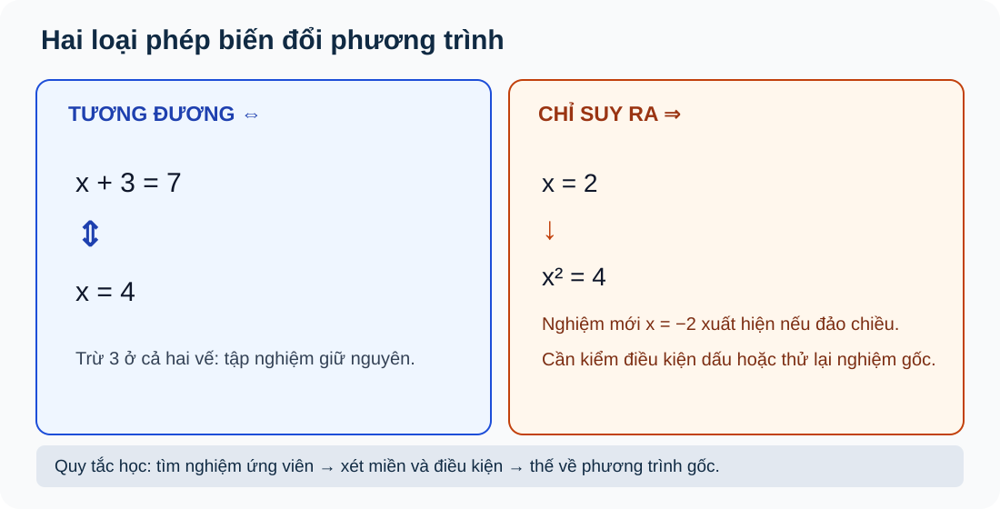
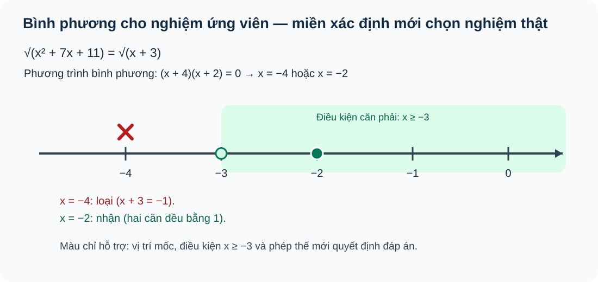
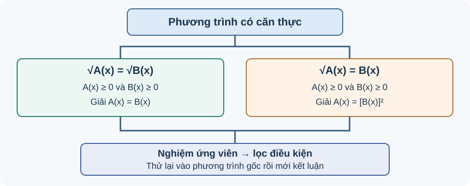

<!-- AUTHORING CURRENT R04: independently not yet released; source-lock Q18 author self-QA and V2 ready manifest reference exact blob. Historical R03 frozen SHA 678b93e92ee5b9b995bee08597a618ff1f536be5. No website integration, merge or deployment. -->
<!-- STANDARD_ID=SLM-THPT-QUALITY-ONE; STANDARD_VERSION=3.1.0; LEARNING_PATH=TOPIC; OUTER_PAGES=Kiến thức|Luyện tập|Tự kiểm tra; SOURCE_VERSION=R04_AUTHORING_READY; AUTHORING_ONLY_METADATA=prototypes/thpt/content-drafts/topic03-algebra-equations/Temp_TOPIC03_R04_AUTHORING_ONLY_CUSTODY_METADATA_20261113.md -->
# CĐ03 — Phương trình đại số và kỹ thuật chuyển đổi dạng

# Kiến thức

## Giải phương trình là giữ đúng tập nghiệm

Một bạn giải phương trình, thu được hai giá trị nhưng khi thay vào đề gốc thì chỉ một giá trị đúng. Sai sót không nhất thiết nằm ở phép tính: có thể bạn ấy đã dùng một bước **không tương đương**, như bình phương hai vế, hoặc quên điều kiện mẫu số khác 0. Vì vậy, muốn giải đúng một phương trình, ta luôn phải trả lời ba câu hỏi gắn với nhau: *Đang xét những giá trị nào? Bước biến đổi này có giữ nguyên tập nghiệm không? Nghiệm tìm được có thỏa bài toán gốc không?*

Trước hết, số thực được ký hiệu \(\mathbb R\), tập nghiệm là \(S\). Ta sẽ dùng tính chất \(ab=0\) khi và chỉ khi \(a=0\) hoặc \(b=0\); giá trị tuyệt đối \(|u|\) là khoảng cách đến 0; căn bậc hai số học \(\sqrt u\) chỉ xác định khi \(u\ge0\) và luôn không âm. Những tiền đề này sẽ được giải thích qua từng phép biến đổi, từ phương trình bậc nhất/bậc hai đến các trường hợp có phân thức và căn. Đặt ẩn phụ và mô hình thực tế được học sau cùng vì cả hai cũng phải quay lại miền giá trị ban đầu.

Để thấy khác nhau giữa biến đổi hai chiều và một chiều, hãy bắt đầu từ các phương trình đơn giản mà ta có thể tự kiểm nghiệm ngay.

<!-- LESSON_ID: TOP03-M01; OUTCOME_ID: TOP03-O01; source: candidate R04 -->

Giải phương trình không chỉ là tìm một con số trông có vẻ đúng. Ta cần tìm **tất cả** giá trị trong miền xác định chung làm hai vế bằng nhau, đồng thời không để phép biến đổi nào làm mất hoặc sinh thêm nghiệm. Nếu hai phương trình có đúng cùng tập nghiệm, ta gọi chúng **tương đương** và viết dấu \(\Leftrightarrow\).

Với \(x+5=12\), trừ cùng 5 ở hai vế cho \(x=7\); làm ngược lại bằng cách cộng 5 sẽ khôi phục phương trình ban đầu, nên đây là biến đổi tương đương. Nhưng từ \(x=3\) suy ra \(x^2=9\) chỉ là một chiều: phương trình sau còn có \(x=-3\), vốn không thỏa câu đầu. Cùng lý do đó, khi giải phương trình chứa căn và phải bình phương, ta phải giữ điều kiện và **thử nghiệm trở lại đề gốc**.

<!-- LESSON_ID: TOP03-M02; OUTCOME_ID: TOP03-O02; source: candidate R04 -->

Ngay cả phương trình bậc nhất cũng có thể đổi bản chất khi hệ số của ẩn bằng không. Đôi khi phép chia mất cả một trường hợp vô số nghiệm; hiểu điều kiện chia quan trọng hơn thao tác máy. Điểm xuất phát là thu gọn, phân phối, tính chất số 0. Với ax=b: nếu a≠0 có nghiệm duy nhất x=b/a; nếu a=0,b≠0 thì vô nghiệm; nếu a=b=0 thì mọi x∈ℝ đều là nghiệm. Khi a có chứa tham số m, phải xét a=0 trước. Đây là kỹ thuật nền để tự học phép quy về bậc hai.

Chẳng hạn, Giải m(x−2)=0: m≠0 ⇒ x=2; m=0 ⇒ 0=0 cho mọi x. Không thể chia cả hai vế cho m khi chưa biết m≠0.

<!-- LESSON_ID: TOP03-M03; OUTCOME_ID: TOP03-O03; source: candidate R04 -->

Khi một biểu thức được tách thành tích, tính chất tích bằng không giúp nhìn thấy nhiều nghiệm. Đưa phương trình về tích làm lộ nhiều nghiệm, nhưng chia cho một nhân tử có thể làm mất nghiệm ngay tại nhân tử ấy. Ta bắt đầu từ tính chất ab=0 ⇔ a=0 hoặc b=0. Nếu biểu thức đã có nghĩa với x đang xét thì A(x)B(x)=0 ⇔ A=0 hoặc B=0. Nghiệm kép khác với hai nghiệm thực phân biệt. Chia cho A(x) chỉ hợp lệ khi A(x)≠0, nếu không phải tách trường hợp A=0.

Xét ví dụ: x²−x−6=0 ⇔ (x−3)(x+2)=0 ⇒ x∈{3,−2}. Nếu vội chia cho x−3 sẽ làm mất x=3; vì thế ưu tiên quy tắc tích bằng 0.

<!-- LESSON_ID: TOP03-M04; OUTCOME_ID: TOP03-O04; source: candidate R04 -->

Nếu phép phân tích nhân tử chưa thuận lợi, biệt thức mở ra cách giải phương trình bậc hai. Bình phương hay khử mẫu thường đưa bài khó về phương trình bậc hai. Kết quả này tạo **ứng viên**, chưa bảo đảm thỏa điều kiện ban đầu. Trước hết, hãy nhớ hệ số a,b,c; công thức bình phương của tổng/hiệu. Với ax²+bx+c=0, a≠0, Δ=b²−4ac. Δ>0 có hai nghiệm thực x=(−b±√Δ)/(2a); Δ=0 một nghiệm kép; Δ<0 vô nghiệm trên ℝ. Dùng phân tích nhân tử nếu thấy dễ, dùng Δ khi không rõ nhân tử; phải xét lại miền của phương trình xuất phát nếu có mẫu/căn.

Hãy kiểm tra trường hợp sau: x²−4x+3=0: Δ=16−12=4>0 ⇒ x=(4±2)/2∈{1,3}; kiểm (x−1)(x−3). Hai cách giải tương đương cho chính phương trình bậc hai này.

### Vận dụng và tự đối chiếu

<!-- First Try for TOP03-M01; noncanonical knowledge question -->
**1.** Giải \(3x+2=11\). Vì sao hai bước chuyển vế và chia cho 3 không làm đổi tập nghiệm?

Đối chiếu

Trừ 2 ở hai vế được \(3x=9\); chia cho \(3\ne0\) được \(x=3\). Cả hai bước đều có phép ngược hợp lệ. Thử lại: \(3\cdot3+2=11\). Nếu em dùng dấu tương đương cho phép bình phương mà không kiểm điều kiện, hãy so trường hợp \(x=3\) và \(x=-3\) ở ví dụ trên.

<!-- First Try for TOP03-M02; noncanonical knowledge question -->
**2.** Giải a(x−1)=0 theo tham số a.

Đối chiếu

Nếu a≠0 thì x=1, nếu a=0 thì mọi x∈ℝ.

Nếu quên trường hợp hệ số 0, đặt a=0 và thử x=6; luyện ADD03, ADD04.

<!-- First Try for TOP03-M03; noncanonical knowledge question -->
**3.** Giải (x−5)(x+1)=0.

Đối chiếu

x=5 hoặc x=−1; thử vào từng thừa số.

Nếu tìm được một nghiệm mà không xét nhân tử còn lại, quay lại ab=0 và luyện ADD05, ADD06.

<!-- First Try for TOP03-M04; noncanonical knowledge question -->
**4.** Giải x²+4x+4=0.

Đối chiếu

(x+2)²=0 ⇒ x=−2 (nghiệm kép), không phải hai giá trị khác nhau.

Nếu Δ âm mà cho nghiệm thực, hoàn phương thành tổng số không âm để kiểm; luyện ADD07, ADD08.

## Khi phép biến đổi cần điều kiện

Các phép cộng và trừ cùng một lượng ở hai vế thường có thể đi ngược trở lại, nhưng chia cho một biểu thức chỉ hợp lệ khi biểu thức ấy **khác 0**. Với giá trị tuyệt đối, một biểu thức dương hay âm có thể tạo ra cùng một kết quả, nên không thể tùy tiện bỏ hai vạch. Từ đây, ta thấy "đưa về phương trình quen thuộc" luôn phải đi cùng việc **giữ lại miền xác định**.

<!-- LESSON_ID: TOP03-M05; OUTCOME_ID: TOP03-O05; source: candidate R04 -->

Khử mẫu rất nhanh nhưng chỉ đúng trên miền mẫu khác 0; một phép rút gọn có thể ‘lấp’ điểm biểu thức gốc vô nghĩa. Ta có thể sử dụng phân tích nhân tử, số hữu tỉ và mẫu số. Đầu tiên xét **mọi mẫu số khác 0**. Khi nhân hai vế với mẫu M(x), phép tương đương chỉ đúng **trên miền M(x)≠0**. Giải phương trình kết quả, loại các nghiệm làm mẫu bằng 0 và thay thử. Đây là cầu nối kỹ thuật cho CĐ03, không tự nhận mọi dạng phân thức là Core B18.

Chẳng hạn, (x+1)/(x−3)=2, x≠3. Nhân x−3 được x+1=2x−6 ⇒ x=7; thử (7+1)/(7−3)=8/4=2. Nếu nghiệm x=3 xuất hiện, phải loại chứ không được chia 0.

<!-- LESSON_ID: TOP03-M06; OUTCOME_ID: TOP03-O06; source: candidate R04 -->

Giá trị tuyệt đối cũng yêu cầu chia trường hợp, bởi nó xóa dấu của biểu thức bên trong. Giá trị tuyệt đối luôn không âm; bỏ dấu bằng mắt có thể tạo nghiệm không có trong phương trình gốc. Để xác định điều đó, cần xét giá trị tuyệt đối |u| là khoảng cách đến 0 trên trục số. Nếu |A|=c hằng số: c<0 vô nghiệm; c≥0 giải A=±c (c=0 hai nhánh trùng). Nếu |A(x)|=B(x), cần B(x)≥0 rồi tách A=B hoặc A=−B, **kiểm lại điều kiện trên từng nhánh**. Đây là cầu nối đại số của Topic, không tự nâng thành Core SGK B18.

Chẳng hạn, |x−1|=3 ⇒ x−1=3 hoặc −3 ⇒ x=4 hoặc −2; thử khoảng cách đến 1 đều là 3. Không thể chỉ lấy nghiệm x=4 vì giá trị tuyệt đối xóa dấu.

### Vận dụng và tự đối chiếu

<!-- First Try for TOP03-M05; noncanonical knowledge question -->
**1.** Giải (x²−9)/(x−3)=0.

Đối chiếu

Điều kiện x≠3. Tử (x−3)(x+3)=0 cho 3 hoặc −3; loại 3, nghiệm duy nhất −3.

Nếu rút gọn rồi kết luận nhận x=3, thay x=3 vào mẫu để thấy vô nghĩa; luyện ADD09/ADD10.

<!-- First Try for TOP03-M06; noncanonical knowledge question -->
**2.** Giải |x+3|=x+3.

Đối chiếu

Vì |u|=u khi u≥0, ta có x+3≥0 ⇒ x≥−3. Thử x=−4 cho |−1|=1 khác −1.

Nếu quên điều kiện B≥0, thử một x làm B âm; luyện ADD11/ADD12.

## Nghiệm ứng viên và phép kiểm ngược

Ở phương trình chứa căn, bình phương giúp bỏ ký hiệu căn để đưa bài toán về phương trình đại số, nhưng phép bình phương **không giữ lại thông tin về dấu**: từ \(A=B\) suy ra \(A^2=B^2\), chiều ngược không luôn đúng. Vì vậy nghiệm sau bình phương mới chỉ là **ứng viên**. Ta sẽ so sánh hai căn bằng nhau với một căn bằng biểu thức, giải thích điều kiện của từng dạng, rồi lọc nghiệm qua miền và phép thay trực tiếp.

<!-- LESSON_ID: TOP03-M07; OUTCOME_ID: TOP03-O07; source: candidate R04 -->

Đây là nguyên nhân chính của nghiệm ngoại lai khi giải phương trình chứa căn. Điểm xuất phát là dấu không âm của √A, bình phương hai vế. Từ A=B suy ra A²=B²; chiều đảo không đúng nếu A,B có thể trái dấu. Với √A(x)=B(x), **phải có B≥0**; sau đó A=B² và điều kiện có thể đủ. Nếu chỉ giải A=B² rồi bỏ B≥0 thì đang giải một phương trình rộng hơn. Cần thử từng nghiệm vào gốc.

Chẳng hạn, √(x+3)=x−1 ⇒ điều kiện x≥1; bình phương x+3=(x−1)² ⇒ x²−3x−2=0 ⇒ x=(3±√17)/2. Chỉ x=(3+√17)/2≥1 thỏa; nghiệm còn lại cho vế phải âm nên ngoại lai.

*Quan sát hình:* Phân biệt mũi tên hai chiều khi giữ nguyên tập nghiệm với mũi tên một chiều khi bình phương có thể sinh nghiệm ngoại lai; luôn thử vào phương trình đầu.

<!-- LESSON_ID: TOP03-M08; OUTCOME_ID: TOP03-O08; source: candidate R04 -->

Hai căn bậc hai bằng nhau chỉ khi các biểu thức bên trong thỏa những điều kiện cần thiết. Một căn không xác định có thể tạo nghiệm ảo tưởng sau phép bình phương. Ta bắt đầu từ điều kiện √u xác định khi u≥0. Với √A(x)=√B(x) trên ℝ, tương đương với **A=B và A≥0** (khi A=B, B≥0 tự theo). Có thể ghi riêng A≥0, B≥0 để dễ kiểm. Tìm nghiệm ứng viên từ A=B, lọc miền trước khi thế. Không suy ra |A|=|B|.

Xét ví dụ sát hình trục số: \(\sqrt{x^2+7x+11}=\sqrt{x+3}\). Hai vế đều là căn số học nên, **sau khi ghi điều kiện xác định**, ta giải \(x^2+7x+11=x+3\), hay \((x+2)(x+4)=0\), được các ứng viên \(x=-2,-4\). Điều kiện từ căn phải đòi \(x\ge-3\): loại \(-4\); với \(-2\), cả hai biểu thức dưới căn bằng 1, nên hai vế đều bằng 1. Do đó nghiệm duy nhất là \(x=-2\). Việc kiểm căn trái và thay lại cho thấy không bỏ sót điều kiện ẩn.

*Đọc trục số:* Đầu mút \(-3\) là ranh giới miền \(x\ge-3\), không phải nghiệm. Điểm \(-4\) bị loại vì nằm ngoài miền; \(-2\) được giữ vì hai căn đều bằng 1 khi thay lại. Trục số **minh họa cho chính ví dụ hai căn phía trên**, không thay phép kiểm biểu thức dưới căn trái.

<!-- LESSON_ID: TOP03-M09; OUTCOME_ID: TOP03-O09; source: candidate R04 -->

Nếu chỉ một vế chứa căn, điều kiện không âm của vế kia trở nên đặc biệt quan trọng. Căn số học không âm, nên không thể bằng số âm dù phương trình sau bình phương thỏa. Trước hết, hãy nhớ căn √u không âm và công thức giải PT bậc hai. √A=B tương đương với **B≥0 và A=B²** trên ℝ; khi A=B²≥0 thì căn cũng xác định. Có thể ghi thêm A≥0 để học sinh kiểm, nhưng đó không phải điều kiện độc lập mới. Giải ứng viên từ A=B² rồi lọc dấu B và thử gốc.

Hãy kiểm tra trường hợp sau: √(3x+1)=x−1: x≥1. Bình phương 3x+1=(x−1)² ⇒ x²−5x=0 ⇒ x=0 hoặc 5. Loại 0, nhận 5 vì √16=4=5−1.

<!-- LESSON_ID: TOP03-M10; OUTCOME_ID: TOP03-O10; source: candidate R04 -->

Như vậy, một nghiệm xuất hiện sau bình phương mới là ứng viên, chưa hẳn nghiệm thật. Một phương trình bình phương có nghiệm không có nghĩa phương trình gốc có nghiệm. Ta có thể sử dụng quy trình √A=√B và √A=B, ĐKXĐ. Lập **bảng ứng viên**: nghiệm của phương trình biến đổi → điều kiện miền → điều kiện dấu của vế phải → thay thử gốc. Đặc biệt với hai căn, ứng viên có thể nằm ngoài miền xác định; với một căn bằng biểu thức, có thể sai do dấu. Phương trình vẫn có thể vô nghiệm sau khi lọc.

Chẳng hạn, √(x+6)=x−2: điều kiện x≥2. Bình phương x+6=(x−2)² ⇒ x²−5x−2=0, nghiệm (5±√33)/2. Chỉ nghiệm dương lớn hơn 2 hợp lệ; nghiệm âm là ngoại lai do vế phải âm. Kiểm x=(5+√33)/2 làm hai vế bằng nhau.

*Đọc sơ đồ:* Nhánh \(\sqrt A=\sqrt B\) cần hai biểu thức dưới căn không âm; nhánh \(\sqrt A=B\) còn cần \(B\ge0\). Cả hai đều phải kiểm nghiệm ứng viên trở lại phương trình ban đầu. Hình là nguồn SGK đã xác thực, không phải mô hình tương tác mới.

### Vận dụng và tự đối chiếu

<!-- First Try for TOP03-M07; noncanonical knowledge question -->
**1.** Giải √(x+1)=x.

Đối chiếu

Điều kiện x≥0; bình phương x+1=x² ⇒ x=(1±√5)/2. Chỉ x=(1+√5)/2≥0 được nhận.

Nếu hai nghiệm sau bình phương đều được nhận, thử nghiệm âm và so dấu hai vế; luyện ADD13/ADD14.

<!-- First Try for TOP03-M08; noncanonical knowledge question -->
**2.** Giải √(x²+5)=√(4x+2).

Đối chiếu

Miền x≥−1/2. Bình phương x²+5=4x+2 ⇒ (x−1)(x−3)=0, x=1 hoặc 3; cả hai hợp miền, thử được √6 và √14 tương ứng ở mỗi vế.

Nếu quên một miền căn, thay nghiệm âm khiến radicand âm để tự bác; luyện ADD15 và C02/W18-01.

<!-- First Try for TOP03-M09; noncanonical knowledge question -->
**3.** Giải √(2x+7)=x+1.

Đối chiếu

Cần x≥−1. Bình phương x²−6=0 ⇒ x=±√6; chỉ +√6≥−1 đạt, âm bị loại. Thử căn bằng √6+1.

Nếu chỉ dùng điều kiện A≥0 rồi giữ nghiệm B âm, thử gốc sẽ sai; luyện ADD16,C01,P01,P02.

<!-- First Try for TOP03-M10; noncanonical knowledge question -->
**4.** Giải √(x²+5)=x−2 trong ℝ.

Đối chiếu

Điều kiện x≥2. Bình phương x²+5=x²−4x+4 ⇒ x=−1/4, trái miền. Vậy S=∅, không nhận ứng viên.

Nếu kết luận nghiệm chỉ bằng giải phương trình sau bình phương, hãy lập bảng ‘ứng viên→miền→dấu→gốc’; luyện ADD17,ADD18 và W01.

## Trở lại biến ban đầu và ý nghĩa thực tế

Khi một phương trình quá phức tạp, ta có thể đặt ẩn phụ để nhìn cấu trúc quen thuộc hơn. Nhưng sau khi giải theo ẩn mới, phải kiểm miền của ẩn ấy rồi **đổi trở lại** biến ban đầu. Điều tương tự xảy ra với bài toán thực tế: ẩn đại diện cho chiều dài, thời gian hoặc vận tốc phải mang đúng đơn vị và điều kiện, nên không thể lấy mọi nghiệm đại số làm đáp số.

<!-- LESSON_ID: TOP03-M11; OUTCOME_ID: TOP03-O11; source: candidate R04 -->

Một phương trình bậc bốn đôi khi trở thành bậc hai nhưng nghiệm ẩn phụ âm không có nghĩa trên ℝ. Để xác định điều đó, cần xét bình phương ≥0 và nghiệm PT bậc hai. Với x⁴+px²+q=0, đặt t=x²≥0. Giải t²+pt+q=0, **lọc t≥0**, rồi giải x²=t: t=0 cho x=0, t>0 cho x=±√t. Đây là *luyện tập mở rộng tự chọn* để hiểu kỹ thuật đổi dạng, không coi là Core bắt buộc của SGK B18.

Chẳng hạn, x⁴−10x²+9=0 ⇒ t²−10t+9=(t−1)(t−9)=0 ⇒ t=1 hoặc 9, x=±1 hoặc ±3. Không nhận t âm.

<!-- LESSON_ID: TOP03-M12; OUTCOME_ID: TOP03-O12; source: candidate R04 -->

Cuối cùng, nghiệm đại số phải quay về đúng đại lượng và đơn vị của tình huống thực tế. Trong hình học và chuyển động, một nghiệm âm hay thời gian vô nghĩa không thể dùng làm đáp án. Điểm xuất phát là pythagore, quãng đường/vận tốc=thời gian, đơn vị đo. Ghi biến, đơn vị và điều kiện **trước** phương trình. Chọn mô hình căn độ dài nếu cạnh huyền, phân thức nếu thời gian; giải thành phương trình đại số, lọc điều kiện, kiểm tính đúng của cả số lẫn đơn vị. Dạng mô hình xe là tự biên soạn bổ trợ, không nói là bài SGK B18 bắt buộc.

Chẳng hạn, Tam giác vuông có hai cạnh góc vuông x>0 và x+7 mét, cạnh huyền 13 mét: √[x²+(x+7)²]=13. Bình phương 2x²+14x+49=169 ⇒ x²+7x−60=0 ⇒ (x+12)(x−5)=0. Nhận x=5, loại −12; ba cạnh 5,12,13 m, thử 25+144=169.

### Vận dụng và tự đối chiếu

<!-- First Try for TOP03-M11; noncanonical knowledge question -->
**1.** Giải x⁴−2x²−3=0.

Đối chiếu

t=x²≥0; t²−2t−3=(t−3)(t+1)=0. Chỉ t=3 hợp lệ ⇒ x=±√3.

Nếu suy x²=−1 có nghiệm thực, kiểm tính không âm của bình phương; luyện ADD19,ADD20.

<!-- First Try for TOP03-M12; noncanonical knowledge question -->
**2.** Một xe đi 90 km với tốc độ v>0; nếu tăng 15 km/h thì nhanh hơn 1 giờ. Tìm v.

Đối chiếu

90/v−90/(v+15)=1 ⇒ v²+15v−1350=0 ⇒ (v−30)(v+45)=0. Lọc v>0 ⇒ v=30 km/h; thời gian 3 giờ và 2 giờ.

Nếu quên miền vật lý hoặc mẫu v(v+15)≠0, đặt biến/đơn vị lại rồi thử số; luyện ADD21,P04,W18-02,W02.

<!-- AUTHORING MEDIA/SPEC NOTES: This R03 puts verified figures in the teaching flow. Complete historical SVG custody and SPEC_ONLY interaction notes are preserved in R02 Git blob c4e6d86debcba7b153eadd949d13b1f2df961f09; no live model feature is claimed. -->

# Luyện tập

**Ngân hàng PUBLIC canonical độc nhất: 31 ID** gồm **8 ID G10 B18 nguồn gốc review** (6 câu Practice, 2 Written, rubric gốc lần lượt 5 và 6 điểm) cùng **23 ID CĐ03 tự biên soạn** (21 Practice, 2 Written rubric 7 điểm). Mỗi item ID chỉ có một stem/key/solution/rubric trong nguồn canonical; trang này chỉ đặt `placement_id`, **không nhân bản**. Anchor là nhãn của Written, không phải thư viện thứ hai. Số lượng không thay QA theo outcome và độ sâu suy luận.

| Mô-đun/outcome | Họ dạng/câu hỏi phải biết tự giải | Câu PUBLIC canonical một nguồn |
|---|---|---|
| `TOP03-M01` / `TOP03-O01` | Giữ nguyên tập nghiệm khi biến đổi; `TRANSFORMATION-EQUIVALENCE` | `THPT-TOP03-ADD01`; `THPT-TOP03-ADD02` |
| `TOP03-M02` / `TOP03-O02` | Không được chia cho biểu thức có thể bằng 0; `LINEAR-DEGENERACY` | `THPT-TOP03-ADD03`; `THPT-TOP03-ADD04` |
| `TOP03-M03` / `TOP03-O03` | Một nghiệm có thể bị mất nếu triệt thừa số; `ZERO-PRODUCT` | `THPT-TOP03-ADD05`; `THPT-TOP03-ADD06` |
| `TOP03-M04` / `TOP03-O04` | Phân biệt hai nghiệm, nghiệm kép và vô nghiệm thực; `QUADRATIC-ROOT-DELTA` | `THPT-TOP03-ADD07`; `THPT-TOP03-ADD08` |
| `TOP03-M05` / `TOP03-O05` | Không biến một điểm không xác định thành nghiệm; `RATIONAL-DOMAIN` | `THPT-TOP03-ADD09`; `THPT-TOP03-ADD10` |
| `TOP03-M06` / `TOP03-O06` | Biến thành các nhánh đúng điều kiện dấu; `ABS-EQUATION` | `THPT-TOP03-ADD11`; `THPT-TOP03-ADD12` |
| `TOP03-M07` / `TOP03-O07` | Nghiệm sau bình phương chỉ là ứng viên; `SQUARING-ONE-WAY` | `THPT-TOP03-ADD13`; `THPT-TOP03-ADD14` |
| `TOP03-M08` / `TOP03-O08` | Đặt điều kiện cho cả hai căn; `TWO-RADICAL-DOMAIN` | `THPT-G10-B18-C02`; `HPT-G10-CHVI-WRI-18-01`; `THPT-TOP03-ADD15` |
| `TOP03-M09` / `TOP03-O09` | Đặt dấu vế phải trước khi bình phương; `ONE-RADICAL-SIGN` | `THPT-G10-B18-C01`; `THPT-G10-B18-P01`; `THPT-G10-B18-P02`; `THPT-TOP03-ADD16` |
| `TOP03-M10` / `TOP03-O10` | Lọc bằng miền và bằng phép thử thật; `CANDIDATE-FILTER` | `THPT-G10-B18-P03`; `THPT-TOP03-ADD17`; `THPT-TOP03-ADD18`; `THPT-TOP03-W01` |
| `TOP03-M11` / `TOP03-O11` | Từ t=x² chỉ được nhận t≥0; `SUBSTITUTION-NONNEGATIVE` | `THPT-TOP03-ADD19`; `THPT-TOP03-ADD20` |
| `TOP03-M12` / `TOP03-O12` | Đặt biến, điều kiện, phương trình và thử tình huống; `REAL-WORLD-MODEL` | `THPT-G10-B18-P04`; `HPT-G10-CHVI-WRI-18-02`; `THPT-TOP03-ADD21`; `THPT-TOP03-W02` |

**Tự luận (4 ID):** Hai câu nguyên gốc `HPT-G10-CHVI-WRI-18-01` có rubric **5 điểm** và `HPT-G10-CHVI-WRI-18-02` là Written gắn Anchor rubric **6 điểm**; hai câu mới `THPT-TOP03-W01` so nghiệm của √(x+7)=x−1 và √(x+7)=|x−1|, `THPT-TOP03-W02` mô hình vận tốc hai chặng, mỗi câu có rubric **7 điểm**. Chỉ tự đối chiếu, không máy chấm chính thức hoặc Mastery.

**Chọn đúng phương pháp:** mệnh đề/điều kiện tương đương M01; tuyến tính/suy biến M02; phân tích thành tích M03; Δ M04; khử mẫu **sau khi giữ miền** M05; phân nhánh trị tuyệt đối M06; bình phương có điều kiện M07–M10; t=x²≥0 M11 mở rộng; mô hình đặt biến, đơn vị và lọc nghiệm M12. Không coi nhãn bài SGK là bố cục của chuyên đề.

# Tự kiểm tra

**12 lượt công khai reuse-only** — mỗi outcome dùng một canonical ID đã gặp trong Luyện tập. Chế độ **`CLIENT_SELF_CHECK_NO_MASTERY`**, không tự nhận `TOPIC_READINESS` độc lập hoặc ghi Skill Mastery; ngân hàng câu RD1 kín không được đưa lên GitHub. Nếu sau này có đề chính thức, đề/đáp án/rubric phải độc lập, owner-held, có Final Submit bảo vệ.

**Trình tự yêu cầu RELEASE kiểm thật:** Trước **Final Submit**, không hiện hint, AI Tutor, lời giải, đáp án hay thông tin đúng/sai. Học sinh làm đủ lượt rồi nộp, sau đó mới tự đối chiếu và mở đường D6. Markdown này không phải website engine hay chứng cứ runtime đã khóa an toàn.

| Lượt | Outcome | PUBLIC item reuse | Trở lại nếu sai |
|---:|---|---|---|
| 1 | `TOP03-O01` | `THPT-TOP03-ADD01` | `TOP03-M01` |
| 2 | `TOP03-O02` | `THPT-TOP03-ADD03` | `TOP03-M02` |
| 3 | `TOP03-O03` | `THPT-TOP03-ADD05` | `TOP03-M03` |
| 4 | `TOP03-O04` | `THPT-TOP03-ADD07` | `TOP03-M04` |
| 5 | `TOP03-O05` | `THPT-TOP03-ADD09` | `TOP03-M05` |
| 6 | `TOP03-O06` | `THPT-TOP03-ADD11` | `TOP03-M06` |
| 7 | `TOP03-O07` | `THPT-TOP03-ADD13` | `TOP03-M07` |
| 8 | `TOP03-O08` | `THPT-G10-B18-C02` | `TOP03-M08` |
| 9 | `TOP03-O09` | `THPT-G10-B18-C01` | `TOP03-M09` |
| 10 | `TOP03-O10` | `THPT-G10-B18-P03` | `TOP03-M10` |
| 11 | `TOP03-O11` | `THPT-TOP03-ADD19` | `TOP03-M11` |
| 12 | `TOP03-O12` | `THPT-G10-B18-P04` | `TOP03-M12` |

**Sau nộp:** phân lỗi thành ‘điều kiện mẫu’, ‘điều kiện căn’, ‘nhân/chia làm mất nghiệm’, ‘bình phương tạo ngoại lai’, ‘trị tuyệt đối’, ‘phương trình bậc hai’, ‘đơn vị thực tế’. Tự quay về module và dùng câu canonical **khác** để luyện; không sử dụng câu đã hiện lời giải làm bằng chứng đánh giá độc lập.
