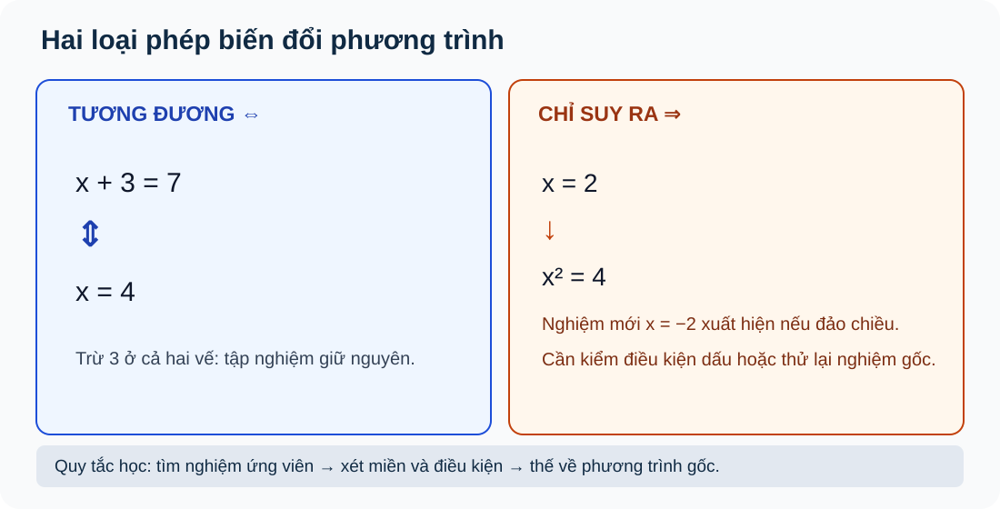
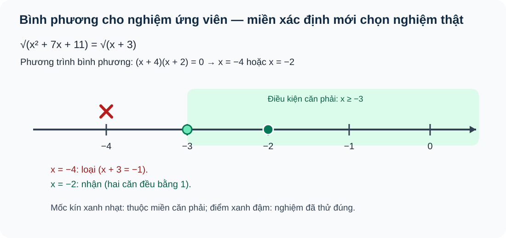
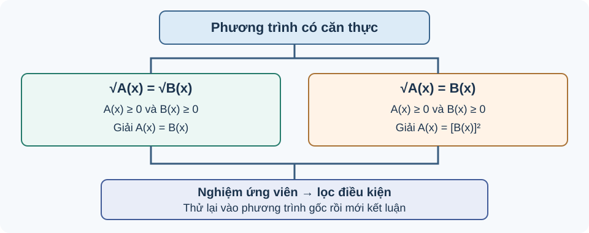

# Chuyên đề 03 · Phương trình đại số và kỹ thuật chuyển đổi dạng

Một phép giải đúng cần tìm đủ nghiệm mà không thêm nghiệm ngoại lai. Em sẽ học cách giữ tập nghiệm, nêu điều kiện trước khi khử mẫu hay bình phương, kiểm ứng viên và chuyển kết quả về ý nghĩa bài toán.

# Kiến thức

## 1. Giữ nguyên tập nghiệm khi biến đổi

Một bạn giải phương trình, thu được hai giá trị nhưng khi thay vào đề gốc thì chỉ một giá trị đúng. Sai sót không nhất thiết nằm ở phép tính: có thể bạn ấy đã dùng một bước **không tương đương**, như bình phương hai vế, hoặc quên điều kiện mẫu số khác 0. Vì vậy, muốn giải đúng một phương trình, ta luôn phải trả lời ba câu hỏi gắn với nhau: *Đang xét những giá trị nào? Bước biến đổi này có giữ nguyên tập nghiệm không? Nghiệm tìm được có thỏa bài toán gốc không?*

Trước hết, số thực được ký hiệu \(\mathbb R\), tập nghiệm là \(S\). Ta sẽ dùng tính chất \(ab=0\) khi và chỉ khi \(a=0\) hoặc \(b=0\); giá trị tuyệt đối \(|u|\) là khoảng cách đến 0; căn bậc hai số học \(\sqrt u\) chỉ xác định khi \(u\ge0\) và luôn không âm. Những tiền đề này sẽ được giải thích qua từng phép biến đổi, từ phương trình bậc nhất/bậc hai đến các trường hợp có phân thức và căn. Đặt ẩn phụ và mô hình thực tế được học sau cùng vì cả hai cũng phải quay lại miền giá trị ban đầu.

Để thấy khác nhau giữa biến đổi hai chiều và một chiều, hãy bắt đầu từ các phương trình đơn giản mà ta có thể tự kiểm nghiệm ngay.

<!-- LESSON_ID: TOP03-M01; OUTCOME_ID: TOP03-O01; PREVIOUS_SOURCE_BLOB: e94bbe37339f7002bd8e29bdf60e0c86fae0aa95 -->

### 1.1. Phép biến đổi tương đương

Vì sao từ \(x=3\) suy ra \(x^2=9\) nhưng không được kết luận ngược lại?

Giải phương trình không chỉ là tìm một con số trông có vẻ đúng. Ta cần tìm **tất cả** giá trị trong miền xác định chung làm hai vế bằng nhau, đồng thời không để phép biến đổi nào làm mất hoặc sinh thêm nghiệm. Nếu hai phương trình có đúng cùng tập nghiệm trên miền đang xét, chúng là những phương trình tương đương.

> **ĐỊNH NGHĨA — Hai phương trình tương đương.** Hai phương trình được gọi là *tương đương* trên một miền xác định khi và chỉ khi chúng có **cùng tập nghiệm trên miền đó**; ký hiệu \(\Leftrightarrow\). Mỗi bước biến đổi tương đương phải có chiều suy luận ngược hợp lệ trên miền đang xét.

Với \(x+5=12\), trừ cùng 5 ở hai vế cho \(x=7\); làm ngược lại bằng cách cộng 5 sẽ khôi phục phương trình ban đầu, nên đây là biến đổi tương đương. Nhưng từ \(x=3\) suy ra \(x^2=9\) chỉ là một chiều: phương trình sau còn có \(x=-3\), vốn không thỏa câu đầu. Cùng lý do đó, khi giải phương trình chứa căn và phải bình phương, ta phải giữ điều kiện và **thử nghiệm trở lại đề gốc**.

**Ví dụ**

**Đề bài.** Giải phương trình \(5x-7=3\) và chứng tỏ phép biến đổi giữ tập nghiệm.

**Lời giải.** Cộng 7 vào hai vế được \(5x=10\), rồi chia cho \(5\ne0\) được \(x=2\). Cả hai thao tác đều có phép ngược, nên các phương trình tương đương. Thử \(5\cdot2-7=3\).

**Vận dụng**

Giải \(3x+2=11\). Vì sao hai bước chuyển vế và chia cho 3 không làm đổi tập nghiệm?

Đối chiếu

Trừ 2 ở hai vế được \(3x=9\); chia cho \(3\ne0\) được \(x=3\). Cả hai bước đều có phép ngược hợp lệ. Thử lại: \(3\cdot3+2=11\). Nếu em dùng dấu tương đương cho phép bình phương mà không kiểm điều kiện, hãy so trường hợp \(x=3\) và \(x=-3\) ở ví dụ trên.

**Kiểm lỗi**

Nếu em chỉ tìm một nghiệm sau khi biến đổi hoặc đặt dấu tương đương cho một phép bình phương không có chiều ngược, hãy đọc lại **Kiến thức 1.1**, rồi giải **Bài 1** và **Bài 2** trong Luyện tập. Kiểm từng nghiệm bằng cách thế vào phương trình ban đầu; phân biệt phép trừ/chia hằng số khác 0 với bước có thể sinh nghiệm ngoại lai.

<!-- LESSON_ID: TOP03-M02; OUTCOME_ID: TOP03-O02; PREVIOUS_SOURCE_BLOB: e94bbe37339f7002bd8e29bdf60e0c86fae0aa95 -->

### 1.2. Phương trình bậc nhất có tham số

Nếu hệ số của x là tham số có thể bằng 0, tại sao không được vội chia?

> **PHƯƠNG PHÁP — Phương trình bậc nhất có tham số.** Ngay cả phương trình bậc nhất cũng có thể đổi bản chất khi hệ số của ẩn bằng không. Nếu chia ngay cho hệ số chứa tham số, ta có thể mất cả trường hợp vô số nghiệm. Với \(ax=b\): nếu \(a\ne0\) có nghiệm duy nhất \(x=\frac ba\); nếu \(a=0,\ b\ne0\) thì vô nghiệm; nếu \(a=b=0\) thì mọi \(x\in\mathbb R\) đều là nghiệm. Khi a có chứa tham số m, phải xét \(a=0\) trước.

Chẳng hạn, giải \(m(x-2)=0\): nếu \(m\ne0\) thì \(x=2\); nếu \(m=0\) thì \(0=0\) với mọi x. Không thể chia cả hai vế cho m khi chưa biết \(m\ne0\).

**Ví dụ**

**Đề bài.** Biện luận \(m(x-2)=m-1\) trên \(\mathbb R\).

**Lời giải.** Nếu \(m=0\) thì \(0=-1\), phương trình **vô nghiệm**. Nếu \(m\ne0\), chia cho m được \(x-2=1-\frac1m\), hay \(x=3-\frac1m\). Tách \(m=0\) trước để không chia cho 0.

**Vận dụng**

Giải \(a(x-1)=0\) theo tham số a.

Đối chiếu

Nếu \(a\ne0\) thì \(x=1\); nếu \(a=0\) thì mọi \(x\in\mathbb R\) đều là nghiệm.

Nếu quên trường hợp hệ số 0, đặt \(a=0\) và thử \(x=6\); làm lại Bài 3 và Bài 4 trong phần Luyện tập.

<!-- LESSON_ID: TOP03-M03; OUTCOME_ID: TOP03-O03; PREVIOUS_SOURCE_BLOB: e94bbe37339f7002bd8e29bdf60e0c86fae0aa95 -->

### 1.3. Tích bằng 0, tránh làm mất nghiệm

Chia cả hai vế cho \(x-2\) có thể làm mất nghiệm nào?

Khi một biểu thức được tách thành tích, tính chất tích bằng không giúp nhìn thấy nhiều nghiệm. Đưa phương trình về tích làm lộ nhiều nghiệm, nhưng chia cho một nhân tử có thể làm mất nghiệm ngay tại nhân tử ấy. Ta bắt đầu từ tính chất \(ab=0\) khi và chỉ khi \(a=0\) hoặc \(b=0\).

> **TÍNH CHẤT — Tích bằng không.** Trên miền mà cả hai biểu thức \(A(x)\), \(B(x)\) đều có nghĩa, \(A(x)B(x)=0\) khi và chỉ khi \(A(x)=0\) **hoặc** \(B(x)=0\). Không được chia cho \(A(x)\) khi chưa loại trường hợp \(A(x)=0\).

Nghiệm kép khác với hai nghiệm thực phân biệt. Chia cho \(A(x)\) chỉ hợp lệ khi \(A(x)\ne0\); nếu không phải tách trường hợp \(A(x)=0\).

Xét ví dụ: \(x^2-x-6=0\Leftrightarrow (x-3)(x+2)=0\), suy ra \(x\in\{3;-2\}\). Nếu vội chia cho \(x-3\) sẽ làm mất \(x=3\); vì thế ưu tiên quy tắc tích bằng 0.

**Ví dụ**

**Đề bài.** Giải \((x+2)(3x-1)=0\).

**Lời giải.** Theo tính chất tích bằng 0, \(x+2=0\) hoặc \(3x-1=0\). Vậy \(S=\{-2;\frac13\}\). Không chia cho một thừa số chứa x, vì như vậy có thể loại mất nghiệm của chính thừa số ấy.

**Vận dụng**

Giải \((x-5)(x+1)=0\).

Đối chiếu

\(x=5\) hoặc \(x=-1\); thử vào từng thừa số.

Nếu tìm được một nghiệm mà không xét nhân tử còn lại, quay lại \(ab=0\) và làm lại Bài 5 và Bài 6 trong phần Luyện tập.

<!-- LESSON_ID: TOP03-M04; OUTCOME_ID: TOP03-O04; PREVIOUS_SOURCE_BLOB: e94bbe37339f7002bd8e29bdf60e0c86fae0aa95 -->

### 1.4. Phương trình bậc hai và biệt thức

Trường hợp biệt thức âm có nghĩa gì khi ta chỉ tìm nghiệm thực?

Phương trình \(ax^2+bx+c=0\), với \(a,b,c\in\mathbb R\) và \(a\ne0\), là **phương trình bậc hai một ẩn**. Điều kiện \(a\ne0\) rất quan trọng: nếu \(a=0\), phương trình trở thành bậc nhất hoặc suy biến và cần giải theo trường hợp trước. Để tìm tất cả nghiệm thực, ta có thể phân tích thành tích khi thuận lợi; nếu chưa nhìn thấy nhân tử, **biệt thức** cho biết phương trình có bao nhiêu nghiệm thực và cách tính chúng.

> **ĐỊNH NGHĨA — Phương trình bậc hai một ẩn.** Phương trình có dạng \(ax^2+bx+c=0\) với \(a,b,c\in\mathbb R\), \(a\ne0\). Nghiệm là giá trị \(x\in\mathbb R\) khiến hai vế bằng nhau.

> **CÔNG THỨC — Nghiệm theo biệt thức.** Đặt \(\Delta=b^2-4ac\). Nếu \(\Delta>0\), có hai nghiệm phân biệt \(x=\dfrac{-b\pm\sqrt{\Delta}}{2a}\); nếu \(\Delta=0\), có nghiệm kép \(x=-\dfrac b{2a}\); nếu \(\Delta<0\), không có nghiệm thực. Khi giải một phương trình vốn có mẫu hoặc căn bằng phép quy về bậc hai, nghiệm tìm được vẫn phải kiểm lại điều kiện của bài gốc.

Khi hệ số của \(x\) là số chẵn, ta có thể dùng **biệt thức thu gọn** để tính ngắn hơn. Viết \(b=2b'\) (nghĩa là \(b'=\frac b2\)); khi đó phương trình \(ax^2+bx+c=0\) với \(a\ne0\) chính là \(ax^2+2b'x+c=0\). Không được tính \(\Delta'\) bằng cách thay nhầm \(b\) cho \(b'\), vì \(\Delta=4\Delta'\).

> **CÔNG THỨC — Biệt thức thu gọn và nghiệm tương ứng.** Với \(a\ne0\), \(b=2b'\), đặt \(\Delta'=(b')^2-ac\). Nếu \(\Delta'>0\) thì phương trình có hai nghiệm \(x=\dfrac{-b'\pm\sqrt{\Delta'}}{a}\); nếu \(\Delta'=0\) thì có một nghiệm kép \(x=-\dfrac{b'}{a}\); nếu \(\Delta'<0\) thì không có nghiệm thực. Hai biệt thức \(\Delta=b^2-4ac\) và \(\Delta'=(b')^2-ac\) đưa ra **cùng một tập nghiệm**, chỉ khác cách tính.

Chẳng hạn, \(2x^2-8x+6=0\) có \(a=2,b'=-4,c=6\) nên \(\Delta'=16-12=4\), nghiệm \(x=\dfrac{4\pm2}{2}\), tức \(x=1\) hoặc \(x=3\); thế lại đều cho giá trị 0. Trong xét dấu tam thức, chính những nghiệm này là các mốc chia khoảng, không vì dùng \(\Delta'\) mà đổi quy tắc xét dấu.

Hãy kiểm tra trường hợp sau: \(x^2-4x+3=0\). Ta có \(\Delta=16-12=4>0\), nên \(x=\frac{4\pm2}{2}\in\{1;3\}\). Có thể kiểm bằng cách phân tích thành \((x-1)(x-3)=0\). Hai cách giải tương đương cho chính phương trình bậc hai này.

**Ví dụ**

**Đề bài.** Giải \(2x^2-3x-2=0\) trên \(\mathbb R\).

**Lời giải.** Với \(a=2,b=-3,c=-2\), \(\Delta=b^2-4ac=9+16=25>0\). Hai nghiệm \(\frac{3\pm5}{4}\) là \(2\) và \(-\frac12\). Có thể đối chiếu bằng \((2x+1)(x-2)=0\).

**Vận dụng**

Giải \(x^2+4x+4=0\).

Đối chiếu

\((x+2)^2=0\Rightarrow x=-2\) (nghiệm kép), không phải hai giá trị khác nhau.

Nếu \(\Delta<0\) mà em vẫn tìm ra nghiệm thực, hãy thử hoàn thành bình phương. Ví dụ \(-x^2-1=0\Leftrightarrow x^2+1=0\). Vì \(x^2+1\ge1>0\) với mọi số thực x, phương trình vô nghiệm. Nếu hệ số bậc hai âm, đổi dấu cả hai vế trước khi xét tổng dương nghiêm ngặt; chỉ không âm thì chưa đủ để kết luận vô nghiệm. Làm lại Bài 7 và Bài 8 trong phần Luyện tập.

## 2. Điều kiện xác định và phép biến đổi

Các phép cộng và trừ cùng một lượng ở hai vế thường có thể đi ngược trở lại, nhưng chia cho một biểu thức chỉ hợp lệ khi biểu thức ấy **khác 0**. Với giá trị tuyệt đối, một biểu thức dương hay âm có thể tạo ra cùng một kết quả, nên không thể tùy tiện bỏ hai vạch. Từ đây, ta thấy "đưa về phương trình quen thuộc" luôn phải đi cùng việc **giữ lại miền xác định**.

<!-- LESSON_ID: TOP03-M05; OUTCOME_ID: TOP03-O05; PREVIOUS_SOURCE_BLOB: e94bbe37339f7002bd8e29bdf60e0c86fae0aa95 -->

### 2.1. Giải phương trình phân thức

Tại sao rút gọn phân thức không được phép nhận một giá trị làm mẫu số bằng 0?

> **PHƯƠNG PHÁP — Giải phương trình phân thức.** Khử mẫu rất nhanh nhưng chỉ đúng trên miền mẫu khác 0; một phép rút gọn có thể làm mất dấu vết điểm biểu thức gốc vô nghĩa. Đầu tiên xét **mọi mẫu số khác 0**. Khi nhân hai vế với mẫu \(M(x)\), phép biến đổi tương đương chỉ đúng trên miền \(M(x)\ne0\). Giải phương trình kết quả, loại các nghiệm làm mẫu bằng 0 và thay thử. Điều kiện của phân thức luôn phải được giữ đến cuối lời giải.

Chẳng hạn, \(\frac{x+1}{x-3}=2\), điều kiện \(x\ne3\). Nhân hai vế với \(x-3\) được \(x+1=2x-6\Rightarrow x=7\); thử \(\frac{7+1}{7-3}=\frac84=2\). Nếu nghiệm \(x=3\) xuất hiện, phải loại chứ không được chia cho 0.

**Ví dụ**

**Đề bài.** Giải \(\frac{x^2-1}{x-1}=0\) trên \(\mathbb R\).

**Lời giải.** Điều kiện \(x\ne1\). Tử số \((x-1)(x+1)=0\) cho ứng viên \(1,-1\); loại \(1\) vì mẫu bằng 0. Thay \(x=-1\), tử bằng 0, mẫu bằng \(-2\ne0\). Vậy \(S=\{-1\}\).

**Vận dụng**

Giải \(\frac{x^2-9}{x-3}=0\).

Đối chiếu

Điều kiện \(x\ne3\). Tử số \((x-3)(x+3)=0\) cho 3 hoặc −3; loại 3, nghiệm duy nhất −3.

Nếu rút gọn rồi kết luận nhận \(x=3\), thay \(x=3\) vào mẫu để thấy vô nghĩa; làm lại Bài 9 và Bài 10 trong phần Luyện tập.

<!-- LESSON_ID: TOP03-M06; OUTCOME_ID: TOP03-O06; PREVIOUS_SOURCE_BLOB: e94bbe37339f7002bd8e29bdf60e0c86fae0aa95 -->

### 2.2. Phương trình có giá trị tuyệt đối

Từ \(\lvert x-1\rvert=3\), tại sao phải xét cả hai nhánh?

> **PHƯƠNG PHÁP — Phương trình có giá trị tuyệt đối.** Giá trị tuyệt đối luôn không âm và \(\lvert u\rvert\) là khoảng cách đến 0 trên trục số. Nếu \(\lvert A\rvert=c\) với c là hằng số: \(c<0\) thì vô nghiệm; \(c\ge0\) thì giải \(A=\pm c\) (hai nhánh trùng khi \(c=0\)). Nếu \(\lvert A(x)\rvert=B(x)\), cần \(B(x)\ge0\) rồi tách \(A(x)=B(x)\) hoặc \(A(x)=-B(x)\), **kiểm lại điều kiện trên từng nhánh**. Nhờ phân nhánh đúng theo dấu, ta không bỏ sót nghiệm.

Chẳng hạn, \(\lvert x-1\rvert=3\) cho \(x-1=3\) hoặc \(x-1=-3\), nên \(x=4\) hoặc \(x=-2\); cả hai có khoảng cách đến 1 bằng 3. Không thể chỉ lấy \(x=4\).

**Ví dụ**

**Đề bài.** Giải \(|x+2|=4\).

**Lời giải.** Vì \(4\ge0\), ta xét \(x+2=4\) hoặc \(x+2=-4\), được \(x=2\) hoặc \(x=-6\). Thử lại cả hai đều cho khoảng cách đến \(-2\) bằng 4. Không chỉ chọn nhánh dương.

**Vận dụng**

Giải \(\lvert x+3\rvert=x+3\).

Đối chiếu

Vì \(\lvert u\rvert=u\) khi và chỉ khi \(u\ge0\), ta có \(x+3\ge0\Rightarrow x\ge-3\). Thử \(x=-4\) cho \(\lvert-1\rvert=1\ne-1\).

Nếu quên điều kiện \(B\ge0\), thử một x làm B âm; làm lại Bài 11 và Bài 12 trong phần Luyện tập.

## 3. Kiểm nghiệm ứng viên sau bình phương

Một **phương trình chứa căn thức** là phương trình có ẩn xuất hiện trong biểu thức dưới dấu căn, chẳng hạn \(\sqrt{x+2}=x\). Trong chuyên đề này ta tập trung vào hai dạng quan trọng: \(\sqrt{A(x)}=\sqrt{B(x)}\) và \(\sqrt{A(x)}=C(x)\), trong đó \(A,B,C\) là các biểu thức được nêu rõ theo \(x\). Với các căn bậc hai số học, biểu thức dưới căn phải không âm. Khi giải các dạng đó, bình phương giúp đưa bài toán về phương trình đại số, nhưng phép bình phương **không giữ lại thông tin về dấu**: từ \(A=B\) suy ra \(A^2=B^2\), chiều ngược không luôn đúng. Vì vậy nghiệm sau bình phương mới chỉ là **ứng viên**. Ta sẽ so sánh hai căn bằng nhau với một căn bằng biểu thức, giải thích điều kiện của từng dạng, rồi lọc nghiệm qua miền và phép thay trực tiếp.

<!-- LESSON_ID: TOP03-M07; OUTCOME_ID: TOP03-O07; PREVIOUS_SOURCE_BLOB: e94bbe37339f7002bd8e29bdf60e0c86fae0aa95 -->

### 3.1. Bình phương có thể sinh nghiệm ngoại lai

Vì sao nghiệm của phương trình bình phương chưa chắc là nghiệm phương trình chứa căn?

Đây là nguyên nhân chính của nghiệm ngoại lai khi giải phương trình chứa căn. Điểm xuất phát là dấu không âm của \(\sqrt A\). Từ \(A=B\) suy ra \(A^2=B^2\); chiều đảo không đúng nếu A và B có thể trái dấu.

> **TÍNH CHẤT — Bình phương hai vế.** Với hai biểu thức thực có nghĩa, từ \(U=V\) luôn suy ra \(U^2=V^2\). Chiều ngược lại không bắt buộc đúng: \(U^2=V^2\) chỉ cho \(U=V\) hoặc \(U=-V\). Vì vậy, bình phương hai vế của phương trình có thể tạo thêm ứng viên, không được coi là phép biến đổi tương đương nếu thiếu điều kiện về dấu.

Khi vế trái là một căn bậc hai số học, nó không âm; nếu vế phải âm thì ứng viên tìm được sau bình phương phải bị loại. Ta sẽ phát biểu đầy đủ điều kiện tương đương cho hai dạng phương trình chứa căn ở hai mục tiếp theo, rồi kiểm nghiệm vào phương trình gốc.

Chẳng hạn, \(\sqrt{x+3}=x-1\) đòi hỏi \(x\ge1\). Bình phương được \(x+3=(x-1)^2\Rightarrow x^2-3x-2=0\), nên \(x=\frac{3\pm\sqrt{17}}2\). Chỉ \(x=\frac{3+\sqrt{17}}2\ge1\) thỏa; nghiệm còn lại cho vế phải âm nên ngoại lai.

*Quan sát hình:* Phân biệt mũi tên hai chiều khi giữ nguyên tập nghiệm với mũi tên một chiều khi bình phương có thể sinh nghiệm ngoại lai; luôn thử vào phương trình đầu.

**Ví dụ**

**Đề bài.** Giải \(\sqrt{x+4}=x-2\) trên \(\mathbb R\).

**Lời giải.** Điều kiện cần là \(x-2\ge0\), tức \(x\ge2\). Bình phương được \(x+4=(x-2)^2\), hay \(x(x-5)=0\), cho ứng viên \(0,5\). Loại 0 vì vế phải âm; với 5, \(\sqrt9=3=5-2\). Vậy \(S=\{5\}\).

**Vận dụng**

Giải \(\sqrt{x+1}=x\).

Đối chiếu

Điều kiện \(x\ge0\); bình phương được \(x+1=x^2\Rightarrow x=\frac{1\pm\sqrt5}2\). Chỉ \(x=\frac{1+\sqrt5}2\ge0\) được nhận.

Nếu hai nghiệm sau bình phương đều được nhận, thử nghiệm âm và so dấu hai vế; làm lại Bài 19 và Bài 20 trong phần Luyện tập.

<!-- LESSON_ID: TOP03-M08; OUTCOME_ID: TOP03-O08; PREVIOUS_SOURCE_BLOB: e94bbe37339f7002bd8e29bdf60e0c86fae0aa95 -->

### 3.2. Hai căn bậc hai và điều kiện đồng thời

Với hai căn cùng bằng nhau, phải kiểm điều kiện của những biểu thức nào?

> **TÍNH CHẤT — Hai căn bậc hai và điều kiện đồng thời.** Căn \(\sqrt u\) xác định khi \(u\ge0\). Hai căn bậc hai số học có nghĩa và bằng nhau khi và chỉ khi các biểu thức dưới căn bằng nhau và không âm. Với \(\sqrt{A(x)}=\sqrt{B(x)}\) trên \(\mathbb R\), điều kiện tương đương là **\(A(x)=B(x)\) và \(A(x)\ge0\)** (khi hai biểu thức bằng nhau, B cũng không âm). Có thể ghi riêng \(A(x)\ge0\), \(B(x)\ge0\) để dễ kiểm. Chỉ giải \(\lvert A(x)\rvert=\lvert B(x)\rvert\) là chưa đủ: chẳng hạn \(A=-1,\ B=1\) có cùng giá trị tuyệt đối nhưng căn của A không xác định trên \(\mathbb R\). Tìm ứng viên từ \(A(x)=B(x)\), lọc miền rồi thế lại.

Xét ví dụ sát hình trục số: \(\sqrt{x^2+7x+11}=\sqrt{x+3}\). Hai vế đều là căn số học nên, **sau khi ghi điều kiện xác định**, ta giải \(x^2+7x+11=x+3\), hay \((x+2)(x+4)=0\), được các ứng viên \(x=-2,-4\). Điều kiện từ căn phải đòi \(x\ge-3\): loại \(-4\); với \(-2\), cả hai biểu thức dưới căn bằng 1, nên hai vế đều bằng 1. Do đó nghiệm duy nhất là \(x=-2\). Việc kiểm căn trái và thay lại cho thấy không bỏ sót điều kiện ẩn.

*Đọc trục số:* Đầu mút \(-3\) được tô kín vì thuộc miền \(x\ge-3\) của căn phải; đó không phải nghiệm của phương trình. Dấu gạch đỏ đánh dấu ứng viên \(-4\) bị loại, còn điểm xanh đậm \(-2\) là ứng viên được nhận vì hai căn đều bằng 1 khi thay lại. Hình không thay phép kiểm biểu thức dưới căn trái.

**Ví dụ**

**Đề bài.** Giải \(\sqrt{x^2+4x+5}=\sqrt{x+5}\) trên \(\mathbb R\).

**Lời giải.** Hai căn xác định khi \(x+5\ge0\) và \(x^2+4x+5\ge0\); điều kiện thứ hai luôn đúng vì \((x+2)^2+1>0\). Bình phương hai căn được \(x^2+3x=0\), nên \(x=0\) hoặc \(x=-3\). Cả hai thỏa \(x\ge-5\) và khi thế vào thì hai biểu thức dưới căn bằng nhau, không âm. Vậy \(S=\{-3;0\}\). Hình trục số phía trên minh họa một trường hợp *khác*, có ứng viên \(-4\) bị loại.

**Vận dụng**

Giải \(\sqrt{x^2+5}=\sqrt{4x+2}\).

Đối chiếu

Miền \(x\ge-\frac12\). Bình phương được \(x^2+5=4x+2\Rightarrow (x-1)(x-3)=0\), nên \(x=1\) hoặc \(x=3\); cả hai hợp miền, thử được \(\sqrt6\) và \(\sqrt{14}\) tương ứng ở mỗi vế.

Nếu quên một miền căn, thay ứng viên \(-4\) trong ví dụ trên vào \(x+3\) để thấy biểu thức dưới căn âm; làm lại Bài 21, Bài 14 và Bài 18 trong phần Luyện tập.

<!-- LESSON_ID: TOP03-M09; OUTCOME_ID: TOP03-O09; PREVIOUS_SOURCE_BLOB: e94bbe37339f7002bd8e29bdf60e0c86fae0aa95 -->

### 3.3. Một căn bằng một biểu thức

Vì sao vế phải của phương trình \(\sqrt A=B\) phải không âm?

> **TÍNH CHẤT — Một căn bằng một biểu thức.** Căn số học không âm, nên không thể bằng số âm dù phương trình sau bình phương thỏa. Trước hết, hãy nhớ căn \(\sqrt u\) không âm và công thức giải phương trình bậc hai. \(\sqrt A=B\) tương đương với **\(B\ge0\) và \(A=B^2\)** trên \(\mathbb R\); khi \(A=B^2\ge0\) thì căn cũng xác định. Có thể ghi thêm \(A\ge0\), nhưng đó không phải điều kiện độc lập mới. Giải ứng viên từ \(A=B^2\), lọc dấu B rồi thử gốc.

Hãy kiểm tra trường hợp sau: \(\sqrt{3x+1}=x-1\) đòi hỏi \(x\ge1\). Bình phương được \(3x+1=(x-1)^2\Rightarrow x^2-5x=0\), nên \(x=0\) hoặc \(x=5\). Loại 0, nhận 5 vì \(\sqrt{16}=4=5-1\).

**Ví dụ**

**Đề bài.** Giải \(\sqrt{x+6}=x\).

**Lời giải.** Vì căn bậc hai số học không âm nên vế phải phải thỏa \(x\ge0\); khi đó \(x+6\ge6>0\), căn có nghĩa. Bình phương hai vế được \(x+6=x^2\), hay \((x-3)(x+2)=0\). Hai ứng viên là \(x=3\) và \(x=-2\); loại \(-2\) vì không thỏa \(x\ge0\). Thử trực tiếp \(x=3\): \(\sqrt{3+6}=3\), đúng bằng vế phải. Vậy tập nghiệm là \(S=\{3\}\).

**Vận dụng**

Giải \(\sqrt{2x+7}=x+1\).

Đối chiếu

Cần \(x\ge-1\). Bình phương được \(x^2-6=0\Rightarrow x=\pm\sqrt6\); chỉ \(x=\sqrt6\ge-1\) đạt, nghiệm âm bị loại. Thử căn bằng \(\sqrt6+1\).

Nếu chỉ dùng điều kiện \(A\ge0\) rồi giữ nghiệm B âm, thử gốc sẽ sai; làm lại Bài 22, Bài 13, Bài 15 và Bài 16 trong phần Luyện tập.

<!-- LESSON_ID: TOP03-M10; OUTCOME_ID: TOP03-O10; PREVIOUS_SOURCE_BLOB: e94bbe37339f7002bd8e29bdf60e0c86fae0aa95 -->

### 3.4. Lọc ứng viên bằng điều kiện và thế ngược

Muốn chắc một nghiệm không ngoại lai, phép kiểm cuối cùng phải dùng phương trình nào?

Như vậy, một nghiệm xuất hiện sau bình phương mới là ứng viên, chưa hẳn nghiệm thật. Một phương trình bình phương có nghiệm không có nghĩa phương trình gốc có nghiệm. Ta có thể sử dụng quy trình \(\sqrt A=\sqrt B\) và \(\sqrt A=B\), luôn ghi điều kiện xác định. Lập **bảng ứng viên**: nghiệm của phương trình biến đổi → điều kiện miền → điều kiện dấu của vế phải → thay thử gốc. Đặc biệt với hai căn, ứng viên có thể nằm ngoài miền xác định; với một căn bằng biểu thức, có thể sai do dấu. Phương trình vẫn có thể vô nghiệm sau khi lọc.

Chẳng hạn, \(\sqrt{x+6}=x-2\): điều kiện \(x\ge2\). Bình phương được \(x+6=(x-2)^2\Rightarrow x^2-5x-2=0\), nghiệm \(\frac{5\pm\sqrt{33}}2\). Chỉ nghiệm dương lớn hơn 2 hợp lệ; nghiệm âm là ngoại lai do vế phải âm. Với \(r=\frac{5+\sqrt{33}}2\), ta có \(r+6=(r-2)^2\) và \(r-2>0\), nên \(\sqrt{r+6}=r-2\).

> **PHƯƠNG PHÁP — Lọc ứng viên bằng điều kiện và thế ngược.** *Đọc sơ đồ:* Nhánh \(\sqrt A=\sqrt B\) cần hai biểu thức dưới căn không âm; nhánh \(\sqrt A=B\) còn cần \(B\ge0\). Cả hai đều phải kiểm nghiệm ứng viên trở lại phương trình ban đầu. Hãy đọc hai nhánh trên hình từ bước kiểm miền xác định, rồi chỉ nhận nghiệm sau khi đối chiếu phương trình ban đầu.

**Ví dụ**

**Đề bài.** Giải \(\sqrt{x+1}=x-3\).

**Lời giải.** Phải có \(x\ge3\). Bình phương cho \(x+1=(x-3)^2\), tức \(x^2-7x+8=0\), nên có hai ứng viên \(r_-=\frac{7-\sqrt{17}}2\) và \(r_+=\frac{7+\sqrt{17}}2\). Ta kiểm từng ứng viên như sau.

| Ứng viên | Điều kiện \(x\ge3\) | Thế lại phương trình gốc |
|---|---|---|
| \(r_-\) | Không thỏa vì \(\sqrt{17}>1\) | Vế phải âm; loại. |
| \(r_+\) | Thỏa | Vì \(r_++1=(r_+-3)^2\) và \(r_+-3>0\), nên \(\sqrt{r_++1}=r_+-3\); nhận. |

Vậy \(S=\left\{\frac{7+\sqrt{17}}2\right\}\). Với nghiệm vô tỉ, có thể kiểm bằng đẳng thức và dấu như trên, không cần làm tròn.

**Vận dụng**

Giải \(\sqrt{x^2+5}=x-2\) trong \(\mathbb R\).

Đối chiếu

Điều kiện \(x\ge2\). Bình phương được \(x^2+5=x^2-4x+4\Rightarrow x=-\frac14\), trái miền. Vậy \(S=\varnothing\), không nhận ứng viên.

Nếu kết luận nghiệm chỉ bằng giải phương trình sau bình phương, hãy lập bảng ‘ứng viên→miền→dấu→gốc’; làm lại Bài 23, Bài 24 và Bài 25 trong phần Luyện tập.

## 4. Đổi biến và kiểm ý nghĩa thực tế

Khi một phương trình quá phức tạp, ta có thể đặt ẩn phụ để nhìn cấu trúc quen thuộc hơn. Nhưng sau khi giải theo ẩn mới, phải kiểm miền của ẩn ấy rồi **đổi trở lại** biến ban đầu. Điều tương tự xảy ra với bài toán thực tế: ẩn đại diện cho chiều dài, thời gian hoặc vận tốc phải mang đúng đơn vị và điều kiện, nên không thể lấy mọi nghiệm đại số làm đáp số.

<!-- LESSON_ID: TOP03-M11; OUTCOME_ID: TOP03-O11; PREVIOUS_SOURCE_BLOB: e94bbe37339f7002bd8e29bdf60e0c86fae0aa95 -->

### 4.1. Đặt ẩn phụ là bình phương, nhớ điều kiện không âm

Khi đặt \(t=x^2\), một nghiệm t âm phải xử lí ra sao?

> **PHƯƠNG PHÁP — Đặt ẩn phụ là bình phương.** Một phương trình bậc bốn đôi khi trở thành bậc hai nhưng nghiệm ẩn phụ âm không có nghĩa trên \(\mathbb R\). Với \(x^4+px^2+q=0\), đặt \(t=x^2\ge0\). Giải \(t^2+pt+q=0\), **lọc \(t\ge0\)**, rồi giải \(x^2=t\): \(t=0\) cho \(x=0\), \(t>0\) cho \(x=\pm\sqrt t\). Phép đổi biến chỉ có ý nghĩa khi giữ điều kiện \(t\ge0\) và trả kết quả về ẩn x.

Chẳng hạn, \(x^4-10x^2+9=0\Rightarrow t^2-10t+9=(t-1)(t-9)=0\). Do đó \(t=1\) hoặc \(t=9\), nên \(x=\pm1\) hoặc \(x=\pm3\). Không nhận t âm.

**Ví dụ**

**Đề bài.** Giải \(x^4-13x^2+36=0\) trên \(\mathbb R\).

**Lời giải.** Đặt \(t=x^2\ge0\), ta có \(t^2-13t+36=(t-4)(t-9)=0\). Hai giá trị \(t=4,9\) đều không âm; quay về ẩn gốc cho \(x=\pm2,\pm3\). Nếu \(t<0\), phải loại vì bình phương số thực không âm.

**Vận dụng**

Giải \(x^4-2x^2-3=0\).

Đối chiếu

\(t=x^2\ge0\); \(t^2-2t-3=(t-3)(t+1)=0\). Chỉ \(t=3\) hợp lệ, nên \(x=\pm\sqrt3\).

Nếu suy \(x^2=-1\) có nghiệm thực, kiểm tính không âm của bình phương; làm lại Bài 28 và Bài 29 trong phần Luyện tập.

<!-- LESSON_ID: TOP03-M12; OUTCOME_ID: TOP03-O12; PREVIOUS_SOURCE_BLOB: e94bbe37339f7002bd8e29bdf60e0c86fae0aa95 -->

### 4.2. Mô hình hóa và giữ đơn vị

Vì sao nghiệm âm có thể đúng đại số nhưng sai với chiều dài hoặc vận tốc?

> **PHƯƠNG PHÁP — Mô hình hóa và giữ đơn vị.** Cuối cùng, nghiệm đại số phải quay về đúng đại lượng và đơn vị của tình huống thực tế. Trong hình học và chuyển động, nghiệm âm hay thời gian vô nghĩa không thể dùng làm đáp án. Điểm xuất phát là định lí Pythagore và quan hệ thời gian bằng quãng đường chia cho vận tốc. Ghi biến, đơn vị và điều kiện **trước** phương trình. Chọn mô hình căn độ dài nếu cạnh huyền, phân thức nếu thời gian; giải thành phương trình đại số, lọc điều kiện, kiểm tính đúng của cả số lẫn đơn vị.

Chẳng hạn, tam giác vuông có hai cạnh góc vuông \(x>0\) và \(x+7\) mét, cạnh huyền 13 mét: \(\sqrt{x^2+(x+7)^2}=13\). Bình phương được \(2x^2+14x+49=169\Rightarrow x^2+7x-60=0\Rightarrow (x+12)(x-5)=0\). Nhận \(x=5\), loại −12; ba cạnh 5, 12, 13 m, thử \(25+144=169\).

**Ví dụ**

**Đề bài.** Một tam giác vuông có hai cạnh góc vuông dài \(x>0\) mét và \(x+17\) mét, cạnh huyền 25 mét. Tìm các cạnh góc vuông.

**Lời giải.** Đặt điều kiện \(x>0\); theo Pythagore, \(x^2+(x+17)^2=25^2\). Suy ra \(x^2+17x-168=(x+24)(x-7)=0\), nên \(x=-24\) hoặc \(7\). Loại số âm; với \(x=7\), cạnh còn lại 24 m và \(7^2+24^2=25^2\).

**Vận dụng**

Một xe đi 90 km với tốc độ \(v>0\); nếu tăng 15 km/h thì nhanh hơn 1 giờ. Tìm v.

Đối chiếu

Gọi v là vận tốc cũ (km/h). Thời gian cũ là \(\frac{90}{v}\) giờ, thời gian mới là \(\frac{90}{v+15}\) giờ. Hiệu thời gian cũ trừ thời gian mới bằng 1 giờ, nên \(\frac{90}{v}-\frac{90}{v+15}=1\Rightarrow v^2+15v-1350=0\Rightarrow (v-30)(v+45)=0\). Lọc \(v>0\), nhận \(v=30\,\mathrm{km/h}\); thời gian lần lượt là 3 giờ và 2 giờ.

Nếu quên miền vật lý hoặc điều kiện \(v(v+15)\ne0\), đặt biến và đơn vị lại rồi thử số; làm lại Bài 30, Bài 26, Bài 27 và Bài 31 trong phần Luyện tập.

> **Kiến thức cần ghi nhớ**
>
> - **Tương đương** có nghĩa là giữ nguyên tập nghiệm trên miền xác định, không chỉ suy ra một chiều. Nhân hoặc chia cho biểu thức có thể bằng 0 phải tách trường hợp.
> - **Tích bằng 0:** \(A(x)B(x)=0\) khi \(A(x)=0\) hoặc \(B(x)=0\), với các biểu thức có nghĩa.
> - **Phân thức và căn:** luôn ghi miền xác định trước khi khử mẫu hoặc bình phương; với \(\sqrt A=B\), thêm \(B\ge0\) và \(A=B^2\). Nghiệm sau phép bình phương chỉ là ứng viên cho đến khi kiểm lại đề gốc.
> - **Đổi biến và bài toán thực tế:** đặt \(t=x^2\) thì \(t\ge0\); nghiệm cần thỏa điều kiện của đại lượng và đơn vị ban đầu.

# Luyện tập

Em hãy làm từng bài trước khi mở **Lời giải**. Khi bình phương hoặc khử mẫu, ghi điều kiện và kiểm từng nghiệm ứng viên bằng cách thay vào phương trình gốc. Với tự luận, tự so các bước theo rubric sau khi hoàn thành.

## 1. Phép biến đổi và phương trình cơ bản

<!-- DISPLAY_ONLY_CANONICAL: THPT-TOP03-ADD01; ORIGINAL_BLOB: fd85d7056f3b934f4599727f8c6da173cf05cd65; OUTCOME: TOP03-O01; NOT_NEW_SOURCE -->

**Bài 1.**

Giải \(2x+6=14\) và chỉ rõ phép biến đổi tương đương.

Lời giải

**Đáp án:** \(S=\{4\}\).

Trừ 6 ở cả hai vế: \(2x=8\); chia \(2>0\) (với phương trình, chỉ cần chia số khác 0) được \(x=4\). Thay \(2\cdot4+6=14\). Cả hai bước đều đảo ngược được nên tập nghiệm giữ nguyên.

<!-- DISPLAY_ONLY_CANONICAL: THPT-TOP03-ADD02; ORIGINAL_BLOB: fd85d7056f3b934f4599727f8c6da173cf05cd65; OUTCOME: TOP03-O01; NOT_NEW_SOURCE -->

**Bài 2.**

So sánh tập nghiệm của \(x=3\) và \(x^2=9\). Có được thay kí hiệu kéo theo bằng tương đương khi bình phương không?

Lời giải

**Đáp án:** \(x=3\) có \(S_1=\{3\}\); \(x^2=9\) có \(S_2=\{-3;3\}\); không tương đương.

Từ \(x=3\) suy ra \(x^2=9\), nhưng từ \(x^2=9\) chỉ suy ra \(x=\pm3\). Phép bình phương mất thông tin dấu; muốn biến đổi hai chiều phải thêm điều kiện \(x\ge0\) trong ví dụ này.

<!-- DISPLAY_ONLY_CANONICAL: THPT-TOP03-ADD03; ORIGINAL_BLOB: fd85d7056f3b934f4599727f8c6da173cf05cd65; OUTCOME: TOP03-O02; NOT_NEW_SOURCE -->

**Bài 3.**

Giải \(3(x-2)=2x+5\) và thử lại nghiệm.

Lời giải

**Đáp án:** \(S=\{11\}\).

Khai triển \(3x-6=2x+5\Leftrightarrow x=11\). Thay: \(3\cdot9=27\) và \(2\cdot11+5=27\). Phép chuyển vế, thu gọn là tương đương trên \(\mathbb R\).

<!-- DISPLAY_ONLY_CANONICAL: THPT-TOP03-ADD04; ORIGINAL_BLOB: fd85d7056f3b934f4599727f8c6da173cf05cd65; OUTCOME: TOP03-O02; NOT_NEW_SOURCE -->

**Bài 4.**

Biện luận phương trình \(mx=2m\) theo tham số thực m.

Lời giải

**Đáp án:** Nếu \(m\ne0\) thì \(S=\{2\}\); nếu \(m=0\) thì \(S=\mathbb R\).

Với \(m\ne0\), chia cả hai vế cho m được \(x=2\). Với \(m=0\), phương trình là \(0=0\), mọi số thực đều thỏa. Không được chia cho biểu thức có thể bằng 0.

<!-- DISPLAY_ONLY_CANONICAL: THPT-TOP03-ADD05; ORIGINAL_BLOB: fd85d7056f3b934f4599727f8c6da173cf05cd65; OUTCOME: TOP03-O03; NOT_NEW_SOURCE -->

**Bài 5.**

Giải \((x-2)(2x+3)=0\).

Lời giải

**Đáp án:** \(S=\{2;-\frac32\}\).

Tích bằng 0 khi ít nhất một thừa số bằng 0. \(x-2=0\Rightarrow x=2\); \(2x+3=0\Rightarrow x=-\frac32\). Cả hai làm tích bằng 0.

<!-- DISPLAY_ONLY_CANONICAL: THPT-TOP03-ADD06; ORIGINAL_BLOB: fd85d7056f3b934f4599727f8c6da173cf05cd65; OUTCOME: TOP03-O03; NOT_NEW_SOURCE -->

**Bài 6.**

Giải \((x-1)^2(x+4)=0\); nghiệm kép có đếm là hai nghiệm phân biệt không?

Lời giải

**Đáp án:** \(S=\{1;-4\}\); chỉ 2 giá trị phân biệt.

\((x-1)^2=0\Leftrightarrow x=1\); \(x+4=0\Leftrightarrow x=-4\). Bội của nghiệm 1 là 2 nhưng tập nghiệm chỉ ghi mỗi giá trị một lần.

<!-- DISPLAY_ONLY_CANONICAL: THPT-TOP03-ADD07; ORIGINAL_BLOB: fd85d7056f3b934f4599727f8c6da173cf05cd65; OUTCOME: TOP03-O04; NOT_NEW_SOURCE -->

**Bài 7.**

Giải \(2x^2-5x-3=0\) bằng biệt thức hoặc phân tích nhân tử.

Lời giải

**Đáp án:** \(S=\{-\frac12;3\}\).

\(\Delta=(-5)^2-4\cdot2\cdot(-3)=49\). \(x=\frac{5\pm7}{4}\) cho 3 và \(-\frac12\). Đồng thời \((2x+1)(x-3)=0\); hai cách đối chiếu nhau.

<!-- DISPLAY_ONLY_CANONICAL: THPT-TOP03-ADD08; ORIGINAL_BLOB: fd85d7056f3b934f4599727f8c6da173cf05cd65; OUTCOME: TOP03-O04; NOT_NEW_SOURCE -->

**Bài 8.**

Tìm tập nghiệm thực của \(x^2+2x+5=0\); giải thích vì sao vô nghiệm.

Lời giải

**Đáp án:** \(S=\varnothing\) trên \(\mathbb R\).

\(\Delta=2^2-4\cdot1\cdot5=-16<0\), nên không có nghiệm thực; hoặc \((x+1)^2+4=0\) là bất khả thi vì vế trái ≥4.

## 2. Miền xác định của phân thức và giá trị tuyệt đối

<!-- DISPLAY_ONLY_CANONICAL: THPT-TOP03-ADD09; ORIGINAL_BLOB: fd85d7056f3b934f4599727f8c6da173cf05cd65; OUTCOME: TOP03-O05; NOT_NEW_SOURCE -->

**Bài 9.**

Giải \(\frac{x^2-4}{x-2}=0\). Giải thích vì sao \(x=2\) bị loại.

Lời giải

**Đáp án:** \(S=\{-2\}\).

Điều kiện \(x\ne2\). Tử \((x-2)(x+2)=0\) cho \(x=2\) hoặc \(x=-2\); chỉ −2 hợp miền. Rút gọn thành \(x+2=0\) chỉ được dùng trên miền \(x\ne2\), không tự lấp lỗ \(x=2\).

<!-- DISPLAY_ONLY_CANONICAL: THPT-TOP03-ADD10; ORIGINAL_BLOB: fd85d7056f3b934f4599727f8c6da173cf05cd65; OUTCOME: TOP03-O05; NOT_NEW_SOURCE -->

**Bài 10.**

Giải \(\frac1{x-1}+\frac1{x+1}=1\) trong \(\mathbb R\).

Lời giải

**Đáp án:** \(S=\{1-\sqrt2;1+\sqrt2\}\).

Điều kiện \(x\ne\pm1\). Quy đồng thành \(\frac{2x}{x^2-1}=1\); nhân với mẫu khác 0 cho \(2x=x^2-1\Rightarrow x^2-2x-1=0\Rightarrow x=1\pm\sqrt2\). Hai nghiệm đều khác ±1 nên được nhận.

<!-- DISPLAY_ONLY_CANONICAL: THPT-TOP03-ADD11; ORIGINAL_BLOB: fd85d7056f3b934f4599727f8c6da173cf05cd65; OUTCOME: TOP03-O06; NOT_NEW_SOURCE -->

**Bài 11.**

Giải \(\lvert2x-3\rvert=5\).

Lời giải

**Đáp án:** \(S=\{-1;4\}\).

Vì \(5\ge0\), \(\lvert2x-3\rvert=5\) khi và chỉ khi \(2x-3=5\) hoặc \(2x-3=-5\). Hai nhánh cho \(x=4\) và \(x=-1\); thử lại cả hai có giá trị tuyệt đối 5.

<!-- DISPLAY_ONLY_CANONICAL: THPT-TOP03-ADD12; ORIGINAL_BLOB: fd85d7056f3b934f4599727f8c6da173cf05cd65; OUTCOME: TOP03-O06; NOT_NEW_SOURCE -->

**Bài 12.**

Giải \(\lvert x-2\rvert=x\).

Lời giải

**Đáp án:** \(S=\{1\}\).

Vế trái ≥0 nên \(x\ge0\). Nếu \(x\ge2\) thì \(\lvert x-2\rvert=x-2\), không thể bằng x; nếu \(0\le x<2\) thì \(\lvert x-2\rvert=2-x=x\Rightarrow x=1\) hợp miền. Thử \(\lvert-1\rvert=1\).

## 3. Phương trình chứa căn và kiểm nghiệm

<!-- DISPLAY_ONLY_CANONICAL: THPT-G10-B18-C01; ORIGINAL_BLOB: 1223d4c2b574433479c5d222dbeff363718ee4bb; OUTCOME: TOP03-O09; NOT_NEW_SOURCE -->

**Bài 13.**

Giải \(\sqrt{x+5}=x-1\) trong \(\mathbb R\).

Lời giải

\(S=\{4\}\). Điều kiện \(x\ge1\); bình phương \(x+5=(x-1)^2\Leftrightarrow (x-4)(x+1)=0\). Loại −1; thử \(x=4\) được \(3=3\).

<!-- DISPLAY_ONLY_CANONICAL: THPT-G10-B18-C02; ORIGINAL_BLOB: 1223d4c2b574433479c5d222dbeff363718ee4bb; OUTCOME: TOP03-O08; NOT_NEW_SOURCE -->

**Bài 14.**

Giải \(\sqrt{(x+4)^2}=\sqrt{x+4}\) trong \(\mathbb R\).

Lời giải

\(S=\{-4;-3\}\). Điều kiện \(x+4\ge0\). Đặt \(u=x+4\ge0\): \(u^2=u\) cho \(u=0\) hoặc \(u=1\); hai giá trị đều thỏa.

<!-- DISPLAY_ONLY_CANONICAL: THPT-G10-B18-P01; ORIGINAL_BLOB: 1223d4c2b574433479c5d222dbeff363718ee4bb; OUTCOME: TOP03-O09; NOT_NEW_SOURCE -->

**Bài 15.**

Giải \(\sqrt{3x+4}=x\).

Lời giải

\(S=\{4\}\). Điều kiện \(x\ge0\), bình phương được \((x-4)(x+1)=0\); loại −1, thử \(x=4\): \(\sqrt{16}=4\).

<!-- DISPLAY_ONLY_CANONICAL: THPT-G10-B18-P02; ORIGINAL_BLOB: 1223d4c2b574433479c5d222dbeff363718ee4bb; OUTCOME: TOP03-O09; NOT_NEW_SOURCE -->

**Bài 16.**

Giải \(\sqrt{2x^2+9}=x+3\).

Lời giải

\(S=\{0;6\}\). Điều kiện \(x\ge-3\); bình phương được \(x(x-6)=0\); thử \(x=0\) và \(x=6\) đều đúng.

<!-- DISPLAY_ONLY_CANONICAL: THPT-G10-B18-P03; ORIGINAL_BLOB: 1223d4c2b574433479c5d222dbeff363718ee4bb; OUTCOME: TOP03-O10; NOT_NEW_SOURCE -->

**Bài 17.**

Giải trên \(\mathbb R\): \(\sqrt{x^2+7x+11}=\sqrt{x+3}\).

Lời giải

\(S=\{-2\}\). Bình phương được \((x+2)(x+4)=0\); ứng viên −4 làm căn \(\sqrt{x+3}\) có biểu thức dưới căn bằng −1, loại; \(x=-2\) thỏa cả hai vế bằng 1.

<!-- DISPLAY_ONLY_CANONICAL: HPT-G10-CHVI-WRI-18-01; ORIGINAL_BLOB: 4da918f36d30c9b7110099e81fc88943e5b7705b; OUTCOME: TOP03-O08; NOT_NEW_SOURCE -->

**Bài 18.**

Giải trong \(\mathbb R\) phương trình \(\sqrt{x^2+4x+4}=\sqrt{2x+4}\). Nêu điều kiện và kiểm tra nghiệm.

Lời giải và rubric

Điều kiện \(x\ge-2\). Bình phương \((x+2)^2=2x+4\Leftrightarrow x^2+2x=0\Leftrightarrow x(x+2)=0\); ứng viên \(x=0\) và \(x=-2\) đều đạt điều kiện và thay lại lần lượt được \(2=2\) và \(0=0\). \(S=\{-2;0\}\).
<table><thead><tr><th>Tiêu chí</th><th>Điểm</th></tr></thead><tbody><tr><td>Điều kiện xác định</td><td>1</td></tr><tr><td>Bình phương đúng</td><td>1</td></tr><tr><td>Tìm nghiệm ứng viên</td><td>1</td></tr><tr><td>Thử lại hai nghiệm</td><td>1</td></tr><tr><td>Tập nghiệm và kết luận</td><td>1</td></tr></tbody></table>

<!-- DISPLAY_ONLY_CANONICAL: THPT-TOP03-ADD13; ORIGINAL_BLOB: fd85d7056f3b934f4599727f8c6da173cf05cd65; OUTCOME: TOP03-O07; NOT_NEW_SOURCE -->

**Bài 19.**

Giải \(\sqrt{x+2}=x\); chỉ rõ nghiệm ngoại lai sau bình phương.

Lời giải

**Đáp án:** \(S=\{2\}\). Nghiệm ứng viên −1 bị loại.

Vế phải là x nên bắt buộc \(x\ge0\). Bình phương \(x+2=x^2\Leftrightarrow (x-2)(x+1)=0\), suy ra \(x=2\) hoặc \(x=-1\); chỉ \(x=2\) hợp dấu vế phải, thử \(\sqrt4=2\). Với −1, \(\sqrt1=1\ne-1\).

<!-- DISPLAY_ONLY_CANONICAL: THPT-TOP03-ADD14; ORIGINAL_BLOB: fd85d7056f3b934f4599727f8c6da173cf05cd65; OUTCOME: TOP03-O07; NOT_NEW_SOURCE -->

**Bài 20.**

Giải \(\sqrt{x^2}=x\) trong \(\mathbb R\).

Lời giải

**Đáp án:** \(S=[0;+\infty)\).

\(\sqrt{x^2}=\lvert x\rvert\), không tự bằng x khi x âm. Điều kiện \(\lvert x\rvert=x\Leftrightarrow x\ge0\). Với \(x=-2\), vế trái 2 còn vế phải −2, không bằng.

<!-- DISPLAY_ONLY_CANONICAL: THPT-TOP03-ADD15; ORIGINAL_BLOB: fd85d7056f3b934f4599727f8c6da173cf05cd65; OUTCOME: TOP03-O08; NOT_NEW_SOURCE -->

**Bài 21.**

Giải \(\sqrt{3x+1}=\sqrt{x+7}\) trong \(\mathbb R\).

Lời giải

**Đáp án:** \(S=\{3\}\).

Điều kiện \(3x+1\ge0\) và \(x+7\ge0\), suy ra \(x\ge-\frac13\). Hai căn không âm bằng nhau khi và chỉ khi \(3x+1=x+7\Rightarrow x=3\). Thử hai vế \(\sqrt{10}\) bằng nhau.

<!-- DISPLAY_ONLY_CANONICAL: THPT-TOP03-ADD16; ORIGINAL_BLOB: fd85d7056f3b934f4599727f8c6da173cf05cd65; OUTCOME: TOP03-O09; NOT_NEW_SOURCE -->

**Bài 22.**

Giải \(\sqrt{5x+4}=x+2\). Phương trình có thể có hai nghiệm hay không?

Lời giải

**Đáp án:** \(S=\{0;1\}\).

Điều kiện \(x+2\ge0\) và \(5x+4\ge0\). Bình phương \(5x+4=(x+2)^2\Rightarrow x^2-x=0\), suy ra \(x=0\) hoặc \(x=1\). Cả hai thỏa: \(\sqrt4=2=0+2\), \(\sqrt9=3=1+2\). Không được mặc định một căn có đúng một nghiệm.

<!-- DISPLAY_ONLY_CANONICAL: THPT-TOP03-ADD17; ORIGINAL_BLOB: fd85d7056f3b934f4599727f8c6da173cf05cd65; OUTCOME: TOP03-O10; NOT_NEW_SOURCE -->

**Bài 23.**

Giải \(\sqrt{x+4}=\sqrt{x^2+5x+2}\) trong \(\mathbb R\) và xác định nghiệm ứng viên không hợp lệ.

Lời giải

**Đáp án:** \(S=\{-2+\sqrt6\}\); \(-2-\sqrt6\) bị loại.

Điều kiện \(x+4\ge0\) và \(x^2+5x+2\ge0\). Bình phương \(x+4=x^2+5x+2\Leftrightarrow x^2+4x-2=0\Rightarrow x=-2\pm\sqrt6\). Với \(-2-\sqrt6<-4\), \(x+4<0\), không có căn thực. Với \(-2+\sqrt6>-4\), hai biểu thức dưới căn cùng bằng \(x+4=2+\sqrt6>0\) nên nhận.

<!-- DISPLAY_ONLY_CANONICAL: THPT-TOP03-ADD18; ORIGINAL_BLOB: fd85d7056f3b934f4599727f8c6da173cf05cd65; OUTCOME: TOP03-O10; NOT_NEW_SOURCE -->

**Bài 24.**

Giải \(\sqrt{x^2+9}=x-1\); vì sao phương trình đại số sau bình phương có nghiệm mà phương trình gốc vô nghiệm?

Lời giải

**Đáp án:** \(S=\varnothing\).

Bên phải \(x-1\) phải không âm, nên \(x\ge1\). Bình phương \(x^2+9=(x-1)^2\Rightarrow 9=-2x+1\Rightarrow x=-4\), trái \(x\ge1\). Trực tiếp tại −4: căn \(\sqrt{25}=5\) còn \(-4-1=-5\). Không có nghiệm.

<!-- DISPLAY_ONLY_CANONICAL: THPT-TOP03-W01; ORIGINAL_BLOB: fd85d7056f3b934f4599727f8c6da173cf05cd65; OUTCOME: TOP03-O10; NOT_NEW_SOURCE -->

**Bài 25.**

So sánh tập nghiệm thực của (A) \(\sqrt{x+7}=x-1\) và (B) \(\sqrt{x+7}=\lvert x-1\rvert\). (a) Viết miền xác định và điều kiện dấu cho mỗi phương trình. (b) Bình phương và giải phương trình chung. (c) Lọc nghiệm của từng phương trình bằng phép thế và giải thích tại sao hai tập nghiệm khác nhau.

Lời giải và rubric

**Đáp án:** Đặt \(r_-=\frac{3-\sqrt{33}}2\), \(r_+=\frac{3+\sqrt{33}}2\). \(S_A=\{r_+\}\); \(S_B=\{r_-;r_+\}\).

Hai phương trình đều cần \(x+7\ge0\). (A) còn cần \(x-1\ge0\Rightarrow x\ge1\); (B) có vế phải \(\lvert x-1\rvert\ge0\) tự động. Bình phương cho \(x+7=(x-1)^2\Leftrightarrow x^2-3x-6=0\), thu được \(r_-\), \(r_+\). Vì \(\sqrt{33}>5\) nên \(r_-=\frac{3-\sqrt{33}}2<-1<1\), nhưng \(r_->-7\) (do \(\sqrt{33}<17\)) nên chỉ (B) nhận \(r_-\); \(r_+>1\) nhận cả hai. Tại mỗi nghiệm, \(x+7=(x-1)^2\ge0\) nên \(\sqrt{x+7}=\lvert x-1\rvert\). Với (A), \(r_-\) sai vì \(x-1\) âm; \(r_+\) đúng.

**Rubric tự đối chiếu:** 7 điểm: miền \(x\ge-7\) và điều kiện \(x\ge1\) riêng (A) (2đ); bình phương và nghiệm \(r_-\), \(r_+\) đúng (2đ); \(S_A\) có đúng một nghiệm với lập luận dấu (1đ); \(S_B\) có hai nghiệm, kiểm (B) (1đ); giải thích phép bình phương không tương đương nếu bỏ điều kiện dấu (1đ).

## 4. Đổi biến và mô hình hóa

<!-- DISPLAY_ONLY_CANONICAL: THPT-G10-B18-P04; ORIGINAL_BLOB: 1223d4c2b574433479c5d222dbeff363718ee4bb; OUTCOME: TOP03-O12; NOT_NEW_SOURCE -->

**Bài 26.**

Tam giác vuông có hai cạnh góc vuông dài \(x>0\) mét và 3 mét; cạnh huyền dài \(x+1\) mét. Tìm x.

Lời giải

\(x=4\,\mathrm m\). Từ Pythagore: \(\sqrt{x^2+9}=x+1\), bình phương được \(x^2+9=x^2+2x+1\Rightarrow x=4\); kiểm \(\sqrt{25}=5\).

<!-- DISPLAY_ONLY_CANONICAL: HPT-G10-CHVI-WRI-18-02; ORIGINAL_BLOB: 4da918f36d30c9b7110099e81fc88943e5b7705b; OUTCOME: TOP03-O12; NOT_NEW_SOURCE -->

**Bài 27.**

Tam giác vuông có hai cạnh góc vuông \(x>0\) m và 5 m, cạnh huyền \(x+1\) m. (a) Lập phương trình chứa căn; (b) giải và kiểm nghiệm; (c) nêu độ dài ba cạnh.

Lời giải và rubric

\(\sqrt{x^2+25}=x+1\). Bình phương được \(x^2+25=x^2+2x+1\Rightarrow x=12\). Thử lại \(\sqrt{169}=13=12+1\). Ba cạnh là 12 m, 5 m, 13 m.
<table><thead><tr><th>Tiêu chí</th><th>Điểm</th></tr></thead><tbody><tr><td>Dựng điều kiện và đại lượng</td><td>1</td></tr><tr><td>Lập phương trình</td><td>2</td></tr><tr><td>Giải x</td><td>1</td></tr><tr><td>Thử nghiệm</td><td>1</td></tr><tr><td>Kết luận 3 cạnh, đơn vị</td><td>1</td></tr></tbody></table>

<!-- DISPLAY_ONLY_CANONICAL: THPT-TOP03-ADD19; ORIGINAL_BLOB: fd85d7056f3b934f4599727f8c6da173cf05cd65; OUTCOME: TOP03-O11; NOT_NEW_SOURCE -->

**Bài 28.**

Giải phương trình \(x^4-5x^2+4=0\) trong \(\mathbb R\) bằng ẩn phụ.

Lời giải

**Đáp án:** \(S=\{-2;-1;1;2\}\).

Đặt \(t=x^2\ge0\); khi đó \(t^2-5t+4=(t-1)(t-4)=0\Rightarrow t\in\{1;4\}\), đều không âm. Quay lại \(x^2=1\Rightarrow x=\pm1\); \(x^2=4\Rightarrow x=\pm2\). Thử bằng cách thay t vào phương trình.

<!-- DISPLAY_ONLY_CANONICAL: THPT-TOP03-ADD20; ORIGINAL_BLOB: fd85d7056f3b934f4599727f8c6da173cf05cd65; OUTCOME: TOP03-O11; NOT_NEW_SOURCE -->

**Bài 29.**

Giải \(x^4+3x^2-4=0\) bằng \(t=x^2\); giải thích vì sao một giá trị t bị loại.

Lời giải

**Đáp án:** \(S=\{-1;1\}\).

Đặt \(t=x^2\ge0\), giải \(t^2+3t-4=(t+4)(t-1)=0\) cho \(t=1\) hoặc \(t=-4\). Vì \(t\ge0\), loại −4; từ \(x^2=1\) được \(x=\pm1\).

<!-- DISPLAY_ONLY_CANONICAL: THPT-TOP03-ADD21; ORIGINAL_BLOB: fd85d7056f3b934f4599727f8c6da173cf05cd65; OUTCOME: TOP03-O12; NOT_NEW_SOURCE -->

**Bài 30.**

Một thang dài 10 m tựa tường, chân thang cách tường \(x>0\) m, độ cao đầu thang là \(x+2\) m. Tìm x và độ cao.

Lời giải

**Đáp án:** \(x=6\,\mathrm m\); độ cao 8 m.

Pythagore: \(\sqrt{x^2+(x+2)^2}=10\), \(x>0\). Bình phương \(x^2+(x+2)^2=100\Rightarrow 2x^2+4x-96=0\Rightarrow (x+8)(x-6)=0\). Chỉ \(x=6\) hợp chiều dài dương; thử \(\sqrt{36+64}=10\). Độ cao 8 m.

<!-- DISPLAY_ONLY_CANONICAL: THPT-TOP03-W02; ORIGINAL_BLOB: fd85d7056f3b934f4599727f8c6da173cf05cd65; OUTCOME: TOP03-O12; NOT_NEW_SOURCE -->

**Bài 31.**

Một xe dự định chạy 120 km với vận tốc không đổi \(v>0\) km/h. Nếu tăng vận tốc thêm 20 km/h, xe đến sớm hơn 1 giờ. (a) Lập phương trình theo v và ghi điều kiện. (b) Giải phương trình, loại nghiệm không hợp thực tế. (c) Tính hai thời gian và thử điều kiện sớm hơn 1 giờ.

Lời giải và rubric

**Đáp án:** \(v=40\,\mathrm{km/h}\), sau tăng là 60 km/h; thời gian lần lượt 3 giờ và 2 giờ.

Điều kiện \(v>0\), \(v+20>0\); thời gian \(t_1=\frac{120}{v}\), \(t_2=\frac{120}{v+20}\). \(t_1-t_2=1\Rightarrow \frac{2400}{v(v+20)}=1\Rightarrow v^2+20v-2400=0\Rightarrow (v-40)(v+60)=0\). Ứng viên 40, −60; chỉ 40 phù hợp \(v>0\). Thử \(\frac{120}{40}=3\), \(\frac{120}{60}=2\), chênh đúng 1 giờ. −60 có nghĩa vận tốc âm nên loại.

**Rubric tự đối chiếu:** 7 điểm: ghi \(v>0\) và đơn vị (1đ); lập \(t_1,t_2\) đúng (1đ); lập phương trình thời gian đúng (2đ); giải nghiệm ứng viên 40, −60 (1đ); lọc −60 và lý do (1đ); kiểm \(3-2=1\), kết luận (1đ).

# Tự kiểm tra

Hãy tự làm trọn 12 câu trước khi xem lại lời giải. Các câu dưới đây là bài công khai đã gặp trong Luyện tập: mục đích là giúp em tự nhận ra phần nào cần ôn, **không phải** một bài đánh giá năng lực độc lập. Sau khi làm xong tất cả, hãy tự đối chiếu ở Luyện tập và quay lại Kiến thức nếu nhầm điều kiện, làm mất nghiệm hoặc nhận nghiệm ngoại lai.

<!-- PUBLIC_REPLAY_ONLY: THPT-TOP03-ADD01; ORIGINAL_BLOB: fd85d7056f3b934f4599727f8c6da173cf05cd65; NO_MASTERY; NOT_RD1 -->

**Câu 1.** Giải \(2x+6=14\) và chỉ rõ phép biến đổi tương đương.

<!-- PUBLIC_REPLAY_ONLY: THPT-TOP03-ADD03; ORIGINAL_BLOB: fd85d7056f3b934f4599727f8c6da173cf05cd65; NO_MASTERY; NOT_RD1 -->

**Câu 2.** Giải \(3(x-2)=2x+5\) và thử lại nghiệm.

<!-- PUBLIC_REPLAY_ONLY: THPT-TOP03-ADD05; ORIGINAL_BLOB: fd85d7056f3b934f4599727f8c6da173cf05cd65; NO_MASTERY; NOT_RD1 -->

**Câu 3.** Giải \((x-2)(2x+3)=0\).

<!-- PUBLIC_REPLAY_ONLY: THPT-TOP03-ADD07; ORIGINAL_BLOB: fd85d7056f3b934f4599727f8c6da173cf05cd65; NO_MASTERY; NOT_RD1 -->

**Câu 4.** Giải \(2x^2-5x-3=0\) bằng biệt thức hoặc phân tích nhân tử.

<!-- PUBLIC_REPLAY_ONLY: THPT-TOP03-ADD09; ORIGINAL_BLOB: fd85d7056f3b934f4599727f8c6da173cf05cd65; NO_MASTERY; NOT_RD1 -->

**Câu 5.** Giải \(\frac{x^2-4}{x-2}=0\). Giải thích vì sao \(x=2\) bị loại.

<!-- PUBLIC_REPLAY_ONLY: THPT-TOP03-ADD11; ORIGINAL_BLOB: fd85d7056f3b934f4599727f8c6da173cf05cd65; NO_MASTERY; NOT_RD1 -->

**Câu 6.** Giải \(\lvert2x-3\rvert=5\).

<!-- PUBLIC_REPLAY_ONLY: THPT-TOP03-ADD13; ORIGINAL_BLOB: fd85d7056f3b934f4599727f8c6da173cf05cd65; NO_MASTERY; NOT_RD1 -->

**Câu 7.** Giải \(\sqrt{x+2}=x\); chỉ rõ nghiệm ngoại lai sau bình phương.

<!-- PUBLIC_REPLAY_ONLY: THPT-G10-B18-C02; ORIGINAL_BLOB: 1223d4c2b574433479c5d222dbeff363718ee4bb; NO_MASTERY; NOT_RD1 -->

**Câu 8.** Giải \(\sqrt{(x+4)^2}=\sqrt{x+4}\) trong \(\mathbb R\).

<!-- PUBLIC_REPLAY_ONLY: THPT-G10-B18-C01; ORIGINAL_BLOB: 1223d4c2b574433479c5d222dbeff363718ee4bb; NO_MASTERY; NOT_RD1 -->

**Câu 9.** Giải \(\sqrt{x+5}=x-1\) trong \(\mathbb R\).

<!-- PUBLIC_REPLAY_ONLY: THPT-G10-B18-P03; ORIGINAL_BLOB: 1223d4c2b574433479c5d222dbeff363718ee4bb; NO_MASTERY; NOT_RD1 -->

**Câu 10.** Giải trên \(\mathbb R\): \(\sqrt{x^2+7x+11}=\sqrt{x+3}\).

<!-- PUBLIC_REPLAY_ONLY: THPT-TOP03-ADD19; ORIGINAL_BLOB: fd85d7056f3b934f4599727f8c6da173cf05cd65; NO_MASTERY; NOT_RD1 -->

**Câu 11.** Giải phương trình \(x^4-5x^2+4=0\) trong \(\mathbb R\) bằng ẩn phụ.

<!-- PUBLIC_REPLAY_ONLY: THPT-G10-B18-P04; ORIGINAL_BLOB: 1223d4c2b574433479c5d222dbeff363718ee4bb; NO_MASTERY; NOT_RD1 -->

**Câu 12.** Tam giác vuông có hai cạnh góc vuông dài \(x>0\) mét và 3 mét; cạnh huyền dài \(x+1\) mét. Tìm x.

Đối chiếu

Sau khi tự làm xong đủ 12 câu, hãy mở **Lời giải** ở đúng bài trong phần **Luyện tập**, theo thứ tự:

| Câu tự kiểm tra | Bài luyện tập có lời giải |
| --- | --- |
| Câu 1 – 2 – 3 | Bài 1 – 3 – 5 |
| Câu 4 – 5 – 6 | Bài 7 – 9 – 11 |
| Câu 7 – 8 – 9 | Bài 19 – 14 – 13 |
| Câu 10 – 11 – 12 | Bài 17 – 28 – 26 |

Nếu còn sai, quay lại mục **Kiến thức** về phép biến đổi, điều kiện xác định, kiểm nghiệm sau bình phương hoặc ẩn phụ; thử giải lại khi đã đóng lời giải. Đây là tự đối chiếu bài công khai, **không phải kiểm tra năng lực độc lập** và không ghi Mastery.

Học liệu tham khảo SGK Toán 10 Kết nối tri thức với cuộc sống, Tập Hai, Chương VI, Bài 18; các kiến thức phương trình cơ bản được giải thích đầy đủ tại đây.
