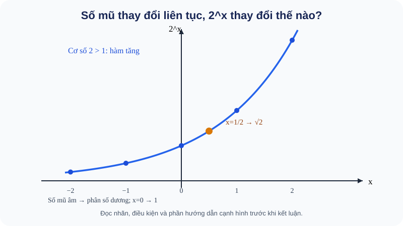
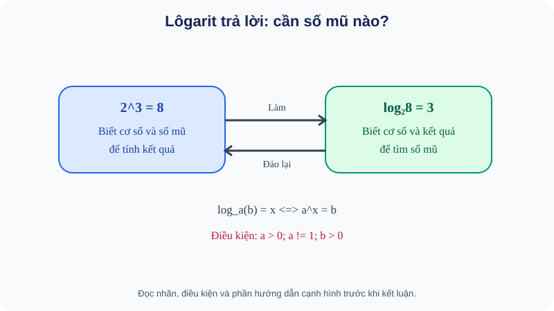
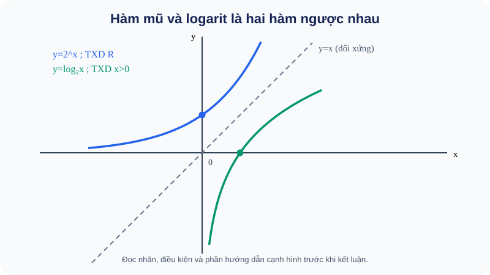
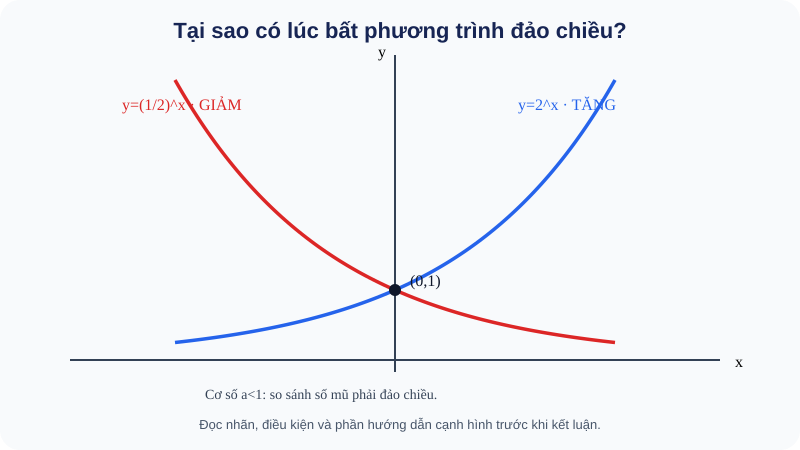
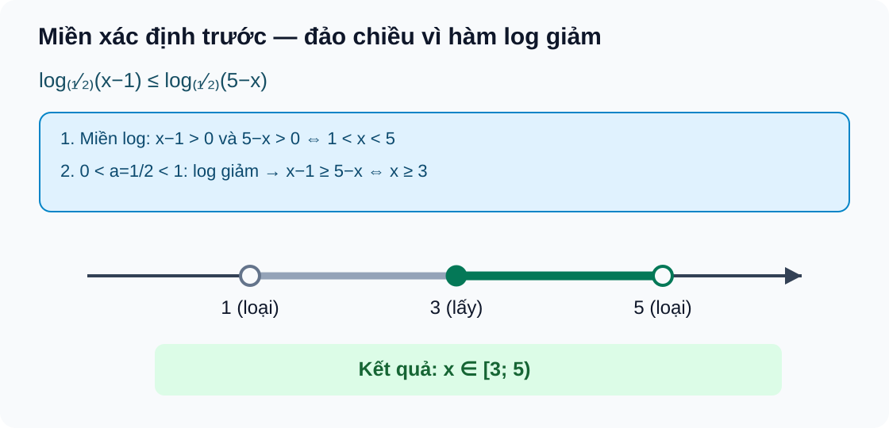

<!-- AUTHORING R04 source; R03 immutable blob d89747f85347cf8c7f9df8f35f753bad25024175; Q18 author receipt references exact final content, not independent reviewer PASS. No merge or deployment. -->
<!-- STANDARD_ID=SLM-THPT-QUALITY-ONE; STANDARD_VERSION=3.1.0; LEARNING_PATH=TOPIC; OUTER_PAGES=Kiến thức|Luyện tập|Tự kiểm tra; SOURCE_VERSION=R04_AUTHORING_READY; AUTHORING_ONLY_METADATA=prototypes/thpt/content-drafts/topic04-powers-exp-log/Temp_TOPIC04_R04_AUTHORING_ONLY_CUSTODY_METADATA_20261113.md -->
# CĐ04 — Lũy thừa, hàm mũ và lôgarit

# Kiến thức

## Từ một phép nhân lặp đến câu hỏi về số kỳ

Giả sử một khoản tiền tăng 8% mỗi năm và tiền lãi được nhập vào vốn. Sau năm thứ nhất, số tiền được nhân với \(1{,}08\); sau năm thứ hai, lại nhân với \(1{,}08\). Nếu cứ nhân như vậy, sau \(n\) năm số tiền được nhân với \(1{,}08^n\). Đây là tình huống tự nhiên đưa đến **lũy thừa**: số mũ cho biết ta lặp lại phép nhân bao nhiêu lần. Khi muốn hỏi “cần bao nhiêu năm để vượt một ngưỡng?”, ta phải làm phép ngược lại: tìm **số mũ** đã tạo nên một giá trị cho trước — đó là ý tưởng của **lôgarit**. Nhìn hai câu hỏi này như một cặp sẽ giúp em hiểu cả đồ thị, phép biến đổi và ứng dụng thay vì nhớ nhiều công thức rời rạc.

Trước khi dùng các ký hiệu mới, ta chỉ cần các kiến thức quen thuộc: nhân số thực, phân số, căn bậc hai không âm, tìm nghiệm phương trình và biểu diễn điểm trên mặt phẳng tọa độ. Số mũ âm sẽ dẫn tới phép chia; căn bậc chẵn dẫn tới điều kiện không âm; các logarit sẽ đòi đối số dương. Những điều kiện ấy không phải phụ lục học thuộc: chúng giải thích tại sao một phép biến đổi có thể hợp lệ ở giá trị này nhưng không hợp lệ ở giá trị khác.

Vì vậy ta bắt đầu bằng những quy tắc của lũy thừa, rồi dần chuyển từ phép tính với một số mũ sang câu hỏi ngược “số mũ nào?”, từ đó mới xét hàm số, bất phương trình và bài toán số kỳ.

Số mũ giúp diễn tả gọn việc nhân nhiều lần, nhưng các công thức chỉ dùng an toàn khi hiểu dấu, cơ số và miền. Ta mở rộng dần từ mũ nguyên sang căn, mũ hữu tỉ và thực để thấy điều kiện xuất hiện từ đâu.

<!-- LESSON_ID: TOP04-M01; OUTCOME_ID: TOP04-O01 -->

Ta biết \(2^3=2\cdot2\cdot2=8\): số mũ dương đếm số lần nhân cùng một cơ số. Nhưng khi giảm số mũ đi một đơn vị, kết quả phải **chia cho cơ số**, không phải đổi dấu. Vì thế với \(a\ne0\), quy tắc tiếp nối tự nhiên là \(a^0=1\) và \(a^{-n}=1/a^n\) khi \(n\) là số nguyên dương. Điều kiện \(a\ne0\) rất quan trọng: \(0^{-1}\) sẽ là \(1/0\), không xác định.

Lấy \((2/3)^{-2}\). Số mũ âm yêu cầu lấy nghịch đảo rồi bình phương: \((3/2)^2=9/4\), vẫn là một số **dương**. Tương tự, số rất nhỏ \(0{,}0000075\) có thể viết thành \(7{,}5\cdot10^{-6}\); dấu trừ thuộc **số mũ**, không phải dấu của số. Trong ký hiệu khoa học chuẩn, phần hệ số phải có trị tuyệt đối từ 1 đến dưới 10.

*Quan sát hình:* Quan sát các giá trị 2^x ở x=−2,−1,0,1,2: số mũ âm cho số dương nhỏ hơn 1, không phải kết quả âm.

<!-- LESSON_ID: TOP04-M02; OUTCOME_ID: TOP04-O02 -->

Số mũ hữu tỉ tiếp tục ý tưởng ấy nhưng phải xét kỹ căn bậc chẵn và căn bậc lẻ. Một phương trình x⁴=c có thể có hai nghiệm, trong khi ký hiệu căn bậc bốn chỉ cho một giá trị không âm. Ta đã biết căn bậc hai số học, nhân lũy thừa số nguyên. Với a>0, a^(m/n)=(ⁿ√a)^m (n nguyên dương), a^(−m/n)=1/a^(m/n). Căn bậc **chẵn** của a≥0 lấy căn không âm; căn bậc lẻ của số âm tồn tại. Với cơ số âm, không áp dụng tùy tiện bộ luật **số mũ thực của cơ số dương** sang mọi phân số.

Chẳng hạn, 81^(3/4)=(⁴√81)³=3³=27. Nhưng ⁴√16=2 còn x⁴=16 có x=±2; lý do là ký hiệu căn và tập nghiệm phương trình có vai trò khác nhau.

<!-- LESSON_ID: TOP04-M03; OUTCOME_ID: TOP04-O03 -->

Từ các số mũ hữu tỉ, ta có thể mở rộng sang số mũ thực khi cơ số phù hợp. Số mũ thực mô tả tăng trưởng theo thời gian không nguyên; không thể chỉ hiểu là ‘nhân số nguyên lần’. Ta sử dụng lũy thừa hữu tỉ của cơ số dương, ý niệm xấp xỉ số thực. Với a>0 và x vô tỉ, a^x được định nghĩa nhất quán từ các lũy thừa hữu tỉ a^r khi r xấp xỉ x, qua giới hạn. Điều này không có nghĩa nhân a đúng ‘√2 lần’. Tính đơn điệu phụ thuộc cơ số a>1 hay 0<a<1; cơ số âm không mặc nhiên có a^x trên mọi x thực.

Xét ví dụ: Vì √2<3/2 và 2>1, 2^(√2)<2^(3/2); còn vì 0<1/2<1, (1/2)^(√2)>(1/2)^(3/2). Cùng số mũ nhưng hai cơ số cho chiều ngược.

<!-- LESSON_ID: TOP04-M04; OUTCOME_ID: TOP04-O04 -->

Các quy tắc tính lũy thừa chỉ đáng tin khi đi kèm điều kiện của cơ số. Nén nhiều phép nhân/chia bằng quy tắc số mũ rất nhanh, nhưng rút gọn xong không được quên giá trị ban đầu vô nghĩa. Ta bắt đầu từ cộng/trừ số mũ hữu tỉ, mẫu số khác 0. Với a>0, a^r a^s=a^(r+s), a^r/a^s=a^(r−s), (a^r)^s=a^(rs). Với biểu thức gốc có chia/căn thì kiểm điều kiện trước; không có quy tắc a^r+a^s=a^(r+s).

Chẳng hạn, E=a^(3/2)·a^(−1/2)/a=a^(3/2−1/2−1)=a^0=1 khi a>0. Không nhận a=0 dù kết quả rút gọn là 1, vì biểu thức gốc chia cho a.

### Vận dụng và tự đối chiếu

<!-- First Try TOP04-M01: knowledge, not canonical Readiness -->
**1.** Tính \(5^{-2}\cdot25\). Biểu thức \(0^{-1}\) có nghĩa không? Vì sao?

Đối chiếu

\(5^{-2}\cdot25=\frac1{25}\cdot25=1\). \(0^{-1}\) không xác định vì dẫn tới phép chia cho 0. Nếu em nhầm dấu âm của số mũ thành dấu âm của giá trị, hãy so \(-2^2=-4\) với \(2^{-2}=1/4\).

<!-- First Try TOP04-M02: knowledge, not canonical Readiness -->
**2.** Tính 27^(2/3) và ³√(−27).

Đối chiếu

27^(2/3)=3²=9; ³√(−27)=−3 vì (−3)³=−27.

Nếu chỉ nhận nghiệm dương khi giải x⁴=16, thử số đối; nếu đổi dấu căn bậc chẵn, nhớ căn số học ≥0.

<!-- First Try TOP04-M03: knowledge, not canonical Readiness -->
**3.** So sánh (1/3)^(√3) với (1/3)^2.

Đối chiếu

√3<2; cơ số 1/3 làm hàm nghịch biến nên (1/3)^(√3)>(1/3)^2.

Nếu đảo dấu sai, dùng x=0 và x=1 để quan sát 1 và cơ số a; quay M10 kiểm tính tăng/giảm.

<!-- First Try TOP04-M04: knowledge, not canonical Readiness -->
**4.** Với a>0, rút gọn a^(3/4)·a^(−1/4)/√a.

Đối chiếu

Bằng a^(3/4−1/4−1/2)=1; giữ a>0 để mẫu và mũ hữu tỉ được xác định.

Nếu cộng số mũ cho phép **cộng** hai lũy thừa, thử 2²+2³=12 khác 2⁵=32.

## Khi kết quả đã biết, tìm lại số mũ

Từ \(2^3=8\) ta biết cơ số và số mũ để tìm kết quả. Nếu đổi câu hỏi thành “phải nâng 2 lên lũy thừa bao nhiêu để được 8?”, đáp án vẫn là 3, nhưng thao tác suy nghĩ đã đảo chiều. Lôgarit đặt tên cho chính thao tác ấy. Vì lũy thừa cơ số dương không thể cho kết quả âm hay bằng 0, điều kiện đối số lôgarit phải dương xuất phát ngay từ ý nghĩa, trước mọi quy tắc tính.

<!-- LESSON_ID: TOP04-M05; OUTCOME_ID: TOP04-O05 -->

Biết số ban đầu và số cuối, ta muốn biết cần bao nhiêu lần nhân theo tỉ lệ a. Cần nhớ hàm mũ cơ số dương, tính đơn ánh của a^x khi a≠1. Với a>0, a≠1 và b>0, log_a b là số y duy nhất sao cho a^y=b. Do đó log_a1=0, log_a a=1; log_a b có thể âm nhưng b **không** thể âm. Đừng học công thức log trước khi hiểu câu hỏi ‘số mũ nào?’.

Chẳng hạn, log₂(1/8)=−3 vì 2^(−3)=1/8. Dấu âm nằm ở **số mũ được tìm**, không phải ở đối số 1/8>0.

*Quan sát hình:* So 2³=8 với log₂8=3, đồng thời ghi điều kiện cơ số dương, khác 1 và đối số logarit dương.

<!-- LESSON_ID: TOP04-M06; OUTCOME_ID: TOP04-O06 -->

Nhưng phép tính ngược ấy chỉ có nghĩa khi đối số và cơ số thỏa điều kiện. Nếu biến đổi log tích thành tổng log mà chưa xét miền, có thể đánh mất nghiệm hợp lệ. Để xác định điều đó, cần xét dấu tích hai nhân tử và bất phương trình bậc hai của tiền đề đã giải thích lại ở đây. Để log_a[F(x)] tồn tại trên ℝ cần a>0, a≠1 và F(x)>0. Quy tắc log_a(uv)=log_a u+log_a v đòi **u>0 và v>0**, mạnh hơn uv>0. Vì vậy với log_a[(x−1)(x−4)], miền x<1 hoặc x>4, nhưng chỉ tách thành tổng log thực trên x>4.

Chẳng hạn, với x=0: (x−1)(x−4)=4>0 nên log₂4 có nghĩa, còn log₂(−1) và log₂(−4) không. Hình dung hai điểm âm nhân lại dương không làm log từng số âm có nghĩa.

<!-- LESSON_ID: TOP04-M07; OUTCOME_ID: TOP04-O07 -->

Ta suy các quy tắc logarit từ chính phép nhân và chia các lũy thừa. Làm việc với những số rất lớn sẽ dễ hơn khi tích biến thành tổng, nhưng phép biến đổi có điều kiện. Ta đã biết tính chất a^r·a^s=a^(r+s), b>0. Với a>0,a≠1,x>0,y>0: log_a(xy)=log_a x+log_a y, log_a(x/y)=log_a x−log_a y, log_a(x^r)=r log_a x (x>0). Chúng đúng vì lấy log hai vế của các tích lũy thừa dương, không phải công thức thuộc lòng không điều kiện.

Chẳng hạn, log₃81−log₃3=log₃(81/3)=log₃27=3. Trừ hai log là log **thương**, không phải log(81−3).

<!-- LESSON_ID: TOP04-M08; OUTCOME_ID: TOP04-O08 -->

Khi đổi cơ số, hướng biến thiên của logarit cũng cần được xem lại. Máy tính thường chỉ có log thập phân hoặc ln; cần biết phép đổi cơ số và điều kiện. Ta sử dụng định nghĩa log, cơ số a>0,a≠1, đối số b>0. Đặt t=log_a b thì a^t=b. Lấy ln hai vế: t ln a=ln b ⇒ log_a b=(ln b)/(ln a); ln a≠0 do a≠1. Khi 0<a<1, ln a âm; log_a b vẫn có nghĩa với b>0 và có thể dương hoặc âm.

Xét ví dụ: log₄8=ln8/ln4=3/2; log_(1/9)3=−1/2 vì (1/9)^(−1/2)=3. Điều kiện từng cơ số và đối số đều đúng.

### Vận dụng và tự đối chiếu

<!-- First Try TOP04-M05: knowledge, not canonical Readiness -->
**1.** Tính log₄(1/8).

Đối chiếu

Vì 4^(−3/2)=1/8 nên log₄(1/8)=−3/2.

Nếu nhầm log_a(−b) với số âm, kiểm log có nghĩa chỉ khi đối số >0; luyện P06 và các câu B19-C01/C02.

<!-- First Try TOP04-M06: knowledge, not canonical Readiness -->
**2.** Tìm miền của log₂(x²−9); tách log₂(x−3)+log₂(x+3) trên mọi miền đó được không?

Đối chiếu

Miền x<−3 hoặc x>3, nhưng hai log riêng cùng có nghĩa chỉ khi x>3.

Nếu mắc lỗi ‘log của tích’ trên toàn miền, lấy x=−4 làm phản ví dụ; luyện P07/P08 và câu Written nguồn B19.

<!-- First Try TOP04-M07: knowledge, not canonical Readiness -->
**3.** Tính log₂24−log₂3.

Đối chiếu

log₂(24/3)=log₂8=3 vì hai đối số dương và 2³=8.

Nếu viết log(x+y)=log x+log y, thử x=y=1: log2≠0; phân biệt tổng với tích.

<!-- First Try TOP04-M08: knowledge, not canonical Readiness -->
**4.** Tính log₈2 bằng đổi cơ số.

Đối chiếu

ln2/ln8=1/3 (hoặc 8^(1/3)=2).

Nếu tính log_(1/9)3=+1/2, kiểm cơ số nhỏ 1 và thử lũy thừa.

## Từ phép tính sang đồ thị hàm mũ và lôgarit

Nếu xem số mũ \(x\) thay đổi liên tục, lũy thừa \(a^x\) tạo thành một hàm số. Thay vì chỉ tính vài giá trị riêng lẻ, ta quan sát xem khi \(x\) tăng thì kết quả tăng hay giảm, có bao giờ bằng 0 hay không. Đảo vai trò đầu vào và đầu ra của hàm mũ ta gặp hàm lôgarit; đồ thị của hai hàm cho ta một cách giải thích trực quan tính đơn điệu và miền xác định.

Hàm mũ diễn tả quá trình nhân theo bước, còn logarit giúp tìm số bước để đạt một mức. Đặt hai hàm cạnh nhau giúp hiểu tính đơn điệu, đồ thị và miền trước khi giải phương trình.

<!-- LESSON_ID: TOP04-M09; OUTCOME_ID: TOP04-O09 -->

Số lượng thay đổi theo tỉ lệ không đổi khác với tăng thêm số lượng tuyệt đối mỗi kỳ. Ta bắt đầu từ số mũ thực cơ số dương và vị trí các điểm trên mặt phẳng tọa độ. Với a>0,a≠1, f(x)=a^x có miền ℝ và giá trị (0,+∞), qua (0,1), (1,a), luôn dương. Khi a>1, f(x)→0 khi x→−∞; khi 0<a<1, f(x)→0 khi x→+∞. Trục Ox là tiệm cận ngang; hàm không cắt Ox.

Chẳng hạn, f(x)=(1/3)^x: f(−1)=3, f(0)=1, f(1)=1/3; các điểm giảm khi x tăng. Chọn bảng ba điểm vì nó nối được đồ thị và mô hình giảm theo tỉ lệ.

<!-- LESSON_ID: TOP04-M10; OUTCOME_ID: TOP04-O10 -->

Cơ số lớn hơn 1 hay nằm giữa 0 và 1 làm thay đổi hướng đồ thị mũ. Đưa bất phương trình về so số mũ chỉ đúng nếu biết hàm tăng hay giảm. Cần nhớ các giá trị a^0=1,a^1=a và khái niệm hàm đơn điệu. Với a>1, a^x tăng nghiêm ngặt; với 0<a<1, a^x giảm nghiêm ngặt. Nếu a^u>a^v thì u>v khi a>1, nhưng u<v khi 0<a<1. Bản chất: tăng một đơn vị số mũ sẽ nhân giá trị với a; nhân số >1 làm lớn, nhân số nằm (0,1) làm nhỏ.

Chẳng hạn, Vì (1/4)^0=1 và (1/4)^1=1/4 nên cơ số 1/4 giảm theo số mũ. Do −1<2, (1/4)^(−1)=4>(1/4)^2=1/16.

<!-- LESSON_ID: TOP04-M11; OUTCOME_ID: TOP04-O11 -->

Nhìn ngược đồ thị ấy, ta hiểu vì sao hàm logarit có miền và tính chất đặc trưng. Nếu hàm mũ biến thời gian thành lượng, logarit giúp biến lượng thành thời gian cần thiết. Để xác định điều đó, cần xét định nghĩa log, cơ số a>0,a≠1 và đường thẳng x=0. Với a>0,a≠1, g(x)=log_a x có miền (0,+∞), giá trị ℝ, qua (1,0) và (a,1); x=0 là tiệm cận đứng. Hàm tăng nếu a>1, giảm nếu 0<a<1. Không có điểm đồ thị với x≤0.

Chẳng hạn, g(x)=log_(1/2)x: g(1/4)=2, g(4)=−2; từ x=1/4 sang x=4 giá trị giảm, phản ánh cơ số nhỏ hơn 1.

<!-- LESSON_ID: TOP04-M12; OUTCOME_ID: TOP04-O12 -->

Hai đồ thị tương ứng phản chiếu qua y=x khi thực sự là hai hàm ngược. Liên kết hai khái niệm thành một thao tác thuận và thao tác ngược để giải phương trình. Ta đã biết khái niệm hàm ngược, tọa độ điểm (x,y). Với a>0,a≠1, f(x)=a^x là một-một từ ℝ đến (0,+∞), g(x)=log_a x là hàm ngược từ (0,+∞) về ℝ. Nếu (u,v) trên f thì (v,u) trên g; đồ thị đối xứng qua y=x. g(f(x))=x với mọi x thực, còn f(g(x))=x chỉ với x>0.

Chẳng hạn, 2^(−1)=1/2, nên f có (−1,1/2), g có (1/2,−1). Đây là hoán đổi chỗ input/output, không phải phép đổi dấu.

*Quan sát hình:* Đối chiếu tọa độ hai điểm bị hoán đổi và chú ý logarit chỉ nhận đầu vào dương; phép đối xứng không xóa miền.

### Vận dụng và tự đối chiếu

<!-- First Try TOP04-M09: knowledge, not canonical Readiness -->
**1.** Cho f(x)=2^x, có x thực nào để f(x)=0 không?

Đối chiếu

Không: 2^x>0 mọi x∈ℝ, chỉ tiến dần về 0 khi x→−∞.

Nếu nhầm số rất nhỏ với 0, thử x=−10 và viết 2^(−10)=1/1024>0.

<!-- First Try TOP04-M10: knowledge, not canonical Readiness -->
**2.** So (1/5)^(−1) và (1/5)^2.

Đối chiếu

5>1/25; số mũ −1 nhỏ hơn 2 nhưng cơ số giảm làm giá trị lớn hơn.

Nếu luôn giữ dấu so sánh khi bỏ mũ, vẽ hai điểm 0,1 trên đồ thị để sửa.

<!-- First Try TOP04-M11: knowledge, not canonical Readiness -->
**3.** Với y=log₂x, giá trị tại x=1/8 và x=8 là gì?

Đối chiếu

log₂(1/8)=−3, log₂8=3, hàm tăng vì cơ số 2>1.

Nếu đặt điểm x=0 lên đồ thị log, hỏi cơ số nào lũy thừa ra 0 (không có).

<!-- First Try TOP04-M12: knowledge, not canonical Readiness -->
**4.** Cho f(x)=3^x. Điểm (1,3) trên f tương ứng điểm nào trên log₃x?

Đối chiếu

(3,1) vì log₃3=1.

Nếu dùng log₃(−3) để đảo hàm, kiểm miền log phải dương; luyện P16 và các Written cũ B20.

## Từ đồ thị đến tập nghiệm phương trình và bất phương trình

Khi hai vế cùng là lũy thừa có chung cơ số hợp lệ, tính đơn ánh của hàm mũ cho phép chuyển việc so sánh giá trị sang so sánh số mũ. Nhưng nếu cơ số ở giữa 0 và 1, hàm giảm nên dấu bất phương trình phải đảo chiều. Với logarit, trước khi so sánh hai đối số còn phải bảo đảm **cả hai đối số dương**. Những điều kiện này được rút ra từ đồ thị vừa học, không phải mẹo biến đổi riêng rẽ.

Việc đưa hai vế về cùng cơ số chỉ là một bước kỹ thuật. Miền xác định, tính một-một và chiều biến thiên mới quyết định phép suy luận có đúng và đủ hay không.

<!-- LESSON_ID: TOP04-M13; OUTCOME_ID: TOP04-O13 -->

Muốn tìm thời gian hoặc giá trị x khi lượng a^x đạt ngưỡng, cần giải phương trình mũ chứ không phỏng đoán. Ta sử dụng a>0,a≠1, hàm mũ đơn ánh, giải phương trình bậc hai. a^u=a^v ⇔ u=v với a>0,a≠1. Nếu phải đặt t=a^x, luôn ghi t>0; nghiệm t≤0 phải loại trước khi quay lại x. Đưa về cùng cơ số là phương pháp cơ bản SGK B21; đặt ẩn phụ là **mở rộng có điều kiện của CĐ04**, không gán cho bản SGK review cũ.

Xét ví dụ: 4^x=2^(x+3) ⇒ 2^(2x)=2^(x+3) ⇒ 2x=x+3 ⇒ x=3. Nếu có 9^x−4·3^x+3=0, t=3^x>0 cho t=1,3 ⇒ x=0,1.

<!-- LESSON_ID: TOP04-M14; OUTCOME_ID: TOP04-O14 -->

Nếu ẩn nằm trong logarit, xác định miền phải đi trước mọi bước biến đổi. Một phương trình đa thức sau gộp log có thể sinh nghiệm âm, nhưng log không có đối số âm. Ta bắt đầu từ miền F(x)>0 và tính đơn ánh log_a. log_a U=log_a V ⇔ U=V **trong miền U>0,V>0**, a>0,a≠1. Khi cộng các log, chỉ gộp nếu từng đối số dương. Giải phương trình đại số thu được ứng viên, kiểm vào miền/đề gốc, đặc biệt khi bình phương hay đưa về tích.

Chẳng hạn, log₂(x−1)+log₂(x+1)=3: miền x>1. (x−1)(x+1)=8 ⇒ x=±3, chỉ x=3 thỏa. Kiểm log₂2+log₂4=1+2=3.

*Đọc hình:* Hai đồ thị \(y=2^x\) và \(y=(1/2)^x\) đều qua \((0,1)\) và luôn dương. Khi \(x\) tăng, đồ thị cơ số 2 đi lên còn cơ số \(1/2\) đi xuống. Đó là lý do so sánh các số mũ cùng cơ số \(1/2\) phải **đảo chiều** bất phương trình.

<!-- LESSON_ID: TOP04-M15; OUTCOME_ID: TOP04-O15 -->

Từ phương trình sang bất phương trình, hướng biến thiên quyết định chiều nghiệm. Giải một bất phương trình mũ có thể nhanh bằng so số mũ, nhưng dấu so sánh sai làm đổi toàn bộ tập nghiệm. Cần nhớ tính đơn điệu a^x, chuyển vế bất phương trình bậc nhất. Với a>1, a^u≤a^v ⇔ u≤v; với 0<a<1, a^u≤a^v ⇔ u≥v. Không thể so trực tiếp hai số mũ nếu cơ số khác nhau mà chưa quy về cùng cơ số một cách hợp lệ.

Chẳng hạn, (1/2)^(x−2)<(1/2)^1 ⇔ x−2>1 (đảo chiều vì cơ số nhỏ hơn 1) ⇔ x>3. Thử x=4: (1/2)^2=1/4<1/2 đúng.

<!-- LESSON_ID: TOP04-M16; OUTCOME_ID: TOP04-O16 -->

Với bất phương trình logarit, kết luận cuối chỉ hợp lệ sau khi giao miền xác định. Dù đã đảo chiều bất phương trình đúng, vẫn có thể nhận điểm ngoài miền log nếu không giao tập nghiệm. Để xác định điều đó, cần xét điều kiện log U, log V dương; tính tăng/giảm log. Với a>1: log_a U≤log_a V ⇔ U≤V khi U,V>0. Với 0<a<1: log_a U≤log_a V ⇔ U≥V khi U,V>0. Kết luận là giao với điều kiện; các mốc khiến đối số bằng 0 luôn **loại**.

Chẳng hạn, log_(1/2)(x−1)≤log_(1/2)(5−x): miền 1<x<5; nghịch biến ⇒ x−1≥5−x ⇒ x≥3; giao được [3,5), không nhận 5.

*Quan sát hình:* Đầu mút \(1\) và \(5\) bị loại vì có đối số logarit bằng 0; tại \(3\) hai vế bằng nhau, nên nhận \(3\). Cơ số \(1/2\) cho chiều nghịch biến: với \(x\ge3\) (và \(x<5\)), bất phương trình đúng.

### Vận dụng và tự đối chiếu

<!-- First Try TOP04-M13: knowledge, not canonical Readiness -->
**1.** Giải 2^(2x)=8·2^x.

Đối chiếu

2^(2x)=2^(x+3) ⇒ x=3; 2^x>0 nên có thể chia cho 2^x nếu muốn.

Nếu đặt t=3^x mà nhận t âm, kiểm t>0; luyện P17 và bài SGK B21-C01.

<!-- First Try TOP04-M14: knowledge, not canonical Readiness -->
**2.** Giải log₂(x−2)+log₂(x+2)=3.

Đối chiếu

Điều kiện x>2. x²−4=8 ⇒ x=±2√3, chỉ +2√3 thỏa vì >2.

Nếu dùng x âm từ phương trình bình phương, thay vào từng đối số; luyện P18/W03 và Written nguồn B19.

<!-- First Try TOP04-M15: knowledge, not canonical Readiness -->
**3.** Giải (1/3)^(2x−1)≥(1/3)^(x+2).

Đối chiếu

Nghịch biến nên 2x−1≤x+2 ⇒ x≤3, lấy dấu bằng tại x=3.

Nếu giữ chiều khi cơ số nhỏ hơn 1, kiểm x=4; luyện P19 và 2 câu gốc B21 bất phương trình mũ.

<!-- First Try TOP04-M16: knowledge, not canonical Readiness -->
**4.** Giải log_(1/3)(x+1)>log_(1/3)4.

Đối chiếu

Miền x>−1; log giảm nên x+1<4 ⇒ x<3; S=(−1,3).

Nếu không loại 5 trong ví dụ, kiểm log(0) vô nghĩa; xem SVG miền mới và luyện P20.

## Khi số mũ là thời gian và đáp án phải có ý nghĩa

Cuối cùng, ta quay về câu hỏi về vốn và số kỳ ở đầu chuyên đề. Công thức tăng theo tỉ lệ không đổi giúp tính giá trị sau một số kỳ; muốn biết **kỳ đầu tiên** vượt ngưỡng, ta dùng logarit để tìm mốc thời gian liên tục rồi kiểm các kỳ nguyên liền kề. Một kết quả như \(2{,}9\) năm không tự động là “năm thứ 2,9” khi đề hỏi số năm nguyên — chính ngữ cảnh quyết định cách kết luận.

Lũy thừa và logarit giúp mô hình hóa lãi theo kỳ hay thời gian tới ngưỡng. Đáp án cần khớp miền, đơn vị và giả thiết của mô hình thay vì chỉ đẹp về đại số.

<!-- LESSON_ID: TOP04-M17; OUTCOME_ID: TOP04-O17 -->

Bài toán lãi kép, giá trị giảm dần hay số lượng quần thể đều liên quan nhân theo tỉ lệ, không cộng lượng cố định. Ta đã biết phần trăm, lũy thừa, logarit và n nguyên không âm cho số kỳ. Nếu mỗi kỳ nhân q>0 và ban đầu A₀>0 thì A(n)=A₀q^n, n nguyên≥0; q>1 tăng, 0<q<1 giảm. Để tìm kỳ đầu tiên đạt ngưỡng dùng log với đúng dấu của ln q, sau đó kiểm các kỳ nguyên kề nhau. Mô hình giả định q không đổi và n nguyên, không tự chứng minh thực tế sẽ tuân chính xác.

Chẳng hạn, 200 triệu đồng lãi gộp 5%/năm, sau 2 năm có 200·1,05²=220,5 triệu. Nếu 100 triệu tăng 8%/năm và muốn vượt 125 triệu: n>ln1,25/ln1,08≈2,8994, nên năm nguyên nhỏ nhất n=3.

<!-- LESSON_ID: TOP04-M18; OUTCOME_ID: TOP04-O18 -->

Trong bài toán tổng hợp, lỗi thường đến từ một điều kiện bị quên. Đề tổng hợp không nói sẵn dùng luật nào; học sinh cần tự phát hiện miền, biến đổi và kiểm nghiệm. Ta sử dụng quy tắc lũy thừa, log domain, so số mũ và giải bậc hai. Đọc bài theo chuỗi: xác định a>0,a≠1; từng log đối số>0; chọn quy tắc/hàm đơn ánh; giải ứng viên; giao mọi miền; thử nghiệm. Không trộn điều kiện của mô hình lãi kép với điều kiện log, hoặc cho rằng tự kiểm tra công khai thay cho Readiness độc lập.

Xét ví dụ: log₂(x²−1)=log₂(3x+3): miền x²−1>0 và 3x+3>0 ⇒ x>1. Đồng nhất đối số cho x²−3x−4=0 ⇒ x=4 hoặc −1; x=−1 sai miền. Nghiệm x=4, thử hai đối số bằng 15.

### Vận dụng và tự đối chiếu

<!-- First Try TOP04-M17: knowledge, not canonical Readiness -->
**1.** Với số lượng 500 giảm 20% mỗi kỳ, tính sau 3 kỳ theo mô hình.

Đối chiếu

N(3)=500·0,8³=256. Giảm 20% trên số còn lại mỗi kỳ, không trừ 100 cố định mỗi lần.

Nếu tăng/giảm tuyến tính theo số cộng, kiểm tỷ lệ thực mỗi năm; luyện P21/W04 và câu SGK B18-P05.

<!-- First Try TOP04-M18: knowledge, not canonical Readiness -->
**2.** Giải \(\log_3(x-1)=1+\log_3(5-x)\). Hãy nêu miền trước khi dùng quy tắc logarit.

Đối chiếu

Điều kiện \(x-1>0\), \(5-x>0\), tức \(1<x<5\). Vì \(1=\log_3 3\), ta có \(\log_3(x-1)=\log_3[3(5-x)]\). Hai đối số dương và cơ số 3 hợp lệ nên \(x-1=15-3x\), suy ra \(x=4\). Thử: \(\log_3 3=1+\log_3 1=1\). Nếu em bỏ điều kiện và nhận nghiệm ngoài (1,5), quay lại bước xác định miền trước khi giải.

<!-- AUTHORING MEDIA/SPEC NOTES: This R03 puts verified figures in the teaching flow. Complete historical SVG custody and SPEC_ONLY interaction notes are preserved in R02 Git blob 55731a0f7763aeff2e26e2e36538e492ff296baf; no live model feature is claimed. -->

# Luyện tập

**75 câu canonical PUBLIC duy nhất = 49 câu nguồn gốc KNTT đã review theo snapshot (41 Practice/Core/Application +8 Written/Anchor) và 26 câu tự biên soạn (22 Practice +4 Written).** Mỗi ID có đúng **một** stem/key/solution/rubric ở nguồn canonical; bảng dưới đây chỉ đặt placement cho chuyên đề, không sao chép câu cũ. **12 bài Written** gồm 8 gốc có rubric 4 điểm và 4 mới có rubric 7 điểm; Anchor chỉ là nhãn, không sinh ID khác. Không lấy tổng số câu thay cho độ sâu từng outcome; 18 outcome đều có nhiều câu khác họ dạng và lý do chọn cách làm.

| Mục tiêu chuyên đề | Phương pháp / họ dạng | Câu canonical PUBLIC |
|---|---|---|
| `TOP04-O01` | Giải thích a^0 và a^(−n), phân biệt số âm với số mũ âm · `POWER-INTEGER-ZERO-NEGATIVE` | `THPT-G11-CHVI-B18-C01`; `THPT-G11-CHVI-B18-C03`; `THPT-G11-CHVI-B18-P07`; `THPT-TOP04-P01` |
| `TOP04-O02` | Phân biệt căn số học và nghiệm phương trình lũy thừa · `ROOT-PARITY-RATIONAL` | `THPT-G11-CHVI-B18-C02`; `THPT-G11-CHVI-B18-C05`; `THPT-G11-CHVI-B18-P02`; `THPT-G11-CHVI-B18-P03`; `THPT-TOP04-P02` |
| `TOP04-O03` | Hiểu vì sao 2^(√2) xác định và so sánh khi số mũ không hữu tỉ · `REAL-EXPONENT-INTERPOLATION` | `THPT-G11-CHVI-B18-C04`; `THPT-TOP04-P03`; `THPT-TOP04-P04` |
| `TOP04-O04` | Rút gọn biểu thức lũy thừa không làm mất điều kiện · `POWER-LAW-CAVEATS` | `THPT-G11-CHVI-B18-P01`; `THPT-G11-CHVI-B18-P04`; `THPT-G11-CHVI-B18-P06`; `THPT-G11-CHVI-B18-W01`; `THPT-TOP04-P05`; `THPT-TOP04-W01` |
| `TOP04-O05` | Giải thích log_a b như thao tác ngược của a^x · `LOG-DEFINITION` | `THPT-G11-CHVI-B19-C01`; `THPT-G11-CHVI-B19-C02`; `THPT-G11-CHVI-B19-P03`; `THPT-TOP04-P06` |
| `TOP04-O06` | Một tích dương không bảo đảm từng thừa số dương · `LOG-DOMAIN-AND-SPLITTING` | `THPT-G11-CHVI-B19-C03`; `THPT-G11-CHVI-B19-P04`; `THPT-G11-CHVI-B19-W01`; `THPT-TOP04-P07`; `THPT-TOP04-P08` |
| `TOP04-O07` | Dùng đúng log của tích, thương, lũy thừa · `LOG-ALGEBRA-RULES` | `THPT-G11-CHVI-B19-P01`; `THPT-G11-CHVI-B19-P02`; `THPT-G11-CHVI-B19-W02-ANCHOR`; `THPT-TOP04-P09` |
| `TOP04-O08` | Chuyển một log lạ về cơ số quen mà không sai dấu · `BASE-CHANGE` | `THPT-G11-CHVI-B19-P05`; `THPT-TOP04-P10`; `THPT-TOP04-P11`; `THPT-TOP04-W02` |
| `TOP04-O09` | Đọc tập xác định, giá trị, điểm, tiệm cận qua ý nghĩa lũy thừa · `EXP-DOMAIN-RANGE-GRAPH` | `THPT-G11-CHVI-B20-C01`; `THPT-TOP04-P12`; `THPT-TOP04-P13` |
| `TOP04-O10` | So sánh số mũ và giải thích khi nào đảo chiều · `EXP-MONOTONIC` | `THPT-G11-CHVI-B20-C02`; `THPT-G11-CHVI-B20-P02`; `THPT-TOP04-P14` |
| `TOP04-O11` | Đọc miền, tập giá trị, đồ thị và tính tăng giảm của log · `LOG-FUNCTION-MONOTONIC` | `THPT-G11-CHVI-B20-C03`; `THPT-G11-CHVI-B20-P01`; `THPT-G11-CHVI-B20-P03`; `THPT-TOP04-P15` |
| `TOP04-O12` | Đọc đồ thị đối xứng qua y=x, không nhầm hoán đổi miền · `INVERSE-GRAPH` | `THPT-G11-CHVI-B20-C04`; `THPT-G11-CHVI-B20-P04`; `THPT-G11-CHVI-B20-W01`; `THPT-G11-CHVI-B20-W02-ANCHOR`; `THPT-TOP04-P16` |
| `TOP04-O13` | Giải bằng đưa về cùng cơ số, nêu giới hạn của đặt t=a^x · `EXP-EQUATIONS` | `THPT-G11-CHVI-B21-C01`; `THPT-G11-CHVI-B21-P01`; `THPT-G11-CHVI-B21-P07`; `THPT-TOP04-P17` |
| `TOP04-O14` | Loại nghiệm đại số không thuộc miền log · `LOG-EQUATIONS-DOMAIN` | `THPT-G11-CHVI-B21-C02`; `THPT-G11-CHVI-B21-P02`; `THPT-TOP04-P18`; `THPT-TOP04-W03` |
| `TOP04-O15` | Chọn chiều của bất phương trình dựa trên cơ số · `EXP-INEQUALITIES` | `THPT-G11-CHVI-B21-C03`; `THPT-G11-CHVI-B21-P03`; `THPT-TOP04-P19` |
| `TOP04-O16` | Giải đủ tập giao của điều kiện log và phép so đối số · `LOG-INEQUALITIES` | `THPT-G11-CHVI-B21-C04`; `THPT-G11-CHVI-B21-P04`; `THPT-TOP04-P20` |
| `TOP04-O17` | Lập A(n)=A₀q^n, phân biệt tăng, giảm và nghiệm nguyên · `EXP-LOG-MODELS` | `THPT-G11-CHVI-B18-P05`; `THPT-G11-CHVI-B19-P06`; `THPT-G11-CHVI-B21-P06`; `THPT-G11-CHVI-B18-W02-ANCHOR`; `THPT-G11-CHVI-B21-W02-ANCHOR`; `THPT-TOP04-P21`; `THPT-TOP04-W04` |
| `TOP04-O18` | Chọn đúng phương pháp theo dấu/miền và đánh giá nghiệm · `INTEGRATED-CONDITION-CHECK` | `THPT-G11-CHVI-B21-P05`; `THPT-G11-CHVI-B21-P08`; `THPT-G11-CHVI-B21-W01`; `THPT-TOP04-P22` |

**Phân tầng:** Câu nhận biết về số mũ, định nghĩa và miền log; câu thông hiểu về vì sao không tách log tích, vì sao đồ thị ngược/đảo dấu; câu vận dụng về đổi cơ số, phương trình và bất phương trình; bài tự luận tích hợp về điều kiện, biến đổi và mô hình năm nguyên. P17 đặt t=3^x>0 là **vận dụng mở rộng tự chọn**; không đánh tráo thành Core bắt buộc SGK đã được review.

**Một thư viện Written:** 8 câu nguồn đã có rubric 4 điểm, lưu nguyên ở nguồn SGK canonical. 4 câu mới `THPT-TOP04-W01` (lũy thừa+khoa học), `W02` (đổi cơ số và điều kiện), `W03` (phương trình log), `W04` (ngưỡng lãi kép) với rubric 7 điểm trong extension. Không để nhãn Anchor tự biến thành bản sao hoặc bài tự luận chấm Mastery máy.

# Tự kiểm tra

**18 placement PUBLIC reuse-only — một outcome một câu đã có trong Luyện tập.** Đây là `CLIENT_SELF_CHECK_NO_MASTERY`, chỉ để học sinh tự đối chiếu sau khi nộp; **không** là `TOPIC_READINESS` độc lập, không ghi Skill Mastery. 22 private RD1 của SGK tuyệt đối **không** sao chép sang Topic; không đặt câu/chìa khóa/đáp án kín lên GitHub.

**Hợp đồng thực thi Q16 cho nhánh RELEASE:** Trước **Final Submit** phải khóa gợi ý, AI Tutor, key, lời giải, phản hồi đúng/sai và rubric. Chỉ sau Final Submit mới hiển thị đối chiếu/đường sửa D6. Việc mô tả trong Markdown **không** chứng minh website hiện đã khóa, đã có đánh giá chính thức hoặc có model tương tác chạy.

| Lượt | Outcome | PUBLIC item_id tái sử dụng | Khi sai quay lại |
|---:|---|---|---|
| 1 | `TOP04-O01` | `THPT-G11-CHVI-B18-C01` | `TOP04-M01` |
| 2 | `TOP04-O02` | `THPT-G11-CHVI-B18-C02` | `TOP04-M02` |
| 3 | `TOP04-O03` | `THPT-G11-CHVI-B18-C04` | `TOP04-M03` |
| 4 | `TOP04-O04` | `THPT-G11-CHVI-B18-P01` | `TOP04-M04` |
| 5 | `TOP04-O05` | `THPT-G11-CHVI-B19-C01` | `TOP04-M05` |
| 6 | `TOP04-O06` | `THPT-G11-CHVI-B19-C03` | `TOP04-M06` |
| 7 | `TOP04-O07` | `THPT-G11-CHVI-B19-P01` | `TOP04-M07` |
| 8 | `TOP04-O08` | `THPT-G11-CHVI-B19-P05` | `TOP04-M08` |
| 9 | `TOP04-O09` | `THPT-G11-CHVI-B20-C01` | `TOP04-M09` |
| 10 | `TOP04-O10` | `THPT-G11-CHVI-B20-C02` | `TOP04-M10` |
| 11 | `TOP04-O11` | `THPT-G11-CHVI-B20-C03` | `TOP04-M11` |
| 12 | `TOP04-O12` | `THPT-G11-CHVI-B20-C04` | `TOP04-M12` |
| 13 | `TOP04-O13` | `THPT-G11-CHVI-B21-C01` | `TOP04-M13` |
| 14 | `TOP04-O14` | `THPT-G11-CHVI-B21-C02` | `TOP04-M14` |
| 15 | `TOP04-O15` | `THPT-G11-CHVI-B21-C03` | `TOP04-M15` |
| 16 | `TOP04-O16` | `THPT-G11-CHVI-B21-C04` | `TOP04-M16` |
| 17 | `TOP04-O17` | `THPT-G11-CHVI-B18-P05` | `TOP04-M17` |
| 18 | `TOP04-O18` | `THPT-G11-CHVI-B21-P05` | `TOP04-M18` |

**Phân loại lỗi sau nộp:** nhầm số mũ âm/căn bậc chẵn; thiếu điều kiện cơ số và đối số; tách log tích trên phần miền sai; đổi cơ số sai; đọc đồ thị ngược; đảo chiều khi cơ số nhỏ hơn 1; lấy nghiệm ngoài miền; làm tròn/nhận năm không nguyên. Dẫn về module tương ứng và luyện một ID khác đã có nguồn.
