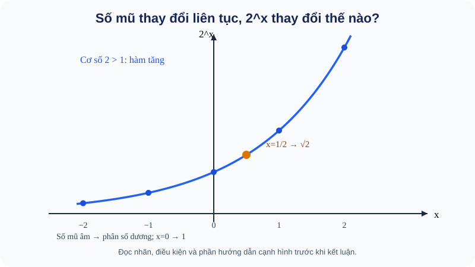
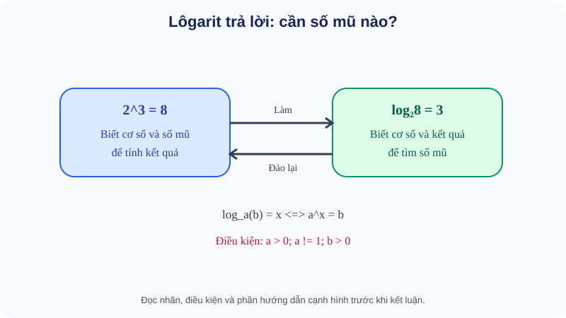
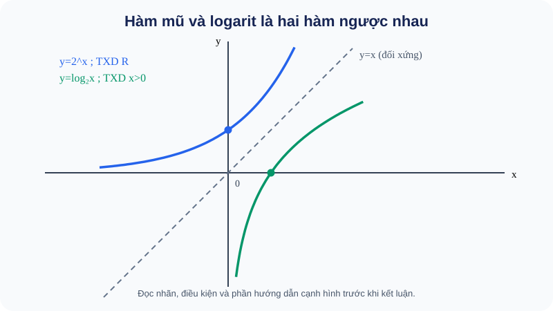
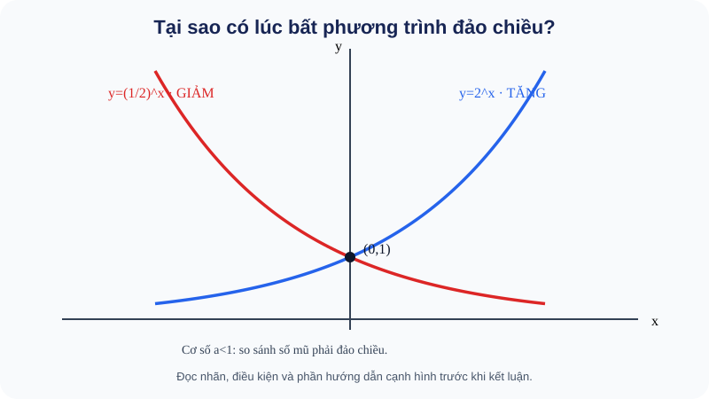
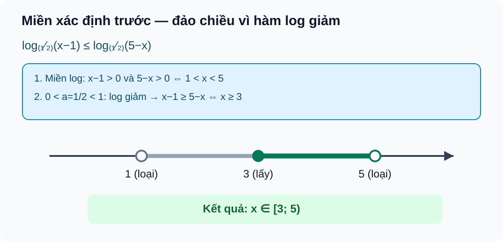

# Chuyên đề 04 · Lũy thừa, hàm mũ và lôgarit

Từ một số vốn nhân lên nhiều lần, em học cách biểu diễn **giá trị** bằng lũy thừa rồi đặt câu hỏi ngược: **số mũ nào** cho giá trị đó? Câu hỏi này dẫn tới lôgarit. Khi xét đồ thị và giải phương trình, điều kiện cơ số và đối số giúp biết phép biến đổi nào thực sự hợp lệ. Kết thúc bài, em sẽ tự chọn số kỳ nguyên trong một mô hình tăng hoặc giảm theo tỉ lệ.

## 1. Kiến thức

### 1. Từ phép nhân lặp đến lũy thừa thực

**Khám phá kiến thức**

Giả sử một khoản tiền tăng 8% mỗi năm và tiền lãi được nhập vào vốn. Sau năm thứ nhất, số tiền được nhân với \(1{,}08\); sau năm thứ hai, lại nhân với \(1{,}08\). Nếu cứ nhân như vậy, sau \(n\) năm số tiền được nhân với \(1{,}08^n\). Đây là tình huống tự nhiên đưa đến **lũy thừa**: số mũ cho biết ta lặp lại phép nhân bao nhiêu lần. Khi muốn hỏi “cần bao nhiêu năm để vượt một ngưỡng?”, ta phải làm phép ngược lại: tìm **số mũ** đã tạo nên một giá trị cho trước — đó là ý tưởng của **lôgarit**. Nhìn hai câu hỏi này như một cặp sẽ giúp em hiểu cả đồ thị, phép biến đổi và ứng dụng thay vì nhớ nhiều công thức rời rạc.

Trước khi dùng các ký hiệu mới, ta chỉ cần các kiến thức quen thuộc: nhân số thực, phân số, căn bậc hai không âm, tìm nghiệm phương trình và biểu diễn điểm trên mặt phẳng tọa độ. Số mũ âm sẽ dẫn tới phép chia; căn bậc chẵn dẫn tới điều kiện không âm; các logarit sẽ đòi đối số dương. Những điều kiện ấy không phải phụ lục học thuộc: chúng giải thích tại sao một phép biến đổi có thể hợp lệ ở giá trị này nhưng không hợp lệ ở giá trị khác.

Vì vậy ta bắt đầu bằng những quy tắc của lũy thừa, rồi dần chuyển từ phép tính với một số mũ sang câu hỏi ngược “số mũ nào?”, từ đó mới xét hàm số, bất phương trình và bài toán số kỳ.

Số mũ giúp diễn tả gọn việc nhân nhiều lần, nhưng các công thức chỉ dùng an toàn khi hiểu dấu, cơ số và miền. Ta mở rộng dần từ mũ nguyên sang căn, mũ hữu tỉ và thực để thấy điều kiện xuất hiện từ đâu.

<!-- LESSON_ID: TOP04-M01; OUTCOME_ID: TOP04-O01; R04_SNAPSHOT: 1f51b01357f87359b689131fd6afcc1ad998209d -->

#### 1.1. Số mũ nguyên, số mũ không và số mũ âm

Khi số mũ giảm từ 2 xuống 1 rồi 0, tại sao ta chia cơ số chứ không đổi dấu giá trị?

Ta biết \(2^3=2\cdot2\cdot2=8\): số mũ dương đếm số lần nhân cùng một cơ số. Nhưng khi giảm số mũ đi một đơn vị, kết quả phải **chia cho cơ số**, không phải đổi dấu. Vì thế với \(a\ne0\), quy tắc tiếp nối tự nhiên là \(a^0=1\) và \(a^{-n}=1/a^n\) khi \(n\) là số nguyên dương. Điều kiện \(a\ne0\) rất quan trọng: \(0^{-1}\) sẽ là \(1/0\), không xác định.

Lấy \((2/3)^{-2}\). Số mũ âm yêu cầu lấy nghịch đảo rồi bình phương: \((3/2)^2=9/4\), vẫn là một số **dương**. Tương tự, số rất nhỏ \(0{,}0000075\) có thể viết thành \(7{,}5\cdot10^{-6}\); dấu trừ thuộc **số mũ**, không phải dấu của số. Trong ký hiệu khoa học chuẩn, phần hệ số phải có trị tuyệt đối từ 1 đến dưới 10.

*Quan sát hình:* Quan sát các giá trị 2^x ở x=−2,−1,0,1,2: số mũ âm cho số dương nhỏ hơn 1, không phải kết quả âm.

**Ví dụ**

**Đề bài.** Tính \(\left(\frac34\right)^{-2}\cdot\frac9{16}\). Giải thích vì sao \(0^{-1}\) không có nghĩa.

**Lời giải.** Vì \(3/4\ne0\), ta lấy nghịch đảo: \((3/4)^{-2}=(4/3)^2=16/9\). Tích với \(9/16\) bằng \(1\). Còn \(0^{-1}=1/0\) là phép chia cho 0, không xác định.

**Vận dụng**

Tính \(5^{-2}\cdot25\). Biểu thức \(0^{-1}\) có nghĩa không? Vì sao?

Đối chiếu

\(5^{-2}\cdot25=\frac1{25}\cdot25=1\). \(0^{-1}\) không xác định vì dẫn tới phép chia cho 0. Nếu em nhầm dấu âm của số mũ thành dấu âm của giá trị, hãy so \(-2^2=-4\) với \(2^{-2}=1/4\).

<!-- LESSON_ID: TOP04-M02; OUTCOME_ID: TOP04-O02; R04_SNAPSHOT: 1f51b01357f87359b689131fd6afcc1ad998209d -->

#### 1.2. Căn bậc chẵn, căn bậc lẻ và mũ hữu tỉ

Ký hiệu căn bậc chẵn nói đến một giá trị hay tất cả nghiệm của phương trình tương ứng?

Số mũ hữu tỉ tiếp tục ý tưởng ấy nhưng phải xét kỹ căn bậc chẵn và căn bậc lẻ. Một phương trình x⁴=c có thể có hai nghiệm, trong khi ký hiệu căn bậc bốn chỉ cho một giá trị không âm. Ta đã biết căn bậc hai số học, nhân lũy thừa số nguyên. Với a>0, a^(m/n)=(ⁿ√a)^m (n nguyên dương), a^(−m/n)=1/a^(m/n). Căn bậc **chẵn** của a≥0 lấy căn không âm; căn bậc lẻ của số âm tồn tại. Với cơ số âm, không áp dụng tùy tiện bộ luật **số mũ thực của cơ số dương** sang mọi phân số.

Chẳng hạn, 81^(3/4)=(⁴√81)³=3³=27. Nhưng ⁴√16=2 còn x⁴=16 có x=±2; lý do là ký hiệu căn và tập nghiệm phương trình có vai trò khác nhau.

**Ví dụ**

**Đề bài.** Tính \(16^{3/4}\); phân biệt \(\sqrt[4]{81}\) với mọi nghiệm của \(x^4=81\).

**Lời giải.** Vì \(16>0\), \(16^{3/4}=(\sqrt[4]{16})^3=2^3=8\). Ký hiệu \(\sqrt[4]{81}=3\) là căn số học không âm; phương trình \(x^4=81\) có hai nghiệm thực \(x=\pm3\).

**Vận dụng**

Tính 27^(2/3) và ³√(−27).

Đối chiếu

27^(2/3)=3²=9; ³√(−27)=−3 vì (−3)³=−27.

Nếu chỉ nhận nghiệm dương khi giải x⁴=16, thử số đối; nếu đổi dấu căn bậc chẵn, nhớ căn số học ≥0.

<!-- LESSON_ID: TOP04-M03; OUTCOME_ID: TOP04-O03; R04_SNAPSHOT: 1f51b01357f87359b689131fd6afcc1ad998209d -->

#### 1.3. Lũy thừa với số mũ thực

Tại sao không thể hiểu \(a^{\sqrt2}\) là ‘nhân \(a\) đúng \(\sqrt2\) lần’?

Từ các số mũ hữu tỉ, ta có thể mở rộng sang số mũ thực khi cơ số phù hợp. Số mũ thực mô tả tăng trưởng theo thời gian không nguyên; không thể chỉ hiểu là ‘nhân số nguyên lần’. Ta sử dụng lũy thừa hữu tỉ của cơ số dương, ý niệm xấp xỉ số thực. Với a>0 và x vô tỉ, a^x được định nghĩa nhất quán từ các lũy thừa hữu tỉ a^r khi r xấp xỉ x, qua giới hạn. Điều này không có nghĩa nhân a đúng ‘√2 lần’. Tính đơn điệu phụ thuộc cơ số a>1 hay 0<a<1; cơ số âm không mặc nhiên có a^x trên mọi x thực.

Xét ví dụ: Vì √2<3/2 và 2>1, 2^(√2)<2^(3/2); còn vì 0<1/2<1, (1/2)^(√2)>(1/2)^(3/2). Cùng số mũ nhưng hai cơ số cho chiều ngược.

**Ví dụ**

**Đề bài.** So sánh \(3^{\sqrt2}\) với \(3^{3/2}\), rồi so sánh \((1/3)^{\sqrt2}\) với \((1/3)^{3/2}\).

**Lời giải.** Vì \((\sqrt2)^2=2<9/4=(3/2)^2\) và cả hai số không âm, \(\sqrt2<3/2\). Cơ số \(3>1\) làm lũy thừa tăng nên \(3^{\sqrt2}<3^{3/2}\). Cơ số \(1/3\in(0,1)\) làm lũy thừa giảm nên chiều so sánh đảo: \((1/3)^{\sqrt2}>(1/3)^{3/2}\).

**Vận dụng**

So sánh (1/3)^(√3) với (1/3)^2.

Đối chiếu

√3<2; cơ số 1/3 làm hàm nghịch biến nên (1/3)^(√3)>(1/3)^2.

Nếu đảo dấu sai, dùng x=0 và x=1 để quan sát 1 và cơ số a; quay M10 kiểm tính tăng/giảm.

<!-- LESSON_ID: TOP04-M04; OUTCOME_ID: TOP04-O04; R04_SNAPSHOT: 1f51b01357f87359b689131fd6afcc1ad998209d -->

#### 1.4. Quy tắc lũy thừa và điều kiện sử dụng

Một biểu thức rút gọn thành 1 có thể vẫn vô nghĩa tại một giá trị cơ số không?

Các quy tắc tính lũy thừa chỉ đáng tin khi đi kèm điều kiện của cơ số. Nén nhiều phép nhân/chia bằng quy tắc số mũ rất nhanh, nhưng rút gọn xong không được quên giá trị ban đầu vô nghĩa. Ta bắt đầu từ cộng/trừ số mũ hữu tỉ, mẫu số khác 0. Với a>0, a^r a^s=a^(r+s), a^r/a^s=a^(r−s), (a^r)^s=a^(rs). Với biểu thức gốc có chia/căn thì kiểm điều kiện trước; không có quy tắc a^r+a^s=a^(r+s).

Chẳng hạn, E=a^(3/2)·a^(−1/2)/a=a^(3/2−1/2−1)=a^0=1 khi a>0. Không nhận a=0 dù kết quả rút gọn là 1, vì biểu thức gốc chia cho a.

**Ví dụ**

**Đề bài.** Với \(a>0\), rút gọn \(E=a^{5/3}\cdot a^{-2/3}/a\) và giải thích điều kiện.

**Lời giải.** Cộng trừ số mũ vì cùng cơ số dương: \(E=a^{5/3-2/3-1}=a^0=1\). Giữ \(a>0\) vì biểu thức gốc có mũ thực và phép chia cho \(a\), không được nhận \(a=0\) chỉ vì kết quả rút gọn bằng 1.

**Vận dụng**

Với a>0, rút gọn a^(3/4)·a^(−1/4)/√a.

Đối chiếu

Bằng a^(3/4−1/4−1/2)=1; giữ a>0 để mẫu và mũ hữu tỉ được xác định.

Nếu cộng số mũ cho phép **cộng** hai lũy thừa, thử 2²+2³=12 khác 2⁵=32.

### 2. Lôgarit: câu hỏi ngược của lũy thừa

**Khám phá kiến thức**

Từ \(2^3=8\) ta biết cơ số và số mũ để tìm kết quả. Nếu đổi câu hỏi thành “phải nâng 2 lên lũy thừa bao nhiêu để được 8?”, đáp án vẫn là 3, nhưng thao tác suy nghĩ đã đảo chiều. Lôgarit đặt tên cho chính thao tác ấy. Vì lũy thừa cơ số dương không thể cho kết quả âm hay bằng 0, điều kiện đối số lôgarit phải dương xuất phát ngay từ ý nghĩa, trước mọi quy tắc tính.

<!-- LESSON_ID: TOP04-M05; OUTCOME_ID: TOP04-O05; R04_SNAPSHOT: 1f51b01357f87359b689131fd6afcc1ad998209d -->

#### 2.1. Định nghĩa lôgarit qua câu hỏi ngược

Đã biết \(5^3=125\), nếu muốn tìm ‘mũ nào cho 125’ thì em hỏi thế nào?

Biết số ban đầu và số cuối, ta muốn biết cần bao nhiêu lần nhân theo tỉ lệ a. Cần nhớ hàm mũ cơ số dương, tính đơn ánh của a^x khi a≠1. Với a>0, a≠1 và b>0, log_a b là số y duy nhất sao cho a^y=b. Do đó log_a1=0, log_a a=1; log_a b có thể âm nhưng b **không** thể âm. Đừng học công thức log trước khi hiểu câu hỏi ‘số mũ nào?’.

Chẳng hạn, log₂(1/8)=−3 vì 2^(−3)=1/8. Dấu âm nằm ở **số mũ được tìm**, không phải ở đối số 1/8>0.

*Quan sát hình:* So 2³=8 với log₂8=3, đồng thời ghi điều kiện cơ số dương, khác 1 và đối số logarit dương.

**Ví dụ**

**Đề bài.** Tính \(\log_5(1/125)\) và diễn giải bằng lũy thừa.

**Lời giải.** Cơ số \(5>0\), \(5\ne1\), đối số \(1/125>0\). Do \(5^{-3}=1/125\), số mũ cần tìm là \(-3\): \(\log_5(1/125)=-3\).

**Vận dụng**

Tính log₄(1/8).

Đối chiếu

Vì 4^(−3/2)=1/8 nên log₄(1/8)=−3/2.

Nếu nhầm log_a(−b) với số âm, kiểm log có nghĩa chỉ khi đối số >0; luyện P06 và các câu B19-C01/C02.

<!-- LESSON_ID: TOP04-M06; OUTCOME_ID: TOP04-O06; R04_SNAPSHOT: 1f51b01357f87359b689131fd6afcc1ad998209d -->

#### 2.2. Điều kiện đối số và bẫy tách lôgarit

Vì sao hai thừa số âm có tích dương nhưng không thể tách log tích thành hai log riêng?

Nhưng phép tính ngược ấy chỉ có nghĩa khi đối số và cơ số thỏa điều kiện. Nếu biến đổi log tích thành tổng log mà chưa xét miền, có thể đánh mất nghiệm hợp lệ. Để xác định điều đó, cần xét dấu tích hai nhân tử và bất phương trình bậc hai của tiền đề đã giải thích lại ở đây. Để log_a[F(x)] tồn tại trên ℝ cần a>0, a≠1 và F(x)>0. Quy tắc log_a(uv)=log_a u+log_a v đòi **u>0 và v>0**, mạnh hơn uv>0. Vì vậy với log_a[(x−1)(x−4)], miền x<1 hoặc x>4, nhưng chỉ tách thành tổng log thực trên x>4.

Chẳng hạn, với x=0: (x−1)(x−4)=4>0 nên log₂4 có nghĩa, còn log₂(−1) và log₂(−4) không. Hình dung hai điểm âm nhân lại dương không làm log từng số âm có nghĩa.

**Ví dụ**

**Đề bài.** Tìm miền xác định của \(\log_3[(x-2)(x+1)]\). Có thể tách thành hai log riêng trên toàn miền không?

**Lời giải.** Cần \((x-2)(x+1)>0\), suy ra \(x<-1\) hoặc \(x>2\). Công thức \(\log_3(x-2)+\log_3(x+1)\) chỉ có nghĩa khi \(x>2\). Tại \(x=-2\), tích \(4>0\) nhưng cả \(x-2\), \(x+1\) đều âm, nên không tách được.

**Vận dụng**

Tìm miền của log₂(x²−9); tách log₂(x−3)+log₂(x+3) trên mọi miền đó được không?

Đối chiếu

Miền x<−3 hoặc x>3, nhưng hai log riêng cùng có nghĩa chỉ khi x>3.

Nếu mắc lỗi ‘log của tích’ trên toàn miền, lấy x=−4 làm phản ví dụ; luyện P07/P08 và câu Written nguồn B19.

<!-- LESSON_ID: TOP04-M07; OUTCOME_ID: TOP04-O07; R04_SNAPSHOT: 1f51b01357f87359b689131fd6afcc1ad998209d -->

#### 2.3. Các quy tắc tính lôgarit

Khi đổi phép nhân thành phép cộng lôgarit, tại sao từng đối số phải dương?

Ta suy các quy tắc logarit từ chính phép nhân và chia các lũy thừa. Làm việc với những số rất lớn sẽ dễ hơn khi tích biến thành tổng, nhưng phép biến đổi có điều kiện. Ta đã biết tính chất a^r·a^s=a^(r+s), b>0. Với a>0,a≠1,x>0,y>0: log_a(xy)=log_a x+log_a y, log_a(x/y)=log_a x−log_a y, log_a(x^r)=r log_a x (x>0). Chúng đúng vì lấy log hai vế của các tích lũy thừa dương, không phải công thức thuộc lòng không điều kiện.

Chẳng hạn, log₃81−log₃3=log₃(81/3)=log₃27=3. Trừ hai log là log **thương**, không phải log(81−3).

**Ví dụ**

**Đề bài.** Tính \(\log_2 32-\log_2 4\) bằng quy tắc thương và kiểm bằng lũy thừa.

**Lời giải.** Hai đối số đều dương. Quy tắc thương cho \(\log_2(32/4)=\log_2 8=3\). Kiểm lại: \(\log_2 32=5\), \(\log_2 4=2\), nên \(5-2=3\).

**Vận dụng**

Tính log₂24−log₂3.

Đối chiếu

log₂(24/3)=log₂8=3 vì hai đối số dương và 2³=8.

Nếu viết log(x+y)=log x+log y, thử x=y=1: log2≠0; phân biệt tổng với tích.

<!-- LESSON_ID: TOP04-M08; OUTCOME_ID: TOP04-O08; R04_SNAPSHOT: 1f51b01357f87359b689131fd6afcc1ad998209d -->

#### 2.4. Đổi cơ số và dấu của lôgarit

Đổi cơ số về ln có thể đổi dấu kết quả khi nào?

Khi đổi cơ số, hướng biến thiên của logarit cũng cần được xem lại. Máy tính thường chỉ có log thập phân hoặc ln; cần biết phép đổi cơ số và điều kiện. Ta sử dụng định nghĩa log, cơ số a>0,a≠1, đối số b>0. Đặt t=log_a b thì a^t=b. Lấy ln hai vế: t ln a=ln b ⇒ log_a b=(ln b)/(ln a); ln a≠0 do a≠1. Khi 0<a<1, ln a âm; log_a b vẫn có nghĩa với b>0 và có thể dương hoặc âm.

Xét ví dụ: log₄8=ln8/ln4=3/2; log_(1/9)3=−1/2 vì (1/9)^(−1/2)=3. Điều kiện từng cơ số và đối số đều đúng.

**Ví dụ**

**Đề bài.** Tính \(\log_{1/4}2\) bằng phép đổi cơ số, rồi kiểm bằng định nghĩa.

**Lời giải.** Cơ số \(1/4\in(0,1)\), đối số \(2>0\) nên hợp lệ. \(\log_{1/4}2=\ln2/\ln(1/4)=\ln2/(-2\ln2)=-1/2\). Kiểm \((1/4)^{-1/2}=2\).

**Vận dụng**

Tính log₈2 bằng đổi cơ số.

Đối chiếu

ln2/ln8=1/3 (hoặc 8^(1/3)=2).

Nếu tính log_(1/9)3=+1/2, kiểm cơ số nhỏ 1 và thử lũy thừa.

### 3. Từ phép tính sang đồ thị hàm số

**Khám phá kiến thức**

Nếu xem số mũ \(x\) thay đổi liên tục, lũy thừa \(a^x\) tạo thành một hàm số. Thay vì chỉ tính vài giá trị riêng lẻ, ta quan sát xem khi \(x\) tăng thì kết quả tăng hay giảm, có bao giờ bằng 0 hay không. Đảo vai trò đầu vào và đầu ra của hàm mũ ta gặp hàm lôgarit; đồ thị của hai hàm cho ta một cách giải thích trực quan tính đơn điệu và miền xác định.

Hàm mũ diễn tả quá trình nhân theo bước, còn logarit giúp tìm số bước để đạt một mức. Đặt hai hàm cạnh nhau giúp hiểu tính đơn điệu, đồ thị và miền trước khi giải phương trình.

<!-- LESSON_ID: TOP04-M09; OUTCOME_ID: TOP04-O09; R04_SNAPSHOT: 1f51b01357f87359b689131fd6afcc1ad998209d -->

#### 3.1. Miền, giá trị và đồ thị hàm mũ

Hàm mũ luôn dương thì đồ thị có cắt trục hoành không?

Số lượng thay đổi theo tỉ lệ không đổi khác với tăng thêm số lượng tuyệt đối mỗi kỳ. Ta bắt đầu từ số mũ thực cơ số dương và vị trí các điểm trên mặt phẳng tọa độ. Với a>0,a≠1, f(x)=a^x có miền ℝ và giá trị (0,+∞), qua (0,1), (1,a), luôn dương. Khi a>1, f(x)→0 khi x→−∞; khi 0<a<1, f(x)→0 khi x→+∞. Trục Ox là tiệm cận ngang; hàm không cắt Ox.

Chẳng hạn, f(x)=(1/3)^x: f(−1)=3, f(0)=1, f(1)=1/3; các điểm giảm khi x tăng. Chọn bảng ba điểm vì nó nối được đồ thị và mô hình giảm theo tỉ lệ.

**Ví dụ**

**Đề bài.** Với \(f(x)=4^x\), tính \(f(-1),f(0),f(1)\), nêu miền và tập giá trị.

**Lời giải.** Ta được \(f(-1)=1/4\), \(f(0)=1\), \(f(1)=4\). Vì \(4>0\) và \(4\ne1\), tập xác định là \(\mathbb R\), tập giá trị là \((0,+\infty)\). Đồ thị qua ba điểm tương ứng và không cắt Ox vì \(4^x>0\) với mọi x.

**Vận dụng**

Cho f(x)=2^x, có x thực nào để f(x)=0 không?

Đối chiếu

Không: 2^x>0 mọi x∈ℝ, chỉ tiến dần về 0 khi x→−∞.

Nếu nhầm số rất nhỏ với 0, thử x=−10 và viết 2^(−10)=1/1024>0.

<!-- LESSON_ID: TOP04-M10; OUTCOME_ID: TOP04-O10; R04_SNAPSHOT: 1f51b01357f87359b689131fd6afcc1ad998209d -->

#### 3.2. Tính đơn điệu của hàm mũ

Hàm mũ cùng cơ số nhỏ hơn 1 thay đổi theo chiều nào khi số mũ tăng?

Cơ số lớn hơn 1 hay nằm giữa 0 và 1 làm thay đổi hướng đồ thị mũ. Đưa bất phương trình về so số mũ chỉ đúng nếu biết hàm tăng hay giảm. Cần nhớ các giá trị a^0=1,a^1=a và khái niệm hàm đơn điệu. Với a>1, a^x tăng nghiêm ngặt; với 0<a<1, a^x giảm nghiêm ngặt. Nếu a^u>a^v thì u>v khi a>1, nhưng u<v khi 0<a<1. Bản chất: tăng một đơn vị số mũ sẽ nhân giá trị với a; nhân số >1 làm lớn, nhân số nằm (0,1) làm nhỏ.

Chẳng hạn, Vì (1/4)^0=1 và (1/4)^1=1/4 nên cơ số 1/4 giảm theo số mũ. Do −1<2, (1/4)^(−1)=4>(1/4)^2=1/16.

**Ví dụ**

**Đề bài.** Giải \(\left(\frac13\right)^{x-1}\ge\left(\frac13\right)^2\).

**Lời giải.** Hàm \(t\mapsto(1/3)^t\) nghịch biến do cơ số trong \((0,1)\). Vì thế dấu \(\ge\) của giá trị dẫn tới \(x-1\le2\), hay \(x\le3\). Dấu đảo khi so số mũ, không phải do thao tác chia số âm.

**Vận dụng**

So (1/5)^(−1) và (1/5)^2.

Đối chiếu

5>1/25; số mũ −1 nhỏ hơn 2 nhưng cơ số giảm làm giá trị lớn hơn.

Nếu luôn giữ dấu so sánh khi bỏ mũ, vẽ hai điểm 0,1 trên đồ thị để sửa.

<!-- LESSON_ID: TOP04-M11; OUTCOME_ID: TOP04-O11; R04_SNAPSHOT: 1f51b01357f87359b689131fd6afcc1ad998209d -->

#### 3.3. Miền và đồ thị hàm lôgarit

Điểm \((1,0)\) của đồ thị lôgarit có nghĩa gì về số mũ?

Nhìn ngược đồ thị ấy, ta hiểu vì sao hàm logarit có miền và tính chất đặc trưng. Nếu hàm mũ biến thời gian thành lượng, logarit giúp biến lượng thành thời gian cần thiết. Để xác định điều đó, cần xét định nghĩa log, cơ số a>0,a≠1 và đường thẳng x=0. Với a>0,a≠1, g(x)=log_a x có miền (0,+∞), giá trị ℝ, qua (1,0) và (a,1); x=0 là tiệm cận đứng. Hàm tăng nếu a>1, giảm nếu 0<a<1. Không có điểm đồ thị với x≤0.

Chẳng hạn, g(x)=log_(1/2)x: g(1/4)=2, g(4)=−2; từ x=1/4 sang x=4 giá trị giảm, phản ánh cơ số nhỏ hơn 1.

**Ví dụ**

**Đề bài.** Với \(g(x)=\log_3 x\), tính \(g(1/9)\) và \(g(9)\), nêu miền xác định.

**Lời giải.** Vì \(3^{-2}=1/9\), \(g(1/9)=-2\); vì \(3^2=9\), \(g(9)=2\). Chỉ \(x>0\) là đối số log hợp lệ. Đồ thị đi qua \((1,0)\), tăng và có tiệm cận đứng \(x=0\).

**Vận dụng**

Với y=log₂x, giá trị tại x=1/8 và x=8 là gì?

Đối chiếu

log₂(1/8)=−3, log₂8=3, hàm tăng vì cơ số 2>1.

Nếu đặt điểm x=0 lên đồ thị log, hỏi cơ số nào lũy thừa ra 0 (không có).

<!-- LESSON_ID: TOP04-M12; OUTCOME_ID: TOP04-O12; R04_SNAPSHOT: 1f51b01357f87359b689131fd6afcc1ad998209d -->

#### 3.4. Hàm mũ và lôgarit là hai hàm ngược

Vì sao điểm \((u,v)\) của hàm mũ trở thành \((v,u)\) trên hàm lôgarit?

Hai đồ thị tương ứng phản chiếu qua y=x khi thực sự là hai hàm ngược. Liên kết hai khái niệm thành một thao tác thuận và thao tác ngược để giải phương trình. Ta đã biết khái niệm hàm ngược, tọa độ điểm (x,y). Với a>0,a≠1, f(x)=a^x là một-một từ ℝ đến (0,+∞), g(x)=log_a x là hàm ngược từ (0,+∞) về ℝ. Nếu (u,v) trên f thì (v,u) trên g; đồ thị đối xứng qua y=x. g(f(x))=x với mọi x thực, còn f(g(x))=x chỉ với x>0.

Chẳng hạn, 2^(−1)=1/2, nên f có (−1,1/2), g có (1/2,−1). Đây là hoán đổi chỗ input/output, không phải phép đổi dấu.

*Quan sát hình:* Đối chiếu tọa độ hai điểm bị hoán đổi và chú ý logarit chỉ nhận đầu vào dương; phép đối xứng không xóa miền.

**Ví dụ**

**Đề bài.** Cho \(f(x)=5^x\), \(g(x)=\log_5x\). Từ điểm \((-1,1/5)\) trên \(f\), xác định điểm tương ứng trên \(g\).

**Lời giải.** Vì \(5^{-1}=1/5\), \(f(-1)=1/5\). Hai hàm ngược hoán đổi vai trò đầu vào/đầu ra nên \(g(1/5)=-1\): điểm tương ứng là \((1/5,-1)\). Đối số \(1/5\) dương nên có nghĩa.

**Vận dụng**

Cho f(x)=3^x. Điểm (1,3) trên f tương ứng điểm nào trên log₃x?

Đối chiếu

(3,1) vì log₃3=1.

Nếu dùng log₃(−3) để đảo hàm, kiểm miền log phải dương; luyện P16 và các Written cũ B20.

### 4. Từ đồ thị đến phương trình và bất phương trình

**Khám phá kiến thức**

Khi hai vế cùng là lũy thừa có chung cơ số hợp lệ, tính đơn ánh của hàm mũ cho phép chuyển việc so sánh giá trị sang so sánh số mũ. Nhưng nếu cơ số ở giữa 0 và 1, hàm giảm nên dấu bất phương trình phải đảo chiều. Với logarit, trước khi so sánh hai đối số còn phải bảo đảm **cả hai đối số dương**. Những điều kiện này được rút ra từ đồ thị vừa học, không phải mẹo biến đổi riêng rẽ.

Việc đưa hai vế về cùng cơ số chỉ là một bước kỹ thuật. Miền xác định, tính một-một và chiều biến thiên mới quyết định phép suy luận có đúng và đủ hay không.

<!-- LESSON_ID: TOP04-M13; OUTCOME_ID: TOP04-O13; R04_SNAPSHOT: 1f51b01357f87359b689131fd6afcc1ad998209d -->

#### 4.1. Phương trình mũ và ẩn phụ dương

Đặt \(t=a^x\) khi giải phương trình mũ thì \(t\) được nhận những giá trị nào?

Muốn tìm thời gian hoặc giá trị x khi lượng a^x đạt ngưỡng, cần giải phương trình mũ chứ không phỏng đoán. Ta sử dụng a>0,a≠1, hàm mũ đơn ánh, giải phương trình bậc hai. a^u=a^v ⇔ u=v với a>0,a≠1. Nếu phải đặt t=a^x, luôn ghi t>0; nghiệm t≤0 phải loại trước khi quay lại x. Đưa về cùng cơ số là phương pháp cơ bản SGK B21; đặt ẩn phụ là **mở rộng có điều kiện của CĐ04**, không gán cho bản SGK review cũ.

Xét ví dụ: 4^x=2^(x+3) ⇒ 2^(2x)=2^(x+3) ⇒ 2x=x+3 ⇒ x=3. Nếu có 9^x−4·3^x+3=0, t=3^x>0 cho t=1,3 ⇒ x=0,1.

**Ví dụ**

**Đề bài.** Giải phương trình \(8^x=2^{x+4}\).

**Lời giải.** Vì \(8=2^3\), ta có \(2^{3x}=2^{x+4}\). Hàm mũ cơ số \(2>1\) đơn ánh nên \(3x=x+4\), suy ra \(x=2\). Thế lại \(8^2=64=2^6\).

**Vận dụng**

Giải 2^(2x)=8·2^x.

Đối chiếu

2^(2x)=2^(x+3) ⇒ x=3; 2^x>0 nên có thể chia cho 2^x nếu muốn.

Nếu đặt t=3^x mà nhận t âm, kiểm t>0; luyện P17 và bài SGK B21-C01.

<!-- LESSON_ID: TOP04-M14; OUTCOME_ID: TOP04-O14; R04_SNAPSHOT: 1f51b01357f87359b689131fd6afcc1ad998209d -->

#### 4.2. Phương trình lôgarit và lọc nghiệm

Vì sao giải xong phương trình đa thức chưa đủ để kết luận nghiệm log?

Nếu ẩn nằm trong logarit, xác định miền phải đi trước mọi bước biến đổi. Một phương trình đa thức sau gộp log có thể sinh nghiệm âm, nhưng log không có đối số âm. Ta bắt đầu từ miền F(x)>0 và tính đơn ánh log_a. log_a U=log_a V ⇔ U=V **trong miền U>0,V>0**, a>0,a≠1. Khi cộng các log, chỉ gộp nếu từng đối số dương. Giải phương trình đại số thu được ứng viên, kiểm vào miền/đề gốc, đặc biệt khi bình phương hay đưa về tích.

Chẳng hạn, log₂(x−1)+log₂(x+1)=3: miền x>1. (x−1)(x+1)=8 ⇒ x=±3, chỉ x=3 thỏa. Kiểm log₂2+log₂4=1+2=3.

**Ví dụ**

**Đề bài.** Giải \(\log_3(x-2)=\log_3(4-x)\) trên \(\mathbb R\).

**Lời giải.** Điều kiện \(x-2>0\) và \(4-x>0\), tức \(2<x<4\). Lôgarit cùng cơ số hợp lệ là đơn ánh nên \(x-2=4-x\), suy ra \(x=3\). Tại 3 hai đối số đều bằng 1; nghiệm được nhận.

**Vận dụng**

Giải log₂(x−2)+log₂(x+2)=3.

Đối chiếu

Điều kiện x>2. x²−4=8 ⇒ x=±2√3, chỉ +2√3 thỏa vì >2.

Nếu dùng x âm từ phương trình bình phương, thay vào từng đối số; luyện P18/W03 và Written nguồn B19.

<!-- LESSON_ID: TOP04-M15; OUTCOME_ID: TOP04-O15; R04_SNAPSHOT: 1f51b01357f87359b689131fd6afcc1ad998209d -->

#### 4.3. Bất phương trình mũ và chiều so sánh

Với cơ số \(1/4\), tăng số mũ thì giá trị tăng hay giảm?

Từ phương trình sang bất phương trình, hướng biến thiên quyết định chiều nghiệm. Giải một bất phương trình mũ có thể nhanh bằng so số mũ, nhưng dấu so sánh sai làm đổi toàn bộ tập nghiệm. Cần nhớ tính đơn điệu a^x, chuyển vế bất phương trình bậc nhất. Với a>1, a^u≤a^v ⇔ u≤v; với 0<a<1, a^u≤a^v ⇔ u≥v. Không thể so trực tiếp hai số mũ nếu cơ số khác nhau mà chưa quy về cùng cơ số một cách hợp lệ.

Chẳng hạn, (1/2)^(x−2)<(1/2)^1 ⇔ x−2>1 (đảo chiều vì cơ số nhỏ hơn 1) ⇔ x>3. Thử x=4: (1/2)^2=1/4<1/2 đúng.

*Đọc hình:* Hai đồ thị \(y=2^x\) và \(y=(1/2)^x\) đều qua \((0,1)\) và luôn dương. Khi \(x\) tăng, đồ thị cơ số 2 đi lên còn cơ số \(1/2\) đi xuống. Đó là lý do so sánh các số mũ cùng cơ số \(1/2\) phải **đảo chiều** bất phương trình.

**Ví dụ**

**Đề bài.** Giải \((1/4)^{2x+1}\le(1/4)^5\).

**Lời giải.** Vì \(0<1/4<1\), hàm mũ nghịch biến nên khi so số mũ phải đảo chiều: \(2x+1\ge5\). Suy ra \(x\ge2\). Kiểm \(x=2\) hai vế bằng nhau nên lấy 2.

**Vận dụng**

Giải (1/3)^(2x−1)≥(1/3)^(x+2).

Đối chiếu

Nghịch biến nên 2x−1≤x+2 ⇒ x≤3, lấy dấu bằng tại x=3.

Nếu giữ chiều khi cơ số nhỏ hơn 1, kiểm x=4; luyện P19 và 2 câu gốc B21 bất phương trình mũ.

<!-- LESSON_ID: TOP04-M16; OUTCOME_ID: TOP04-O16; R04_SNAPSHOT: 1f51b01357f87359b689131fd6afcc1ad998209d -->

#### 4.4. Bất phương trình lôgarit giảm, giao miền

Điểm mút khiến đối số log bằng 0 có được nhận dù dấu bất phương trình không nghiêm không?

Với bất phương trình logarit, kết luận cuối chỉ hợp lệ sau khi giao miền xác định. Dù đã đảo chiều bất phương trình đúng, vẫn có thể nhận điểm ngoài miền log nếu không giao tập nghiệm. Để xác định điều đó, cần xét điều kiện log U, log V dương; tính tăng/giảm log. Với a>1: log_a U≤log_a V ⇔ U≤V khi U,V>0. Với 0<a<1: log_a U≤log_a V ⇔ U≥V khi U,V>0. Kết luận là giao với điều kiện; các mốc khiến đối số bằng 0 luôn **loại**.

Chẳng hạn, log_(1/2)(x−1)≤log_(1/2)(5−x): miền 1<x<5; nghịch biến ⇒ x−1≥5−x ⇒ x≥3; giao được [3,5), không nhận 5.

*Quan sát hình:* Đầu mút \(1\) và \(5\) bị loại vì có đối số logarit bằng 0; tại \(3\) hai vế bằng nhau, nên nhận \(3\). Cơ số \(1/2\) cho chiều nghịch biến: với \(x\ge3\) (và \(x<5\)), bất phương trình đúng.

**Ví dụ**

**Đề bài.** Giải \(\log_{1/2}(x+2)>\log_{1/2}(6-x)\).

**Lời giải.** Điều kiện \(x+2>0\) và \(6-x>0\) cho \(-2<x<6\). Vì lôgarit cơ số \(1/2\) nghịch biến, bất phương trình tương đương \(x+2<6-x\), hay \(x<2\). Giao miền được \((-2,2)\); loại \(-2\) vì đối số bằng 0.

**Vận dụng**

Giải log_(1/3)(x+1)>log_(1/3)4.

Đối chiếu

Miền x>−1; log giảm nên x+1<4 ⇒ x<3; S=(−1,3).

Nếu không loại 5 trong ví dụ, kiểm log(0) vô nghĩa; xem SVG miền mới và luyện P20.

### 5. Tăng trưởng và quyết định theo số kỳ

**Khám phá kiến thức**

Cuối cùng, ta quay về câu hỏi về vốn và số kỳ ở đầu chuyên đề. Công thức tăng theo tỉ lệ không đổi giúp tính giá trị sau một số kỳ; muốn biết **kỳ đầu tiên** vượt ngưỡng, ta dùng logarit để tìm mốc thời gian liên tục rồi kiểm các kỳ nguyên liền kề. Một kết quả như \(2{,}9\) năm không tự động là “năm thứ 2,9” khi đề hỏi số năm nguyên — chính ngữ cảnh quyết định cách kết luận.

Lũy thừa và logarit giúp mô hình hóa lãi theo kỳ hay thời gian tới ngưỡng. Đáp án cần khớp miền, đơn vị và giả thiết của mô hình thay vì chỉ đẹp về đại số.

<!-- LESSON_ID: TOP04-M17; OUTCOME_ID: TOP04-O17; R04_SNAPSHOT: 1f51b01357f87359b689131fd6afcc1ad998209d -->

#### 5.1. Mô hình tăng giảm theo kỳ nguyên

Khi đề hỏi ‘kỳ nguyên đầu tiên vượt ngưỡng’, tại sao cần thử hai kỳ liên tiếp?

Bài toán lãi kép, giá trị giảm dần hay số lượng quần thể đều liên quan nhân theo tỉ lệ, không cộng lượng cố định. Ta đã biết phần trăm, lũy thừa, logarit và n nguyên không âm cho số kỳ. Nếu mỗi kỳ nhân q>0 và ban đầu A₀>0 thì A(n)=A₀q^n, n nguyên≥0; q>1 tăng, 0<q<1 giảm. Để tìm kỳ đầu tiên đạt ngưỡng dùng log với đúng dấu của ln q, sau đó kiểm các kỳ nguyên kề nhau. Mô hình giả định q không đổi và n nguyên, không tự chứng minh thực tế sẽ tuân chính xác.

Chẳng hạn, 200 triệu đồng lãi gộp 5%/năm, sau 2 năm có 200·1,05²=220,5 triệu. Nếu 100 triệu tăng 8%/năm và muốn vượt 125 triệu: n>ln1,25/ln1,08≈2,8994, nên năm nguyên nhỏ nhất n=3.

**Ví dụ**

**Đề bài.** Ban đầu có 400 sản phẩm, mỗi kỳ chỉ còn \(90\%\). Kỳ nguyên không âm đầu tiên mà lượng còn lại **nhỏ hơn** 300 là kỳ nào?

**Lời giải.** Mô hình \(N(n)=400(0{,}9)^n\), \(n\in\mathbb Z_{\ge0}\). Cần \((0{,}9)^n<0{,}75\). Vì \(\ln0{,}9<0\), ta có \(n>\ln(0{,}75)/\ln(0{,}9)\approx2{,}73\). Do đó \(n=3\) là kỳ đầu: \(N(2)=324>300\), \(N(3)=291{,}6<300\).

**Vận dụng**

Với số lượng 500 giảm 20% mỗi kỳ, tính sau 3 kỳ theo mô hình.

Đối chiếu

N(3)=500·0,8³=256. Giảm 20% trên số còn lại mỗi kỳ, không trừ 100 cố định mỗi lần.

Nếu tăng/giảm tuyến tính theo số cộng, kiểm tỷ lệ thực mỗi năm; luyện P21/W04 và câu SGK B18-P05.

<!-- LESSON_ID: TOP04-M18; OUTCOME_ID: TOP04-O18; R04_SNAPSHOT: 1f51b01357f87359b689131fd6afcc1ad998209d -->

#### 5.2. Bài toán tổng hợp nhiều điều kiện

Bài toán có nhiều logarit: khi nào nên kiểm miền, khi nào thử nghiệm lại?

Trong bài toán tổng hợp, lỗi thường đến từ một điều kiện bị quên. Đề tổng hợp không nói sẵn dùng luật nào; học sinh cần tự phát hiện miền, biến đổi và kiểm nghiệm. Ta sử dụng quy tắc lũy thừa, log domain, so số mũ và giải bậc hai. Đọc bài theo chuỗi: xác định a>0,a≠1; từng log đối số>0; chọn quy tắc/hàm đơn ánh; giải ứng viên; giao mọi miền; thử nghiệm. Không trộn điều kiện của mô hình lãi kép với điều kiện log, và phải thử lại kết quả trong các miền xác định trước khi kết luận.

Xét ví dụ: log₂(x²−1)=log₂(3x+3): miền x²−1>0 và 3x+3>0 ⇒ x>1. Đồng nhất đối số cho x²−3x−4=0 ⇒ x=4 hoặc −1; x=−1 sai miền. Nghiệm x=4, thử hai đối số bằng 15.

**Ví dụ**

**Đề bài.** Giải \(\log_2(x-1)+\log_2(x-3)=3\) trên \(\mathbb R\).

**Lời giải.** Cần \(x-1>0,\ x-3>0\), nên \(x>3\). Gộp log thành \(\log_2[(x-1)(x-3)]=3\), suy ra \(x^2-4x+3=8\), tức \((x-5)(x+1)=0\). Ứng viên \(5,-1\); chỉ \(5>3\), và tại 5 hai đối số 4 và 2 cho tích 8. Vậy nghiệm \(x=5\).

**Vận dụng**

Giải \(\log_3(x-1)=1+\log_3(5-x)\). Hãy nêu miền trước khi dùng quy tắc logarit.

Đối chiếu

Điều kiện \(x-1>0\), \(5-x>0\), tức \(1<x<5\). Vì \(1=\log_3 3\), ta có \(\log_3(x-1)=\log_3[3(5-x)]\). Hai đối số dương và cơ số 3 hợp lệ nên \(x-1=15-3x\), suy ra \(x=4\). Thử: \(\log_3 3=1+\log_3 1=1\). Nếu em bỏ điều kiện và nhận nghiệm ngoài (1,5), quay lại bước xác định miền trước khi giải.

## 2. Luyện tập

Hãy giải từng bài trước khi mở lời giải. Với lôgarit, ghi rõ điều kiện cơ số và đối số; với bất phương trình, giải thích vì sao đổi hoặc giữ chiều; với mô hình tăng trưởng, kiểm số kỳ nguyên. Nếu sai, quay lại mảng Kiến thức tương ứng rồi thử bài mới.

### Lũy thừa, căn và số mũ thực

<!-- DISPLAY_ONLY_CANONICAL: THPT-G11-CHVI-B18-C01; ORIGINAL_BLOB: 17d6fe73d8f3ac0e378dabf53c3e5d2e69e71872; OUTCOME: TOP04-O01; NOT_NEW_BANK -->

#### Bài 1

Tại sao (2/5)^(-2) không phải số âm? Tính giá trị.

Lời giải

**Đáp án:** 25/4.

Số mũ âm nói lấy nghịch đảo, không phải dấu âm trước lũy thừa: (2/5)^(-2)=(5/2)^2=25/4.

<!-- DISPLAY_ONLY_CANONICAL: THPT-G11-CHVI-B18-C02; ORIGINAL_BLOB: 17d6fe73d8f3ac0e378dabf53c3e5d2e69e71872; OUTCOME: TOP04-O02; NOT_NEW_BANK -->

#### Bài 2

Giải thích ý nghĩa của 81^(3/4) và tính kết quả.

Lời giải

**Đáp án:** 27.

Cơ số dương, căn bậc 4 của 81 bằng 3; lấy lũy thừa bậc 3 được 27.

<!-- DISPLAY_ONLY_CANONICAL: THPT-G11-CHVI-B18-C03; ORIGINAL_BLOB: 17d6fe73d8f3ac0e378dabf53c3e5d2e69e71872; OUTCOME: TOP04-O01; NOT_NEW_BANK -->

#### Bài 3

0^(-2) có nghĩa trong tập số thực không? Vì sao?

Lời giải

**Đáp án:** Không.

Nếu dùng quy tắc số mũ âm sẽ là 1/0², phép chia cho 0 không xác định.

<!-- DISPLAY_ONLY_CANONICAL: THPT-G11-CHVI-B18-C04; ORIGINAL_BLOB: 17d6fe73d8f3ac0e378dabf53c3e5d2e69e71872; OUTCOME: TOP04-O03; NOT_NEW_BANK -->

#### Bài 4

Một bạn nói: “2^(√2) không có nghĩa, vì √2 không thể đếm số lần nhân 2”. Em giải thích bạn đang hiểu sai điều gì và mô tả cách số này được hình thành.

Lời giải

**Đáp án:** 2^(√2) có nghĩa vì cơ số 2>0; số mũ thực không còn được hiểu là số lần nhân nguyên. Nó được định nghĩa bằng giới hạn của dãy giá trị 2^r khi các số hữu tỉ r tiến đến √2.

Các số mũ hữu tỉ gần √2 như 1,4;1,41;1,414,… đã có định nghĩa bằng căn/lũy thừa. Khi các giá trị 2^r tiến đến một số xác định không phụ thuộc dãy xấp xỉ, ta gọi đó là 2^(√2). Đây là mở rộng nhất quán của khái niệm, không phải “nhân số 2 √2 lần”.

<!-- DISPLAY_ONLY_CANONICAL: THPT-G11-CHVI-B18-C05; ORIGINAL_BLOB: 17d6fe73d8f3ac0e378dabf53c3e5d2e69e71872; OUTCOME: TOP04-O02; NOT_NEW_BANK -->

#### Bài 5

Phân biệt hai yêu cầu: tìm `√25` và giải `x²=25`. Nếu chuyển sang `∛(−27)`, kết quả ra sao? Giải thích vai trò của căn bậc chẵn/lẻ.

Lời giải

**Đáp án:** `√25=5` là căn không âm; phương trình `x²=25` có hai nghiệm `x=5` và `x=−5`; `∛(−27)=−3`.

Ký hiệu căn bậc chẵn lấy giá trị không âm, còn phương trình `x²=25` yêu cầu tìm **mọi** số bình phương bằng 25. Căn bậc lẻ của số âm tồn tại trong ℝ vì `(−3)³=−27`. Không suy rộng cơ số âm sang mọi số mũ thực.

<!-- DISPLAY_ONLY_CANONICAL: THPT-G11-CHVI-B18-P01; ORIGINAL_BLOB: 17d6fe73d8f3ac0e378dabf53c3e5d2e69e71872; OUTCOME: TOP04-O04; NOT_NEW_BANK -->

#### Bài 6

Với a>0, rút gọn a^(-1/2)·a^(3/2).

Lời giải

**Đáp án:** a.

Cộng các số mũ do cùng cơ số dương: a^((-1/2)+(3/2))=a^1=a.

<!-- DISPLAY_ONLY_CANONICAL: THPT-G11-CHVI-B18-P02; ORIGINAL_BLOB: 17d6fe73d8f3ac0e378dabf53c3e5d2e69e71872; OUTCOME: TOP04-O02; NOT_NEW_BANK -->

#### Bài 7

Tính 64^(-1/3).

Lời giải

**Đáp án:** 1/4.

Căn bậc ba của 64 là 4; số mũ âm lấy nghịch đảo.

<!-- DISPLAY_ONLY_CANONICAL: THPT-G11-CHVI-B18-P03; ORIGINAL_BLOB: 17d6fe73d8f3ac0e378dabf53c3e5d2e69e71872; OUTCOME: TOP04-O02; NOT_NEW_BANK -->

#### Bài 8

Tính 16^(3/4) theo căn bậc bốn.

Lời giải

**Đáp án:** 8.

Căn bậc 4 của 16 là 2, sau đó lấy 2³=8.

<!-- DISPLAY_ONLY_CANONICAL: THPT-G11-CHVI-B18-P04; ORIGINAL_BLOB: 17d6fe73d8f3ac0e378dabf53c3e5d2e69e71872; OUTCOME: TOP04-O04; NOT_NEW_BANK -->

#### Bài 9

Với a>0, rút gọn (a^(2/3))^(3/2).

Lời giải

**Đáp án:** a.

Nhân số mũ 2/3·3/2=1 với cơ số dương để mọi phép tính hợp lệ.

<!-- DISPLAY_ONLY_CANONICAL: THPT-G11-CHVI-B18-P06; ORIGINAL_BLOB: 17d6fe73d8f3ac0e378dabf53c3e5d2e69e71872; OUTCOME: TOP04-O04; NOT_NEW_BANK -->

#### Bài 10

Bạn viết 2²+2³=2⁵. Hãy nêu lỗi và kết quả đúng.

Lời giải

**Đáp án:** 12; quy tắc cộng số mũ không áp dụng cho tổng hai lũy thừa.

2²+2³=4+8=12; 2⁵=32 chỉ bằng 2²·2³.

<!-- DISPLAY_ONLY_CANONICAL: THPT-G11-CHVI-B18-P07; ORIGINAL_BLOB: 17d6fe73d8f3ac0e378dabf53c3e5d2e69e71872; OUTCOME: TOP04-O01; NOT_NEW_BANK -->

#### Bài 11

Viết `0,0000075` dưới dạng kí hiệu khoa học, rồi giải thích dấu của số mũ và vì sao không được viết `75×10^{-7}` làm **dạng chuẩn** dù giá trị bằng nhau.

Lời giải

**Đáp án:** `7,5×10^{-6}`. Biểu thức `75×10^{-7}` cũng bằng cùng giá trị nhưng hệ số 75 không thuộc đoạn `[1,10)` nên không phải dạng chuẩn.

Số rất nhỏ hơn 1 nên số mũ của 10 âm; chuyển dấu phẩy sáu chữ số để có phần hệ số 7,5, nhân `10^{-6}` để giữ đúng giá trị. Kí hiệu khoa học chuẩn có phần trị tuyệt đối hệ số từ 1 đến dưới 10.

<!-- DISPLAY_ONLY_CANONICAL: THPT-G11-CHVI-B18-W01; ORIGINAL_BLOB: 17d6fe73d8f3ac0e378dabf53c3e5d2e69e71872; OUTCOME: TOP04-O04; NOT_NEW_BANK -->

#### Bài 12

Với a>0: (a) rút gọn E=a^(3/2)·a^(−1/2)/a^(1/3); (b) tính 64^(2/3); (c) giải thích tại sao điều kiện a>0 được giữ trong E.

Lời giải và rubric

(a) E=a^(3/2−1/2−1/3)=a^(2/3); (b) ³√64=4, bình phương là 16; (c) cần a>0 để các lũy thừa có số mũ thực/hữu tỉ được dùng nhất quán và mẫu khác 0.

**Rubric 4 điểm:**

1. Kiểm đúng a>0 và nêu ý nghĩa hợp lệ phép chia — **1 điểm**.
2. Đưa E về một lũy thừa bằng cách cộng/trừ số mũ đúng — **1 điểm**.
3. Kết luận E=a^(2/3) không bỏ điều kiện — **1 điểm**.
4. Tính 64^(2/3)=16 và giải thích qua căn bậc ba — **1 điểm**.

<!-- DISPLAY_ONLY_CANONICAL: THPT-TOP04-P01; ORIGINAL_BLOB: 004692a2d996b5ba955318a087f4d58dcdb2df04; OUTCOME: TOP04-O01; NOT_NEW_BANK -->

#### Bài 13

Giải thích tại sao 3^(-2)·9=1 nhưng 0^(-2) không xác định.

Lời giải

**Đáp án:** 3^(-2)·9=1; 0^(-2) không xác định.

3^(-2)=1/9 vì 3≠0; nhân 9 cho 1. Nếu thay cơ số bằng 0 thì số mũ −2 đòi lấy 1/0², là phép chia cho 0.

<!-- DISPLAY_ONLY_CANONICAL: THPT-TOP04-P02; ORIGINAL_BLOB: 004692a2d996b5ba955318a087f4d58dcdb2df04; OUTCOME: TOP04-O02; NOT_NEW_BANK -->

#### Bài 14

Phân biệt ⁴√16 với nghiệm của x⁴=16; tính thêm ³√(−8).

Lời giải

**Đáp án:** ⁴√16=2; x⁴=16 có x=±2; ³√(−8)=−2.

Căn số học bậc chẵn chỉ nhận giá trị không âm; phương trình bậc chẵn có thể có hai nghiệm đối nhau. Căn bậc lẻ của số âm có nghĩa vì (−2)³=−8.

<!-- DISPLAY_ONLY_CANONICAL: THPT-TOP04-P03; ORIGINAL_BLOB: 004692a2d996b5ba955318a087f4d58dcdb2df04; OUTCOME: TOP04-O03; NOT_NEW_BANK -->

#### Bài 15

So sánh 2^(√2) và 2^(3/2) mà không dùng máy tính; nêu điều kiện cơ số.

Lời giải

**Đáp án:** 2^(√2) < 2^(3/2).

√2<3/2 vì 2<9/4, và y=2^x tăng nghiêm ngặt. Cơ số 2>0 nên lũy thừa với số mũ vô tỉ xác định.

<!-- DISPLAY_ONLY_CANONICAL: THPT-TOP04-P04; ORIGINAL_BLOB: 004692a2d996b5ba955318a087f4d58dcdb2df04; OUTCOME: TOP04-O03; NOT_NEW_BANK -->

#### Bài 16

So sánh (1/2)^(√3) với (1/2)^2, giải thích dấu so sánh.

Lời giải

**Đáp án:** (1/2)^(√3) > (1/2)^2.

√3<2, nhưng cơ số 1/2 nằm giữa 0 và 1 nên hàm lũy thừa theo số mũ giảm: số mũ nhỏ cho giá trị lớn. Không được dùng quy tắc so sánh cơ số >1.

<!-- DISPLAY_ONLY_CANONICAL: THPT-TOP04-P05; ORIGINAL_BLOB: 004692a2d996b5ba955318a087f4d58dcdb2df04; OUTCOME: TOP04-O04; NOT_NEW_BANK -->

#### Bài 17

Với a>0, rút gọn E=a^(3/4)·a^(−1/4)/√a. Điều kiện nào bảo đảm phép tính có nghĩa?

Lời giải

**Đáp án:** E=1 với a>0.

√a=a^(1/2)>0 vì a>0. E=a^(3/4−1/4−1/2)=a^0=1. Với a=0 phép chia cho √a không xác định; với a âm không dùng nhất quán mũ thực theo định nghĩa SGK.

<!-- DISPLAY_ONLY_CANONICAL: THPT-TOP04-W01; ORIGINAL_BLOB: 004692a2d996b5ba955318a087f4d58dcdb2df04; OUTCOME: TOP04-O04; NOT_NEW_BANK -->

#### Bài 18

Với a>0, đặt E=a^(3/4)·a^(−5/4)/a^(−1/2). (a) Rút gọn E và giải thích tại sao phải giữ a>0. (b) Viết 0,0000075 dưới dạng kí hiệu khoa học chuẩn. (c) Vì sao 75·10^(−7) không là dạng chuẩn mặc dù bằng cùng số?

Lời giải và rubric

**Đáp án:** E=1 (a>0); 0,0000075=7,5·10^(−6); 75·10^(−7) bằng cùng giá trị nhưng hệ số không thuộc [1,10).

Vì a>0 nên mọi lũy thừa thực và phép chia đều có nghĩa; E=a^(3/4−5/4+1/2)=a^0=1. Số 0,0000075=7,5·10^(−6). Kí hiệu khoa học chuẩn yêu cầu 1≤|k|<10, nên hệ số 75 của 75·10^(−7) là sai **dạng chuẩn**, không sai giá trị.

**Rubric tự đối chiếu:**

7 điểm: nhận diện điều kiện a>0 và mẫu không bằng 0 (1đ); cộng/trừ đúng ba số mũ (2đ); kết luận E=1 (1đ); viết 7,5·10^(−6) (2đ); phân biệt đúng giá trị và dạng chuẩn của 75·10^(−7) (1đ).

### Lôgarit và phép đổi cơ số

<!-- DISPLAY_ONLY_CANONICAL: THPT-G11-CHVI-B19-C01; ORIGINAL_BLOB: 17d6fe73d8f3ac0e378dabf53c3e5d2e69e71872; OUTCOME: TOP04-O05; NOT_NEW_BANK -->

#### Bài 19

log₅125 là số nào và vì sao?

Lời giải

**Đáp án:** 3.

5³=125, logarit là số mũ cần tìm.

<!-- DISPLAY_ONLY_CANONICAL: THPT-G11-CHVI-B19-C02; ORIGINAL_BLOB: 17d6fe73d8f3ac0e378dabf53c3e5d2e69e71872; OUTCOME: TOP04-O05; NOT_NEW_BANK -->

#### Bài 20

Giải thích log₂(1/8)=-3 bằng lũy thừa.

Lời giải

**Đáp án:** −3.

2^(−3)=1/8. Giá trị logarit có thể âm dù đối số phải dương.

<!-- DISPLAY_ONLY_CANONICAL: THPT-G11-CHVI-B19-C03; ORIGINAL_BLOB: 17d6fe73d8f3ac0e378dabf53c3e5d2e69e71872; OUTCOME: TOP04-O06; NOT_NEW_BANK -->

#### Bài 21

log₂(−4) có nghĩa trong ℝ không?

Lời giải

**Đáp án:** Không.

Với cơ số 2>0, 2^x luôn dương nên không thể bằng −4.

<!-- DISPLAY_ONLY_CANONICAL: THPT-G11-CHVI-B19-P01; ORIGINAL_BLOB: 17d6fe73d8f3ac0e378dabf53c3e5d2e69e71872; OUTCOME: TOP04-O07; NOT_NEW_BANK -->

#### Bài 22

Tính log₃(81/3), chỉ rõ điều kiện dùng quy tắc thương.

Lời giải

**Đáp án:** 3.

81/3=27 và log₃27=3; hoặc log₃81−log₃3=4−1=3, các đối số đều dương.

<!-- DISPLAY_ONLY_CANONICAL: THPT-G11-CHVI-B19-P02; ORIGINAL_BLOB: 17d6fe73d8f3ac0e378dabf53c3e5d2e69e71872; OUTCOME: TOP04-O07; NOT_NEW_BANK -->

#### Bài 23

Tính log₂8+log₂4 và diễn giải bằng quy tắc tích.

Lời giải

**Đáp án:** 5.

log₂8=3, log₂4=2; tổng là log₂(8·4)=log₂32=5.

<!-- DISPLAY_ONLY_CANONICAL: THPT-G11-CHVI-B19-P03; ORIGINAL_BLOB: 17d6fe73d8f3ac0e378dabf53c3e5d2e69e71872; OUTCOME: TOP04-O05; NOT_NEW_BANK -->

#### Bài 24

Tính log₄64 và log₄(√4).

Lời giải

**Đáp án:** 3 và 1/2.

4³=64 và 4^(1/2)=√4=2.

<!-- DISPLAY_ONLY_CANONICAL: THPT-G11-CHVI-B19-P04; ORIGINAL_BLOB: 17d6fe73d8f3ac0e378dabf53c3e5d2e69e71872; OUTCOME: TOP04-O06; NOT_NEW_BANK -->

#### Bài 25

Tìm điều kiện xác định của log₂((x−1)(x+2)); có luôn tách thành tổng hai log không?

Lời giải

**Đáp án:** x<−2 hoặc x>1; không tách được trên toàn miền.

Tích dương khi hai thừa số cùng dấu. Trên x<−2, từng thừa số âm nên hai log riêng không có nghĩa.

<!-- DISPLAY_ONLY_CANONICAL: THPT-G11-CHVI-B19-P05; ORIGINAL_BLOB: 17d6fe73d8f3ac0e378dabf53c3e5d2e69e71872; OUTCOME: TOP04-O08; NOT_NEW_BANK -->

#### Bài 26

Viết log₂7 theo lôgarit tự nhiên và nêu điều kiện cơ số.

Lời giải

**Đáp án:** ln7/ln2.

Đổi cơ số: log₂7=(ln7)/(ln2); 2>0,2≠1,7>0 và ln2≠0.

<!-- DISPLAY_ONLY_CANONICAL: THPT-G11-CHVI-B19-W01; ORIGINAL_BLOB: 17d6fe73d8f3ac0e378dabf53c3e5d2e69e71872; OUTCOME: TOP04-O06; NOT_NEW_BANK -->

#### Bài 27

Giải phương trình log₂(x−1)+log₂(x+1)=3. Viết rõ miền xác định, vì sao được gộp log, các nghiệm đại số và nghiệm nhận.

Lời giải và rubric

Điều kiện x−1>0 và x+1>0, tức x>1. Quy tắc tổng cho log₂((x−1)(x+1))=3, suy ra x²−1=8 ⇒ x=±3; chỉ x=3 thỏa x>1.

**Rubric 4 điểm:**

1. Tìm đúng điều kiện x>1 trước biến đổi — **1 điểm**.
2. Chỉ ra vì sao phép gộp log hợp lệ khi hai đối số dương — **1 điểm**.
3. Suy ra x²=9 và xét x=±3 — **1 điểm**.
4. Loại −3, chốt x=3 và thế kiểm tra — **1 điểm**.

<!-- DISPLAY_ONLY_CANONICAL: THPT-G11-CHVI-B19-W02-ANCHOR; ORIGINAL_BLOB: 17d6fe73d8f3ac0e378dabf53c3e5d2e69e71872; OUTCOME: TOP04-O07; NOT_NEW_BANK -->

#### Bài 28

(a) Tính A=log₃81−2log₃3. (b) Tìm miền xác định của log₂((x−2)(x+3)) và giải thích vì sao tách thành log₂(x−2)+log₂(x+3) chỉ đúng trên một phần miền.

Lời giải và rubric

(a) A=4−2=2. (b) (x−2)(x+3)>0 ⇔ x<−3 hoặc x>2. Trên x>2 cả hai thừa số dương nên tách hợp lệ. Trên x<−3 cả hai thừa số âm, log riêng không xác định dù log tích có nghĩa.

**Rubric 4 điểm:**

1. Tính đúng A=2 — **1 điểm**.
2. Giải đúng bất phương trình tích, được hai khoảng — **1 điểm**.
3. Chỉ ra trên x>2 tách log hợp lệ — **1 điểm**.
4. Giải thích trên x<−3 không thể tách log vì đối số âm — **1 điểm**.

<!-- DISPLAY_ONLY_CANONICAL: THPT-TOP04-P06; ORIGINAL_BLOB: 004692a2d996b5ba955318a087f4d58dcdb2df04; OUTCOME: TOP04-O05; NOT_NEW_BANK -->

#### Bài 29

Tính log₄(1/8) và giải thích số âm xuất hiện ở đâu.

Lời giải

**Đáp án:** log₄(1/8)=−3/2.

4^(−3/2)=1/(√4)^3=1/8. Logarit là số mũ cần đặt lên cơ số 4 để nhận 1/8, không phải đối số âm.

<!-- DISPLAY_ONLY_CANONICAL: THPT-TOP04-P07; ORIGINAL_BLOB: 004692a2d996b5ba955318a087f4d58dcdb2df04; OUTCOME: TOP04-O06; NOT_NEW_BANK -->

#### Bài 30

Tìm miền xác định của log₃[(x−1)(x−4)]. Ở miền nào có thể tách thành log₃(x−1)+log₃(x−4)?

Lời giải

**Đáp án:** Miền x<1 hoặc x>4; chỉ tách thành tổng log thực khi x>4.

Điều kiện (x−1)(x−4)>0 ⇒ x<1 hoặc x>4. Để tách, **từng** đối số x−1 và x−4 phải dương ⇒ x>4; x<1 cho tích dương nhưng hai thừa số âm.

<!-- DISPLAY_ONLY_CANONICAL: THPT-TOP04-P08; ORIGINAL_BLOB: 004692a2d996b5ba955318a087f4d58dcdb2df04; OUTCOME: TOP04-O06; NOT_NEW_BANK -->

#### Bài 31

Tìm miền của log₂(x²−9), rồi xét tính hợp lệ của log₂(x−3)+log₂(x+3) trên toàn miền đó.

Lời giải

**Đáp án:** TXĐ x<−3 hoặc x>3; tách thành tổng log thực chỉ trên x>3.

x²−9=(x−3)(x+3)>0 khi |x|>3. Muốn log của từng thừa số có nghĩa phải có x−3>0 và x+3>0 ⇒ x>3.

<!-- DISPLAY_ONLY_CANONICAL: THPT-TOP04-P09; ORIGINAL_BLOB: 004692a2d996b5ba955318a087f4d58dcdb2df04; OUTCOME: TOP04-O07; NOT_NEW_BANK -->

#### Bài 32

Tính log₂24−log₂3. Vì sao không cần tính riêng hai số thập phân?

Lời giải

**Đáp án:** 3.

Hai đối số 24,3 đều dương. Quy tắc log thương cho log₂(24/3)=log₂8=3 vì 2³=8. Quy tắc chỉ hợp khi cả hai log được xác định.

<!-- DISPLAY_ONLY_CANONICAL: THPT-TOP04-P10; ORIGINAL_BLOB: 004692a2d996b5ba955318a087f4d58dcdb2df04; OUTCOME: TOP04-O08; NOT_NEW_BANK -->

#### Bài 33

Tính log₄8 bằng hai cách: tìm số mũ và đổi cơ số log₂.

Lời giải

**Đáp án:** 3/2.

4^(3/2)=(√4)^3=8. Mặt khác log₄8=log₂8/log₂4=3/2, mẫu ≠0 do cơ số 4≠1.

<!-- DISPLAY_ONLY_CANONICAL: THPT-TOP04-P11; ORIGINAL_BLOB: 004692a2d996b5ba955318a087f4d58dcdb2df04; OUTCOME: TOP04-O08; NOT_NEW_BANK -->

#### Bài 34

Tính log_(1/9)3. Giá trị này dương hay âm?

Lời giải

**Đáp án:** −1/2.

(1/9)^(−1/2)=1/√(1/9)=3; do cơ số 1/9<1, số mũ âm có thể cho giá trị >1. Cơ số vẫn hợp lệ vì >0, ≠1.

<!-- DISPLAY_ONLY_CANONICAL: THPT-TOP04-W02; ORIGINAL_BLOB: 004692a2d996b5ba955318a087f4d58dcdb2df04; OUTCOME: TOP04-O08; NOT_NEW_BANK -->

#### Bài 35

Đặt L=log₄8+log_(1/2)4−log₉3. (a) Tính L chính xác bằng cách đổi cơ số/nhận diện lũy thừa. (b) Nêu các điều kiện để log_a b tồn tại trên ℝ và giải thích log₄(−8) không có nghĩa.

Lời giải và rubric

**Đáp án:** L=−1. Điều kiện a>0, a≠1, b>0; log₄(−8) không tồn tại trên ℝ.

log₄8=3/2 vì 4^(3/2)=8; log_(1/2)4=−2 vì (1/2)^(−2)=4; log₉3=1/2 vì 9^(1/2)=3. Tổng L=3/2−2−1/2=−1. Với log_a b thực, cơ số a>0 và a≠1, đối số b>0; đối số −8 sai điều kiện.

**Rubric tự đối chiếu:**

7 điểm: viết điều kiện cơ số/đối số (1đ); tính đúng log₄8 (1đ), log_(1/2)4 (1đ), log₉3 (1đ); tổng L=−1 (1đ); giải thích một cách đổi cơ số hợp lệ (1đ); giải thích log₄(−8) vô nghĩa (1đ).

### Hàm mũ, hàm lôgarit và đồ thị

<!-- DISPLAY_ONLY_CANONICAL: THPT-G11-CHVI-B20-C01; ORIGINAL_BLOB: 17d6fe73d8f3ac0e378dabf53c3e5d2e69e71872; OUTCOME: TOP04-O09; NOT_NEW_BANK -->

#### Bài 36

Hàm f(x)=5^x có TXĐ, tập giá trị và điểm cắt trục tung là gì?

Lời giải

**Đáp án:** TXĐ ℝ; tập giá trị (0,+∞); đi qua (0,1).

Số mũ x được nhận mọi số thực; 5^x luôn dương; f(0)=1.

<!-- DISPLAY_ONLY_CANONICAL: THPT-G11-CHVI-B20-C02; ORIGINAL_BLOB: 17d6fe73d8f3ac0e378dabf53c3e5d2e69e71872; OUTCOME: TOP04-O10; NOT_NEW_BANK -->

#### Bài 37

Hàm (1/5)^x đồng biến hay nghịch biến và tại sao?

Lời giải

**Đáp án:** Nghịch biến trên ℝ.

Mỗi khi x tăng 1, giá trị hàm nhân 1/5, tức giảm; 0<1/5<1.

<!-- DISPLAY_ONLY_CANONICAL: THPT-G11-CHVI-B20-C03; ORIGINAL_BLOB: 17d6fe73d8f3ac0e378dabf53c3e5d2e69e71872; OUTCOME: TOP04-O11; NOT_NEW_BANK -->

#### Bài 38

Hàm g(x)=log₃(x−2) xác định khi nào?

Lời giải

**Đáp án:** x>2.

Đối số của logarit phải dương: x−2>0.

<!-- DISPLAY_ONLY_CANONICAL: THPT-G11-CHVI-B20-C04; ORIGINAL_BLOB: 17d6fe73d8f3ac0e378dabf53c3e5d2e69e71872; OUTCOME: TOP04-O12; NOT_NEW_BANK -->

#### Bài 39

Nếu y=3^x đi qua (3,27), đồ thị y=log₃x có điểm nào tương ứng?

Lời giải

**Đáp án:** (27,3).

Hai hàm ngược nhau, hoán đổi tọa độ x và y.

<!-- DISPLAY_ONLY_CANONICAL: THPT-G11-CHVI-B20-P01; ORIGINAL_BLOB: 17d6fe73d8f3ac0e378dabf53c3e5d2e69e71872; OUTCOME: TOP04-O11; NOT_NEW_BANK -->

#### Bài 40

Tìm x>0 sao cho log₂x=−1.

Lời giải

**Đáp án:** x=1/2.

Chuyển về lũy thừa x=2^(−1)=1/2 >0.

<!-- DISPLAY_ONLY_CANONICAL: THPT-G11-CHVI-B20-P02; ORIGINAL_BLOB: 17d6fe73d8f3ac0e378dabf53c3e5d2e69e71872; OUTCOME: TOP04-O10; NOT_NEW_BANK -->

#### Bài 41

So sánh 3^(1/2) và 3^1 mà không dùng máy tính.

Lời giải

**Đáp án:** 3^(1/2)<3.

Hàm 3^x tăng vì 3>1; số mũ 1/2<1.

<!-- DISPLAY_ONLY_CANONICAL: THPT-G11-CHVI-B20-P03; ORIGINAL_BLOB: 17d6fe73d8f3ac0e378dabf53c3e5d2e69e71872; OUTCOME: TOP04-O11; NOT_NEW_BANK -->

#### Bài 42

Tính log_(1/2)2 và giải thích dấu.

Lời giải

**Đáp án:** −1.

(1/2)^(−1)=2, nên log_(1/2)2=−1. Cơ số thuộc (0,1) hợp lệ.

<!-- DISPLAY_ONLY_CANONICAL: THPT-G11-CHVI-B20-P04; ORIGINAL_BLOB: 17d6fe73d8f3ac0e378dabf53c3e5d2e69e71872; OUTCOME: TOP04-O12; NOT_NEW_BANK -->

#### Bài 43

Mô hình N(t)=20·(3/2)^t, t≥0 (kỳ). Tính N(2) và giải thích tại sao theo t tăng thì N tăng.

Lời giải

**Đáp án:** 45; N tăng vì cơ số 3/2>1.

20·(3/2)²=45; mỗi kỳ lượng tăng theo hệ số 1,5 của kỳ trước (mô hình lý tưởng).

<!-- DISPLAY_ONLY_CANONICAL: THPT-G11-CHVI-B20-W01; ORIGINAL_BLOB: 17d6fe73d8f3ac0e378dabf53c3e5d2e69e71872; OUTCOME: TOP04-O12; NOT_NEW_BANK -->

#### Bài 44

Lập bảng ba điểm của f(x)=2^x ứng với x=0,1,2 và ba điểm tương ứng của g(x)=log₂x; nêu TXĐ/TGT, sự đối xứng đồ thị và cách đọc ý nghĩa hai hàm.

Lời giải và rubric

f có (0,1),(1,2),(2,4); g có (1,0),(2,1),(4,2). f: TXĐ ℝ, TGT (0,+∞); g: TXĐ (0,+∞), TGT ℝ. Mỗi điểm (x,y) hoán đổi thành (y,x) khi lấy hàm ngược, nên đồ thị đối xứng qua y=x.

**Rubric 4 điểm:**

1. Lập đúng ba tọa độ của f — **1 điểm**.
2. Lập đúng ba tọa độ của g — **1 điểm**.
3. Nêu đủ TXĐ/TGT mỗi hàm — **1 điểm**.
4. Giải thích ngược nhau/đối xứng qua y=x bằng hoán đổi vai trò — **1 điểm**.

<!-- DISPLAY_ONLY_CANONICAL: THPT-G11-CHVI-B20-W02-ANCHOR; ORIGINAL_BLOB: 17d6fe73d8f3ac0e378dabf53c3e5d2e69e71872; OUTCOME: TOP04-O12; NOT_NEW_BANK -->

#### Bài 45

Một mẫu giảm còn một nửa sau mỗi kỳ: N(t)=80(1/2)^t với t≥0. (a) Tính N(3); (b) tìm t để N(t)=5; (c) giải thích ý nghĩa logarit và lý do hàm giảm.

Lời giải và rubric

N(3)=80/8=10. N(t)=5 ⇒ (1/2)^t=1/16=(1/2)^4 ⇒ t=4; hoặc t=log_(1/2)(1/16)=4. Vì cơ số giữa 0 và 1, mỗi kỳ nhân một số nhỏ hơn 1 nên hàm giảm. Mô hình lý tưởng liên tục nếu t được cho phép thực.

**Rubric 4 điểm:**

1. Tính N(3)=10 kèm đơn vị mô hình — **1 điểm**.
2. Lập đúng phương trình N(t)=5 và tìm t=4 — **1 điểm**.
3. Giải thích log là số mũ cần tìm — **1 điểm**.
4. Nêu cơ số 1/2 làm hàm giảm và phạm vi t≥0 — **1 điểm**.

<!-- DISPLAY_ONLY_CANONICAL: THPT-TOP04-P12; ORIGINAL_BLOB: 004692a2d996b5ba955318a087f4d58dcdb2df04; OUTCOME: TOP04-O09; NOT_NEW_BANK -->

#### Bài 46

Cho f(x)=(1/3)^x. Nêu tập xác định, tập giá trị và tính f(0), f(−1).

Lời giải

**Đáp án:** D=ℝ, T=(0,+∞), f(0)=1, f(−1)=3.

Với cơ số 1/3>0 khác 1, hàm mũ xác định mọi x thực, luôn dương. (1/3)^0=1, (1/3)^(−1)=3; không có nghiệm f(x)=0.

<!-- DISPLAY_ONLY_CANONICAL: THPT-TOP04-P13; ORIGINAL_BLOB: 004692a2d996b5ba955318a087f4d58dcdb2df04; OUTCOME: TOP04-O09; NOT_NEW_BANK -->

#### Bài 47

Hàm y=2^x có thể cắt trục hoành không? Khi x→−∞ thì y tiến về số nào?

Lời giải

**Đáp án:** Không cắt Ox; y>0 mọi x và tiến về 0 từ phía dương khi x→−∞.

Mọi lũy thừa thực của cơ số 2>0 đều dương, nên không có nghiệm 2^x=0. Nếu x giảm không giới hạn, 2^x=1/2^(−x) tiến về 0 nhưng không bằng 0.

<!-- DISPLAY_ONLY_CANONICAL: THPT-TOP04-P14; ORIGINAL_BLOB: 004692a2d996b5ba955318a087f4d58dcdb2df04; OUTCOME: TOP04-O10; NOT_NEW_BANK -->

#### Bài 48

Sắp xếp theo thứ tự giảm dần các giá trị (1/5)^(−1), (1/5)^0 và (1/5)^2.

Lời giải

**Đáp án:** 5 > 1 > 1/25, tương ứng các số mũ −1,0,2.

Với 0<a=1/5<1, a^x nghịch biến. Tính trực tiếp: a^(−1)=5, a^0=1, a²=1/25.

<!-- DISPLAY_ONLY_CANONICAL: THPT-TOP04-P15; ORIGINAL_BLOB: 004692a2d996b5ba955318a087f4d58dcdb2df04; OUTCOME: TOP04-O11; NOT_NEW_BANK -->

#### Bài 49

Cho g(x)=log_(1/2)x. Nêu miền, tính g(1/4), g(4) và nhận xét biến thiên.

Lời giải

**Đáp án:** D=(0,+∞), g(1/4)=2, g(4)=−2, hàm nghịch biến.

(1/2)^2=1/4 và (1/2)^(−2)=4. Cơ số nằm giữa 0 và 1 nên logarit giảm; trục Oy (x=0) là tiệm cận đứng, không có log cho x≤0.

<!-- DISPLAY_ONLY_CANONICAL: THPT-TOP04-P16; ORIGINAL_BLOB: 004692a2d996b5ba955318a087f4d58dcdb2df04; OUTCOME: TOP04-O12; NOT_NEW_BANK -->

#### Bài 50

Với f(x)=2^x, g(x)=log₂x, tìm điểm tương ứng trên g nếu (−1;1/2) nằm trên f; nói rõ miền của g(f(x)) và f(g(x)).

Lời giải

**Đáp án:** Điểm (1/2;−1). g(f(x))=x với mọi x∈ℝ; f(g(x))=x chỉ khi x>0.

Hai hàm ngược nhau nên tọa độ đổi chỗ qua y=x. f(x)>0 với mọi x nên g(f(x)) có nghĩa; g(x) chỉ tồn tại x>0, do đó f(g(x)) chỉ xét x>0.

### Phương trình và bất phương trình

<!-- DISPLAY_ONLY_CANONICAL: THPT-G11-CHVI-B21-C01; ORIGINAL_BLOB: 17d6fe73d8f3ac0e378dabf53c3e5d2e69e71872; OUTCOME: TOP04-O13; NOT_NEW_BANK -->

#### Bài 51

Giải 2^(x+1)=16.

Lời giải

**Đáp án:** x=3.

16=2⁴, hàm 2^t đơn ánh nên x+1=4.

<!-- DISPLAY_ONLY_CANONICAL: THPT-G11-CHVI-B21-C02; ORIGINAL_BLOB: 17d6fe73d8f3ac0e378dabf53c3e5d2e69e71872; OUTCOME: TOP04-O14; NOT_NEW_BANK -->

#### Bài 52

Giải log₃(x−2)=2 kèm điều kiện xác định.

Lời giải

**Đáp án:** x=11.

Điều kiện x>2; x−2=3²=9 ⇒ x=11, hợp lệ.

<!-- DISPLAY_ONLY_CANONICAL: THPT-G11-CHVI-B21-C03; ORIGINAL_BLOB: 17d6fe73d8f3ac0e378dabf53c3e5d2e69e71872; OUTCOME: TOP04-O15; NOT_NEW_BANK -->

#### Bài 53

Giải (1/2)^x>(1/2)^2.

Lời giải

**Đáp án:** x<2.

Hàm cơ số 1/2 nghịch biến: đảo chiều khi so sánh số mũ.

<!-- DISPLAY_ONLY_CANONICAL: THPT-G11-CHVI-B21-C04; ORIGINAL_BLOB: 17d6fe73d8f3ac0e378dabf53c3e5d2e69e71872; OUTCOME: TOP04-O16; NOT_NEW_BANK -->

#### Bài 54

Giải log₂(x−1)≥log₂3.

Lời giải

**Đáp án:** x≥4.

Điều kiện x>1; cơ số 2>1 tăng, suy ra x−1≥3 ⇒ x≥4.

<!-- DISPLAY_ONLY_CANONICAL: THPT-G11-CHVI-B21-P01; ORIGINAL_BLOB: 17d6fe73d8f3ac0e378dabf53c3e5d2e69e71872; OUTCOME: TOP04-O13; NOT_NEW_BANK -->

#### Bài 55

Giải 5^(2x−1)=1/25.

Lời giải

**Đáp án:** x=−1/2.

1/25=5^(−2), nên 2x−1=−2 ⇒ x=−1/2.

<!-- DISPLAY_ONLY_CANONICAL: THPT-G11-CHVI-B21-P02; ORIGINAL_BLOB: 17d6fe73d8f3ac0e378dabf53c3e5d2e69e71872; OUTCOME: TOP04-O14; NOT_NEW_BANK -->

#### Bài 56

Giải log_(1/2)(x+2)=−2.

Lời giải

**Đáp án:** x=2.

x+2>0; x+2=(1/2)^(−2)=4 ⇒ x=2 hợp lệ.

<!-- DISPLAY_ONLY_CANONICAL: THPT-G11-CHVI-B21-P03; ORIGINAL_BLOB: 17d6fe73d8f3ac0e378dabf53c3e5d2e69e71872; OUTCOME: TOP04-O15; NOT_NEW_BANK -->

#### Bài 57

Giải (1/3)^(2x−1)≤(1/3)^3.

Lời giải

**Đáp án:** x≥2.

Vì 0<1/3<1, đảo chiều số mũ: 2x−1≥3 ⇒ x≥2.

<!-- DISPLAY_ONLY_CANONICAL: THPT-G11-CHVI-B21-P04; ORIGINAL_BLOB: 17d6fe73d8f3ac0e378dabf53c3e5d2e69e71872; OUTCOME: TOP04-O16; NOT_NEW_BANK -->

#### Bài 58

Giải log_(1/4)(x−1)>log_(1/4)4.

Lời giải

**Đáp án:** 1<x<5.

Điều kiện x>1; hàm log cơ số 1/4 giảm, nên 0<x−1<4 ⇒ 1<x<5.

<!-- DISPLAY_ONLY_CANONICAL: THPT-G11-CHVI-B21-P07; ORIGINAL_BLOB: 17d6fe73d8f3ac0e378dabf53c3e5d2e69e71872; OUTCOME: TOP04-O13; NOT_NEW_BANK -->

#### Bài 59

Phương trình 2^x=−1 có nghiệm thực không? Vì sao?

Lời giải

**Đáp án:** Không có.

2^x>0 với mọi x thực; không thể bằng −1.

<!-- DISPLAY_ONLY_CANONICAL: THPT-TOP04-P17; ORIGINAL_BLOB: 004692a2d996b5ba955318a087f4d58dcdb2df04; OUTCOME: TOP04-O13; NOT_NEW_BANK -->

#### Bài 60

Giải 9^x−4·3^x+3=0 trong ℝ bằng đặt ẩn t=3^x>0; ghi rõ vì sao không thể nhận t≤0.

Lời giải

**Đáp án:** S={0,1}.

9^x=(3^x)². Đặt t=3^x>0, phương trình t²−4t+3=(t−1)(t−3)=0. Hai t=1,3 đều dương, tương ứng x=0,1. Đây là kỹ thuật vận dụng mở rộng CĐ04, không mạo nhận là phương pháp đã giải thích trong SGK B21 cũ.

<!-- DISPLAY_ONLY_CANONICAL: THPT-TOP04-P18; ORIGINAL_BLOB: 004692a2d996b5ba955318a087f4d58dcdb2df04; OUTCOME: TOP04-O14; NOT_NEW_BANK -->

#### Bài 61

Giải log₂(x−1)+log₂(x−3)=3, ghi điều kiện và nghiệm bị loại.

Lời giải

**Đáp án:** S={5}.

ĐK x−1>0 và x−3>0 ⇒ x>3. Gộp log: (x−1)(x−3)=2³=8 ⇒ x²−4x−5=(x−5)(x+1)=0. Ứng viên 5,−1; chỉ 5 hợp miền. Thử log₂4+log₂2=3.

<!-- DISPLAY_ONLY_CANONICAL: THPT-TOP04-P19; ORIGINAL_BLOB: 004692a2d996b5ba955318a087f4d58dcdb2df04; OUTCOME: TOP04-O15; NOT_NEW_BANK -->

#### Bài 62

Giải (1/3)^(2x−1) ≥ (1/3)^(x+2) trên ℝ.

Lời giải

**Đáp án:** S=(−∞,3].

Vì 0<1/3<1, hàm mũ nghịch biến; bất phương trình tương đương 2x−1≤x+2 ⇒ x≤3. x=3 cho dấu bằng nên lấy mốc.

<!-- DISPLAY_ONLY_CANONICAL: THPT-TOP04-P20; ORIGINAL_BLOB: 004692a2d996b5ba955318a087f4d58dcdb2df04; OUTCOME: TOP04-O16; NOT_NEW_BANK -->

#### Bài 63

Giải log_(1/2)(x−1) ≤ log_(1/2)(5−x) trong ℝ.

Lời giải

**Đáp án:** S=[3,5).

Điều kiện x−1>0 và 5−x>0 ⇒ 1<x<5. Cơ số 1/2 làm log giảm, nên x−1≥5−x ⇒ x≥3. Lấy giao với miền: [3,5), 5 bị loại vì log 0 vô nghĩa.

<!-- DISPLAY_ONLY_CANONICAL: THPT-TOP04-W03; ORIGINAL_BLOB: 004692a2d996b5ba955318a087f4d58dcdb2df04; OUTCOME: TOP04-O14; NOT_NEW_BANK -->

#### Bài 64

Giải trong ℝ: log₂(x−2)+log₂(x+2)=3. Trình bày miền xác định trước khi gộp log; nêu mọi nghiệm đại số và lí do giữ/loại.

Lời giải và rubric

**Đáp án:** S={2√3}.

Điều kiện x−2>0 và x+2>0 ⇒ x>2. Gộp log₂[(x−2)(x+2)]=3 ⇔ x²−4=8 ⇔ x²=12, được x=±2√3. Vì 2√3>2 còn −2√3<2, chỉ nhận 2√3. Thử (2√3−2)(2√3+2)=8 ⇒ tổng log=3.

**Rubric tự đối chiếu:**

7 điểm: xác định cả hai đối số dương và x>2 (2đ); gộp log có điều kiện (1đ); giải được hai nghiệm đại số (2đ); loại nghiệm âm đúng (1đ); thử lại và kết luận tập nghiệm (1đ).

### Tăng trưởng theo kỳ và bài toán tổng hợp

<!-- DISPLAY_ONLY_CANONICAL: THPT-G11-CHVI-B18-P05; ORIGINAL_BLOB: 17d6fe73d8f3ac0e378dabf53c3e5d2e69e71872; OUTCOME: TOP04-O17; NOT_NEW_BANK -->

#### Bài 65

Vốn 400 triệu tăng 5% mỗi năm, lãi nhập gốc. Sau 2 năm có bao nhiêu triệu đồng (bỏ qua phí)?

Lời giải

**Đáp án:** 441 triệu đồng.

400·1,05²=441. Năm thứ hai tính lãi trên số vốn đã tăng sau năm đầu.

<!-- DISPLAY_ONLY_CANONICAL: THPT-G11-CHVI-B19-P06; ORIGINAL_BLOB: 17d6fe73d8f3ac0e378dabf53c3e5d2e69e71872; OUTCOME: TOP04-O17; NOT_NEW_BANK -->

#### Bài 66

50 đơn vị tăng gấp đôi mỗi kỳ. Sau bao nhiêu kỳ (cho phép thời gian thực) thì đạt 800 đơn vị?

Lời giải

**Đáp án:** 4 kỳ.

50·2^t=800 ⇒ 2^t=16 ⇒ t=log₂16=4; t≥0.

<!-- DISPLAY_ONLY_CANONICAL: THPT-G11-CHVI-B21-P05; ORIGINAL_BLOB: 17d6fe73d8f3ac0e378dabf53c3e5d2e69e71872; OUTCOME: TOP04-O18; NOT_NEW_BANK -->

#### Bài 67

Giải log₃(x−4)=log₃(2−x) trên ℝ.

Lời giải

**Đáp án:** Vô nghiệm.

Điều kiện x−4>0 tức x>4 và 2−x>0 tức x<2 đồng thời; bất khả. Không giải x−4=2−x rồi nhận x=3.

<!-- DISPLAY_ONLY_CANONICAL: THPT-G11-CHVI-B21-P06; ORIGINAL_BLOB: 17d6fe73d8f3ac0e378dabf53c3e5d2e69e71872; OUTCOME: TOP04-O17; NOT_NEW_BANK -->

#### Bài 68

Vốn 100 triệu tăng 10% cuối mỗi năm; n nguyên không âm. Năm đầu tiên vốn **vượt** 121 triệu là năm nào?

Lời giải

**Đáp án:** Cuối năm 3.

100·1,1²=121 nên năm 2 mới bằng, chưa vượt; n>2 ⇒ n nguyên đầu tiên bằng 3.

<!-- DISPLAY_ONLY_CANONICAL: THPT-G11-CHVI-B21-P08; ORIGINAL_BLOB: 17d6fe73d8f3ac0e378dabf53c3e5d2e69e71872; OUTCOME: TOP04-O18; NOT_NEW_BANK -->

#### Bài 69

Một bạn phát biểu: “log₂(2^x)=2x và y=log₂x xác định với mọi x thực vì hàm y=2^x có TXĐ ℝ”. Hãy tìm và sửa **hai lỗi khái niệm**, sau đó giải thích hàm nào thực hiện phép ngược của hàm nào.

Lời giải

**Đáp án:** log₂(2^x)=x với mọi x thực, không phải 2x. Hàm y=log₂x chỉ xác định với x>0. Hai hàm y=2^x và y=log₂x là hai hàm ngược: đầu ra của hàm mũ là đầu vào hợp lệ của hàm logarit.

Logarit trả lại **số mũ** đã tạo ra kết quả, không nhân cơ số với số mũ. Hàm 2^x nhận mọi x thực nhưng **cho ra số dương**; chính tập giá trị (0,+∞) đó trở thành TXĐ của hàm ngược log₂x. Nhầm TXĐ của hàm gốc với TXĐ của hàm ngược là lỗi bản chất.

<!-- DISPLAY_ONLY_CANONICAL: THPT-G11-CHVI-B18-W02-ANCHOR; ORIGINAL_BLOB: 17d6fe73d8f3ac0e378dabf53c3e5d2e69e71872; OUTCOME: TOP04-O17; NOT_NEW_BANK -->

#### Bài 70

Vốn 200 triệu đồng gửi lãi gộp 8%/năm, không có phí và rút cuối năm thứ 3. (a) Lập công thức P(n); (b) tính P(3); (c) so với mô hình lãi đơn 8%/năm; (d) giải thích bản chất khác biệt.

Lời giải và rubric

P(n)=200(1,08)^n triệu; P(3)=200·1,259712=251,9424 triệu. Lãi đơn sau 3 năm 200(1+0,08·3)=248 triệu. Chênh 3,9424 triệu. Khác biệt do lãi gộp trên cả phần lãi đã sinh từ các năm trước.

**Rubric 4 điểm:**

1. Xác định đúng tỉ lệ nhân 1,08 và công thức lãi kép — **1 điểm**.
2. Tính P(3)=251,9424 triệu kèm đơn vị — **1 điểm**.
3. Tính đúng vốn lãi đơn 248 triệu, chênh 3,9424 — **1 điểm**.
4. Giải thích cơ chế nhập lãi, phạm vi mô hình không phí — **1 điểm**.

<!-- DISPLAY_ONLY_CANONICAL: THPT-G11-CHVI-B21-W01; ORIGINAL_BLOB: 17d6fe73d8f3ac0e378dabf53c3e5d2e69e71872; OUTCOME: TOP04-O18; NOT_NEW_BANK -->

#### Bài 71

(a) Giải log₂(x−1)=log₂(7−x); (b) giải log_(1/2)(x+1)≥log_(1/2)4; kiểm điều kiện log ở cả hai ý.

Lời giải và rubric

(a) Điều kiện x>1, x<7; x−1=7−x ⇒ x=4 hợp lệ. (b) Điều kiện x+1>0 ⇒ x>−1. Do log cơ số 1/2 nghịch biến, x+1≤4 ⇒ x≤3, kết hợp −1<x≤3.

**Rubric 4 điểm:**

1. Viết đủ miền (1,7) ý a, tìm nghiệm x=4 — **1 điểm**.
2. Kiểm x=4 hợp lệ và giải thích tính đơn ánh — **1 điểm**.
3. Viết điều kiện x>−1 và lý do đảo chiều ý b — **1 điểm**.
4. Kết luận −1<x≤3 không lấy x=−1 — **1 điểm**.

<!-- DISPLAY_ONLY_CANONICAL: THPT-G11-CHVI-B21-W02-ANCHOR; ORIGINAL_BLOB: 17d6fe73d8f3ac0e378dabf53c3e5d2e69e71872; OUTCOME: TOP04-O17; NOT_NEW_BANK -->

#### Bài 72

Mô hình P(n)=60(1,2)^n triệu đồng, n nguyên không âm. (a) Năm đầu tiên đạt ít nhất 103,68 triệu? (b) năm đầu tiên **vượt** 103,68 triệu? (c) giải thích sự khác biệt ≥ và > ở mốc n nguyên.

Lời giải và rubric

1,2³=1,728 nên P(3)=103,68. Do cơ số >1, P(n) tăng; lần đầu đạt mức ≥ là n=3, lần đầu vượt nghiêm ngặt là n=4. n chỉ nhận 0,1,2,… nên không chọn số thực tùy ý để làm kết luận thời điểm cuối năm.

**Rubric 4 điểm:**

1. Thiết lập đúng bất đẳng thức với ngưỡng 103,68 — **1 điểm**.
2. Tính đúng 1,2³=1,728 và P(3)=103,68 — **1 điểm**.
3. Kết luận lần đầu ≥ ở n=3 và > ở n=4 — **1 điểm**.
4. Giải thích cơ số tăng, dấu chặt và n nguyên không âm — **1 điểm**.

<!-- DISPLAY_ONLY_CANONICAL: THPT-TOP04-P21; ORIGINAL_BLOB: 004692a2d996b5ba955318a087f4d58dcdb2df04; OUTCOME: TOP04-O17; NOT_NEW_BANK -->

#### Bài 73

Một quần thể giả định có 500 cá thể và giảm 20% sau mỗi chu kỳ, không có sinh nhập cư. Mô hình N(n)=500·0,8^n. Tính N(3) và diễn giải phạm vi mô hình.

Lời giải

**Đáp án:** N(3)=256 cá thể theo giá trị kỳ vọng của mô hình; không bảo đảm số thực tế nếu tác động ngẫu nhiên.

Mỗi chu kỳ nhân 1−0,2=0,8; ba chu kỳ 500·(4/5)³=500·64/125=256. Mô hình nhân cố định chỉ là giả thiết, không tính các biến cố ngẫu nhiên.

<!-- DISPLAY_ONLY_CANONICAL: THPT-TOP04-P22; ORIGINAL_BLOB: 004692a2d996b5ba955318a087f4d58dcdb2df04; OUTCOME: TOP04-O18; NOT_NEW_BANK -->

#### Bài 74

Giải log₂(x²−1)=log₂(3x+3), bắt buộc ghi miền hai đối số trước khi biến đổi.

Lời giải

**Đáp án:** S={4}.

ĐK x²−1>0 (x<−1 hoặc x>1) và 3x+3>0 (x>−1), giao là x>1. Vì log₂ đơn ánh, x²−1=3x+3 ⇒ x²−3x−4=(x−4)(x+1)=0. Chỉ x=4 hợp miền, kiểm log₂15=log₂15.

<!-- DISPLAY_ONLY_CANONICAL: THPT-TOP04-W04; ORIGINAL_BLOB: 004692a2d996b5ba955318a087f4d58dcdb2df04; OUTCOME: TOP04-O17; NOT_NEW_BANK -->

#### Bài 75

Một khoản vốn giả định 100 triệu đồng tăng 8% mỗi năm, nhập lãi vào gốc, không phí, n là số năm nguyên không âm. Tìm năm đầu tiên số tiền **lớn hơn** 125 triệu đồng. Giải thích vì sao phải kiểm hai năm liên tiếp.

Lời giải và rubric

**Đáp án:** Năm đầu tiên là n=3; n=2 có 116,64 triệu, n=3 có 125,9712 triệu.

P(n)=100·(1,08)^n triệu. Cần (1,08)^n>1,25 ⇒ n>ln(1,25)/ln(1,08)≈2,8994 vì ln(1,08)>0. Do n nguyên không âm, nhỏ nhất n=3. Kiểm P(2)=100·1,1664=116,64<125, P(3)=100·1,259712=125,9712>125. Mô hình cố định 8%, bỏ qua phí/rủi ro.

**Rubric tự đối chiếu:**

7 điểm: mô hình tăng trưởng và đơn vị đúng (2đ); lập bất đẳng thức ‘lớn hơn’ đúng (1đ); dùng log đổi chiều đúng và tính ngưỡng n>2,899… (2đ); chọn n=3 là năm nguyên nhỏ nhất (1đ); kiểm P(2), P(3) và kết luận (1đ).

## 3. Tự kiểm tra

Hãy tự làm đủ 18 câu trước khi xem lại lời giải. Đây là các câu công khai đã có trong Luyện tập, dùng để tự ôn và nhận diện lỗi, không phải kiểm tra năng lực độc lập. Khi hoàn thành, hãy đối chiếu và quay lại Kiến thức nếu còn nhầm điều kiện, dấu bất phương trình hoặc số kỳ.

<!-- PUBLIC_REPLAY_ONLY: THPT-G11-CHVI-B18-C01; ORIGINAL_BLOB: 17d6fe73d8f3ac0e378dabf53c3e5d2e69e71872; OUTCOME: TOP04-O01; NO_MASTERY; NOT_RD1 -->

**Câu 1.** Tại sao (2/5)^(-2) không phải số âm? Tính giá trị.

<!-- PUBLIC_REPLAY_ONLY: THPT-G11-CHVI-B18-C02; ORIGINAL_BLOB: 17d6fe73d8f3ac0e378dabf53c3e5d2e69e71872; OUTCOME: TOP04-O02; NO_MASTERY; NOT_RD1 -->

**Câu 2.** Giải thích ý nghĩa của 81^(3/4) và tính kết quả.

<!-- PUBLIC_REPLAY_ONLY: THPT-G11-CHVI-B18-C04; ORIGINAL_BLOB: 17d6fe73d8f3ac0e378dabf53c3e5d2e69e71872; OUTCOME: TOP04-O03; NO_MASTERY; NOT_RD1 -->

**Câu 3.** Một bạn nói: “2^(√2) không có nghĩa, vì √2 không thể đếm số lần nhân 2”. Em giải thích bạn đang hiểu sai điều gì và mô tả cách số này được hình thành.

<!-- PUBLIC_REPLAY_ONLY: THPT-G11-CHVI-B18-P01; ORIGINAL_BLOB: 17d6fe73d8f3ac0e378dabf53c3e5d2e69e71872; OUTCOME: TOP04-O04; NO_MASTERY; NOT_RD1 -->

**Câu 4.** Với a>0, rút gọn a^(-1/2)·a^(3/2).

<!-- PUBLIC_REPLAY_ONLY: THPT-G11-CHVI-B19-C01; ORIGINAL_BLOB: 17d6fe73d8f3ac0e378dabf53c3e5d2e69e71872; OUTCOME: TOP04-O05; NO_MASTERY; NOT_RD1 -->

**Câu 5.** log₅125 là số nào và vì sao?

<!-- PUBLIC_REPLAY_ONLY: THPT-G11-CHVI-B19-C03; ORIGINAL_BLOB: 17d6fe73d8f3ac0e378dabf53c3e5d2e69e71872; OUTCOME: TOP04-O06; NO_MASTERY; NOT_RD1 -->

**Câu 6.** log₂(−4) có nghĩa trong ℝ không?

<!-- PUBLIC_REPLAY_ONLY: THPT-G11-CHVI-B19-P01; ORIGINAL_BLOB: 17d6fe73d8f3ac0e378dabf53c3e5d2e69e71872; OUTCOME: TOP04-O07; NO_MASTERY; NOT_RD1 -->

**Câu 7.** Tính log₃(81/3), chỉ rõ điều kiện dùng quy tắc thương.

<!-- PUBLIC_REPLAY_ONLY: THPT-G11-CHVI-B19-P05; ORIGINAL_BLOB: 17d6fe73d8f3ac0e378dabf53c3e5d2e69e71872; OUTCOME: TOP04-O08; NO_MASTERY; NOT_RD1 -->

**Câu 8.** Viết log₂7 theo lôgarit tự nhiên và nêu điều kiện cơ số.

<!-- PUBLIC_REPLAY_ONLY: THPT-G11-CHVI-B20-C01; ORIGINAL_BLOB: 17d6fe73d8f3ac0e378dabf53c3e5d2e69e71872; OUTCOME: TOP04-O09; NO_MASTERY; NOT_RD1 -->

**Câu 9.** Hàm f(x)=5^x có TXĐ, tập giá trị và điểm cắt trục tung là gì?

<!-- PUBLIC_REPLAY_ONLY: THPT-G11-CHVI-B20-C02; ORIGINAL_BLOB: 17d6fe73d8f3ac0e378dabf53c3e5d2e69e71872; OUTCOME: TOP04-O10; NO_MASTERY; NOT_RD1 -->

**Câu 10.** Hàm (1/5)^x đồng biến hay nghịch biến và tại sao?

<!-- PUBLIC_REPLAY_ONLY: THPT-G11-CHVI-B20-C03; ORIGINAL_BLOB: 17d6fe73d8f3ac0e378dabf53c3e5d2e69e71872; OUTCOME: TOP04-O11; NO_MASTERY; NOT_RD1 -->

**Câu 11.** Hàm g(x)=log₃(x−2) xác định khi nào?

<!-- PUBLIC_REPLAY_ONLY: THPT-G11-CHVI-B20-C04; ORIGINAL_BLOB: 17d6fe73d8f3ac0e378dabf53c3e5d2e69e71872; OUTCOME: TOP04-O12; NO_MASTERY; NOT_RD1 -->

**Câu 12.** Nếu y=3^x đi qua (3,27), đồ thị y=log₃x có điểm nào tương ứng?

<!-- PUBLIC_REPLAY_ONLY: THPT-G11-CHVI-B21-C01; ORIGINAL_BLOB: 17d6fe73d8f3ac0e378dabf53c3e5d2e69e71872; OUTCOME: TOP04-O13; NO_MASTERY; NOT_RD1 -->

**Câu 13.** Giải 2^(x+1)=16.

<!-- PUBLIC_REPLAY_ONLY: THPT-G11-CHVI-B21-C02; ORIGINAL_BLOB: 17d6fe73d8f3ac0e378dabf53c3e5d2e69e71872; OUTCOME: TOP04-O14; NO_MASTERY; NOT_RD1 -->

**Câu 14.** Giải log₃(x−2)=2 kèm điều kiện xác định.

<!-- PUBLIC_REPLAY_ONLY: THPT-G11-CHVI-B21-C03; ORIGINAL_BLOB: 17d6fe73d8f3ac0e378dabf53c3e5d2e69e71872; OUTCOME: TOP04-O15; NO_MASTERY; NOT_RD1 -->

**Câu 15.** Giải (1/2)^x>(1/2)^2.

<!-- PUBLIC_REPLAY_ONLY: THPT-G11-CHVI-B21-C04; ORIGINAL_BLOB: 17d6fe73d8f3ac0e378dabf53c3e5d2e69e71872; OUTCOME: TOP04-O16; NO_MASTERY; NOT_RD1 -->

**Câu 16.** Giải log₂(x−1)≥log₂3.

<!-- PUBLIC_REPLAY_ONLY: THPT-G11-CHVI-B18-P05; ORIGINAL_BLOB: 17d6fe73d8f3ac0e378dabf53c3e5d2e69e71872; OUTCOME: TOP04-O17; NO_MASTERY; NOT_RD1 -->

**Câu 17.** Vốn 400 triệu tăng 5% mỗi năm, lãi nhập gốc. Sau 2 năm có bao nhiêu triệu đồng (bỏ qua phí)?

<!-- PUBLIC_REPLAY_ONLY: THPT-G11-CHVI-B21-P05; ORIGINAL_BLOB: 17d6fe73d8f3ac0e378dabf53c3e5d2e69e71872; OUTCOME: TOP04-O18; NO_MASTERY; NOT_RD1 -->

**Câu 18.** Giải log₃(x−4)=log₃(2−x) trên ℝ.

Học liệu tham khảo SGK Toán 11, Tập Hai, Chương VI (Bài 18–21), bộ Kết nối tri thức với cuộc sống.
