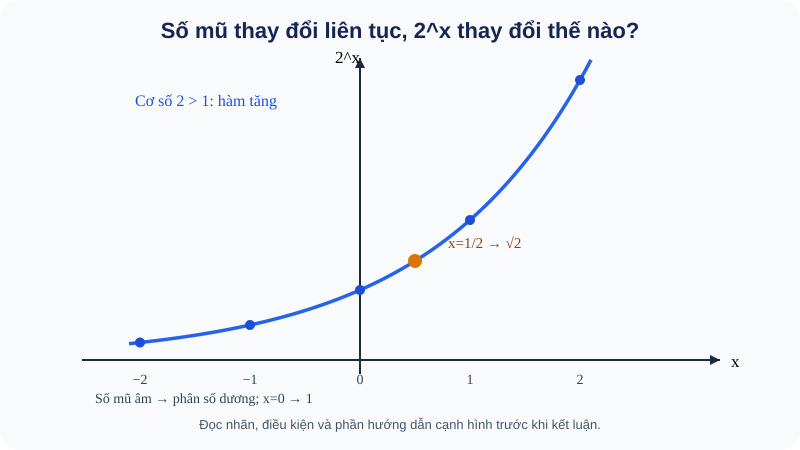
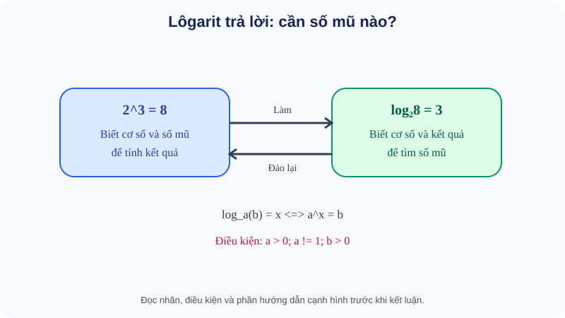
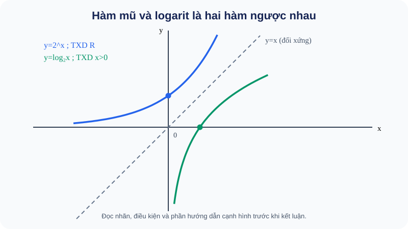
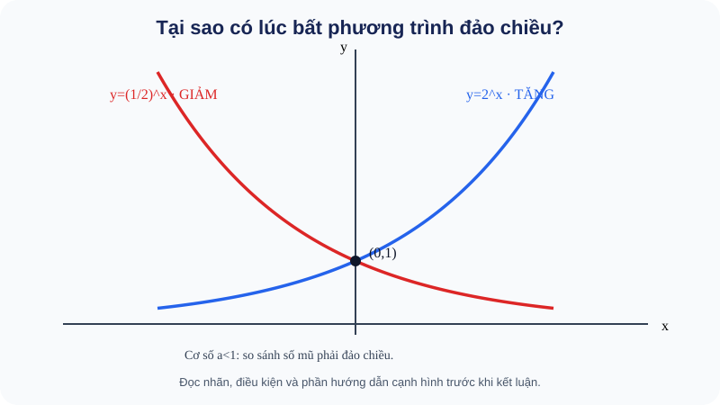
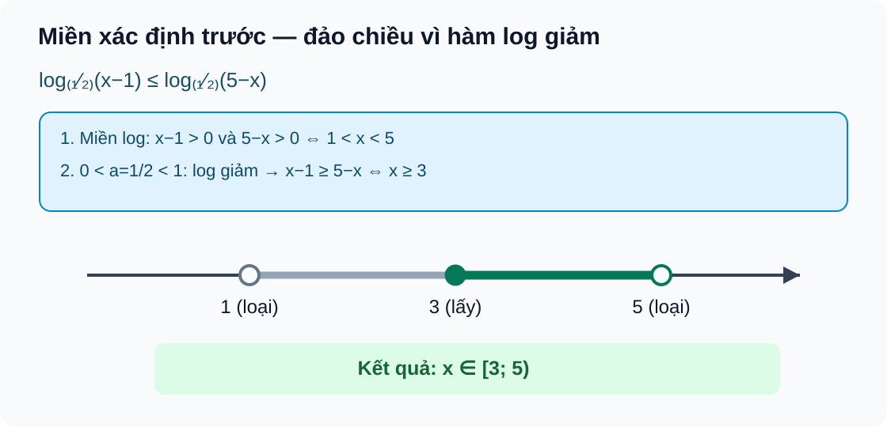

# Chuyên đề 04 · Lũy thừa, hàm mũ và lôgarit

Từ một số vốn nhân lên nhiều lần, em học cách biểu diễn **giá trị** bằng lũy thừa rồi đặt câu hỏi ngược: **số mũ nào** cho giá trị đó? Câu hỏi này dẫn tới lôgarit. Khi xét đồ thị và giải phương trình, điều kiện cơ số và đối số giúp biết phép biến đổi nào thực sự hợp lệ. Kết thúc bài, em sẽ tự chọn số kỳ nguyên trong một mô hình tăng hoặc giảm theo tỉ lệ.

# Kiến thức

## 1. Từ phép nhân lặp đến lũy thừa thực

Giả sử một khoản tiền tăng 8% mỗi năm và tiền lãi được nhập vào vốn. Sau năm thứ nhất, số tiền được nhân với \(1{,}08\); sau năm thứ hai, lại nhân với \(1{,}08\). Nếu cứ nhân như vậy, sau \(n\) năm số tiền được nhân với \((1{,}08)^n\). Đây là tình huống tự nhiên đưa đến **lũy thừa**: số mũ cho biết ta lặp lại phép nhân bao nhiêu lần. Khi muốn hỏi “cần bao nhiêu năm để vượt một ngưỡng?”, ta phải làm phép ngược lại: tìm **số mũ** đã tạo nên một giá trị cho trước — đó là ý tưởng của **lôgarit**. Nhìn hai câu hỏi này như một cặp sẽ giúp em hiểu cả đồ thị, phép biến đổi và ứng dụng thay vì nhớ nhiều công thức rời rạc.

Trước khi dùng các ký hiệu mới, ta chỉ cần các kiến thức quen thuộc: nhân số thực, phân số, căn bậc hai không âm, tìm nghiệm phương trình và biểu diễn điểm trên mặt phẳng tọa độ. Số mũ âm sẽ dẫn tới phép chia; căn bậc chẵn dẫn tới điều kiện không âm; các logarit sẽ đòi đối số dương. Những điều kiện ấy không phải phụ lục học thuộc: chúng giải thích tại sao một phép biến đổi có thể hợp lệ ở giá trị này nhưng không hợp lệ ở giá trị khác.

Vì vậy ta bắt đầu bằng những quy tắc của lũy thừa, rồi dần chuyển từ phép tính với một số mũ sang câu hỏi ngược “số mũ nào?”, từ đó mới xét hàm số, bất phương trình và bài toán số kỳ.

Số mũ giúp diễn tả gọn việc nhân nhiều lần, nhưng các công thức chỉ dùng an toàn khi hiểu dấu, cơ số và miền. Ta mở rộng dần từ mũ nguyên sang căn, mũ hữu tỉ và thực để thấy điều kiện xuất hiện từ đâu.

<!-- LESSON_ID: TOP04-M01; OUTCOME_ID: TOP04-O01; R04_SNAPSHOT: 1f51b01357f87359b689131fd6afcc1ad998209d -->

### 1.1. Số mũ nguyên, số mũ không và số mũ âm

Khi số mũ giảm từ 2 xuống 1 rồi 0, tại sao ta chia cơ số chứ không đổi dấu giá trị?

Ta biết \(2^3=2\cdot2\cdot2=8\): số mũ dương đếm số lần nhân cùng một cơ số. Nhưng khi giảm số mũ đi một đơn vị, kết quả phải **chia cho cơ số**, không phải đổi dấu. Vì thế số mũ bằng không và âm tiếp nối quy luật nhân/chia của lũy thừa.

> **CÔNG THỨC — Số mũ không và số mũ nguyên âm.** Với \(a\ne0\) và \(n\) là số nguyên dương, \(a^0=1\), \(a^{-n}=\dfrac1{a^n}\). Riêng \(0^0\) và \(0^{-n}\) (với \(n>0\)) không xác định; số \(0^n=0\) vẫn có nghĩa khi \(n\) là số nguyên dương. Không được bỏ điều kiện \(a\ne0\) khi số mũ bằng 0 hoặc âm.

Lấy \(\left(\frac23\right)^{-2}\). Số mũ âm yêu cầu lấy nghịch đảo rồi bình phương: \(\left(\frac32\right)^2=\frac94\), vẫn là một số **dương**. Tương tự, số rất nhỏ \(0{,}0000075\) có thể viết thành \(7{,}5\cdot10^{-6}\); dấu trừ thuộc **số mũ**, không phải dấu của số. Trong ký hiệu khoa học chuẩn, phần hệ số phải có trị tuyệt đối từ 1 đến dưới 10.

*Quan sát hình:* Quan sát các giá trị \(2^x\) tại \(x=-2,-1,0,1,2\): số mũ âm cho số dương nhỏ hơn 1, không phải kết quả âm.

**Ví dụ**

**Đề bài.** Tính \(\left(\frac34\right)^{-2}\cdot\frac9{16}\). Giải thích vì sao \(0^{-1}\) không có nghĩa.

**Lời giải.** Vì \(\frac34\ne0\), ta lấy nghịch đảo: \(\left(\frac34\right)^{-2}=\left(\frac43\right)^2=\frac{16}{9}\). Tích với \(\frac9{16}\) bằng 1. Còn nếu áp dụng quy tắc số mũ âm cho \(0^{-1}\), ta sẽ gặp phép chia cho 0, không xác định.

**Vận dụng**

Tính \(5^{-2}\cdot25\). Biểu thức \(0^{-1}\) có nghĩa không? Vì sao?

Đối chiếu

\(5^{-2}\cdot25=\frac1{25}\cdot25=1\). \(0^{-1}\) không xác định vì dẫn tới phép chia cho 0. Nếu em nhầm dấu âm của số mũ thành dấu âm của giá trị, hãy so \(-2^2=-4\) với \(2^{-2}=\frac14\).

**Kiểm lỗi**

Nếu nghĩ số mũ âm làm kết quả âm, đọc lại **Kiến thức 1.1** rồi giải **Bài 13** và **Bài 11**: viết thành phân số nghịch đảo và kiểm điều kiện cơ số khác 0.

<!-- LESSON_ID: TOP04-M02; OUTCOME_ID: TOP04-O02; R04_SNAPSHOT: 1f51b01357f87359b689131fd6afcc1ad998209d -->

### 1.2. Căn bậc chẵn, căn bậc lẻ và mũ hữu tỉ

Ký hiệu căn bậc chẵn nói đến một giá trị hay tất cả nghiệm của phương trình tương ứng?

> **ĐỊNH NGHĨA — Căn bậc chẵn, căn bậc lẻ và mũ hữu tỉ.** Số thực \(b\) là **căn bậc \(n\)** của \(a\) nếu \(b^n=a\), trong đó \(n\) là số nguyên dương. Nếu \(n\) **lẻ**, mỗi \(a\in\mathbb R\) có đúng một căn bậc \(n\), kể cả \(a<0\). Nếu \(n\) **chẵn**, \(a>0\) có hai căn đối nhau, \(a=0\) có duy nhất căn \(0\), còn \(a<0\) không có căn thực; ký hiệu \(\sqrt[n]{a}\) luôn chỉ **căn số học không âm** khi \(n\) chẵn.

Với cơ số \(a>0\), số hữu tỉ \(r=\frac mn\) (\(m\in\mathbb Z,\ n\in\mathbb N^*\)) cho \(a^r=\sqrt[n]{a^m}=(\sqrt[n]{a})^m\). Khi \(m<0\), lũy thừa vẫn có nghĩa vì \(a>0\), và \(a^{-\frac mn}=\frac1{a^{\frac mn}}\) với \(m>0\). Không áp dụng tùy tiện các quy tắc lũy thừa số mũ thực cho cơ số âm.

Từ định nghĩa căn bậc \(n\), ta suy ra những tính chất hữu ích để rút gọn. Khi các căn đều có nghĩa, **căn của tích** là tích các căn và **căn của thương** là thương các căn (mẫu khác \(0\)); nhờ đó có thể gộp những căn cùng bậc rồi tính.

> **TÍNH CHẤT — Phép tính với căn bậc \(n\).** Với \(n,k\) nguyên dương, \(m\in\mathbb Z\) và giả thiết **tất cả biểu thức có nghĩa**, ta có:
>
> - \(\sqrt[n]{a}\sqrt[n]{b}=\sqrt[n]{ab}\).
> - \(\frac{\sqrt[n]{a}}{\sqrt[n]{b}}=\sqrt[n]{\frac ab}\) với \(b\ne0\).
> - \((\sqrt[n]{a})^m=\sqrt[n]{a^m}\).
> - \(\sqrt[n]{\sqrt[k]{a}}=\sqrt[nk]{a}\).
>
> Đặc biệt, \(\sqrt[n]{a^n}=a\) nếu \(n\) **lẻ**, nhưng \(\sqrt[n]{a^n}=|a|\) nếu \(n\) **chẵn**. Với căn bậc chẵn phải bảo đảm các số dưới dấu căn không âm; với số mũ âm còn phải loại cơ số bằng \(0\).

Vì sao ở bậc chẵn lại là giá trị tuyệt đối? Cả \(7^2\) và \((-7)^2\) đều bằng \(49\), nhưng \(\sqrt{49}=7\) là căn số học không âm. Do đó \(\sqrt{(-7)^2}=7=|-7|\), **không** phải \(-7\). Còn với căn bậc lẻ, \(\sqrt[3]{-125}\cdot\sqrt[3]{8}=(-5)\cdot2=-10=\sqrt[3]{-1000}\), đúng quy tắc tích ngay cả khi số dưới căn âm.

Chẳng hạn, \(81^{\frac34}=(\sqrt[4]{81})^3=3^3=27\). Nhưng \(\sqrt[4]{16}=2\) còn \(x^4=16\) có \(x=\pm2\); lý do là ký hiệu căn và tập nghiệm phương trình có vai trò khác nhau.

**Ví dụ**

**Đề bài.** Tính \(16^{\frac34}\); phân biệt \(\sqrt[4]{81}\) với mọi nghiệm của \(x^4=81\).

**Lời giải.** Vì \(16>0\), \(16^{\frac34}=(\sqrt[4]{16})^3=2^3=8\). Ký hiệu \(\sqrt[4]{81}=3\) là căn số học không âm; phương trình \(x^4=81\) có hai nghiệm thực \(x=\pm3\).

**Vận dụng**

Tính \(27^{\frac23}\) và \(\sqrt[3]{-27}\).

Đối chiếu

\(27^{\frac23}=3^2=9\); \(\sqrt[3]{-27}=-3\) vì \((-3)^3=-27\).

Nếu chỉ nhận nghiệm dương khi giải \(x^4=16\), thử số đối; nếu đổi dấu căn bậc chẵn, nhớ căn số học không âm.

**Kiểm lỗi**

Nếu nhầm căn bậc chẵn số học với cả hai nghiệm của phương trình, đọc **Kiến thức 1.2**, làm **Bài 14** rồi **Bài 5**; luôn kiểm dấu của căn và trường hợp bậc lẻ.

<!-- LESSON_ID: TOP04-M03; OUTCOME_ID: TOP04-O03; R04_SNAPSHOT: 1f51b01357f87359b689131fd6afcc1ad998209d -->

### 1.3. Lũy thừa với số mũ thực

Tại sao không thể hiểu \(a^{\sqrt2}\) là “nhân \(a\) đúng \(\sqrt2\) lần”? Với số mũ vô tỉ, cách đếm phép nhân không còn phù hợp. Ta đi từ những số mũ hữu tỉ tiến ngày càng gần số mũ muốn xét, rồi xem các giá trị lũy thừa tiến đến đâu.

> **ĐỊNH NGHĨA — Lũy thừa với số mũ thực.** Với \(a>0\) và số vô tỉ \(\alpha\), chọn một dãy số hữu tỉ \(r_n\to\alpha\). Khi đó các giá trị \(a^{r_n}\) có giới hạn không phụ thuộc cách chọn dãy; định nghĩa \(a^\alpha=\lim_{n\to\infty}a^{r_n}\). Với số mũ hữu tỉ, dùng định nghĩa đã học ở mục 1.2. Như vậy \(a^x>0\) cho mọi \(x\in\mathbb R\) nếu \(a>0\).

Định nghĩa này mở rộng lũy thừa sang mọi số mũ thực, nhưng không có nghĩa phải “nhân \(a\)” một số lần vô tỉ. Sự tăng hay giảm theo số mũ phụ thuộc vào cơ số: \(a>1\) thì giá trị tăng khi số mũ tăng, còn \(0<a<1\) thì giảm. Cơ số âm không mặc nhiên xác định với mọi số mũ thực.

Khi cần **tính gần đúng** một lũy thừa có số mũ vô tỉ, máy tính cầm tay có thể dùng phím lũy thừa: nhập cơ số dương, nhập số mũ (có thể chứa \(\sqrt{\phantom x}\)), rồi yêu cầu kết quả. Chẳng hạn, \(3^{\sqrt2}\approx4{,}7288\) nếu làm tròn đến bốn chữ số thập phân. Kết quả máy tính là **xấp xỉ**, không thay cho lời giải thích tính đơn điệu khi cần so sánh chính xác hai lũy thừa.

Xét ví dụ: Vì \(\sqrt2<\frac32\) và \(2>1\), \(2^{\sqrt2}<2^{\frac32}\); còn vì \(0<\frac12<1\), \(\left(\frac12\right)^{\sqrt2}>\left(\frac12\right)^{\frac32}\). Cùng hai số mũ nhưng hai cơ số cho chiều so sánh ngược nhau.

**Ví dụ**

**Đề bài.** So sánh \(3^{\sqrt2}\) với \(3^{\frac32}\), rồi so sánh \(\left(\frac13\right)^{\sqrt2}\) với \(\left(\frac13\right)^{\frac32}\).

**Lời giải.** Vì \((\sqrt2)^2=2<\frac94=\left(\frac32\right)^2\) và cả hai số không âm, \(\sqrt2<\frac32\). Cơ số \(3>1\) làm lũy thừa tăng nên \(3^{\sqrt2}<3^{\frac32}\). Cơ số \(\frac13\in(0;1)\) làm lũy thừa giảm nên chiều so sánh đảo: \(\left(\frac13\right)^{\sqrt2}>\left(\frac13\right)^{\frac32}\).

**Vận dụng**

So sánh \(\left(\frac13\right)^{\sqrt3}\) với \(\left(\frac13\right)^2\).

Đối chiếu

\(\sqrt3<2\); hàm mũ cơ số \(\frac13\) nghịch biến nên \(\left(\frac13\right)^{\sqrt3}>\left(\frac13\right)^2\).

Nếu đảo dấu sai, dùng \(x=0\) và \(x=1\) để quan sát 1 và cơ số a; xem lại mục Kiến thức 1.3 về chiều tăng/giảm của lũy thừa khi cơ số lớn hơn 1 hoặc nằm giữa 0 và 1.

**Kiểm lỗi**

Nếu so sánh mũ thực mà giữ chiều như cơ số lớn hơn 1, quay lại **Kiến thức 1.3**, giải **Bài 15** và **Bài 16**, dùng cơ số trong khoảng (0,1) để thử ngược kết luận.

<!-- LESSON_ID: TOP04-M04; OUTCOME_ID: TOP04-O04; R04_SNAPSHOT: 1f51b01357f87359b689131fd6afcc1ad998209d -->

### 1.4. Quy tắc lũy thừa và điều kiện sử dụng

Một biểu thức rút gọn thành 1 có thể vẫn vô nghĩa tại một giá trị cơ số không?

> **TÍNH CHẤT — Quy tắc lũy thừa và điều kiện sử dụng.** Các quy tắc tính lũy thừa chỉ đáng tin khi đi kèm điều kiện của cơ số. Nén nhiều phép nhân/chia bằng quy tắc số mũ rất nhanh, nhưng rút gọn xong không được quên giá trị ban đầu vô nghĩa. Ta bắt đầu từ cộng/trừ số mũ hữu tỉ, mẫu số khác 0. Với \(a>0\) và \(r,s\in\mathbb R\): \(a^ra^s=a^{r+s}\), \(\dfrac{a^r}{a^s}=a^{r-s}\), \((a^r)^s=a^{rs}\). Với \(a,b>0\), còn có \((ab)^r=a^rb^r\) và \(\left(\dfrac ab\right)^r=\dfrac{a^r}{b^r}\). Đặc biệt khi số mũ \(m\in\mathbb Z\), các quy tắc tích/thương vẫn áp dụng cho \(a,b\ne0\) dù cơ số âm; điều này **không** cho phép mở rộng tùy tiện sang mọi số mũ thực của cơ số âm. Với biểu thức gốc có chia/căn thì kiểm điều kiện trước; không có quy tắc \(a^r+a^s=a^{r+s}\).

Chẳng hạn, \(E=\frac{a^{\frac32}\cdot a^{-\frac12}}{a}=a^{\frac32-\frac12-1}=a^0=1\) khi \(a>0\). Không nhận \(a=0\) dù kết quả rút gọn là 1, vì biểu thức gốc chia cho a.

**Ví dụ**

**Đề bài.** Với \(a>0\), rút gọn \(E=\frac{a^{\frac53}\cdot a^{-\frac23}}a\) và giải thích điều kiện.

**Lời giải.** Cộng trừ số mũ vì cùng cơ số dương: \(E=a^{\frac53-\frac23-1}=a^0=1\). Giữ \(a>0\) vì biểu thức gốc có mũ thực và phép chia cho a, không được nhận \(a=0\) chỉ vì kết quả rút gọn bằng 1.

**Vận dụng**

Với \(a>0\), rút gọn \(\frac{a^{\frac34}\cdot a^{-\frac14}}{\sqrt a}\).

Đối chiếu

Bằng \(a^{\frac34-\frac14-\frac12}=1\); giữ \(a>0\) để mẫu và mũ hữu tỉ được xác định.

Nếu cộng số mũ cho phép **cộng** hai lũy thừa, thử \(2^2+2^3=12\) khác \(2^5=32\).

**Kiểm lỗi**

Nếu rút gọn lũy thừa mà quên \(a>0\) hoặc dùng nhầm quy tắc cộng hai lũy thừa, đọc **Kiến thức 1.4**, làm **Bài 17** và **Bài 9**; thế một số dương để kiểm kết quả.

## 2. Lôgarit: câu hỏi ngược của lũy thừa

Từ \(2^3=8\) ta biết cơ số và số mũ để tìm kết quả. Nếu đổi câu hỏi thành “phải nâng 2 lên lũy thừa bao nhiêu để được 8?”, đáp án vẫn là 3, nhưng thao tác suy nghĩ đã đảo chiều. Lôgarit đặt tên cho chính thao tác ấy. Vì lũy thừa cơ số dương không thể cho kết quả âm hay bằng 0, điều kiện đối số lôgarit phải dương xuất phát ngay từ ý nghĩa, trước mọi quy tắc tính.

<!-- LESSON_ID: TOP04-M05; OUTCOME_ID: TOP04-O05; R04_SNAPSHOT: 1f51b01357f87359b689131fd6afcc1ad998209d -->

### 2.1. Định nghĩa lôgarit qua câu hỏi ngược

Đã biết \(5^3=125\), nếu muốn tìm ‘mũ nào cho 125’ thì em hỏi thế nào?

Biết số ban đầu và số cuối, ta muốn biết cần bao nhiêu lần nhân theo tỉ lệ a. Cần nhớ hàm mũ cơ số dương, tính đơn ánh của \(a^x\) khi \(a\ne1\). 

> **ĐỊNH NGHĨA — Lôgarit.** Với \(a>0\), \(a\ne1\) và \(b>0\), số \(\log_a b\) là số thực duy nhất \(y\) thỏa \(a^y=b\). Do đó \(\log_a1=0\), \(\log_a a=1\), \(a^{\log_a b}=b\) (với \(b>0\)) và \(\log_a(a^x)=x\) (với mọi \(x\in\mathbb R\)). Đây là hai cách quay lại số ban đầu sau phép thuận/ngược; kết quả lôgarit có thể âm, nhưng **đối số** \(b\) phải dương.

 Đừng học công thức log trước khi hiểu câu hỏi ‘số mũ nào?’.

Chẳng hạn, \(\log_2\frac18=-3\) vì \(2^{-3}=\frac18\). Dấu âm nằm ở **số mũ được tìm**, không phải ở đối số \(\frac18>0\).

*Quan sát hình:* So \(2^3=8\) với \(\log_2 8=3\), đồng thời ghi điều kiện cơ số dương, khác 1 và đối số lôgarit dương.

**Ví dụ**

**Đề bài.** Tính \(\log_5\frac1{125}\) và diễn giải bằng lũy thừa.

**Lời giải.** Cơ số \(5>0\), \(5\ne1\), đối số \(\frac1{125}>0\). Do \(5^{-3}=\frac1{125}\), số mũ cần tìm là \(-3\): \(\log_5\frac1{125}=-3\).

**Vận dụng**

Tính \(\log_4\frac18\).

Đối chiếu

Vì \(4^{-\frac32}=\frac18\) nên \(\log_4\frac18=-\frac32\).

Nếu nhầm \(\log_a(-b)\) với một giá trị lôgarit âm, nhớ rằng lôgarit chỉ có nghĩa khi đối số dương; làm lại Bài 29 (lôgarit âm), Bài 19 và Bài 20 (định nghĩa lôgarit) trong phần Luyện tập.

<!-- LESSON_ID: TOP04-M06; OUTCOME_ID: TOP04-O06; R04_SNAPSHOT: 1f51b01357f87359b689131fd6afcc1ad998209d -->

### 2.2. Điều kiện đối số và bẫy tách lôgarit

Vì sao hai thừa số âm có tích dương nhưng không thể tách log tích thành hai log riêng?

Nhưng phép tính ngược ấy chỉ có nghĩa khi đối số và cơ số thỏa điều kiện. Nếu biến đổi log tích thành tổng log mà chưa xét miền, có thể đánh mất nghiệm hợp lệ. Để xác định điều đó, cần xét dấu tích hai nhân tử và bất phương trình bậc hai của tiền đề đã giải thích lại ở đây. 

> **KIẾN THỨC CẦN GHI NHỚ — Miền xác định và tách lôgarit.** Trên số thực, \(\log_a(F(x))\) có nghĩa khi \(a>0\), \(a\ne1\) và \(F(x)>0\). Công thức \(\log_a(uv)=\log_a u+\log_a v\) đòi **riêng từng** \(u>0\), \(v>0\); điều kiện \(uv>0\) chưa đủ để tách hai lôgarit.

Vì vậy với \(\log_a[(x-1)(x-4)]\), miền xác định là \(x<1\) hoặc \(x>4\) (cơ số hợp lệ), nhưng chỉ tách thành tổng hai lôgarit thực trên miền \(x>4\).

Chẳng hạn, với \(x=0\): \((x-1)(x-4)=4>0\) nên \(\log_2 4\) có nghĩa, còn \(\log_2(-1)\) và \(\log_2(-4)\) không. Hai số âm nhân lại dương không làm lôgarit từng số âm có nghĩa.

**Ví dụ**

**Đề bài.** Tìm miền xác định của \(\log_3[(x-2)(x+1)]\). Có thể tách thành hai log riêng trên toàn miền không?

**Lời giải.** Cần \((x-2)(x+1)>0\), suy ra \(x<-1\) hoặc \(x>2\). Công thức \(\log_3(x-2)+\log_3(x+1)\) chỉ có nghĩa khi \(x>2\). Tại \(x=-2\), tích \(4>0\) nhưng cả \(x-2\), \(x+1\) đều âm, nên không tách được.

**Vận dụng**

Tìm miền xác định của \(\log_2(x^2-9)\); có thể tách thành \(\log_2(x-3)+\log_2(x+3)\) trên toàn miền đó không?

Đối chiếu

Miền xác định là \(x<-3\) hoặc \(x>3\), nhưng hai lôgarit riêng cùng có nghĩa chỉ khi \(x>3\).

Nếu mắc lỗi ‘log của tích’ trên toàn miền, lấy \(x=-4\) làm phản ví dụ; làm lại Bài 30, Bài 31 (điều kiện tách lôgarit) và Bài 28 (tự luận về miền xác định) trong phần Luyện tập.

<!-- LESSON_ID: TOP04-M07; OUTCOME_ID: TOP04-O07; R04_SNAPSHOT: 1f51b01357f87359b689131fd6afcc1ad998209d -->

### 2.3. Các quy tắc tính lôgarit

Khi đổi phép nhân thành phép cộng lôgarit, tại sao từng đối số phải dương?

> **TÍNH CHẤT — Các quy tắc tính lôgarit.** Ta suy các quy tắc lôgarit từ chính phép nhân và chia các lũy thừa. Ta đã biết tính chất \(a^r\cdot a^s=a^{r+s}\), \(a>0\). Với \(a>0,\ a\ne1,\ x>0,\ y>0\): \(\log_a(xy)=\log_a x+\log_a y\), \(\log_a\frac xy=\log_a x-\log_a y\), \(\log_a(x^r)=r\log_a x\) với \(r\in\mathbb R\). Chúng đúng vì lấy lôgarit hai vế của các tích lũy thừa dương, không phải công thức thuộc lòng không điều kiện.

Chẳng hạn, \(\log_3 81-\log_3 3=\log_3\frac{81}{3}=\log_3 27=3\). Trừ hai lôgarit là lôgarit của **thương**, không phải \(\log_3(81-3)\).

**Ví dụ**

**Đề bài.** Tính \(\log_2 32-\log_2 4\) bằng quy tắc thương và kiểm bằng lũy thừa.

**Lời giải.** Hai đối số đều dương. Quy tắc thương cho \(\log_2\frac{32}{4}=\log_2 8=3\). Kiểm lại: \(\log_2 32=5\), \(\log_2 4=2\), nên \(5-2=3\).

**Vận dụng**

Tính \(\log_2 24-\log_2 3\).

Đối chiếu

\(\log_2\frac{24}{3}=\log_2 8=3\) vì hai đối số dương và \(2^3=8\).

Nếu viết \(\log(x+y)=\log x+\log y\), thử \(x=y=1\): \(\log 2\ne0\); phân biệt tổng với tích.

**Kiểm lỗi**

Nếu tự ý biến \(\log_a(x+y)\) thành hai lôgarit, đọc **Kiến thức 2.3**, làm **Bài 22** và **Bài 32**; chỉ dùng quy tắc tích/thương sau khi kiểm từng đối số dương.

<!-- LESSON_ID: TOP04-M08; OUTCOME_ID: TOP04-O08; R04_SNAPSHOT: 1f51b01357f87359b689131fd6afcc1ad998209d -->

### 2.4. Đổi cơ số và dấu của lôgarit

Đổi cơ số về ln có thể đổi dấu kết quả khi nào?

Khi máy tính hiện phím `log` và `ln`, đó không phải hai phép toán mới: cả hai đều là lôgarit, chỉ khác **cơ số**. Vì thế, trước khi dùng \(\ln\) trong công thức đổi cơ số, em cần biết số \(e\) đến từ đâu và các ký hiệu có nghĩa gì. Khi chia một khoảng thời gian thành càng nhiều kỳ tính lãi, một giới hạn tự nhiên xuất hiện; nó dẫn đến một cơ số đặc biệt lớn hơn 1.

> **ĐỊNH NGHĨA — Số \(e\).** Số \(e\) là số dương có giá trị gần đúng \(2{,}71828\), được xác định bởi giới hạn \(e=\lim_{t\to+\infty}\left(1+\frac1t\right)^t\). Đây là một số vô tỉ và là cơ số quan trọng của hàm số mũ. Với vốn \(P>0\), lãi suất năm không đổi \(r\) và thời gian \(t\ge0\), mô hình lãi kép liên tục (khi các kỳ tính lãi ngày càng ngắn) cho công thức \(A(t)=Pe^{rt}\); phải phân biệt mô hình liên tục với lãi kép theo kỳ hữu hạn.

> **ĐỊNH NGHĨA — Lôgarit thập phân và lôgarit tự nhiên.** Với mọi \(M>0\), lôgarit **thập phân** là \(\log M=\log_{10}M\) (cũng viết \(\lg M\)); lôgarit **tự nhiên** là \(\ln M=\log_e M\). Cả hai chỉ xác định với \(M>0\); \(\ln e=1\), \(\log 10=1\), và \(\ln1=\log1=0\). Ký hiệu \(\log\) không ghi cơ số trong giáo trình này được hiểu là cơ số 10, còn \(\ln\) luôn dùng cơ số \(e\).

Chẳng hạn, \(\log100=2\) vì \(10^2=100\), còn \(\ln(e^2)=2\). Khi tính \(\log_4 8\) bằng máy chỉ có hai phím trên, em có thể dùng \(\frac{\ln8}{\ln4}\) hoặc \(\frac{\log8}{\log4}\); cả hai bằng \(\frac32\), vì tỷ số đổi cơ số giống nhau. Chỉ dùng các phép tính đó khi **mọi đối số lôgarit dương** và các cơ số hợp lệ.

> **CÔNG THỨC — Đổi cơ số và dấu của lôgarit.** Với \(a>0,\ a\ne1,\ b>0\), đặt \(t=\log_a b\) thì \(a^t=b\). Lấy lôgarit tự nhiên hai vế: \(t\ln a=\ln b\). Vì \(\ln a\ne0\) do \(a\ne1\), ta có \(\log_a b=\frac{\ln b}{\ln a}\). Khi \(0<a<1\), \(\ln a<0\); \(\log_a b\) vẫn có nghĩa với \(b>0\) và có thể dương, âm hoặc bằng 0.

Xét ví dụ: \(\log_4 8=\frac{\ln 8}{\ln 4}=\frac32\); \(\log_{\frac19}3=-\frac12\) vì \(\left(\frac19\right)^{-\frac12}=3\). Điều kiện từng cơ số và đối số đều đúng.

**Ví dụ**

**Đề bài.** Tính \(\log_{\frac14}2\) bằng phép đổi cơ số, rồi kiểm bằng định nghĩa.

**Lời giải.** Cơ số \(\frac14\in(0;1)\), đối số \(2>0\) nên hợp lệ. \(\log_{\frac14}2=\frac{\ln2}{\ln(\frac14)}=\frac{\ln2}{-2\ln2}=-\frac12\). Kiểm \(\left(\frac14\right)^{-\frac12}=2\).

**Vận dụng**

Tính \(\log_8 2\) bằng đổi cơ số.

Đối chiếu

\(\frac{\ln2}{\ln8}=\frac13\) (hoặc \(8^{\frac13}=2\)).

Nếu tính \(\log_{\frac19}3=+\frac12\), kiểm cơ số nhỏ hơn 1 và thử lũy thừa.

**Kiểm lỗi**

Nếu dấu của lôgarit cơ số nhỏ hơn 1 hoặc phép đổi cơ số bị nhầm, đọc **Kiến thức 2.4**, làm **Bài 26** rồi **Bài 33**, so lại với định nghĩa lũy thừa.

## 3. Từ phép tính sang đồ thị hàm số

Nếu xem số mũ \(x\) thay đổi liên tục, lũy thừa \(a^x\) tạo thành một hàm số. Thay vì chỉ tính vài giá trị riêng lẻ, ta quan sát xem khi \(x\) tăng thì kết quả tăng hay giảm, có bao giờ bằng 0 hay không. Đảo vai trò đầu vào và đầu ra của hàm mũ ta gặp hàm lôgarit; đồ thị của hai hàm cho ta một cách giải thích trực quan tính đơn điệu và miền xác định.

Hàm mũ diễn tả quá trình nhân theo bước, còn logarit giúp tìm số bước để đạt một mức. Đặt hai hàm cạnh nhau giúp hiểu tính đơn điệu, đồ thị và miền trước khi giải phương trình.

<!-- LESSON_ID: TOP04-M09; OUTCOME_ID: TOP04-O09; R04_SNAPSHOT: 1f51b01357f87359b689131fd6afcc1ad998209d -->

### 3.1. Miền, giá trị và đồ thị hàm mũ

Hàm mũ luôn dương thì đồ thị có cắt trục hoành không?

> **ĐỊNH NGHĨA — Miền, giá trị và đồ thị hàm mũ.** Với \(a>0,\ a\ne1\), hàm số \(f(x)=a^x\) có tập xác định \(\mathbb R\), tập giá trị \((0;+\infty)\), qua hai điểm \((0;1),(1;a)\), luôn dương. Khi \(a>1\), \(f(x)\to0\) khi \(x\to-\infty\); khi \(0<a<1\), \(f(x)\to0\) khi \(x\to+\infty\). Trục Ox là tiệm cận ngang; hàm không cắt Ox.

Chẳng hạn, \(f(x)=\left(\frac13\right)^x\): \(f(-1)=3,\ f(0)=1,\ f(1)=\frac13\); các giá trị giảm khi x tăng. Chọn bảng ba điểm vì nó nối được đồ thị và mô hình giảm theo tỉ lệ.

**Ví dụ**

**Đề bài.** Với \(f(x)=4^x\), tính \(f(-1),f(0),f(1)\), nêu miền và tập giá trị.

**Lời giải.** Ta được \(f(-1)=\frac14,\ f(0)=1,\ f(1)=4\). Vì \(4>0\) và \(4\ne1\), tập xác định là \(\mathbb R\), tập giá trị là \((0;+\infty)\). Đồ thị qua ba điểm tương ứng và không cắt Ox vì \(4^x>0\) với mọi x.

**Vận dụng**

Cho \(f(x)=2^x\), có x thực nào để \(f(x)=0\) không?

Đối chiếu

Không: \(2^x>0\) với mọi \(x\in\mathbb R\), chỉ tiến dần về 0 khi \(x\to-\infty\).

Nếu nhầm số rất nhỏ với 0, thử \(x=-10\) và viết \(2^{-10}=\frac1{1024}>0\).

**Kiểm lỗi**

Nếu cho rằng \(2^x=0\) có nghiệm, đọc **Kiến thức 3.1** rồi làm **Bài 36** và **Bài 46**; phân biệt tiệm cận ngang với điểm thuộc đồ thị.

<!-- LESSON_ID: TOP04-M10; OUTCOME_ID: TOP04-O10; R04_SNAPSHOT: 1f51b01357f87359b689131fd6afcc1ad998209d -->

### 3.2. Tính đơn điệu của hàm mũ

Hàm mũ cùng cơ số nhỏ hơn 1 thay đổi theo chiều nào khi số mũ tăng?

> **TÍNH CHẤT — Tính đơn điệu của hàm mũ.** Đưa bất phương trình về so số mũ chỉ đúng nếu biết hàm tăng hay giảm. Cần nhớ \(a^0=1,\ a^1=a\). Với \(a>1\), hàm \(a^x\) đồng biến nghiêm ngặt; với \(0<a<1\), hàm \(a^x\) nghịch biến nghiêm ngặt. Nếu \(a^u>a^v\), thì \(u>v\) khi \(a>1\), nhưng \(u<v\) khi \(0<a<1\). Bản chất: tăng một đơn vị số mũ sẽ nhân giá trị với a; nhân số dương với \(a>1\) làm lớn, với \(0<a<1\) làm nhỏ.

Chẳng hạn, với cơ số cố định \(\frac14\), ta có \(\left(\frac14\right)^0=1\) và \(\left(\frac14\right)^1=\frac14\). Hàm số nghịch biến: số mũ tăng thì giá trị lũy thừa giảm, còn cơ số không đổi. Vì \(-1<2\), \(\left(\frac14\right)^{-1}=4>\left(\frac14\right)^2=\frac1{16}\).

**Ví dụ**

**Đề bài.** Giải \(\left(\frac13\right)^{x-1}\ge\left(\frac13\right)^2\).

**Lời giải.** Hàm \(t\mapsto\left(\frac13\right)^t\) nghịch biến do cơ số trong \((0;1)\). Vì thế dấu \(\ge\) của giá trị dẫn tới \(x-1\le2\), hay \(x\le3\). Dấu đảo khi so số mũ, không phải do thao tác chia số âm.

**Vận dụng**

So \(\left(\frac15\right)^{-1}\) và \(\left(\frac15\right)^2\).

Đối chiếu

\(5>\frac1{25}\). Cơ số \(\frac15\) không đổi và thuộc \((0;1)\), nên hàm số nghịch biến: số mũ \(-1\) nhỏ hơn 2 thì giá trị lũy thừa lớn hơn.

Nếu luôn giữ dấu so sánh khi bỏ mũ, vẽ hai điểm 0,1 trên đồ thị để sửa.

**Kiểm lỗi**

Nếu so sánh hai lũy thừa cơ số \(0<a<1\) mà không đảo chiều, đọc **Kiến thức 3.2**, thực hiện **Bài 37** và **Bài 41** với điểm thử 0, 1.

<!-- LESSON_ID: TOP04-M11; OUTCOME_ID: TOP04-O11; R04_SNAPSHOT: 1f51b01357f87359b689131fd6afcc1ad998209d -->

### 3.3. Miền và đồ thị hàm lôgarit

Điểm \((1,0)\) của đồ thị lôgarit có nghĩa gì về số mũ?

> **ĐỊNH NGHĨA — Miền và đồ thị hàm lôgarit.** Với \(a>0,\ a\ne1\), \(g(x)=\log_a x\) có tập xác định \((0;+\infty)\), tập giá trị \(\mathbb R\), qua \((1;0)\) và \((a;1)\); \(x=0\) là tiệm cận đứng. Hàm tăng nếu \(a>1\), giảm nếu \(0<a<1\). Không có điểm đồ thị với \(x\le0\).

Chẳng hạn, \(g(x)=\log_{\frac12}x\): \(g(\frac14)=2,\ g(4)=-2\); từ \(x=\frac14\) sang \(x=4\) giá trị giảm, phản ánh cơ số cố định nhỏ hơn 1.

**Ví dụ**

**Đề bài.** Với \(g(x)=\log_3 x\), tính \(g(\frac19)\) và \(g(9)\), nêu miền xác định.

**Lời giải.** Vì \(3^{-2}=\frac19\), \(g(\frac19)=-2\); vì \(3^2=9\), \(g(9)=2\). Chỉ \(x>0\) là đối số lôgarit hợp lệ. Đồ thị đi qua \((1;0)\), tăng và có tiệm cận đứng \(x=0\).

**Vận dụng**

Với \(y=\log_2 x\), giá trị tại \(x=\frac18\) và \(x=8\) là gì?

Đối chiếu

\(\log_2\frac18=-3,\ \log_2 8=3\), hàm tăng vì cơ số \(2>1\).

Nếu đặt điểm \(x=0\) lên đồ thị lôgarit, hỏi số mũ nào cho lũy thừa của cơ số hợp lệ bằng 0 (không có).

**Kiểm lỗi**

Nếu nhận \(x\le0\) vào tập xác định của \(\log_a x\), đọc **Kiến thức 3.3**, thử **Bài 38** và **Bài 40**; kiểm từng tọa độ theo điều kiện đối số dương.

<!-- LESSON_ID: TOP04-M12; OUTCOME_ID: TOP04-O12; R04_SNAPSHOT: 1f51b01357f87359b689131fd6afcc1ad998209d -->

### 3.4. Hàm mũ và lôgarit là hai hàm ngược

Vì sao điểm \((u,v)\) của hàm mũ trở thành \((v,u)\) trên hàm lôgarit?

> **TÍNH CHẤT — Hàm mũ và lôgarit là hai hàm ngược.** Với \(a>0,\ a\ne1\), \(f(x)=a^x\) là ánh xạ một-một từ \(\mathbb R\) lên \((0;+\infty)\), \(g(x)=\log_a x\) là hàm ngược từ \((0;+\infty)\) về \(\mathbb R\). Nếu \((u;v)\) trên đồ thị f thì \((v;u)\) trên đồ thị g; hai đồ thị đối xứng qua \(y=x\). Ta có \(g(f(x))=x\) với mọi x thực, còn \(f(g(x))=x\) chỉ với \(x>0\).

Chẳng hạn, \(2^{-1}=\frac12\), nên đồ thị f có điểm \((-1;\frac12)\), đồ thị g có điểm \((\frac12;-1)\). Đây là hoán đổi đầu vào và đầu ra, không phải phép đổi dấu.

*Quan sát hình:* Đối chiếu tọa độ hai điểm bị hoán đổi và chú ý logarit chỉ nhận đầu vào dương; phép đối xứng không xóa miền.

**Ví dụ**

**Đề bài.** Cho \(f(x)=5^x\), \(g(x)=\log_5 x\). Từ điểm \((-1;\frac15)\) trên f, xác định điểm tương ứng trên g.

**Lời giải.** Vì \(5^{-1}=\frac15\), \(f(-1)=\frac15\). Hai hàm ngược hoán đổi vai trò đầu vào/đầu ra nên \(g(\frac15)=-1\): điểm tương ứng là \((\frac15;-1)\). Đối số \(\frac15\) dương nên có nghĩa.

**Vận dụng**

Cho \(f(x)=3^x\). Điểm \((1;3)\) trên f tương ứng điểm nào trên đồ thị \(y=\log_3 x\)?

Đối chiếu

\((3;1)\) vì \(\log_3 3=1\).

Nếu dùng \(\log_3(-3)\) để đảo hàm, kiểm miền lôgarit phải có đối số dương; làm lại Bài 50 (hàm ngược) và Bài 44 (đối xứng đồ thị hàm mũ–lôgarit) trong phần Luyện tập.

## 4. Từ đồ thị đến phương trình và bất phương trình

Khi hai vế cùng là lũy thừa có chung cơ số hợp lệ, tính đơn ánh của hàm mũ cho phép chuyển việc so sánh giá trị sang so sánh số mũ. Nhưng nếu cơ số ở giữa 0 và 1, hàm giảm nên dấu bất phương trình phải đảo chiều. Với logarit, trước khi so sánh hai đối số còn phải bảo đảm **cả hai đối số dương**. Những điều kiện này được rút ra từ đồ thị vừa học, không phải mẹo biến đổi riêng rẽ.

Việc đưa hai vế về cùng cơ số chỉ là một bước kỹ thuật. Miền xác định, tính một-một và chiều biến thiên mới quyết định phép suy luận có đúng và đủ hay không.

<!-- LESSON_ID: TOP04-M13; OUTCOME_ID: TOP04-O13; R04_SNAPSHOT: 1f51b01357f87359b689131fd6afcc1ad998209d -->

### 4.1. Phương trình mũ và ẩn phụ dương

Đặt \(t=a^x\) khi giải phương trình mũ thì \(t\) được nhận những giá trị nào?

> **PHƯƠNG PHÁP — Phương trình mũ và ẩn phụ dương.** Với \(a>0,\ a\ne1\), hàm mũ đơn ánh nên \(a^u=a^v\iff u=v\). Nếu phải đặt \(t=a^x\), luôn ghi \(t>0\); nghiệm \(t\le0\) phải loại trước khi quay lại x. Ưu tiên đưa về cùng cơ số khi làm được; chỉ đặt ẩn phụ nếu phương trình có thể quy về đa thức của \(a^x\).

Trước cả các phép biến đổi nhiều bước, hãy nhận biết **phương trình mũ cơ bản** \(a^x=b\), với \(a>0\), \(a\ne1\). Vì mọi \(a^x>0\), khi \(b\le0\) phương trình **vô nghiệm**; khi \(b>0\), tính đơn ánh của hàm mũ và định nghĩa lôgarit cho đúng **một nghiệm** \(x=\log_a b\). Ví dụ, \(2^x=7\) có nghiệm \(x=\log_2 7\), không cần ép \(7\) thành lũy thừa nguyên của \(2\); còn \(2^x=-1\) vô nghiệm. Sau đó ta mới đưa các phương trình phức tạp về cùng cơ số hoặc đặt ẩn phụ.

> **CÔNG THỨC — Phương trình mũ cơ bản.** Với \(a>0,\ a\ne1\), phương trình \(a^x=b\) có nghiệm duy nhất \(x=\log_a b\) nếu \(b>0\); không có nghiệm thực nếu \(b\le0\).

Xét ví dụ: \(4^x=2^{x+3}\iff2^{2x}=2^{x+3}\iff2x=x+3\iff x=3\). Nếu có \(9^x-4\cdot3^x+3=0\), đặt \(t=3^x>0\) thì \(t^2-4t+3=0\). Hai nghiệm \(t=1,3\) đều dương, suy ra \(x=0,1\).

**Ví dụ**

**Đề bài.** Giải phương trình \(8^x=2^{x+4}\).

**Lời giải.** Vì \(8=2^3\), ta có \(2^{3x}=2^{x+4}\). Hàm mũ cơ số \(2>1\) đơn ánh nên \(3x=x+4\), suy ra \(x=2\). Thế lại \(8^2=64=2^6\).

**Vận dụng**

Giải phương trình \(2^{2x}-3\cdot2^x-4=0\). Đặt \(t=2^x\), xác định điều kiện của \(t\) rồi giải.

Đối chiếu

Đặt \(t=2^x>0\). Phương trình trở thành \(t^2-3t-4=0\), hay \((t-4)(t+1)=0\). Ta nhận \(t=4\) và loại \(t=-1\) vì \(2^x\) luôn dương. Từ \(2^x=4\), suy ra \(x=2\). Kiểm lại: \(16-3\cdot4-4=0\).

**Kiểm lỗi**

Nếu em nhận cả \(t=-1\), hãy nhớ không tồn tại số thực \(x\) sao cho \(2^x=-1\). Ôn Bài 60 (đặt ẩn dương) và Bài 51 (phương trình mũ) trong Luyện tập.

<!-- LESSON_ID: TOP04-M14; OUTCOME_ID: TOP04-O14; R04_SNAPSHOT: 1f51b01357f87359b689131fd6afcc1ad998209d -->

### 4.2. Phương trình lôgarit và lọc nghiệm

Vì sao giải xong phương trình đa thức chưa đủ để kết luận nghiệm log?

> **PHƯƠNG PHÁP — Phương trình lôgarit và lọc nghiệm.** Nếu ẩn nằm trong lôgarit, xác định miền phải đi trước mọi bước biến đổi. Một phương trình đa thức sau gộp lôgarit có thể sinh nghiệm không thỏa điều kiện đối số. Với \(a>0,\ a\ne1\), ta có \(\log_a U=\log_a V\iff U=V\) **trong miền** \(U>0,\ V>0\). Khi cộng các lôgarit, chỉ gộp nếu từng đối số dương. Giải phương trình đại số thu được ứng viên, kiểm vào miền và đề gốc, đặc biệt khi bình phương hay đưa về tích.

Dạng đơn giản nhất là \(\log_a x=b\) với \(a>0,\ a\ne1\). Theo định nghĩa, nó luôn có nghiệm duy nhất \(x=a^b>0\) với mọi \(b\in\mathbb R\); ví dụ \(\log_2 x=-3\) cho \(x=2^{-3}=\frac18\). Khi trong lôgarit là một biểu thức \(U(x)\), ta giải \(U(x)=a^b\) rồi kiểm miền \(U(x)>0\), đồng thời giữ mọi điều kiện phụ của biểu thức ban đầu.

> **CÔNG THỨC — Phương trình lôgarit cơ bản.** Nếu \(a>0,\ a\ne1\), thì \(\log_a x=b\iff x=a^b\), với \(b\in\mathbb R\) và \(x>0\).

Chẳng hạn, \(\log_2(x-1)+\log_2(x+1)=3\) có miền \(x>1\). Gộp lôgarit được \((x-1)(x+1)=8\), suy ra \(x=\pm3\), chỉ \(x=3\) thỏa. Kiểm \(\log_2 2+\log_2 4=1+2=3\).

**Ví dụ**

**Đề bài.** Giải \(\log_3(x-2)=\log_3(4-x)\) trên \(\mathbb R\).

**Lời giải.** Điều kiện \(x-2>0\) và \(4-x>0\), tức \(2<x<4\). Lôgarit cùng cơ số hợp lệ là đơn ánh nên \(x-2=4-x\), suy ra \(x=3\). Tại 3 hai đối số đều bằng 1; nghiệm được nhận.

**Vận dụng**

Giải \(\log_2(x-2)+\log_2(x+2)=3\).

Đối chiếu

Điều kiện \(x-2>0,\ x+2>0\), tức \(x>2\). Gộp hai lôgarit trong miền đó rồi chuyển sang dạng lũy thừa: \((x-2)(x+2)=2^3=8\). Suy ra \(x^2-4=8\), tức \(x=\pm2\sqrt3\). Chỉ \(x=2\sqrt3\) thỏa \(x>2\).

**Kiểm lỗi**

Nghiệm âm xuất hiện khi giải phương trình bậc hai thu được từ tích hai đối số, không phải do bình phương hai vế. Nếu em nhận nghiệm âm, thay vào từng đối số để thấy lôgarit không xác định. Ôn Bài 61, Bài 64 và Bài 27 trong Luyện tập.

<!-- LESSON_ID: TOP04-M15; OUTCOME_ID: TOP04-O15; R04_SNAPSHOT: 1f51b01357f87359b689131fd6afcc1ad998209d -->

### 4.3. Bất phương trình mũ và chiều so sánh

Với cơ số \(\frac14\), tăng số mũ thì giá trị tăng hay giảm?

> **TÍNH CHẤT — Bất phương trình mũ và chiều so sánh.** Với \(a>1\), \(a^u\le a^v\iff u\le v\); với \(0<a<1\), \(a^u\le a^v\iff u\ge v\). Không thể so trực tiếp hai số mũ nếu cơ số khác nhau mà chưa quy về cùng cơ số một cách hợp lệ.

Với dạng đơn giản \(a^x>b\) (\(a>0,\ a\ne1\)), cũng phải xét **dấu của \(b\)** trước. Nếu \(b\le0\), mọi \(x\in\mathbb R\) đều thỏa vì \(a^x>0\). Nếu \(b>0\), viết \(b=a^{\log_a b}\): với \(a>1\) ta có \(x>\log_a b\), còn với \(0<a<1\) ta có \(x<\log_a b\). Các dấu \(<,\le,\ge\) xử lý tương tự, nhưng giá trị \(a^x\) **không bao giờ bằng \(0\)** nên cần đặc biệt chú ý khi \(b\le0\).

Chẳng hạn, \(\left(\frac12\right)^{x-2}<\left(\frac12\right)^1\iff x-2>1\iff x>3\) (đảo chiều vì cơ số nhỏ hơn 1). Thử \(x=4\): \(\left(\frac12\right)^2=\frac14<\frac12\) đúng.

*Đọc hình:* Hai đồ thị \(y=2^x\) và \(y=\left(\frac12\right)^x\) đều qua \((0,1)\) và luôn dương. Khi \(x\) tăng, đồ thị cơ số 2 đi lên còn cơ số \(\frac12\) đi xuống. Đó là lý do so sánh các số mũ cùng cơ số \(\frac12\) phải **đảo chiều** bất phương trình.

**Ví dụ**

**Đề bài.** Giải \(\left(\frac14\right)^{2x+1}\le\left(\frac14\right)^5\).

**Lời giải.** Vì \(0<\frac14<1\), hàm mũ nghịch biến nên khi so số mũ phải đảo chiều: \(2x+1\ge5\). Suy ra \(x\ge2\). Kiểm \(x=2\) hai vế bằng nhau nên lấy 2.

**Vận dụng**

Giải \(\left(\frac13\right)^{2x-1}\ge\left(\frac13\right)^{x+2}\).

Đối chiếu

Hàm nghịch biến nên \(2x-1\le x+2\Rightarrow x\le3\), lấy dấu bằng tại \(x=3\).

Nếu giữ chiều khi cơ số nhỏ hơn 1, kiểm \(x=4\); làm lại Bài 62 (bất phương trình mũ), Bài 53 và Bài 57 (cùng kiểm chiều bất đẳng thức) trong phần Luyện tập.

<!-- LESSON_ID: TOP04-M16; OUTCOME_ID: TOP04-O16; R04_SNAPSHOT: 1f51b01357f87359b689131fd6afcc1ad998209d -->

### 4.4. Bất phương trình lôgarit giảm, giao miền

Điểm mút khiến đối số log bằng 0 có được nhận dù dấu bất phương trình không nghiêm không?

> **TÍNH CHẤT — Bất phương trình lôgarit giảm, giao miền.** Điều kiện xác định là **hai đối số** \(U>0,\ V>0\), không phải giá trị hai lôgarit dương. Với \(a>1\): \(\log_a U\le\log_a V\iff U\le V\) khi \(U,V>0\). Với \(0<a<1\): \(\log_a U\le\log_a V\iff U\ge V\) khi \(U,V>0\). Kết luận là giao với điều kiện xác định; các mốc khiến đối số bằng 0 luôn **loại**. Chẳng hạn \(\log_2\frac12=-1\) vẫn có nghĩa.

Với bất phương trình cơ bản \(\log_a x>b\), trước hết **bắt buộc \(x>0\)**. Viết \(b=\log_a(a^b)\): nếu \(a>1\), nghiệm là \(x>a^b\); nếu \(0<a<1\), nghiệm là \(0<x<a^b\). Tương tự cho các dấu còn lại, luôn lấy giao với miền của biểu thức trong lôgarit. Khác với \(a^x\), lôgarit nhận mọi giá trị thực nhưng chỉ khi **đối số dương**.

Chẳng hạn, \(\log_{\frac12}(x-1)\le\log_{\frac12}(5-x)\) có miền \(1<x<5\); hàm nghịch biến nên \(x-1\ge5-x\Rightarrow x\ge3\). Giao miền được \([3;5)\), không nhận 5.

*Quan sát hình:* Đầu mút \(1\) và \(5\) bị loại vì có đối số logarit bằng 0; tại \(3\) hai vế bằng nhau, nên nhận \(3\). Cơ số \(\frac12\) cho chiều nghịch biến: với \(x\ge3\) (và \(x<5\)), bất phương trình đúng.

**Ví dụ**

**Đề bài.** Giải \(\log_{\frac12}(x+2)>\log_{\frac12}(6-x)\).

**Lời giải.** Điều kiện \(x+2>0\) và \(6-x>0\) cho \(-2<x<6\). Vì lôgarit cơ số \(\frac12\) nghịch biến, bất phương trình tương đương \(x+2<6-x\), hay \(x<2\). Giao miền được \((-2;2)\); loại \(-2\) vì đối số bằng 0.

**Vận dụng**

Giải \(\log_{\frac13}(x+1)>\log_{\frac13}4\).

Đối chiếu

Miền \(x>-1\); hàm lôgarit nghịch biến nên \(x+1<4\Rightarrow x<3\). Tập nghiệm \(S=(-1;3)\).

Nếu em nhận đầu mút \(x=-2\) hoặc \(x=6\) trong **Ví dụ**, một đối số bằng 0 nên lôgarit không xác định; xét lại điều kiện trước khi so sánh. Với câu Vận dụng, hai đầu mút phải loại là \(x=-1\) và \(x=3\) (đầu thứ hai là biên bất phương trình nghiêm, không phải biên miền).

**Kiểm lỗi**

Nếu quên giao miền đối số dương hoặc không đảo dấu khi cơ số \(0<a<1\), đọc **Kiến thức 4.4**, làm **Bài 54** và **Bài 58**; kiểm riêng từng điểm biên.

## 5. Tăng trưởng và quyết định theo số kỳ

Cuối cùng, ta quay về câu hỏi về vốn và số kỳ ở đầu chuyên đề. Công thức tăng theo tỉ lệ không đổi giúp tính giá trị sau một số kỳ; muốn biết **kỳ đầu tiên** vượt ngưỡng, ta dùng logarit để tìm mốc thời gian liên tục rồi kiểm các kỳ nguyên liền kề. Một kết quả như \(2{,}9\) năm không tự động là “năm thứ 2,9” khi đề hỏi số năm nguyên — chính ngữ cảnh quyết định cách kết luận.

Lũy thừa và logarit giúp mô hình hóa lãi theo kỳ hay thời gian tới ngưỡng. Đáp án cần khớp miền, đơn vị và giả thiết của mô hình thay vì chỉ đẹp về đại số.

<!-- LESSON_ID: TOP04-M17; OUTCOME_ID: TOP04-O17; R04_SNAPSHOT: 1f51b01357f87359b689131fd6afcc1ad998209d -->

### 5.1. Mô hình tăng giảm theo kỳ nguyên

Khi đề hỏi ‘kỳ nguyên đầu tiên vượt ngưỡng’, tại sao cần thử hai kỳ liên tiếp?

> **PHƯƠNG PHÁP — Mô hình tăng giảm theo kỳ nguyên.** Bài toán lãi kép, giá trị giảm dần hay số lượng quần thể đều liên quan nhân theo tỉ lệ, không cộng lượng cố định. Ta đã biết phần trăm, lũy thừa, logarit và n nguyên không âm cho số kỳ. Nếu mỗi kỳ nhân \(q>0\) và ban đầu \(A_0>0\) thì \(A(n)=A_0q^n\), \(n\) nguyên không âm. Riêng **lãi kép** theo kỳ với vốn \(P>0\), lãi suất \(r>-1\) trên mỗi kỳ và không gửi thêm/rút ra có \(A(n)=P(1+r)^n\), nêu rõ lãi suất tính **theo cùng một kỳ**; \(q>1\) tăng, \(0<q<1\) giảm. Để tìm kỳ đầu tiên đạt ngưỡng dùng log với đúng dấu của \(\ln q\), sau đó kiểm các kỳ nguyên kề nhau. Mô hình giả định q không đổi và n nguyên, không tự chứng minh thực tế sẽ tuân chính xác.

Chẳng hạn, 200 triệu đồng lãi gộp 5% mỗi năm, sau 2 năm có \(200\cdot(1{,}05)^2=220{,}5\) triệu đồng. Nếu 100 triệu tăng 8% mỗi năm và muốn vượt 125 triệu thì \(n>\frac{\ln(1{,}25)}{\ln(1{,}08)}\approx2{,}8994\), nên năm nguyên nhỏ nhất là \(n=3\).

**Ví dụ**

**Đề bài.** Ban đầu có 400 sản phẩm, mỗi kỳ chỉ còn \(90\%\). Kỳ nguyên không âm đầu tiên mà lượng còn lại **nhỏ hơn** 300 là kỳ nào?

**Lời giải.** Mô hình \(N(n)=400(0{,}9)^n\), \(n\in\mathbb Z_{\ge0}\). Cần \((0{,}9)^n<0{,}75\). Vì \(\ln(0{,}9)<0\), ta có \(n>\frac{\ln(0{,}75)}{\ln(0{,}9)}\approx2{,}73\). Do đó \(n=3\) là kỳ đầu: \(N(2)=324>300\), \(N(3)=291{,}6<300\).

**Vận dụng**

Một quần thể giả định ban đầu có 640 cá thể và giảm 25% mỗi kỳ theo quy tắc nhân cố định. (a) Tính số lượng theo mô hình sau 2 kỳ; vì sao không trừ 160 cá thể ở mỗi kỳ? (b) Kỳ nguyên đầu tiên mà số lượng theo mô hình nhỏ hơn 300 là kỳ nào?

Đối chiếu

(a) Sau 2 kỳ, mô hình cho \(N(2)=640\cdot(0{,}75)^2=360\) cá thể. Mỗi kỳ số còn lại nhân với \(0{,}75\): kỳ 1 còn 480, kỳ 2 còn 360. Nếu trừ cố định 160 cá thể mỗi kỳ thì chỉ còn 320, không phải quy tắc giảm 25% của số còn lại. (b) Cần \(640(0{,}75)^n<300\), hay \((0{,}75)^n<\frac{15}{32}\). Vì \(\ln(0{,}75)<0\), suy ra \(n>\frac{\ln(\frac{15}{32})}{\ln(0{,}75)}\approx2{,}63\). Kiểm \(N(2)=360>300\), \(N(3)=270<300\), vậy kỳ 3 là kỳ đầu. Đây là kết quả của mô hình giả định, không phải dự đoán chắc chắn số lượng ngoài thực tế.

Nếu tăng/giảm tuyến tính theo số cộng, kiểm tỷ lệ thực mỗi năm; làm lại Bài 73, Bài 75 (mô hình tăng/giảm theo kỳ) và Bài 65 (lãi kép) trong phần Luyện tập.

<!-- LESSON_ID: TOP04-M18; OUTCOME_ID: TOP04-O18; R04_SNAPSHOT: 1f51b01357f87359b689131fd6afcc1ad998209d -->

### 5.2. Bài toán tổng hợp nhiều điều kiện

Bài toán có nhiều logarit: khi nào nên kiểm miền, khi nào thử nghiệm lại?

> **PHƯƠNG PHÁP — Bài toán tổng hợp nhiều điều kiện.** Đọc bài theo chuỗi: xác định cơ số \(a>0,\ a\ne1\); kiểm từng đối số lôgarit dương; chọn quy tắc hoặc tính đơn ánh; giải ứng viên; giao mọi miền; thử nghiệm. Không trộn điều kiện của mô hình lãi kép với điều kiện lôgarit, và phải thử lại kết quả trong các miền xác định trước khi kết luận.

Xét ví dụ: \(\log_2(x^2-1)=\log_2(3x+3)\). Miền \(x^2-1>0\) và \(3x+3>0\) cho \(x>1\). Đồng nhất đối số được \(x^2-3x-4=0\), suy ra \(x=4\) hoặc \(x=-1\); nghiệm \(-1\) sai miền. Nghiệm \(x=4\), thử hai đối số bằng 15.

**Ví dụ**

**Đề bài.** Giải \(\log_2(x-1)+\log_2(x-3)=3\) trên \(\mathbb R\).

**Lời giải.** Cần \(x-1>0,\ x-3>0\), nên \(x>3\). Gộp log thành \(\log_2[(x-1)(x-3)]=3\), suy ra \(x^2-4x+3=8\), tức \((x-5)(x+1)=0\). Ứng viên \(5,-1\); chỉ \(5>3\), và tại 5 hai đối số 4 và 2 cho tích 8. Vậy nghiệm \(x=5\).

**Vận dụng**

Giải \(\log_3(x-1)=1+\log_3(5-x)\). Hãy nêu miền trước khi dùng quy tắc logarit.

Đối chiếu

Điều kiện \(x-1>0\), \(5-x>0\), tức \(1<x<5\). Vì \(1=\log_3 3\), ta có \(\log_3(x-1)=\log_3[3(5-x)]\). Hai đối số dương và cơ số 3 hợp lệ nên \(x-1=15-3x\), suy ra \(x=4\). Thử: \(\log_3 3=1+\log_3 1=1\). Nếu em bỏ điều kiện và nhận nghiệm ngoài \((1;5)\), quay lại bước xác định miền trước khi giải.

**Kiểm lỗi**

Nếu giải phương trình logarit rồi quên lọc nghiệm theo đồng thời hai đối số, đọc **Kiến thức 5.2** rồi thử **Bài 67** và **Bài 69**; chỉ kết luận sau khi thế vào phương trình gốc.

> **Kiến thức cần ghi nhớ**
>
> - **Lũy thừa:** với \(a\ne0\), \(a^0=1\), \(a^{-n}=\frac1{a^n}\) với n nguyên dương. Các quy tắc mũ thực dùng an toàn cho cơ số \(a>0\), không tùy tiện thay bằng cơ số âm.
> - **Lôgarit:** \(\log_a b=y\iff a^y=b\), luôn cần \(a>0\), \(a\ne1\), \(b>0\). Trước khi tách hay gộp lôgarit, kiểm **từng đối số**.
> - **Đồ thị và bất phương trình:** cơ số \(a>1\) cho hàm mũ/lôgarit tăng; \(0<a<1\) cho hàm giảm nên phép so sánh đảo chiều. Kết luận nghiệm luôn giao miền xác định.
> - **Ẩn phụ và bài toán số kỳ:** đặt \(t=a^x\) thì \(t>0\); với mô hình theo kỳ nguyên, kiểm thời điểm và hai kỳ nguyên lân cận ngưỡng.

# Luyện tập

Hãy giải từng bài trước khi mở lời giải. Với lôgarit, ghi rõ điều kiện cơ số và đối số; với bất phương trình, giải thích vì sao đổi hoặc giữ chiều; với mô hình tăng trưởng, kiểm số kỳ nguyên. Nếu sai, quay lại mảng Kiến thức tương ứng rồi thử bài mới.

## 1. Lũy thừa, căn và số mũ thực

<!-- DISPLAY_ONLY_CANONICAL: THPT-G11-CHVI-B18-C01; ORIGINAL_BLOB: 17d6fe73d8f3ac0e378dabf53c3e5d2e69e71872; OUTCOME: TOP04-O01; NOT_NEW_BANK -->

**Bài 1.**

Tại sao \(\left(\frac25\right)^{-2}\) không phải số âm? Tính giá trị.

Lời giải

**Đáp án:** \(\frac{25}{4}\).

Số mũ âm nói lấy nghịch đảo, không phải dấu âm trước lũy thừa: \(\left(\frac25\right)^{-2}=\left(\frac52\right)^2=\frac{25}{4}\).

<!-- DISPLAY_ONLY_CANONICAL: THPT-G11-CHVI-B18-C02; ORIGINAL_BLOB: 17d6fe73d8f3ac0e378dabf53c3e5d2e69e71872; OUTCOME: TOP04-O02; NOT_NEW_BANK -->

**Bài 2.**

Giải thích ý nghĩa của \(81^{\frac34}\) và tính kết quả.

Lời giải

**Đáp án:** 27.

Cơ số dương, căn bậc 4 của 81 bằng 3; lấy lũy thừa bậc 3 được 27.

<!-- DISPLAY_ONLY_CANONICAL: THPT-G11-CHVI-B18-C03; ORIGINAL_BLOB: 17d6fe73d8f3ac0e378dabf53c3e5d2e69e71872; OUTCOME: TOP04-O01; NOT_NEW_BANK -->

**Bài 3.**

\(0^{-2}\) có nghĩa trong tập số thực không? Vì sao?

Lời giải

**Đáp án:** Không.

Nếu dùng quy tắc số mũ âm sẽ gặp phép chia cho \(0^2=0\), không xác định.

<!-- DISPLAY_ONLY_CANONICAL: THPT-G11-CHVI-B18-C04; ORIGINAL_BLOB: 17d6fe73d8f3ac0e378dabf53c3e5d2e69e71872; OUTCOME: TOP04-O03; NOT_NEW_BANK -->

**Bài 4.**

Một bạn nói: “\(2^{\sqrt2}\) không có nghĩa, vì \(\sqrt2\) không thể đếm số lần nhân 2”. Em giải thích bạn đang hiểu sai điều gì và mô tả cách số này được hình thành.

Lời giải

**Đáp án:** \(2^{\sqrt2}\) có nghĩa vì cơ số \(2>0\); số mũ thực không còn được hiểu là số lần nhân nguyên. Nó được định nghĩa bằng giới hạn của dãy giá trị \(2^r\) khi các số hữu tỉ r tiến đến \(\sqrt2\).

Các số mũ hữu tỉ gần \(\sqrt2\) như 1,4; 1,41; 1,414; … đã có định nghĩa bằng căn/lũy thừa. Khi các giá trị \(2^r\) tiến đến một số xác định không phụ thuộc dãy xấp xỉ, ta gọi đó là \(2^{\sqrt2}\). Đây là mở rộng nhất quán của khái niệm, không phải “nhân số 2 đúng \(\sqrt2\) lần”.

<!-- DISPLAY_ONLY_CANONICAL: THPT-G11-CHVI-B18-C05; ORIGINAL_BLOB: 17d6fe73d8f3ac0e378dabf53c3e5d2e69e71872; OUTCOME: TOP04-O02; NOT_NEW_BANK -->

**Bài 5.**

Phân biệt hai yêu cầu: tìm \(\sqrt{25}\) và giải \(x^2=25\). Nếu chuyển sang \(\sqrt[3]{-27}\), kết quả ra sao? Giải thích vai trò của căn bậc chẵn/lẻ.

Lời giải

**Đáp án:** \(\sqrt{25}=5\) là căn không âm; phương trình \(x^2=25\) có hai nghiệm \(x=5\) và \(x=-5\); \(\sqrt[3]{-27}=-3\).

Ký hiệu căn bậc chẵn lấy giá trị không âm, còn phương trình \(x^2=25\) yêu cầu tìm **mọi** số bình phương bằng 25. Căn bậc lẻ của số âm tồn tại trong \(\mathbb R\) vì \((-3)^3=-27\). Không suy rộng cơ số âm sang mọi số mũ thực.

<!-- DISPLAY_ONLY_CANONICAL: THPT-G11-CHVI-B18-P01; ORIGINAL_BLOB: 17d6fe73d8f3ac0e378dabf53c3e5d2e69e71872; OUTCOME: TOP04-O04; NOT_NEW_BANK -->

**Bài 6.**

Với \(a>0\), rút gọn \(a^{-\frac12}\cdot a^{\frac32}\).

Lời giải

**Đáp án:** a.

Cộng các số mũ do cùng cơ số dương: \(a^{-\frac12+\frac32}=a^1=a\).

<!-- DISPLAY_ONLY_CANONICAL: THPT-G11-CHVI-B18-P02; ORIGINAL_BLOB: 17d6fe73d8f3ac0e378dabf53c3e5d2e69e71872; OUTCOME: TOP04-O02; NOT_NEW_BANK -->

**Bài 7.**

Tính \(64^{-\frac13}\).

Lời giải

**Đáp án:** \(\frac14\).

Căn bậc ba của 64 là 4; số mũ âm lấy nghịch đảo.

<!-- DISPLAY_ONLY_CANONICAL: THPT-G11-CHVI-B18-P03; ORIGINAL_BLOB: 17d6fe73d8f3ac0e378dabf53c3e5d2e69e71872; OUTCOME: TOP04-O02; NOT_NEW_BANK -->

**Bài 8.**

Tính \(16^{\frac34}\) theo căn bậc bốn.

Lời giải

**Đáp án:** 8.

Căn bậc 4 của 16 là 2, sau đó lấy \(2^3=8\).

<!-- DISPLAY_ONLY_CANONICAL: THPT-G11-CHVI-B18-P04; ORIGINAL_BLOB: 17d6fe73d8f3ac0e378dabf53c3e5d2e69e71872; OUTCOME: TOP04-O04; NOT_NEW_BANK -->

**Bài 9.**

Với \(a>0\), rút gọn \(\left(a^{\frac23}\right)^{\frac32}\).

Lời giải

**Đáp án:** a.

Nhân số mũ \(\frac23\cdot\frac32=1\) với cơ số dương để mọi phép tính hợp lệ.

<!-- DISPLAY_ONLY_CANONICAL: THPT-G11-CHVI-B18-P06; ORIGINAL_BLOB: 17d6fe73d8f3ac0e378dabf53c3e5d2e69e71872; OUTCOME: TOP04-O04; NOT_NEW_BANK -->

**Bài 10.**

Bạn viết \(2^2+2^3=2^5\). Hãy nêu lỗi và kết quả đúng.

Lời giải

**Đáp án:** 12; quy tắc cộng số mũ không áp dụng cho tổng hai lũy thừa.

\(2^2+2^3=4+8=12\); \(2^5=32\) chỉ bằng \(2^2\cdot2^3\).

<!-- DISPLAY_ONLY_CANONICAL: THPT-G11-CHVI-B18-P07; ORIGINAL_BLOB: 17d6fe73d8f3ac0e378dabf53c3e5d2e69e71872; OUTCOME: TOP04-O01; NOT_NEW_BANK -->

**Bài 11.**

Viết \(0{,}0000075\) dưới dạng kí hiệu khoa học, rồi giải thích dấu của số mũ và vì sao không được viết \(75\times10^{-7}\) làm **dạng chuẩn** dù giá trị bằng nhau.

Lời giải

**Đáp án:** \(7{,}5\times10^{-6}\). Biểu thức \(75\times10^{-7}\) cũng bằng cùng giá trị nhưng hệ số 75 không thuộc \([1;10)\) nên không phải dạng chuẩn.

Số rất nhỏ hơn 1 nên số mũ của 10 âm; chuyển dấu phẩy sáu chữ số để có phần hệ số 7,5, nhân \(10^{-6}\) để giữ đúng giá trị. Kí hiệu khoa học chuẩn có phần trị tuyệt đối hệ số từ 1 đến dưới 10.

<!-- DISPLAY_ONLY_CANONICAL: THPT-G11-CHVI-B18-W01; ORIGINAL_BLOB: 17d6fe73d8f3ac0e378dabf53c3e5d2e69e71872; OUTCOME: TOP04-O04; NOT_NEW_BANK -->

**Bài 12.**

Với \(a>0\): (a) rút gọn \(E=\frac{a^{\frac32}\cdot a^{-\frac12}}{a^{\frac13}}\); (b) tính \(64^{\frac23}\); (c) giải thích tại sao điều kiện \(a>0\) được giữ trong E.

Lời giải và rubric

(a) \(E=a^{\frac32-\frac12-\frac13}=a^{\frac23}\); (b) \(\sqrt[3]{64}=4\), bình phương là 16; (c) cần \(a>0\) để các lũy thừa có số mũ thực/hữu tỉ được dùng nhất quán và mẫu khác 0.

**Rubric 4 điểm:**

1. Kiểm đúng \(a>0\) và nêu ý nghĩa hợp lệ phép chia — **1 điểm**.
2. Đưa E về một lũy thừa bằng cách cộng/trừ số mũ đúng — **1 điểm**.
3. Kết luận \(E=a^{\frac23}\) không bỏ điều kiện — **1 điểm**.
4. Tính \(64^{\frac23}=16\) và giải thích qua căn bậc ba — **1 điểm**.

<!-- DISPLAY_ONLY_CANONICAL: THPT-TOP04-P01; ORIGINAL_BLOB: 377de2e2e9fb6771f02270e8d85e950559669895; OUTCOME: TOP04-O01; NOT_NEW_BANK -->

**Bài 13.**

Giải thích tại sao \(3^{-2}\cdot9=1\) nhưng \(0^{-2}\) không xác định.

Lời giải

**Đáp án:** \(3^{-2}\cdot9=1\); \(0^{-2}\) không xác định.

\(3^{-2}=\frac19\) vì \(3\ne0\); nhân 9 cho 1. Nếu thay cơ số bằng 0 thì số mũ \(-2\) đòi chia cho \(0^2=0\), là phép chia cho 0.

<!-- DISPLAY_ONLY_CANONICAL: THPT-TOP04-P02; ORIGINAL_BLOB: 377de2e2e9fb6771f02270e8d85e950559669895; OUTCOME: TOP04-O02; NOT_NEW_BANK -->

**Bài 14.**

Phân biệt \(\sqrt[4]{16}\) với nghiệm của \(x^4=16\); tính thêm \(\sqrt[3]{-8}\).

Lời giải

**Đáp án:** \(\sqrt[4]{16}=2\); \(x^4=16\) có \(x=\pm2\); \(\sqrt[3]{-8}=-2\).

Căn số học bậc chẵn chỉ nhận giá trị không âm; phương trình bậc chẵn có thể có hai nghiệm đối nhau. Căn bậc lẻ của số âm có nghĩa vì \((-2)^3=-8\).

<!-- DISPLAY_ONLY_CANONICAL: THPT-TOP04-P03; ORIGINAL_BLOB: 377de2e2e9fb6771f02270e8d85e950559669895; OUTCOME: TOP04-O03; NOT_NEW_BANK -->

**Bài 15.**

So sánh \(2^{\sqrt2}\) và \(2^{\frac32}\) mà không dùng máy tính; nêu điều kiện cơ số.

Lời giải

**Đáp án:** \(2^{\sqrt2}<2^{\frac32}\).

\(\sqrt2<\frac32\) vì \(2<\frac94\), và \(y=2^x\) tăng nghiêm ngặt. Cơ số \(2>0\) nên lũy thừa với số mũ vô tỉ xác định.

<!-- DISPLAY_ONLY_CANONICAL: THPT-TOP04-P04; ORIGINAL_BLOB: 377de2e2e9fb6771f02270e8d85e950559669895; OUTCOME: TOP04-O03; NOT_NEW_BANK -->

**Bài 16.**

So sánh \(\left(\frac12\right)^{\sqrt3}\) với \(\left(\frac12\right)^2\), giải thích dấu so sánh.

Lời giải

**Đáp án:** \(\left(\frac12\right)^{\sqrt3}>\left(\frac12\right)^2\).

\(\sqrt3<2\), nhưng cơ số \(\frac12\) nằm giữa 0 và 1 nên hàm lũy thừa theo số mũ giảm: số mũ nhỏ cho giá trị lớn. Không được dùng quy tắc so sánh của cơ số lớn hơn 1.

<!-- DISPLAY_ONLY_CANONICAL: THPT-TOP04-P05; ORIGINAL_BLOB: 377de2e2e9fb6771f02270e8d85e950559669895; OUTCOME: TOP04-O04; NOT_NEW_BANK -->

**Bài 17.**

Với \(a>0\), rút gọn \(E=\frac{a^{\frac34}\cdot a^{-\frac14}}{\sqrt a}\). Điều kiện nào bảo đảm phép tính có nghĩa?

Lời giải

**Đáp án:** \(E=1\) với \(a>0\).

\(\sqrt a=a^{\frac12}>0\) vì \(a>0\). Ta có \(E=a^{\frac34-\frac14-\frac12}=a^0=1\). Với \(a=0\), phép chia cho \(\sqrt a\) không xác định; với a âm không dùng nhất quán mũ thực theo định nghĩa SGK.

<!-- DISPLAY_ONLY_CANONICAL: THPT-TOP04-W01; ORIGINAL_BLOB: 377de2e2e9fb6771f02270e8d85e950559669895; OUTCOME: TOP04-O04; NOT_NEW_BANK -->

**Bài 18.**

Với \(a>0\), đặt \(E=\frac{a^{\frac34}\cdot a^{-\frac54}}{a^{-\frac12}}\). (a) Rút gọn E và giải thích tại sao phải giữ \(a>0\). (b) Viết \(0{,}0000075\) dưới dạng kí hiệu khoa học chuẩn. (c) Vì sao \(75\cdot10^{-7}\) không là dạng chuẩn mặc dù bằng cùng số?

Lời giải và rubric

**Đáp án:** \(E=1\) (\(a>0\)); \(0{,}0000075=7{,}5\cdot10^{-6}\); \(75\cdot10^{-7}\) bằng cùng giá trị nhưng hệ số không thuộc \([1;10)\).

Vì \(a>0\) nên mọi lũy thừa thực và phép chia đều có nghĩa; \(E=a^{\frac34-\frac54+\frac12}=a^0=1\). Số \(0{,}0000075=7{,}5\cdot10^{-6}\). Kí hiệu khoa học chuẩn yêu cầu \(1\le\lvert k\rvert<10\), nên hệ số 75 của \(75\cdot10^{-7}\) là sai **dạng chuẩn**, không sai giá trị.

**Rubric tự đối chiếu:**

7 điểm: nhận diện điều kiện \(a>0\) và mẫu không bằng 0 (1đ); cộng/trừ đúng ba số mũ (2đ); kết luận \(E=1\) (1đ); viết \(7{,}5\cdot10^{-6}\) (2đ); phân biệt đúng giá trị và dạng chuẩn của \(75\cdot10^{-7}\) (1đ).

## 2. Lôgarit và phép đổi cơ số

<!-- DISPLAY_ONLY_CANONICAL: THPT-G11-CHVI-B19-C01; ORIGINAL_BLOB: 17d6fe73d8f3ac0e378dabf53c3e5d2e69e71872; OUTCOME: TOP04-O05; NOT_NEW_BANK -->

**Bài 19.**

\(\log_5 125\) là số nào và vì sao?

Lời giải

**Đáp án:** 3.

\(5^3=125\), lôgarit là số mũ cần tìm.

<!-- DISPLAY_ONLY_CANONICAL: THPT-G11-CHVI-B19-C02; ORIGINAL_BLOB: 17d6fe73d8f3ac0e378dabf53c3e5d2e69e71872; OUTCOME: TOP04-O05; NOT_NEW_BANK -->

**Bài 20.**

Giải thích \(\log_2\frac18=-3\) bằng lũy thừa.

Lời giải

**Đáp án:** −3.

\(2^{-3}=\frac18\). Giá trị lôgarit có thể âm dù đối số phải dương.

<!-- DISPLAY_ONLY_CANONICAL: THPT-G11-CHVI-B19-C03; ORIGINAL_BLOB: 17d6fe73d8f3ac0e378dabf53c3e5d2e69e71872; OUTCOME: TOP04-O06; NOT_NEW_BANK -->

**Bài 21.**

\(\log_2(-4)\) có nghĩa trong \(\mathbb R\) không?

Lời giải

**Đáp án:** Không.

Với cơ số \(2>0\), \(2^x\) luôn dương nên không thể bằng \(-4\).

<!-- DISPLAY_ONLY_CANONICAL: THPT-G11-CHVI-B19-P01; ORIGINAL_BLOB: 17d6fe73d8f3ac0e378dabf53c3e5d2e69e71872; OUTCOME: TOP04-O07; NOT_NEW_BANK -->

**Bài 22.**

Tính \(\log_3\frac{81}{3}\), chỉ rõ điều kiện dùng quy tắc thương.

Lời giải

**Đáp án:** 3.

\(\frac{81}{3}=27\) và \(\log_3 27=3\); hoặc \(\log_3 81-\log_3 3=4-1=3\), các đối số đều dương.

<!-- DISPLAY_ONLY_CANONICAL: THPT-G11-CHVI-B19-P02; ORIGINAL_BLOB: 17d6fe73d8f3ac0e378dabf53c3e5d2e69e71872; OUTCOME: TOP04-O07; NOT_NEW_BANK -->

**Bài 23.**

Tính \(\log_2 8+\log_2 4\) và diễn giải bằng quy tắc tích.

Lời giải

**Đáp án:** 5.

\(\log_2 8=3,\ \log_2 4=2\); tổng là \(\log_2(8\cdot4)=\log_2 32=5\).

<!-- DISPLAY_ONLY_CANONICAL: THPT-G11-CHVI-B19-P03; ORIGINAL_BLOB: 17d6fe73d8f3ac0e378dabf53c3e5d2e69e71872; OUTCOME: TOP04-O05; NOT_NEW_BANK -->

**Bài 24.**

Tính \(\log_4 64\) và \(\log_4\sqrt4\).

Lời giải

**Đáp án:** 3 và \(\frac12\).

\(4^3=64\) và \(4^{\frac12}=\sqrt4=2\).

<!-- DISPLAY_ONLY_CANONICAL: THPT-G11-CHVI-B19-P04; ORIGINAL_BLOB: 17d6fe73d8f3ac0e378dabf53c3e5d2e69e71872; OUTCOME: TOP04-O06; NOT_NEW_BANK -->

**Bài 25.**

Tìm điều kiện xác định của \(\log_2((x-1)(x+2))\); có luôn tách thành tổng hai lôgarit không?

Lời giải

**Đáp án:** \(x<-2\) hoặc \(x>1\); không tách được trên toàn miền.

Tích dương khi hai thừa số cùng dấu. Trên \(x<-2\), từng thừa số âm nên hai lôgarit riêng không có nghĩa.

<!-- DISPLAY_ONLY_CANONICAL: THPT-G11-CHVI-B19-P05; ORIGINAL_BLOB: 17d6fe73d8f3ac0e378dabf53c3e5d2e69e71872; OUTCOME: TOP04-O08; NOT_NEW_BANK -->

**Bài 26.**

Viết \(\log_2 7\) theo lôgarit tự nhiên và nêu điều kiện cơ số.

Lời giải

**Đáp án:** \(\frac{\ln7}{\ln2}\).

Đổi cơ số: \(\log_2 7=\frac{\ln7}{\ln2}\); \(2>0,\ 2\ne1,\ 7>0\) và \(\ln2\ne0\).

<!-- DISPLAY_ONLY_CANONICAL: THPT-G11-CHVI-B19-W01; ORIGINAL_BLOB: 17d6fe73d8f3ac0e378dabf53c3e5d2e69e71872; OUTCOME: TOP04-O06; NOT_NEW_BANK -->

**Bài 27.**

Giải phương trình \(\log_2(x-1)+\log_2(x+1)=3\). Viết rõ miền xác định, vì sao được gộp lôgarit, các nghiệm đại số và nghiệm nhận.

Lời giải và rubric

Điều kiện \(x-1>0\) và \(x+1>0\), tức \(x>1\). Quy tắc tích cho \(\log_2((x-1)(x+1))=3\), suy ra \(x^2-1=8\Rightarrow x=\pm3\); chỉ \(x=3\) thỏa \(x>1\).

**Rubric 4 điểm:**

1. Tìm đúng điều kiện \(x>1\) trước biến đổi — **1 điểm**.
2. Chỉ ra vì sao phép gộp log hợp lệ khi hai đối số dương — **1 điểm**.
3. Suy ra \(x^2=9\) và xét \(x=\pm3\) — **1 điểm**.
4. Loại \(-3\), chốt \(x=3\) và thế kiểm tra — **1 điểm**.

<!-- DISPLAY_ONLY_CANONICAL: THPT-G11-CHVI-B19-W02-ANCHOR; ORIGINAL_BLOB: 17d6fe73d8f3ac0e378dabf53c3e5d2e69e71872; OUTCOME: TOP04-O07; NOT_NEW_BANK -->

**Bài 28.**

(a) Tính \(A=\log_3 81-2\log_3 3\). (b) Tìm miền xác định của \(\log_2((x-2)(x+3))\) và giải thích vì sao tách thành \(\log_2(x-2)+\log_2(x+3)\) chỉ đúng trên một phần miền.

Lời giải và rubric

(a) \(A=4-2=2\). (b) \((x-2)(x+3)>0\) khi và chỉ khi \(x<-3\) hoặc \(x>2\). Trên \(x>2\) cả hai thừa số dương nên tách hợp lệ. Trên \(x<-3\) cả hai thừa số âm, lôgarit riêng không xác định dù lôgarit của tích có nghĩa.

**Rubric 4 điểm:**

1. Tính đúng \(A=2\) — **1 điểm**.
2. Giải đúng bất phương trình tích, được hai khoảng — **1 điểm**.
3. Chỉ ra trên \(x>2\) tách lôgarit hợp lệ — **1 điểm**.
4. Giải thích trên \(x<-3\) không thể tách lôgarit vì đối số âm — **1 điểm**.

<!-- DISPLAY_ONLY_CANONICAL: THPT-TOP04-P06; ORIGINAL_BLOB: 377de2e2e9fb6771f02270e8d85e950559669895; OUTCOME: TOP04-O05; NOT_NEW_BANK -->

**Bài 29.**

Tính \(\log_4\frac18\) và giải thích số âm xuất hiện ở đâu.

Lời giải

**Đáp án:** \(\log_4\frac18=-\frac32\).

\(4^{-\frac32}=\frac1{(\sqrt4)^3}=\frac18\). Lôgarit là số mũ cần đặt lên cơ số 4 để nhận \(\frac18\), không phải đối số âm.

<!-- DISPLAY_ONLY_CANONICAL: THPT-TOP04-P07; ORIGINAL_BLOB: 377de2e2e9fb6771f02270e8d85e950559669895; OUTCOME: TOP04-O06; NOT_NEW_BANK -->

**Bài 30.**

Tìm miền xác định của \(\log_3[(x-1)(x-4)]\). Ở miền nào có thể tách thành \(\log_3(x-1)+\log_3(x-4)\)?

Lời giải

**Đáp án:** Miền \(x<1\) hoặc \(x>4\); chỉ tách thành tổng lôgarit thực khi \(x>4\).

Điều kiện \((x-1)(x-4)>0\) suy ra \(x<1\) hoặc \(x>4\). Để tách, **từng** đối số \(x-1\) và \(x-4\) phải dương, suy ra \(x>4\); \(x<1\) cho tích dương nhưng hai thừa số âm.

<!-- DISPLAY_ONLY_CANONICAL: THPT-TOP04-P08; ORIGINAL_BLOB: 377de2e2e9fb6771f02270e8d85e950559669895; OUTCOME: TOP04-O06; NOT_NEW_BANK -->

**Bài 31.**

Tìm miền xác định của \(\log_2(x^2-9)\), rồi xét tính hợp lệ của \(\log_2(x-3)+\log_2(x+3)\) trên toàn miền đó.

Lời giải

**Đáp án:** Tập xác định: \(x<-3\) hoặc \(x>3\); tách thành tổng lôgarit thực chỉ trên \(x>3\).

\(x^2-9=(x-3)(x+3)>0\) khi \(\lvert x\rvert>3\). Muốn lôgarit của từng thừa số có nghĩa phải có \(x-3>0\) và \(x+3>0\), suy ra \(x>3\).

<!-- DISPLAY_ONLY_CANONICAL: THPT-TOP04-P09; ORIGINAL_BLOB: 377de2e2e9fb6771f02270e8d85e950559669895; OUTCOME: TOP04-O07; NOT_NEW_BANK -->

**Bài 32.**

Tính \(\log_2 24-\log_2 3\). Vì sao không cần tính riêng hai số thập phân?

Lời giải

**Đáp án:** 3.

Hai đối số 24, 3 đều dương. Quy tắc thương cho \(\log_2\frac{24}{3}=\log_2 8=3\) vì \(2^3=8\). Quy tắc chỉ hợp lệ khi cả hai lôgarit được xác định.

<!-- DISPLAY_ONLY_CANONICAL: THPT-TOP04-P10; ORIGINAL_BLOB: 377de2e2e9fb6771f02270e8d85e950559669895; OUTCOME: TOP04-O08; NOT_NEW_BANK -->

**Bài 33.**

Tính \(\log_4 8\) bằng hai cách: tìm số mũ và đổi sang cơ số 2.

Lời giải

**Đáp án:** \(\frac32\).

\(4^{\frac32}=(\sqrt4)^3=8\). Mặt khác \(\log_4 8=\frac{\log_2 8}{\log_2 4}=\frac32\), mẫu khác 0 do cơ số \(4\ne1\).

<!-- DISPLAY_ONLY_CANONICAL: THPT-TOP04-P11; ORIGINAL_BLOB: 377de2e2e9fb6771f02270e8d85e950559669895; OUTCOME: TOP04-O08; NOT_NEW_BANK -->

**Bài 34.**

Tính \(\log_{\frac19}3\). Giá trị này dương hay âm?

Lời giải

**Đáp án:** \(-\frac12\).

\(\left(\frac19\right)^{-\frac12}=\frac1{\sqrt{\frac19}}=3\); do cơ số \(\frac19<1\), số mũ âm có thể cho giá trị lớn hơn 1. Cơ số vẫn hợp lệ vì dương và khác 1.

<!-- DISPLAY_ONLY_CANONICAL: THPT-TOP04-W02; ORIGINAL_BLOB: 377de2e2e9fb6771f02270e8d85e950559669895; OUTCOME: TOP04-O08; NOT_NEW_BANK -->

**Bài 35.**

Đặt L=log₄8+log_(1/2)4−log₉3. (a) Tính L chính xác bằng cách đổi cơ số/nhận diện lũy thừa. (b) Nêu các điều kiện để log_a b tồn tại trên ℝ và giải thích log₄(−8) không có nghĩa.

Lời giải và rubric

**Đáp án:** L=−1. Điều kiện a>0, a≠1, b>0; log₄(−8) không tồn tại trên ℝ.

log₄8=3/2 vì 4^(3/2)=8; log_(1/2)4=−2 vì (1/2)^(−2)=4; log₉3=1/2 vì 9^(1/2)=3. Tổng L=3/2−2−1/2=−1. Với log_a b thực, cơ số a>0 và a≠1, đối số b>0; đối số −8 sai điều kiện.

**Rubric tự đối chiếu:**

7 điểm: viết điều kiện cơ số/đối số (1đ); tính đúng log₄8 (1đ), log_(1/2)4 (1đ), log₉3 (1đ); tổng L=−1 (1đ); giải thích một cách đổi cơ số hợp lệ (1đ); giải thích log₄(−8) vô nghĩa (1đ).

## 3. Hàm mũ, hàm lôgarit và đồ thị

<!-- DISPLAY_ONLY_CANONICAL: THPT-G11-CHVI-B20-C01; ORIGINAL_BLOB: 17d6fe73d8f3ac0e378dabf53c3e5d2e69e71872; OUTCOME: TOP04-O09; NOT_NEW_BANK -->

**Bài 36.**

Hàm f(x)=5^x có TXĐ, tập giá trị và điểm cắt trục tung là gì?

Lời giải

**Đáp án:** TXĐ ℝ; tập giá trị (0,+∞); đi qua (0,1).

Số mũ x được nhận mọi số thực; 5^x luôn dương; f(0)=1.

<!-- DISPLAY_ONLY_CANONICAL: THPT-G11-CHVI-B20-C02; ORIGINAL_BLOB: 17d6fe73d8f3ac0e378dabf53c3e5d2e69e71872; OUTCOME: TOP04-O10; NOT_NEW_BANK -->

**Bài 37.**

Hàm (1/5)^x đồng biến hay nghịch biến và tại sao?

Lời giải

**Đáp án:** Nghịch biến trên ℝ.

Mỗi khi x tăng 1, giá trị hàm nhân 1/5, tức giảm; 0<1/5<1.

<!-- DISPLAY_ONLY_CANONICAL: THPT-G11-CHVI-B20-C03; ORIGINAL_BLOB: 17d6fe73d8f3ac0e378dabf53c3e5d2e69e71872; OUTCOME: TOP04-O11; NOT_NEW_BANK -->

**Bài 38.**

Hàm g(x)=log₃(x−2) xác định khi nào?

Lời giải

**Đáp án:** x>2.

Đối số của logarit phải dương: x−2>0.

<!-- DISPLAY_ONLY_CANONICAL: THPT-G11-CHVI-B20-C04; ORIGINAL_BLOB: 17d6fe73d8f3ac0e378dabf53c3e5d2e69e71872; OUTCOME: TOP04-O12; NOT_NEW_BANK -->

**Bài 39.**

Nếu y=3^x đi qua (3,27), đồ thị y=log₃x có điểm nào tương ứng?

Lời giải

**Đáp án:** (27,3).

Hai hàm ngược nhau, hoán đổi tọa độ x và y.

<!-- DISPLAY_ONLY_CANONICAL: THPT-G11-CHVI-B20-P01; ORIGINAL_BLOB: 17d6fe73d8f3ac0e378dabf53c3e5d2e69e71872; OUTCOME: TOP04-O11; NOT_NEW_BANK -->

**Bài 40.**

Tìm x>0 sao cho log₂x=−1.

Lời giải

**Đáp án:** x=1/2.

Chuyển về lũy thừa x=2^(−1)=1/2 >0.

<!-- DISPLAY_ONLY_CANONICAL: THPT-G11-CHVI-B20-P02; ORIGINAL_BLOB: 17d6fe73d8f3ac0e378dabf53c3e5d2e69e71872; OUTCOME: TOP04-O10; NOT_NEW_BANK -->

**Bài 41.**

So sánh 3^(1/2) và 3^1 mà không dùng máy tính.

Lời giải

**Đáp án:** 3^(1/2)<3.

Hàm 3^x tăng vì 3>1; số mũ 1/2<1.

<!-- DISPLAY_ONLY_CANONICAL: THPT-G11-CHVI-B20-P03; ORIGINAL_BLOB: 17d6fe73d8f3ac0e378dabf53c3e5d2e69e71872; OUTCOME: TOP04-O11; NOT_NEW_BANK -->

**Bài 42.**

Tính log_(1/2)2 và giải thích dấu.

Lời giải

**Đáp án:** −1.

(1/2)^(−1)=2, nên log_(1/2)2=−1. Cơ số thuộc (0,1) hợp lệ.

<!-- DISPLAY_ONLY_CANONICAL: THPT-G11-CHVI-B20-P04; ORIGINAL_BLOB: 17d6fe73d8f3ac0e378dabf53c3e5d2e69e71872; OUTCOME: TOP04-O12; NOT_NEW_BANK -->

**Bài 43.**

Mô hình N(t)=20·(3/2)^t, t≥0 (kỳ). Tính N(2) và giải thích tại sao theo t tăng thì N tăng.

Lời giải

**Đáp án:** 45; N tăng vì cơ số 3/2>1.

20·(3/2)²=45; mỗi kỳ lượng tăng theo hệ số 1,5 của kỳ trước (mô hình lý tưởng).

<!-- DISPLAY_ONLY_CANONICAL: THPT-G11-CHVI-B20-W01; ORIGINAL_BLOB: 17d6fe73d8f3ac0e378dabf53c3e5d2e69e71872; OUTCOME: TOP04-O12; NOT_NEW_BANK -->

**Bài 44.**

Lập bảng ba điểm của f(x)=2^x ứng với x=0,1,2 và ba điểm tương ứng của g(x)=log₂x; nêu TXĐ/TGT, sự đối xứng đồ thị và cách đọc ý nghĩa hai hàm.

Lời giải và rubric

f có (0,1),(1,2),(2,4); g có (1,0),(2,1),(4,2). f: TXĐ ℝ, TGT (0,+∞); g: TXĐ (0,+∞), TGT ℝ. Mỗi điểm (x,y) hoán đổi thành (y,x) khi lấy hàm ngược, nên đồ thị đối xứng qua y=x.

**Rubric 4 điểm:**

1. Lập đúng ba tọa độ của f — **1 điểm**.
2. Lập đúng ba tọa độ của g — **1 điểm**.
3. Nêu đủ TXĐ/TGT mỗi hàm — **1 điểm**.
4. Giải thích ngược nhau/đối xứng qua y=x bằng hoán đổi vai trò — **1 điểm**.

<!-- DISPLAY_ONLY_CANONICAL: THPT-G11-CHVI-B20-W02-ANCHOR; ORIGINAL_BLOB: 17d6fe73d8f3ac0e378dabf53c3e5d2e69e71872; OUTCOME: TOP04-O12; NOT_NEW_BANK -->

**Bài 45.**

Một mẫu giảm còn một nửa sau mỗi kỳ: N(t)=80(1/2)^t với t≥0. (a) Tính N(3); (b) tìm t để N(t)=5; (c) giải thích ý nghĩa logarit và lý do hàm giảm.

Lời giải và rubric

N(3)=80/8=10. N(t)=5 ⇒ (1/2)^t=1/16=(1/2)^4 ⇒ t=4; hoặc t=log_(1/2)(1/16)=4. Vì cơ số giữa 0 và 1, mỗi kỳ nhân một số nhỏ hơn 1 nên hàm giảm. Mô hình lý tưởng liên tục nếu t được cho phép thực.

**Rubric 4 điểm:**

1. Tính N(3)=10 kèm đơn vị mô hình — **1 điểm**.
2. Lập đúng phương trình N(t)=5 và tìm t=4 — **1 điểm**.
3. Giải thích log là số mũ cần tìm — **1 điểm**.
4. Nêu cơ số 1/2 làm hàm giảm và phạm vi t≥0 — **1 điểm**.

<!-- DISPLAY_ONLY_CANONICAL: THPT-TOP04-P12; ORIGINAL_BLOB: 377de2e2e9fb6771f02270e8d85e950559669895; OUTCOME: TOP04-O09; NOT_NEW_BANK -->

**Bài 46.**

Cho f(x)=(1/3)^x. Nêu tập xác định, tập giá trị và tính f(0), f(−1).

Lời giải

**Đáp án:** D=ℝ, T=(0,+∞), f(0)=1, f(−1)=3.

Với cơ số 1/3>0 khác 1, hàm mũ xác định mọi x thực, luôn dương. (1/3)^0=1, (1/3)^(−1)=3; không có nghiệm f(x)=0.

<!-- DISPLAY_ONLY_CANONICAL: THPT-TOP04-P13; ORIGINAL_BLOB: 377de2e2e9fb6771f02270e8d85e950559669895; OUTCOME: TOP04-O09; NOT_NEW_BANK -->

**Bài 47.**

Hàm y=2^x có thể cắt trục hoành không? Khi x→−∞ thì y tiến về số nào?

Lời giải

**Đáp án:** Không cắt Ox; y>0 mọi x và tiến về 0 từ phía dương khi x→−∞.

Mọi lũy thừa thực của cơ số 2>0 đều dương, nên không có nghiệm 2^x=0. Nếu x giảm không giới hạn, 2^x=1/2^(−x) tiến về 0 nhưng không bằng 0.

<!-- DISPLAY_ONLY_CANONICAL: THPT-TOP04-P14; ORIGINAL_BLOB: 377de2e2e9fb6771f02270e8d85e950559669895; OUTCOME: TOP04-O10; NOT_NEW_BANK -->

**Bài 48.**

Sắp xếp theo thứ tự giảm dần các giá trị (1/5)^(−1), (1/5)^0 và (1/5)^2.

Lời giải

**Đáp án:** 5 > 1 > 1/25, tương ứng các số mũ −1,0,2.

Với 0<a=1/5<1, a^x nghịch biến. Tính trực tiếp: a^(−1)=5, a^0=1, a²=1/25.

<!-- DISPLAY_ONLY_CANONICAL: THPT-TOP04-P15; ORIGINAL_BLOB: 377de2e2e9fb6771f02270e8d85e950559669895; OUTCOME: TOP04-O11; NOT_NEW_BANK -->

**Bài 49.**

Cho g(x)=log_(1/2)x. Nêu miền, tính g(1/4), g(4) và nhận xét biến thiên.

Lời giải

**Đáp án:** D=(0,+∞), g(1/4)=2, g(4)=−2, hàm nghịch biến.

(1/2)^2=1/4 và (1/2)^(−2)=4. Cơ số nằm giữa 0 và 1 nên logarit giảm; trục Oy (x=0) là tiệm cận đứng, không có log cho x≤0.

<!-- DISPLAY_ONLY_CANONICAL: THPT-TOP04-P16; ORIGINAL_BLOB: 377de2e2e9fb6771f02270e8d85e950559669895; OUTCOME: TOP04-O12; NOT_NEW_BANK -->

**Bài 50.**

Với f(x)=2^x, g(x)=log₂x, tìm điểm tương ứng trên g nếu (−1;1/2) nằm trên f; nói rõ miền của g(f(x)) và f(g(x)).

Lời giải

**Đáp án:** Điểm (1/2;−1). g(f(x))=x với mọi x∈ℝ; f(g(x))=x chỉ khi x>0.

Hai hàm ngược nhau nên tọa độ đổi chỗ qua y=x. f(x)>0 với mọi x nên g(f(x)) có nghĩa; g(x) chỉ tồn tại x>0, do đó f(g(x)) chỉ xét x>0.

## 4. Phương trình và bất phương trình

<!-- DISPLAY_ONLY_CANONICAL: THPT-G11-CHVI-B21-C01; ORIGINAL_BLOB: 17d6fe73d8f3ac0e378dabf53c3e5d2e69e71872; OUTCOME: TOP04-O13; NOT_NEW_BANK -->

**Bài 51.**

Giải 2^(x+1)=16.

Lời giải

**Đáp án:** x=3.

16=2⁴, hàm 2^t đơn ánh nên x+1=4.

<!-- DISPLAY_ONLY_CANONICAL: THPT-G11-CHVI-B21-C02; ORIGINAL_BLOB: 17d6fe73d8f3ac0e378dabf53c3e5d2e69e71872; OUTCOME: TOP04-O14; NOT_NEW_BANK -->

**Bài 52.**

Giải log₃(x−2)=2 kèm điều kiện xác định.

Lời giải

**Đáp án:** x=11.

Điều kiện x>2; x−2=3²=9 ⇒ x=11, hợp lệ.

<!-- DISPLAY_ONLY_CANONICAL: THPT-G11-CHVI-B21-C03; ORIGINAL_BLOB: 17d6fe73d8f3ac0e378dabf53c3e5d2e69e71872; OUTCOME: TOP04-O15; NOT_NEW_BANK -->

**Bài 53.**

Giải (1/2)^x>(1/2)^2.

Lời giải

**Đáp án:** x<2.

Hàm cơ số 1/2 nghịch biến: đảo chiều khi so sánh số mũ.

<!-- DISPLAY_ONLY_CANONICAL: THPT-G11-CHVI-B21-C04; ORIGINAL_BLOB: 17d6fe73d8f3ac0e378dabf53c3e5d2e69e71872; OUTCOME: TOP04-O16; NOT_NEW_BANK -->

**Bài 54.**

Giải log₂(x−1)≥log₂3.

Lời giải

**Đáp án:** x≥4.

Điều kiện x>1; cơ số 2>1 tăng, suy ra x−1≥3 ⇒ x≥4.

<!-- DISPLAY_ONLY_CANONICAL: THPT-G11-CHVI-B21-P01; ORIGINAL_BLOB: 17d6fe73d8f3ac0e378dabf53c3e5d2e69e71872; OUTCOME: TOP04-O13; NOT_NEW_BANK -->

**Bài 55.**

Giải 5^(2x−1)=1/25.

Lời giải

**Đáp án:** x=−1/2.

1/25=5^(−2), nên 2x−1=−2 ⇒ x=−1/2.

<!-- DISPLAY_ONLY_CANONICAL: THPT-G11-CHVI-B21-P02; ORIGINAL_BLOB: 17d6fe73d8f3ac0e378dabf53c3e5d2e69e71872; OUTCOME: TOP04-O14; NOT_NEW_BANK -->

**Bài 56.**

Giải log_(1/2)(x+2)=−2.

Lời giải

**Đáp án:** x=2.

x+2>0; x+2=(1/2)^(−2)=4 ⇒ x=2 hợp lệ.

<!-- DISPLAY_ONLY_CANONICAL: THPT-G11-CHVI-B21-P03; ORIGINAL_BLOB: 17d6fe73d8f3ac0e378dabf53c3e5d2e69e71872; OUTCOME: TOP04-O15; NOT_NEW_BANK -->

**Bài 57.**

Giải (1/3)^(2x−1)≤(1/3)^3.

Lời giải

**Đáp án:** x≥2.

Vì 0<1/3<1, đảo chiều số mũ: 2x−1≥3 ⇒ x≥2.

<!-- DISPLAY_ONLY_CANONICAL: THPT-G11-CHVI-B21-P04; ORIGINAL_BLOB: 17d6fe73d8f3ac0e378dabf53c3e5d2e69e71872; OUTCOME: TOP04-O16; NOT_NEW_BANK -->

**Bài 58.**

Giải log_(1/4)(x−1)>log_(1/4)4.

Lời giải

**Đáp án:** 1<x<5.

Điều kiện x>1; hàm log cơ số 1/4 giảm, nên 0<x−1<4 ⇒ 1<x<5.

<!-- DISPLAY_ONLY_CANONICAL: THPT-G11-CHVI-B21-P07; ORIGINAL_BLOB: 17d6fe73d8f3ac0e378dabf53c3e5d2e69e71872; OUTCOME: TOP04-O13; NOT_NEW_BANK -->

**Bài 59.**

Phương trình 2^x=−1 có nghiệm thực không? Vì sao?

Lời giải

**Đáp án:** Không có.

2^x>0 với mọi x thực; không thể bằng −1.

<!-- DISPLAY_ONLY_CANONICAL: THPT-TOP04-P17; ORIGINAL_BLOB: 377de2e2e9fb6771f02270e8d85e950559669895; OUTCOME: TOP04-O13; NOT_NEW_BANK -->

**Bài 60.**

Giải 9^x−4·3^x+3=0 trong ℝ bằng đặt ẩn t=3^x>0; ghi rõ vì sao không thể nhận t≤0.

Lời giải

**Đáp án:** S={0,1}.

9^x=(3^x)². Đặt t=3^x>0, phương trình t²−4t+3=(t−1)(t−3)=0. Hai t=1,3 đều dương, tương ứng x=0,1. Đây là kỹ thuật vận dụng mở rộng CĐ04, không mạo nhận là phương pháp đã giải thích trong SGK B21 cũ.

<!-- DISPLAY_ONLY_CANONICAL: THPT-TOP04-P18; ORIGINAL_BLOB: 377de2e2e9fb6771f02270e8d85e950559669895; OUTCOME: TOP04-O14; NOT_NEW_BANK -->

**Bài 61.**

Giải log₂(x−1)+log₂(x−3)=3, ghi điều kiện và nghiệm bị loại.

Lời giải

**Đáp án:** S={5}.

ĐK x−1>0 và x−3>0 ⇒ x>3. Gộp log: (x−1)(x−3)=2³=8 ⇒ x²−4x−5=(x−5)(x+1)=0. Ứng viên 5,−1; chỉ 5 hợp miền. Thử log₂4+log₂2=3.

<!-- DISPLAY_ONLY_CANONICAL: THPT-TOP04-P19; ORIGINAL_BLOB: 377de2e2e9fb6771f02270e8d85e950559669895; OUTCOME: TOP04-O15; NOT_NEW_BANK -->

**Bài 62.**

Giải (1/3)^(2x−1) ≥ (1/3)^(x+2) trên ℝ.

Lời giải

**Đáp án:** S=(−∞,3].

Vì 0<1/3<1, hàm mũ nghịch biến; bất phương trình tương đương 2x−1≤x+2 ⇒ x≤3. x=3 cho dấu bằng nên lấy mốc.

<!-- DISPLAY_ONLY_CANONICAL: THPT-TOP04-P20; ORIGINAL_BLOB: 377de2e2e9fb6771f02270e8d85e950559669895; OUTCOME: TOP04-O16; NOT_NEW_BANK -->

**Bài 63.**

Giải log_(1/2)(x−1) ≤ log_(1/2)(5−x) trong ℝ.

Lời giải

**Đáp án:** S=[3,5).

Điều kiện x−1>0 và 5−x>0 ⇒ 1<x<5. Cơ số 1/2 làm log giảm, nên x−1≥5−x ⇒ x≥3. Lấy giao với miền: [3,5), 5 bị loại vì log 0 vô nghĩa.

<!-- DISPLAY_ONLY_CANONICAL: THPT-TOP04-W03; ORIGINAL_BLOB: 377de2e2e9fb6771f02270e8d85e950559669895; OUTCOME: TOP04-O14; NOT_NEW_BANK -->

**Bài 64.**

Giải trong ℝ: log₂(x−2)+log₂(x+2)=3. Trình bày miền xác định trước khi gộp log; nêu mọi nghiệm đại số và lí do giữ/loại.

Lời giải và rubric

**Đáp án:** S={2√3}.

Điều kiện x−2>0 và x+2>0 ⇒ x>2. Gộp log₂[(x−2)(x+2)]=3 ⇔ x²−4=8 ⇔ x²=12, được x=±2√3. Vì 2√3>2 còn −2√3<2, chỉ nhận 2√3. Thử (2√3−2)(2√3+2)=8 ⇒ tổng log=3.

**Rubric tự đối chiếu:**

7 điểm: xác định cả hai đối số dương và x>2 (2đ); gộp log có điều kiện (1đ); giải được hai nghiệm đại số (2đ); loại nghiệm âm đúng (1đ); thử lại và kết luận tập nghiệm (1đ).

## 5. Tăng trưởng theo kỳ và bài toán tổng hợp

<!-- DISPLAY_ONLY_CANONICAL: THPT-G11-CHVI-B18-P05; ORIGINAL_BLOB: 17d6fe73d8f3ac0e378dabf53c3e5d2e69e71872; OUTCOME: TOP04-O17; NOT_NEW_BANK -->

**Bài 65.**

Vốn 400 triệu tăng 5% mỗi năm, lãi nhập gốc. Sau 2 năm có bao nhiêu triệu đồng (bỏ qua phí)?

Lời giải

**Đáp án:** 441 triệu đồng.

400·1,05²=441. Năm thứ hai tính lãi trên số vốn đã tăng sau năm đầu.

<!-- DISPLAY_ONLY_CANONICAL: THPT-G11-CHVI-B19-P06; ORIGINAL_BLOB: 17d6fe73d8f3ac0e378dabf53c3e5d2e69e71872; OUTCOME: TOP04-O17; NOT_NEW_BANK -->

**Bài 66.**

50 đơn vị tăng gấp đôi mỗi kỳ. Sau bao nhiêu kỳ (cho phép thời gian thực) thì đạt 800 đơn vị?

Lời giải

**Đáp án:** 4 kỳ.

50·2^t=800 ⇒ 2^t=16 ⇒ t=log₂16=4; t≥0.

<!-- DISPLAY_ONLY_CANONICAL: THPT-G11-CHVI-B21-P05; ORIGINAL_BLOB: 17d6fe73d8f3ac0e378dabf53c3e5d2e69e71872; OUTCOME: TOP04-O18; NOT_NEW_BANK -->

**Bài 67.**

Giải log₃(x−4)=log₃(2−x) trên ℝ.

Lời giải

**Đáp án:** Vô nghiệm.

Điều kiện x−4>0 tức x>4 và 2−x>0 tức x<2 đồng thời; bất khả. Không giải x−4=2−x rồi nhận x=3.

<!-- DISPLAY_ONLY_CANONICAL: THPT-G11-CHVI-B21-P06; ORIGINAL_BLOB: 17d6fe73d8f3ac0e378dabf53c3e5d2e69e71872; OUTCOME: TOP04-O17; NOT_NEW_BANK -->

**Bài 68.**

Vốn 100 triệu tăng 10% cuối mỗi năm; n nguyên không âm. Năm đầu tiên vốn **vượt** 121 triệu là năm nào?

Lời giải

**Đáp án:** Cuối năm 3.

100·1,1²=121 nên năm 2 mới bằng, chưa vượt; n>2 ⇒ n nguyên đầu tiên bằng 3.

<!-- DISPLAY_ONLY_CANONICAL: THPT-G11-CHVI-B21-P08; ORIGINAL_BLOB: 17d6fe73d8f3ac0e378dabf53c3e5d2e69e71872; OUTCOME: TOP04-O18; NOT_NEW_BANK -->

**Bài 69.**

Một bạn phát biểu: “log₂(2^x)=2x và y=log₂x xác định với mọi x thực vì hàm y=2^x có TXĐ ℝ”. Hãy tìm và sửa **hai lỗi khái niệm**, sau đó giải thích hàm nào thực hiện phép ngược của hàm nào.

Lời giải

**Đáp án:** log₂(2^x)=x với mọi x thực, không phải 2x. Hàm y=log₂x chỉ xác định với x>0. Hai hàm y=2^x và y=log₂x là hai hàm ngược: đầu ra của hàm mũ là đầu vào hợp lệ của hàm logarit.

Logarit trả lại **số mũ** đã tạo ra kết quả, không nhân cơ số với số mũ. Hàm 2^x nhận mọi x thực nhưng **cho ra số dương**; chính tập giá trị (0,+∞) đó trở thành TXĐ của hàm ngược log₂x. Nhầm TXĐ của hàm gốc với TXĐ của hàm ngược là lỗi bản chất.

<!-- DISPLAY_ONLY_CANONICAL: THPT-G11-CHVI-B18-W02-ANCHOR; ORIGINAL_BLOB: 17d6fe73d8f3ac0e378dabf53c3e5d2e69e71872; OUTCOME: TOP04-O17; NOT_NEW_BANK -->

**Bài 70.**

Vốn 200 triệu đồng gửi lãi gộp 8%/năm, không có phí và rút cuối năm thứ 3. (a) Lập công thức P(n); (b) tính P(3); (c) so với mô hình lãi đơn 8%/năm; (d) giải thích bản chất khác biệt.

Lời giải và rubric

P(n)=200(1,08)^n triệu; P(3)=200·1,259712=251,9424 triệu. Lãi đơn sau 3 năm 200(1+0,08·3)=248 triệu. Chênh 3,9424 triệu. Khác biệt do lãi gộp trên cả phần lãi đã sinh từ các năm trước.

**Rubric 4 điểm:**

1. Xác định đúng tỉ lệ nhân 1,08 và công thức lãi kép — **1 điểm**.
2. Tính P(3)=251,9424 triệu kèm đơn vị — **1 điểm**.
3. Tính đúng vốn lãi đơn 248 triệu, chênh 3,9424 — **1 điểm**.
4. Giải thích cơ chế nhập lãi, phạm vi mô hình không phí — **1 điểm**.

<!-- DISPLAY_ONLY_CANONICAL: THPT-G11-CHVI-B21-W01; ORIGINAL_BLOB: 17d6fe73d8f3ac0e378dabf53c3e5d2e69e71872; OUTCOME: TOP04-O18; NOT_NEW_BANK -->

**Bài 71.**

(a) Giải log₂(x−1)=log₂(7−x); (b) giải log_(1/2)(x+1)≥log_(1/2)4; kiểm điều kiện log ở cả hai ý.

Lời giải và rubric

(a) Điều kiện x>1, x<7; x−1=7−x ⇒ x=4 hợp lệ. (b) Điều kiện x+1>0 ⇒ x>−1. Do log cơ số 1/2 nghịch biến, x+1≤4 ⇒ x≤3, kết hợp −1<x≤3.

**Rubric 4 điểm:**

1. Viết đủ miền (1,7) ý a, tìm nghiệm x=4 — **1 điểm**.
2. Kiểm x=4 hợp lệ và giải thích tính đơn ánh — **1 điểm**.
3. Viết điều kiện x>−1 và lý do đảo chiều ý b — **1 điểm**.
4. Kết luận −1<x≤3 không lấy x=−1 — **1 điểm**.

<!-- DISPLAY_ONLY_CANONICAL: THPT-G11-CHVI-B21-W02-ANCHOR; ORIGINAL_BLOB: 17d6fe73d8f3ac0e378dabf53c3e5d2e69e71872; OUTCOME: TOP04-O17; NOT_NEW_BANK -->

**Bài 72.**

Mô hình P(n)=60(1,2)^n triệu đồng, n nguyên không âm. (a) Năm đầu tiên đạt ít nhất 103,68 triệu? (b) năm đầu tiên **vượt** 103,68 triệu? (c) giải thích sự khác biệt ≥ và > ở mốc n nguyên.

Lời giải và rubric

1,2³=1,728 nên P(3)=103,68. Do cơ số >1, P(n) tăng; lần đầu đạt mức ≥ là n=3, lần đầu vượt nghiêm ngặt là n=4. n chỉ nhận 0,1,2,… nên không chọn số thực tùy ý để làm kết luận thời điểm cuối năm.

**Rubric 4 điểm:**

1. Thiết lập đúng bất đẳng thức với ngưỡng 103,68 — **1 điểm**.
2. Tính đúng 1,2³=1,728 và P(3)=103,68 — **1 điểm**.
3. Kết luận lần đầu ≥ ở n=3 và > ở n=4 — **1 điểm**.
4. Giải thích cơ số tăng, dấu chặt và n nguyên không âm — **1 điểm**.

<!-- DISPLAY_ONLY_CANONICAL: THPT-TOP04-P21; ORIGINAL_BLOB: 377de2e2e9fb6771f02270e8d85e950559669895; OUTCOME: TOP04-O17; NOT_NEW_BANK -->

**Bài 73.**

Một quần thể giả định có 500 cá thể và giảm 20% sau mỗi chu kỳ, không có sinh nhập cư. Mô hình N(n)=500·0,8^n. Tính N(3) và diễn giải phạm vi mô hình.

Lời giải

**Đáp án:** N(3)=256 cá thể **theo mô hình giảm cố định 20% mỗi chu kỳ**; đây là kết quả của công thức đã cho, không phải một kỳ vọng xác suất. Số lượng ngoài thực tế có thể khác khi các giả thiết của mô hình không còn đúng.

Mỗi chu kỳ nhân 1−0,2=0,8; ba chu kỳ 500·(4/5)³=500·64/125=256. Mô hình nhân cố định chỉ là giả thiết, không tính các biến cố ngẫu nhiên.

<!-- DISPLAY_ONLY_CANONICAL: THPT-TOP04-P22; ORIGINAL_BLOB: 377de2e2e9fb6771f02270e8d85e950559669895; OUTCOME: TOP04-O18; NOT_NEW_BANK -->

**Bài 74.**

Giải log₂(x²−1)=log₂(3x+3), bắt buộc ghi miền hai đối số trước khi biến đổi.

Lời giải

**Đáp án:** S={4}.

ĐK x²−1>0 (x<−1 hoặc x>1) và 3x+3>0 (x>−1), giao là x>1. Vì log₂ đơn ánh, x²−1=3x+3 ⇒ x²−3x−4=(x−4)(x+1)=0. Chỉ x=4 hợp miền, kiểm log₂15=log₂15.

<!-- DISPLAY_ONLY_CANONICAL: THPT-TOP04-W04; ORIGINAL_BLOB: 377de2e2e9fb6771f02270e8d85e950559669895; OUTCOME: TOP04-O17; NOT_NEW_BANK -->

**Bài 75.**

Một khoản vốn giả định 100 triệu đồng tăng 8% mỗi năm, nhập lãi vào gốc, không phí, n là số năm nguyên không âm. Tìm năm đầu tiên số tiền **lớn hơn** 125 triệu đồng. Giải thích vì sao phải kiểm hai năm liên tiếp.

Lời giải và rubric

**Đáp án:** Năm đầu tiên là n=3; n=2 có 116,64 triệu, n=3 có 125,9712 triệu.

P(n)=100·(1,08)^n triệu. Cần (1,08)^n>1,25 ⇒ n>ln(1,25)/ln(1,08)≈2,8994 vì ln(1,08)>0. Do n nguyên không âm, nhỏ nhất n=3. Kiểm P(2)=100·1,1664=116,64<125, P(3)=100·1,259712=125,9712>125. Mô hình cố định 8%, bỏ qua phí/rủi ro.

**Rubric tự đối chiếu:**

7 điểm: mô hình tăng trưởng và đơn vị đúng (2đ); lập bất đẳng thức ‘lớn hơn’ đúng (1đ); dùng log đổi chiều đúng và tính ngưỡng n>2,899… (2đ); chọn n=3 là năm nguyên nhỏ nhất (1đ); kiểm P(2), P(3) và kết luận (1đ).

# Tự kiểm tra

Hãy tự làm đủ 18 câu trước khi xem lại lời giải. Đây là các câu công khai đã có trong Luyện tập, dùng để tự ôn và nhận diện lỗi, không phải kiểm tra năng lực độc lập. Khi hoàn thành, hãy đối chiếu và quay lại Kiến thức nếu còn nhầm điều kiện, dấu bất phương trình hoặc số kỳ.

<!-- PUBLIC_REPLAY_ONLY: THPT-G11-CHVI-B18-C01; ORIGINAL_BLOB: 17d6fe73d8f3ac0e378dabf53c3e5d2e69e71872; OUTCOME: TOP04-O01; NO_MASTERY; NOT_RD1 -->

**Câu 1.** Tại sao (2/5)^(-2) không phải số âm? Tính giá trị.

<!-- PUBLIC_REPLAY_ONLY: THPT-G11-CHVI-B18-C02; ORIGINAL_BLOB: 17d6fe73d8f3ac0e378dabf53c3e5d2e69e71872; OUTCOME: TOP04-O02; NO_MASTERY; NOT_RD1 -->

**Câu 2.** Giải thích ý nghĩa của 81^(3/4) và tính kết quả.

<!-- PUBLIC_REPLAY_ONLY: THPT-G11-CHVI-B18-C04; ORIGINAL_BLOB: 17d6fe73d8f3ac0e378dabf53c3e5d2e69e71872; OUTCOME: TOP04-O03; NO_MASTERY; NOT_RD1 -->

**Câu 3.** Một bạn nói: “2^(√2) không có nghĩa, vì √2 không thể đếm số lần nhân 2”. Em giải thích bạn đang hiểu sai điều gì và mô tả cách số này được hình thành.

<!-- PUBLIC_REPLAY_ONLY: THPT-G11-CHVI-B18-P01; ORIGINAL_BLOB: 17d6fe73d8f3ac0e378dabf53c3e5d2e69e71872; OUTCOME: TOP04-O04; NO_MASTERY; NOT_RD1 -->

**Câu 4.** Với a>0, rút gọn a^(-1/2)·a^(3/2).

<!-- PUBLIC_REPLAY_ONLY: THPT-G11-CHVI-B19-C01; ORIGINAL_BLOB: 17d6fe73d8f3ac0e378dabf53c3e5d2e69e71872; OUTCOME: TOP04-O05; NO_MASTERY; NOT_RD1 -->

**Câu 5.** log₅125 là số nào và vì sao?

<!-- PUBLIC_REPLAY_ONLY: THPT-G11-CHVI-B19-C03; ORIGINAL_BLOB: 17d6fe73d8f3ac0e378dabf53c3e5d2e69e71872; OUTCOME: TOP04-O06; NO_MASTERY; NOT_RD1 -->

**Câu 6.** log₂(−4) có nghĩa trong ℝ không?

<!-- PUBLIC_REPLAY_ONLY: THPT-G11-CHVI-B19-P01; ORIGINAL_BLOB: 17d6fe73d8f3ac0e378dabf53c3e5d2e69e71872; OUTCOME: TOP04-O07; NO_MASTERY; NOT_RD1 -->

**Câu 7.** Tính log₃(81/3), chỉ rõ điều kiện dùng quy tắc thương.

<!-- PUBLIC_REPLAY_ONLY: THPT-G11-CHVI-B19-P05; ORIGINAL_BLOB: 17d6fe73d8f3ac0e378dabf53c3e5d2e69e71872; OUTCOME: TOP04-O08; NO_MASTERY; NOT_RD1 -->

**Câu 8.** Viết log₂7 theo lôgarit tự nhiên và nêu điều kiện cơ số.

<!-- PUBLIC_REPLAY_ONLY: THPT-G11-CHVI-B20-C01; ORIGINAL_BLOB: 17d6fe73d8f3ac0e378dabf53c3e5d2e69e71872; OUTCOME: TOP04-O09; NO_MASTERY; NOT_RD1 -->

**Câu 9.** Hàm f(x)=5^x có TXĐ, tập giá trị và điểm cắt trục tung là gì?

<!-- PUBLIC_REPLAY_ONLY: THPT-G11-CHVI-B20-C02; ORIGINAL_BLOB: 17d6fe73d8f3ac0e378dabf53c3e5d2e69e71872; OUTCOME: TOP04-O10; NO_MASTERY; NOT_RD1 -->

**Câu 10.** Hàm (1/5)^x đồng biến hay nghịch biến và tại sao?

<!-- PUBLIC_REPLAY_ONLY: THPT-G11-CHVI-B20-C03; ORIGINAL_BLOB: 17d6fe73d8f3ac0e378dabf53c3e5d2e69e71872; OUTCOME: TOP04-O11; NO_MASTERY; NOT_RD1 -->

**Câu 11.** Hàm g(x)=log₃(x−2) xác định khi nào?

<!-- PUBLIC_REPLAY_ONLY: THPT-G11-CHVI-B20-C04; ORIGINAL_BLOB: 17d6fe73d8f3ac0e378dabf53c3e5d2e69e71872; OUTCOME: TOP04-O12; NO_MASTERY; NOT_RD1 -->

**Câu 12.** Nếu y=3^x đi qua (3,27), đồ thị y=log₃x có điểm nào tương ứng?

<!-- PUBLIC_REPLAY_ONLY: THPT-G11-CHVI-B21-C01; ORIGINAL_BLOB: 17d6fe73d8f3ac0e378dabf53c3e5d2e69e71872; OUTCOME: TOP04-O13; NO_MASTERY; NOT_RD1 -->

**Câu 13.** Giải 2^(x+1)=16.

<!-- PUBLIC_REPLAY_ONLY: THPT-G11-CHVI-B21-C02; ORIGINAL_BLOB: 17d6fe73d8f3ac0e378dabf53c3e5d2e69e71872; OUTCOME: TOP04-O14; NO_MASTERY; NOT_RD1 -->

**Câu 14.** Giải log₃(x−2)=2 kèm điều kiện xác định.

<!-- PUBLIC_REPLAY_ONLY: THPT-G11-CHVI-B21-C03; ORIGINAL_BLOB: 17d6fe73d8f3ac0e378dabf53c3e5d2e69e71872; OUTCOME: TOP04-O15; NO_MASTERY; NOT_RD1 -->

**Câu 15.** Giải (1/2)^x>(1/2)^2.

<!-- PUBLIC_REPLAY_ONLY: THPT-G11-CHVI-B21-C04; ORIGINAL_BLOB: 17d6fe73d8f3ac0e378dabf53c3e5d2e69e71872; OUTCOME: TOP04-O16; NO_MASTERY; NOT_RD1 -->

**Câu 16.** Giải log₂(x−1)≥log₂3.

<!-- PUBLIC_REPLAY_ONLY: THPT-G11-CHVI-B18-P05; ORIGINAL_BLOB: 17d6fe73d8f3ac0e378dabf53c3e5d2e69e71872; OUTCOME: TOP04-O17; NO_MASTERY; NOT_RD1 -->

**Câu 17.** Vốn 400 triệu tăng 5% mỗi năm, lãi nhập gốc. Sau 2 năm có bao nhiêu triệu đồng (bỏ qua phí)?

<!-- PUBLIC_REPLAY_ONLY: THPT-G11-CHVI-B21-P05; ORIGINAL_BLOB: 17d6fe73d8f3ac0e378dabf53c3e5d2e69e71872; OUTCOME: TOP04-O18; NO_MASTERY; NOT_RD1 -->

**Câu 18.** Giải log₃(x−4)=log₃(2−x) trên ℝ.

Đối chiếu

Sau khi tự hoàn thành 18 câu, em tìm **Lời giải** của đúng bài trong phần **Luyện tập** theo bảng sau. Chỉ mở lời giải khi em đã tự thử; nếu còn sai, theo mục Kiểm lỗi của Kiến thức tương ứng để làm lại.

| Câu tự kiểm tra | Bài có lời giải trong Luyện tập |
| --- | --- |
| Câu 1 – 2 – 3 – 4 | Bài 1 – 2 – 4 – 6 |
| Câu 5 – 6 – 7 – 8 | Bài 19 – 21 – 22 – 26 |
| Câu 9 – 10 – 11 – 12 | Bài 36 – 37 – 38 – 39 |
| Câu 13 – 14 – 15 – 16 | Bài 51 – 52 – 53 – 54 |
| Câu 17 – 18 | Bài 65 – 67 |

Đây là **tự đối chiếu bài công khai đã học**, không phải đánh giá năng lực độc lập và không ghi Mastery.

Học liệu tham khảo SGK Toán 11, Tập Hai, Chương VI (Bài 18–21), bộ Kết nối tri thức với cuộc sống.
