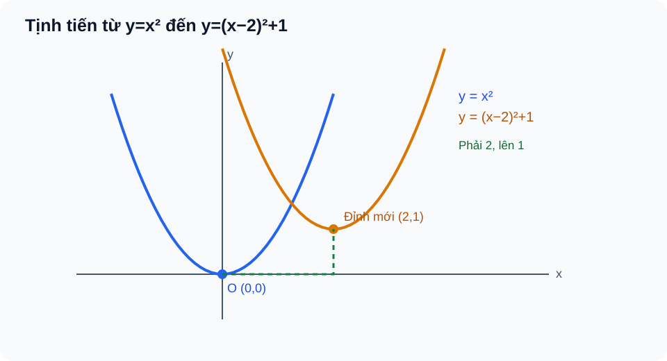
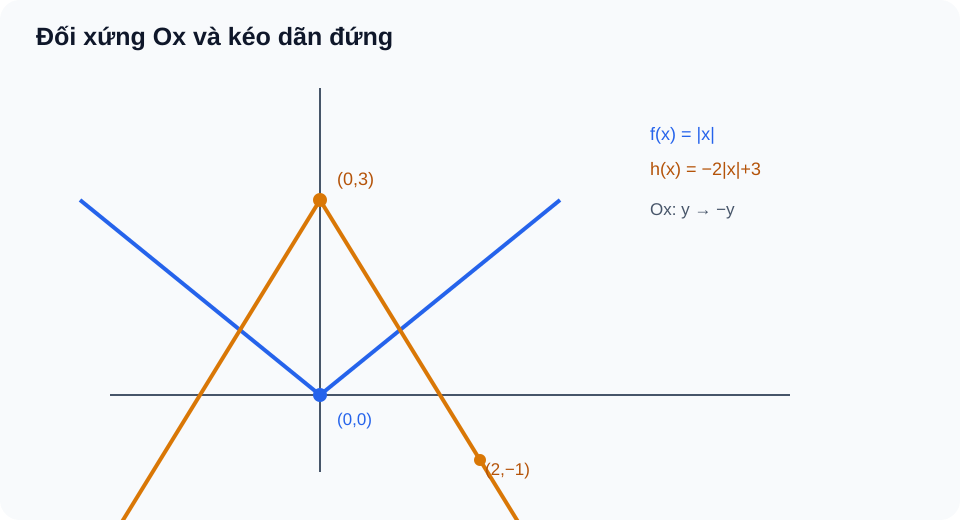
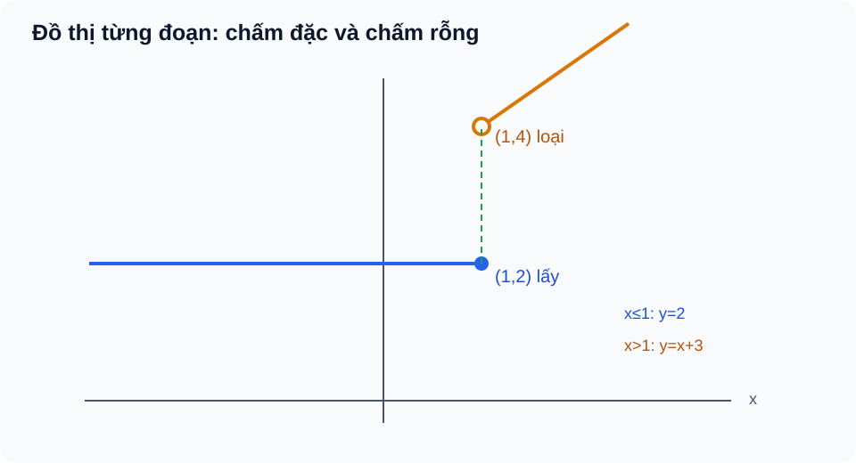

<!-- AUTHORING R04: original R03 immutable c7c6227e94d1c5349195911c61b8021518542cd7; math/PED Q18 receipt and V2 ready reference exact R04 blob, not independent reviewer PASS or RELEASE. -->
<!-- STANDARD_ID=SLM-THPT-QUALITY-ONE; STANDARD_VERSION=3.1.0; LEARNING_PATH=TOPIC; OUTER_PAGES=Kiến thức|Luyện tập|Tự kiểm tra; SOURCE_VERSION=R04_AUTHORING_READY; AUTHORING_ONLY_METADATA=prototypes/thpt/content-drafts/topic05-functions-graph/Temp_TOPIC05_R04_AUTHORING_ONLY_CUSTODY_METADATA_20261113.md -->
# CĐ05 — Hàm số, đồ thị và các phép biến đổi đồ thị

# Kiến thức

## Từ bảng dữ liệu đến một quy luật có thể nhìn thấy

Nếu một cửa hàng thay đổi mức phí giao hàng theo quãng đường, ta có thể lập bảng ghi quãng đường và số tiền phải trả. Nhưng chỉ nhìn vài dòng của bảng chưa đủ hiểu quy luật cho **mọi** quãng đường được phép: cần biết quãng đường nào hợp lệ, mỗi giá trị đầu vào có xác định duy nhất một khoản phí hay không, và khi quãng đường thay đổi thì số tiền tăng giảm ra sao. Hàm số giúp trả lời bằng công thức; đồ thị giúp nhìn thấy xu hướng, những điểm bị loại và ranh giới giữa các cách tính.

Trước khi dịch hay phản xạ một đồ thị, em cần đọc đúng đồ thị **ban đầu**. Chẳng hạn, căn bậc hai \(\sqrt u\) chỉ có nghĩa khi \(u\ge0\), phân thức phải có mẫu khác 0 và ký hiệu \((x,y)\) trên hệ trục chỉ một điểm có hoành độ \(x\), tung độ \(y\). Những kiến thức ấy sẽ được dùng khi tìm miền và khi xem một điểm bị phép biến đổi đưa tới đâu.

Ta bắt đầu bằng câu hỏi “đâu là một hàm số?”, rồi lần lượt xem đồ thị cho biết miền, tập giá trị, sự tăng giảm và đối xứng như thế nào. Sau đó mới tìm hiểu vì sao đổi một con số trong công thức có thể dịch hoặc biến dạng cả đồ thị.

<!-- LESSON_ID: TOP05-M01; OUTCOME_ID: TOP05-O01 -->

Hãy hình dung một bảng ghi nhiệt độ ở từng thời điểm. Để bảng thực sự mô tả một quy luật kiểu hàm số, **mỗi đầu vào** phải có **đúng một đầu ra**. Hai thời điểm khác nhau có thể cùng nhiệt độ; điều không được phép là cùng một thời điểm lại có hai nhiệt độ khác nhau trong cùng một quy luật đang xét. Đó là ý nghĩa của hàm \(f:D\to\mathbb R\): mỗi \(x\in D\) nhận đúng một giá trị \(f(x)\).

Xét bảng các cặp \((0,2),(1,4),(1,4)\). Dù \(x=1\) được ghi hai lần, cả hai lần đều cho 4, nên bảng vẫn phù hợp với một hàm số. Nếu thay một cặp thành \((1,7)\) thì cùng đầu vào 1 sẽ có hai đầu ra khác nhau: bảng không còn định nghĩa một hàm. Trên đồ thị, ta có thể hình dung điều kiện ấy bằng việc mỗi đường thẳng đứng cắt đồ thị tại **không quá một điểm**.

<!-- LESSON_ID: TOP05-M02; OUTCOME_ID: TOP05-O02 -->

Để có một hàm số, trước hết cần biết những đầu vào nào biểu thức cho phép. Căn số học và mẫu số tạo ra điểm bị loại; dấu ≥ của căn không được biến thành >. Ta đã biết căn √u đòi u≥0, mẫu v≠0. Với √A(x)/B(x) cần đồng thời A(x)≥0 và B(x)≠0, nên D là **giao** các miền; luôn xét biểu thức ban đầu trước khi rút gọn. Ở đầu mút căn bằng0 là hợp lệ nếu mẫu khác0.

Chẳng hạn, √(x+1)/(x−2): cần x≥−1, x≠2 ⇒ D=[−1,2)∪(2,+∞). Nhận x=−1 vì căn bằng0, mẫu−3.

<!-- LESSON_ID: TOP05-M03; OUTCOME_ID: TOP05-O03 -->

Miền đầu vào chưa nói hết các giá trị đầu ra mà hàm có thể nhận. Một biểu thức có thể cho rất nhiều giá trị trên ℝ, nhưng trên số sản phẩm nguyên chỉ có ít đầu ra. Ta sử dụng phép thế số và tập số nguyên/đoạn. T={f(x):x∈D} là tập **các y thật nhận được**, khác tập xác định D và tập đích ℝ. Miền rời rạc dẫn tới tập giá trị rời rạc, không tự nối thành khoảng.

Xét ví dụ: f(x)=x² trên D={−2,0,1} cho T={0,1,4}. Với D=[−2,1] thì T=[0,4]. Cùng công thức nhưng miền khác nhau làm tập giá trị khác.

<!-- LESSON_ID: TOP05-M04; OUTCOME_ID: TOP05-O04 -->

Khi đã biết miền và tập giá trị, đồ thị cho phép quan sát quy luật. Nối một vài điểm đo thành đường cong có thể là giả định, không phải dữ kiện chắc chắn. Ta bắt đầu từ hệ trục Oxy; điểm A(a,b). Γ={(x,f(x)):x∈D}. A(a,b) thuộc đồ thị khi a∈D và b=f(a). Chấm đặc biểu thị điểm thuộc, chấm rỗng không thuộc; đường thẳng đứng x=c gặp hai y thì quan hệ không là đồ thị y=f(x).

Chẳng hạn, f(x)=|x−2|+1: A(1,2) thuộc vì f(1)=2, B(3,3) không thuộc vì f(3)=2. Thay vào công thức là lý do kiểm nhanh chính xác.

### Vận dụng và tự đối chiếu

<!-- First Try TOP05-M01: knowledge, not canonical Readiness -->
**1.** Các cặp \((1,3),(2,3),(3,5)\) có thể là dữ liệu của một hàm số không? Điều gì quyết định?

Đối chiếu

Có. Ba đầu vào 1, 2, 3 khác nhau và mỗi đầu vào chỉ có một đầu ra. Việc hai đầu vào cùng cho giá trị 3 không vi phạm định nghĩa. Nếu em nhầm với yêu cầu “mỗi y chỉ đến từ một x”, hãy nhớ đó là tính một-một, không phải điều kiện cơ bản của hàm số.

<!-- First Try TOP05-M02: knowledge, not canonical Readiness -->
**2.** Tìm D của √(9−x²)/(x−1).

Đối chiếu

D=[−3,1)∪(1,3], vì −3≤x≤3 và x≠1.

Nếu bỏ điều kiện mẫu, thử x=1; nếu loại căn bằng0, thử x=±3; luyện P03/P04.

<!-- First Try TOP05-M03: knowledge, not canonical Readiness -->
**3.** f(q)=3q−1 với q∈{0,1,2} có T nào?

Đối chiếu

T={−1,2,5}, không phải cả đoạn [−1,5].

Nếu lầm T với [min,max], liệt kê đầu vào thực sự cho phép; luyện P05/P06.

<!-- First Try TOP05-M04: knowledge, not canonical Readiness -->
**4.** Vì sao đường tròn x²+y²=9 không biểu diễn hàm y=f(x) trên [−3,3]?

Đối chiếu

x=0 cho hai y=3 và −3, vi phạm một đầu vào một đầu ra.

Nếu chỉ nhìn đường cong mượt và gọi hàm, kẻ đường thẳng đứng qua x=0; luyện P07/P08.

## Từ các điểm riêng lẻ đến hình dạng chung

Khi đã biết một điểm \((a,f(a))\) có thuộc đồ thị hay không, câu hỏi tiếp theo là nhìn cả một khoảng: giá trị đi lên, đi xuống hay lặp lại theo chu kỳ? Một parabol có đỉnh, một đồ thị chẵn đối xứng qua trục tung, và một hiện tượng tuần hoàn lặp theo trục thời gian. Hiểu những đặc điểm này trước giúp ta không nhầm một đồ thị đã bị dịch với đồ thị gốc.

<!-- LESSON_ID: TOP05-M05; OUTCOME_ID: TOP05-O05 -->

Một vài điểm tăng không chứng minh cả đồ thị tăng; cần xét mọi cặp trong khoảng. Cần nhớ thứ tự x₁<x₂ và dấu của hiệu f(x₂)−f(x₁). Hàm đồng biến nghiêm ngặt trên khoảng K khi với mọi x₁<x₂ trong K, f(x₁)<f(x₂); nghịch biến nếu f(x₁)>f(x₂). Với x²: trên x<0 hàm giảm, trên x>0 hàm tăng. Không kết luận trên cả ℝ chỉ vì một nhánh đi lên.

Chẳng hạn, f(x)=−3x+2: f(x₂)−f(x₁)=−3(x₂−x₁)<0 khi x₁<x₂, nên nghịch biến trên ℝ. Chọn cách so hiệu vì không cần đạo hàm.

<!-- LESSON_ID: TOP05-M06; OUTCOME_ID: TOP05-O06 -->

Với parabol, vị trí đỉnh cho biết cực trị trong miền được phép. Đỉnh của parabol có thể nằm ngoài miền khả thi nên không phải đáp án cực trị. Để xác định điều đó, cần xét bình phương không âm, khoảng/đoạn đóng và số nguyên. Hoàn phương ax²+bx+c=a(x−h)²+k (a≠0), h=−b/(2a), k=f(h). Đỉnh(h,k), trục đối xứng x=h. Khi tìm GTLN/GTNN trên D, luôn kiểm h có ở D không, so biên và các giá trị nguyên khả thi; không cần vội dùng đạo hàm.

Chẳng hạn, f(x)=−(x−1)²+8 trên [2,5]: đỉnh ở1 bị loại. Hàm giảm trên miền, max f(2)=7, min f(5)=−8. Chọn kiểm miền trước công thức cực trị.

<!-- LESSON_ID: TOP05-M07; OUTCOME_ID: TOP05-O07 -->

Đồ thị cũng có thể giữ nguyên hình dạng khi phản xạ qua trục hoặc qua gốc. Phỏng đoán một hình đối xứng không thay được chứng minh với mọi x. Ta đã biết miền D đối xứng qua0; so f(−x) và f(x). Chẵn khi D đối xứng và f(−x)=f(x), đồ thị đối xứng trục Oy. Lẻ khi D đối xứng và f(−x)=−f(x), đồ thị đối xứng gốc O. Miền không đối xứng thì không suy chẵn/lẻ chỉ từ công thức.

Chẳng hạn, f(x)=x⁴−2x² chẵn do f(−x)=f(x); x³ lẻ do f(−x)=−f(x). Tính trực tiếp đáng tin hơn nhìn sơ đồ phác.

<!-- LESSON_ID: TOP05-M08; OUTCOME_ID: TOP05-O08 -->

Một loại đối xứng khác xuất hiện khi giá trị lặp lại theo chu kỳ. Quan sát số liệu lặp chưa đủ chứng minh hàm tuần hoàn trên mọi đầu vào. Ta sử dụng t>0, phép dịch đầu vào x↦x+T. T là chu kỳ khi f(x+T)=f(x) với mọi x trong miền mà các điểm dịch hợp lệ và miền bảo toàn qua phép dịch. Chu kỳ cơ bản là chu kỳ dương nhỏ nhất nếu tồn tại. Không lẫn chu kỳ trên Ox với độ cao/biên độ trên Oy. Công thức chi tiết lượng giác thuộc CĐ06.

Xét ví dụ: Nếu f(x+5)=f(x) và f(2)=−1, thì f(12)=f(2+2·5)=−1. Chọn dùng định nghĩa, không cần biết hàm là sin hay cos.

### Vận dụng và tự đối chiếu

<!-- First Try TOP05-M05: knowledge, not canonical Readiness -->
**1.** x² tăng/giảm trên [−5,−2] ra sao?

Đối chiếu

Giảm; GTLN25 ở−5, GTNN4 ở−2.

Nếu chỉ thử x=0,1, hãy giải thích cho x₁,x₂ tùy ý; luyện P09/P10.

<!-- First Try TOP05-M06: knowledge, not canonical Readiness -->
**2.** f(x)=(x+2)²−1 trên [−1,3] có min/max?

Đối chiếu

Đỉnh−2 ngoài miền; min f(−1)=0, max f(3)=24.

Nếu lấy đỉnh vô điều kiện, khoanh D trước khi chọn; luyện P11/P12.

<!-- First Try TOP05-M07: knowledge, not canonical Readiness -->
**3.** g(x)=x²+x trên ℝ thuộc loại nào?

Đối chiếu

g(−x)=x²−x khác g(x) và −g(x), nên không chẵn/lẻ.

Nếu chỉ nhìn số mũ cao nhất, thay −x vào **toàn bộ** biểu thức; luyện P13/P14.

<!-- First Try TOP05-M08: knowledge, not canonical Readiness -->
**4.** f(x+3)=f(x), f(1)=4; f(10) là?

Đối chiếu

4, vì 10=1+3·3; chưa thể kết luận 3 là chu kỳ **cơ bản**.

Nếu từ bốn điểm suy toàn miền tuần hoàn, hãy tách quan sát và định nghĩa; luyện P15/P16.

## Một điểm dịch đi, cả đồ thị dịch theo

Thay vì nhớ dấu cộng hay dấu trừ một cách máy móc, hãy đánh dấu một điểm đã biết trên đồ thị gốc rồi theo dõi nó đi đâu. Nếu cộng một lượng vào **giá trị hàm**, tung độ thay đổi; nếu thay \(x\) bằng \(x-h\) thì chính đầu vào thay đổi, nên đồ thị dịch theo phương ngang. Nhìn một điểm trước sẽ giúp giải thích cả phép tịnh tiến, đối xứng và co giãn sau đó.

<!-- LESSON_ID: TOP05-M09; OUTCOME_ID: TOP05-O09 -->

Một mức phí cố định cộng vào mọi hóa đơn, không đổi lượng đầu vào. Ta bắt đầu từ điểm (x,f(x)) và phép cộng số k. g(x)=f(x)+k có D_g=D_f, mọi điểm (x,y)→(x,y+k). k>0 dịch lên, k<0 dịch xuống. Số cộng nằm **ngoài** f làm đổi tung độ, không đổi hoành độ.

Chẳng hạn, f(x)=|x−1|, g(x)=f(x)+4 có đỉnh(1,4), g(0)=5. Chọn xem điểm đỉnh và một điểm kiểm.

<!-- LESSON_ID: TOP05-M10; OUTCOME_ID: TOP05-O10 -->

Khi dịch theo phương ngang, dấu bên trong đối số dễ gây nhầm. Dời thời điểm bắt đầu của hiện tượng có thể dời cả miền hợp lệ. Cần nhớ đặt u=x−h; miền gốc D_f. g(x)=f(x−h) xác định khi x−h∈D_f, nên D_g=D_f+h; điểm (u,f(u)) thành(u+h,f(u)). h>0 là dịch **phải** h; f(x+h) dịch trái h. Không đoán chiều dịch chỉ theo dấu trừ cộng nếu chưa xét tọa độ.

Chẳng hạn, từ parabol \(f(x)=x^2\) có đỉnh \((0,0)\), hàm \(g(x)=f(x-2)+1=(x-2)^2+1\) có đỉnh \((2,1)\): dịch phải 2 và lên 1, đúng như hai đường trong hình. Với một hàm có miền giới hạn như \(f(x)=\sqrt x\), phép \(f(x-3)\) còn làm điểm bắt đầu dịch từ \((0,0)\) sang \((3,0)\); miền mới là \([3,+\infty)\). Cả hai minh họa cùng quy luật hoành độ cộng 2 hay 3 theo lượng dịch.

*Đọc hình:* Hai parabol \(y=x^2\) và \(y=(x-2)^2+1\) có đỉnh lần lượt \((0,0)\), \((2,1)\). Chọn điểm đỉnh để thấy chính xác **dịch phải hai, lên một**; không có phép đổi độ rộng.

<!-- LESSON_ID: TOP05-M11; OUTCOME_ID: TOP05-O11 -->

Sau phép dịch, phép phản xạ tạo đồ thị mới mà không cần vẽ lại. Đổi dấu đầu ra khác hoàn toàn việc đổi hướng đầu vào. Để xác định điều đó, cần xét điểm (x,y), đổi dấu x hoặc y. −f(x) phản xạ Ox: (x,y)→(x,−y), miền giữ. f(−x) phản xạ Oy: (x,y)→(−x,y), miền thành −D_f. Với f chẵn, phản xạ Oy không làm đổi hình; với f lẻ cả hai cho cùng biểu thức.

Chẳng hạn, f=x²+x: −f=−x²−x trong khi f(−x)=x²−x. Tại x=1 được −2 và0, chứng minh hai phép khác nhau.

<!-- LESSON_ID: TOP05-M12; OUTCOME_ID: TOP05-O12 -->

Nhân toàn bộ giá trị hàm làm độ cao thay đổi, khác tác động lên đối số. Phóng to đơn vị tung độ làm đường cong cao hơn nhưng giữ vị trí đầu vào. Ta đã biết nhân một tung độ y với hệ số c. g(x)=c f(x): (x,y)→(x,cy). |c|>1 dãn đứng, 0<|c|<1 co đứng, c<0 còn phản xạ Ox. c=0 đưa hình về Ox nhưng không là phép giãn khả nghịch. Nếu c≠0 thì tập nghiệm f(x)=0 giữ nguyên.

Chẳng hạn, đặt \(f(x)=|x|\) và \(h(x)=-2|x|+3\). Với \(x=2\), điểm \((2,2)\) trên đồ thị \(f\) thành \((2,-1)\) trên \(h\): trước tiên nhân tung độ với \(-2\) (lật qua trục \(Ox\), dãn đứng hai lần), rồi cộng 3 (dịch lên). Đỉnh chuyển từ \((0,0)\) lên \((0,3)\), đúng như hình. Muốn đổi chỉ riêng tung độ mà không dịch, ta bỏ số \(+3\) ở ngoài.

*Đọc hình:* Hình vẽ cả \(f(x)=|x|\) và \(h(x)=-2|x|+3\), nên phép biến đổi thật sự gồm \((x,y)\mapsto(x,-2y+3)\). Dấu âm đảo tung độ, hệ số 2 dãn đứng, còn số 3 dịch lên; không được lược mất bước cuối.

<!-- LESSON_ID: TOP05-M13; OUTCOME_ID: TOP05-O13 -->

Nếu nhân biến bên trong đối số, khoảng cách theo trục hoành biến đổi. Khi đầu vào chạy nhanh gấp đôi, cùng một tung độ xuất hiện sớm hơn. Ta sử dụng đặt u=kx (k khác0), điểm gốc(u,f(u)). g(x)=f(kx) biến (u,f(u)) thành(u/k,f(u)); độ rộng ngang nhân1/|k|. |k|>1 là co ngang, 0<|k|<1 là dãn ngang; k<0 còn phản xạ Oy. Miền D_g={x:kx∈D_f}, khác phép g=kf(x).

Xét ví dụ: f=|x|, g=f(2x)=2|x|: cùng y=4, f đạt x=±4 còn g đạt x=±2. Vẻ dốc hơn là kết quả co ngang theo đối số.

<!-- LESSON_ID: TOP05-M14; OUTCOME_ID: TOP05-O14 -->

Giá trị tuyệt đối có hai hiệu ứng khác nhau khi đặt ngoài hay trong hàm. Dấu |.| bên ngoài f và bên trong đối số thay hai nửa đồ thị khác nhau. Ta bắt đầu từ |t|≥0, |t|=t khi t≥0, =−t nếu t<0. |f(x)| giữ phần y≥0, phản xạ phần y<0 lên Ox; miền không đổi. f(|x|) lấy nửa đồ thị f trên x≥0 rồi phản xạ sang x≤0; miền mới {x:|x|∈D_f}. Không thể coi chúng giống nhau.

Chẳng hạn, f=x−1: |f(x)|=|x−1| có đỉnh(1,0), còn f(|x|)=|x|−1 có đỉnh(0,−1). Điểm x=0 cho hai giá trị khác.

### Vận dụng và tự đối chiếu

<!-- First Try TOP05-M09: knowledge, not canonical Readiness -->
**1.** Từ f=x², g=f−2 có đỉnh đâu?

Đối chiếu

(0,−2), và điểm (1,1) thành (1,−1).

Nếu nói dịch ngang, hãy xem x có bị thay trong f không; luyện P17/P18.

<!-- First Try TOP05-M10: knowledge, not canonical Readiness -->
**2.** g(x)=(x+2)² dịch parabol x² thế nào?

Đối chiếu

Trái2, đỉnh(−2,0), vì x+2=0 tại−2.

Nếu dịch phải vì dấu+, tìm x để đối số bằng0; luyện P19/P20.

<!-- First Try TOP05-M11: knowledge, not canonical Readiness -->
**3.** Với f=x²−2x, f(−x) là gì?

Đối chiếu

x²+2x, là ảnh qua trục Oy.

Nếu đổi dấu toàn biểu thức, đó là phản xạ Ox; luyện P21/P22.

<!-- First Try TOP05-M12: knowledge, not canonical Readiness -->
**4.** g=(1/2)|x| tại x=4 so với f=|x|?

Đối chiếu

g(4)=2, f(4)=4, co đứng một nửa.

Nếu kết luận co ngang, giữ x=4 và so hai tung độ; luyện P23/P24.

<!-- First Try TOP05-M13: knowledge, not canonical Readiness -->
**5.** f=√x, g=f(3x): D và x khi g(x)=2?

Đối chiếu

D=[0,+∞), 3x=4 ⇒ x=4/3, so f đạt y=2 ở x=4.

Nếu nhận giãn ngang3, dùng u=3x ⇒ x=u/3; luyện P25/P26.

<!-- First Try TOP05-M14: knowledge, not canonical Readiness -->
**6.** f=x²−1, tính |f(0)| và f(|0|).

Đối chiếu

|−1|=1, còn f(0)=−1.

Nếu gán hai hàm bằng nhau mọi x, dùng x=0 làm phản ví dụ; luyện P27/P28.

## Khi nhiều phép biến đổi cùng xuất hiện

Một đồ thị có thể vừa bị dịch, vừa bị lật và co giãn. Muốn không đảo nhầm thứ tự, ta theo một điểm gốc qua từng phép biến đổi rồi kiểm lại miền xác định. Nếu hàm chỉ dùng cho số sản phẩm nguyên hoặc thời gian không âm, không thể coi cả đường cong vẽ trên \(\mathbb R\) đều là phương án hợp lệ. Cuối cùng, hàm từng đoạn sẽ cho thấy vì sao một dấu bằng ở điểm nối có thể thay đổi kết quả dù công thức gần giống nhau.

Khi nhiều phép biến đổi xảy ra liên tiếp, thứ tự thực hiện và miền của hàm vẫn cần được kiểm tra. Hàm từng đoạn và tình huống tối ưu cho thấy đọc đồ thị là một cách lập luận, không chỉ phác hình.

<!-- LESSON_ID: TOP05-M15; OUTCOME_ID: TOP05-O15 -->

Nhìn dấu cộng trừ mà bỏ qua thứ tự thao tác có thể sai miền và đỉnh. Cần nhớ đổi điểm(u,f(u)) theo u=k(x−h). Với g(x)=c f(k(x−h))+v, c,k≠0, điểm(u,f(u)) thành(h+u/k, c f(u)+v). Đây là phép đổi tọa độ có chứng minh, không phải 'dịch đoán'. Luôn kiểm f đã xác định ở k(x−h) trước khi tính.

Chẳng hạn, f=x², g=2f(x−1)+3 có đỉnh (1,3), g(0)=5. Viết dạng đỉnh trực tiếp cho thấy miền ℝ và cực tiểu3.

<!-- LESSON_ID: TOP05-M16; OUTCOME_ID: TOP05-O16 -->

Với hàm từng đoạn, điểm nối và dấu bằng có thể làm thay đổi đồ thị. Hai công thức giá theo thời gian có thể gặp nhau hoặc tạo bước nhảy tại mốc đổi giá. Để xác định điều đó, cần xét phân biệt x<c, x≤c, x≥c; chấm rỗng/đặc. Tại x=c, **nhánh có dấu bằng** xác định f(c). Nhìn độ cao của hai nhánh sát c: khác nhau tạo bước nhảy, bằng nhau có thể nối khi điểm được nhận. Đây là cách đọc hình trực quan, không thay nội dung định nghĩa/định lý giới hạn và liên tục chính thức ở CĐ08.

Chẳng hạn, hàm từng đoạn \(f(x)=2\) khi \(x\le1\), còn \(f(x)=x+3\) khi \(x>1\) có \(f(1)=2\) nhờ nhánh chứa dấu bằng. Trên hình, nhánh phải chỉ tiến gần điểm \((1,4)\) khi \(x\to1^+\) nhưng không nhận điểm ấy. Vì 2 khác 4, hai nhánh tạo **bước nhảy** tại \(x=1\), chứ không nối nhau; cần phân biệt giá trị tại mốc và giá trị gần mốc.

*Đọc hình:* Chấm **đặc** tại \((1,2)\) thuộc nhánh \(x\le1\); chấm **rỗng** tại \((1,4)\) chỉ là điểm mà nhánh \(x>1\) tiến tới. Hai tung độ khác nhau nên không thể kết luận đồ thị nối liên tục.

<!-- LESSON_ID: TOP05-M17; OUTCOME_ID: TOP05-O17 -->

Mọi phép biến đổi phải quay về miền hợp lệ của mô hình. Một đỉnh đẹp trên toàn ℝ có thể không có ý nghĩa vì sản phẩm chỉ nhận giá trị nguyên và còn ràng buộc. Ta đã biết biến q nguyên, đơn vị, miền quyết định D. Đặt biến, **đơn vị và miền khả thi trước**; từ đó tính hàm và ứng viên, kiểm ứng viên trong D. Khi ràng buộc đổi, quyết định tối ưu có thể đổi dù công thức không đổi. Với bậc hai sơ cấp dùng hoàn phương; khảo sát cực trị bằng đạo hàm thuộc CĐ10.

Chẳng hạn, P(q)=−(q−4)²+16 (triệu) với q∈{5,6}. Đỉnh q=4 không khả thi; P(5)=15, P(6)=12 ⇒ chọn q=5.

### Vận dụng và tự đối chiếu

<!-- First Try TOP05-M15: knowledge, not canonical Readiness -->
**1.** g=−f(x+2)+1 với f=x² có đỉnh và hướng mở?

Đối chiếu

g=−(x+2)²+1, đỉnh(−2,1), mở xuống.

Nếu đọc x+2 là dịch phải, tìm x làm x+2=0; luyện P29/P30/W02.

<!-- First Try TOP05-M16: knowledge, not canonical Readiness -->
**2.** f=0 nếu x≤0, f=x+2 nếu x>0 có bước nhảy ở 0 không?

Đối chiếu

Có: chấm đặc(0,0) và chấm rỗng(0,2) thuộc nhánh bên phải.

Nếu tính f(0)=2, bạn đã dùng nhầm nhánh x>0; luyện P31/P32/W03.

<!-- First Try TOP05-M17: knowledge, not canonical Readiness -->
**3.** Q(t)=(t−3)²+2 trên t∈[5,7], giá trị min?

Đối chiếu

t≥5, nên min Q(5)=6; không chọn Q(3)=2 vì ngoài miền.

Nếu vẫn chọn đỉnh không hợp lệ, viết lại tập khả thi và thử các biên; luyện P33/P34/W04.

<!-- AUTHORING MEDIA/SPEC NOTES: This R03 puts verified figures in the teaching flow. Complete historical SVG custody and SPEC_ONLY interaction notes are preserved in R02 Git blob 1de60ae0dc3e4c5ce79281bd0fd8cfcc7c616205; no live model feature is claimed. -->

# Luyện tập

**38 `item_id` canonical PUBLIC mới** trong một nguồn duy nhất: **34 Practice và 4 Written** rubric **7 điểm**. Không sao chép 116 ID hoặc câu/đáp án của thí điểm #782; phần source/Academic/PED PASS R18 cũ bảo toàn đúng snapshot riêng. Mỗi outcome có ít nhất 2 câu chủ đích và một vòng Tự thử → D6 trước Luyện tập.

| Outcome | Họ dạng | 1 canonical ID cho mỗi câu |
|---|---|---|
| `TOP05-O01` | Phương pháp `TOP05-M01` | `THPT-TOP05-P01`; `THPT-TOP05-P02` |
| `TOP05-O02` | Phương pháp `TOP05-M02` | `THPT-TOP05-P03`; `THPT-TOP05-P04` |
| `TOP05-O03` | Phương pháp `TOP05-M03` | `THPT-TOP05-P05`; `THPT-TOP05-P06`; `THPT-TOP05-W01` |
| `TOP05-O04` | Phương pháp `TOP05-M04` | `THPT-TOP05-P07`; `THPT-TOP05-P08` |
| `TOP05-O05` | Phương pháp `TOP05-M05` | `THPT-TOP05-P09`; `THPT-TOP05-P10` |
| `TOP05-O06` | Phương pháp `TOP05-M06` | `THPT-TOP05-P11`; `THPT-TOP05-P12` |
| `TOP05-O07` | Phương pháp `TOP05-M07` | `THPT-TOP05-P13`; `THPT-TOP05-P14` |
| `TOP05-O08` | Phương pháp `TOP05-M08` | `THPT-TOP05-P15`; `THPT-TOP05-P16` |
| `TOP05-O09` | Phương pháp `TOP05-M09` | `THPT-TOP05-P17`; `THPT-TOP05-P18` |
| `TOP05-O10` | Phương pháp `TOP05-M10` | `THPT-TOP05-P19`; `THPT-TOP05-P20` |
| `TOP05-O11` | Phương pháp `TOP05-M11` | `THPT-TOP05-P21`; `THPT-TOP05-P22` |
| `TOP05-O12` | Phương pháp `TOP05-M12` | `THPT-TOP05-P23`; `THPT-TOP05-P24` |
| `TOP05-O13` | Phương pháp `TOP05-M13` | `THPT-TOP05-P25`; `THPT-TOP05-P26` |
| `TOP05-O14` | Phương pháp `TOP05-M14` | `THPT-TOP05-P27`; `THPT-TOP05-P28` |
| `TOP05-O15` | Phương pháp `TOP05-M15` | `THPT-TOP05-P29`; `THPT-TOP05-P30`; `THPT-TOP05-W02` |
| `TOP05-O16` | Phương pháp `TOP05-M16` | `THPT-TOP05-P31`; `THPT-TOP05-P32`; `THPT-TOP05-W03` |
| `TOP05-O17` | Phương pháp `TOP05-M17` | `THPT-TOP05-P33`; `THPT-TOP05-P34`; `THPT-TOP05-W04` |

**Written/rubric:** `THPT-TOP05-W01` miền và đối xứng của nửa đường tròn, `W02` chuỗi phép biến đổi parabol, `W03` điểm nối từng đoạn, `W04` tối ưu khi miền số sản phẩm đổi. Mỗi bài tự luận 7 điểm với giải chi tiết/rubric tại bank. Anchor nếu dùng chỉ là nhãn trên cùng ID, không tạo thư viện khác; tự luận tự đối chiếu không ghi Mastery.

# Tự kiểm tra

**17 lượt PUBLIC đã có trong Luyện tập, reuse-only**, một outcome một item, chế độ `CLIENT_SELF_CHECK_NO_MASTERY`. Không phải `TOPIC_READINESS` độc lập, không lấy các câu đã xem lời giải làm điểm chứng nhận; 0 private RD1 nhập từ SGK hay pilot R18.

**Hợp đồng runtime Q16 cho RELEASE:** Không hint/AI Tutor/đúng–sai/key/lời giải/rubric **trước Final Submit**. Sau nộp mới tự đối chiếu và D6. Đây là nội dung Markdown, không phải bằng chứng website engine thực thi. Chưa có Mastery hay bảo mật đề đánh giá chính thức.

| Lượt | TOP05 outcome | PUBLIC reuse item_id | Trở lại khi sai |
|---:|---|---|---|
| 1 | `TOP05-O01` | `THPT-TOP05-P01` | `TOP05-M01` |
| 2 | `TOP05-O02` | `THPT-TOP05-P03` | `TOP05-M02` |
| 3 | `TOP05-O03` | `THPT-TOP05-P05` | `TOP05-M03` |
| 4 | `TOP05-O04` | `THPT-TOP05-P07` | `TOP05-M04` |
| 5 | `TOP05-O05` | `THPT-TOP05-P09` | `TOP05-M05` |
| 6 | `TOP05-O06` | `THPT-TOP05-P11` | `TOP05-M06` |
| 7 | `TOP05-O07` | `THPT-TOP05-P13` | `TOP05-M07` |
| 8 | `TOP05-O08` | `THPT-TOP05-P15` | `TOP05-M08` |
| 9 | `TOP05-O09` | `THPT-TOP05-P17` | `TOP05-M09` |
| 10 | `TOP05-O10` | `THPT-TOP05-P19` | `TOP05-M10` |
| 11 | `TOP05-O11` | `THPT-TOP05-P21` | `TOP05-M11` |
| 12 | `TOP05-O12` | `THPT-TOP05-P23` | `TOP05-M12` |
| 13 | `TOP05-O13` | `THPT-TOP05-P25` | `TOP05-M13` |
| 14 | `TOP05-O14` | `THPT-TOP05-P27` | `TOP05-M14` |
| 15 | `TOP05-O15` | `THPT-TOP05-P29` | `TOP05-M15` |
| 16 | `TOP05-O16` | `THPT-TOP05-P31` | `TOP05-M16` |
| 17 | `TOP05-O17` | `THPT-TOP05-P33` | `TOP05-M17` |

**Đường sửa lỗi:** sai miền/đầu ra → M01–M03; đọc đồ thị/đơn điệu/đỉnh → M04–M06; chẵn–lẻ/chu kỳ → M07–M08; tịnh tiến ngang/đứng → M09–M10; phản xạ và co dãn → M11–M13; |f(x)| vs f(|x|) → M14; kết hợp phép → M15; chấm mở/đặc → M16; ràng buộc bài toán → M17. Sau khi xem lời giải, đổi câu luyện, không tái dùng làm đánh giá độc lập.
