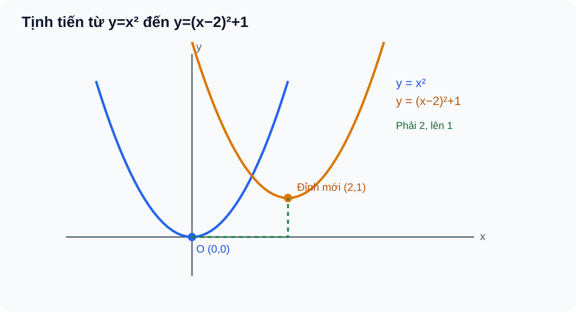
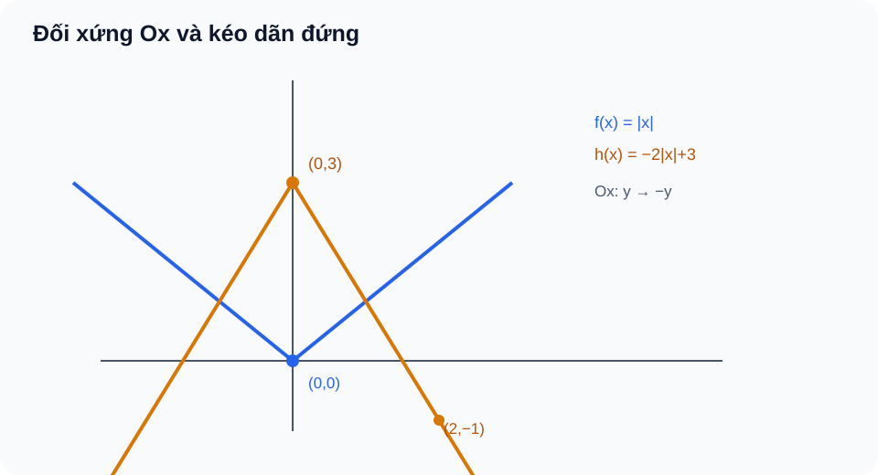
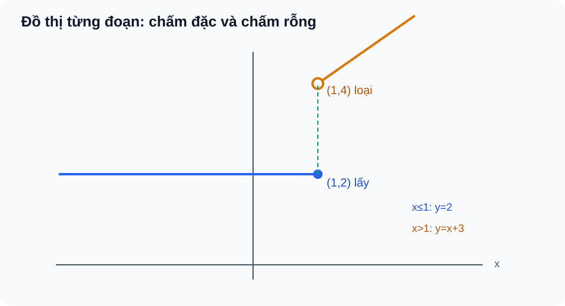

# Chuyên đề 05 · Hàm số, đồ thị và phép biến đổi

Một khoản phí giao hàng thay đổi theo quãng đường là một ví dụ về hàm số: mỗi quãng đường hợp lệ phải cho đúng một mức phí. Ta sẽ học cách đọc miền, tập giá trị, xu hướng trên đồ thị rồi đổi đồ thị **bằng cách theo dõi tọa độ điểm**. Sau cùng, các phép biến đổi giúp giải những bài có giới hạn về số lượng và miền thực tế.

# Kiến thức

## 1. Từ bảng dữ liệu đến quy luật hàm số

Nếu một cửa hàng thay đổi mức phí giao hàng theo quãng đường, ta có thể lập bảng ghi quãng đường và số tiền phải trả. Nhưng chỉ nhìn vài dòng của bảng chưa đủ hiểu quy luật cho **mọi** quãng đường được phép: cần biết quãng đường nào hợp lệ, mỗi giá trị đầu vào có xác định duy nhất một khoản phí hay không, và khi quãng đường thay đổi thì số tiền tăng giảm ra sao. Hàm số giúp trả lời bằng công thức; đồ thị giúp nhìn thấy xu hướng, những điểm bị loại và ranh giới giữa các cách tính.

Trước khi dịch hay phản xạ một đồ thị, em cần đọc đúng đồ thị **ban đầu**. Chẳng hạn, căn bậc hai \(\sqrt u\) chỉ có nghĩa khi \(u\ge0\), phân thức phải có mẫu khác 0 và ký hiệu \((x,y)\) trên hệ trục chỉ một điểm có hoành độ \(x\), tung độ \(y\). Những kiến thức ấy sẽ được dùng khi tìm miền và khi xem một điểm bị phép biến đổi đưa tới đâu.

Ta bắt đầu bằng câu hỏi “đâu là một hàm số?”, rồi lần lượt xem đồ thị cho biết miền, tập giá trị, sự tăng giảm và đối xứng như thế nào. Sau đó mới tìm hiểu vì sao đổi một con số trong công thức có thể dịch hoặc biến dạng cả đồ thị.

<!-- LESSON_ID: TOP05-M01; OUTCOME_ID: TOP05-O01; R04_BLOB: 04f532661d014ee011e5d2f61a3dca9578a101d4 -->

### 1.1. Thế nào là một hàm số?

Khi nào các cặp số lặp lại đầu vào vẫn xác định một hàm số?

Hãy hình dung một bảng ghi nhiệt độ ở từng thời điểm. Để bảng thực sự mô tả một quy luật kiểu hàm số, **mỗi đầu vào** phải có **đúng một đầu ra**. Hai thời điểm khác nhau có thể cùng nhiệt độ; điều không được phép là cùng một thời điểm lại có hai nhiệt độ khác nhau trong cùng một quy luật đang xét. 

> **ĐỊNH NGHĨA — Hàm số.** Hàm \(f:D\to\mathbb R\) gán cho **mỗi** \(x\in D\) **đúng một** giá trị \(f(x)\). Hai đầu vào khác nhau được phép có cùng đầu ra; một đầu vào không thể tương ứng hai đầu ra khác nhau trong cùng một hàm số.

**Các cách cho một hàm số.** Trong thực tế, quy luật ghép đầu vào với đầu ra có thể được trình bày bằng **bảng** (mỗi cột ghi một cặp giá trị), **biểu đồ** (đọc giá trị từ các cột hay điểm biểu diễn), **công thức** (ví dụ \(f(x)=2x+1\)) hoặc **mô tả bằng lời** (mỗi sản phẩm có giá 5 nghìn đồng thì số tiền mua \(x\) sản phẩm là \(5x\) nghìn đồng). Dù cho bằng cách nào, phải chỉ ra các đầu vào được phép và **mỗi đầu vào chỉ nhận một đầu ra**. Nếu bảng chỉ ghi vài thời điểm thì ta không được tự khẳng định công thức hay giá trị ở thời điểm chưa quan sát, trừ khi bài toán bổ sung quy luật hoặc giả thiết.

Xét bảng các cặp \((0,2),(1,4),(1,4)\). Dù \(x=1\) được ghi hai lần, cả hai lần đều cho 4, nên bảng vẫn phù hợp với một hàm số. Nếu thay một cặp thành \((1,7)\) thì cùng đầu vào 1 sẽ có hai đầu ra khác nhau: bảng không còn định nghĩa một hàm. Trên đồ thị, ta có thể hình dung điều kiện ấy bằng việc mỗi đường thẳng đứng cắt đồ thị tại **không quá một điểm**.

**Ví dụ**

**Đề bài.** Xét \((0,1),(1,2),(1,2),(2,3)\) trên tập \(\{0,1,2\}\). Có phải hàm số? Nếu thay cặp cuối bằng \((1,3)\) thì sao?

**Lời giải.** Ban đầu \(f(0)=1,f(1)=2,f(2)=3\), mỗi đầu vào cho đúng một đầu ra nên là hàm số dù cặp \((1,2)\) lặp. Sau khi thay, \(x=1\) cho cả 2 và 3; đồng thời \(x=2\) vẫn thuộc tập đầu vào nhưng không còn đầu ra nào. Vì vậy vi phạm cả yêu cầu **mỗi đầu vào** và **đúng một đầu ra**.

**Vận dụng**

Các cặp \((1,3),(2,3),(3,5)\) có thể là dữ liệu của một hàm số không? Điều gì quyết định?

Đối chiếu

Có. Ba đầu vào 1, 2, 3 khác nhau và mỗi đầu vào chỉ có một đầu ra. Việc hai đầu vào cùng cho giá trị 3 không vi phạm định nghĩa. Nếu em nhầm với yêu cầu “mỗi y chỉ đến từ một x”, hãy nhớ đó là tính một-một, không phải điều kiện cơ bản của hàm số.

**Kiểm lỗi**

Nếu em nhầm “nhiều đầu vào có cùng một đầu ra” với “một đầu vào có nhiều đầu ra”, đọc lại **Kiến thức 1.1** rồi làm **Bài 1** và **Bài 2** trong Luyện tập. Ở Bài 1, cặp \((1;4)\) lặp lại nhưng vẫn là hàm; ở Bài 2, một đầu vào 0 cho hai giá trị 1 và 3 nên không là hàm.

<!-- LESSON_ID: TOP05-M02; OUTCOME_ID: TOP05-O02; R04_BLOB: 04f532661d014ee011e5d2f61a3dca9578a101d4 -->

### 1.2. Tập xác định của biểu thức

Tại sao căn bằng 0 được nhận, còn mẫu bằng 0 phải loại?

Khi một hàm số \(y=f(x)\) được **cho bằng công thức mà không ghi tập xác định**, ta quy ước tập xác định là **tất cả số thực \(x\) làm cho biểu thức \(f(x)\) có nghĩa**. Ví dụ, \(f(x)=\sqrt{x-2}\) có miền \([2,+\infty)\), còn \(g(x)=1/(x-2)\) có miền \(\mathbb R\setminus\{2\}\). Nếu bài toán **đã chỉ định miền**, chẳng hạn \(x\) là số sản phẩm nguyên không âm từ \(0\) đến \(10\), phải dùng miền chỉ định ấy sau khi kiểm biểu thức có nghĩa, không tự nới thành cả \(\mathbb R\).

Để có một hàm số, trước hết cần biết những đầu vào nào biểu thức cho phép. Căn số học và mẫu số tạo ra điểm bị loại; căn \(\sqrt u\) đòi \(u\ge0\), mẫu v đòi \(v\ne0\). Không loại nhầm giá trị làm căn bằng 0.

> **KIẾN THỨC CẦN GHI NHỚ — Miền xác định của phân thức có căn.** Với \(f(x)=\dfrac{\sqrt{A(x)}}{B(x)}\), điều kiện xác định trên số thực là \(A(x)\ge0\) **và** \(B(x)\ne0\). Miền xác định là giao của hai điều kiện, phải xét trên biểu thức gốc trước khi rút gọn.

 Ở đầu mút căn bằng0 là hợp lệ nếu mẫu khác0.

Chẳng hạn, với \(\frac{\sqrt{x+1}}{x-2}\), cần \(x\ge-1\), \(x\ne2\), nên \(D=[-1;2)\cup(2;+\infty)\). Nhận \(x=-1\) vì căn bằng 0, mẫu bằng −3.

**Ví dụ**

**Đề bài.** Tìm tập xác định \(f(x)=\dfrac{\sqrt{5-x}}{x+2}\).

**Lời giải.** Cần \(5-x\ge0\Rightarrow x\le5\), và \(x+2\ne0\Rightarrow x\ne-2\). Giao hai điều kiện: \(D=(-\infty,-2)\cup(-2,5]\). Nhận \(x=5\) vì \(\sqrt0=0\) và mẫu khác 0.

**Vận dụng**

Tìm D của \(\frac{\sqrt{9-x^2}}{x-1}\).

Đối chiếu

\(D=[-3;1)\cup(1;3]\), vì \(-3\le x\le3\) và \(x\ne1\).

Nếu bỏ điều kiện mẫu, thử \(x=1\); nếu loại căn bằng 0, thử \(x=\pm3\); làm lại Bài 3 và Bài 4 trong phần Luyện tập.

<!-- LESSON_ID: TOP05-M03; OUTCOME_ID: TOP05-O03; R04_BLOB: 04f532661d014ee011e5d2f61a3dca9578a101d4 -->

### 1.3. Tập giá trị phụ thuộc miền

Đổi tập đầu vào từ rời rạc sang đoạn ảnh hưởng tập giá trị ra sao?

> **ĐỊNH NGHĨA — Tập giá trị phụ thuộc miền.** Miền đầu vào chưa nói hết các giá trị đầu ra mà hàm có thể nhận. Một biểu thức có thể cho rất nhiều giá trị trên \(\mathbb R\), nhưng trên số sản phẩm nguyên chỉ có ít đầu ra. \(T=\{f(x):x\in D\}\) là tập **các giá trị y thật nhận được**, khác tập xác định D và tập đích \(\mathbb R\). Miền rời rạc dẫn tới tập giá trị rời rạc, không tự nối thành khoảng.

Xét ví dụ: \(f(x)=x^2\) trên \(D=\{-2;0;1\}\) cho \(T=\{0;1;4\}\). Với \(D=[-2;1]\) thì \(T=[0;4]\). Cùng công thức nhưng miền khác nhau làm tập giá trị khác.

**Ví dụ**

**Đề bài.** Cho \(f(x)=2x+1\). Tìm tập giá trị trên \(D_1=\{-1,0,2\}\) và \(D_2=[-1,2]\).

**Lời giải.** Trên \(D_1\), thế từng số: \(T_1=\{-1,1,5\}\). Trên đoạn \(D_2\), hàm bậc nhất có hệ số \(2>0\) nên tăng từ \(-1\) đến \(5\); \(T_2=[-1,5]\). Không nối các giá trị rời rạc của \(D_1\) thành đoạn.

**Vận dụng**

\(f(q)=3q-1\) với \(q\in\{0;1;2\}\) có tập giá trị T nào?

Đối chiếu

T={−1,2,5}, không phải cả đoạn [−1,5].

Nếu lầm T với [min,max], liệt kê đầu vào thực sự cho phép; làm lại Bài 5 và Bài 6 trong phần Luyện tập.

<!-- LESSON_ID: TOP05-M04; OUTCOME_ID: TOP05-O04; R04_BLOB: 04f532661d014ee011e5d2f61a3dca9578a101d4 -->

### 1.4. Đọc một điểm thuộc đồ thị

Muốn kiểm một điểm có thuộc đồ thị, phải làm phép tính nào?

> **TÍNH CHẤT — Đọc một điểm thuộc đồ thị.** Khi đã biết miền và tập giá trị, đồ thị cho phép quan sát quy luật. Nối một vài điểm đo thành đường cong có thể là giả định, không phải dữ kiện chắc chắn. Ta bắt đầu từ hệ trục Oxy; điểm \(A(a;b)\). Đồ thị \(\Gamma=\{(x;f(x)):x\in D\}\). Điểm \(A(a;b)\) thuộc đồ thị khi \(a\in D\) và \(b=f(a)\). Chấm đặc biểu thị điểm thuộc, chấm rỗng không thuộc; nếu đường thẳng đứng \(x=c\) gặp hai điểm có tung độ khác nhau thì quan hệ không là đồ thị \(y=f(x)\).

Chẳng hạn, \(f(x)=\lvert x-2\rvert+1\): \(A(1;2)\) thuộc vì \(f(1)=2\), \(B(3;3)\) không thuộc vì \(f(3)=2\). Thay vào công thức là lý do kiểm nhanh chính xác.

**Ví dụ**

**Đề bài.** Với \(f(x)=|x+1|+2\), kiểm \(A(0,3)\), \(B(1,5)\), \(C(-1,2)\) có thuộc đồ thị không.

**Lời giải.** Điểm \((a,b)\) thuộc đồ thị nếu \(b=f(a)\). \(f(0)=3\) nên \(A\) thuộc; \(f(1)=4\ne5\) nên \(B\) không thuộc; \(f(-1)=2\) nên \(C\) thuộc. Đỉnh của đồ thị chữ V là \((-1,2)\).

**Vận dụng**

Vì sao đường tròn \(x^2+y^2=9\) không biểu diễn hàm \(y=f(x)\) trên \([-3;3]\)?

Đối chiếu

\(x=0\) cho hai giá trị \(y=3\) và \(y=-3\), vi phạm một đầu vào một đầu ra.

Nếu chỉ nhìn đường cong mượt và gọi hàm, kẻ đường thẳng đứng qua \(x=0\); làm lại Bài 8 và Bài 9 trong phần Luyện tập.

## 2. Đọc đồ thị, biến thiên và đối xứng

Khi đã biết một điểm \((a,f(a))\) có thuộc đồ thị hay không, câu hỏi tiếp theo là nhìn cả một khoảng: giá trị đi lên, đi xuống hay lặp lại theo chu kỳ? Một parabol có đỉnh, một đồ thị chẵn đối xứng qua trục tung, và một hiện tượng tuần hoàn lặp theo trục thời gian. Hiểu những đặc điểm này trước giúp ta không nhầm một đồ thị đã bị dịch với đồ thị gốc.

<!-- LESSON_ID: TOP05-M05; OUTCOME_ID: TOP05-O05; R04_BLOB: 04f532661d014ee011e5d2f61a3dca9578a101d4 -->

### 2.1. Đồng biến và nghịch biến

Nhìn vài điểm tăng đã chứng minh hàm đồng biến chưa?

> **ĐỊNH NGHĨA — Đồng biến và nghịch biến.** Một vài điểm tăng không chứng minh cả đồ thị tăng; cần xét mọi cặp trong khoảng. Cần nhớ thứ tự \(x_1<x_2\) và dấu của hiệu \(f(x_2)-f(x_1)\). Hàm đồng biến nghiêm ngặt trên khoảng K khi với mọi \(x_1<x_2\) trong K, \(f(x_1)<f(x_2)\); nghịch biến nếu \(f(x_1)>f(x_2)\). Với \(f(x)=x^2\), hàm giảm trên khoảng \(x<0\), tăng trên khoảng \(x>0\). Không kết luận trên cả \(\mathbb R\) chỉ vì một nhánh đi lên.

Chẳng hạn, \(f(x)=-3x+2\): \(f(x_2)-f(x_1)=-3(x_2-x_1)<0\) khi \(x_1<x_2\), nên nghịch biến trên \(\mathbb R\). Chọn cách so hiệu vì không cần đạo hàm.

**Ví dụ**

**Đề bài.** Chứng minh \(f(x)=4-2x\) nghịch biến trên \(\mathbb R\) mà không dùng đạo hàm.

**Lời giải.** Với mọi \(x_1<x_2\), \(f(x_2)-f(x_1)=-2(x_2-x_1)<0\). Do đó \(f(x_2)<f(x_1)\), nên hàm nghịch biến trên toàn \(\mathbb R\). Kiểm mọi cặp đầu vào mới là chứng minh, không chỉ nhìn hai điểm.

**Vận dụng**

Hàm \(f(x)=x^2\) đồng biến hay nghịch biến trên \([-5;-2]\)?

Đối chiếu

Hàm nghịch biến trên \([-5;-2]\). Thật vậy, nếu \(-5\le x_1<x_2\le-2\), thì \(f(x_2)-f(x_1)=(x_2-x_1)(x_2+x_1)<0\). Giá trị lớn nhất là 25 tại \(x=-5\); giá trị nhỏ nhất là 4 tại \(x=-2\).

Nếu em kết luận đồng biến vì số mũ chẵn, hãy so \(f(-5)=25\) với \(f(-2)=4\), rồi kiểm dấu của \(x_2+x_1\) với hai điểm bất kỳ trong khoảng đã cho. Làm lại Bài 10 và Bài 11 trong phần Luyện tập.

<!-- LESSON_ID: TOP05-M06; OUTCOME_ID: TOP05-O06; R04_BLOB: 04f532661d014ee011e5d2f61a3dca9578a101d4 -->

### 2.2. Đỉnh parabol trên miền cho phép

Đỉnh của parabol nằm ngoài miền có thể làm cực trị trên miền không?

Để trả lời, hãy bắt đầu từ chính hàm số. Một hàm số bậc hai có dạng \(f(x)=ax^2+bx+c\) với \(a\ne0\), \(a,b,c\) là các số thực; khi chưa có ràng buộc của bài toán thực tế, tập xác định là toàn bộ \(\mathbb R\). Điều kiện \(a\ne0\) rất quan trọng: nếu \(a=0\) thì biểu thức chỉ còn bậc nhất hoặc hằng, không phải hàm số bậc hai. Đồ thị của hàm số bậc hai là một **parabol**. Để hiểu hình dạng của nó thay vì học thuộc chiều mở, ta có thể viết \(f(x)=a(x-h)^2+k\) với \(h=-\frac{b}{2a}\), \(k=f(h)=-\frac{b^2-4ac}{4a}\). Vì \((x-h)^2\ge0\), điểm \(I(h,k)\) là thấp nhất nếu \(a>0\), và cao nhất nếu \(a<0\).

> **ĐỊNH NGHĨA — Hàm số bậc hai và parabol.** Hàm số bậc hai là hàm số \(y=ax^2+bx+c\), trong đó \(a,b,c\in\mathbb R\), \(a\ne0\), có tập xác định \(\mathbb R\). Đồ thị là parabol có đỉnh \(I\left(-\frac{b}{2a},-\frac{\Delta}{4a}\right)\), trục đối xứng \(x=-\frac{b}{2a}\), với \(\Delta=b^2-4ac\).

Muốn **lập bảng giá trị và vẽ đồ thị**, trước tiên tìm đỉnh, rồi chọn các hoành độ ở hai phía trục đối xứng và tính tung độ tương ứng. Ví dụ với \(f(x)=x^2-2x=(x-1)^2-1\), bảng giá trị là:

| \(x\) | \(-1\) | \(0\) | \(1\) | \(2\) | \(3\) |
|---|---:|---:|---:|---:|---:|
| \(f(x)\) | \(3\) | \(0\) | \(-1\) | \(0\) | \(3\) |

Trên hệ trục, đánh dấu các điểm \((-1,3),(0,0),(1,-1),(2,0),(3,3)\), rồi nối bằng một **đường cong parabol trơn**, không nối thành các đoạn thẳng gấp khúc. Hai điểm có hoành độ cách đều \(x=1\) có cùng tung độ; đỉnh \((1,-1)\), trục đối xứng \(x=1\). Khi đọc hình, hãy nhận ra chiều mở, vị trí đỉnh, đường đối xứng và các điểm cắt trục nếu có; nếu bài toán chỉ cho phép \(x\) trong một miền \(D\), chỉ xét phần đồ thị tương ứng với \(D\).

Để vẽ đúng các **giao điểm với trục tọa độ**, ta dùng chính định nghĩa điểm thuộc đồ thị: trên trục \(Oy\) có \(x=0\), nên giao điểm của \(y=ax^2+bx+c\) với \(Oy\) là \((0;c)\). Trên trục \(Ox\) có \(y=0\), nên phải giải \(ax^2+bx+c=0\). Với \(\Delta=b^2-4ac\): nếu \(\Delta>0\), parabol cắt \(Ox\) tại **hai điểm** có hoành độ là hai nghiệm; nếu \(\Delta=0\), parabol **tiếp xúc** \(Ox\) tại đỉnh; nếu \(\Delta<0\), parabol không có điểm chung với \(Ox\). Không được tự vẽ thêm giao điểm khi phương trình vô nghiệm thực.

Ngay ở bảng trên, \(f(x)=x^2-2x=x(x-2)\) cho \(c=0\), nên đồ thị đi qua \((0;0)\) trên \(Oy\); giải \(x(x-2)=0\) được \(x=0\) hoặc \(x=2\), đúng hai giao điểm \((0;0)\) và \((2;0)\) với \(Ox\). Một điểm có thể đồng thời nằm trên cả hai trục. Ta xác định chúng bằng phương trình trước, rồi mới kiểm vị trí trên hình.

> **TÍNH CHẤT — Chiều mở và biến thiên của parabol.** Với \(f(x)=a(x-h)^2+k\), \(a\ne0\): nếu \(a>0\), parabol mở lên, hàm **nghịch biến** trên \((-\infty,h)\), **đồng biến** trên \((h,+\infty)\) và đạt giá trị nhỏ nhất \(k\) tại \(x=h\). Nếu \(a<0\), parabol mở xuống, hàm **đồng biến** trên \((-\infty,h)\), **nghịch biến** trên \((h,+\infty)\) và đạt giá trị lớn nhất \(k\) tại \(x=h\). Các kết luận cực trị toàn miền này chỉ áp dụng ngay khi đang xét toàn \(\mathbb R\); trên một miền ràng buộc phải kiểm đỉnh có được phép và so sánh biên.

> **TÍNH CHẤT — Đỉnh parabol trên miền cho phép.** Với parabol, vị trí đỉnh cho biết giá trị lớn nhất hoặc nhỏ nhất nếu đỉnh thuộc miền được phép. Hoàn thành bình phương: \(ax^2+bx+c=a(x-h)^2+k\) (\(a\ne0\)), với \(h=-\frac{b}{2a}\), \(k=f(h)\). Đỉnh là \((h;k)\), trục đối xứng \(x=h\). Khi tìm giá trị lớn nhất hoặc nhỏ nhất trên D, luôn kiểm h có ở D không, so biên và các giá trị nguyên khả thi; không cần vội dùng đạo hàm.

Chẳng hạn, \(f(x)=-(x-1)^2+8\) trên \([2;5]\): hoành độ đỉnh 1 nằm ngoài miền. Hàm giảm trên miền, giá trị lớn nhất \(f(2)=7\), nhỏ nhất \(f(5)=-8\). Chọn kiểm miền trước khi dùng công thức cực trị.

**Ví dụ**

**Đề bài.** Tìm GTLN và GTNN của \(f(x)=-(x-2)^2+9\) trên \([3,6]\).

**Lời giải.** Đỉnh \((2,9)\) nằm ngoài đoạn. Trên \(x\ge3\), \((x-2)^2\) tăng nên \(f\) giảm. \(f(3)=8\) là GTLN, \(f(6)=-7\) là GTNN. Không nhận giá trị 9 tại \(x=2\) ngoài miền.

**Vận dụng**

\(f(x)=(x+2)^2-1\) trên \([-1;3]\) có giá trị nhỏ nhất và lớn nhất là bao nhiêu?

Đối chiếu

Hoành độ đỉnh −2 nằm ngoài miền; giá trị nhỏ nhất \(f(-1)=0\), giá trị lớn nhất \(f(3)=24\).

Nếu lấy đỉnh vô điều kiện, khoanh D trước khi chọn; làm lại Bài 12 và Bài 13 trong phần Luyện tập.

<!-- LESSON_ID: TOP05-M07; OUTCOME_ID: TOP05-O07; R04_BLOB: 04f532661d014ee011e5d2f61a3dca9578a101d4 -->

### 2.3. Chẵn, lẻ và miền đối xứng

Tại sao cần miền đối xứng để kết luận hàm chẵn hoặc lẻ?

Đồ thị cũng có thể giữ nguyên hình dạng khi phản xạ qua trục hoặc qua gốc. Phỏng đoán một hình đối xứng không thay được chứng minh với mọi x. Ta đã biết miền D đối xứng qua0; so f(−x) và f(x). 

> **ĐỊNH NGHĨA — Hàm chẵn và hàm lẻ.** Nếu miền \(D\) đối xứng qua 0 (\(x\in D\Rightarrow -x\in D\)), hàm \(f\) *chẵn* khi \(f(-x)=f(x)\) với mọi \(x\in D\), và *lẻ* khi \(f(-x)=-f(x)\) với mọi \(x\in D\). Đồ thị tương ứng đối xứng qua trục \(Oy\) hoặc gốc \(O\).

 Miền không đối xứng thì không suy chẵn/lẻ chỉ từ công thức.

Chẳng hạn, \(f(x)=x^4-2x^2\) chẵn do \(f(-x)=f(x)\); hàm \(f(x)=x^3\) lẻ do \(f(-x)=-f(x)\). Tính trực tiếp đáng tin hơn nhìn sơ đồ phác.

**Ví dụ**

**Đề bài.** Xác định tính chẵn/lẻ của \(g(x)=x^3-x\) trên \(\mathbb R\).

**Lời giải.** Miền \(\mathbb R\) đối xứng qua 0 và \(g(-x)=-x^3+x=-g(x)\) với mọi \(x\). Vậy \(g\) là hàm lẻ, đồ thị đối xứng qua gốc tọa độ.

**Vận dụng**

Hàm \(g(x)=x^2+x\) trên \(\mathbb R\) thuộc loại nào?

Đối chiếu

\(g(-x)=x^2-x\) khác \(g(x)\) và \(-g(x)\) như các hàm số, nên không chẵn, không lẻ.

Nếu chỉ nhìn số mũ cao nhất, thay −x vào **toàn bộ** biểu thức; làm lại Bài 14 và Bài 15 trong phần Luyện tập.

<!-- LESSON_ID: TOP05-M08; OUTCOME_ID: TOP05-O08; R04_BLOB: 04f532661d014ee011e5d2f61a3dca9578a101d4 -->

### 2.4. Chu kỳ hàm số

Lặp ở vài điểm có đủ để kết luận tuần hoàn không?

> **ĐỊNH NGHĨA — Chu kỳ hàm số.** Một loại đối xứng khác xuất hiện khi giá trị lặp lại theo chu kỳ. Quan sát số liệu lặp chưa đủ chứng minh hàm tuần hoàn trên mọi đầu vào. Số \(T>0\) là chu kỳ khi miền xác định bảo toàn qua phép dịch \(x\mapsto x+T\) và \(f(x+T)=f(x)\) với mọi x trong miền. Chu kỳ cơ bản là chu kỳ dương nhỏ nhất nếu tồn tại. Không lẫn chu kỳ trên Ox với độ cao/biên độ trên Oy. Công thức chi tiết lượng giác thuộc CĐ06.

Xét ví dụ: Nếu \(f(x+5)=f(x)\) và \(f(2)=-1\), thì \(f(12)=f(2+2\cdot5)=-1\). Chọn dùng định nghĩa, không cần biết hàm là sin hay cos.

**Ví dụ**

**Đề bài.** Biết \(f(x+4)=f(x)\) với mọi số thực \(x\), và \(f(1)=6\). Tìm \(f(9)\); 4 có chắc là chu kỳ nhỏ nhất không?

**Lời giải.** Vì \(9=1+2\cdot4\), \(f(9)=f(5)=f(1)=6\). Bốn là một chu kỳ nhưng chưa chắc cơ bản; một hàm có chu kỳ 2 cũng thỏa điều kiện dịch 4.

**Vận dụng**

\(f(x+3)=f(x)\), \(f(1)=4\); tính \(f(10)\).

Đối chiếu

4, vì \(10=1+3\cdot3\); chưa thể kết luận 3 là chu kỳ **cơ bản**.

Nếu từ bốn điểm suy toàn miền tuần hoàn, hãy tách quan sát và định nghĩa; làm lại Bài 16 và Bài 17 trong phần Luyện tập.

## 3. Dịch, phản xạ và co giãn đồ thị

Thay vì nhớ dấu cộng hay dấu trừ một cách máy móc, hãy đánh dấu một điểm đã biết trên đồ thị gốc rồi theo dõi nó đi đâu. Nếu cộng một lượng vào **giá trị hàm**, tung độ thay đổi; nếu thay \(x\) bằng \(x-h\) thì chính đầu vào thay đổi, nên đồ thị dịch theo phương ngang. Nhìn một điểm trước sẽ giúp giải thích cả phép tịnh tiến, đối xứng và co giãn sau đó.

<!-- LESSON_ID: TOP05-M09; OUTCOME_ID: TOP05-O09; R04_BLOB: 04f532661d014ee011e5d2f61a3dca9578a101d4 -->

### 3.1. Dịch đồ thị theo phương đứng

Cộng một hằng số ngoài hàm làm điểm đồ thị dịch theo phương nào?

> **PHƯƠNG PHÁP — Dịch đồ thị theo phương đứng.** Một mức phí cố định cộng vào mọi hóa đơn, không đổi lượng đầu vào. Ta bắt đầu từ điểm \((x;f(x))\) và phép cộng số k. Hàm \(g(x)=f(x)+k\) có \(D_g=D_f\), mọi điểm \((x;y)\mapsto(x;y+k)\). Nếu \(k>0\) thì dịch lên, nếu \(k<0\) thì dịch xuống. Số cộng nằm **ngoài** f làm đổi tung độ, không đổi hoành độ.

Chẳng hạn, \(f(x)=\lvert x-1\rvert\), \(g(x)=f(x)+4\) có đỉnh \((1;4)\), \(g(0)=5\). Chọn xem điểm đỉnh và một điểm kiểm.

**Ví dụ**

**Đề bài.** Từ \(f(x)=x^2\), đặt \(g(x)=f(x)+3\). Tìm đỉnh và \(g(2)\).

**Lời giải.** Cộng 3 ngoài hàm giữ nguyên hoành độ, tăng tung độ 3. Đỉnh chuyển từ \((0,0)\) lên \((0,3)\); \(g(2)=2^2+3=7\). Điểm \((2,4)\) của \(f\) biến thành \((2,7)\).

**Vận dụng**

Từ \(f(x)=x^2\), cho \(g(x)=f(x)-2\). Đỉnh g ở đâu?

Đối chiếu

\((0;-2)\), và điểm \((1;1)\) thành \((1;-1)\).

Nếu nói dịch ngang, hãy xem x có bị thay trong f không; làm lại Bài 18 và Bài 19 trong phần Luyện tập.

<!-- LESSON_ID: TOP05-M10; OUTCOME_ID: TOP05-O10; R04_BLOB: 04f532661d014ee011e5d2f61a3dca9578a101d4 -->

### 3.2. Dịch đồ thị theo phương ngang

Vì sao biểu thức \(f(x-3)\) lại dịch phải ba đơn vị?

> **PHƯƠNG PHÁP — Dịch đồ thị theo phương ngang.** Khi dịch theo phương ngang, dấu bên trong đối số dễ gây nhầm. Dời thời điểm bắt đầu của hiện tượng có thể dời cả miền hợp lệ. Cần nhớ đặt \(u=x-h\); miền gốc \(D_f\). Hàm \(g(x)=f(x-h)\) xác định khi \(x-h\in D_f\), nên \(D_g=D_f+h\); điểm \((u;f(u))\) thành \((u+h;f(u))\). Nếu \(h>0\) thì dịch **phải** h; \(f(x+h)\) dịch trái h. Không đoán chiều dịch chỉ theo dấu trừ cộng nếu chưa xét tọa độ.

Chẳng hạn, từ parabol \(f(x)=x^2\) có đỉnh \((0,0)\), hàm \(g(x)=f(x-2)+1=(x-2)^2+1\) có đỉnh \((2,1)\): dịch phải 2 và lên 1, đúng như hai đường trong hình. Với một hàm có miền giới hạn như \(f(x)=\sqrt x\), phép \(f(x-3)\) còn làm điểm bắt đầu dịch từ \((0,0)\) sang \((3,0)\); miền mới là \([3,+\infty)\). Cả hai minh họa cùng quy luật hoành độ cộng 2 hay 3 theo lượng dịch.

*Đọc hình:* Hai parabol \(y=x^2\) và \(y=(x-2)^2+1\) có đỉnh lần lượt \((0,0)\), \((2,1)\). Chọn điểm đỉnh để thấy chính xác **dịch phải hai, lên một**; không có phép đổi độ rộng.

**Ví dụ**

**Đề bài.** Từ \(f(x)=x^2\), đặt \(g(x)=f(x-3)\). Tìm đỉnh và ảnh của điểm \((1,1)\).

**Lời giải.** Đặt \(u=x-3\Rightarrow x=u+3\): dịch phải 3. Đỉnh \((0,0)\mapsto(3,0)\) và \((1,1)\mapsto(4,1)\). Hình trong bài minh họa một phép dịch khác (phải 2, lên 1) nhưng cùng quy tắc điểm.

**Vận dụng**

\(g(x)=(x+2)^2\) dịch parabol \(y=x^2\) thế nào?

Đối chiếu

Dịch trái 2, đỉnh \((-2;0)\), vì \(x+2=0\) tại \(x=-2\).

Nếu dịch phải vì dấu+, tìm x để đối số bằng0; làm lại Bài 20 và Bài 21 trong phần Luyện tập.

<!-- LESSON_ID: TOP05-M11; OUTCOME_ID: TOP05-O11; R04_BLOB: 04f532661d014ee011e5d2f61a3dca9578a101d4 -->

### 3.3. Phản xạ qua hai trục

Phản xạ đầu vào và phản xạ đầu ra khác nhau thế nào?

> **PHƯƠNG PHÁP — Phản xạ qua hai trục.** Sau phép dịch, phép phản xạ tạo đồ thị mới mà không cần vẽ lại. Đổi dấu đầu ra khác hoàn toàn việc đổi hướng đầu vào. Với \(-f(x)\), phản xạ qua Ox: \((x;y)\mapsto(x;-y)\), miền giữ nguyên. Với \(f(-x)\), phản xạ qua Oy: \((x;y)\mapsto(-x;y)\), miền thành \(-D_f\). Với f chẵn, phản xạ qua Oy không làm đổi hình; với f lẻ, cả hai cho cùng biểu thức.

Chẳng hạn, \(f(x)=x^2+x\): \(-f(x)=-x^2-x\) trong khi \(f(-x)=x^2-x\). Tại \(x=1\) được −2 và 0, chứng minh hai phép khác nhau.

**Ví dụ**

**Đề bài.** Với \(f(x)=x^2+2x\), lập \(g(x)=-f(x)\) và \(h(x)=f(-x)\); so \(g(1)\), \(h(1)\).

**Lời giải.** Ta có \(g(x)=-x^2-2x\), là phản xạ \(Ox\); \(h(x)=x^2-2x\), là phản xạ \(Oy\). \(g(1)=-3\) còn \(h(1)=-1\), chứng tỏ hai phép khác nhau.

**Vận dụng**

Với \(f(x)=x^2-2x\), tính \(f(-x)\).

Đối chiếu

\(x^2+2x\), là ảnh qua trục Oy.

Nếu đổi dấu toàn biểu thức, đó là phản xạ Ox; làm lại Bài 22 và Bài 23 trong phần Luyện tập.

<!-- LESSON_ID: TOP05-M12; OUTCOME_ID: TOP05-O12; R04_BLOB: 04f532661d014ee011e5d2f61a3dca9578a101d4 -->

### 3.4. Đổi độ cao và phản xạ đứng

Nhân tung độ với hệ số âm tác động lên chiều và độ lớn ra sao?

> **PHƯƠNG PHÁP — Đổi độ cao và phản xạ đứng.** Nhân toàn bộ giá trị hàm làm độ cao thay đổi, khác tác động lên đối số. Ta nhân tung độ y với hệ số c. Hàm \(g(x)=cf(x)\) biến \((x;y)\mapsto(x;cy)\). Nếu \(\lvert c\rvert>1\) thì dãn đứng, nếu \(0<\lvert c\rvert<1\) thì co đứng, nếu \(c<0\) thì còn phản xạ qua Ox. Với \(c=0\), hình về Ox nhưng không là phép giãn khả nghịch. Nếu \(c\ne0\) thì tập nghiệm \(f(x)=0\) giữ nguyên.

Chẳng hạn, đặt \(f(x)=|x|\) và \(h(x)=-2|x|+3\). Với \(x=2\), điểm \((2,2)\) trên đồ thị \(f\) thành \((2,-1)\) trên \(h\): trước tiên nhân tung độ với \(-2\) (lật qua trục \(Ox\), dãn đứng hai lần), rồi cộng 3 (dịch lên). Đỉnh chuyển từ \((0,0)\) lên \((0,3)\), đúng như hình. Muốn đổi chỉ riêng tung độ mà không dịch, ta bỏ số \(+3\) ở ngoài.

*Đọc hình:* Hình vẽ cả \(f(x)=|x|\) và \(h(x)=-2|x|+3\), nên phép biến đổi thật sự gồm \((x,y)\mapsto(x,-2y+3)\). Dấu âm đảo tung độ, hệ số 2 dãn đứng, còn số 3 dịch lên; không được lược mất bước cuối.

**Ví dụ**

**Đề bài.** Cho \(f(x)=|x|\), \(g(x)=-3|x|+2\). Điểm \((2,2)\) thành điểm nào? Đỉnh mới?

**Lời giải.** Mỗi tung độ \(y\mapsto-3y+2\), nên \((2,2)\mapsto(2,-4)\), đỉnh \((0,0)\mapsto(0,2)\). Hình cạnh bài dùng trường hợp **khác** \(h=-2|x|+3\); không nhầm số của hình và ví dụ.

**Vận dụng**

So sánh \(g(x)=\frac12\lvert x\rvert\) với \(f(x)=\lvert x\rvert\) tại \(x=4\).

Đối chiếu

\(g(4)=2\), \(f(4)=4\), co đứng một nửa.

Nếu kết luận co ngang, giữ \(x=4\) và so hai tung độ; làm lại Bài 24 và Bài 25 trong phần Luyện tập.

<!-- LESSON_ID: TOP05-M13; OUTCOME_ID: TOP05-O13; R04_BLOB: 04f532661d014ee011e5d2f61a3dca9578a101d4 -->

### 3.5. Co giãn ngang theo đối số

Vì sao f(3x) có thể hẹp hơn đồ thị f(x)?

> **PHƯƠNG PHÁP — Co giãn ngang theo đối số.** Nếu nhân biến bên trong đối số, khoảng cách theo trục hoành biến đổi. Khi đầu vào chạy nhanh gấp đôi, cùng một tung độ xuất hiện sớm hơn. Đặt \(u=kx\) (\(k\ne0\)), điểm gốc \((u;f(u))\). Hàm \(g(x)=f(kx)\) biến điểm đó thành \((\frac uk;f(u))\); độ rộng ngang nhân với \(\frac1{\lvert k\rvert}\). Nếu \(\lvert k\rvert>1\) thì co ngang, nếu \(0<\lvert k\rvert<1\) thì dãn ngang; nếu \(k<0\) thì còn phản xạ qua Oy. Miền \(D_g=\{x:kx\in D_f\}\), khác phép \(g(x)=kf(x)\).

Xét ví dụ: \(f(x)=\lvert x\rvert\), \(g(x)=f(2x)=2\lvert x\rvert\). Cùng mức \(y=4\), f đạt \(x=\pm4\) còn g đạt \(x=\pm2\). Vẻ dốc hơn là kết quả co ngang theo đối số.

**Ví dụ**

**Đề bài.** Với \(f(x)=|x|\), \(g(x)=f(3x)\), tìm các \(x\) để \(f(x)=6\) và \(g(x)=6\).

**Lời giải.** Ta có \(|x|=6\Rightarrow x=\pm6\); \(|3x|=6\Rightarrow x=\pm2\). Hoành độ cho cùng tung độ bị chia 3 nên đồ thị co ngang 3 lần.

**Vận dụng**

Cho \(f(x)=\sqrt x\), \(g(x)=f(3x)\). Tìm miền D của g và x khi \(g(x)=2\).

Đối chiếu

\(D=[0;+\infty)\), \(3x=4\Rightarrow x=\frac43\); so với f đạt \(y=2\) ở \(x=4\).

Nếu nhận giãn ngang 3, dùng \(u=3x\Rightarrow x=\frac u3\); làm lại Bài 26 và Bài 27 trong phần Luyện tập.

<!-- LESSON_ID: TOP05-M14; OUTCOME_ID: TOP05-O14; R04_BLOB: 04f532661d014ee011e5d2f61a3dca9578a101d4 -->

### 3.6. Giá trị tuyệt đối ngoài và trong hàm

Trị tuyệt đối đặt ngoài hàm và trong đối số tác động lên thành phần nào?

> **TÍNH CHẤT — Giá trị tuyệt đối ngoài và trong hàm.** Giá trị tuyệt đối có hai hiệu ứng khác nhau khi đặt ngoài hay trong hàm. Ta bắt đầu từ \(\lvert t\rvert\ge0\), \(\lvert t\rvert=t\) khi \(t\ge0\), \(\lvert t\rvert=-t\) nếu \(t<0\). Với \(\lvert f(x)\rvert\), giữ phần \(y\ge0\), phản xạ phần \(y<0\) qua Ox lên trên; miền không đổi. Với \(f(\lvert x\rvert)\), lấy nửa đồ thị f trên \(x\ge0\) rồi phản xạ sang \(x\le0\); miền mới \(\{x:\lvert x\rvert\in D_f\}\). Không thể coi chúng giống nhau.

Chẳng hạn, \(f(x)=x-1\): \(\lvert f(x)\rvert=\lvert x-1\rvert\) có đỉnh \((1;0)\), còn \(f(\lvert x\rvert)=\lvert x\rvert-1\) có đỉnh \((0;-1)\). Điểm \(x=0\) cho hai giá trị khác.

**Ví dụ**

**Đề bài.** Với \(f(x)=x+2\), so \(p(x)=|f(x)|\) và \(q(x)=f(|x|)\) tại \(x=-3\).

**Lời giải.** \(p(x)=|x+2|\) có đỉnh \((-2,0)\), \(q(x)=|x|+2\) có đỉnh \((0,2)\). \(p(-3)=1\) nhưng \(q(-3)=5\). Dấu trị tuyệt đối ngoài tác động lên tung độ; trong tác động lên đầu vào.

**Vận dụng**

Cho \(f(x)=x^2-1\), tính \(\lvert f(0)\rvert\) và \(f(\lvert0\rvert)\).

Đối chiếu

\(\lvert-1\rvert=1\), còn \(f(0)=-1\).

Nếu gán hai hàm bằng nhau với mọi x, dùng \(x=0\) làm phản ví dụ; làm lại Bài 28 và Bài 29 trong phần Luyện tập.

## 4. Kết hợp phép biến đổi và miền ứng dụng

Một đồ thị có thể vừa bị dịch, vừa bị lật và co giãn. Muốn không đảo nhầm thứ tự, ta theo một điểm gốc qua từng phép biến đổi rồi kiểm lại miền xác định. Nếu hàm chỉ dùng cho số sản phẩm nguyên hoặc thời gian không âm, không thể coi cả đường cong vẽ trên \(\mathbb R\) đều là phương án hợp lệ. Cuối cùng, hàm từng đoạn sẽ cho thấy vì sao một dấu bằng ở điểm nối có thể thay đổi kết quả dù công thức gần giống nhau.

Khi nhiều phép biến đổi xảy ra liên tiếp, thứ tự thực hiện và miền của hàm vẫn cần được kiểm tra. Hàm từng đoạn và tình huống tối ưu cho thấy đọc đồ thị là một cách lập luận, không chỉ phác hình.

<!-- LESSON_ID: TOP05-M15; OUTCOME_ID: TOP05-O15; R04_BLOB: 04f532661d014ee011e5d2f61a3dca9578a101d4 -->

### 4.1. Phối hợp nhiều phép biến đổi

Làm sao theo dõi đúng tọa độ điểm khi phối hợp dịch và co giãn?

> **PHƯƠNG PHÁP — Phối hợp nhiều phép biến đổi.** Nhìn dấu cộng trừ mà bỏ qua thứ tự thao tác có thể sai miền và đỉnh. Đổi điểm \((u;f(u))\) theo \(u=k(x-h)\). Với \(g(x)=cf(k(x-h))+v\), \(c,k\ne0\), điểm \((u;f(u))\) thành \((h+\frac uk;cf(u)+v)\). Đây là phép đổi tọa độ có chứng minh, không phải dịch đoán. Luôn kiểm f đã xác định ở \(k(x-h)\) trước khi tính.

Chẳng hạn, \(f(x)=x^2\), \(g(x)=2f(x-1)+3\) có đỉnh \((1;3)\), \(g(0)=5\). Viết dạng đỉnh trực tiếp cho thấy miền \(\mathbb R\) và giá trị nhỏ nhất 3.

**Ví dụ**

**Đề bài.** Cho \(f(x)=x^2\), \(g(x)=-2f(x-1)+3\). Mô tả phép biến đổi, tìm đỉnh và \(g(0)\).

**Lời giải.** Dịch phải 1, nhân tung độ \(-2\) (phản xạ \(Ox\), dãn đứng 2) rồi lên 3. \(g(x)=-2(x-1)^2+3\) có đỉnh \((1,3)\), mở xuống, \(g(0)=1\).

**Vận dụng**

\(g(x)=-f(x+2)+1\) với \(f(x)=x^2\) có đỉnh và hướng mở thế nào?

Đối chiếu

\(g(x)=-(x+2)^2+1\), đỉnh \((-2;1)\), mở xuống.

Nếu đọc \(x+2\) là dịch phải, tìm x làm \(x+2=0\); làm lại Bài 30, Bài 31 và Bài 36 trong phần Luyện tập.

<!-- LESSON_ID: TOP05-M16; OUTCOME_ID: TOP05-O16; R04_BLOB: 04f532661d014ee011e5d2f61a3dca9578a101d4 -->

### 4.2. Hàm từng đoạn và điểm đầu mút

Chấm đặc hay chấm rỗng quyết định giá trị tại mốc?

> **ĐỊNH NGHĨA — Hàm từng đoạn và điểm đầu mút.** Với hàm từng đoạn, điểm nối và dấu bằng có thể làm thay đổi đồ thị. Hai công thức giá theo thời gian có thể gặp nhau hoặc tạo bước nhảy tại mốc đổi giá. Để xác định điều đó, cần xét điều kiện từng nhánh: chẳng hạn \(x<c\), \(x\le c\) hoặc \(x\ge c\). Tại \(x=c\), **nhánh chứa mốc c** xác định \(f(c)\), nếu c thuộc miền xác định. Nhìn độ cao của hai nhánh sát c: khác nhau tạo bước nhảy, bằng nhau có thể nối khi điểm được nhận. Đây là cách đọc hình trực quan, không thay nội dung định nghĩa/định lý giới hạn và liên tục chính thức ở CĐ08.

Chẳng hạn, hàm từng đoạn \(f(x)=2\) khi \(x\le1\), còn \(f(x)=x+3\) khi \(x>1\) có \(f(1)=2\) nhờ nhánh chứa dấu bằng. Trên hình, nhánh phải chỉ tiến gần điểm \((1,4)\) khi \(x\to1^+\) nhưng không nhận điểm ấy. Vì 2 khác 4, hai nhánh tạo **bước nhảy** tại \(x=1\), chứ không nối nhau; cần phân biệt giá trị tại mốc và giá trị gần mốc.

*Đọc hình:* Chấm **đặc** tại \((1,2)\) thuộc nhánh \(x\le1\); chấm **rỗng** tại \((1,4)\) chỉ là điểm mà nhánh \(x>1\) tiến tới. Hai tung độ khác nhau nên không thể kết luận đồ thị nối liên tục.

**Ví dụ**

**Đề bài.** Đặt \(p(x)=3\) nếu \(x\le2\), và \(p(x)=x+4\) nếu \(x>2\). Tìm \(p(2)\), hai chấm tại mốc và tính bước nhảy.

**Lời giải.** Nhánh chứa dấu bằng cho \(p(2)=3\): chấm đặc \((2,3)\). Nhánh phải tiến tới 6 nhưng không nhận tại 2: chấm rỗng \((2,6)\). Khi đi từ trái sang phải, độ cao chuyển từ 3 lên 6, nên bước nhảy hướng lên có độ lớn \(6-3=3\) đơn vị. Hình bài học dùng mốc 1, áp dụng cùng nguyên tắc.

**Vận dụng**

Cho \(f(x)=0\) nếu \(x\le0\) và \(f(x)=x+2\) nếu \(x>0\). Có bước nhảy tại 0 không?

Đối chiếu

Có. Chấm đặc \((0;0)\) thuộc đồ thị vì nhánh trái nhận \(x=0\), nên \(f(0)=0\). Chấm rỗng \((0;2)\) chỉ đánh dấu vị trí nhánh phải tiến tới khi x tiến đến 0 từ bên phải; nó **không thuộc đồ thị**, vì nhánh phải chỉ nhận \(x>0\). Hai độ cao khác nhau; bước nhảy hướng lên có độ lớn \(2-0=2\) đơn vị.

Nếu tính \(f(0)=2\), em đã dùng nhầm nhánh \(x>0\). Hãy kiểm xem 0 thỏa điều kiện của nhánh nào, rồi đặt chấm đặc tại đúng giá trị \(f(0)\). Làm lại Bài 32, Bài 33 và Bài 37 trong phần Luyện tập.

<!-- LESSON_ID: TOP05-M17; OUTCOME_ID: TOP05-O17; R04_BLOB: 04f532661d014ee011e5d2f61a3dca9578a101d4 -->

### 4.3. Tối ưu trong miền khả thi

Có thể chọn đỉnh tối ưu nếu lượng sản xuất bị giới hạn ở các số nguyên khác không?

Trước khi tối ưu một hàm số, ta thường phải **tự lập hàm số từ tình huống**. Bắt đầu bằng lời: cần tìm đại lượng nào và nó phụ thuộc vào đại lượng nào? Tiếp đó chọn **biến cùng đơn vị, miền hợp lệ**, biểu diễn các đại lượng còn lại theo biến, lập công thức hàm số rồi dùng nó giải câu hỏi và **kiểm tính phù hợp của kết quả**. Bốn bước này giúp ta không nhảy ngay vào một công thức có thể sai mô hình.

Chẳng hạn, dùng 24 m dây bao quanh một mảnh vườn **hình chữ nhật đủ bốn cạnh**. Gọi \(x\) (m) là chiều rộng; từ chu vi \(2(x+y)=24\), chiều dài là \(y=12-x\) (m). Vì cả hai cạnh dương, \(0<x<12\). Diện tích là \(S(x)=x(12-x)=36-(x-6)^2\) (m²). Đây là một **hàm số của chiều rộng** trên miền \((0,12)\); vì bình phương không âm, diện tích lớn nhất \(36\) m² đạt tại \(x=6\), tức hình vuông cạnh \(6\) m. Sau khi tính xong phải thử ngược chu vi \(4\cdot6=24\) m. Trường hợp chỉ rào ba cạnh dựa vào tường sẽ là **một mô hình khác**, nên không được sao chép công thức này.

> **PHƯƠNG PHÁP — Tối ưu trong miền khả thi.** Mọi phép biến đổi phải quay về miền hợp lệ của mô hình. Một đỉnh đẹp trên toàn \(\mathbb R\) có thể không có ý nghĩa vì sản phẩm chỉ nhận giá trị nguyên và còn ràng buộc. Đặt biến, **đơn vị và miền khả thi trước**; từ đó tính hàm và ứng viên, kiểm ứng viên trong D. Khi ràng buộc đổi, quyết định tối ưu có thể đổi dù công thức không đổi. Với bậc hai sơ cấp dùng hoàn phương; khảo sát cực trị bằng đạo hàm thuộc CĐ10.

Chẳng hạn, \(P(q)=-(q-4)^2+16\) (triệu đồng) với \(q\in\{5;6\}\). Đỉnh \(q=4\) không khả thi; \(P(5)=15\), \(P(6)=12\), nên chọn \(q=5\).

**Ví dụ**

**Đề bài.** Lợi nhuận \(P(q)=-(q-6)^2+25\) triệu đồng, với \(q\in\{7,8,9\}\) lô. Chọn \(q\) tối ưu.

**Lời giải.** Đỉnh \(q=6\) không khả thi. \(P(7)=24,\ P(8)=21,\ P(9)=16\) triệu đồng, nên chọn \(q=7\) và lợi nhuận lớn nhất 24 triệu. Giữ điều kiện số lô nguyên và đơn vị.

**Vận dụng**

\(Q(t)=(t-3)^2+2\) trên \(t\in[5;7]\); giá trị nhỏ nhất là bao nhiêu?

Đối chiếu

\(t\ge5\), nên giá trị nhỏ nhất \(Q(5)=6\); không chọn \(Q(3)=2\) vì ngoài miền.

Nếu vẫn chọn đỉnh không hợp lệ, viết lại tập khả thi và thử các biên; làm lại Bài 34, Bài 35 và Bài 38 trong phần Luyện tập.

> **Kiến thức cần ghi nhớ**
>
> - **Hàm số:** mỗi đầu vào \(x\in D\) cho đúng một đầu ra; tập giá trị là những giá trị thực sự đạt được \(\{f(x):x\in D\}\), không tự đồng nhất với tập đích.
> - **Miền xác định:** căn bậc chẵn cần biểu thức trong căn không âm; mẫu số phải khác 0. Với hàm từng đoạn, **nhánh chứa dấu bằng** xác định giá trị ở mốc.
> - **Đọc và biến đổi đồ thị:** \(f(x)+k\) dịch lên/xuống; \(f(x-h)\) dịch phải \(h\) và cũng dịch miền xác định; \(-f(x)\) phản xạ qua \(Ox\), \(f(-x)\) phản xạ qua \(Oy\). Luôn kiểm tác động lên điểm và miền.
> - **Biến thiên và cực trị:** xét mọi cặp trên khoảng, không suy từ vài điểm; khi tối ưu chỉ nhận ứng viên thuộc **miền khả thi** (đặc biệt khi biến nguyên).

# Luyện tập

Hãy tự giải trước khi mở **Lời giải**. Với câu hỏi về miền, kiểm điều kiện căn và mẫu; với đồ thị, theo dõi tọa độ trước/sau phép biến đổi và phân biệt chấm đặc – chấm rỗng. Với bài tối ưu, luôn kiểm miền khả thi. Nếu làm sai, trở lại bài Kiến thức tương ứng rồi thử một bài khác.

## 1. Hàm số, miền xác định và tập giá trị

<!-- DISPLAY_ONLY_CANONICAL: THPT-TOP05-P01; ORIGINAL_BLOB: ab878f1a18dea87872449a79c27b75a612d81b39; OUTCOME: TOP05-O01; NOT_CANONICAL -->

**Bài 1.**

Một bảng có các cặp \((0;2),(1;4),(1;4),(2;5)\). Đây có phải một hàm số trên tập đầu vào \(\{0;1;2\}\) không?

Lời giải

**Đáp án:** Có; \(f(1)=4\) được lặp nhất quán.

Mỗi đầu vào chỉ có đúng một đầu ra. Việc \(x=1\) xuất hiện hai lần nhưng đều gắn \(y=4\) không phá tính đơn trị.

<!-- DISPLAY_ONLY_CANONICAL: THPT-TOP05-P02; ORIGINAL_BLOB: ab878f1a18dea87872449a79c27b75a612d81b39; OUTCOME: TOP05-O01; NOT_CANONICAL -->

**Bài 2.**

Một quan hệ có \((0;1),(0;3),(2;4)\). Vì sao không phải hàm số \(y=f(x)\) trên \(\{0;2\}\)?

Lời giải

**Đáp án:** Không phải hàm số vì \(x=0\) cho hai đầu ra 1 và 3 khác nhau.

Một hàm số phải gán mỗi x đúng một y; chỉ một đầu vào vi phạm đã đủ bác bỏ.

<!-- DISPLAY_ONLY_CANONICAL: THPT-TOP05-P03; ORIGINAL_BLOB: ab878f1a18dea87872449a79c27b75a612d81b39; OUTCOME: TOP05-O02; NOT_CANONICAL -->

**Bài 3.**

Tìm tập xác định \(f(x)=\frac{\sqrt{x+2}}{x-3}\).

Lời giải

**Đáp án:** \(D=[-2;3)\cup(3;+\infty)\).

Cần \(x+2\ge0\), tức \(x\ge-2\); đồng thời \(x-3\ne0\), tức \(x\ne3\). Lấy giao và không loại \(x=-2\) vì \(\sqrt0=0\) hợp lệ.

<!-- DISPLAY_ONLY_CANONICAL: THPT-TOP05-P04; ORIGINAL_BLOB: ab878f1a18dea87872449a79c27b75a612d81b39; OUTCOME: TOP05-O02; NOT_CANONICAL -->

**Bài 4.**

Tìm tập xác định \(f(x)=\frac{\sqrt{4-x^2}}{x+1}\).

Lời giải

**Đáp án:** \(D=[-2;-1)\cup(-1;2]\).

Điều kiện \(4-x^2\ge0\Rightarrow -2\le x\le2\); đồng thời \(x\ne-1\) vì mẫu. Hai đầu \(x=\pm2\) được phép.

<!-- DISPLAY_ONLY_CANONICAL: THPT-TOP05-P05; ORIGINAL_BLOB: ab878f1a18dea87872449a79c27b75a612d81b39; OUTCOME: TOP05-O03; NOT_CANONICAL -->

**Bài 5.**

Cho \(f(x)=(x-2)^2+1\) với \(D=[-1;3]\). Tìm tập giá trị thật của hàm số trên D.

Lời giải

**Đáp án:** \(T=[1;10]\).

Bình phương nhỏ nhất 0 tại \(x=2\in D\); khoảng cách \(\lvert x-2\rvert\) lớn nhất tại −1 bằng 3, bình phương bằng 9 rồi cộng 1 cho 10. Hàm liên tục trên đoạn nên nhận mọi giá trị ở giữa.

<!-- DISPLAY_ONLY_CANONICAL: THPT-TOP05-P06; ORIGINAL_BLOB: ab878f1a18dea87872449a79c27b75a612d81b39; OUTCOME: TOP05-O03; NOT_CANONICAL -->

**Bài 6.**

Mô hình số sản phẩm \(q\in\{0;1;2;3\}\), \(f(q)=2q+1\). Tìm tập giá trị.

Lời giải

**Đáp án:** \(\{1;3;5;7\}\).

Thế lần lượt đúng bốn đầu vào nguyên. Không thể nhận 4 vì phương trình \(2q+1=4\) cho \(q=1{,}5\) không thuộc miền thực tế.

<!-- DISPLAY_ONLY_CANONICAL: THPT-TOP05-W01; ORIGINAL_BLOB: ab878f1a18dea87872449a79c27b75a612d81b39; OUTCOME: TOP05-O03; NOT_CANONICAL -->

**Bài 7.**

Cho \(f(x)=\sqrt{4-x^2}\) trên số thực. (a) Tìm D; (b) tìm tập giá trị; (c) xác định tính chẵn/lẻ; (d) xác minh các điểm \((-2;0)\), \((0;2)\), \((2;0)\) thuộc đồ thị.

Lời giải và rubric

**Đáp án:** \(D=[-2;2]\), \(T=[0;2]\), hàm chẵn; cả ba điểm thuộc.

\(4-x^2\ge0\Rightarrow x\in[-2;2]\). Căn không âm; giá trị lớn nhất \(\sqrt4=2\) tại \(x=0\), nhỏ nhất 0 tại \(x=\pm2\), giá trị trung gian đều có bởi tính liên tục của căn. \(f(-x)=f(x)\), miền đối xứng nên chẵn. Thay ba x cho các y tương ứng.

**Rubric tự đối chiếu:** 7 điểm: D và điều kiện căn (2đ), tập giá trị đủ đầu mút (2đ), chẵn với chứng minh miền đối xứng (1đ), kiểm đủ ba điểm (2đ).

## 2. Đồ thị, biến thiên và đối xứng

<!-- DISPLAY_ONLY_CANONICAL: THPT-TOP05-P07; ORIGINAL_BLOB: ab878f1a18dea87872449a79c27b75a612d81b39; OUTCOME: TOP05-O04; NOT_CANONICAL -->

**Bài 8.**

Trên đồ thị \(y=\lvert x-1\rvert+2\), điểm \(A(0;3)\) và \(B(2;4)\) có thuộc đồ thị không?

Lời giải

**Đáp án:** A thuộc, B không thuộc.

Tính \(f(0)=\lvert-1\rvert+2=3\) nên A thuộc; \(f(2)=\lvert1\rvert+2=3\) khác 4 nên B không thuộc.

<!-- DISPLAY_ONLY_CANONICAL: THPT-TOP05-P08; ORIGINAL_BLOB: ab878f1a18dea87872449a79c27b75a612d81b39; OUTCOME: TOP05-O04; NOT_CANONICAL -->

**Bài 9.**

Vì sao đường tròn \(x^2+y^2=4\) không biểu diễn một hàm số \(y=f(x)\) trên toàn đoạn \([-2;2]\)?

Lời giải

**Đáp án:** Vì \(x=0\) cho \(y=2\) và \(y=-2\), vi phạm điều kiện một x chỉ có một y.

Thay \(x=0\) được \(y^2=4\). Hai giao điểm trên đường \(x=0\) chứng minh quan hệ không đơn trị.

<!-- DISPLAY_ONLY_CANONICAL: THPT-TOP05-P09; ORIGINAL_BLOB: ab878f1a18dea87872449a79c27b75a612d81b39; OUTCOME: TOP05-O05; NOT_CANONICAL -->

**Bài 10.**

Cho \(f(x)=x^2\) trên \(D=[-4;-1]\). Hàm tăng hay giảm trên D? Tìm giá trị lớn nhất và nhỏ nhất.

Lời giải

**Đáp án:** Giảm; lớn nhất 16 ở −4, nhỏ nhất 1 ở −1.

Với \(-4\le x<y\le-1\), cả hai đều âm, nên \(\lvert x\rvert>\lvert y\rvert\) và \(x^2>y^2\). Hàm giảm trên chính đoạn D; hai đầu mút lần lượt cho 16 và 1.

<!-- DISPLAY_ONLY_CANONICAL: THPT-TOP05-P10; ORIGINAL_BLOB: ab878f1a18dea87872449a79c27b75a612d81b39; OUTCOME: TOP05-O05; NOT_CANONICAL -->

**Bài 11.**

Chứng minh \(f(x)=-2x+7\) nghịch biến trên \(\mathbb R\) mà không dùng đạo hàm.

Lời giải

**Đáp án:** Nghịch biến nghiêm ngặt.

Với \(x_1<x_2\), \(f(x_2)-f(x_1)=-2(x_2-x_1)<0\), suy ra \(f(x_2)<f(x_1)\). Đây là chứng minh cho mọi cặp, không chỉ hai điểm thử.

<!-- DISPLAY_ONLY_CANONICAL: THPT-TOP05-P11; ORIGINAL_BLOB: ab878f1a18dea87872449a79c27b75a612d81b39; OUTCOME: TOP05-O06; NOT_CANONICAL -->

**Bài 12.**

\(f(x)=-(x-2)^2+9\) trên \([0;5]\). Tìm giá trị lớn nhất và nhỏ nhất trên đoạn.

Lời giải

**Đáp án:** Giá trị lớn nhất 9 tại \(x=2\); nhỏ nhất 0 tại \(x=5\).

Khoảng cách tới 2 nhỏ nhất 0 cho 9; lớn nhất 3 tại \(x=5\) cho \(9-9=0\). Ở \(x=0\) được 5 nên không phải giá trị nhỏ nhất.

<!-- DISPLAY_ONLY_CANONICAL: THPT-TOP05-P12; ORIGINAL_BLOB: ab878f1a18dea87872449a79c27b75a612d81b39; OUTCOME: TOP05-O06; NOT_CANONICAL -->

**Bài 13.**

\(f(x)=2(x+1)^2-3\) trên \([-2;2]\). Tìm giá trị nhỏ nhất và lớn nhất.

Lời giải

**Đáp án:** Giá trị nhỏ nhất −3 tại \(x=-1\); lớn nhất 15 tại \(x=2\).

Đỉnh có \(x=-1\) trong đoạn cho giá trị nhỏ nhất −3. Các đầu mút: \(f(-2)=-1\), \(f(2)=15\), nên giá trị lớn nhất là 15.

<!-- DISPLAY_ONLY_CANONICAL: THPT-TOP05-P13; ORIGINAL_BLOB: ab878f1a18dea87872449a79c27b75a612d81b39; OUTCOME: TOP05-O07; NOT_CANONICAL -->

**Bài 14.**

Xét \(f(x)=x^3-x\) trên \(\mathbb R\). Hàm chẵn, lẻ hay không loại nào? Nêu đối xứng.

Lời giải

**Đáp án:** Hàm lẻ, đối xứng qua gốc tọa độ.

\(f(-x)=-x^3+x=-(x^3-x)=-f(x)\); miền \(\mathbb R\) đối xứng qua 0.

<!-- DISPLAY_ONLY_CANONICAL: THPT-TOP05-P14; ORIGINAL_BLOB: ab878f1a18dea87872449a79c27b75a612d81b39; OUTCOME: TOP05-O07; NOT_CANONICAL -->

**Bài 15.**

Xét \(g(x)=x^2+x\) trên \(\mathbb R\). Hàm g chẵn hay lẻ?

Lời giải

**Đáp án:** Không chẵn cũng không lẻ.

\(g(-x)=x^2-x\), khác \(g(x)=x^2+x\) và khác \(-g(x)=-x^2-x\) (chọn \(x=1\)). Miền đối xứng nhưng tính chất công thức không đạt.

<!-- DISPLAY_ONLY_CANONICAL: THPT-TOP05-P15; ORIGINAL_BLOB: ab878f1a18dea87872449a79c27b75a612d81b39; OUTCOME: TOP05-O08; NOT_CANONICAL -->

**Bài 16.**

Hàm f xác định trên \(\mathbb R\) có chu kỳ 4: \(f(x+4)=f(x)\) với mọi x. Nếu \(f(1)=2\), tính \(f(9)\).

Lời giải

**Đáp án:** \(f(9)=2\).

Vì \(9=1+2\cdot4\), lặp quan hệ hai lần. Không cần biết công thức lượng giác.

<!-- DISPLAY_ONLY_CANONICAL: THPT-TOP05-P16; ORIGINAL_BLOB: ab878f1a18dea87872449a79c27b75a612d81b39; OUTCOME: TOP05-O08; NOT_CANONICAL -->

**Bài 17.**

Bốn giá trị \(f(0)=1,\ f(1)=0,\ f(2)=1,\ f(3)=0\) có đủ chứng minh f có chu kỳ 2 trên \(\mathbb R\) không?

Lời giải

**Đáp án:** Không đủ.

Dữ liệu ở bốn điểm không chứng minh \(f(x+2)=f(x)\) với mọi x trong miền. Chẳng hạn hàm đa thức nội suy qua bốn điểm có thể khác nhau ở những x khác.

## 3. Tịnh tiến, phản xạ và co giãn

<!-- DISPLAY_ONLY_CANONICAL: THPT-TOP05-P17; ORIGINAL_BLOB: ab878f1a18dea87872449a79c27b75a612d81b39; OUTCOME: TOP05-O09; NOT_CANONICAL -->

**Bài 18.**

Từ \(f(x)=x^2\), cho \(g(x)=f(x)-3\). Đỉnh g ở đâu và đồ thị dịch theo hướng nào?

Lời giải

**Đáp án:** Dịch xuống 3; đỉnh \((0;-3)\).

Trừ 3 khỏi mọi tung độ giữ hoành độ không đổi, \((0;0)\mapsto(0;-3)\).

<!-- DISPLAY_ONLY_CANONICAL: THPT-TOP05-P18; ORIGINAL_BLOB: ab878f1a18dea87872449a79c27b75a612d81b39; OUTCOME: TOP05-O09; NOT_CANONICAL -->

**Bài 19.**

Từ \(f(x)=\lvert x\rvert\), cho \(g(x)=f(x)+2\). Giá trị nhỏ nhất và vị trí đạt được?

Lời giải

**Đáp án:** Giá trị nhỏ nhất 2 tại \(x=0\); đồ thị dịch lên 2.

\(\lvert x\rvert\ge0\) với dấu bằng tại \(x=0\); cộng 2 vào giá trị y nên giá trị nhỏ nhất tăng từ 0 lên 2.

<!-- DISPLAY_ONLY_CANONICAL: THPT-TOP05-P19; ORIGINAL_BLOB: ab878f1a18dea87872449a79c27b75a612d81b39; OUTCOME: TOP05-O10; NOT_CANONICAL -->

**Bài 20.**

Từ \(y=x^2\), đồ thị \(g(x)=(x+3)^2\) được tịnh tiến bao nhiêu đơn vị theo chiều nào?

Lời giải

**Đáp án:** Sang trái 3; đỉnh \((-3;0)\).

\(g(x)=f(x-(-3))\); g bằng 0 tại \(x=-3\). Dấu trong ngoặc ngược với chiều dịch của điểm.

<!-- DISPLAY_ONLY_CANONICAL: THPT-TOP05-P20; ORIGINAL_BLOB: ab878f1a18dea87872449a79c27b75a612d81b39; OUTCOME: TOP05-O10; NOT_CANONICAL -->

**Bài 21.**

Từ \(f(x)=\sqrt x\) (\(D=[0;+\infty)\)), cho \(g(x)=\sqrt{x-4}\). Tìm \(D_g\) và chiều dịch.

Lời giải

**Đáp án:** \(D_g=[4;+\infty)\), dịch phải 4.

Điều kiện \(x-4\ge0\Rightarrow x\ge4\); hình g được từ hình f bằng cách dịch mỗi điểm sang phải 4.

<!-- DISPLAY_ONLY_CANONICAL: THPT-TOP05-P21; ORIGINAL_BLOB: ab878f1a18dea87872449a79c27b75a612d81b39; OUTCOME: TOP05-O11; NOT_CANONICAL -->

**Bài 22.**

Với \(f(x)=x^2+x\), \(h(x)=-f(x)\). Đối xứng qua trục nào? Tính \(h(1)\).

Lời giải

**Đáp án:** Qua Ox, \(h(1)=-2\).

Phép \(y\mapsto-y\) giữ x, đổi dấu tung độ; \(f(1)=2\) nên \(h(1)=-2\).

<!-- DISPLAY_ONLY_CANONICAL: THPT-TOP05-P22; ORIGINAL_BLOB: ab878f1a18dea87872449a79c27b75a612d81b39; OUTCOME: TOP05-O11; NOT_CANONICAL -->

**Bài 23.**

Với \(f(x)=x^2+x\), \(k(x)=f(-x)\). Viết k và tính \(k(1)\).

Lời giải

**Đáp án:** \(k(x)=x^2-x\), \(k(1)=0\); đối xứng qua Oy.

Thay −x ở đối số: \((-x)^2+(-x)=x^2-x\). Đổi dấu x giữ tung độ tạo đối xứng qua Oy.

<!-- DISPLAY_ONLY_CANONICAL: THPT-TOP05-P23; ORIGINAL_BLOB: ab878f1a18dea87872449a79c27b75a612d81b39; OUTCOME: TOP05-O12; NOT_CANONICAL -->

**Bài 24.**

Cho \(f(x)=\lvert x\rvert\), \(g(x)=3f(x)\). Tính \(g(-2)\), xét giá trị nhỏ nhất và mô tả biến đổi.

Lời giải

**Đáp án:** \(g(-2)=6\); giá trị nhỏ nhất 0; kéo dãn đứng hệ số 3.

Mọi tung độ y nhân 3, nên ở \(x=-2\) từ 2 lên 6; giá trị nhỏ nhất 0 vẫn ở \(x=0\).

<!-- DISPLAY_ONLY_CANONICAL: THPT-TOP05-P24; ORIGINAL_BLOB: ab878f1a18dea87872449a79c27b75a612d81b39; OUTCOME: TOP05-O12; NOT_CANONICAL -->

**Bài 25.**

\(f(x)=x^2\), \(g(x)=-\frac12 f(x)\). Mô tả phép biến đổi và tính \(g(2)\).

Lời giải

**Đáp án:** Đối xứng qua Ox và co chiều đứng hệ số \(\frac12\); \(g(2)=-2\).

Từ \(f(2)=4\), nhân \(-\frac12\) được −2. Hệ số âm phản xạ qua Ox; độ lớn \(\frac12\) thu nhỏ mọi tung độ.

<!-- DISPLAY_ONLY_CANONICAL: THPT-TOP05-P25; ORIGINAL_BLOB: ab878f1a18dea87872449a79c27b75a612d81b39; OUTCOME: TOP05-O13; NOT_CANONICAL -->

**Bài 26.**

\(f(x)=x^2\) và \(g(x)=f(2x)=4x^2\). So độ rộng hai đồ thị và tìm \(g(1)\).

Lời giải

**Đáp án:** g co ngang hệ số \(\frac12\); \(g(1)=4\).

Cùng mức \(y=4\), f đạt \(x=\pm2\) còn g đạt \(x=\pm1\), nên hình g hẹp theo Ox gấp đôi. \(g(1)=2^2=4\).

<!-- DISPLAY_ONLY_CANONICAL: THPT-TOP05-P26; ORIGINAL_BLOB: ab878f1a18dea87872449a79c27b75a612d81b39; OUTCOME: TOP05-O13; NOT_CANONICAL -->

**Bài 27.**

\(f(x)=\lvert x\rvert\) và \(h(x)=f(\frac x3)\). Đây là co hay giãn ngang? Tính \(h(-6)\).

Lời giải

**Đáp án:** Giãn ngang hệ số 3; \(h(-6)=2\).

Để đạt mức \(y=2\), f cần \(\lvert x\rvert=2\) còn h cần \(\left|\frac x3\right|=2\), tức \(\lvert x\rvert=6\). \(h(-6)=\lvert-2\rvert=2\).

<!-- DISPLAY_ONLY_CANONICAL: THPT-TOP05-P27; ORIGINAL_BLOB: ab878f1a18dea87872449a79c27b75a612d81b39; OUTCOME: TOP05-O14; NOT_CANONICAL -->

**Bài 28.**

Từ \(f(x)=x-2\), \(g(x)=\lvert f(x)\rvert\). Đỉnh hình chữ V ở đâu? Nửa dưới trục Ox biến đi đâu?

Lời giải

**Đáp án:** Đỉnh \((2;0)\); phần \(f(x)<0\) phản xạ lên phía trên Ox.

Lấy \(\lvert y\rvert\) giữ \(y\ge0\) và đổi dấu \(y<0\); đồ thị \(y=\lvert x-2\rvert\) không có tung độ âm, nghiệm bằng 0 tại \(x=2\).

<!-- DISPLAY_ONLY_CANONICAL: THPT-TOP05-P28; ORIGINAL_BLOB: ab878f1a18dea87872449a79c27b75a612d81b39; OUTCOME: TOP05-O14; NOT_CANONICAL -->

**Bài 29.**

Từ \(f(x)=x^2-4\), \(g(x)=\lvert x^2-4\rvert\). Tìm nghiệm \(g(x)=0\) và tính \(g(0)\).

Lời giải

**Đáp án:** \(x=-2\) hoặc \(x=2\); \(g(0)=4\).

\(\lvert u\rvert=0\Leftrightarrow u=0\Rightarrow x^2=4\) trong bài này. \(f(0)=-4\) được phản xạ thành \(g(0)=4\). Không được kết luận \(g(x)=x^2-4\) với mọi x.

## 4. Phép biến đổi kết hợp và mô hình thực tế

<!-- DISPLAY_ONLY_CANONICAL: THPT-TOP05-P29; ORIGINAL_BLOB: ab878f1a18dea87872449a79c27b75a612d81b39; OUTCOME: TOP05-O15; NOT_CANONICAL -->

**Bài 30.**

\(f(x)=x^2\), \(g(x)=f(x-2)+1\). Nêu chuỗi dịch và tính \(g(0)\).

Lời giải

**Đáp án:** Dịch phải 2 rồi lên 1; \(g(0)=5\).

\(g(x)=(x-2)^2+1\). Đỉnh từ \((0;0)\) đến \((2;1)\), \(g(0)=4+1=5\). Dịch ngang dùng đối số, dịch đứng dùng số ngoài.

<!-- DISPLAY_ONLY_CANONICAL: THPT-TOP05-P30; ORIGINAL_BLOB: ab878f1a18dea87872449a79c27b75a612d81b39; OUTCOME: TOP05-O15; NOT_CANONICAL -->

**Bài 31.**

\(f(x)=x^2\), \(h(x)=-2f(x+1)+3\). Tìm đỉnh, chiều parabol và tính \(h(0)\).

Lời giải

**Đáp án:** Đỉnh \((-1;3)\), parabol quay xuống, \(h(0)=1\).

\(h(x)=-2(x+1)^2+3\): dịch trái 1, kéo giãn đứng 2 và phản xạ qua Ox, rồi lên 3. Đỉnh tại \(x=-1\), \(h(0)=-2+3=1\).

<!-- DISPLAY_ONLY_CANONICAL: THPT-TOP05-P31; ORIGINAL_BLOB: ab878f1a18dea87872449a79c27b75a612d81b39; OUTCOME: TOP05-O16; NOT_CANONICAL -->

**Bài 32.**

\(f(x)=x+1\) khi \(x<0\) và \(f(x)=x^2+1\) khi \(x\ge0\). Tính \(f(0)\) và giải thích hai nhánh có nối nhau tại \(x=0\) không.

Lời giải

**Đáp án:** \(f(0)=1\); hai nhánh gặp nhau tại \((0;1)\), không nhảy.

Tại \(x=0\) dùng nhánh \(x\ge0\) nên \(f(0)=1\). Giá trị nhánh trái khi x gần 0 là gần 1, nhánh phải cũng gần 1; điểm thuộc nhánh phải là chấm đặc.

<!-- DISPLAY_ONLY_CANONICAL: THPT-TOP05-P32; ORIGINAL_BLOB: ab878f1a18dea87872449a79c27b75a612d81b39; OUTCOME: TOP05-O16; NOT_CANONICAL -->

**Bài 33.**

\(f(x)=2\) nếu \(x\le1\) và \(f(x)=x+3\) nếu \(x>1\). Xác định chấm đặc/rỗng tại \(x=1\) và có bước nhảy không.

Lời giải

**Đáp án:** Chấm đặc \((1;2)\), chấm rỗng \((1;4)\), có bước nhảy.

Tại \(x=1\), quy tắc đầu cho \(f(1)=2\). Nhánh thứ hai chỉ nhận \(x>1\); lúc x đến gần 1 từ phải, tung độ gần 4 nhưng \((1;4)\) không thuộc đồ thị.

<!-- DISPLAY_ONLY_CANONICAL: THPT-TOP05-P33; ORIGINAL_BLOB: ab878f1a18dea87872449a79c27b75a612d81b39; OUTCOME: TOP05-O17; NOT_CANONICAL -->

**Bài 34.**

Lợi nhuận giả định \(R(q)=-(q-5)^2+25\) (triệu đồng), \(q\in\{0;1;\ldots;8\}\) là số sản phẩm. Tìm giá trị lớn nhất hợp lệ và q tương ứng.

Lời giải

**Đáp án:** Giá trị lớn nhất 25 triệu tại \(q=5\).

\(R(q)\le25\) do trừ một bình phương, \(q=5\) nằm trong miền nguyên cho \(R(5)=25\). Không dùng đạo hàm; đỉnh và miền thực tế đã đủ.

<!-- DISPLAY_ONLY_CANONICAL: THPT-TOP05-P34; ORIGINAL_BLOB: ab878f1a18dea87872449a79c27b75a612d81b39; OUTCOME: TOP05-O17; NOT_CANONICAL -->

**Bài 35.**

Giá thuê dịch vụ \(F(k)=12000+9000\cdot\max(k-2;0)\) (đồng), \(k\ge0\) tính bằng giờ. Tính \(F(1)\), \(F(4)\) và giải thích vai trò ngưỡng 2 giờ.

Lời giải

**Đáp án:** \(F(1)=12000\) đồng, \(F(4)=30000\) đồng; trước hoặc bằng 2 giờ chỉ trả phí nền.

\(\max(k-2;0)\) bằng 0 với \(k\le2\) và bằng \(k-2\) khi \(k>2\). Khi \(k=4\), \(F(4)=12000+9000\cdot2=30000\). Quy tắc theo từng khoảng tạo điểm đổi dốc ở \(k=2\).

<!-- DISPLAY_ONLY_CANONICAL: THPT-TOP05-W02; ORIGINAL_BLOB: ab878f1a18dea87872449a79c27b75a612d81b39; OUTCOME: TOP05-O15; NOT_CANONICAL -->

**Bài 36.**

Từ \(f(x)=x^2\), cho \(g(x)=-2f(x+3)+4\). (a) Mô tả phép biến đổi; (b) tìm đỉnh và giá trị lớn nhất trên \(\mathbb R\); (c) tính \(g(0)\); (d) giải \(g(x)=0\).

Lời giải và rubric

**Đáp án:** Trái 3, phản xạ qua Ox/kéo đứng 2, lên 4; đỉnh \((-3;4)\), giá trị lớn nhất 4; \(g(0)=-14\); nghiệm \(x=-3\pm\sqrt2\).

\(g(x)=-2(x+3)^2+4\). Hệ số bình phương âm nên đạt giá trị lớn nhất 4 tại \(x=-3\). \(g(0)=-2\cdot9+4=-14\). Giải \(-2(x+3)^2+4=0\Rightarrow (x+3)^2=2\Rightarrow x=-3\pm\sqrt2\).

**Rubric tự đối chiếu:** 7 điểm: mô tả dịch ngang/đứng (1đ), phản xạ và tỉ lệ đứng (1đ), đỉnh và giá trị lớn nhất có lí do (2đ), \(g(0)\) (1đ), hai nghiệm đúng và giải thích (2đ).

<!-- DISPLAY_ONLY_CANONICAL: THPT-TOP05-W03; ORIGINAL_BLOB: ab878f1a18dea87872449a79c27b75a612d81b39; OUTCOME: TOP05-O16; NOT_CANONICAL -->

**Bài 37.**

Cho \(f(x)=(x+2)^2\) nếu \(x<-1\), và \(f(x)=3-x\) nếu \(x\ge-1\). Tính \(f(-2)\), \(f(-1)\), mô tả hai chấm tại \(x=-1\) và xác định đồ thị có bị nhảy tại đó không.

Lời giải và rubric

**Đáp án:** \(f(-2)=0\), \(f(-1)=4\); chấm rỗng \((-1;1)\), chấm đặc \((-1;4)\); có bước nhảy.

Nhánh trái \(x<-1\) cho \(f(-2)=0\) và khi tiến tới −1 thì \((x+2)^2\) tiến đến 1, nhưng không lấy điểm \((-1;1)\). Nhánh phải có dấu ≥ nên \(f(-1)=3-(-1)=4\) là điểm đặc. Hai nhánh không nối tại cùng tung độ nên bị nhảy.

**Rubric tự đối chiếu:** 7 điểm: chọn đúng nhánh ở −2 (1đ), tính 0 (1đ), chọn đúng nhánh tại −1 và tính 4 (2đ), nêu đúng điểm mở (1đ), điểm đóng (1đ), giải thích bước nhảy (1đ).

<!-- DISPLAY_ONLY_CANONICAL: THPT-TOP05-W04; ORIGINAL_BLOB: ab878f1a18dea87872449a79c27b75a612d81b39; OUTCOME: TOP05-O17; NOT_CANONICAL -->

**Bài 38.**

Một mô hình lợi nhuận \(R(q)=-(q-4)^2+16\) (triệu đồng), q là số sản phẩm nguyên không âm và chỉ được sản xuất \(q\in\{0;1;2;3;4;5;6\}\). (a) Tìm phương án tối ưu ban đầu; (b) nếu chỉ còn lựa chọn \(q=5\) hoặc \(q=6\), tìm phương án mới; (c) giải thích vì sao đỉnh không tự là đáp án khi miền khả thi đổi.

Lời giải và rubric

**Đáp án:** Ban đầu \(q=4\), lợi nhuận 16; nếu chỉ \(q\in\{5;6\}\), chọn \(q=5\) với \(R(5)=15\) thay vì \(R(6)=12\).

\(R(q)=16-(q-4)^2\le16\) và \(q=4\) khả thi, nên tối ưu toàn miền ban đầu. Khi miền còn \(\{5;6\}\), \(q=4\) không khả thi: \(R(5)=15\), \(R(6)=12\); chọn 5. Cần tối ưu trên miền quyết định, không trên \(\mathbb R\) không ràng buộc.

**Rubric tự đối chiếu:** 7 điểm: hiểu miền nguyên q và đơn vị (1đ), nhận đỉnh \(q=4\) và giá trị 16 (2đ), tính \(R(5)=15\) và \(R(6)=12\) (2đ), chọn tối ưu \(q=5\) (1đ), giải thích thay miền thay quyết định (1đ).

# Tự kiểm tra

Hãy làm đủ 17 câu trước khi mở lại phần Luyện tập để tự đối chiếu. Đây là các câu **công khai đã gặp**, nhằm giúp em phát hiện phần cần ôn, không phải đánh giá năng lực độc lập. Sau khi làm xong, hãy kiểm điều kiện, điểm biên, phép biến đổi và đơn vị; nếu sai, quay lại bài Kiến thức tương ứng.

<!-- PUBLIC_REPLAY_ONLY: THPT-TOP05-P01; ORIGINAL_BLOB: ab878f1a18dea87872449a79c27b75a612d81b39; OUTCOME: TOP05-O01; NO_MASTERY; NOT_RD1 -->

**Câu 1.** Một bảng có các cặp \((0;2),(1;4),(1;4),(2;5)\). Đây có phải một hàm số trên tập đầu vào \(\{0;1;2\}\) không?

<!-- PUBLIC_REPLAY_ONLY: THPT-TOP05-P03; ORIGINAL_BLOB: ab878f1a18dea87872449a79c27b75a612d81b39; OUTCOME: TOP05-O02; NO_MASTERY; NOT_RD1 -->

**Câu 2.** Tìm tập xác định \(f(x)=\frac{\sqrt{x+2}}{x-3}\).

<!-- PUBLIC_REPLAY_ONLY: THPT-TOP05-P05; ORIGINAL_BLOB: ab878f1a18dea87872449a79c27b75a612d81b39; OUTCOME: TOP05-O03; NO_MASTERY; NOT_RD1 -->

**Câu 3.** Cho \(f(x)=(x-2)^2+1\) với \(D=[-1;3]\). Tìm tập giá trị thật của hàm số trên D.

<!-- PUBLIC_REPLAY_ONLY: THPT-TOP05-P07; ORIGINAL_BLOB: ab878f1a18dea87872449a79c27b75a612d81b39; OUTCOME: TOP05-O04; NO_MASTERY; NOT_RD1 -->

**Câu 4.** Trên đồ thị \(y=\lvert x-1\rvert+2\), điểm \(A(0;3)\) và \(B(2;4)\) có thuộc đồ thị không?

<!-- PUBLIC_REPLAY_ONLY: THPT-TOP05-P09; ORIGINAL_BLOB: ab878f1a18dea87872449a79c27b75a612d81b39; OUTCOME: TOP05-O05; NO_MASTERY; NOT_RD1 -->

**Câu 5.** Cho \(f(x)=x^2\) trên \(D=[-4;-1]\). Hàm tăng hay giảm trên D? Tìm giá trị lớn nhất và nhỏ nhất.

<!-- PUBLIC_REPLAY_ONLY: THPT-TOP05-P11; ORIGINAL_BLOB: ab878f1a18dea87872449a79c27b75a612d81b39; OUTCOME: TOP05-O06; NO_MASTERY; NOT_RD1 -->

**Câu 6.** \(f(x)=-(x-2)^2+9\) trên \([0;5]\). Tìm giá trị lớn nhất và nhỏ nhất trên đoạn.

<!-- PUBLIC_REPLAY_ONLY: THPT-TOP05-P13; ORIGINAL_BLOB: ab878f1a18dea87872449a79c27b75a612d81b39; OUTCOME: TOP05-O07; NO_MASTERY; NOT_RD1 -->

**Câu 7.** Xét \(f(x)=x^3-x\) trên \(\mathbb R\). Hàm chẵn, lẻ hay không loại nào? Nêu đối xứng.

<!-- PUBLIC_REPLAY_ONLY: THPT-TOP05-P15; ORIGINAL_BLOB: ab878f1a18dea87872449a79c27b75a612d81b39; OUTCOME: TOP05-O08; NO_MASTERY; NOT_RD1 -->

**Câu 8.** Hàm f xác định trên \(\mathbb R\) có chu kỳ 4: \(f(x+4)=f(x)\) với mọi x. Nếu \(f(1)=2\), tính \(f(9)\).

<!-- PUBLIC_REPLAY_ONLY: THPT-TOP05-P17; ORIGINAL_BLOB: ab878f1a18dea87872449a79c27b75a612d81b39; OUTCOME: TOP05-O09; NO_MASTERY; NOT_RD1 -->

**Câu 9.** Từ \(f(x)=x^2\), cho \(g(x)=f(x)-3\). Đỉnh g ở đâu và đồ thị dịch theo hướng nào?

<!-- PUBLIC_REPLAY_ONLY: THPT-TOP05-P19; ORIGINAL_BLOB: ab878f1a18dea87872449a79c27b75a612d81b39; OUTCOME: TOP05-O10; NO_MASTERY; NOT_RD1 -->

**Câu 10.** Từ \(y=x^2\), đồ thị \(g(x)=(x+3)^2\) được tịnh tiến bao nhiêu đơn vị theo chiều nào?

<!-- PUBLIC_REPLAY_ONLY: THPT-TOP05-P21; ORIGINAL_BLOB: ab878f1a18dea87872449a79c27b75a612d81b39; OUTCOME: TOP05-O11; NO_MASTERY; NOT_RD1 -->

**Câu 11.** Với \(f(x)=x^2+x\), \(h(x)=-f(x)\). Đối xứng qua trục nào? Tính \(h(1)\).

<!-- PUBLIC_REPLAY_ONLY: THPT-TOP05-P23; ORIGINAL_BLOB: ab878f1a18dea87872449a79c27b75a612d81b39; OUTCOME: TOP05-O12; NO_MASTERY; NOT_RD1 -->

**Câu 12.** Cho \(f(x)=\lvert x\rvert\), \(g(x)=3f(x)\). Tính \(g(-2)\), xét giá trị nhỏ nhất và mô tả biến đổi.

<!-- PUBLIC_REPLAY_ONLY: THPT-TOP05-P25; ORIGINAL_BLOB: ab878f1a18dea87872449a79c27b75a612d81b39; OUTCOME: TOP05-O13; NO_MASTERY; NOT_RD1 -->

**Câu 13.** \(f(x)=x^2\) và \(g(x)=f(2x)=4x^2\). So độ rộng hai đồ thị và tìm \(g(1)\).

<!-- PUBLIC_REPLAY_ONLY: THPT-TOP05-P27; ORIGINAL_BLOB: ab878f1a18dea87872449a79c27b75a612d81b39; OUTCOME: TOP05-O14; NO_MASTERY; NOT_RD1 -->

**Câu 14.** Từ \(f(x)=x-2\), \(g(x)=\lvert f(x)\rvert\). Đỉnh hình chữ V ở đâu? Nửa dưới trục Ox biến đi đâu?

<!-- PUBLIC_REPLAY_ONLY: THPT-TOP05-P29; ORIGINAL_BLOB: ab878f1a18dea87872449a79c27b75a612d81b39; OUTCOME: TOP05-O15; NO_MASTERY; NOT_RD1 -->

**Câu 15.** \(f(x)=x^2\), \(g(x)=f(x-2)+1\). Nêu chuỗi dịch và tính \(g(0)\).

<!-- PUBLIC_REPLAY_ONLY: THPT-TOP05-P31; ORIGINAL_BLOB: ab878f1a18dea87872449a79c27b75a612d81b39; OUTCOME: TOP05-O16; NO_MASTERY; NOT_RD1 -->

**Câu 16.** \(f(x)=x+1\) khi \(x<0\) và \(f(x)=x^2+1\) khi \(x\ge0\). Tính \(f(0)\) và giải thích hai nhánh có nối nhau tại \(x=0\) không.

<!-- PUBLIC_REPLAY_ONLY: THPT-TOP05-P33; ORIGINAL_BLOB: ab878f1a18dea87872449a79c27b75a612d81b39; OUTCOME: TOP05-O17; NO_MASTERY; NOT_RD1 -->

**Câu 17.** Lợi nhuận giả định \(R(q)=-(q-5)^2+25\) (triệu đồng), \(q\in\{0;1;\ldots;8\}\) là số sản phẩm. Tìm giá trị lớn nhất hợp lệ và q tương ứng.

Đối chiếu

Sau khi tự làm hết 17 câu, em mở **Lời giải** của đúng bài trong phần **Luyện tập** theo bảng dưới đây. Nếu sai, xem lại Kiến thức của dạng ấy, thử làm lại rồi mới tự mở lời giải.

| Câu tự kiểm tra | Bài có lời giải trong Luyện tập |
| --- | --- |
| Câu 1 – 2 – 3 – 4 | Bài 1 – 3 – 5 – 8 |
| Câu 5 – 6 – 7 – 8 | Bài 10 – 12 – 14 – 16 |
| Câu 9 – 10 – 11 – 12 | Bài 18 – 20 – 22 – 24 |
| Câu 13 – 14 – 15 – 16 – 17 | Bài 26 – 28 – 30 – 32 – 34 |

Đây là **tự đối chiếu bài công khai đã học**, không phải kiểm tra năng lực độc lập và không ghi Mastery.

Học liệu tham khảo SGK Toán 10, Tập Hai (Bài 15–16) và SGK Toán 11, Tập Một (Bài 3), bộ Kết nối tri thức với cuộc sống.
