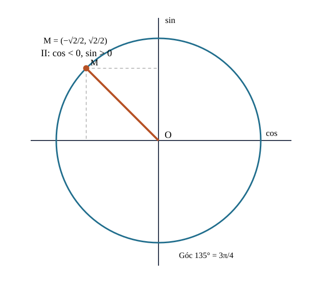
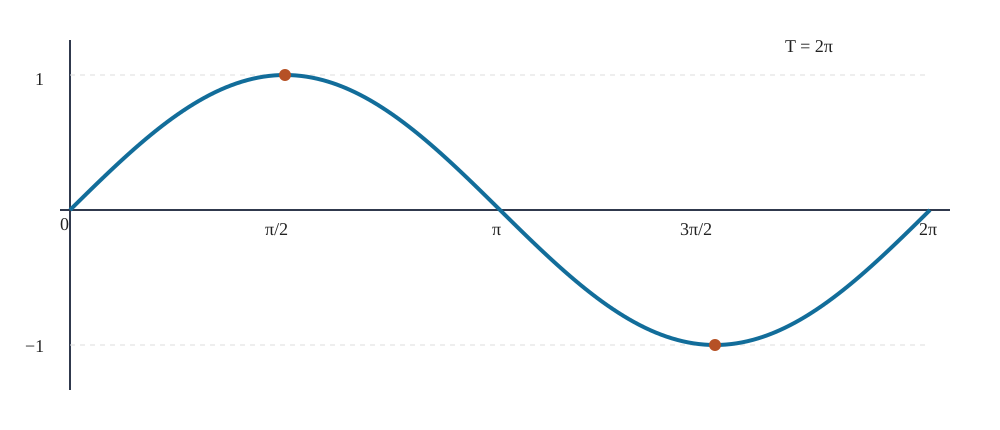
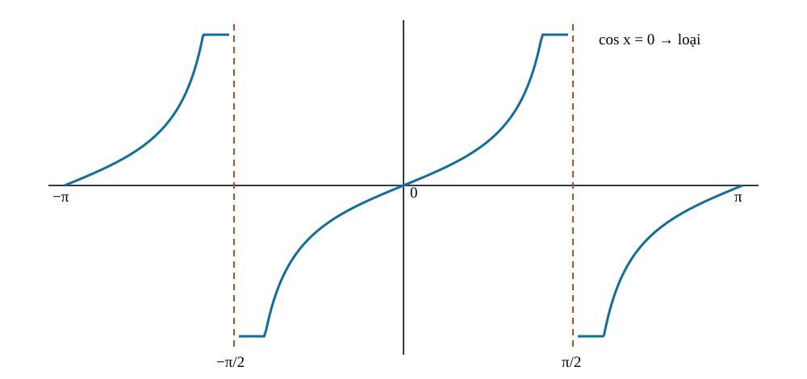

<!-- AUTHORING R03 CANDIDATE: Continuous concept arcs, original R01 preserved, holistic Q18/owner verdict pending. -->
<!-- AUTHORING CANDIDATE R02 / DELTA_C_ACADEMIC_MATERIAL / NOT CONTENT_READY. R01 immutable; holistic source QA and owner learner UX review required before activation. -->
# CĐ06/22 — Lượng giác và Phương trình lượng giác · Biên tập liền mạch R02 (ứng viên)

**LEARNING_PATH: TOPIC** — ba trang độc lập **Kiến thức / Luyện tập / Tự kiểm tra**; không có Core Chuyên đề. Bài viết hoàn toàn theo mạch lý luận lượng giác xuyên lớp, không ghép nguyên các chương SGK.

## Nguồn học thuật và ranh giới

- **S1 gốc:** SGK Toán 11 Kết nối tri thức tập 1, Chương I B01 (trang in 5–16), B02 (17–21), B03 (22–30), B04 (31–39), cuối chương (40–41), theo biên bản trực quan lịch sử đã khóa trong Git. SBT tập 1 B01 (4–7), B02 (8–10), B03 (11–18), B04 (19–24) và cuối chương (25–30) theo source receipts lưu tại chương I. Lượt này tham chiếu receipt, **không xác nhận quét lại PDF gốc**; số trang là trang in, không tự suy đoán PDF index.
- **Nguồn canonical SGK chung:** `prototypes/thpt/content-drafts/G11_CHI_B01_B04_CONCEPT_FIRST_PED_R03_SOURCE_CANDIDATE_20261102.md`, Git blob `256ceb5edc5e02aec320e83e99c8e08e035654f3`, có đúng 46 PUBLIC original IDs; chỉ tham chiếu qua index, không nhân stem/key/solution/rubric.
- **Ranh giới Topic:** mạch cơ bản từ góc định hướng đến đồ thị, phương trình và mô hình. Chuyên đề Hàm số/Đồ thị tổng quát thuộc CĐ05; giới hạn, đạo hàm, khảo sát tối ưu không nằm trong CĐ06. Các bài căn hàm sin, mô hình tổng hợp là mở rộng tự chọn, không nâng thành Core SGK.
- **Điều kiện:** mọi nghiệm phương trình có k∈ℤ; tan loại cos=0, cot loại sin=0; nghiệm trên khoảng phải lọc đầu mút; người học có thể đi trọn Chuyên đề mà không cần mở SGK. Toàn bộ số liệu ví dụ là ví dụ tự biên soạn.

## Vì sao cần lượng giác?

Một vòng quay được mô tả bằng một góc có hướng. Chiếu điểm quay lên hai trục, ta thu được hai hàm số sin và cos; từ hình học đó xuất hiện công thức, sóng tuần hoàn và những phương trình có nhiều họ nghiệm. Không bắt đầu bằng bảng công thức: mỗi mảng dưới đây gắn tình huống, tiền đề, bản chất, ví dụ giải có lý do, tự thử và đường khắc phục.

## Góc quay và tọa độ trên đường tròn

Một góc không chỉ là độ mở mà còn mang chiều quay và có thể đi qua nhiều vòng. Đường tròn đơn vị giúp biến góc thành tọa độ, từ đó hiểu dấu sin, cos và quan hệ giữa các góc.

<!-- LESSON_ID: TOP06-M01; OUTCOME_ID: TOP06-O01 -->

Khi quay một chiếc kim, ta có thể quay theo hoặc ngược chiều kim đồng hồ, quay chưa hết một vòng hay nhiều vòng. Một góc lượng giác vì thế không chỉ ghi **độ mở**, mà còn ghi **chiều quay**: chiều ngược kim đồng hồ được quy ước dương, chiều thuận kim đồng hồ là âm. Đơn vị radian giúp gắn góc với độ dài cung tròn: một vòng ứng với \(360^\circ=2\pi\) radian. Hai góc chênh nhau \(2k\pi\) có cùng tia cuối nhưng không nhất thiết cùng số vòng quay.

Chẳng hạn, quay \(-450^\circ\) nghĩa là quay một vòng và thêm \(90^\circ\) theo chiều âm. Đổi sang radian: \(-450\cdot\pi/180=-5\pi/2\). Điểm cuối của góc này trùng điểm cuối \(-\pi/2\), nhưng phép quay đầu tiên thực hiện thêm một vòng. Vì vậy khi gặp yêu cầu tính độ dài cung hoặc số vòng, không thể tùy ý thay mọi góc bằng góc cùng tia cuối nếu mất thông tin về chuyển động.

<!-- LESSON_ID: TOP06-M02; OUTCOME_ID: TOP06-O02 -->

Trên đường tròn đơn vị, dấu của sin và cos được đọc từ tọa độ. Làm sao biết dấu sin, cos trước khi tính giá trị chính xác? Trước hết, ta xuất phát từ đường tròn đơn vị, tọa độ (x,y). Điểm M ứng với góc α trên đường tròn đơn vị có M=(cosα,sinα). Cos là hoành độ, sin là tung độ, nên dấu đến từ góc phần tư; tanα=sinα/cosα chỉ tồn tại khi cosα≠0, cotα khi sinα≠0.

Một ví dụ giúp kiểm chứng điều đó. Nếu sinα=4/5 và α ở góc phần tư II, cosα âm. Dùng sin²α+cos²α=1 cho cosα=−3/5; tanα=−4/3. Đặt dấu trước rồi mới lấy căn.

*Quan sát hình:* Đọc hoành độ là cos, tung độ là sin. Chiều quay và góc phần tư quyết định dấu, không phải vị trí ước lượng của điểm trên hình.

<!-- LESSON_ID: TOP06-M03; OUTCOME_ID: TOP06-O03 -->

Các góc khác số đo vẫn có thể dẫn tới cùng vị trí trên đường tròn. Đo được quãng đường trên một vòng cung từ góc ở tâm bằng cách nào? Điểm tựa cho suy luận là định nghĩa radian và chu vi 2πr. Độ dài cung hình học s=r|θ| với θ radian, r>0; độ dời có hướng d=rθ giữ dấu. Góc chênh 2kπ có cùng tia cuối nhưng cung quét có thể khác nhiều vòng.

Hãy theo dõi cách giải này. Bánh xe bán kính 7 cm quay −120° tức −2π/3: độ dời cung theo chiều quay là −14π/3 cm, độ dài quãng đường là 14π/3 cm. Trước hết đổi radian để đơn vị đúng.

### Vận dụng và tự đối chiếu

<!-- First Try TOP06-M01: knowledge, not canonical Readiness -->
**1.** Đổi \(-150^\circ\) sang radian, rồi cho biết góc quay mang dấu gì.

Đối chiếu sau khi tự làm

\(-150^\circ=-150\pi/180=-5\pi/6\) radian. Dấu âm cho biết chiều quay thuận kim đồng hồ. Nếu em làm mất dấu, hãy so vị trí cuối của \(+90^\circ\) và \(-90^\circ\) trên đường tròn.

<!-- First Try TOP06-M02: knowledge, not canonical Readiness -->
**2.** Sinα=−3/5, α thuộc góc phần tư IV; cosα bằng bao nhiêu?

Đối chiếu sau khi tự làm

+4/5 vì cos dương ở góc IV.

Nếu cách làm của em chưa đúng, hãy kiểm tra lại điều kiện và lý do chọn phương pháp. Nếu ra −4/5, xem lại trục hoành phía phải; luyện THPT-G11-B01-C02 và THPT-TOP06-P02.

<!-- First Try TOP06-M03: knowledge, not canonical Readiness -->
**3.** Bán kính 3, quay 3π/2 rad: cung dài bao nhiêu?

Đối chiếu sau khi tự làm

9π/2; góc đã ở radian.

Nếu cách làm của em chưa đúng, hãy kiểm tra lại điều kiện và lý do chọn phương pháp. Nếu dùng r×góc độ trực tiếp, đổi 270°=3π/2 rồi tính lại. Luyện THPT-G11-B01-P03 và THPT-TOP06-P03.

## Công thức lượng giác có nguồn gốc hình học

Các công thức không phải những dòng cần học thuộc riêng lẻ: chúng phát triển từ vị trí điểm trên đường tròn, điều kiện tan/cot và phép cộng hai góc. Ta sẽ lần lượt kiểm nghiệm chúng bằng những trường hợp cụ thể.

<!-- LESSON_ID: TOP06-M04; OUTCOME_ID: TOP06-O04 -->

Có thể tìm một giá trị lượng giác từ các giá trị còn lại không? Ta có thể bắt đầu bằng tam giác vuông; cos²+sin²=1 trên đường tròn đơn vị. Hệ thức sin²x+cos²x=1 đúng với mọi x thực; 1+tan²x=1/cos²x chỉ khi cosx≠0; 1+cot²x=1/sin²x chỉ khi sinx≠0. Không được chia cho sin hoặc cos tại nghiệm bằng 0.

Thử vận dụng vào một tình huống. Nếu sinx=3/5 và x ở góc phần tư I: cosx=4/5; tanx=3/4. Nếu sinx=0 thì cotx không xác định, dù các hệ thức không có dấu chia sau biến đổi.

<!-- LESSON_ID: TOP06-M05; OUTCOME_ID: TOP06-O05 -->

Những góc đối xứng trên đường tròn tạo ra các quy luật về giá trị lượng giác. Vì sao hai góc khác nhau có thể có sin bằng nhau nhưng cos trái dấu? Những điều đã biết ở đây là phép đối xứng qua trục Oy trên đường tròn. Đối xứng của điểm (cosα,sinα) qua Oy biến α thành π−α; do đó sin(π−α)=sinα, cos(π−α)=−cosα. Với −α: cos chẵn, sin lẻ. Lý do hình học đi trước việc học thuộc dấu.

Từ lập luận vừa rồi, ta xét: α=π/6; góc 5π/6 đối xứng qua Oy nên sin(5π/6)=1/2, cos(5π/6)=−√3/2. Dùng điểm trên đường tròn thay vì nhớ hai bảng dấu.

<!-- LESSON_ID: TOP06-M06; OUTCOME_ID: TOP06-O06 -->

Hai góc cộng hoặc trừ nhau tạo ra công thức có thể suy từ hình học. Sin(u+v) có bằng sin u+sin v không? Để hiểu, ta dựa vào đường tròn đơn vị, tích vô hướng của hai vectơ đơn vị. Hiệu hai góc chi phối tích vô hướng: cos(u−v)=cosu cosv+sinu sinv. Thay v→−v suy ra cos(u+v)=cosu cosv−sinu sinv; các công thức sin tương ứng: sin(u±v)=sinu cosv±cosu sinv. Không tách sin một tổng bằng tổng các sin.

Chẳng hạn, Cos15°=cos(45°−30°)=√6/4+√2/4. Chọn phép trừ vì 15° không có trong bảng cơ bản nhưng 45°,30° thì có.

<!-- LESSON_ID: TOP06-M07; OUTCOME_ID: TOP06-O07 -->

Công thức góc đôi và tích–tổng gắn liền với công thức cộng. Một tổ hợp sin2x hoặc sinx cosx có thể biến đổi gọn hơn ra sao? Trước hết, ta xuất phát từ công thức cộng; phân phối biểu thức. Lấy u=v=x trong công thức cộng được sin2x=2sinx cosx và cos2x=cos²x−sin²x. Cộng/trừ các công thức cho u±v tạo biến đổi tích–tổng, tổng–tích. Chọn dạng đơn giản hóa theo mục tiêu, luôn giữ biểu thức xác định.

Một ví dụ giúp kiểm chứng điều đó. sin3x+sinx=2sin2x cosx: đặt A=3x,B=x rồi dùng sinA+sinB=2sin((A+B)/2)cos((A−B)/2). Cách này phù hợp khi muốn đặt nhân tử hoặc xét nghiệm.

### Vận dụng và tự đối chiếu

<!-- First Try TOP06-M04: knowledge, not canonical Readiness -->
**1.** Với x=π/2, tanx tồn tại không?

Đối chiếu sau khi tự làm

Không, cos(π/2)=0.

Nếu cách làm của em chưa đúng, hãy kiểm tra lại điều kiện và lý do chọn phương pháp. Ghi điều kiện trước khi áp dụng đẳng thức phân thức; luyện THPT-G11-B01-P01 và THPT-TOP06-P04.

<!-- First Try TOP06-M05: knowledge, not canonical Readiness -->
**2.** So sánh sin(−π/3) với sin(π/3).

Đối chiếu sau khi tự làm

sin(−π/3)=−√3/2 do sin là hàm lẻ.

Nếu cách làm của em chưa đúng, hãy kiểm tra lại điều kiện và lý do chọn phương pháp. Vẽ trục Ox và phản xạ trên đường tròn; luyện THPT-G11-B01-P05 và THPT-TOP06-P05.

<!-- First Try TOP06-M06: knowledge, not canonical Readiness -->
**3.** Tính sin75° từ 45°+30°.

Đối chiếu sau khi tự làm

(√6+√2)/4.

Nếu cách làm của em chưa đúng, hãy kiểm tra lại điều kiện và lý do chọn phương pháp. Nếu ghi sin45°+sin30°, thử u=v=π/2 để tìm phản ví dụ. Luyện THPT-G11-B02-C01 và THPT-TOP06-P06.

<!-- First Try TOP06-M07: knowledge, not canonical Readiness -->
**4.** Viết 2sinx cosx thành hàm của 2x.

Đối chiếu sau khi tự làm

sin2x.

Nếu cách làm của em chưa đúng, hãy kiểm tra lại điều kiện và lý do chọn phương pháp. Nếu nhầm hệ số 2, thay x=π/4 để kiểm. Luyện THPT-G11-B02-P04/P05 và THPT-TOP06-P07.

## Từ đường tròn đến hàm số tuần hoàn

Khi góc thay đổi liên tục, sin, cos, tan và cot trở thành hàm số có miền, chu kỳ, đối xứng và đồ thị. Quan sát sự lặp lại giúp hiểu vì sao một phương trình lượng giác thường có nhiều nghiệm.

<!-- LESSON_ID: TOP06-M08; OUTCOME_ID: TOP06-O08 -->

Vì sao không phải mọi hàm lượng giác đều có miền xác định ℝ? Điểm tựa cho suy luận là khái niệm hàm số và mẫu số khác 0. Sin, cos xác định trên ℝ, nhận giá trị trong [−1,1]. Tanx không xác định tại x=π/2+kπ; cotx không xác định tại x=kπ. Với biểu thức ghép như √(2sinx−1), thêm điều kiện trong căn ≥0; đây là mở rộng bài toán theo mô hình, không mạo nhận Core của B03.

Hãy theo dõi cách giải này. Tìm D của f(x)=√(2sinx−1): cần sinx≥1/2, nên x∈[π/6+2kπ,5π/6+2kπ], k∈ℤ. Chọn hình đường tròn hoặc đồ thị sin để xác định các cung đủ điều kiện.

<!-- LESSON_ID: TOP06-M09; OUTCOME_ID: TOP06-O09 -->

Chu kỳ và đối xứng giúp đọc hàm lượng giác trên cả miền, không chỉ vài điểm. Làm thế nào dự đoán khi nào một dạng sóng lặp lại? Ta có thể bắt đầu bằng hàm số trên miền xác định; giá trị sin,cos trên vòng tròn. f có chu kỳ T>0 khi x±T đều thuộc miền nếu x thuộc miền và f(x+T)=f(x) với mọi x. Sin,cos có chu kỳ cơ bản 2π; tan,cot có chu kỳ π. Sin lẻ, cos chẵn; đổi biến và nhân hệ số có thể làm chu kỳ khác. Tránh kết luận chu kỳ chỉ nhờ vài điểm trùng nhau.

Thử vận dụng vào một tình huống. y=sin(3x) có chu kỳ cơ bản 2π/3 vì tăng x lên 2π/3 làm góc tăng 2π. y=cos2x+sin3x có chu kỳ 2π; hai thành phần có tần số khác nhau và chu kỳ chung phù hợp.

<!-- LESSON_ID: TOP06-M10; OUTCOME_ID: TOP06-O10 -->

Với sin và cos, dịch pha làm đổi vị trí đỉnh nhưng giữ tính tuần hoàn. Đồ thị giúp đọc điều gì ngoài một bảng giá trị? Những điều đã biết ở đây là mỗi điểm đồ thị là (x,f(x)); chuyển dịch ngang/đứng. y=A sin(ωx+φ)+d (A,ω≠0) có biên độ |A|, chu kỳ 2π/|ω|, trục giữa y=d và tập giá trị [d−|A|,d+|A|]. Pha dịch ngang −φ/ω; không nhầm chiều dấu. Nếu ω=0, hàm hằng và không có chu kỳ cơ bản.

Từ lập luận vừa rồi, ta xét: y=−2sin(3x−π/2)+1 có biên độ 2, T=2π/3, trục giữa 1, tập giá trị [−1,3], dịch pha sang phải π/6 trước khi phản xạ Ox/co giãn rồi dời trục. Đổi dấu ngoài và trong hàm có ý nghĩa khác nhau.

*Quan sát hình:* Chọn các mốc cách nhau 2π để thấy giá trị lặp lại, đồng thời đọc phép dịch pha bằng cách theo dõi vị trí đỉnh và điểm không.

<!-- LESSON_ID: TOP06-M11; OUTCOME_ID: TOP06-O11 -->

Đồ thị tan và cot có điểm cấm, nên phải tách thành từng nhánh. Tại sao đồ thị tan không nối liền qua x=π/2? Để hiểu, ta dựa vào tan là sin/cos, cot là cos/sin. Tan có miền ℝ trừ π/2+kπ, chu kỳ π và tiệm cận đứng ở điểm loại. Cot có miền ℝ trừ kπ, chu kỳ π. Đồ thị chia nhánh, không được nối đường qua tiệm cận; tính tăng/giảm chỉ xét trên mỗi khoảng liên thông miền.

Chẳng hạn, y=tan(2x) không xác định khi 2x=π/2+kπ ⇒ x=π/4+kπ/2; chu kỳ cơ bản π/2. Chọn giải điều kiện mẫu trước khi vẽ nhánh.

*Quan sát hình:* Những điểm cos=0 bị loại khỏi miền của tan; các nhánh không được nối xuyên điểm cấm dù đồ thị có tính tuần hoàn.

### Vận dụng và tự đối chiếu

<!-- First Try TOP06-M08: knowledge, not canonical Readiness -->
**1.** Tập giá trị của y=2cosx−3 là gì?

Đối chiếu sau khi tự làm

[−5,−1] do cosx∈[−1,1].

Nếu cách làm của em chưa đúng, hãy kiểm tra lại điều kiện và lý do chọn phương pháp. Nếu bỏ mất miền xác định của tan, đặt cosx=0 làm thử phản ví dụ. Luyện THPT-G11-B03-C01 và THPT-TOP06-P08.

<!-- First Try TOP06-M09: knowledge, not canonical Readiness -->
**2.** Chu kỳ cơ bản của y=cos(4x) là gì?

Đối chiếu sau khi tự làm

π/2.

Nếu cách làm của em chưa đúng, hãy kiểm tra lại điều kiện và lý do chọn phương pháp. Nếu đo chu kỳ bằng cách nhìn một đỉnh, kiểm đỉnh tiếp theo và điều kiện trên mọi x. Luyện THPT-G11-B03-C03 và THPT-TOP06-P09.

<!-- First Try TOP06-M10: knowledge, not canonical Readiness -->
**3.** y=3cos(2x)+4 có giá trị lớn nhất, nhỏ nhất là bao nhiêu?

Đối chiếu sau khi tự làm

7 và 1.

Nếu cách làm của em chưa đúng, hãy kiểm tra lại điều kiện và lý do chọn phương pháp. Đánh dấu trục giữa/điểm cực trị; nếu nhầm tịnh tiến ngang, giải 3x−π/2=0. Luyện THPT-G11-B03-P02/P04/P05 và THPT-TOP06-P10.

<!-- First Try TOP06-M11: knowledge, not canonical Readiness -->
**4.** Tanx xác định tại x=π không?

Đối chiếu sau khi tự làm

Có, tanπ=0; cotπ mới không xác định.

Nếu cách làm của em chưa đúng, hãy kiểm tra lại điều kiện và lý do chọn phương pháp. Ghi bảng điểm loại trước khi nối hình; luyện THPT-G11-B03-P06/P07 và THPT-TOP06-P11.

## Giải phương trình trong miền được phép

Một nghiệm trên đường tròn có thể lặp lại sau những chu kỳ, nhưng bài toán thực tế hoặc một khoảng cụ thể chỉ cho phép vài giá trị. Ta phải xử lý điều kiện, công thức và phép lọc nghiệm cùng lúc.

<!-- LESSON_ID: TOP06-M12; OUTCOME_ID: TOP06-O12 -->

Giải sinx=a khác giải đa thức chỗ nào? Trước hết, ta xuất phát từ đường tròn đơn vị, nghiệm cùng vị trí theo chu kỳ. Sinx=a có nghiệm thực khi |a|≤1; nếu sinα=a thì x=α+2kπ hoặc x=π−α+2kπ. Cosx=a có x=±arccos(a)+2kπ khi |a|≤1. Trong công thức này arccos(a)∈[0,π], còn α phải là góc đã biết thỏa sinα=a.

Một ví dụ giúp kiểm chứng điều đó. Sin(2x)=√3/2: 2x=π/3+2kπ hoặc 2π/3+2kπ ⇒ x=π/6+kπ hoặc π/3+kπ, k∈ℤ. Có hai họ vì đường ngang cắt đường tròn tại hai điểm.

<!-- LESSON_ID: TOP06-M13; OUTCOME_ID: TOP06-O13 -->

Khi giải phương trình tan hoặc cot, miền xác định thuộc về lời giải. Tại sao tanx=a chỉ cần một họ nghiệm? Điểm tựa cho suy luận là tan xác định khi cosx≠0; tính chu kỳ π. Tan là tỉ số với cos không bằng 0; tanx=a ⇔ x=arctan(a)+kπ, k∈ℤ. Cotx=a ⇔ x=arccot(a)+kπ với arccot chọn trong (0,π), k∈ℤ; cách viết khác phải định rõ nhánh arccot. Luôn xét điều kiện ban đầu khi có biểu thức ghép.

Hãy theo dõi cách giải này. Tan(x+π/4)=−1 ⇒ x+π/4=−π/4+kπ ⇒ x=−π/2+kπ. Thế lại: góc tan bằng −π/4+kπ, không chạm điểm loại.

<!-- LESSON_ID: TOP06-M14; OUTCOME_ID: TOP06-O14 -->

Biến đổi phương trình lượng giác có thể sinh nghiệm ngoài điều kiện. Rút gọn có thể vô tình tạo nghiệm mới như thế nào? Ta có thể bắt đầu bằng hệ thức cơ bản và quy tắc biến đổi tương đương. Phân tích thành tích chỉ tương đương nếu không chia cho biểu thức có thể bằng 0. Nếu khử mẫu/biến đổi căn cần giữ điều kiện ban đầu rồi thử lại. Một tích bằng 0 cho hợp các họ nghiệm của từng thừa số; không vứt một nhánh.

Thử vận dụng vào một tình huống. Sinx(2cosx−1)=0 ⇒ sinx=0 hoặc cosx=1/2, nên x=kπ hoặc x=±π/3+2kπ. Không được chia cả hai vế cho sinx vì mất x=kπ.

<!-- LESSON_ID: TOP06-M15; OUTCOME_ID: TOP06-O15 -->

Nghiệm tổng quát cần lọc khi chỉ xét một khoảng hữu hạn. Một họ nghiệm có vô hạn số nguyên k, nhưng bài toán chỉ chọn khoảng nhất định. Những điều đã biết ở đây là bất đẳng thức, khoảng mở/đóng và hàm lượng giác. Giải trên ℝ trước, sau đó lọc k theo khoảng hoặc xét trực tiếp các góc trên đường tròn trong [a,b]. Với [a,b) chỉ lấy a nếu thỏa, loại b; tránh đếm hai góc 0 và 2π là hai nghiệm khác nhau khi khoảng nửa mở.

Từ lập luận vừa rồi, ta xét: 2sin²x−3sinx+1=0 ⇒ (2sinx−1)(sinx−1)=0. Với [0,2π): x=π/6,5π/6,π/2, tổng 3 nghiệm. Không thêm 2π vì không thuộc khoảng.

<!-- LESSON_ID: TOP06-M16; OUTCOME_ID: TOP06-O16 -->

Mô hình tuần hoàn thực tế còn có giới hạn thời gian và đơn vị phải kiểm. Sóng, thủy triều và nhiệt độ thay đổi trong thời gian hữu hạn có thể mô tả bằng công thức nào? Để hiểu, ta dựa vào đồ thị sin/cos, chu kỳ, đơn vị thời gian. Mô hình h(t)=d+Acos(ωt+φ) có điều kiện miền t thực tế, mức nền d, biên độ |A|, chu kỳ 2π/|ω| khi ω≠0. Dữ liệu thực không nhất thiết đúng sinus lý tưởng; phải phân biệt mô hình giả định với kết luận về thế giới.

Chẳng hạn, Mực nước giả định h(t)=3+1,2cos(πt/6) (m), 0≤t≤24 h. Chu kỳ 12 h; h(0)=4,2 m; h(6)=1,8 m; lần đầu đạt mức nền h=3 m khi t=3 h. Đây chỉ là mô hình luyện toán, không phải dự báo thật.

### Vận dụng và tự đối chiếu

<!-- First Try TOP06-M12: knowledge, not canonical Readiness -->
**1.** Giải cosx=0 trên ℝ.

Đối chiếu sau khi tự làm

x=π/2+kπ (k∈ℤ).

Nếu cách làm của em chưa đúng, hãy kiểm tra lại điều kiện và lý do chọn phương pháp. Nếu chỉ viết một nghiệm, quay thêm chu kỳ; nếu |a|>1 thì vô nghiệm. Luyện THPT-G11-B04-C01/C02 và THPT-TOP06-P12.

<!-- First Try TOP06-M13: knowledge, not canonical Readiness -->
**2.** Giải tan(2x)=0.

Đối chiếu sau khi tự làm

x=kπ/2, k∈ℤ; mọi nghiệm nằm trong miền tan.

Nếu cách làm của em chưa đúng, hãy kiểm tra lại điều kiện và lý do chọn phương pháp. Không nhân chéo cho cos=0; luyện THPT-G11-B04-C03/C04 và THPT-TOP06-P13.

<!-- First Try TOP06-M14: knowledge, not canonical Readiness -->
**3.** Giải 2sinx cosx=0.

Đối chiếu sau khi tự làm

x=kπ/2, k∈ℤ; hoặc sinx=0 (kπ) hoặc cosx=0 (π/2+kπ).

Nếu cách làm của em chưa đúng, hãy kiểm tra lại điều kiện và lý do chọn phương pháp. Nếu đang muốn chia cho sinx, tách trường hợp sinx=0 trước. Luyện THPT-G11-B04-P01/P02/P08 và THPT-TOP06-P14.

<!-- First Try TOP06-M15: knowledge, not canonical Readiness -->
**4.** Giải sinx=0 trên [0,2π).

Đối chiếu sau khi tự làm

x=0,π; loại 2π.

Nếu cách làm của em chưa đúng, hãy kiểm tra lại điều kiện và lý do chọn phương pháp. Vẽ dãy nghiệm trên trục số và đánh dấu đầu mút; luyện THPT-G11-B04-P06/P07 và THPT-TOP06-P15.

<!-- First Try TOP06-M16: knowledge, not canonical Readiness -->
**5.** Trong mô hình đó, h(12) bằng bao nhiêu?

Đối chiếu sau khi tự làm

4,2 m, vì cos2π=1.

Nếu cách làm của em chưa đúng, hãy kiểm tra lại điều kiện và lý do chọn phương pháp. Nếu đếm chu kỳ sai, so pha ở t=0 và t=12; nếu viết t<0 ngoài phạm vi thì đọc miền. Luyện THPT-G11-B03-P08, THPT-G11-B04-P09 và THPT-TOP06-P16.

## Hình học trực quan — hướng dẫn đọc

- **SVG 01 — vòng tròn đơn vị:** `prototypes/thpt/visuals/THPT_TOPIC06_UNIT_CIRCLE_QUADRANTS_R01.svg`. Học sinh đọc từ tọa độ M tới cosα/sinα; chú ý điểm phần tư II cho cos âm, sin dương. Không suy ngược dấu từ trị tuyệt đối.
- **SVG 02 — đồ thị sin và chu kỳ:** `prototypes/thpt/visuals/THPT_TOPIC06_SINE_PERIOD_R01.svg`. Theo trục x từ 0 tới 2π: 0→1→0→−1→0 tại các mốc π/2. Một chu kỳ mới quay về toàn bộ hình, không chỉ một điểm.
- **SVG 03 — tiệm cận tan:** `prototypes/thpt/visuals/THPT_TOPIC06_TAN_ASYMPTOTES_R01.svg`. Quan sát đường gạch đứng x=±π/2 là nơi cos=0, **không thuộc đồ thị**; các nhánh không được nối qua đường gạch.

## Mô hình tương tác gợi ý (SPEC_ONLY)

1. **Góc quay ↔ tọa độ ↔ cung có hướng:** kéo một góc với bàn phím/chạm; mô hình hiển thị tia cuối, sin, cos, chiều quay và giá trị cung; giới hạn/đối sánh gần số 0 phải kiểm soát độ chính xác. Chỉ là **đặc tả**, không có runtime, không nhận QA browser.
2. **Dịch pha và lọc nghiệm theo khoảng:** thanh trượt biên độ/pha/chu kỳ, tô giao điểm với mức y=a, đánh dấu đúng miền. Không ghi Mastery hoặc đánh giá độc lập. Cần kiểm trường hợp A=0, ω=0 và endpoints.

# Luyện tập

Mỗi outcome trỏ tới các câu ORIGINAL SGK trong index liên kết, cùng một nguồn answer/rubric được khóa; các câu mới `THPT-TOP06-P01…P16` và Written `THPT-TOP06-W01…W04` nằm duy nhất ở `prototypes/thpt/shared-items/Temp_TOPIC06_TRIGONOMETRY_NEW20_PUBLIC_CANONICAL_R01_20261112.md`. Các câu tự biên soạn là phần luyện tập công khai, không gắn lại SGK Core.

Người học làm bài trên giấy hoặc tương tác luyện tập, tự mở lời giải theo nhu cầu, đối chiếu chỗ sai và trở về mục Kiến thức tương ứng. Hình và ví dụ hỗ trợ riêng cho từng outcome; không cần đi sang đường học SGK.

# Tự kiểm tra

**Tự kiểm tra công khai:** dùng lại 16 `THPT-TOP06-P01…P16`, mỗi outcome một placement, không tạo `item_id` thứ hai. Toàn bộ đề phải được hiển thị và người học bấm **Final Submit** trước khi có đúng/sai, đáp án, gợi ý hoặc lời giải; sự bảo vệ thật sự trên website thuộc RELEASE. Tự kiểm tra này có `ASSESSMENT_MODE=CLIENT_SELF_CHECK_NO_MASTERY`, không phải held-out `TOPIC_READINESS`, không cấp Skill Mastery, không dùng RD1 riêng tư.

Sau Submit: người học tự so lời giải và rubric, xác định outcome mắc lỗi, quay lại mục kiến thức/D6 và làm câu khác. Không suy ra một điểm kiểm tra độc lập từ các câu đã có thể xem trong Practice.

## Phụ lục AUTHORING — không đưa vào giao diện học sinh

PACKET_ID: THPT-TOPIC06-TRIGONOMETRY-FULL-R01
STANDARD_ID: SLM-THPT-QUALITY-ONE
STANDARD_VERSION: 3.1.0
CATALOG_TOPIC_ID: CD06
LESSON_IDS: TOP06-M01..TOP06-M16
OUTCOME_IDS: TOP06-O01..TOP06-O16
PUBLIC_ORIGINAL_SGK_IDS: 46 (tham chiếu, xem index riêng)
PUBLIC_NEW_CANONICAL_IDS: 20 (16 Practice, 4 Written)
PUBLIC_SELF_CHECK_REUSE_PLACEMENTS: 16
PRIVATE_RD1_IMPORTED: 0
Q18_VERIFICATION_MODE: AUTHOR_SELF_VERIFIED (pending exact source QA receipt/handoff)
RELEASE_AUTHORIZATION: NO
RUNTIME_TOPIC_ID: UNASSIGNED_OWNER_DECISION

## SOURCE-LOCKED PUBLIC_ITEM_IDS — metadata học liệu, không hiển thị cho học sinh

**Original SGK 46 IDs (reference only; stem/key/solution/rubric nằm ở source gốc):**
- THPT-G11-B01-C01
- THPT-G11-B01-C02
- THPT-G11-B01-P01
- THPT-G11-B01-P02
- THPT-G11-B01-P03
- THPT-G11-B01-P04
- THPT-G11-B02-C01
- THPT-G11-B02-C02
- THPT-G11-B02-P01
- THPT-G11-B02-P02
- THPT-G11-B02-P03
- THPT-G11-B02-P04
- THPT-G11-B02-P05
- THPT-G11-B02-P06
- THPT-G11-B01-P05
- THPT-G11-B02-P07
- THPT-G11-CHI-W01
- THPT-G11-CHI-W02-ANCHOR
- THPT-G11-B03-C01
- THPT-G11-B03-C02
- THPT-G11-B03-C03
- THPT-G11-B03-C04
- THPT-G11-B03-P01
- THPT-G11-B03-P02
- THPT-G11-B03-P03
- THPT-G11-B03-P04
- THPT-G11-B03-P05
- THPT-G11-B03-P06
- THPT-G11-B03-P07
- THPT-G11-B03-P08
- THPT-G11-B04-C01
- THPT-G11-B04-C02
- THPT-G11-B04-C03
- THPT-G11-B04-C04
- THPT-G11-B04-P01
- THPT-G11-B04-P02
- THPT-G11-B04-P03
- THPT-G11-B04-P04
- THPT-G11-B04-P05
- THPT-G11-B04-P06
- THPT-G11-B04-P07
- THPT-G11-B04-P08
- THPT-G11-B04-P09
- THPT-G11-B04-P10
- THPT-G11-CHI-W03
- THPT-G11-CHI-W04-ANCHOR

**New Topic 20 IDs (stem/key/solution/rubric nằm trong một file extension duy nhất):**
- THPT-TOP06-P01
- THPT-TOP06-P02
- THPT-TOP06-P03
- THPT-TOP06-P04
- THPT-TOP06-P05
- THPT-TOP06-P06
- THPT-TOP06-P07
- THPT-TOP06-P08
- THPT-TOP06-P09
- THPT-TOP06-P10
- THPT-TOP06-P11
- THPT-TOP06-P12
- THPT-TOP06-P13
- THPT-TOP06-P14
- THPT-TOP06-P15
- THPT-TOP06-P16
- THPT-TOP06-W01
- THPT-TOP06-W02
- THPT-TOP06-W03
- THPT-TOP06-W04

PUBLIC_ORIGINAL_SOURCE_BLOB: 256ceb5edc5e02aec320e83e99c8e08e035654f3
PUBLIC_ORIGINAL_INDEX_PATH: prototypes/thpt/shared-items/Temp_TOPIC06_TRIGONOMETRY_ORIGINAL46_CANONICAL_INDEX_R01_20261112.md
PUBLIC_ORIGINAL_INDEX_BLOB: d8279df37c9dcd74a0b26f0da389baf7d53ecf64
PUBLIC_NEW_BANK_PATH: prototypes/thpt/shared-items/Temp_TOPIC06_TRIGONOMETRY_NEW20_PUBLIC_CANONICAL_R01_20261112.md
PUBLIC_NEW_BANK_BLOB: f83b285ff0c8f4e45b724cf06248935e5d618b65
SCOPE: TOPIC_AUTHORING_ONLY_NO_RELEASE
