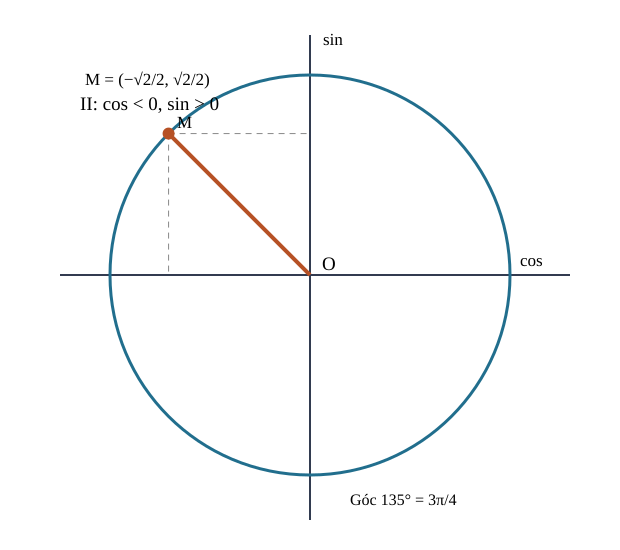
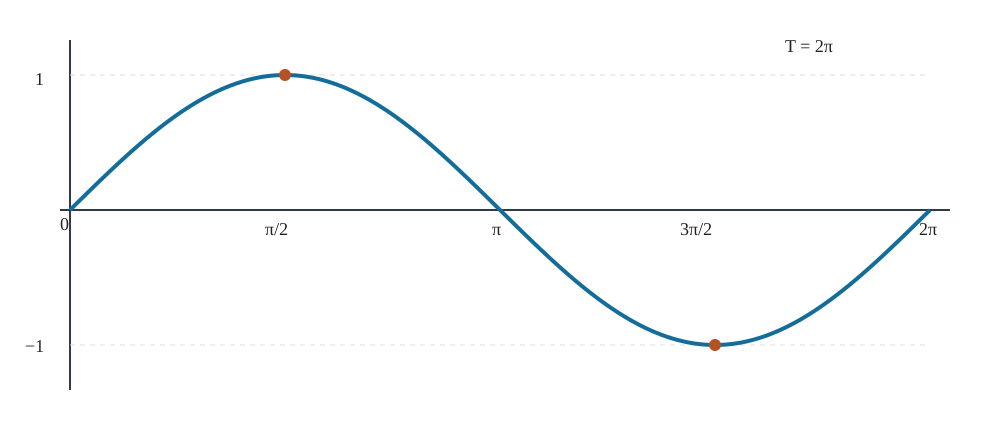
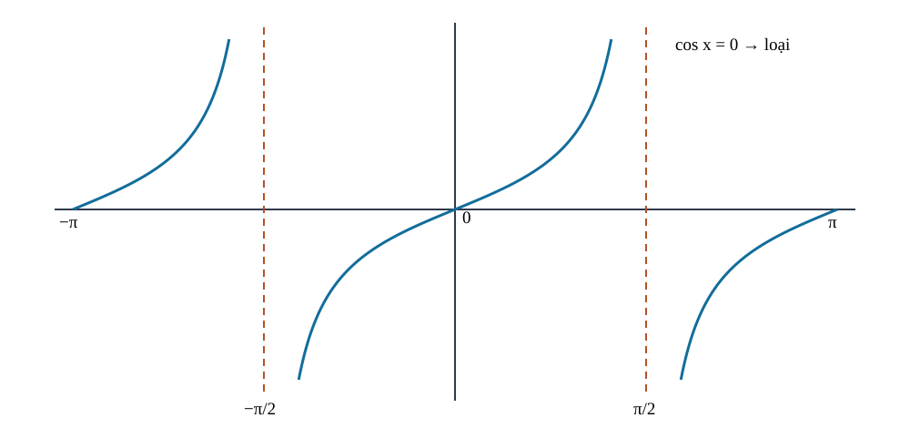

# Chuyên đề 06 · Lượng giác và phương trình lượng giác

Một bánh xe có thể quay nhiều vòng rồi lại về vị trí cũ. Đường tròn đơn vị giúp em hiểu dấu sin/cos, công thức và chu kỳ; khi giải phương trình, em phải viết **đủ họ nghiệm** và lọc đúng điểm loại, khoảng nghiệm. Đây là hành trình Chuyên đề tự đủ, không cần Core riêng.

## 1. Kiến thức

### 1. Góc quay và tọa độ trên đường tròn

**Khám phá kiến thức**

Khi bánh xe quay, điều quan trọng không chỉ là nó đã quay một góc bao nhiêu độ mà còn là **theo chiều nào** và **bao nhiêu vòng**. Ta có thể đánh dấu một điểm trên vành bánh xe: trong quá trình quay, hoành độ và tung độ của điểm này thay đổi rồi lặp lại. Chính hai tọa độ ấy dẫn đến \(\cos\) và \(\sin\). Nếu hiểu góc có hướng và đường tròn trước, các dấu, công thức và đồ thị tuần hoàn về sau đều có lý do hình học.

Trước hết hãy xem tia cuối của một góc được xác định ra sao, vì sao hai góc khác nhau có thể cùng tia cuối và tại sao không thể bỏ qua số vòng khi tính quãng đường chuyển động.

<!-- LESSON_ID: TOP06-M01; OUTCOME_ID: TOP06-O01; PREVIOUS_R04_BLOB: 9fee274efababcf7ffd91c78c7e39e89191f17c0 -->

#### 1.1. Độ và radian của góc có hướng

Hai góc cùng tia cuối có kể cùng số vòng quay không?

Khi quay một chiếc kim, ta có thể quay theo hoặc ngược chiều kim đồng hồ, quay chưa hết một vòng hay nhiều vòng. Một góc lượng giác vì thế không chỉ ghi **độ mở**, mà còn ghi **chiều quay**: chiều ngược kim đồng hồ được quy ước dương, chiều thuận kim đồng hồ là âm. Đơn vị radian giúp gắn góc với độ dài cung tròn: một vòng ứng với \(360^\circ=2\pi\) radian. Hai góc chênh nhau \(2k\pi\) có cùng tia cuối nhưng không nhất thiết cùng số vòng quay.

Chẳng hạn, quay \(-450^\circ\) nghĩa là quay một vòng và thêm \(90^\circ\) theo chiều âm. Đổi sang radian: \(-450\cdot\pi/180=-5\pi/2\). Điểm cuối của góc này trùng điểm cuối \(-\pi/2\), nhưng phép quay đầu tiên thực hiện thêm một vòng. Vì vậy khi gặp yêu cầu tính độ dài cung hoặc số vòng, không thể tùy ý thay mọi góc bằng góc cùng tia cuối nếu mất thông tin về chuyển động.

**Ví dụ**

**Đề bài.** Quay \(585^\circ\) ngược chiều kim đồng hồ. Đổi sang radian và tìm góc cùng tia cuối trong \([0,2\pi)\).

**Lời giải.** \(585^\circ=585\pi/180=13\pi/4\). Trừ \(2\pi\) được \(5\pi/4\). Tia cuối trùng nhau, nhưng góc \(13\pi/4\) ghi cả một vòng nhiều hơn góc đại diện; không bỏ số vòng nếu bài hỏi chuyển động.

**Vận dụng**

Đổi \(-150^\circ\) sang radian, rồi cho biết góc quay mang dấu gì.

Đối chiếu

\(-150^\circ=-150\pi/180=-5\pi/6\) radian. Dấu âm cho biết chiều quay thuận kim đồng hồ. Nếu em làm mất dấu, hãy so vị trí cuối của \(+90^\circ\) và \(-90^\circ\) trên đường tròn.

<!-- LESSON_ID: TOP06-M02; OUTCOME_ID: TOP06-O02; PREVIOUS_R04_BLOB: 9fee274efababcf7ffd91c78c7e39e89191f17c0 -->

#### 1.2. Sin/cos từ tọa độ đường tròn

Dấu sin và cos khác nhau ở hai phía của trục Oy vì sao?

Trên đường tròn đơn vị, dấu của sin và cos được đọc từ tọa độ. Làm sao biết dấu sin, cos trước khi tính giá trị chính xác? Ta đã biết đường tròn đơn vị, tọa độ (x,y). Điểm M ứng với góc α trên đường tròn đơn vị có M=(cosα,sinα). Cos là hoành độ, sin là tung độ, nên dấu đến từ góc phần tư; tanα=sinα/cosα chỉ tồn tại khi cosα≠0, cotα khi sinα≠0.

Chẳng hạn, tại góc \(135^\circ\) (góc phần tư II) trên hình, \(\cos135^\circ=-\sqrt2/2\) là **hoành độ âm**, còn \(\sin135^\circ=\sqrt2/2\) là **tung độ dương**. Một ví dụ không cần góc đặc biệt: nếu \(\sin\alpha=4/5\) và \(\alpha\) ở phần tư II, thì \(\cos\alpha=-\sqrt{1-16/25}=-3/5\), \(\tan\alpha=-4/3\). Cả hai trường hợp đều phải chọn dấu từ góc phần tư trước khi lấy căn.

*Đọc hình:* Điểm \(M\) ở \(135^\circ\) có tọa độ \((-\sqrt2/2,\sqrt2/2)\). Hãy đọc dấu âm ở trục ngang và dấu dương ở trục đứng; chỉ sau đó mới gắn các giá trị \(\cos\), \(\sin\). Hình minh họa góc cụ thể, còn quy tắc đúng ở mọi góc phần tư.

**Ví dụ**

**Đề bài.** Biết \(\cos\alpha=-5/13\), góc \(\alpha\) thuộc phần tư II. Tính \(\sin\alpha,\tan\alpha\).

**Lời giải.** \(\sin^2\alpha=1-25/169=144/169\). Phần tư II sin dương nên \(\sin\alpha=12/13\); cos khác 0 nên \(\tan\alpha=-12/5\). Chọn dấu theo phần tư trước khi lấy căn.

**Vận dụng**

Sinα=−3/5, α thuộc góc phần tư IV; cosα bằng bao nhiêu?

Đối chiếu

+4/5 vì cos dương ở góc IV.

Nếu ra −4/5, xem lại trục hoành phía phải; luyện THPT-G11-B01-C02 và THPT-TOP06-P02.

<!-- LESSON_ID: TOP06-M03; OUTCOME_ID: TOP06-O03; PREVIOUS_R04_BLOB: 9fee274efababcf7ffd91c78c7e39e89191f17c0 -->

#### 1.3. Cung hình học và độ dời có hướng

Quãng đường đi có âm khi kim quay thuận chiều không?

Các góc khác số đo vẫn có thể dẫn tới cùng vị trí trên đường tròn. Đo được quãng đường trên một vòng cung từ góc ở tâm bằng cách nào? Ta sử dụng định nghĩa radian và chu vi 2πr. Độ dài cung hình học s=r|θ| với θ radian, r>0; độ dời có hướng d=rθ giữ dấu. Góc chênh 2kπ có cùng tia cuối nhưng cung quét có thể khác nhiều vòng.

Xét ví dụ: Bánh xe bán kính 7 cm quay −120° tức −2π/3: độ dời cung theo chiều quay là −14π/3 cm, độ dài quãng đường là 14π/3 cm. Trước hết đổi radian để đơn vị đúng.

**Ví dụ**

**Đề bài.** Một bánh xe bán kính \(9\) cm quay \(-240^\circ\). Tìm độ dời cung có hướng và quãng đường trên vành.

**Lời giải.** \(-240^\circ=-4\pi/3\) rad. Độ dời \(d=r\theta=-12\pi\) cm, quãng đường \(s=r|\theta|=12\pi\) cm. Độ dài quãng đường phải không âm.

**Vận dụng**

Bán kính 3, quay 3π/2 rad: cung dài bao nhiêu?

Đối chiếu

9π/2; góc đã ở radian.

Nếu dùng r×góc độ trực tiếp, đổi 270°=3π/2 rồi tính lại. Luyện THPT-G11-B01-P03 và THPT-TOP06-P03.

### 2. Công thức lượng giác có điều kiện

**Khám phá kiến thức**

Trên đường tròn bán kính 1, một điểm luôn thỏa \(x^2+y^2=1\). Thay \(x=\cos\alpha\), \(y=\sin\alpha\), ta hiểu được hệ thức nền tảng trước khi ghi nhớ. Khi đổi góc, các điểm trên đường tròn quay hoặc phản xạ; công thức cộng, trừ và góc nhân đôi là cách diễn tả những phép biến đổi hình học ấy bằng ký hiệu. Vì vậy cần kiểm đúng góc và dấu, không chỉ áp dụng công thức theo mẫu.

Các công thức không phải những dòng cần học thuộc riêng lẻ: chúng phát triển từ vị trí điểm trên đường tròn, điều kiện tan/cot và phép cộng hai góc. Ta sẽ lần lượt kiểm nghiệm chúng bằng những trường hợp cụ thể.

<!-- LESSON_ID: TOP06-M04; OUTCOME_ID: TOP06-O04; PREVIOUS_R04_BLOB: 9fee274efababcf7ffd91c78c7e39e89191f17c0 -->

#### 2.1. Hệ thức lượng giác cùng điều kiện

Khi nào các tỉ số tan/cot không được phép sử dụng?

Có thể tìm một giá trị lượng giác từ các giá trị còn lại không? Ta bắt đầu từ tam giác vuông; cos²+sin²=1 trên đường tròn đơn vị. Hệ thức sin²x+cos²x=1 đúng với mọi x thực; 1+tan²x=1/cos²x chỉ khi cosx≠0; 1+cot²x=1/sin²x chỉ khi sinx≠0. Không được chia cho sin hoặc cos tại nghiệm bằng 0.

Chẳng hạn, Nếu sinx=3/5 và x ở góc phần tư I: cosx=4/5; tanx=3/4. Nếu sinx=0 thì cotx không xác định, dù các hệ thức không có dấu chia sau biến đổi.

**Ví dụ**

**Đề bài.** Biết \(\sin\alpha=-8/17\), \(\alpha\) ở phần tư IV. Tìm cos và tan.

**Lời giải.** \(\cos^2\alpha=1-64/289=225/289\); cos dương ở phần tư IV nên \(\cos\alpha=15/17\). Vì cos khác 0, \(\tan\alpha=-8/15\). Không được chia cho cos tại góc mà cos bằng 0.

**Vận dụng**

Với x=π/2, tanx tồn tại không?

Đối chiếu

Không, cos(π/2)=0.

Ghi điều kiện trước khi áp dụng đẳng thức phân thức; luyện THPT-G11-B01-P01 và THPT-TOP06-P04.

<!-- LESSON_ID: TOP06-M05; OUTCOME_ID: TOP06-O05; PREVIOUS_R04_BLOB: 9fee274efababcf7ffd91c78c7e39e89191f17c0 -->

#### 2.2. Góc liên quan và đối xứng

Phản xạ qua trục Oy đổi giá trị nào?

Những góc đối xứng trên đường tròn tạo ra các quy luật về giá trị lượng giác. Vì sao hai góc khác nhau có thể có sin bằng nhau nhưng cos trái dấu? Cần nhớ phép đối xứng qua trục Oy trên đường tròn. Đối xứng của điểm (cosα,sinα) qua Oy biến α thành π−α; do đó sin(π−α)=sinα, cos(π−α)=−cosα. Với −α: cos chẵn, sin lẻ. Lý do hình học đi trước việc học thuộc dấu.

Chẳng hạn, α=π/6; góc 5π/6 đối xứng qua Oy nên sin(5π/6)=1/2, cos(5π/6)=−√3/2. Dùng điểm trên đường tròn thay vì nhớ hai bảng dấu.

**Ví dụ**

**Đề bài.** Từ góc \(\pi/4\), tính \(\sin(3\pi/4)\) và \(\cos(3\pi/4)\) bằng đối xứng.

**Lời giải.** Vì \(3\pi/4=\pi-\pi/4\), đối xứng qua Oy giữ tung độ, đổi dấu hoành độ. Suy ra \(\sin(3\pi/4)=\sqrt2/2\), \(\cos(3\pi/4)=-\sqrt2/2\).

**Vận dụng**

So sánh sin(−π/3) với sin(π/3).

Đối chiếu

sin(−π/3)=−√3/2 do sin là hàm lẻ.

Vẽ trục Ox và phản xạ trên đường tròn; luyện THPT-G11-B01-P05 và THPT-TOP06-P05.

<!-- LESSON_ID: TOP06-M06; OUTCOME_ID: TOP06-O06; PREVIOUS_R04_BLOB: 9fee274efababcf7ffd91c78c7e39e89191f17c0 -->

#### 2.3. Công thức cộng/trừ góc

Vì sao sin(u+v) không bằng sin u+sin v?

Hai góc cộng hoặc trừ nhau tạo ra công thức có thể suy từ hình học. Sin(u+v) có bằng sin u+sin v không? Để xác định điều đó, cần xét đường tròn đơn vị, tích vô hướng của hai vectơ đơn vị. Hiệu hai góc chi phối tích vô hướng: cos(u−v)=cosu cosv+sinu sinv. Thay v→−v suy ra cos(u+v)=cosu cosv−sinu sinv; các công thức sin tương ứng: sin(u±v)=sinu cosv±cosu sinv. Không tách sin một tổng bằng tổng các sin.

Chẳng hạn, Cos15°=cos(45°−30°)=√6/4+√2/4. Chọn phép trừ vì 15° không có trong bảng cơ bản nhưng 45°,30° thì có.

**Ví dụ**

**Đề bài.** Tính chính xác \(\cos105^\circ\) bằng công thức cộng.

**Lời giải.** Viết \(105^\circ=60^\circ+45^\circ\). \(\cos105^\circ=\cos60^\circ\cos45^\circ-\sin60^\circ\sin45^\circ=(\sqrt2-\sqrt6)/4\). Dấu âm hợp lý vì góc ở phần tư II.

**Vận dụng**

Tính sin75° từ 45°+30°.

Đối chiếu

(√6+√2)/4.

Nếu ghi sin45°+sin30°, thử u=v=π/2 để tìm phản ví dụ. Luyện THPT-G11-B02-C01 và THPT-TOP06-P06.

<!-- LESSON_ID: TOP06-M07; OUTCOME_ID: TOP06-O07; PREVIOUS_R04_BLOB: 9fee274efababcf7ffd91c78c7e39e89191f17c0 -->

#### 2.4. Góc nhân đôi và đổi dạng

Có thể chọn dạng tích hay tổng để thuận lợi giải phương trình?

Công thức góc đôi và tích–tổng gắn liền với công thức cộng. Một tổ hợp sin2x hoặc sinx cosx có thể biến đổi gọn hơn ra sao? Ta đã biết công thức cộng; phân phối biểu thức. Lấy u=v=x trong công thức cộng được sin2x=2sinx cosx và cos2x=cos²x−sin²x. Cộng/trừ các công thức cho u±v tạo biến đổi tích–tổng, tổng–tích. Chọn dạng đơn giản hóa theo mục tiêu, luôn giữ biểu thức xác định.

Chẳng hạn, sin3x+sinx=2sin2x cosx: đặt A=3x,B=x rồi dùng sinA+sinB=2sin((A+B)/2)cos((A−B)/2). Cách này phù hợp khi muốn đặt nhân tử hoặc xét nghiệm.

**Ví dụ**

**Đề bài.** Cho \(\cos x=3/5\), \(\sin x=4/5\). Tính \(\sin2x,\cos2x\).

**Lời giải.** \(\sin2x=2(3/5)(4/5)=24/25\). \(\cos2x=(3/5)^2-(4/5)^2=-7/25\). Kiểm \((24/25)^2+(-7/25)^2=1\).

**Vận dụng**

Viết 2sinx cosx thành hàm của 2x.

Đối chiếu

sin2x.

Nếu nhầm hệ số 2, thay x=π/4 để kiểm. Luyện THPT-G11-B02-P04/P05 và THPT-TOP06-P07.

### 3. Hàm lượng giác và các đồ thị tuần hoàn

**Khám phá kiến thức**

Nếu góc tiếp tục tăng, hình chiếu của điểm trên đường tròn lúc đi lên, lúc đi xuống và trở về giá trị cũ sau một vòng. Đó là cách hàm \(y=\sin x\) xuất hiện: từ chuyển động tròn thành đường sóng. Các phép co giãn và dịch pha sẽ thay đổi biên độ, chu kỳ hoặc vị trí đỉnh nhưng không thay bản chất của một quy luật tuần hoàn.

Khi góc thay đổi liên tục, sin, cos, tan và cot trở thành hàm số có miền, chu kỳ, đối xứng và đồ thị. Quan sát sự lặp lại giúp hiểu vì sao một phương trình lượng giác thường có nhiều nghiệm.

<!-- LESSON_ID: TOP06-M08; OUTCOME_ID: TOP06-O08; PREVIOUS_R04_BLOB: 9fee274efababcf7ffd91c78c7e39e89191f17c0 -->

#### 3.1. Miền xác định của biểu thức lượng giác

Khi biểu thức có căn và tan, phải giao những miền nào?

Vì sao không phải mọi hàm lượng giác đều có miền xác định ℝ? Ta sử dụng khái niệm hàm số và mẫu số khác 0. Sin, cos xác định trên ℝ, nhận giá trị trong [−1,1]. Tanx không xác định tại x=π/2+kπ; cotx không xác định tại x=kπ. Với biểu thức ghép như √(2sinx−1), thêm điều kiện trong căn ≥0; đây là mở rộng bài toán theo mô hình, không mạo nhận Core của B03.

Xét ví dụ: Tìm D của f(x)=√(2sinx−1): cần sinx≥1/2, nên x∈[π/6+2kπ,5π/6+2kπ], k∈ℤ. Chọn hình đường tròn hoặc đồ thị sin để xác định các cung đủ điều kiện.

**Ví dụ**

**Đề bài.** Tìm miền xác định của \(f(x)=\sqrt{1-2\cos x}\).

**Lời giải.** Cần \(1-2\cos x\ge0\), tức \(\cos x\le1/2\). Trong mỗi vòng điều này đúng trên \([\pi/3,5\pi/3]\); vậy \(D=\bigcup_{k\in\mathbb Z}[\pi/3+2k\pi,5\pi/3+2k\pi]\). Hai biên được nhận vì căn 0 có nghĩa.

**Vận dụng**

Tập giá trị của y=2cosx−3 là gì?

Đối chiếu

[−5,−1] do cosx∈[−1,1].

Nếu bỏ mất miền xác định của tan, đặt cosx=0 làm thử phản ví dụ. Luyện THPT-G11-B03-C01 và THPT-TOP06-P08.

<!-- LESSON_ID: TOP06-M09; OUTCOME_ID: TOP06-O09; PREVIOUS_R04_BLOB: 9fee274efababcf7ffd91c78c7e39e89191f17c0 -->

#### 3.2. Chu kỳ cơ bản và đối xứng

Hai điểm cùng độ cao đã đủ chứng minh chu kỳ chưa?

Chu kỳ và đối xứng giúp đọc hàm lượng giác trên cả miền, không chỉ vài điểm. Làm thế nào dự đoán khi nào một dạng sóng lặp lại? Ta bắt đầu từ hàm số trên miền xác định; giá trị sin,cos trên vòng tròn. f có chu kỳ T>0 khi x±T đều thuộc miền nếu x thuộc miền và f(x+T)=f(x) với mọi x. Sin,cos có chu kỳ cơ bản 2π; tan,cot có chu kỳ π. Sin lẻ, cos chẵn; đổi biến và nhân hệ số có thể làm chu kỳ khác. Tránh kết luận chu kỳ chỉ nhờ vài điểm trùng nhau.

Chẳng hạn, y=sin(3x) có chu kỳ cơ bản 2π/3 vì tăng x lên 2π/3 làm góc tăng 2π. y=cos2x+sin3x có chu kỳ 2π; hai thành phần có tần số khác nhau và chu kỳ chung phù hợp.

**Ví dụ**

**Đề bài.** Tìm chu kỳ cơ bản của \(f(x)=\sin(5x)\).

**Lời giải.** Tăng \(x\) thêm \(2\pi/5\) làm đối số tăng \(2\pi\), nên lặp với mọi \(x\). Chu kỳ dương nhỏ nhất của sin theo đối số là \(2\pi\), vì thế \(5T=2\pi\) nhỏ nhất, tức \(T=2\pi/5\). Hai điểm có cùng tung độ chưa đủ chứng minh chu kỳ.

**Vận dụng**

Chu kỳ cơ bản của y=cos(4x) là gì?

Đối chiếu

π/2.

Nếu đo chu kỳ bằng cách nhìn một đỉnh, kiểm đỉnh tiếp theo và điều kiện trên mọi x. Luyện THPT-G11-B03-C03 và THPT-TOP06-P09.

<!-- LESSON_ID: TOP06-M10; OUTCOME_ID: TOP06-O10; PREVIOUS_R04_BLOB: 9fee274efababcf7ffd91c78c7e39e89191f17c0 -->

#### 3.3. Biên độ, pha và trục giữa

Biên độ khác dịch pha và trục giữa ra sao?

Với sin và cos, dịch pha làm đổi vị trí đỉnh nhưng giữ tính tuần hoàn. Đồ thị giúp đọc điều gì ngoài một bảng giá trị? Cần nhớ mỗi điểm đồ thị là (x,f(x)); chuyển dịch ngang/đứng. y=A sin(ωx+φ)+d (A,ω≠0) có biên độ |A|, chu kỳ 2π/|ω|, trục giữa y=d và tập giá trị [d−|A|,d+|A|]. Pha dịch ngang −φ/ω; không nhầm chiều dấu. Nếu ω=0, hàm hằng và không có chu kỳ cơ bản.

Trước hết, hình bên dưới vẽ \(y=\sin x\) trên một chu kỳ \([0,2\pi]\): đi qua \((0,0)\), cực đại 1 ở \(x=\pi/2\), về 0 ở \(\pi\), cực tiểu −1 ở \(3\pi/2\), rồi về 0 ở \(2\pi\). Khi kết hợp các phép biến đổi, ví dụ \(y=-2\sin(3x-\pi/2)+1\) có biên độ 2, chu kỳ \(2\pi/3\), đường giữa \(y=1\), tập giá trị \([-1,3]\), dịch pha phải \(\pi/6\) trước khi lật và co giãn đứng. Hình gốc giải thích chu kỳ, **không phải hình của hàm đã biến đổi**.

*Đọc hình:* Đồ thị đang vẽ \(y=\sin x\) trên \([0,2\pi]\), đánh dấu các mốc 0, \(\pi/2\), \(\pi\), \(3\pi/2\), \(2\pi\) với tung độ lần lượt 0,1,0,−1,0. Đó là chu kỳ gốc; khi học hàm \(\sin(3x-\pi/2)\), phải **tính lại** chu kỳ và pha chứ không đo thẳng trên hình này.

**Ví dụ**

**Đề bài.** Với \(y=1+3\cos(2x+\pi/3)\), tìm biên độ, chu kỳ, trục giữa, tập giá trị và dịch pha.

**Lời giải.** Biên độ 3, chu kỳ \(\pi\), trục giữa \(y=1\), tập giá trị \([-2,4]\). Do \(2x+\pi/3=2(x+\pi/6)\), dịch pha trái \(\pi/6\) so với \(\cos2x\). Hình cạnh bài là \(\sin x\) gốc, không phải đồ thị hàm này.

**Vận dụng**

y=3cos(2x)+4 có giá trị lớn nhất, nhỏ nhất là bao nhiêu?

Đối chiếu

7 và 1.

Đánh dấu trục giữa/điểm cực trị; nếu nhầm tịnh tiến ngang, giải 3x−π/2=0. Luyện THPT-G11-B03-P02/P04/P05 và THPT-TOP06-P10.

<!-- LESSON_ID: TOP06-M11; OUTCOME_ID: TOP06-O11; PREVIOUS_R04_BLOB: 9fee274efababcf7ffd91c78c7e39e89191f17c0 -->

#### 3.4. Nhánh tan/cot và tiệm cận đứng

Có thể nối hai nhánh tan qua tiệm cận không?

Đồ thị tan và cot có điểm cấm, nên phải tách thành từng nhánh. Tại sao đồ thị tan không nối liền qua x=π/2? Để xác định điều đó, cần xét tan là sin/cos, cot là cos/sin. Tan có miền ℝ trừ π/2+kπ, chu kỳ π và tiệm cận đứng ở điểm loại. Cot có miền ℝ trừ kπ, chu kỳ π. Đồ thị chia nhánh, không được nối đường qua tiệm cận; tính tăng/giảm chỉ xét trên mỗi khoảng liên thông miền.

Trên hình, \(y=\tan x\) không xác định tại \(x=\pm\pi/2\) (và nói chung \(\pi/2+k\pi\)), vì \(\cos x=0\). Những đường này là **tiệm cận đứng**, không phải điểm để nối các nhánh. Nếu thay đối số thành \(2x\), hàm \(y=\tan(2x)\) sẽ có điểm loại tại \(x=\pi/4+k\pi/2\) và chu kỳ cơ bản \(\pi/2\). Hình đang minh họa \(\tan x\), không vẽ phiên bản \(\tan(2x)\).

*Đọc hình:* Các nhánh của \(y=\tan x\) tăng giữa hai tiệm cận \(x=-\pi/2\), \(x=\pi/2\). Đường tiệm cận bị loại khỏi miền; không thể nối nhánh qua vạch đứt hoặc đánh dấu tại đó một giá trị hàm hữu hạn.

**Ví dụ**

**Đề bài.** Cho \(g(x)=\tan(x-\pi/4)\). Tìm miền xác định và chu kỳ.

**Lời giải.** Cần \(\cos(x-\pi/4)\ne0\), tức \(x\ne3\pi/4+k\pi\), \(k\in\mathbb Z\). Chu kỳ cơ bản \(\pi\). Tiệm cận của \(\tan x\) trong hình chuyển sang phải \(\pi/4\), không nối nhánh qua tiệm cận.

**Vận dụng**

Tanx xác định tại x=π không?

Đối chiếu

Có, tanπ=0; cotπ mới không xác định.

Ghi bảng điểm loại trước khi nối hình; luyện THPT-G11-B03-P06/P07 và THPT-TOP06-P11.

### 4. Họ nghiệm, khoảng nghiệm và mô hình chu kỳ

**Khám phá kiến thức**

Một giá trị sin có thể đạt được ở nhiều góc trong cùng một vòng và lặp vô hạn lần qua các vòng tiếp theo. Khi giải phương trình lượng giác, đáp số vì thế thường là **họ góc**, không chỉ một góc chính. Chọn đúng các họ rồi lọc theo đoạn yêu cầu và điểm bị loại bởi \(\tan\) hoặc \(\cot\) là bước quyết định để không bỏ sót hay nhận nhầm nghiệm.

Một nghiệm trên đường tròn có thể lặp lại sau những chu kỳ, nhưng bài toán thực tế hoặc một khoảng cụ thể chỉ cho phép vài giá trị. Ta phải xử lý điều kiện, công thức và phép lọc nghiệm cùng lúc.

<!-- LESSON_ID: TOP06-M12; OUTCOME_ID: TOP06-O12; PREVIOUS_R04_BLOB: 9fee274efababcf7ffd91c78c7e39e89191f17c0 -->

#### 4.1. Nghiệm của sin/cos

Vì sao sin/cos thường phải ghi hai họ nghiệm?

Giải sinx=a khác giải đa thức chỗ nào? Ta đã biết đường tròn đơn vị, nghiệm cùng vị trí theo chu kỳ. Sinx=a có nghiệm thực khi |a|≤1; nếu sinα=a thì x=α+2kπ hoặc x=π−α+2kπ. Cosx=a có x=±arccos(a)+2kπ khi |a|≤1. Trong công thức này arccos(a)∈[0,π], còn α phải là góc đã biết thỏa sinα=a.

Chẳng hạn, Sin(2x)=√3/2: 2x=π/3+2kπ hoặc 2π/3+2kπ ⇒ x=π/6+kπ hoặc π/3+kπ, k∈ℤ. Có hai họ vì đường ngang cắt đường tròn tại hai điểm.

**Ví dụ**

**Đề bài.** Giải \(\cos3x=-1/2\) trên \(\mathbb R\).

**Lời giải.** \(3x=\pm2\pi/3+2k\pi\), suy ra \(x=\pm2\pi/9+2k\pi/3\), \(k\in\mathbb Z\). Dấu \(\pm\) là hai họ khác nhau, không chỉ một góc.

**Vận dụng**

Giải cosx=0 trên ℝ.

Đối chiếu

x=π/2+kπ (k∈ℤ).

Nếu chỉ viết một nghiệm, quay thêm chu kỳ; nếu |a|>1 thì vô nghiệm. Luyện THPT-G11-B04-C01/C02 và THPT-TOP06-P12.

<!-- LESSON_ID: TOP06-M13; OUTCOME_ID: TOP06-O13; PREVIOUS_R04_BLOB: 9fee274efababcf7ffd91c78c7e39e89191f17c0 -->

#### 4.2. Nghiệm của tan/cot

Vì sao tan/cot chỉ có một họ nghiệm mỗi chu kỳ?

Khi giải phương trình tan hoặc cot, miền xác định thuộc về lời giải. Tại sao tanx=a chỉ cần một họ nghiệm? Ta sử dụng tan xác định khi cosx≠0; tính chu kỳ π. Tan là tỉ số với cos không bằng 0; tanx=a ⇔ x=arctan(a)+kπ, k∈ℤ. Cotx=a ⇔ x=arccot(a)+kπ với arccot chọn trong (0,π), k∈ℤ; cách viết khác phải định rõ nhánh arccot. Luôn xét điều kiện ban đầu khi có biểu thức ghép.

Xét ví dụ: Tan(x+π/4)=−1 ⇒ x+π/4=−π/4+kπ ⇒ x=−π/2+kπ. Thế lại: góc tan bằng −π/4+kπ, không chạm điểm loại.

**Ví dụ**

**Đề bài.** Giải \(\cot2x=1\) trên \(\mathbb R\).

**Lời giải.** \(\cot\theta=1\) khi \(\theta=\pi/4+k\pi\). Vậy \(x=\pi/8+k\pi/2\), \(k\in\mathbb Z\); mọi nghiệm có \(\sin2x\ne0\), thỏa điều kiện cot.

**Vận dụng**

Giải tan(2x)=0.

Đối chiếu

x=kπ/2, k∈ℤ; mọi nghiệm nằm trong miền tan.

Không nhân chéo cho cos=0; luyện THPT-G11-B04-C03/C04 và THPT-TOP06-P13.

<!-- LESSON_ID: TOP06-M14; OUTCOME_ID: TOP06-O14; PREVIOUS_R04_BLOB: 9fee274efababcf7ffd91c78c7e39e89191f17c0 -->

#### 4.3. Biến đổi không làm mất nghiệm

Chia cho sin/cos có thể làm mất nghiệm nào?

Biến đổi phương trình lượng giác có thể sinh nghiệm ngoài điều kiện. Rút gọn có thể vô tình tạo nghiệm mới như thế nào? Ta bắt đầu từ hệ thức cơ bản và quy tắc biến đổi tương đương. Phân tích thành tích chỉ tương đương nếu không chia cho biểu thức có thể bằng 0. Nếu khử mẫu/biến đổi căn cần giữ điều kiện ban đầu rồi thử lại. Một tích bằng 0 cho hợp các họ nghiệm của từng thừa số; không vứt một nhánh.

Chẳng hạn, Sinx(2cosx−1)=0 ⇒ sinx=0 hoặc cosx=1/2, nên x=kπ hoặc x=±π/3+2kπ. Không được chia cả hai vế cho sinx vì mất x=kπ.

**Ví dụ**

**Đề bài.** Giải \(2\sin x\cos x=\cos x\) mà không chia cho cos.

**Lời giải.** \(\cos x(2\sin x-1)=0\). Do đó \(x=\pi/2+k\pi\) hoặc \(x=\pi/6+2k\pi\) hoặc \(x=5\pi/6+2k\pi\), \(k\in\mathbb Z\). Chia cho cos sẽ làm mất cả họ đầu.

**Vận dụng**

Giải 2sinx cosx=0.

Đối chiếu

x=kπ/2, k∈ℤ; hoặc sinx=0 (kπ) hoặc cosx=0 (π/2+kπ).

Nếu đang muốn chia cho sinx, tách trường hợp sinx=0 trước. Luyện THPT-G11-B04-P01/P02/P08 và THPT-TOP06-P14.

<!-- LESSON_ID: TOP06-M15; OUTCOME_ID: TOP06-O15; PREVIOUS_R04_BLOB: 9fee274efababcf7ffd91c78c7e39e89191f17c0 -->

#### 4.4. Lọc nghiệm theo khoảng

Đoạn [0,2π) có lấy góc 2π không?

Nghiệm tổng quát cần lọc khi chỉ xét một khoảng hữu hạn. Một họ nghiệm có vô hạn số nguyên k, nhưng bài toán chỉ chọn khoảng nhất định. Cần nhớ bất đẳng thức, khoảng mở/đóng và hàm lượng giác. Giải trên ℝ trước, sau đó lọc k theo khoảng hoặc xét trực tiếp các góc trên đường tròn trong [a,b]. Với [a,b) chỉ lấy a nếu thỏa, loại b; tránh đếm hai góc 0 và 2π là hai nghiệm khác nhau khi khoảng nửa mở.

Chẳng hạn, 2sin²x−3sinx+1=0 ⇒ (2sinx−1)(sinx−1)=0. Với [0,2π): x=π/6,5π/6,π/2, tổng 3 nghiệm. Không thêm 2π vì không thuộc khoảng.

**Ví dụ**

**Đề bài.** Giải \(\cos2x=1/2\) trên \([0,2\pi)\).

**Lời giải.** Trên toàn trục \(x=\pm\pi/6+k\pi\). Chọn \(0\le x<2\pi\) cho bốn nghiệm \(\pi/6,5\pi/6,7\pi/6,11\pi/6\). Không tự thêm điểm mút bị loại.

**Vận dụng**

Giải sinx=0 trên [0,2π).

Đối chiếu

x=0,π; loại 2π.

Vẽ dãy nghiệm trên trục số và đánh dấu đầu mút; luyện THPT-G11-B04-P06/P07 và THPT-TOP06-P15.

<!-- LESSON_ID: TOP06-M16; OUTCOME_ID: TOP06-O16; PREVIOUS_R04_BLOB: 9fee274efababcf7ffd91c78c7e39e89191f17c0 -->

#### 4.5. Chu kỳ trong mô hình có giới hạn

Nghiệm của mô hình ngoài miền thời gian có hợp lệ không?

Mô hình tuần hoàn thực tế còn có giới hạn thời gian và đơn vị phải kiểm. Sóng, thủy triều và nhiệt độ thay đổi trong thời gian hữu hạn có thể mô tả bằng công thức nào? Để xác định điều đó, cần xét đồ thị sin/cos, chu kỳ, đơn vị thời gian. Mô hình h(t)=d+Acos(ωt+φ) có điều kiện miền t thực tế, mức nền d, biên độ |A|, chu kỳ 2π/|ω| khi ω≠0. Dữ liệu thực không nhất thiết đúng sinus lý tưởng; phải phân biệt mô hình giả định với kết luận về thế giới.

Chẳng hạn, Mực nước giả định h(t)=3+1,2cos(πt/6) (m), 0≤t≤24 h. Chu kỳ 12 h; h(0)=4,2 m; h(6)=1,8 m; lần đầu đạt mức nền h=3 m khi t=3 h. Đây chỉ là mô hình luyện toán, không phải dự báo thật.

**Ví dụ**

**Đề bài.** Mô hình \(h(t)=2+0{,}5\cos(\pi t/4)\) m, \(0\le t\le12\) giờ. Tính chu kỳ, cực đại/cực tiểu trong miền.

**Lời giải.** Chu kỳ \(T=2\pi/(\pi/4)=8\) giờ. Cực đại \(2{,}5\) m tại \(t=0,8\); cực tiểu \(1{,}5\) m tại \(t=4,12\). Những thời điểm ngoài miền không được nhận; đây là mô hình giả định.

**Vận dụng**

Trong mô hình đó, h(12) bằng bao nhiêu?

Đối chiếu

4,2 m, vì cos2π=1.

Nếu đếm chu kỳ sai, so pha ở t=0 và t=12; nếu viết t<0 ngoài phạm vi thì đọc miền. Luyện THPT-G11-B03-P08, THPT-G11-B04-P09 và THPT-TOP06-P16.

## 2. Luyện tập

