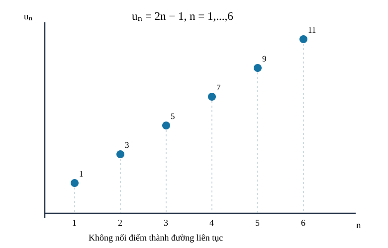
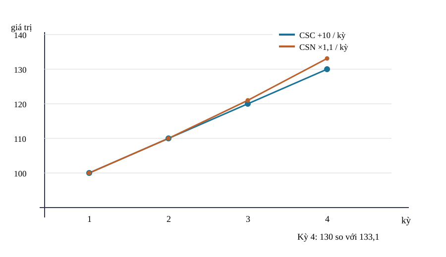
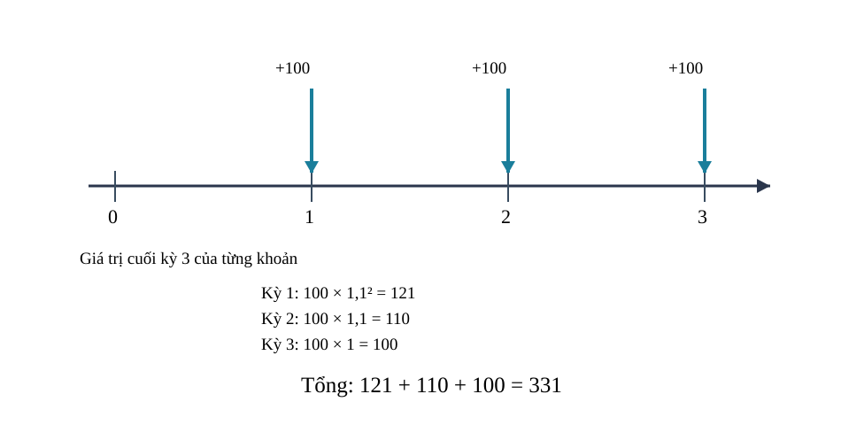

<!-- AUTHORING R04 · Original R03 blob 0635fcf41384970e2148b0d53542a2b93c53adf2 immutable; Q18 self-QA and V2 source-locked, not RELEASE. -->
<!-- STANDARD_ID=SLM-THPT-QUALITY-ONE; STANDARD_VERSION=3.1.0; LEARNING_PATH=TOPIC; OUTER_PAGES=Kiến thức|Luyện tập|Tự kiểm tra; SOURCE_VERSION=R04_AUTHORING_READY; AUTHORING_ONLY_METADATA=prototypes/thpt/content-drafts/topic07-sequences/Temp_TOPIC07_R04_AUTHORING_ONLY_CUSTODY_METADATA_20261113.md -->
# CĐ07 — Dãy số, cấp số cộng và cấp số nhân

# Kiến thức

## Từ những lần quan sát đến một dãy số

Một rạp hát thêm ghế theo từng hàng, còn khoản tiền gửi ngân hàng tăng sau mỗi kỳ. Cả hai đều cho ta một danh sách số **có thứ tự**, nhưng hai cách tăng rất khác: thêm một lượng cố định và nhân với một tỉ lệ cố định. Trước khi chọn công thức, hãy hỏi “mỗi số ứng với hàng hay kỳ **thứ mấy**?”, “chỉ số bắt đầu từ đâu?” và “quy luật đúng trong bao lâu?”. Những câu hỏi ấy quyết định chúng ta có đang giải đúng bài toán hay không.

Ta sẽ bắt đầu từ một dãy rời rạc theo chỉ số nguyên, thử tìm công thức hoặc hệ thức truy hồi, rồi chứng minh tính chất trên miền chỉ số thực. Sau đó mới đi đến cấp số cộng, cấp số nhân, tổng hữu hạn và các mô hình tiền theo kỳ; mỗi bước xuất phát từ **ý nghĩa của sự thay đổi**, không từ một bảng công thức cần học thuộc.

<!-- LESSON_ID: TOP07-M01; OUTCOME_ID: TOP07-O01 -->

Một danh sách như 1, 4, 9, 16 có thể được tạo ra từ quy luật \(u_n=n^2\), nhưng để gọi đó là một dãy **đã được xác định**, ta cần biết chỉ số \(n\) được phép nhận những giá trị nào. Có thể đây là dãy hữu hạn với \(n=1,2,3,4\), hoặc một dãy vô hạn với \(n\in\mathbb N^*\). Cùng công thức, hai miền chỉ số khác nhau cho hai dãy khác nhau. Vì thế dãy số là một hàm đặc biệt có đầu vào là những chỉ số nguyên được chỉ định.

Trên hình ngay dưới, dãy hữu hạn \(u_n=2n-1\) chỉ được cho với \(1\le n\le6\): sáu điểm rời rạc lần lượt là \((1,1),(2,3),(3,5),(4,7),(5,9),(6,11)\). Không có điểm nào ở chỉ số \(n=2{,}5\), vì đây không phải biến liên tục. Tương tự, với \(v_n=n^2\) trên \(n=1,\ldots,4\), ta được 1,4,9,16; dù công thức vẫn tính được khi \(n=5\), \(v_5\) **không thuộc dãy hữu hạn đã cho**. Xét tập chỉ số là bước đầu tiên của mọi phép tính với dãy.

*Đọc hình:* Theo đúng sáu điểm của \(u_n=2n-1\) với \(n=1,\ldots,6\). Chúng có hoành độ nguyên, cách nhau 1 đơn vị, nhưng không có đoạn đồ thị liên tục giữa hai số hạng. Số hạng của một dãy không phải mọi điểm trên đường thẳng \(y=2x-1\).

<!-- LESSON_ID: TOP07-M02; OUTCOME_ID: TOP07-O02 -->

Từ miền chỉ số, câu hỏi tiếp theo là làm sao nhận ra công thức tổng quát. Làm sao tìm u_100 mà không viết đủ 99 số trước? Ta đã biết phép thế và tìm quy luật số; phân biệt vài giá trị đầu với định nghĩa. Công thức tường minh u_n=f(n) cho phép tính một số hạng bằng một phép thế; một vài giá trị đầu KHÔNG xác định duy nhất dãy nếu chưa nói quy luật. Muốn kết luận công thức phải có định nghĩa, giả thiết hoặc chứng minh, không chỉ khớp ba số đầu.

Chẳng hạn, u_n=2n+1, n≥1 cho u_1=3,u_2=5,u_3=7 và u_10=21. Nhưng thêm một biểu thức bội (n−1)(n−2)(n−3) vẫn giữ ba số đầu mà đổi các số sau; do đó suy từ ba số không đủ duy nhất.

<!-- LESSON_ID: TOP07-M03; OUTCOME_ID: TOP07-O03 -->

Không phải dãy nào cũng có công thức trực tiếp; có khi bước sau phụ thuộc bước trước. Một dãy mô tả 'năm sau phụ thuộc năm trước' có cần công thức trực tiếp không? Ta sử dụng thế số và biến đổi đại số; điều kiện số hạng đầu. Truy hồi cho u_{n+1} qua u_n (hoặc nhiều số trước) phải kèm đủ giá trị khởi tạo. Có thể đổi biến v_n=u_n−c để nhận ra quy luật nhân đều; không bao giờ bỏ điều kiện đầu. Cùng một công thức truy hồi với hai số đầu khác nhau tạo hai dãy khác nhau.

Xét ví dụ: u_1=3, u_{n+1}=2u_n+1. Đặt v_n=u_n+1, v_{n+1}=2v_n và v_1=4, nên v_n=4·2^{n−1}, u_n=4·2^{n−1}−1. Thử u_2=7 khớp 2·3+1; chọn đổi biến vì dấu +1 được hấp thụ.

<!-- LESSON_ID: TOP07-M04; OUTCOME_ID: TOP07-O04 -->

Muốn khẳng định tăng hay giảm, phải chứng minh cho mọi chỉ số hợp lệ. Thấy ba số đầu đang tăng có đủ để nói dãy luôn tăng không? Ta bắt đầu từ bất đẳng thức số thực và n≥1. Dãy tăng nghiêm ngặt nếu u_{n+1}>u_n với mọi n hợp lệ; giảm nếu ngược. Dùng hiệu u_{n+1}−u_n, hoặc tỉ số chỉ khi có dấu thích hợp và số hạng khác 0. Đừng dùng vài giá trị quan sát thay chứng minh trên mọi n.

Chẳng hạn, u_n=n/(n+1) với n≥1. u_{n+1}−u_n=(n+1)/(n+2)−n/(n+1)=[(n+1)²−n(n+2)]/[(n+1)(n+2)]=1/[(n+1)(n+2)]>0. Chọn hiệu vì không cần chia số hạng.

<!-- LESSON_ID: TOP07-M05; OUTCOME_ID: TOP07-O05 -->

Một dãy có thể bị chặn bởi giá trị mà nó không bao giờ đạt. Một dãy có thể tiến gần 1 mãi mà không bao giờ bằng 1 không? Cần nhớ dấu phân thức dương, bất đẳng thức. Bị chặn trên nếu tồn tại M sao cho u_n≤M cho mọi n, bị chặn dưới tương tự; chặn không đồng nghĩa giá trị đạt. Dãy tăng và có chặn trên không tự nói giá trị giới hạn bằng cận khi chưa chứng minh; ở đây chỉ xây dựng ranh giới trực giác, giới hạn chi tiết sang CĐ08.

Chẳng hạn, u_n=1−1/(n+1), n≥1. Vì 0<1/(n+1)≤1/2 nên 1/2≤u_n<1. u_1=1/2 là cận dưới đạt, còn 1 không là một số hạng của dãy. Chọn tách thành 1 trừ số dương để nhìn cận.

### Vận dụng và tự đối chiếu

<!-- First Try TOP07-M01: knowledge, not canonical Readiness -->
**1.** Dãy \(u_n=3n\) được cho với \(n\in\{1,2,3\}\). Dãy có các số hạng nào? Có \(u_0\) không?

Đối chiếu

Dãy gồm 3, 6, 9 và **không có \(u_0\)** vì 0 không thuộc miền chỉ số. Nếu em tính \(u_0=0\), hãy phân biệt giá trị của biểu thức đại số tại 0 với số hạng thực sự thuộc dãy.

<!-- First Try TOP07-M02: knowledge, not canonical Readiness -->
**2.** Với u_n=4n−1, tính u_6.

Đối chiếu

23; n bắt đầu từ 1 nhưng số hạng thứ sáu thế n=6, không phải 5.

Nếu dùng n−1 vô cớ, phân biệt chỉ số của biểu thức với số lần tăng trong cấp số.

<!-- First Try TOP07-M03: knowledge, not canonical Readiness -->
**3.** Cho u_1=2,u_{n+1}=u_n+4. Tính u_3.

Đối chiếu

u_2=6,u_3=10; cần chạy truy hồi hai lần.

Nếu nhảy trực tiếp từ u_1 đến u_3, ghi hai mũi tên n=1→2→3 và kiểm chênh lệch.

<!-- First Try TOP07-M04: knowledge, not canonical Readiness -->
**4.** Dãy u_n=1/n (n≥1) tăng hay giảm?

Đối chiếu

Giảm nghiêm ngặt vì 1/(n+1)<1/n với mẫu dương.

Nếu chỉ nhìn 1,1/2,1/3 thì đó mới là gợi ý; chứng minh dấu cho mọi n.

<!-- First Try TOP07-M05: knowledge, not canonical Readiness -->
**5.** u_n=2−1/n (n≥1) có đạt 2 không?

Đối chiếu

Không; 1/n>0 nên u_n<2 với mọi n nguyên dương.

Phân biệt ký hiệu '≤' và '<'; thử giải u_n=2 bằng phương trình.

## Khi mỗi bước thêm đúng một lượng như nhau

Nếu số ghế mỗi hàng thêm 4 chỗ so với hàng trước, **hiệu** giữa hai số hạng liên tiếp luôn bằng 4. Đây là điều cốt lõi của cấp số cộng: công sai mô tả thay đổi tuyệt đối trên từng bước. Từ đó ta suy được số hạng ở xa và tổng nhiều hàng bằng cách ghép các cặp đầu–cuối, thay vì ghi nhớ riêng hai công thức.

Nếu độ tăng giữa hai kỳ giữ nguyên, dãy có cấu trúc cấp số cộng. Từ công sai, số hạng thứ n đến tổng nhiều số hạng, các công thức cùng xuất phát từ một ý tưởng cộng đều.

<!-- LESSON_ID: TOP07-M06; OUTCOME_ID: TOP07-O06 -->

Mỗi kỳ tăng thêm 5 đơn vị và mỗi kỳ tăng 5% có phải cùng một quy luật? Để xác định điều đó, cần xét hiệu hai số thực. Cấp số cộng (CSC) có u_{n+1}=u_n+d với d hằng; hiệu liên tiếp luôn bằng d. d=0 cho dãy hằng, d<0 là giảm. Một phần trăm cố định thường cho cấp số nhân chứ không phải CSC (trừ trường hợp suy biến đặc biệt).

Chẳng hạn, Dãy 14,11,8,5 có các hiệu −3; là CSC với d=−3. Dãy 10,20,40 có hiệu 10,20 nên không CSC. Chọn kiểm hiệu trước khi áp công thức.

<!-- LESSON_ID: TOP07-M07; OUTCOME_ID: TOP07-O07 -->

Khi mỗi bước cộng cùng một lượng, ta suy được số hạng bất kỳ. Vì sao ở số hạng thứ n lại xuất hiện n−1? Ta đã biết truy hồi cộng d và số đếm bước. Từ u_1 đến u_n thực hiện đúng n−1 lần cộng công sai, nên u_n=u_1+(n−1)d. Nếu d=0 công thức vẫn đúng; nếu cho u_k thì u_n=u_k+(n−k)d với cả n<k.

Chẳng hạn, u_1=7,d=−2, u_6=7+5(−2)=−3. Ta chọn công thức tổng quát thay vì cộng năm bước riêng lẻ; thử u_2=5 để kiểm chiều âm.

<!-- LESSON_ID: TOP07-M08; OUTCOME_ID: TOP07-O08 -->

Ngược lại, hai số hạng cách xa nhau có thể cho biết công sai. Có thể tìm cả u_1 và d khi chỉ biết u_5,u_9 không? Ta sử dụng hiệu hai phương trình tuyến tính. Vì u_m−u_k=(m−k)d, khi m≠k ta tìm d=(u_m−u_k)/(m−k), sau đó u_1=u_k−(k−1)d. Hai giá trị theo hai chỉ số khác nhau đủ xác định một CSC; kiểm điều kiện m≠k.

Xét ví dụ: u_3=5,u_7=21 ⇒ d=(21−5)/(7−3)=4, u_1=5−2·4=−3. Thử u_7=−3+6·4=21. Chọn phép trừ để khử u_1.

<!-- LESSON_ID: TOP07-M09; OUTCOME_ID: TOP07-O09 -->

Cộng nhiều số hạng bằng ghép cặp dẫn tới công thức tổng. Tại sao tổng các số 1 đến n tính nhanh được mà không cộng từng số? Ta bắt đầu từ cộng giao hoán và công thức u_n. Ghép u_1+u_n, u_2+u_{n−1},… mỗi cặp có cùng tổng 2u_1+(n−1)d, cho 2S_n=n(u_1+u_n); do đó S_n=n[2u_1+(n−1)d]/2. Đếm đúng n số hạng; công thức dùng cả n lẻ vì số ở giữa ghép với chính nó khi nhân 2.

Chẳng hạn, CSC u_1=2,d=3,n=6 có u_6=17 và S_6=6(2+17)/2=57. Chọn ghép đầu/cuối để nhìn cấu trúc đối xứng.

<!-- LESSON_ID: TOP07-M10; OUTCOME_ID: TOP07-O10 -->

Tổng cấp số cộng mô tả lượng tích lũy trong các bài toán theo kỳ. Khi số sản phẩm mỗi tuần tăng cố định, cần phân biệt tuần cuối với tổng cả giai đoạn. Cần nhớ đơn vị đếm, CSC, tổng hữu hạn. Nếu sản lượng tuần n là a+(n−1)d, tổng n tuần là S_n. Trong mô hình thực tế phải đặt rõ tuần đầu, số tuần, mức tăng và tính hợp lệ (không có số lượng âm). Không suy từ CSC sang lãi kép vì lãi kép nhân theo tỷ lệ.

Chẳng hạn, Xưởng tuần đầu làm 20 sản phẩm, mỗi tuần thêm 4 sản phẩm, trong 5 tuần: tuần 5 làm 36, tổng 20+24+28+32+36=140; cũng S_5=5(20+36)/2=140. Chọn tổng vì bài hỏi toàn giai đoạn.

### Vận dụng và tự đối chiếu

<!-- First Try TOP07-M06: knowledge, not canonical Readiness -->
**1.** Dãy 2,2,2,2 có phải CSC không?

Đối chiếu

Có, công sai d=0.

Nếu thấy 'không tăng' rồi loại, nhớ CSC cho phép công sai 0.

<!-- First Try TOP07-M07: knowledge, not canonical Readiness -->
**2.** CSC u_1=10,d=−3: tính u_4.

Đối chiếu

u_4=10+3(−3)=1.

Nếu tính thành −2, xem lại từ số hạng 1 đến 4 chỉ có 3 khoảng.

<!-- First Try TOP07-M08: knowledge, not canonical Readiness -->
**3.** u_2=7,u_5=16 thì d bằng bao nhiêu?

Đối chiếu

d=(16−7)/(5−2)=3.

Không chia cho số thứ tự lớn hơn; chia chênh chỉ số.

<!-- First Try TOP07-M09: knowledge, not canonical Readiness -->
**4.** Tính 1+3+5+7+9.

Đối chiếu

25; đây là CSC 5 số, đầu1 cuối9, S=5(1+9)/2.

Nếu lấy n bằng số cuối 9, viết rõ có bao nhiêu số được cộng.

<!-- First Try TOP07-M10: knowledge, not canonical Readiness -->
**5.** Hàng 1 có 8 ghế, mỗi hàng thêm 2 ghế, 4 hàng có bao nhiêu ghế?

Đối chiếu

8+10+12+14=44 ghế.

Nếu chỉ trả số ghế hàng cuối, phân biệt 'mỗi hàng' và 'tổng toàn bộ'.

## Khi mỗi bước nhân theo cùng một tỉ lệ

Nếu lượng hàng tồn kho mỗi kỳ tăng 10% so với **chính kỳ trước**, lượng tăng tuyệt đối không còn cố định: 100 tăng thành 110, kỳ sau tăng thêm 11 chứ không phải 10. Điều giữ nguyên là **tỉ số**, ở đây bằng 1,1. Cấp số nhân vì thế khác cấp số cộng ngay ở cách đặt câu hỏi; từ số hạng đầu, công bội quyết định mọi số hạng và tổng tích lũy.

Không phải mọi tăng trưởng đều cộng đều. Khi mỗi bước nhân với cùng một hệ số, dấu, số 0, công bội, số hạng và tổng phải được hiểu trong một cấu trúc khác.

<!-- LESSON_ID: TOP07-M11; OUTCOME_ID: TOP07-O11 -->

Tăng gấp đôi nhưng có kỳ đổi dấu: vẫn là cấp số nhân chứ? Để xác định điều đó, cần xét phép nhân số thực, số hạng khác 0 khi chia tỉ số. Cấp số nhân (CSN) thỏa u_{n+1}=qu_n với công bội q cố định. Khi các số hạng khác 0 có thể kiểm tỉ số u_{n+1}/u_n=q. q=0 là trường hợp hợp lệ nếu u_1≠0: từ u_2 trở đi bằng 0; không chia cho 0. q<0 làm dấu luân phiên nếu u_1 khác 0.

Chẳng hạn, Dãy 2,−6,18,−54 là CSN q=−3. Dãy 5,0,0,… là CSN q=0; tỉ số 0/0 không có nghĩa nhưng truy hồi u_{n+1}=0·u_n vẫn đúng. Chọn kiểm phép nhân thay chia khi xuất hiện 0.

<!-- LESSON_ID: TOP07-M12; OUTCOME_ID: TOP07-O12 -->

Từ công bội cố định, ta tìm số hạng ở bất kỳ vị trí nào. Sau nhiều lần nhân cùng một số, số mũ là n hay n−1? Ta đã biết lũy thừa và thứ tự số hạng. CSN u_n=u_1q^{n−1}; khi q âm, dấu do số mũ chẵn/lẻ; q=1 cho dãy hằng, q=0 cho u_1 ban đầu rồi từ số 2 bằng 0 (đối với n=1 quy ước q^0=1, riêng 0^0 trong biểu thức tính toán cần tránh thay máy móc). Khi q=0 dùng truy hồi cho trường hợp n=1 và n≥2 thay công thức lũy thừa tại n=1.

Chẳng hạn, u_1=−2, q=3, u_4=−2·3³=−54. Chọn số mũ 3 vì từ số 1 đến 4 chỉ nhân 3 lần; thử u_2=−6 để kiểm.

<!-- LESSON_ID: TOP07-M13; OUTCOME_ID: TOP07-O13 -->

Hai số hạng được biết giúp suy công bội, nhưng dấu và điều kiện cần kiểm. Hai số hạng cách hai vị trí có cho biết duy nhất công bội? Ta sử dụng căn bậc hai, dấu dương/âm, phép chia hợp lệ. Nếu u_k≠0 và u_m=u_k q^{m−k}, chênh chỉ số chẵn có thể dẫn q=±c, không tự chọn q dương. Với ba số liên tiếp khác 0, b²=ac là điều kiện cần cho CSN; nếu a,b,c phù hợp và a,b khác 0 thì b/a=c/b. Với a,c dương, b có thể ±√(ac), phải nêu ràng buộc dấu nếu muốn duy nhất.

Xét ví dụ: u_2=6,u_4=24 ⇒ q²=4 nên q=±2. Với q=2 thì u_1=3; q=−2 thì u_1=−3. Chọn xét bình phương trước rồi giải đủ hai dấu.

<!-- LESSON_ID: TOP07-M14; OUTCOME_ID: TOP07-O14 -->

Tổng của các số hạng nhân lặp khác hẳn tổng cấp số cộng. Có thể ghép đầu–cuối như cấp số cộng để tính tổng cấp số nhân không? Ta bắt đầu từ nhân phân phối và khử vế. S_n=u_1+u_1q+...+u_1q^{n−1}. Nhân q và trừ: (1−q)S_n=u_1(1−q^n), nên nếu q≠1 thì S_n=u_1(1−q^n)/(1−q). Nếu q=1 thì S_n=nu_1. q=0 vẫn cho S_n=u_1 khi n≥1, tránh công thức u_1q^{n−1} tại n=1 của trường hợp q=0.

Chẳng hạn, Với u_1=2,q=3,n=4: S_4=2(1−3^4)/(1−3)=2·40=80. Thử bằng cộng 2+6+18+54=80. Chọn nhân trừ để rút gọn n phần tử.

<!-- LESSON_ID: TOP07-M15; OUTCOME_ID: TOP07-O15 -->

Nếu trị tuyệt đối công bội nhỏ hơn 1, phần dư của tổng giảm dần. Vì sao có thể cộng vô hạn số hạng mà được một số hữu hạn? Cần nhớ tổng n số hạng CSN và dãy q^n; phần Giới hạn G11 B15. Với |q|<1, q^n→0; lấy giới hạn của S_n=u_1(1−q^n)/(1−q) được S_∞=u_1/(1−q). Điều kiện |q|<1 là bắt buộc cho cấp số nhân có u_1≠0; q=−1 làm tổng riêng dao động, |q|>1 thường không hội tụ. Phần dư S_∞−S_n=u_1q^n/(1−q); trị tuyệt đối đo sai số.

Chẳng hạn, Với u_1=6,q=1/2, S_n=12[1−(1/2)^n], S_∞=12; sau n=4 phần dư=12/16=3/4. Chọn công thức phần dư khi muốn biết phải cộng bao nhiêu số hạng để đủ chính xác.

### Vận dụng và tự đối chiếu

<!-- First Try TOP07-M11: knowledge, not canonical Readiness -->
**1.** Dãy 4,0,0,0,… có là CSN không?

Đối chiếu

Có, với q=0.

Nếu loại vì phép chia 0/0, hãy quay lại định nghĩa u_{n+1}=qu_n.

<!-- First Try TOP07-M12: knowledge, not canonical Readiness -->
**2.** CSN u_1=5,q=−2: tính u_4.

Đối chiếu

5(−2)³=−40.

Đặt dấu âm trong ngoặc của lũy thừa; không tính −2³ như (−2)³ mà không xét ngữ cảnh.

<!-- First Try TOP07-M13: knowledge, not canonical Readiness -->
**3.** Ba số 2,b,18 là CSN với b≠0: b có thể bằng bao nhiêu?

Đối chiếu

b²=36 ⇒ b=±6; q=b/2 là ±3.

Nếu chỉ ra b=6, xem lại phép lấy căn bình phương.

<!-- First Try TOP07-M14: knowledge, not canonical Readiness -->
**4.** Tính S_5 nếu u_1=−4, q=1.

Đối chiếu

S_5=5(−4)=−20; không chia cho 1−q=0.

Nếu gặp 0 ở mẫu, tách q=1 trước.

<!-- First Try TOP07-M15: knowledge, not canonical Readiness -->
**5.** Với u_1=4,q=−1, tổng vô hạn có giá trị theo công thức trên không?

Đối chiếu

Không; |q|=1, tổng riêng lần lượt 4,0,4,0,… không hội tụ.

Nếu tự thay q=−1 vào biểu thức u_1/(1−q) được 2, đó là lạm dụng công thức ngoài miền |q|<1.

## Phân biệt tăng đều, tăng theo phần trăm và tiền gửi theo thời điểm

Khi hai mô hình cùng bắt đầu từ một số, những kỳ đầu có thể rất gần nhau. Nhưng cộng 10 đơn vị mỗi kỳ khác với nhân 1,1 vào số dư hiện có: mức tăng của mô hình thứ hai tự lớn lên theo kỳ. Với khoản tiền gửi thêm **cuối mỗi kỳ**, ta còn phải biết khoản nào đã sinh lãi một kỳ, khoản nào hai kỳ và khoản mới gửi chưa sinh lãi. Bởi vậy, đếm đúng **thời điểm** quan trọng không kém chọn đúng công thức.

Tăng đều về lượng và tăng đều theo phần trăm dẫn đến kết quả rất khác khi số kỳ lớn. Mô hình lãi kép hay gửi góp chỉ có nghĩa khi biết thời điểm tiền vào, lãi suất kỳ và giới hạn giả định.

<!-- LESSON_ID: TOP07-M16; OUTCOME_ID: TOP07-O16 -->

Một báo cáo ghi 'tăng 10' và 'tăng 10%' khác nhau ra sao qua nhiều kỳ? Để xác định điều đó, cần xét đơn vị phần trăm, CSC và CSN. Tăng cố định d mỗi kỳ: u_n=u_1+(n−1)d (CSC). Tăng cố định r theo tỷ lệ kỳ trước: v_n=v_1(1+r)^{n−1} (CSN với q=1+r). Nói '10%' phải xác định 10% của giá trị kỳ nào; số phần trăm tăng đều khác số tuyệt đối tăng đều. Mô hình có thể lệch dữ liệu thực và chỉ hợp lệ trong miền giả định.

Chẳng hạn, bắt đầu ở kỳ 0 với 100 đơn vị. Nếu mỗi kỳ cộng thêm 10, các giá trị trong hình ở kỳ 0,1,2,3 là \(100,110,120,130\). Nếu mỗi kỳ tăng 10% của số kỳ trước, ta được \(100,110,121,133{,}1\). Hai cách cùng tăng thêm 10 ở kỳ đầu, nhưng từ kỳ thứ hai **khác nhau**, vì 10% của 110 là 11. Ví dụ thứ hai là mô hình cấp số nhân, không được nhầm với cấp số cộng.

*Đọc hình:* Tại kỳ 0 và 1, hai mô hình trùng nhau ở 100 và 110. Tại kỳ 2, một bên 120, bên kia 121; kỳ 3 là 130 và 133,1. Nhìn các **điểm theo kỳ**, không tự hiểu hai đường là mô hình liên tục ở mọi thời gian thực.

<!-- LESSON_ID: TOP07-M17; OUTCOME_ID: TOP07-O17 -->

Trong lãi kép, tỷ lệ theo kỳ làm số kỳ và đơn vị trở nên quan trọng. Vì sao gửi 5%/năm qua nhiều năm không chỉ lấy 5% nhân số năm? Ta đã biết phần trăm, lũy thừa, hợp đồng kỳ hạn. Nếu lãi gộp vào vốn mỗi kỳ với lãi suất r *theo chính kỳ đó*, không nộp/rút/phí, số dư sau n kỳ là P(1+r)^n, P≥0, 1+r>0 (thực tế thường r≥0). Nếu lãi theo tháng thì n phải là số tháng, không dùng lãi năm như lãi tháng; lãi hiệu dụng khác lãi danh nghĩa. KNTT ChII cung cấp CSN; ví dụ tài chính ở đây là mô hình toán tự biên soạn, không phải báo giá.

Chẳng hạn, P=10 triệu, r=6%/năm, hai năm: 10·1,06²=11,236 triệu. Chọn lũy thừa vì tiền lãi năm đầu đã nằm trong số dư sinh lãi năm hai.

<!-- LESSON_ID: TOP07-M18; OUTCOME_ID: TOP07-O18 -->

Gửi góp khác gửi một lần vì mỗi khoản tiền sinh lãi trong số kỳ khác nhau. Cùng gọi là 'trả mỗi tháng', vì sao một bài tính tổng tương lai, bài kia tính tiền trả nợ hiện tại? Ta sử dụng tổng CSN hữu hạn, số kỳ và phân biệt đầu/cuối kỳ. Gửi a vào CUỐI mỗi kỳ với lãi r/kỳ, r≠0, số dư NGAY CUỐI kỳ n: FV=a[(1+r)^n−1]/r; nếu r=0 thì FV=na. Vay V tại đầu, trả a vào CUỐI mỗi kỳ, dư B_k=(1+r)B_{k−1}−a, B_0=V; tất toán sau n kỳ cho V=a[1−(1+r)^{-n}]/r khi r≠0 và 1+r>0; nếu r=0 thì V=na. Các công thức là tổng CSN hữu hạn, không phải tổng vô hạn và phải đánh dấu thời điểm dòng tiền.

Xét ví dụ đúng với sơ đồ: gửi **100 đơn vị vào cuối mỗi kỳ** 1, 2, 3, với lãi 10%/kỳ. Tính số dư **ngay sau khi gửi kỳ 3**: khoản gửi kỳ 1 có hai kỳ lãi, thành \(100\cdot1{,}1^2=121\); khoản kỳ 2 có một kỳ, thành 110; khoản vừa gửi kỳ 3 vẫn là 100. Tổng \(121+110+100=331\). Nếu số gửi chỉ là 50 mỗi kỳ, tổng tương ứng mới là 165,5. Với bài trả nợ, ta theo dõi dư nợ \(B_{k+1}=(1+r)B_k-a\); khoản trả làm **giảm** số dư, khác khoản gửi.

*Đọc hình:* Kỳ 0 chưa có khoản gửi; các mũ 2,1,0 ứng với ba khoản 100 gửi cuối kỳ 1, 2, 3. Kỳ 3 được tính **ngay sau lần gửi cuối**, nên khoản thứ ba chưa có lãi. Tổng 331 phải khớp cả dòng thời gian lẫn phép tính.

### Vận dụng và tự đối chiếu

<!-- First Try TOP07-M16: knowledge, not canonical Readiness -->
**1.** Khởi đầu 50, tăng 10% mỗi kỳ sau hai lần tăng có phải 60 không?

Đối chiếu

Không, 50·1,1²=60,5.

Nếu ghi 60, bạn đã cộng 5 cố định và vô tình dùng CSC thay CSN.

<!-- First Try TOP07-M17: knowledge, not canonical Readiness -->
**2.** P=1 triệu, r=10% mỗi kỳ, hai kỳ còn bao nhiêu?

Đối chiếu

1·1,1²=1,21 triệu.

Nếu làm thành 1,2 triệu, bạn đã dùng lãi đơn thay lãi kép; ghi rõ 'không nộp/rút'.

<!-- First Try TOP07-M18: knowledge, not canonical Readiness -->
**3.** Gửi 20 vào cuối hai kỳ với r=10%/kỳ, số dư cuối kỳ 2 là bao nhiêu?

Đối chiếu

20·1,1+20=42; khoản gửi cuối kỳ 2 chưa sinh lãi.

Nếu nhân cả hai khoản với 1,1², vẽ trục kỳ 0–1–2 và đánh dấu ngay sau khi nộp.

<!-- AUTHORING_ONLY: source-locked figure custody and interaction SPEC_ONLY notes preserved in original R02 blob 5068c400b2d8361fab9d3f30a2145455dd8a6fcf. The learner text already places verified SVG inline. -->

# Luyện tập

Ở chặng **dãy số**, em hãy viết rõ miền chỉ số, tính số hạng và chứng minh tăng, giảm hoặc bị chặn bằng một lập luận áp dụng cho mọi chỉ số được phép. Sang **cấp số cộng**, em nhận ra công sai qua hiệu hai số liên tiếp, dùng số bước từ số hạng đầu tới số hạng cần tìm, rồi suy tổng bằng cách ghép cặp đầu–cuối. Với **cấp số nhân**, hãy so tỉ số, kiểm dấu và trường hợp công bội bằng 1 trước khi dùng công thức; tổng vô hạn chỉ được xét khi công bội có trị tuyệt đối nhỏ hơn 1.

Ở phần **vận dụng**, em cần viết trục thời gian theo kỳ, cho biết tiền gửi đầu hay cuối kỳ và phân biệt lượng tăng tuyệt đối với phần trăm trên số dư. Làm từng bài và các câu tự luận trước khi mở hướng dẫn đối chiếu. Khi sai, hãy trở lại chặng kiến thức liên quan, giải thích vì sao chọn phương pháp rồi mới tính lại. Ngân hàng bài tập công khai gồm các câu căn bản SGK được tái sử dụng cùng 18 bài luyện và 4 bài tự luận riêng của Chuyên đề; các câu phải được hiển thị ngay trong trang học, không buộc em tự tìm tệp nguồn.

# Tự kiểm tra

Cuối chuyên đề, em tự giải 18 câu đại diện cho 18 mục tiêu, trải từ chỉ số dãy, cấp số cộng và cấp số nhân tới các tình huống tiền gửi theo kỳ. Hãy trình bày kết quả trước khi nhấn **Final Submit**. Chỉ sau khi nộp, em mới tự mở đối chiếu đúng/sai, đáp án và giải thích để xác định chỗ cần ôn.

Các câu này được dùng lại từ phần Luyện tập, nên kết quả chỉ có ý nghĩa **tự phát hiện lỗ hổng**, không phải bài kiểm tra độc lập hay điểm thành thạo chính thức. Em hãy quay về đoạn giải thích tương ứng, làm lại một bài khác và tự đánh giá điều đã hiểu, không ghi nhận điểm Mastery từ việc xem lời giải.

<!-- AUTHORING SOURCE-LOCK POINTERS ONLY; these are existing canonical source item IDs, NOT question copies, NOT learner UI.
- THPT-G11-B05-C01
- THPT-G11-B05-C02
- THPT-G11-B05-C03
- THPT-G11-B05-C04
- THPT-G11-B05-P01
- THPT-G11-B05-P02
- THPT-G11-B05-P03
- THPT-G11-B05-P04
- THPT-G11-B05-P05
- THPT-G11-B05-P06
- THPT-G11-B05-P07
- THPT-G11-B05-P08
- THPT-G11-B06-C01
- THPT-G11-B06-C02
- THPT-G11-B06-C03
- THPT-G11-B06-C04
- THPT-G11-B06-P01
- THPT-G11-B06-P02
- THPT-G11-B06-P03
- THPT-G11-B06-P04
- THPT-G11-B06-P05
- THPT-G11-B06-P06
- THPT-G11-B06-P07
- THPT-G11-B06-P08
- THPT-G11-B07-C01
- THPT-G11-B07-C02
- THPT-G11-B07-C03
- THPT-G11-B07-C04
- THPT-G11-B07-P01
- THPT-G11-B07-P02
- THPT-G11-B07-P03
- THPT-G11-B07-P04
- THPT-G11-B07-P05
- THPT-G11-B07-P06
- THPT-G11-B07-P07
- THPT-G11-B07-P08
- THPT-G11-CHII-W05-01
- THPT-G11-CHII-W05-02-ANCHOR
- THPT-G11-CHII-W06-01
- THPT-G11-CHII-W06-02-ANCHOR
- THPT-G11-CHII-W07-01
- THPT-G11-CHII-W07-02-ANCHOR
- THPT-G11-CHV-B15-C03
- THPT-G11-CHV-B15-P05
- THPT-G11-CHV-B15-P06
- THPT-G11-CHV-B15-P07
- THPT-G11-CHV-B15-W02-ANCHOR
- THPT-TOP07-P01
- THPT-TOP07-P02
- THPT-TOP07-P03
- THPT-TOP07-P04
- THPT-TOP07-P05
- THPT-TOP07-P06
- THPT-TOP07-P07
- THPT-TOP07-P08
- THPT-TOP07-P09
- THPT-TOP07-P10
- THPT-TOP07-P11
- THPT-TOP07-P12
- THPT-TOP07-P13
- THPT-TOP07-P14
- THPT-TOP07-P15
- THPT-TOP07-P16
- THPT-TOP07-P17
- THPT-TOP07-P18
- THPT-TOP07-W01
- THPT-TOP07-W02
- THPT-TOP07-W03
- THPT-TOP07-W04
-->
