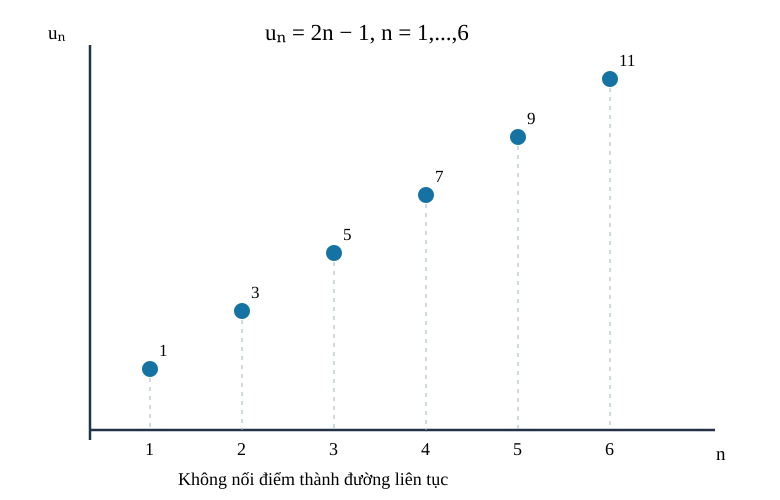
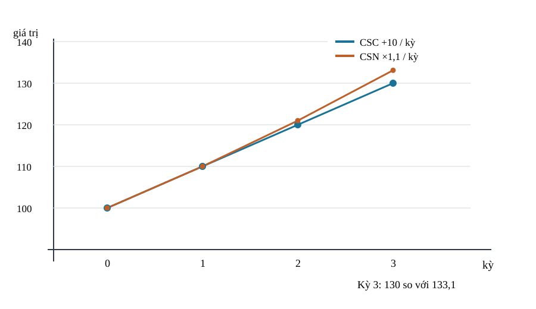
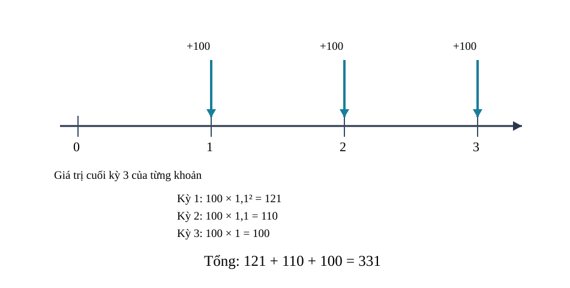

<!-- AUTHORING_ONLY_NOT_FOR_STUDENT_VIEW: CĐ07 current R07 learner canonical; Q18 current source verified in separate receipt; older R06/R04 status kept only in Git history. -->
<!-- AUTHORING_ONLY_NOT_FOR_STUDENT_VIEW: STANDARD_ID=SLM-THPT-QUALITY-ONE; STANDARD_VERSION=3.2.0; LEARNING_PATH=TOPIC; SOURCE_VERSION=R07_CANONICAL_AUTHOR_Q18_SELF_VERIFIED; INDEX_BLOB=01154e0801e77c2e81d56a717c77f7dae5a3515d; NEW_BANK_BLOB=f70e2c961dfcf31825d135b61e301cbb4c322767 -->
# CĐ07 — Dãy số, cấp số cộng và cấp số nhân

# Kiến thức

## 1. Từ những lần quan sát đến một dãy số

Một rạp hát thêm ghế theo từng hàng, còn khoản tiền gửi ngân hàng tăng sau mỗi kỳ. Cả hai đều cho ta một danh sách số **có thứ tự**, nhưng hai cách tăng rất khác: thêm một lượng cố định và nhân với một tỉ lệ cố định. Trước khi chọn công thức, hãy hỏi “mỗi số ứng với hàng hay kỳ **thứ mấy**?”, “chỉ số bắt đầu từ đâu?” và “quy luật đúng trong bao lâu?”. Những câu hỏi ấy quyết định chúng ta có đang giải đúng bài toán hay không.

Ta sẽ bắt đầu từ một dãy rời rạc theo chỉ số nguyên, thử tìm công thức hoặc hệ thức truy hồi, rồi chứng minh tính chất với mọi chỉ số nguyên thuộc miền xác định của dãy. Sau đó mới đi đến cấp số cộng, cấp số nhân, tổng hữu hạn và các mô hình tiền theo kỳ; mỗi bước xuất phát từ **ý nghĩa của sự thay đổi**, không từ một bảng công thức cần học thuộc.

### 1.1. Dãy số và tập chỉ số

<!-- LESSON_ID: TOP07-M01; OUTCOME_ID: TOP07-O01 -->

Một danh sách như 1, 4, 9, 16 có thể được tạo ra từ quy luật \(u_n=n^2\), nhưng để gọi đó là một dãy **đã được xác định**, ta cần biết chỉ số \(n\) được phép nhận những giá trị nào. Có thể đây là dãy hữu hạn với \(n=1,2,3,4\), hoặc một dãy vô hạn với \(n\in\mathbb N^*\). Cùng công thức, hai miền chỉ số khác nhau cho hai dãy khác nhau. Vì vậy, không thể xác định đầy đủ một dãy nếu chưa nói chỉ số được phép nhận những giá trị nào.

> **ĐỊNH NGHĨA — Dãy số.** Dãy số là một hàm xác định trên một tập chỉ số nguyên được chỉ định; mỗi chỉ số \(n\) trong tập ấy tương ứng với đúng một số hạng \(u_n\).

Trên hình ngay dưới, dãy hữu hạn \(u_n=2n-1\) chỉ được cho với \(1\le n\le6\): sáu điểm rời rạc lần lượt là \((1;1),(2;3),(3;5),(4;7),(5;9),(6;11)\). Không có điểm nào ở chỉ số \(n=2{,}5\), vì đây không phải biến liên tục. Tương tự, với \(v_n=n^2\) trên \(n=1,\ldots,4\), ta được 1,4,9,16; dù công thức vẫn tính được khi \(n=5\), \(v_5\) **không thuộc dãy hữu hạn đã cho**. Xét tập chỉ số là bước đầu tiên của mọi phép tính với dãy.

*Đọc hình:* Theo đúng sáu điểm của \(u_n=2n-1\) với \(n=1,\ldots,6\). Chúng có hoành độ nguyên, cách nhau 1 đơn vị, nhưng không có đoạn đồ thị liên tục giữa hai số hạng. Số hạng của một dãy không phải mọi điểm trên đường thẳng \(y=2x-1\).

**Ví dụ**

**Đề bài.** Dãy hữu hạn \(a_n=3n+2\) có \(n\in\{2,3,4,5\}\). Liệt kê dãy và xét \(a_1\).

**Lời giải.** Thay đúng bốn chỉ số: \(a_2=8,a_3=11,a_4=14,a_5=17\). Không có \(a_1\) trong dãy vì \(1\) không thuộc miền chỉ số, dù biểu thức vẫn tính được tại \(n=1\).

**Vận dụng** Dãy \(u_n=3n\) được cho với \(n\in\{1,2,3\}\). Dãy có các số hạng nào? Có \(u_0\) không?

Đối chiếu

Dãy gồm 3, 6, 9 và **không có \(u_0\)** vì 0 không thuộc miền chỉ số. Nếu em tính \(u_0=0\), hãy phân biệt giá trị của biểu thức đại số tại 0 với số hạng thực sự thuộc dãy.

**Kiểm lỗi**

Nếu em tính thêm số hạng ở một chỉ số **ngoài tập đã cho**, em đang nhầm công thức đại số với miền chỉ số của dãy. Đọc lại **Kiến thức 1.1**, giải **Bài 2** (dãy hữu hạn không có số hạng thứ năm) và **Bài 1** (liệt kê đúng số hạng trong miền).

### 1.2. Công thức tường minh và quy luật

<!-- LESSON_ID: TOP07-M02; OUTCOME_ID: TOP07-O02 -->

**Các cách cho một dãy số.** Có bốn cách thường dùng để cho một dãy số, bổ trợ nhau: **liệt kê** các số hạng, **mô tả bằng lời** một quy luật xác định, **cho công thức số hạng tổng quát** và **cho bằng hệ thức truy hồi** kèm điều kiện ban đầu. Chúng không phải bốn loại dãy riêng biệt: cùng một dãy có thể viết theo nhiều cách. Chẳng hạn, số ghế của các hàng lần lượt là \(12,15,18,21,\ldots\) khi biết rõ quy luật **hàng đầu có 12 ghế, mỗi hàng sau nhiều hơn 3 ghế**. Viết bằng công thức được \(u_n=12+3(n-1)\), \(n\ge1\); còn bằng truy hồi là \(u_1=12\), \(u_{n+1}=u_n+3\) với mọi \(n\ge1\). Liệt kê một vài số đầu **chỉ minh họa**; nếu không có lời mô tả, công thức hay giả thiết thêm thì chưa xác định được duy nhất các số tiếp theo.

Cách nào thuận tiện tùy câu hỏi: cần ngay số hạng thứ \(100\) thì công thức tổng quát hiệu quả; biết mỗi bước phụ thuộc bước trước thì truy hồi tự nhiên hơn; bảng liệt kê hữu ích để **quan sát** nhưng không thay thế quy luật cần chứng minh.

> **PHƯƠNG PHÁP — Công thức tường minh và quy luật.** Với một dãy số \((u_n)\), mỗi số hạng \(u_n\) được gắn với một chỉ số \(n\) thuộc miền chỉ số đã cho (chẳng hạn \(n=1,2,3,\ldots\)). Làm thế nào tìm \(u_{100}\) mà không phải liệt kê 99 số hạng trước đó? Một **công thức tường minh** \(u_n=f(n)\) cho phép tính trực tiếp bằng cách thay \(n\); tuy nhiên, vài số hạng đầu **không xác định duy nhất** toàn bộ dãy nếu thiếu quy luật hoặc giả thiết. Muốn khẳng định một công thức đúng cho mọi chỉ số cho phép, ta cần định nghĩa hoặc chứng minh, không chỉ dựa vào ba giá trị đầu.

Chẳng hạn, \(u_n=2n+1\), \(n\ge1\) cho \(u_1=3,\ u_2=5,\ u_3=7,\ u_{10}=21\). Dãy \(v_n=2n+1+(n-1)(n-2)(n-3)\) vẫn có ba số đầu 3, 5, 7, nhưng \(v_4=15\) khác \(u_4=9\). Vì thế ba số đầu không đủ xác định duy nhất quy luật.

**Ví dụ**

**Đề bài.** Với \(u_n=\dfrac{n+2}{n+1}\), \(n\ge1\), hãy tính \(u_3\) và xem \(1\) có là số hạng không.

**Lời giải.** \(u_3=\frac54\). Nếu \(u_n=1\) thì \(n+2=n+1\), vô lý. Tiến gần 1 không có nghĩa là có số hạng đúng bằng 1.

**Vận dụng** Với \(u_n=4n-1\), tính \(u_6\).

Đối chiếu

23; n bắt đầu từ 1 nhưng số hạng thứ sáu thế \(n=6\), không phải 5.

Nếu dùng n−1 vô cớ, phân biệt chỉ số của biểu thức với số lần tăng trong cấp số.

**Kiểm lỗi**

Nếu thế sai chỉ số hoặc cho rằng một giá trị có thể đạt chỉ vì biểu thức tiến gần tới nó, đọc lại **Kiến thức 1.2** rồi làm **Bài 5** (đúng thứ tự chỉ số) và **Bài 6** (kiểm tra một giá trị có thực sự là số hạng hay không).

### 1.3. Hệ thức truy hồi

<!-- LESSON_ID: TOP07-M03; OUTCOME_ID: TOP07-O03 -->

> **ĐỊNH NGHĨA — Hệ thức truy hồi.** Không phải dãy nào cũng có công thức trực tiếp; có khi bước sau phụ thuộc bước trước. Hệ thức truy hồi cho \(u_{n+1}\) qua \(u_n\) (hoặc nhiều số hạng trước đó) phải kèm đủ giá trị khởi tạo. Có thể đổi biến \(v_n=u_n-c\) để nhận ra quy luật nhân đều; không bao giờ bỏ điều kiện đầu. Cùng một hệ thức truy hồi với hai giá trị khởi tạo khác nhau có thể tạo hai dãy khác nhau.

Chẳng hạn, \(u_1=3,\ u_{n+1}=2u_n+1\). Số \(-1\) thỏa \(-1=2(-1)+1\); xét độ lệch \(v_n=u_n+1\) để có \(v_{n+1}=2v_n,\ v_1=4\). Sau \(n-1\) lần nhân 2, \(v_n=4\cdot2^{n-1}\), nên \(u_n=4\cdot2^{n-1}-1\). Thử \(u_2=7\) khớp \(2\cdot3+1\).

**Ví dụ**

**Đề bài.** Cho \(u_1=5\), \(u_{n+1}=2u_n-3\) với \(n\ge1\). Tìm \(u_2,u_3\) và công thức tường minh.

**Lời giải.** \(u_2=2\cdot5-3=7\), \(u_3=2\cdot7-3=11\). Ta chọn số 3 vì \(3=2\cdot3-3\): nếu số hạng bằng 3 thì bước sau vẫn bằng 3. Xét độ lệch \(v_n=u_n-3\), ta có \(v_1=5-3=2\) và \(v_{n+1}=u_{n+1}-3=2u_n-6=2(u_n-3)=2v_n\). Từ \(v_1\) tới \(v_n\) có \(n-1\) lần nhân 2, nên \(v_n=2\cdot2^{n-1}=2^n\), hay \(u_n=3+2^n\).

Kiểm cho mọi \(n\ge1\): công thức cho \(u_1=5\), và \(2(3+2^n)-3=3+2^{n+1}=u_{n+1}\). Vì truy hồi xác định duy nhất mỗi số hạng sau từ số hạng trước, công thức đúng cho toàn bộ dãy.

**Vận dụng** (a) Cho \(u_1=2,\ u_{n+1}=u_n+4\). Tính \(u_3\). (b) Cho \(w_1=3,\ w_{n+1}=3w_n-4\). Tìm số không đổi c thỏa \(c=3c-4\), rồi dùng \(v_n=w_n-c\) tìm công thức tường minh và kiểm hệ thức truy hồi.

Đối chiếu

(a) \(u_2=6,\ u_3=10\); cần chạy truy hồi hai lần. (b) \(c=2\), nên \(v_1=1,\ v_{n+1}=3v_n\). Do đó \(v_n=3^{n-1}\) và \(w_n=2+3^{n-1}\). Kiểm \(w_1=3\); với mọi \(n\ge1\), \(3w_n-4=3(2+3^{n-1})-4=2+3^n=w_{n+1}\).

Nếu nhảy trực tiếp từ \(u_1\) đến \(u_3\), ghi hai mũi tên \(1\to2\to3\). Khi đổi biến, hãy kiểm điều kiện đầu và hệ thức truy hồi cho mọi chỉ số hợp lệ, không chỉ thử vài số đầu.

**Kiểm lỗi**

Nếu bỏ qua điều kiện đầu hoặc nhảy một bước khi dùng hệ thức truy hồi, đọc lại **Kiến thức 1.3**, làm **Bài 8** (tính từng bước) rồi **Bài 11** (chứng minh công thức tường minh bằng dãy đã cho).

### 1.4. Chứng minh tăng, giảm

<!-- LESSON_ID: TOP07-M04; OUTCOME_ID: TOP07-O04 -->

> **TÍNH CHẤT — Chứng minh tăng, giảm.** Muốn khẳng định tăng hay giảm, phải chứng minh cho mọi chỉ số hợp lệ. Dãy tăng nghiêm ngặt nếu \(u_{n+1}>u_n\) với mọi n hợp lệ; giảm nghiêm ngặt nếu \(u_{n+1}<u_n\). Dùng hiệu \(u_{n+1}-u_n\); nếu mọi số hạng dương, cũng có thể so \(\frac{u_{n+1}}{u_n}\) với 1 (lớn hơn 1 thì tăng, nhỏ hơn 1 thì giảm). Đừng dùng vài giá trị quan sát thay chứng minh trên mọi n.

Chẳng hạn, \(u_n=\frac{n}{n+1}\) với \(n\ge1\). Ta có \(u_{n+1}-u_n=\frac{n+1}{n+2}-\frac{n}{n+1}=\frac{(n+1)^2-n(n+2)}{(n+1)(n+2)}=\frac1{(n+1)(n+2)}>0\). Chọn hiệu vì không cần chia số hạng.

**Ví dụ**

**Đề bài.** Chứng minh \(u_n=4-\dfrac1{n+2}\), \(n\ge1\), tăng nghiêm ngặt.

**Lời giải.** \(u_{n+1}-u_n=\dfrac1{n+2}-\dfrac1{n+3}=\dfrac1{(n+2)(n+3)}>0\) với mọi \(n\ge1\). Dấu này, chứ không phải vài số hạng đầu, là chứng minh.

**Vận dụng** Dãy \(u_n=\frac1n\) (\(n\ge1\)) tăng hay giảm?

Đối chiếu

Giảm nghiêm ngặt vì \(\frac1{n+1}<\frac1n\) với mẫu dương.

Nếu chỉ nhìn \(1,\frac12,\frac13\) thì đó mới là gợi ý; chứng minh dấu cho mọi n.

**Kiểm lỗi**

Nếu chỉ dựa vào vài số hạng đầu để khẳng định dãy tăng/giảm, đọc lại **Kiến thức 1.4**; giải **Bài 14** và **Bài 16**, luôn xét dấu hiệu hai số hạng liên tiếp cho **mọi chỉ số hợp lệ**.

### 1.5. Tính bị chặn

<!-- LESSON_ID: TOP07-M05; OUTCOME_ID: TOP07-O05 -->

Một dãy có thể tiến gần một giá trị mà không bao giờ đạt giá trị đó. Khi xét dãy có bị chặn hay không, em cần phân biệt một cận với giá trị mà dãy thực sự đạt. Dãy tăng và có chặn trên chưa chắc có giới hạn bằng chính cận trên đã chọn.

> **ĐỊNH NGHĨA — Dãy số bị chặn.** Dãy \((u_n)\) **bị chặn trên** nếu tồn tại số thực \(M\) sao cho \(u_n\le M\) với **mọi** chỉ số \(n\) hợp lệ; **bị chặn dưới** nếu tồn tại số thực \(m\) sao cho \(u_n\ge m\) với mọi \(n\). Dãy **bị chặn** nếu có cả hai cận, tức tồn tại \(m,M\in\mathbb R\) thỏa \(m\le u_n\le M\) với mọi \(n\). Các cận không nhất thiết là số hạng của dãy và cũng không nhất thiết là cận tốt nhất.

Chẳng hạn, \(u_n=1-\frac1{n+1}\), \(n\ge1\). Vì \(0<\frac1{n+1}\le\frac12\) nên \(\frac12\le u_n<1\). Số hạng \(u_1=\frac12\) đạt cận dưới, còn 1 không là một số hạng của dãy.

**Ví dụ**

**Đề bài.** Tìm cận dưới đạt được và cận trên không đạt được của \(u_n=5-\dfrac2{n+1}\), \(n\ge1\).

**Lời giải.** Vì \(0<\frac2{n+1}\le1\) nên \(4\le u_n<5\). Tại \(n=1\), \(u_1=4\); không có số hạng bằng 5 vì \(\frac2{n+1}>0\).

**Vận dụng** Dãy \(u_n=2-\frac1n\) (\(n\ge1\)) có đạt 2 không?

Đối chiếu

Không; \(\frac1n>0\) nên \(u_n<2\) với mọi n nguyên dương.

Phân biệt dấu nhỏ hơn hoặc bằng với dấu nhỏ hơn nghiêm ngặt; thử giải \(u_n=2\) bằng phương trình.

**Kiểm lỗi**

Nếu nhầm cận trên với số hạng lớn nhất, hoặc dấu nhỏ hơn nghiêm ngặt với dấu bằng, đọc lại **Kiến thức 1.5**, làm **Bài 19** (chứng minh hai cận) và **Bài 20** (cận dưới đạt, cận trên không đạt).

## 2. Khi mỗi bước thêm đúng một lượng như nhau

Nếu số ghế mỗi hàng thêm 4 chỗ so với hàng trước, **hiệu** giữa hai số hạng liên tiếp luôn bằng 4. Đây là điều cốt lõi của cấp số cộng: công sai mô tả thay đổi tuyệt đối trên từng bước. Từ đó ta suy được số hạng ở xa và tổng nhiều hàng bằng cách ghép các cặp đầu–cuối, thay vì ghi nhớ riêng hai công thức.

Nếu độ tăng giữa hai kỳ giữ nguyên, dãy có cấu trúc cấp số cộng. Từ công sai, số hạng thứ n đến tổng nhiều số hạng, các công thức cùng xuất phát từ một ý tưởng cộng đều.

### 2.1. Nhận diện cấp số cộng

<!-- LESSON_ID: TOP07-M06; OUTCOME_ID: TOP07-O06 -->

Mỗi kỳ tăng thêm 5 đơn vị và mỗi kỳ tăng 5% có phải cùng một quy luật? Để xác định điều đó, cần xét hiệu hai số thực. 

> **ĐỊNH NGHĨA — Cấp số cộng.** Dãy \((u_n)\) là cấp số cộng khi có một số thực \(d\) không đổi sao cho \(u_{n+1}=u_n+d\) với mọi cặp chỉ số liên tiếp của dãy. Khi đó \(d=u_{n+1}-u_n\) gọi là *công sai*.

 \(d=0\) cho dãy hằng, \(d<0\) cho dãy giảm nghiêm ngặt. Một phần trăm cố định thường cho cấp số nhân chứ không phải CSC (trừ trường hợp suy biến đặc biệt).

Chẳng hạn, dãy 14, 11, 8, 5 có các hiệu \(-3\); là CSC với \(d=-3\). Dãy 10, 20, 40 có hiệu 10, 20 nên không là CSC. Chọn kiểm hiệu trước khi áp công thức.

**Ví dụ**

**Đề bài.** Cho dãy \(13,9,5,1,\ldots\) và giả thiết hiệu các số liên tiếp luôn không đổi. Tìm công sai và hai số tiếp.

**Lời giải.** Các hiệu đã thấy đều là \(-4\); theo giả thiết, \(d=-4\), nên hai số sau là \(-3,-7\). Nếu chỉ biết bốn giá trị mà không biết quy luật tiếp tục, không thể khẳng định dãy vô hạn là CSC.

**Vận dụng** Dãy 2,2,2,2 có phải CSC không?

Đối chiếu

Có, công sai \(d=0\).

Nếu thấy 'không tăng' rồi loại, nhớ CSC cho phép công sai 0.

**Kiểm lỗi**

Nếu loại một cấp số cộng chỉ vì các số hạng không tăng, đọc lại **Kiến thức 2.1**: công sai có thể bằng 0 hoặc âm. Làm **Bài 22** (hiệu âm không đổi) và **Bài 23** (nhận diện quy luật, viết công sai).

### 2.2. Công thức số hạng tổng quát

<!-- LESSON_ID: TOP07-M07; OUTCOME_ID: TOP07-O07 -->

> **CÔNG THỨC — Công thức số hạng tổng quát.** Từ \(u_1\) đến \(u_n\) thực hiện đúng \(n-1\) lần cộng công sai, nên **\(u_n=u_1+(n-1)d\)**. Nếu \(d=0\) công thức vẫn đúng; nếu cho \(u_k\) thì \(u_n=u_k+(n-k)d\) với cả \(n<k\). Ví dụ \(u_5=10,\ d=3\) thì \(u_2=10+(2-5)\cdot3=1\): đi lùi ba bước nghĩa là trừ công sai ba lần.

Chẳng hạn, \(u_1=7,\ d=-2,\ u_6=7+5(-2)=-3\). Ta chọn công thức tổng quát thay vì cộng năm bước riêng lẻ; thử \(u_2=5\) để kiểm chiều âm.

**Ví dụ**

**Đề bài.** CSC có \(u_1=-6\), \(d=5\). Tính \(u_9\), giải thích số bước cộng.

**Lời giải.** Từ chỉ số \(1\) đến \(9\) có \(8\) bước cộng. Vì thế \(u_9=-6+8\cdot5=34\).

**Vận dụng** CSC \(u_1=10,\ d=-3\): tính \(u_4\).

Đối chiếu

\(u_4=10+3(-3)=1\).

Nếu tính thành −2, xem lại từ số hạng 1 đến 4 chỉ có 3 khoảng.

**Kiểm lỗi**

Nếu dùng n thay n−1 lần cộng công sai, đọc lại **Kiến thức 2.2**, làm **Bài 26** (tìm số hạng theo chỉ số) và **Bài 27** (giải số hạng xa). Đếm số *khoảng cách chỉ số* từ số hạng đầu.

### 2.3. Tìm công sai từ hai số hạng

<!-- LESSON_ID: TOP07-M08; OUTCOME_ID: TOP07-O08 -->

Ngược lại, hai số hạng cách xa nhau có thể cho biết công sai. Có thể tìm cả \(u_1\) và d khi chỉ biết \(u_5,u_9\) không? Vì \(u_m-u_k=(m-k)d\), khi \(m\ne k\) ta tìm \(d=\frac{u_m-u_k}{m-k}\), sau đó \(u_1=u_k-(k-1)d\). Hai giá trị theo hai chỉ số khác nhau đủ xác định một CSC.

> **PHƯƠNG PHÁP — Tìm công sai từ hai số hạng.** Nếu đề cho **ba số hạng liên tiếp** \(a,b,c\), cũng dùng cùng ý tưởng hiệu không đổi: \(b-a=c-b\), tương đương \(2b=a+c\). Ngược lại, nếu ba số được cho theo đúng thứ tự và thỏa \(2b=a+c\), thì hai hiệu bằng nhau và chúng có thể là ba số hạng liên tiếp của một cấp số cộng. Với biểu thức chứa ẩn, hãy lập phương trình từ điều kiện này, giải rồi kiểm lại cả hai hiệu.

Xét ví dụ: \(u_3=5,\ u_7=21\Rightarrow d=\frac{21-5}{7-3}=4,\ u_1=5-2\cdot4=-3\). Thử \(u_7=-3+6\cdot4=21\). Chọn phép trừ để khử \(u_1\).

**Ví dụ**

**Đề bài.** Biết \(u_4=7,\ u_9=27\) thuộc cùng một CSC. Tìm \(d\) và \(u_1\).

**Lời giải.** Có 5 khoảng chỉ số nên \(d=\frac{27-7}{5}=4\). Ta có \(u_1=u_4-3d=7-12=-5\). Kiểm \(u_9=-5+8\cdot4=27\).

**Vận dụng** \(u_2=7,\ u_5=16\) thì d bằng bao nhiêu?

Đối chiếu

\(d=\frac{16-7}{5-2}=3\).

Không chia cho số thứ tự lớn hơn; chia chênh chỉ số.

**Kiểm lỗi**

Nếu tính công sai bằng cách chia cho số thứ tự thay vì **hiệu chỉ số**, đọc lại **Kiến thức 2.3**, làm **Bài 25** và **Bài 30**; lấy hiệu hai giá trị chia cho hiệu hai chỉ số rồi thế ngược để kiểm.

### 2.4. Tổng các số hạng đầu

<!-- LESSON_ID: TOP07-M09; OUTCOME_ID: TOP07-O09 -->

> **CÔNG THỨC — Tổng các số hạng đầu.** Viết cùng tổng theo hai thứ tự: \(S_n=u_1+u_2+\cdots+u_n\) và \(S_n=u_n+u_{n-1}+\cdots+u_1\). Cộng theo từng vị trí, mỗi cặp có cùng tổng \(u_1+u_n=2u_1+(n-1)d\). Có n cặp nên \(2S_n=n(u_1+u_n)\); do đó **\(S_n=\frac{n(u_1+u_n)}2=\frac{n[2u_1+(n-1)d]}2\)**. Đếm đúng n số hạng; công thức dùng cả n lẻ vì số ở giữa ghép với chính nó khi nhân 2.

Chẳng hạn, CSC \(u_1=2,\ d=3,\ n=6\) có \(u_6=17\) và \(S_6=\frac{6(2+17)}2=57\). Chọn ghép đầu/cuối để nhìn cấu trúc đối xứng.

**Ví dụ**

**Đề bài.** CSC có \(u_1=3,d=2\). Tính tổng tám số hạng đầu.

**Lời giải.** \(u_8=3+7\cdot2=17\). Ghép cặp đầu–cuối được \(S_8=\dfrac{8(3+17)}2=80\).

**Vận dụng** Tính 1+3+5+7+9.

Đối chiếu

25; đây là CSC có 5 số hạng, số đầu 1, số cuối 9, \(S_5=\frac{5(1+9)}2=25\).

Nếu lấy n bằng số cuối 9, viết rõ có bao nhiêu số được cộng.

**Kiểm lỗi**

Nếu nhầm số số hạng n với số hạng cuối, đọc lại **Kiến thức 2.4**, tính tổng ở **Bài 34** và **Bài 35** theo cặp đầu–cuối; kiểm xem đã xác định đúng n và \(u_n\) chưa.

### 2.5. Bài toán tích lũy

<!-- LESSON_ID: TOP07-M10; OUTCOME_ID: TOP07-O10 -->

> **PHƯƠNG PHÁP — Bài toán tích lũy.** Tổng cấp số cộng mô tả lượng tích lũy trong các bài toán theo kỳ. Khi số sản phẩm mỗi tuần tăng cố định, cần phân biệt tuần cuối với tổng cả giai đoạn. Nếu sản lượng tuần n là \(a+(n-1)d\), tổng n tuần là \(S_n\). Trong mô hình thực tế phải đặt rõ tuần đầu, số tuần, mức tăng và tính hợp lệ (không có số lượng âm). Không suy từ CSC sang lãi kép vì lãi kép nhân theo tỷ lệ.

Chẳng hạn, xưởng tuần đầu làm 20 sản phẩm, mỗi tuần thêm 4 sản phẩm, trong 5 tuần: tuần 5 làm 36, tổng \(20+24+28+32+36=140\); cũng có \(S_5=\frac{5(20+36)}2=140\). Chọn tổng vì bài hỏi toàn giai đoạn.

**Ví dụ**

**Đề bài.** Một xưởng làm \(15\) sản phẩm tuần đầu, mỗi tuần thêm \(5\) sản phẩm. Tổng sản lượng sáu tuần là bao nhiêu?

**Lời giải.** Tuần thứ sáu có \(15+5\cdot5=40\) sản phẩm; \(S_6=\dfrac{6(15+40)}2=165\) sản phẩm. Phân biệt sản lượng tuần cuối với tổng sáu tuần.

**Vận dụng** Hàng 1 có 8 ghế, mỗi hàng thêm 2 ghế, 4 hàng có bao nhiêu ghế?

Đối chiếu

\(8+10+12+14=44\) ghế.

Nếu chỉ trả số ghế hàng cuối, phân biệt 'mỗi hàng' và 'tổng toàn bộ'.

**Kiểm lỗi**

Nếu chỉ trả sản lượng hàng cuối thay vì tổng tất cả hàng/kỳ, đọc lại **Kiến thức 2.5**, giải **Bài 38** và **Bài 40**; trước khi cộng, ghi rõ số hàng và số ghế hàng cuối.

## 3. Khi mỗi bước nhân theo cùng một tỉ lệ

Nếu lượng hàng tồn kho mỗi kỳ tăng 10% so với **chính kỳ trước**, lượng tăng tuyệt đối không còn cố định: 100 tăng thành 110, kỳ sau tăng thêm 11 chứ không phải 10. Điều giữ nguyên là **tỉ số**, ở đây bằng 1,1. Cấp số nhân vì thế khác cấp số cộng ngay ở cách đặt câu hỏi; từ số hạng đầu, công bội quyết định mọi số hạng và tổng tích lũy.

Không phải mọi tăng trưởng đều cộng đều. Khi mỗi bước nhân với cùng một hệ số, dấu, số 0, công bội, số hạng và tổng phải được hiểu trong một cấu trúc khác.

### 3.1. Công bội và trường hợp đặc biệt

<!-- LESSON_ID: TOP07-M11; OUTCOME_ID: TOP07-O11 -->

Tăng gấp đôi nhưng có kỳ đổi dấu: vẫn là cấp số nhân chứ? Để xác định điều đó, cần xét phép nhân số thực, số hạng khác 0 khi chia tỉ số. 

> **ĐỊNH NGHĨA — Cấp số nhân.** Dãy \((u_n)\) là cấp số nhân khi có một số thực \(q\) không đổi sao cho \(u_{n+1}=qu_n\) với mọi cặp chỉ số liên tiếp của dãy. Số \(q\) gọi là *công bội*.

Khi số hạng đứng trước khác 0, có thể kiểm tỉ số \(\frac{u_{n+1}}{u_n}=q\). Nếu \(q=0\) và \(u_1\ne0\), từ \(u_2\) trở đi bằng 0; không chia cho 0. Dãy toàn 0 cũng thỏa định nghĩa với mọi q, nên công bội không duy nhất. Khi \(q<0\) và \(u_1\ne0\), dấu các số hạng luân phiên.

Chẳng hạn, dãy \(2,-6,18,-54\) là CSN với \(q=-3\). Dãy \(5,0,0,\ldots\) là CSN với \(q=0\); tỉ số \(\frac00\) không có nghĩa nhưng truy hồi \(u_{n+1}=0\cdot u_n\) vẫn đúng. Chọn kiểm phép nhân thay chia khi xuất hiện 0.

**Ví dụ**

**Đề bài.** Dãy \(1,-4,16,-64,\ldots\) được xác định bằng phép nhân cùng một số. Tìm \(q\) và số tiếp theo.

**Lời giải.** Ta có công bội \(q=-4\), số tiếp là \(256\). Dấu luân phiên vẫn là cấp số nhân; nếu xuất hiện số \(0\), phải kiểm qua truy hồi \(u_{n+1}=qu_n\), không chia cho \(0\).

**Vận dụng** Dãy 4,0,0,0,… có là CSN không?

Đối chiếu

Có, với \(q=0\).

Nếu loại vì không chia được 0 cho 0, hãy quay lại định nghĩa \(u_{n+1}=qu_n\).

**Kiểm lỗi**

Nếu cố tìm công bội bằng phép chia cho 0 hoặc loại \(q<0,\ q=0\), đọc lại **Kiến thức 3.1**, làm **Bài 41** (\(q=0\)) và **Bài 44** (công bội âm). Ưu tiên hệ thức nhân liên tiếp thay vì phép chia khi mẫu bằng 0.

### 3.2. Số hạng tổng quát

<!-- LESSON_ID: TOP07-M12; OUTCOME_ID: TOP07-O12 -->

> **CÔNG THỨC — Số hạng tổng quát.** Từ \(u_1\) đến \(u_n\) có \(n-1\) lần nhân công bội. Với \(q\ne0\), ta có **\(u_n=u_1q^{n-1}\)** cho mọi \(n\ge1\). Khi q âm, dấu phụ thuộc số mũ chẵn/lẻ; \(q=1\) cho dãy hằng. Riêng \(q=0\), số hạng đầu là \(u_1\), còn \(u_n=0\) với \(n\ge2\). Không cần dùng biểu thức \(0^0\).

Chẳng hạn, \(u_1=-2,\ q=3,\ u_4=-2\cdot3^3=-54\). Chọn số mũ 3 vì từ số 1 đến 4 chỉ nhân 3 lần; thử \(u_2=-6\) để kiểm.

**Ví dụ**

**Đề bài.** CSN có \(u_1=-4,\ q=2\). Tính \(u_6\).

**Lời giải.** Có năm lần nhân từ \(u_1\) đến \(u_6\), nên \(u_6=-4\cdot2^5=-128\). Trường hợp \(q=0\) tại số hạng đầu phải xét riêng, tránh \(0^0\).

**Vận dụng** CSN \(u_1=5,\ q=-2\): tính \(u_4\).

Đối chiếu

\(5(-2)^3=-40\).

Dấu ngoặc đặc biệt quan trọng khi số mũ chẵn: \(u_3=5(-2)^2=20\), trong khi \(5\cdot(-2^2)=-20\). Hai biểu thức với số mũ lẻ có thể trùng giá trị, nên hãy dùng \(u_3\) để phát hiện lỗi bỏ ngoặc.

**Kiểm lỗi**

Nếu đặt mũ là n thay cho n−1 hoặc làm mất dấu của công bội âm, đọc lại **Kiến thức 3.2**, làm **Bài 46** (số hạng thứ sáu) và **Bài 47** (công bội âm). Kiểm trực tiếp hai số hạng đầu.

### 3.3. Suy công bội từ hai số hạng

<!-- LESSON_ID: TOP07-M13; OUTCOME_ID: TOP07-O13 -->

> **PHƯƠNG PHÁP — Suy công bội từ hai số hạng.** Với \(m>k\) và \(u_k\ne0\), ta có \(q^{m-k}=\frac{u_m}{u_k}\); chênh chỉ số chẵn có thể dẫn đến hai công bội trái dấu, không tự chọn q dương. Với ba số liên tiếp a, b, c đều khác 0, điều kiện cần và đủ để lập CSN là \(b^2=ac\), vì khi đó \(\frac ba=\frac cb\). Khi \(a,c>0\), b có thể bằng \(\pm\sqrt{ac}\), phải nêu ràng buộc dấu nếu muốn duy nhất.

Xét ví dụ: \(u_2=6,\ u_4=24\Rightarrow q^2=4\), nên \(q=\pm2\). Với \(q=2\) thì \(u_1=3\); với \(q=-2\) thì \(u_1=-3\). Chọn xét bình phương trước rồi giải đủ hai dấu.

**Ví dụ**

**Đề bài.** Biết \(u_2=16,\ u_4=256\) của một CSN, các số hạng liên quan khác \(0\). Tìm mọi công bội thực và số đầu tương ứng.

**Lời giải.** \(q^2=\frac{u_4}{u_2}=\frac{256}{16}=16\), nên \(q=4\) hoặc \(q=-4\). Tương ứng \(u_1=\frac{16}4=4\) hoặc \(u_1=\frac{16}{-4}=-4\). Cả hai cho đúng \(u_4=256\); không tự bỏ dấu âm.

**Vận dụng** Ba số 2, b, 18 là CSN với \(b\ne0\): b có thể bằng bao nhiêu?

Đối chiếu

\(b^2=36\Rightarrow b=\pm6\); \(q=\frac b2=\pm3\). Hai dãy \(2,6,18\) và \(2,-6,18\) đều thỏa: \((-6)(-3)=18\).

Nếu chỉ ra \(b=6\), xem lại phép lấy căn bình phương.

**Kiểm lỗi**

Nếu từ \(q^2\) chỉ lấy một căn dương mà đề **không yêu cầu mọi số hạng dương**, đọc lại **Kiến thức 3.3**, so **Bài 48** (giả thiết các số dương) với **Bài 50** (cả q dương và âm có thể thỏa).

### 3.4. Tổng hữu hạn

<!-- LESSON_ID: TOP07-M14; OUTCOME_ID: TOP07-O14 -->

> **CÔNG THỨC — Tổng hữu hạn.** Với \(q\ne0\), viết \(S_n=u_1+u_1q+\cdots+u_1q^{n-1}\) và \(qS_n=u_1q+u_1q^2+\cdots+u_1q^n\). Lấy dòng đầu trừ dòng sau, các số hạng ở giữa triệt tiêu: \((1-q)S_n=u_1(1-q^n)\). Nếu \(q\ne1\) ta được **\(S_n=\frac{u_1(1-q^n)}{1-q}\)**. Nếu \(q=1\), **\(S_n=nu_1\)**. Công thức tổng với \(q\ne1\) cũng đúng khi \(q=0\), vì lúc này \(S_n=u_1\) với \(n\ge1\).

Chẳng hạn, với \(u_1=2,\ q=3,\ n=4\): \(S_4=\frac{2(1-3^4)}{1-3}=2\cdot40=80\). Thử bằng cộng \(2+6+18+54=80\). Chọn nhân trừ để rút gọn n số hạng.

**Ví dụ**

**Đề bài.** CSN có \(u_1=3,\ q=2\). Tính tổng năm số hạng đầu.

**Lời giải.** Vì \(q\ne1\), \(S_5=3\dfrac{1-2^5}{1-2}=93\). Kiểm \(3+6+12+24+48=93\); tổng hữu hạn không cần \(|q|<1\).

**Vận dụng** Tính \(S_5\) nếu \(u_1=-4,\ q=1\).

Đối chiếu

\(S_5=5(-4)=-20\); không chia cho \(1-q=0\).

Nếu gặp 0 ở mẫu, tách \(q=1\) trước.

**Kiểm lỗi**

Nếu dùng công thức có mẫu \(1-q\) khi \(q=1\), hoặc nhầm tổng hữu hạn với tổng vô hạn, đọc lại **Kiến thức 3.4**, làm **Bài 52** (\(q=1\)) và **Bài 55** (q khác 1). Thử cộng trực tiếp vài số hạng để kiểm dấu.

### 3.5. Tổng vô hạn và phần dư

<!-- LESSON_ID: TOP07-M15; OUTCOME_ID: TOP07-O15 -->

> **CÔNG THỨC — Tổng vô hạn và phần dư.** Nếu \(\lvert q\rvert<1\), **độ lớn của phần dư** tiến về 0; bản thân phần dư có thể đổi dấu. Vì \(\lvert q\rvert<1\), \(q^n\to0\); lấy giới hạn của \(S_n=\frac{u_1(1-q^n)}{1-q}\) được **\(S_\infty=\frac{u_1}{1-q}\)**. Khi \(u_1\ne0\), tổng vô hạn hội tụ chỉ khi \(\lvert q\rvert<1\): \(q=-1\) làm tổng riêng dao động, \(q=1\) cho tổng riêng \(nu_1\), còn \(\lvert q\rvert>1\) khiến số hạng không tiến về 0. Dãy toàn 0 có tổng 0. Trong trường hợp \(\lvert q\rvert<1\), phần dư \(R_n=S_\infty-S_n=\frac{u_1q^n}{1-q}\); trị tuyệt đối \(\lvert R_n\rvert\) đo sai số.

Chẳng hạn, với \(u_1=6,\ q=\frac12\), các tổng riêng \(S_n=12(1-(\frac12)^n)\) lần lượt bằng 6, 9, 10,5, 11,25 khi \(n=1,2,3,4\). Chúng ngày càng gần 12: đó là ý nghĩa của \(S_n\to12\) và tổng vô hạn \(S_\infty=12\). Sau bốn số hạng, phần dư là \(12-11{,}25=\frac34\). Nếu \(q<0\), phần dư có thể xen kẽ dấu; chẳng hạn \(u_1=1,\ q=-\frac12\) cho \(R_1=-\frac13,\ R_2=\frac16,\ R_3=-\frac1{12}\). Chỉ độ lớn \(|R_n|\) giảm về 0 trong ví dụ này.

**Ví dụ**

**Đề bài.** CSN có \(u_1=5,\ q=\frac14\). Tính tổng vô hạn và phần dư sau ba số hạng.

**Lời giải.** Do \(\lvert q\rvert<1\), \(S_\infty=\frac5{1-\frac14}=\frac{20}3\). Phần dư sau ba số hạng \(R_3=\frac{5(\frac14)^3}{1-\frac14}=\frac5{48}\).

**Vận dụng** Với \(u_1=4,\ q=-1\), tổng vô hạn có giá trị theo công thức trên không?

Đối chiếu

Không; |q|=1, tổng riêng lần lượt 4,0,4,0,… không hội tụ.

Nếu tự thay \(q=-1\) vào biểu thức \(\frac{u_1}{1-q}\) được 2, đó là lạm dụng công thức ngoài miền \(\lvert q\rvert<1\).

**Kiểm lỗi**

Nếu lấy tổng vô hạn theo công thức khi \(\lvert q\rvert\ge1\) hoặc bỏ mất dấu phần dư với công bội âm, đọc lại **Kiến thức 3.5**, làm **Bài 58** (chuỗi lùi có hội tụ) và **Bài 61** (tổng cùng phần dư). Chỉ sử dụng công thức sau khi kiểm \(\lvert q\rvert<1\).

## 4. Phân biệt tăng đều, tăng theo phần trăm và tiền gửi theo thời điểm

Khi hai mô hình cùng bắt đầu từ một số, những kỳ đầu có thể rất gần nhau. Nhưng cộng 10 đơn vị mỗi kỳ khác với nhân 1,1 vào số dư hiện có: mức tăng của mô hình thứ hai tự lớn lên theo kỳ. Với khoản tiền gửi thêm **cuối mỗi kỳ**, ta còn phải biết khoản nào đã sinh lãi một kỳ, khoản nào hai kỳ và khoản mới gửi chưa sinh lãi. Bởi vậy, đếm đúng **thời điểm** quan trọng không kém chọn đúng công thức.

Tăng đều về lượng và tăng đều theo phần trăm dẫn đến kết quả rất khác khi số kỳ lớn. Mô hình lãi kép hay gửi góp chỉ có nghĩa khi biết thời điểm tiền vào, lãi suất kỳ và giới hạn giả định.

### 4.1. Thay đổi tuyệt đối so với thay đổi theo tỉ lệ

<!-- LESSON_ID: TOP07-M16; OUTCOME_ID: TOP07-O16 -->

> **TÍNH CHẤT — Thay đổi tuyệt đối so với thay đổi theo tỉ lệ.** Một báo cáo ghi 'tăng 10' và 'tăng 10%' khác nhau ra sao qua nhiều kỳ? Để xác định điều đó, cần xét đơn vị phần trăm, CSC và CSN. Tăng cố định \(d\) mỗi kỳ: \(u_n=u_1+(n-1)d\) khi đếm số hạng từ \(n=1\) (CSC). Tăng cố định theo tỉ lệ \(r\) của kỳ trước: \(v_n=v_1(1+r)^{n-1}\) khi đếm từ \(n=1\) (CSN với \(q=1+r\)). **Nếu hình bắt đầu từ kỳ 0**, phải dùng \(u_k=u_0+kd\) và \(v_k=v_0(1+r)^k\) với \(k=0,1,2,\ldots\); không dịch chỉ số mà giữ nguyên số mũ. Nói '10%' phải xác định 10% của giá trị kỳ nào; số phần trăm tăng đều khác số tuyệt đối tăng đều. Mô hình có thể lệch dữ liệu thực và chỉ hợp lệ trong miền giả định.

Chẳng hạn, bắt đầu ở kỳ 0 với 100 đơn vị. Nếu mỗi kỳ cộng thêm 10, các giá trị trong hình ở kỳ 0,1,2,3 là \(100,110,120,130\). Nếu mỗi kỳ tăng 10% của số kỳ trước, ta được \(100,110,121,133{,}1\). Hai cách cùng tăng thêm 10 ở kỳ đầu, nhưng từ kỳ thứ hai **khác nhau**, vì 10% của 110 là 11. Ví dụ thứ hai là mô hình cấp số nhân, không được nhầm với cấp số cộng.

*Đọc hình:* Tại kỳ 0 và 1, hai mô hình trùng nhau ở 100 và 110. Tại kỳ 2, một bên 120, bên kia 121; kỳ 3 là 130 và 133,1. Nhìn các **điểm theo kỳ**, không tự hiểu hai đường là mô hình liên tục ở mọi thời gian thực.

**Ví dụ**

**Đề bài.** Hai đại lượng đều bằng \(80\) ở kỳ \(0\); A cộng \(8\) đơn vị mỗi kỳ, B tăng \(10\%\) so với kỳ trước. Sau hai kỳ bằng bao nhiêu?

**Lời giải.** \(A_2=80+2\cdot8=96\), \(B_2=80(1{,}1)^2=96{,}8\). Ở kỳ đầu cùng tăng \(8\), kỳ sau B tăng \(8{,}8\). Hình phía trên minh họa đầu kỳ \(100\), khác dữ kiện bài này.

**Vận dụng** Khởi đầu 50, tăng 10% mỗi kỳ sau hai lần tăng có phải 60 không?

Đối chiếu

Không, \(50\cdot(1{,}1)^2=60{,}5\).

Nếu ghi 60, bạn đã cộng 5 cố định và vô tình dùng CSC thay CSN.

**Kiểm lỗi**

Nếu nhầm tăng đều một lượng với tăng theo phần trăm của **giá trị kỳ trước**, đọc lại **Kiến thức 4.1**, làm **Bài 40** (mô hình cộng đều) rồi **Bài 63** (đặt hai quy luật tăng cạnh nhau theo chỉ số kỳ).

### 4.2. Mô hình lãi kép

<!-- LESSON_ID: TOP07-M17; OUTCOME_ID: TOP07-O17 -->

> **CÔNG THỨC — Mô hình lãi kép.** Nếu lãi gộp vào vốn mỗi kỳ với lãi suất r *theo chính kỳ đó*, không nộp/rút/phí, số dư sau n kỳ là \(P(1+r)^n\), với \(P\ge0,\ 1+r>0\) (thực tế thường \(r\ge0\)). Nếu lãi theo tháng thì n phải là số tháng, không dùng lãi năm như lãi tháng. Ví dụ 12%/năm danh nghĩa chia đều 12 tháng là 1%/tháng; nếu nhập lãi hàng tháng, mức tăng thực sau một năm là \((1{,}01)^{12}-1\), khoảng 12,68%, gọi là lãi suất hiệu dụng năm. Đây là mô hình hóa dựa trên CSN, không phải báo giá thực tế.

Chẳng hạn, \(P=10\) triệu đồng, \(r=6\%\) mỗi năm, hai năm: \(10\cdot(1{,}06)^2=11{,}236\) triệu đồng. Chọn lũy thừa vì tiền lãi năm đầu đã nằm trong số dư sinh lãi năm hai.

**Ví dụ**

**Đề bài.** Gửi \(8\) triệu đồng một lần, lãi nhập gốc \(4\%\) mỗi năm, không gửi/rút thêm, bỏ qua phí. Sau ba năm có bao nhiêu?

**Lời giải.** Qua ba kỳ, số dư theo mô hình là \(8(1{,}04)^3=8\cdot1{,}124864=8{,}998912\) triệu đồng, không cộng lãi đơn ba lần.

**Vận dụng** \(P=1\) triệu đồng, \(r=10\%\) mỗi kỳ, hai kỳ còn bao nhiêu?

Đối chiếu

\(1\cdot(1{,}1)^2=1{,}21\) triệu đồng.

Nếu làm thành 1,2 triệu, bạn đã dùng lãi đơn thay lãi kép; ghi rõ 'không nộp/rút'.

**Kiểm lỗi**

Nếu cộng cùng một khoản lãi mỗi kỳ dù đề đã nói **lãi nhập gốc**, đọc lại **Kiến thức 4.2**, giải **Bài 65** và **Bài 67**; ghi mốc kỳ 0, kỳ 1 rồi kỳ 2 và nhân hệ số tăng cho từng kỳ.

### 4.3. Gửi góp và trả nợ theo kỳ

<!-- LESSON_ID: TOP07-M18; OUTCOME_ID: TOP07-O18 -->

> **CÔNG THỨC — Gửi góp và trả nợ theo kỳ.** Gửi góp khác gửi một lần vì mỗi khoản tiền sinh lãi trong số kỳ khác nhau. Cùng gọi là 'trả mỗi tháng', vì sao một bài tính tổng tương lai, bài kia tính tiền trả nợ hiện tại? Ta sử dụng tổng CSN hữu hạn, số kỳ và phân biệt đầu/cuối kỳ. Gửi \(a\ge0\) vào **cuối mỗi kỳ**, xét \(n\ge1\) kỳ và lãi suất \(r\) theo kỳ với \(1+r>0\). Nếu \(r\ne0\), số dư **ngay sau khoản gửi cuối kỳ n**: \(FV=a\dfrac{(1+r)^n-1}{r}\); nếu \(r=0\) thì \(FV=na\). Vay \(V\) tại đầu kỳ 0, trả \(a\) vào cuối mỗi kỳ: \(B_0=V\), \(B_k=(1+r)B_{k-1}-a\). Nếu tất toán sau \(n\) kỳ và \(r\ne0\), \(V=a\dfrac{1-(1+r)^{-n}}{r}\); khi \(r=0\), \(V=na\). Phải kiểm điều kiện số tiền, thời điểm và số dư của mô hình. Các công thức là tổng CSN hữu hạn, không phải tổng vô hạn và phải đánh dấu thời điểm dòng tiền.

Xét ví dụ đúng với sơ đồ: gửi **100 đơn vị vào cuối mỗi kỳ** 1, 2, 3, với lãi 10%/kỳ. Tính số dư **ngay sau khi gửi kỳ 3**: khoản gửi kỳ 1 có hai kỳ lãi, thành \(100\cdot(1{,}1)^2=121\); khoản kỳ 2 có một kỳ, thành 110; khoản vừa gửi kỳ 3 vẫn là 100. Tổng \(121+110+100=331\). Nếu số gửi chỉ là 50 mỗi kỳ, tổng tương ứng mới là 165,5. Với bài trả nợ, ta theo dõi dư nợ \(B_{k+1}=(1+r)B_k-a\); khoản trả làm **giảm** số dư, khác khoản gửi.

*Đọc hình:* Kỳ 0 chưa có khoản gửi; các mũ 2,1,0 ứng với ba khoản 100 gửi cuối kỳ 1, 2, 3. Kỳ 3 được tính **ngay sau lần gửi cuối**, nên khoản thứ ba chưa có lãi. Tổng 331 phải khớp cả dòng thời gian lẫn phép tính.

**Ví dụ**

**Đề bài.** Gửi \(25\) đơn vị vào cuối mỗi kỳ trong bốn kỳ, lãi cố định \(4\%\)/kỳ, không phí/rút. Tính số dư ngay sau khoản gửi thứ tư.

**Lời giải.** Bốn khoản gửi được hưởng \(3,2,1,0\) kỳ lãi, nên \(FV=25[(1{,}04)^3+(1{,}04)^2+1{,}04+1]=25(1{,}124864+1{,}0816+1{,}04+1)=106{,}1616\). Không tính lãi cho khoản gửi cuối kỳ thứ tư; hình minh họa bên trên có ba khoản \(100\), là dữ liệu khác.

**Ví dụ — Trả nợ cuối kỳ**

**Đề bài.** Vay 210 đơn vị tiền ở kỳ 0, lãi 10% mỗi kỳ. Cuối mỗi kỳ trả 121 đơn vị. Sau hai kỳ có hết nợ không?

**Lời giải.** Mỗi kỳ, tính lãi trên dư nợ đầu kỳ rồi trừ khoản trả. Kết quả:

| Kỳ | Dư nợ đầu kỳ | Lãi | Khoản trả | Dư nợ cuối kỳ |
|---|---:|---:|---:|---:|
| 1 | 210 | 21 | 121 | 110 |
| 2 | 110 | 11 | 121 | 0 |

Vậy \(B_2=0\), khoản vay được tất toán sau hai kỳ.

**Vận dụng** (a) Gửi 20 đơn vị vào cuối hai kỳ, lãi 10%/kỳ. Tính số dư ngay sau khoản gửi cuối. (b) Vay 315 đơn vị ở kỳ 0 với lãi 10%/kỳ, trả 181,5 đơn vị vào cuối mỗi kỳ. Tính dư nợ cuối kỳ 1 và 2; kiểm đã tất toán chưa.

Đối chiếu

(a) \(20\cdot1{,}1+20=42\); khoản gửi cuối kỳ 2 chưa sinh lãi.

(b) \(B_1=315\cdot1{,}1-181{,}5=165\); \(B_2=165\cdot1{,}1-181{,}5=0\). Đã tất toán sau hai kỳ. Khoản trả làm giảm dư nợ, nên dùng phép trừ, không dùng phép cộng như gửi góp.

Nếu nhân cả hai khoản gửi với \((1{,}1)^2\), vẽ trục kỳ 0–1–2 và đánh dấu ngay sau khi nộp.

**Kiểm lỗi**

Nếu cộng lãi cho khoản gửi ngay **cuối kỳ** vừa nộp hoặc nhầm thời điểm trả nợ với tính lãi, đọc lại **Kiến thức 4.3**, làm **Bài 68** (gửi đầu/cuối kỳ) và **Bài 69** (trả nợ cuối kỳ); vẽ trục thời gian và đánh dấu khoản tiền trước khi lập công thức.

<!-- AUTHORING_ONLY: source-locked figure custody and interaction SPEC_ONLY notes preserved in original R02 blob 5068c400b2d8361fab9d3f30a2145455dd8a6fcf. The learner text already places verified SVG inline. -->

> **Kiến thức cần ghi nhớ**
>
> - **Dãy số** phải đi kèm miền chỉ số. Công thức có thể tính được ở ngoài miền ấy nhưng giá trị đó không phải số hạng của dãy đã cho.
> - **Cấp số cộng:** \(u_{n+1}=u_n+d\) với công sai \(d\) cố định; muốn dùng công thức theo \(n\), phải biết số hạng đầu và chỉ số bắt đầu.
> - **Cấp số nhân:** \(u_{n+1}=qu_n\) với công bội \(q\) cố định. Trường hợp \(q=0\) vẫn hợp lệ; không lấy tỉ số hai số hạng khi mẫu bằng \(0\).
> - **Bài toán tài chính theo kỳ:** đặt rõ thời điểm gửi/rút và lúc tính số dư; không tự cho khoản vừa gửi cuối kỳ hưởng thêm một kỳ lãi.

# Luyện tập

Hãy tự giải từng bài rồi mới mở **Lời giải**. Cần kiểm miền chỉ số, điều kiện, giới hạn áp dụng và đơn vị; với bài tự luận, tự đối chiếu cả phương pháp và rubric. Nếu sai, quay lại đoạn Kiến thức tương ứng trước khi giải lại.

## 1. Dãy số và tính chất

<!-- DISPLAY_ONLY_CANONICAL: THPT-G11-B05-C01; ORIGINAL_BLOB: 2101e2a248e0cf53ee11847b913b937cebcd0806; OUTCOME: TOP07-O01; NOT_A_NEW_BANK -->

**Bài 1.** Dãy hữu hạn gồm 5 số chính phương dương đầu tiên là gì?

Lời giải

**Đáp án:** 1; 4; 9; 16; 25.

**Lời giải:** Số hạng thứ n là n², n=1,2,3,4,5. Dãy có đúng năm số hạng.

<!-- DISPLAY_ONLY_CANONICAL: THPT-TOP07-P01; ORIGINAL_BLOB: f70e2c961dfcf31825d135b61e301cbb4c322767; OUTCOME: TOP07-O01; NOT_A_NEW_BANK -->

**Bài 2.** Cho dãy hữu hạn a_n=(−1)^n(2n+1), n∈{0,1,2,3}. Liệt kê các số hạng; có a_4 trong dãy không?

Lời giải

**Đáp án:** a_0=1,a_1=−3,a_2=5,a_3=−7; không có a_4.

**Lời giải có suy luận:** Thế lần lượt n=0,1,2,3 cho 1,−3,5,−7. Miền chỉ số của dãy có 0 nhưng không có 4; tính biểu thức tại n=4 được 9 không khiến 9 trở thành số hạng thuộc dãy đã cho.

**Nếu làm sai:** Viết miền chỉ số trước khi thay số; không mặc định mọi dãy bắt đầu n=1.

<!-- DISPLAY_ONLY_CANONICAL: THPT-G11-B05-P06; ORIGINAL_BLOB: 2101e2a248e0cf53ee11847b913b937cebcd0806; OUTCOME: TOP07-O02; NOT_A_NEW_BANK -->

**Bài 3.** Một khán phòng có hàng ghế thứ n gồm 10+2(n−1) ghế; có 12 hàng. Hỏi hàng cuối có bao nhiêu ghế?

Lời giải

**Đáp án:** 32 ghế.

**Lời giải:** Thế n=12: 10+2·11=32; không tính tổng khi chỉ hỏi một hàng.

<!-- DISPLAY_ONLY_CANONICAL: THPT-G11-B05-P01; ORIGINAL_BLOB: 2101e2a248e0cf53ee11847b913b937cebcd0806; OUTCOME: TOP07-O02; NOT_A_NEW_BANK -->

**Bài 4.** Dãy u_n=5n+2 (n≥1). Có số hạng nào bằng 87 không? Nếu có là số hạng thứ mấy?

Lời giải

**Đáp án:** Có, n=17.

**Lời giải:** 5n+2=87 ⇒ n=17 là số nguyên dương.

<!-- DISPLAY_ONLY_CANONICAL: THPT-G11-B05-C02; ORIGINAL_BLOB: 2101e2a248e0cf53ee11847b913b937cebcd0806; OUTCOME: TOP07-O02; NOT_A_NEW_BANK -->

**Bài 5.** Cho u_n=4n−3 (n≥1). Tìm u_1 và u_6.

Lời giải

**Đáp án:** u_1=1; u_6=21.

**Lời giải:** Thế n=1 và n=6, tương ứng 4·1−3=1, 4·6−3=21.

<!-- DISPLAY_ONLY_CANONICAL: THPT-TOP07-P02; ORIGINAL_BLOB: f70e2c961dfcf31825d135b61e301cbb4c322767; OUTCOME: TOP07-O02; NOT_A_NEW_BANK -->

**Bài 6.** Dãy vô hạn u_n=(n+1)/(2n+1), n≥1. Tính u_4 và xét 1/2 có phải một số hạng hay không.

Lời giải

**Đáp án:** u_4=5/9; 1/2 không là số hạng.

**Lời giải có suy luận:** Thế n=4 được 5/9. Nếu (n+1)/(2n+1)=1/2 thì 2n+2=2n+1, vô lý; không có chỉ số nguyên dương nào thỏa.

**Nếu làm sai:** Không suy từ giới hạn 1/2 thành 'phải có một số hạng đúng bằng 1/2'.

<!-- DISPLAY_ONLY_CANONICAL: THPT-G11-CHII-W05-02-ANCHOR; ORIGINAL_BLOB: 2101e2a248e0cf53ee11847b913b937cebcd0806; OUTCOME: TOP07-O03; NOT_A_NEW_BANK -->

**Bài 7.** Dãy u_1=1 và u_{n+1}=2u_n+1. Tính 5 số hạng đầu và chứng minh công thức u_n=2^n−1.

Lời giải và rubric

**Lời giải:** u_1=1,u_2=3,u_3=7,u_4=15,u_5=31. Quy nạp: n=1 đúng; nếu u_n=2^n−1 thì u_{n+1}=2(2^n−1)+1=2^(n+1)−1.

**Rubric /6:**
- 5 số hạng đầu đúng (1 điểm).
- giả thuyết công thức (1 điểm).
- bước cơ sở (1 điểm).
- giả thiết quy nạp (1 điểm).
- bước chuyển n→n+1 (1 điểm).
- kết luận n≥1 (1 điểm).

<!-- DISPLAY_ONLY_CANONICAL: THPT-G11-B05-P07; ORIGINAL_BLOB: 2101e2a248e0cf53ee11847b913b937cebcd0806; OUTCOME: TOP07-O03; NOT_A_NEW_BANK -->

**Bài 8.** Với u_1=4, u_{n+1}=3u_n−2, tính u_3.

Lời giải

**Đáp án:** u_3=28.

**Lời giải:** u_2=3·4−2=10, u_3=3·10−2=28.

<!-- DISPLAY_ONLY_CANONICAL: THPT-G11-B05-P02; ORIGINAL_BLOB: 2101e2a248e0cf53ee11847b913b937cebcd0806; OUTCOME: TOP07-O03; NOT_A_NEW_BANK -->

**Bài 9.** u_1=1,u_{n+1}=2u_n+1. Tìm u_4.

Lời giải

**Đáp án:** u_4=15.

**Lời giải:** u_2=3,u_3=7,u_4=15; không nhầm 2u_n+1 với 2(u_n+1).

<!-- DISPLAY_ONLY_CANONICAL: THPT-G11-B05-C03; ORIGINAL_BLOB: 2101e2a248e0cf53ee11847b913b937cebcd0806; OUTCOME: TOP07-O03; NOT_A_NEW_BANK -->

**Bài 10.** u_1=2, u_{n+1}=u_n+5. Viết 4 số hạng đầu.

Lời giải

**Đáp án:** 2; 7; 12; 17.

**Lời giải:** Bắt đầu tại u_1=2, mỗi lần tăng 5.

<!-- DISPLAY_ONLY_CANONICAL: THPT-TOP07-P03; ORIGINAL_BLOB: f70e2c961dfcf31825d135b61e301cbb4c322767; OUTCOME: TOP07-O03; NOT_A_NEW_BANK -->

**Bài 11.** Dãy u_1=4, u_{n+1}=2u_n−1. Tìm u_2,u_3,u_4 và chứng minh công thức u_n=3·2^{n−1}+1.

Lời giải

**Đáp án:** u_2=7,u_3=13,u_4=25; u_n=3·2^{n−1}+1.

**Lời giải có suy luận:** Đặt v_n=u_n−1, khi đó v_{n+1}=2v_n và v_1=3, suy ra v_n=3·2^{n−1}. Hoặc quy nạp: công thức đúng n=1, thay vào truy hồi cho n+1 đúng.

**Nếu làm sai:** Nếu nhầm u_{n+1}=2(u_n−1), khai triển và đối chiếu u_2.

<!-- DISPLAY_ONLY_CANONICAL: THPT-TOP07-W01; ORIGINAL_BLOB: f70e2c961dfcf31825d135b61e301cbb4c322767; OUTCOME: TOP07-O03; NOT_A_NEW_BANK -->

**Bài 12.** Dãy u_1=2, u_{n+1}=3u_n−2 (n≥1). (a) Tính u_2,u_3. (b) Đặt v_n=u_n−1 và tìm số hạng tổng quát u_n, chứng minh bằng quy nạp. (c) Chứng minh dãy tăng và tính u_4.

Lời giải và rubric

**Đáp án:** u_2=4,u_3=10,u_n=3^{n−1}+1, u_4=28; tăng nghiêm ngặt.

**Lời giải đầy đủ:** Từ truy hồi u_2=3·2−2=4, u_3=3·4−2=10. v_n=u_n−1 ⇒ v_{n+1}=u_{n+1}−1=3u_n−3=3(u_n−1)=3v_n, v_1=1 ⇒ v_n=3^{n−1}. Công thức u_n=3^{n−1}+1 đúng n=1; nếu đúng ở n, 3u_n−2=3·3^{n−1}+1=3^n+1 nên đúng ở n+1. Hiệu u_{n+1}−u_n=2·3^{n−1}>0. u_4=3³+1=28.

**Rubric tự đối chiếu /7 điểm:**
1. Tính u_2 (1đ)
2. Tính u_3 (1đ)
3. Đặt v_n và biến đổi truy hồi (1đ)
4. Viết công thức u_n (1đ)
5. Chứng minh quy nạp đầy đủ (1đ)
6. Chứng minh tăng mọi n≥1 (1đ)
7. Tính u_4 và kiểm lại (1đ)

**Nếu làm sai:** Nếu nhầm 3u_n−2 thành 3(u_n−2), hãy khai triển; kiểm lại u_2.

<!-- DISPLAY_ONLY_CANONICAL: THPT-G11-CHII-W05-01; ORIGINAL_BLOB: 2101e2a248e0cf53ee11847b913b937cebcd0806; OUTCOME: TOP07-O04; NOT_A_NEW_BANK -->

**Bài 13.** Cho u_n=(2n+1)/(n+2), n≥1. Tính u_1,u_2, chứng minh dãy tăng và bị chặn.

Lời giải và rubric

**Lời giải:** u_1=1,u_2=5/4. u_n=2−3/(n+2), u_{n+1}−u_n=3/[(n+2)(n+3)]>0. Vì 0<3/(n+2)≤1 nên 1≤u_n<2.

**Rubric /6:**
- u_1,u_2 đúng (1 điểm).
- biến đổi 2−3/(n+2) (1 điểm).
- tính hiệu dương (1 điểm).
- kết luận tăng (1 điểm).
- chứng minh hai cận (1 điểm).
- giải thích không đạt 2 (1 điểm).

<!-- DISPLAY_ONLY_CANONICAL: THPT-G11-B05-P03; ORIGINAL_BLOB: 2101e2a248e0cf53ee11847b913b937cebcd0806; OUTCOME: TOP07-O04; NOT_A_NEW_BANK -->

**Bài 14.** Chứng minh u_n=3/(n+2) giảm với mọi n≥1.

Lời giải

**Đáp án:** Giảm nghiêm ngặt.

**Lời giải:** u_{n+1}−u_n=3/(n+3)−3/(n+2)=−3/[(n+2)(n+3)]<0.

<!-- DISPLAY_ONLY_CANONICAL: THPT-G11-B05-C04; ORIGINAL_BLOB: 2101e2a248e0cf53ee11847b913b937cebcd0806; OUTCOME: TOP07-O04; NOT_A_NEW_BANK -->

**Bài 15.** Dãy u_n=5−2n (n≥1) tăng hay giảm?

Lời giải

**Đáp án:** Giảm nghiêm ngặt.

**Lời giải:** u_{n+1}−u_n=−2<0 với mọi n≥1.

<!-- DISPLAY_ONLY_CANONICAL: THPT-TOP07-P04; ORIGINAL_BLOB: f70e2c961dfcf31825d135b61e301cbb4c322767; OUTCOME: TOP07-O04; NOT_A_NEW_BANK -->

**Bài 16.** Với u_n=3−2/n (n≥1), xét dãy tăng hay giảm bằng hiệu hai số hạng liên tiếp.

Lời giải

**Đáp án:** Tăng nghiêm ngặt.

**Lời giải có suy luận:** u_{n+1}−u_n=(3−2/(n+1))−(3−2/n)=2/[n(n+1)]>0 vì n≥1. Kết luận tăng với mọi chỉ số thuộc miền.

**Nếu làm sai:** Thử n=1,2 để đoán rồi phải chứng minh dấu tổng quát.

<!-- DISPLAY_ONLY_CANONICAL: THPT-G11-B05-P08; ORIGINAL_BLOB: 2101e2a248e0cf53ee11847b913b937cebcd0806; OUTCOME: TOP07-O05; NOT_A_NEW_BANK -->

**Bài 17.** Chứng minh u_n=n/(n+1) (n≥1) bị chặn và tìm một khoảng chứa mọi u_n.

Lời giải

**Đáp án:** 1/2≤u_n<1.

**Lời giải:** u_n=1−1/(n+1); n≥1 ⇒ 0<1/(n+1)≤1/2; suy ra 1/2≤u_n<1.

<!-- DISPLAY_ONLY_CANONICAL: THPT-G11-B05-P05; ORIGINAL_BLOB: 2101e2a248e0cf53ee11847b913b937cebcd0806; OUTCOME: TOP07-O05; NOT_A_NEW_BANK -->

**Bài 18.** Dãy u_n=(-1)^n (n≥1) có tăng, giảm hay bị chặn không?

Lời giải

**Đáp án:** Không tăng hoặc giảm; bị chặn bởi -1 và 1.

**Lời giải:** Các giá trị luân phiên −1,1,−1,1...; −1≤u_n≤1.

<!-- DISPLAY_ONLY_CANONICAL: THPT-G11-B05-P04; ORIGINAL_BLOB: 2101e2a248e0cf53ee11847b913b937cebcd0806; OUTCOME: TOP07-O05; NOT_A_NEW_BANK -->

**Bài 19.** Xác định một cận trên và một cận dưới của u_n=2−1/n (n≥1).

Lời giải

**Đáp án:** 1≤u_n<2; cận dưới 1, cận trên 2.

**Lời giải:** Vì 0<1/n≤1 nên 1≤2−1/n<2.

<!-- DISPLAY_ONLY_CANONICAL: THPT-TOP07-P05; ORIGINAL_BLOB: f70e2c961dfcf31825d135b61e301cbb4c322767; OUTCOME: TOP07-O05; NOT_A_NEW_BANK -->

**Bài 20.** Cho u_n=(2n+1)/(n+2), n≥1. Chứng minh 1≤u_n<2 và cho biết số hạng nào nhận cận dưới 1.

Lời giải

**Đáp án:** 1≤u_n<2; u_1=1.

**Lời giải có suy luận:** Biến đổi u_n=2−3/(n+2). Vì n≥1 nên 0<3/(n+2)≤1; do đó 1≤u_n<2; dấu bằng trái tại n=1.

**Nếu làm sai:** Đừng đánh đồng cận trên 2 với một giá trị dãy thực sự đạt.

## 2. Cấp số cộng và tổng

<!-- DISPLAY_ONLY_CANONICAL: THPT-G11-B06-P02; ORIGINAL_BLOB: 2101e2a248e0cf53ee11847b913b937cebcd0806; OUTCOME: TOP07-O06; NOT_A_NEW_BANK -->

**Bài 21.** Dãy u_n=3n²+1 (n≥1) có phải CSC không?

Lời giải

**Đáp án:** Không.

**Lời giải:** u_{n+1}−u_n=6n+3 phụ thuộc n.

<!-- DISPLAY_ONLY_CANONICAL: THPT-G11-B06-C01; ORIGINAL_BLOB: 2101e2a248e0cf53ee11847b913b937cebcd0806; OUTCOME: TOP07-O06; NOT_A_NEW_BANK -->

**Bài 22.** Dãy 11,7,3,−1,... có phải cấp số cộng không? Tìm d.

Lời giải

**Đáp án:** Có, d=−4.

**Lời giải:** Các hiệu liên tiếp đều bằng −4.

<!-- DISPLAY_ONLY_CANONICAL: THPT-TOP07-P06; ORIGINAL_BLOB: f70e2c961dfcf31825d135b61e301cbb4c322767; OUTCOME: TOP07-O06; NOT_A_NEW_BANK -->

**Bài 23.** Dãy 7,4,1,−2,… có là cấp số cộng? Nêu công sai và u_n.

Lời giải

**Đáp án:** Có; d=−3; u_n=7−3(n−1).

**Lời giải có suy luận:** Hiệu mỗi số sau trừ số trước luôn −3. Dãy CSC với số đầu 7, công sai −3 và số thứ n là 7+(n−1)(−3).

**Nếu làm sai:** Kiểm dấu hiệu u_{n+1}−u_n không phụ thuộc n.

<!-- DISPLAY_ONLY_CANONICAL: THPT-G11-B06-P04; ORIGINAL_BLOB: 2101e2a248e0cf53ee11847b913b937cebcd0806; OUTCOME: TOP07-O07; NOT_A_NEW_BANK -->

**Bài 24.** CSC u_1=−5,d=4 có số hạng nào bằng 39?

Lời giải

**Đáp án:** Có, n=12.

**Lời giải:** −5+4(n−1)=39 ⇒ n−1=11 ⇒ n=12 nguyên dương.

<!-- DISPLAY_ONLY_CANONICAL: THPT-G11-B06-P01; ORIGINAL_BLOB: 2101e2a248e0cf53ee11847b913b937cebcd0806; OUTCOME: TOP07-O07; NOT_A_NEW_BANK -->

**Bài 25.** CSC u_3=10,u_8=30. Tìm công sai và u_1.

Lời giải

**Đáp án:** d=4,u_1=2.

**Lời giải:** u_8−u_3=5d=20 ⇒ d=4; u_1=u_3−2d=2.

<!-- DISPLAY_ONLY_CANONICAL: THPT-G11-B06-C02; ORIGINAL_BLOB: 2101e2a248e0cf53ee11847b913b937cebcd0806; OUTCOME: TOP07-O07; NOT_A_NEW_BANK -->

**Bài 26.** CSC có u_1=6,d=3. Tìm u_9.

Lời giải

**Đáp án:** u_9=30.

**Lời giải:** u_9=6+(9−1)·3=30.

<!-- DISPLAY_ONLY_CANONICAL: THPT-TOP07-P07; ORIGINAL_BLOB: f70e2c961dfcf31825d135b61e301cbb4c322767; OUTCOME: TOP07-O07; NOT_A_NEW_BANK -->

**Bài 27.** CSC có u_1=−4 và d=3. Tính u_{20}.

Lời giải

**Đáp án:** 53.

**Lời giải có suy luận:** Từ số hạng thứ nhất đến thứ 20 có 19 bước cộng d. u_{20}=−4+19·3=53.

**Nếu làm sai:** Không nhầm n bước với n−1 bước.

<!-- DISPLAY_ONLY_CANONICAL: THPT-G11-B06-P05; ORIGINAL_BLOB: 2101e2a248e0cf53ee11847b913b937cebcd0806; OUTCOME: TOP07-O08; NOT_A_NEW_BANK -->

**Bài 28.** Ba số 2x−1, x+5, 3x+1 là ba số hạng liên tiếp của CSC. Tìm x.

Lời giải

**Đáp án:** x=10/3.

**Lời giải:** 2(x+5)=(2x−1)+(3x+1)=5x ⇒ 2x+10=5x ⇒ x=10/3.

<!-- DISPLAY_ONLY_CANONICAL: THPT-G11-B06-C04; ORIGINAL_BLOB: 2101e2a248e0cf53ee11847b913b937cebcd0806; OUTCOME: TOP07-O08; NOT_A_NEW_BANK -->

**Bài 29.** Tìm x để 6,x,14 theo thứ tự là ba số hạng liên tiếp của CSC.

Lời giải

**Đáp án:** x=10.

**Lời giải:** 2x=6+14 ⇒ x=10.

<!-- DISPLAY_ONLY_CANONICAL: THPT-TOP07-P08; ORIGINAL_BLOB: f70e2c961dfcf31825d135b61e301cbb4c322767; OUTCOME: TOP07-O08; NOT_A_NEW_BANK -->

**Bài 30.** CSC có u_5=14 và u_{11}=32. Tìm công sai d và u_1.

Lời giải

**Đáp án:** d=3, u_1=2.

**Lời giải có suy luận:** Khoảng cách chỉ số là 11−5=6 bước; d=(32−14)/6=3, suy ra u_1=u_5−4d=14−12=2.

**Nếu làm sai:** Không chia hiệu giá trị cho 11 hay 5.

<!-- DISPLAY_ONLY_CANONICAL: THPT-G11-CHII-W06-01; ORIGINAL_BLOB: 2101e2a248e0cf53ee11847b913b937cebcd0806; OUTCOME: TOP07-O09; NOT_A_NEW_BANK -->

**Bài 31.** Một CSC có u_4=11,u_9=26. Tìm u_1,d,u_{15} và S_{15}.

Lời giải và rubric

**Lời giải:** 5d=15⇒d=3;u_1=11−9=2;u_15=2+14·3=44;S_15=15(2+44)/2=345.

**Rubric /6:**
- thiết lập hiệu hai số hạng (1 điểm).
- tìm d=3 (1 điểm).
- tìm u1=2 (1 điểm).
- tìm u15=44 (1 điểm).
- công thức tổng đúng (1 điểm).
- S15=345 và đơn vị nếu có (1 điểm).

<!-- DISPLAY_ONLY_CANONICAL: THPT-G11-B06-P07; ORIGINAL_BLOB: 2101e2a248e0cf53ee11847b913b937cebcd0806; OUTCOME: TOP07-O09; NOT_A_NEW_BANK -->

**Bài 32.** CSC d=−3,u_5=13. Tính S_12.

Lời giải

**Đáp án:** S_12=102.

**Lời giải:** u_1=u_5−4d=25;u_12=25−33=−8;S_12=12(25−8)/2=102.

<!-- DISPLAY_ONLY_CANONICAL: THPT-G11-B06-P03; ORIGINAL_BLOB: 2101e2a248e0cf53ee11847b913b937cebcd0806; OUTCOME: TOP07-O09; NOT_A_NEW_BANK -->

**Bài 33.** CSC có u_1=9,d=−2. Tính S_8.

Lời giải

**Đáp án:** S_8=16.

**Lời giải:** u_8=9−14=−5, S_8=8(9−5)/2=16.

<!-- DISPLAY_ONLY_CANONICAL: THPT-G11-B06-C03; ORIGINAL_BLOB: 2101e2a248e0cf53ee11847b913b937cebcd0806; OUTCOME: TOP07-O09; NOT_A_NEW_BANK -->

**Bài 34.** CSC có u_1=2,d=2. Tính S_5.

Lời giải

**Đáp án:** S_5=30.

**Lời giải:** Năm số hạng đầu 2,4,6,8,10 nên tổng 30, hoặc 5(2+10)/2=30.

<!-- DISPLAY_ONLY_CANONICAL: THPT-TOP07-P09; ORIGINAL_BLOB: f70e2c961dfcf31825d135b61e301cbb4c322767; OUTCOME: TOP07-O09; NOT_A_NEW_BANK -->

**Bài 35.** CSC có u_1=3,d=4. Tính tổng 15 số hạng đầu.

Lời giải

**Đáp án:** 465.

**Lời giải có suy luận:** u_{15}=3+14·4=59. Ghép số hạng đầu và cuối: S_{15}=15(3+59)/2=465.

**Nếu làm sai:** Nếu dùng n/2[2u_1+(n−1)d], bảo đảm n=15 và d=4.

<!-- DISPLAY_ONLY_CANONICAL: THPT-TOP07-W02; ORIGINAL_BLOB: f70e2c961dfcf31825d135b61e301cbb4c322767; OUTCOME: TOP07-O09; NOT_A_NEW_BANK -->

**Bài 36.** Một cấp số cộng thỏa u_4=13 và u_{10}=31. (a) Tìm u_1,d. (b) Tìm u_{20}. (c) Tính S_{20} theo hai cách: cặp đầu–cuối và công thức công sai. Đối chiếu.

Lời giải và rubric

**Đáp án:** d=3,u_1=4,u_{20}=61,S_{20}=650.

**Lời giải đầy đủ:** u_{10}−u_4=(10−4)d=18 ⇒ d=3. u_1=u_4−3d=13−9=4. u_{20}=4+19·3=61. Ghép đầu–cuối S_{20}=20(4+61)/2=650. Công thức khác S_{20}=20[2·4+19·3]/2=10(8+57)=650; hai cách thống nhất.

**Rubric tự đối chiếu /7 điểm:**
1. Lập phương trình hai chỉ số (1đ)
2. Tìm d (1đ)
3. Tìm u_1 (1đ)
4. Tính u_{20} (1đ)
5. Tổng theo đầu–cuối (1đ)
6. Tổng theo công sai (1đ)
7. Đối chiếu và kết luận (1đ)

**Nếu làm sai:** Đếm bước 10−4=6; n=20 có 19 lần tăng d.

<!-- DISPLAY_ONLY_CANONICAL: THPT-G11-CHII-W06-02-ANCHOR; ORIGINAL_BLOB: 2101e2a248e0cf53ee11847b913b937cebcd0806; OUTCOME: TOP07-O10; NOT_A_NEW_BANK -->

**Bài 37.** Một rạp chiếu có 18 hàng ghế: hàng đầu 12 chỗ, mỗi hàng sau tăng 3 chỗ. Tính hàng cuối, tổng ghế, và số ghế của 5 hàng cuối.

Lời giải và rubric

**Lời giải:** u_18=12+17·3=63. S_18=18(12+63)/2=675. Năm hàng cuối (14–18) có u_14=51; tổng 5(51+63)/2=285.

**Rubric /6:**
- xác định CSC (1 điểm).
- u18=63 (1 điểm).
- S18 công thức (1 điểm).
- S18=675 (1 điểm).
- đúng u14=51 (1 điểm).
- tổng năm hàng cuối 285 (1 điểm).

<!-- DISPLAY_ONLY_CANONICAL: THPT-G11-B06-P08; ORIGINAL_BLOB: 2101e2a248e0cf53ee11847b913b937cebcd0806; OUTCOME: TOP07-O10; NOT_A_NEW_BANK -->

**Bài 38.** Một sân vận động có 15 hàng ghế, hàng đầu 20 ghế, mỗi hàng sau nhiều hơn 2 ghế. Tổng số ghế?

Lời giải

**Đáp án:** 510 ghế.

**Lời giải:** u_15=20+14·2=48, S_15=15(20+48)/2=510.

<!-- DISPLAY_ONLY_CANONICAL: THPT-G11-B06-P06; ORIGINAL_BLOB: 2101e2a248e0cf53ee11847b913b937cebcd0806; OUTCOME: TOP07-O10; NOT_A_NEW_BANK -->

**Bài 39.** Tiền thưởng tháng đầu 1,2 triệu; mỗi tháng sau tăng 0,1 triệu. Tổng thưởng 10 tháng?

Lời giải

**Đáp án:** 16,5 triệu đồng.

**Lời giải:** u_1=1,2;d=0,1;u_10=2,1;S_10=10(1,2+2,1)/2=16,5.

<!-- DISPLAY_ONLY_CANONICAL: THPT-TOP07-P10; ORIGINAL_BLOB: f70e2c961dfcf31825d135b61e301cbb4c322767; OUTCOME: TOP07-O10; NOT_A_NEW_BANK -->

**Bài 40.** Một khán đài có 10 hàng, hàng đầu 12 ghế, mỗi hàng tiếp theo nhiều hơn hàng trước 3 ghế. Tổng số ghế?

Lời giải

**Đáp án:** 255 ghế.

**Lời giải có suy luận:** Số ghế theo hàng là CSC với u_1=12,d=3,n=10. Hàng cuối 12+9·3=39; tổng S_{10}=10(12+39)/2=255. Ghế phải đếm số nguyên không âm.

**Nếu làm sai:** Dùng n−1 khoảng tăng cho hàng cuối rồi mới tính tổng.

## 3. Cấp số nhân và tổng

<!-- DISPLAY_ONLY_CANONICAL: THPT-G11-B07-P07; ORIGINAL_BLOB: 2101e2a248e0cf53ee11847b913b937cebcd0806; OUTCOME: TOP07-O11; NOT_A_NEW_BANK -->

**Bài 41.** Dãy 3,0,0,0,... có phải CSN không?

Lời giải

**Đáp án:** Có, công bội q=0.

**Lời giải:** u_{n+1}=0·u_n cho mọi n≥1; không dùng u_3/u_2=0/0.

<!-- DISPLAY_ONLY_CANONICAL: THPT-G11-B07-P01; ORIGINAL_BLOB: 2101e2a248e0cf53ee11847b913b937cebcd0806; OUTCOME: TOP07-O11; NOT_A_NEW_BANK -->

**Bài 42.** Dãy u_n=7(−2)^(n−1) là CSN? Tìm q và u_4.

Lời giải

**Đáp án:** q=−2,u_4=−56.

**Lời giải:** u_{n+1}=−2u_n; u_4=7(−2)^3=−56.

<!-- DISPLAY_ONLY_CANONICAL: THPT-G11-B07-C01; ORIGINAL_BLOB: 2101e2a248e0cf53ee11847b913b937cebcd0806; OUTCOME: TOP07-O11; NOT_A_NEW_BANK -->

**Bài 43.** Dãy 5,15,45,135,... có phải CSN không? Tìm q.

Lời giải

**Đáp án:** Có, q=3.

**Lời giải:** Mỗi số hạng sau gấp 3 lần số hạng trước.

<!-- DISPLAY_ONLY_CANONICAL: THPT-TOP07-P11; ORIGINAL_BLOB: f70e2c961dfcf31825d135b61e301cbb4c322767; OUTCOME: TOP07-O11; NOT_A_NEW_BANK -->

**Bài 44.** Dãy −3,6,−12,24,… có là CSN không? Nêu công bội và số tiếp theo.

Lời giải

**Đáp án:** Có; q=−2; tiếp theo −48.

**Lời giải có suy luận:** Tỉ số 6/(−3)=(−12)/6=24/(−12)=−2. Công bội âm làm dấu luân phiên; nhân 24 với −2 được −48.

**Nếu làm sai:** Không lấy |q|=2 rồi làm mất dấu.

<!-- DISPLAY_ONLY_CANONICAL: THPT-G11-B07-P02; ORIGINAL_BLOB: 2101e2a248e0cf53ee11847b913b937cebcd0806; OUTCOME: TOP07-O12; NOT_A_NEW_BANK -->

**Bài 45.** CSN u_2=6,u_5=162, các số hạng đầu khác 0. Tìm q và u_1.

Lời giải

**Đáp án:** q=3,u_1=2.

**Lời giải:** u_5/u_2=q³=27 ⇒ q=3 (nghiệm thực duy nhất);u_1=u_2/q=2.

<!-- DISPLAY_ONLY_CANONICAL: THPT-G11-B07-C02; ORIGINAL_BLOB: 2101e2a248e0cf53ee11847b913b937cebcd0806; OUTCOME: TOP07-O12; NOT_A_NEW_BANK -->

**Bài 46.** CSN u_1=4,q=2. Tìm u_6.

Lời giải

**Đáp án:** u_6=128.

**Lời giải:** u_6=4·2^(6−1)=128.

<!-- DISPLAY_ONLY_CANONICAL: THPT-TOP07-P12; ORIGINAL_BLOB: f70e2c961dfcf31825d135b61e301cbb4c322767; OUTCOME: TOP07-O12; NOT_A_NEW_BANK -->

**Bài 47.** CSN u_1=3,q=−2. Tính u_6.

Lời giải

**Đáp án:** −96.

**Lời giải có suy luận:** u_6=3(−2)^{6−1}=3(−32)=−96. Lũy thừa bậc lẻ của số âm là âm.

**Nếu làm sai:** Nhớ số mũ n−1 và giữ dấu trong ngoặc.

<!-- DISPLAY_ONLY_CANONICAL: THPT-G11-B07-P05; ORIGINAL_BLOB: 2101e2a248e0cf53ee11847b913b937cebcd0806; OUTCOME: TOP07-O13; NOT_A_NEW_BANK -->

**Bài 48.** Ba số 9, x, 1 theo thứ tự là CSN, tất cả dương. Tìm x.

Lời giải

**Đáp án:** x=3.

**Lời giải:** x²=9·1=9 và x>0 ⇒ x=3.

<!-- DISPLAY_ONLY_CANONICAL: THPT-G11-B07-C04; ORIGINAL_BLOB: 2101e2a248e0cf53ee11847b913b937cebcd0806; OUTCOME: TOP07-O13; NOT_A_NEW_BANK -->

**Bài 49.** Một CSN có ba số hạng dương liên tiếp 2, x, 18. Tìm x.

Lời giải

**Đáp án:** x=6.

**Lời giải:** x²=2·18=36; do các số hạng đều dương nên x=6.

<!-- DISPLAY_ONLY_CANONICAL: THPT-TOP07-P13; ORIGINAL_BLOB: f70e2c961dfcf31825d135b61e301cbb4c322767; OUTCOME: TOP07-O13; NOT_A_NEW_BANK -->

**Bài 50.** CSN có u_2=6,u_4=54, các số hạng liên quan khác 0. Có bao nhiêu cặp (u_1,q) thực thỏa điều kiện?

Lời giải

**Đáp án:** Hai cặp: (2,3) và (−2,−3).

**Lời giải có suy luận:** u_4/u_2=q²=54/6=9 ⇒ q=3 hoặc q=−3. Với u_2=u_1q=6, suy ra u_1=2 khi q=3 và u_1=−2 khi q=−3. Kiểm lại u_4=u_1q³=54 trong cả hai trường hợp.

**Nếu làm sai:** Không tự lấy căn q=+3 và bỏ nghiệm âm.

<!-- DISPLAY_ONLY_CANONICAL: THPT-G11-CHII-W07-01; ORIGINAL_BLOB: 2101e2a248e0cf53ee11847b913b937cebcd0806; OUTCOME: TOP07-O14; NOT_A_NEW_BANK -->

**Bài 51.** CSN có u_1=5,q=−2. Tính u_6, S_6, và chứng minh bằng cộng từng số hạng.

Lời giải và rubric

**Lời giải:** u_6=5(−2)^5=−160. Sáu số hạng 5,−10,20,−40,80,−160, tổng −105. Công thức S6=5[1−(−2)^6]/[1−(−2)]=5(1−64)/3=−105.

**Rubric /6:**
- công thức un (1 điểm).
- u6=−160 (1 điểm).
- liệt kê sáu số hạng (1 điểm).
- cộng trực tiếp −105 (1 điểm).
- áp công thức q≠1 (1 điểm).
- hai cách thống nhất (1 điểm).

<!-- DISPLAY_ONLY_CANONICAL: THPT-G11-B07-P04; ORIGINAL_BLOB: 2101e2a248e0cf53ee11847b913b937cebcd0806; OUTCOME: TOP07-O14; NOT_A_NEW_BANK -->

**Bài 52.** CSN u_1=8,q=1. Tính S_9.

Lời giải

**Đáp án:** 72.

**Lời giải:** Dãy hằng bằng 8, S_9=9·8=72; không chia cho 1−q=0.

<!-- DISPLAY_ONLY_CANONICAL: THPT-G11-B07-P03; ORIGINAL_BLOB: 2101e2a248e0cf53ee11847b913b937cebcd0806; OUTCOME: TOP07-O14; NOT_A_NEW_BANK -->

**Bài 53.** CSN u_1=2,q=−2. Tính S_5.

Lời giải

**Đáp án:** S_5=22.

**Lời giải:** S_5=2(1−(−2)^5)/(1−(−2))=2·33/3=22.

<!-- DISPLAY_ONLY_CANONICAL: THPT-G11-B07-C03; ORIGINAL_BLOB: 2101e2a248e0cf53ee11847b913b937cebcd0806; OUTCOME: TOP07-O14; NOT_A_NEW_BANK -->

**Bài 54.** CSN u_1=3,q=2. Tính S_4.

Lời giải

**Đáp án:** 45.

**Lời giải:** 3+6+12+24=45, hoặc 3(1−2⁴)/(1−2)=45.

<!-- DISPLAY_ONLY_CANONICAL: THPT-TOP07-P14; ORIGINAL_BLOB: f70e2c961dfcf31825d135b61e301cbb4c322767; OUTCOME: TOP07-O14; NOT_A_NEW_BANK -->

**Bài 55.** CSN u_1=5,q=2. Tính S_6; viết rõ vì sao không dùng công thức q=1.

Lời giải

**Đáp án:** 315.

**Lời giải có suy luận:** S_6=5(2^6−1)/(2−1)=5·63=315. Vì q=2≠1 nên áp dụng tổng nhân hữu hạn; nếu q=1 thì phải dùng S_n=nu_1.

**Nếu làm sai:** Phân biệt q≠1 với q=1; công thức có mẫu q−1 không dùng được khi q=1.

<!-- DISPLAY_ONLY_CANONICAL: THPT-G11-CHV-B15-W02-ANCHOR; ORIGINAL_BLOB: 7934757ed06de4ae4b63dbc351ef524fc054e0d0; OUTCOME: TOP07-O15; NOT_A_NEW_BANK -->

**Bài 56.** Một thiết bị trong lần thử đầu tiêu thụ 1,2 đơn vị năng lượng. Mỗi lần thử tiếp theo tiêu thụ 3/4 lần liền trước. (a) Viết ba mức tiêu thụ đầu. (b) Thiết lập tổng n lần thử. (c) Tính tổng lý thuyết vô hạn. (d) Giải thích vì sao công thức không áp dụng với q=1.

Lời giải và rubric

**Lời giải và lí do:** (a) 1,2; 0,9; 0,675. (b) Sₙ=1,2(1−(3/4)ⁿ)/(1−3/4). (c) Vì |3/4|<1 nên (3/4)ⁿ→0, S=1,2/(1/4)=4,8. (d) Nếu q=1, mỗi số hạng bằng 1,2, tổng n lần là 1,2n tăng không bị chặn; không có tổng hữu hạn.

**Rubric 4 điểm:**
1. Tính đúng ba mức đầu và công bội. — 1 điểm.
2. Thiết lập đúng tổng riêng Sₙ, ghi điều kiện. — 1 điểm.
3. Lấy giới hạn và kết luận 4,8 đơn vị. — 1 điểm.
4. Lí giải đúng q=1 làm tổng không hội tụ hữu hạn. — 1 điểm.

<!-- DISPLAY_ONLY_CANONICAL: THPT-G11-CHV-B15-P07; ORIGINAL_BLOB: 7934757ed06de4ae4b63dbc351ef524fc054e0d0; OUTCOME: TOP07-O15; NOT_A_NEW_BANK -->

**Bài 57.** Bóng rơi từ độ cao 3 m, mỗi lần bật lên cao bằng 1/2 lần trước; mô hình vô hạn. Tổng quãng đường theo phương thẳng đứng là bao nhiêu?

Lời giải

**Đáp án:** 9 m.

**Lời giải và lời giải thích:** Lần đầu đi xuống 3 m. Những lần sau gồm đi lên và xuống ở các độ cao 3/2,3/4,… nên tổng là 3+2×[(3/2)/(1−1/2)]=9 m. Nêu rõ đây là mô hình lí tưởng.

<!-- DISPLAY_ONLY_CANONICAL: THPT-G11-CHV-B15-P06; ORIGINAL_BLOB: 7934757ed06de4ae4b63dbc351ef524fc054e0d0; OUTCOME: TOP07-O15; NOT_A_NEW_BANK -->

**Bài 58.** Tính tổng lý thuyết 8−4+2−1+…; vì sao tổng vẫn hữu hạn dù có vô hạn số hạng?

Lời giải

**Đáp án:** 16/3.

**Lời giải và lời giải thích:** Đây là cấp số nhân a=8, q=−1/2, |q|<1; tổng bằng 8/(1+1/2)=16/3; số hạng và phần dư tiến về 0.

<!-- DISPLAY_ONLY_CANONICAL: THPT-G11-CHV-B15-P05; ORIGINAL_BLOB: 7934757ed06de4ae4b63dbc351ef524fc054e0d0; OUTCOME: TOP07-O15; NOT_A_NEW_BANK -->

**Bài 59.** Dãy vₙ=(−1)ⁿ có giới hạn hữu hạn hoặc ±∞ không?

Lời giải

**Đáp án:** Không có giới hạn theo các loại đã học.

**Lời giải và lời giải thích:** Các số hạng chẵn bằng 1 và lẻ bằng −1, nên không dần về một số hay vô cực có dấu.

<!-- DISPLAY_ONLY_CANONICAL: THPT-G11-CHV-B15-C03; ORIGINAL_BLOB: 7934757ed06de4ae4b63dbc351ef524fc054e0d0; OUTCOME: TOP07-O15; NOT_A_NEW_BANK -->

**Bài 60.** Tổng vô hạn 3+3/5+3/25+… có thể dùng công thức cấp số nhân lùi vô hạn không?

Lời giải

**Đáp án:** Có; tổng bằng 15/4.

**Lời giải và lời giải thích:** Số hạng đầu 3, công bội 1/5 có trị tuyệt đối nhỏ hơn 1; tổng 3/(1−1/5)=15/4.

<!-- DISPLAY_ONLY_CANONICAL: THPT-TOP07-P15; ORIGINAL_BLOB: f70e2c961dfcf31825d135b61e301cbb4c322767; OUTCOME: TOP07-O15; NOT_A_NEW_BANK -->

**Bài 61.** CSN vô hạn có a_1=9,q=−1/3. Tính tổng S_∞, tổng bốn số hạng đầu S_4 và phần dư S_∞−S_4.

Lời giải

**Đáp án:** S_∞=27/4, S_4=20/3, phần dư=1/12.

**Lời giải có suy luận:** |q|=1/3<1 nên S_∞=9/(1+1/3)=27/4. S_4=9[1−(−1/3)^4]/(1+1/3)=20/3. Phần dư=27/4−20/3=(81−80)/12=1/12.

**Nếu làm sai:** Tổng vô hạn cần |q|<1; phần dư có dấu khi q âm.

<!-- DISPLAY_ONLY_CANONICAL: THPT-TOP07-W03; ORIGINAL_BLOB: f70e2c961dfcf31825d135b61e301cbb4c322767; OUTCOME: TOP07-O15; NOT_A_NEW_BANK -->

**Bài 62.** CSN có u_1=12,q=−1/2. (a) Viết S_n và lý do được tính tổng vô hạn. (b) Tính S_∞. (c) Tìm số nguyên n nhỏ nhất sao cho |S_∞−S_n|<1/4; chú ý dấu < nghiêm ngặt.

Lời giải và rubric

**Đáp án:** S_n=8[1−(−1/2)^n], S_∞=8, n nhỏ nhất =6.

**Lời giải đầy đủ:** Vì q≠1, S_n=12[1−(−1/2)^n]/(1+1/2)=8[1−(−1/2)^n]. Vì |q|=1/2<1 nên q^n→0, S_∞=8. Sai số tuyệt đối |8−S_n|=8/2^n. Muốn nhỏ hơn 1/4 ⇒ 2^n>32, n nguyên nhỏ nhất 6; n=5 chỉ đạt đúng 1/4 nên không thỏa.

**Rubric tự đối chiếu /7 điểm:**
1. Nhận diện u_1,q và điều kiện q≠1 (1đ)
2. Thiết lập S_n (1đ)
3. Rút gọn S_n (1đ)
4. Giải thích |q|<1 (1đ)
5. Tính S_∞ (1đ)
6. Lập bất đẳng thức sai số (1đ)
7. Tìm n=6 và loại n=5 (1đ)

**Nếu làm sai:** Nếu chọn n=5, phân biệt 'nhỏ hơn' và 'nhỏ hơn hoặc bằng'.

## 4. Mô hình và dòng tiền

<!-- DISPLAY_ONLY_CANONICAL: THPT-TOP07-P16; ORIGINAL_BLOB: f70e2c961dfcf31825d135b61e301cbb4c322767; OUTCOME: TOP07-O16; NOT_A_NEW_BANK -->

**Bài 63.** Hai mô hình bắt đầu ở kỳ 0 với 50 đơn vị. A tăng 5 đơn vị mỗi kỳ; B tăng 10% so với kỳ trước. Tính A_3,B_3 và xác định kỳ nguyên k≥0 đầu tiên có B_k−A_k≥1.

Lời giải

**Đáp án:** A_3=65; B_3=66,55; k=3 là kỳ đầu tiên hiệu ít nhất 1.

**Lời giải có suy luận:** A_k=50+5k; B_k=50·1,1^k. Theo k=0,1,2,3, A lần lượt 50,55,60,65 và B lần lượt 50,55,60,5,66,55. Hiệu B_k−A_k lần lượt 0,0,0,5,1,55; do đó k=3 là chỉ số đầu tiên thỏa ≥1. Dãy bắt đầu ở kỳ 0, không phải số hạng đầu ở kỳ 1.

**Nếu làm sai:** Lập bảng từng kỳ 0→3; giữ nguyên 5 khi cộng nhưng tính 10% trên số dư mới khi nhân.

<!-- DISPLAY_ONLY_CANONICAL: THPT-G11-CHII-W07-02-ANCHOR; ORIGINAL_BLOB: 2101e2a248e0cf53ee11847b913b937cebcd0806; OUTCOME: TOP07-O17; NOT_A_NEW_BANK -->

**Bài 64.** Một khoản tiền 80 triệu đồng tăng trưởng 5%/năm theo lãi kép. Tìm công thức vốn sau n năm; tính sau 4 năm và năm nguyên nhỏ nhất để vốn vượt 100 triệu.

Lời giải và rubric

**Lời giải:** V_n=80·1,05^n (triệu), n≥0. V_4=97,2405. Vì V_4<100 và V_5=102,102525>100, năm nguyên đầu tiên là 5.

**Rubric /6:**
- nêu V0, q=1,05 (1 điểm).
- đúng Vn (1 điểm).
- V4=97,2405 (1 điểm).
- chứng minh V4 chưa vượt 100 (1 điểm).
- V5=102,102525 (1 điểm).
- kết luận năm 5, làm rõ mốc thời gian (1 điểm).

<!-- DISPLAY_ONLY_CANONICAL: THPT-G11-B07-P08; ORIGINAL_BLOB: 2101e2a248e0cf53ee11847b913b937cebcd0806; OUTCOME: TOP07-O17; NOT_A_NEW_BANK -->

**Bài 65.** Gửi 50 triệu đồng với lãi kép 4% mỗi năm, không nạp/rút. Số tiền sau 3 năm?

Lời giải

**Đáp án:** 50·1,04³ = 56,2432 triệu đồng.

**Lời giải:** V_3=50(1+0,04)^3=56,2432; phân biệt t=0 và t=3.

<!-- DISPLAY_ONLY_CANONICAL: THPT-G11-B07-P06; ORIGINAL_BLOB: 2101e2a248e0cf53ee11847b913b937cebcd0806; OUTCOME: TOP07-O17; NOT_A_NEW_BANK -->

**Bài 66.** Một nguồn vi khuẩn ban đầu 200 cá thể, mỗi giờ gấp đôi. Sau 5 giờ có bao nhiêu?

Lời giải

**Đáp án:** 6400 cá thể.

**Lời giải:** N_5=200·2⁵=6400; ban đầu tính là thời điểm t=0.

<!-- DISPLAY_ONLY_CANONICAL: THPT-TOP07-P17; ORIGINAL_BLOB: f70e2c961dfcf31825d135b61e301cbb4c322767; OUTCOME: TOP07-O17; NOT_A_NEW_BANK -->

**Bài 67.** Gửi 8 triệu đồng, lãi kép 5% mỗi năm, không nộp/rút giữa kỳ. Sau đúng 2 năm có bao nhiêu triệu?

Lời giải

**Đáp án:** 8,82 triệu đồng.

**Lời giải có suy luận:** Mỗi năm nhân số dư với 1,05: 8·1,05²=8·1,1025=8,82 (triệu). Đây là mô hình giả định, chưa trừ thuế/phí nếu có.

**Nếu làm sai:** 5% là tỉ lệ theo năm, không phải cộng 0,05 triệu mỗi năm.

<!-- DISPLAY_ONLY_CANONICAL: THPT-TOP07-P18; ORIGINAL_BLOB: f70e2c961dfcf31825d135b61e301cbb4c322767; OUTCOME: TOP07-O18; NOT_A_NEW_BANK -->

**Bài 68.** Gửi 40 đơn vị vào CUỐI mỗi kỳ của 3 kỳ, lãi cố định 5%/kỳ, không phí. (a) Số dư ngay sau khoản gửi cuối kỳ 3? (b) Nếu gửi 40 vào ĐẦU mỗi kỳ 1,2,3 thì số dư cuối kỳ 3 lớn hơn bao nhiêu?

Lời giải

**Đáp án:** (a) 126,1; (b) gửi đầu kỳ được 132,405, nhiều hơn 6,305 đơn vị.

**Lời giải có suy luận:** Gửi cuối kỳ 1,2,3 được hưởng tương ứng 2,1,0 kỳ lãi: FV_cuối=40[(1,05)^2+1,05+1]=126,1. Gửi đầu kỳ 1,2,3 tương ứng thời điểm 0,1,2 nên mỗi khoản sinh lãi thêm một kỳ: FV_đầu=126,1·1,05=132,405. Chênh lệch =6,305. Các mốc thời gian quan trọng hơn tên công thức.

**Nếu làm sai:** Vẽ các mốc 0–1–2–3 và ghi số kỳ hưởng lãi cho từng khoản trước khi cộng.

<!-- DISPLAY_ONLY_CANONICAL: THPT-TOP07-W04; ORIGINAL_BLOB: f70e2c961dfcf31825d135b61e301cbb4c322767; OUTCOME: TOP07-O18; NOT_A_NEW_BANK -->

**Bài 69.** Vay 42 đơn vị tại đầu kỳ 0, lãi 10% mỗi kỳ, trả đều A vào CUỐI hai kỳ 1 và 2, không phí. (a) Lập B_0,B_1,B_2 và tìm A để tất toán. (b) Nếu lãi 0% thì A bằng bao nhiêu? (c) Giải thích thứ tự tính lãi và khoản trả.

Lời giải và rubric

**Đáp án:** Lãi 10%: A=24,2 đơn vị/kỳ, B_0=42, B_1=22, B_2=0. Lãi 0%: A=21 đơn vị/kỳ.

**Lời giải đầy đủ:** Từ B_0=42, sau kỳ 1: B_1=1,1·42−A=46,2−A. Sau kỳ 2: B_2=1,1(46,2−A)−A=50,82−2,1A. Đặt B_2=0 cho A=50,82/2,1=24,2; kiểm B_1=22, B_2=1,1·22−24,2=0. Với r=0, A=42/2=21. Mỗi kỳ phải tính lãi trên dư nợ đầu kỳ rồi mới trừ khoản trả cuối kỳ; các con số là mô hình toán, không phải báo giá.

**Rubric tự đối chiếu /7 điểm:**
1. Đặt mốc thời gian, B_0=42 (1đ)
2. Viết đúng B_1=46,2−A (1đ)
3. Lập B_2=50,82−2,1A (1đ)
4. Tìm A=24,2 từ B_2=0 (1đ)
5. Kiểm lại B_1=22, B_2=0 (1đ)
6. Phân biệt r=0 và tính A=21 (1đ)
7. Giải thích lãi trước – trả sau, điều kiện mô hình (1đ)

**Nếu làm sai:** Khi không tất toán, kiểm từng dòng theo đúng thứ tự: nhân số dư đầu kỳ với 1,1 rồi trừ khoản trả cuối kỳ.

# Tự kiểm tra

Hãy tự làm đủ 18 câu trước khi đối chiếu. Trình bày lý do chọn cách giải, điều kiện, số kỳ và đơn vị nếu có. Đây là những câu công khai đã gặp trong Luyện tập, giúp em phát hiện lỗ hổng chứ không phải bài kiểm tra năng lực độc lập.

<!-- PUBLIC_REPLAY_ONLY: THPT-TOP07-P01; NO_MASTERY; NOT_RD1 -->

**Câu 1.** Cho dãy hữu hạn a_n=(−1)^n(2n+1), n∈{0,1,2,3}. Liệt kê các số hạng; có a_4 trong dãy không?

<!-- PUBLIC_REPLAY_ONLY: THPT-TOP07-P02; NO_MASTERY; NOT_RD1 -->

**Câu 2.** Dãy vô hạn u_n=(n+1)/(2n+1), n≥1. Tính u_4 và xét 1/2 có phải một số hạng hay không.

<!-- PUBLIC_REPLAY_ONLY: THPT-TOP07-P03; NO_MASTERY; NOT_RD1 -->

**Câu 3.** Dãy u_1=4, u_{n+1}=2u_n−1. Tìm u_2,u_3,u_4 và chứng minh công thức u_n=3·2^{n−1}+1.

<!-- PUBLIC_REPLAY_ONLY: THPT-TOP07-P04; NO_MASTERY; NOT_RD1 -->

**Câu 4.** Với u_n=3−2/n (n≥1), xét dãy tăng hay giảm bằng hiệu hai số hạng liên tiếp.

<!-- PUBLIC_REPLAY_ONLY: THPT-TOP07-P05; NO_MASTERY; NOT_RD1 -->

**Câu 5.** Cho u_n=(2n+1)/(n+2), n≥1. Chứng minh 1≤u_n<2 và cho biết số hạng nào nhận cận dưới 1.

<!-- PUBLIC_REPLAY_ONLY: THPT-TOP07-P06; NO_MASTERY; NOT_RD1 -->

**Câu 6.** Dãy 7,4,1,−2,… có là cấp số cộng? Nêu công sai và u_n.

<!-- PUBLIC_REPLAY_ONLY: THPT-TOP07-P07; NO_MASTERY; NOT_RD1 -->

**Câu 7.** CSC có u_1=−4 và d=3. Tính u_{20}.

<!-- PUBLIC_REPLAY_ONLY: THPT-TOP07-P08; NO_MASTERY; NOT_RD1 -->

**Câu 8.** CSC có u_5=14 và u_{11}=32. Tìm công sai d và u_1.

<!-- PUBLIC_REPLAY_ONLY: THPT-TOP07-P09; NO_MASTERY; NOT_RD1 -->

**Câu 9.** CSC có u_1=3,d=4. Tính tổng 15 số hạng đầu.

<!-- PUBLIC_REPLAY_ONLY: THPT-TOP07-P10; NO_MASTERY; NOT_RD1 -->

**Câu 10.** Một khán đài có 10 hàng, hàng đầu 12 ghế, mỗi hàng tiếp theo nhiều hơn hàng trước 3 ghế. Tổng số ghế?

<!-- PUBLIC_REPLAY_ONLY: THPT-TOP07-P11; NO_MASTERY; NOT_RD1 -->

**Câu 11.** Dãy −3,6,−12,24,… có là CSN không? Nêu công bội và số tiếp theo.

<!-- PUBLIC_REPLAY_ONLY: THPT-TOP07-P12; NO_MASTERY; NOT_RD1 -->

**Câu 12.** CSN u_1=3,q=−2. Tính u_6.

<!-- PUBLIC_REPLAY_ONLY: THPT-TOP07-P13; NO_MASTERY; NOT_RD1 -->

**Câu 13.** CSN có u_2=6,u_4=54, các số hạng liên quan khác 0. Có bao nhiêu cặp (u_1,q) thực thỏa điều kiện?

<!-- PUBLIC_REPLAY_ONLY: THPT-TOP07-P14; NO_MASTERY; NOT_RD1 -->

**Câu 14.** CSN u_1=5,q=2. Tính S_6; viết rõ vì sao không dùng công thức q=1.

<!-- PUBLIC_REPLAY_ONLY: THPT-TOP07-P15; NO_MASTERY; NOT_RD1 -->

**Câu 15.** CSN vô hạn có a_1=9,q=−1/3. Tính tổng S_∞, tổng bốn số hạng đầu S_4 và phần dư S_∞−S_4.

<!-- PUBLIC_REPLAY_ONLY: THPT-TOP07-P16; NO_MASTERY; NOT_RD1 -->

**Câu 16.** Hai mô hình bắt đầu ở kỳ 0 với 50 đơn vị. A tăng 5 đơn vị mỗi kỳ; B tăng 10% so với kỳ trước. Tính A_3,B_3 và xác định kỳ nguyên k≥0 đầu tiên có B_k−A_k≥1.

<!-- PUBLIC_REPLAY_ONLY: THPT-TOP07-P17; NO_MASTERY; NOT_RD1 -->

**Câu 17.** Gửi 8 triệu đồng, lãi kép 5% mỗi năm, không nộp/rút giữa kỳ. Sau đúng 2 năm có bao nhiêu triệu?

<!-- PUBLIC_REPLAY_ONLY: THPT-TOP07-P18; NO_MASTERY; NOT_RD1 -->

**Câu 18.** Gửi 40 đơn vị vào CUỐI mỗi kỳ của 3 kỳ, lãi cố định 5%/kỳ, không phí. (a) Số dư ngay sau khoản gửi cuối kỳ 3? (b) Nếu gửi 40 vào ĐẦU mỗi kỳ 1,2,3 thì số dư cuối kỳ 3 lớn hơn bao nhiêu?

Đối chiếu

Em hãy tự giải đủ 18 câu trước khi mở bảng này. Sau đó, xem **Lời giải** ở đúng bài trong phần **Luyện tập** để tự kiểm tra cách làm. Nếu còn nhầm, đọc lại mục Kiến thức và thực hiện lại bài tương ứng.

| Câu tự kiểm tra | Bài có lời giải trong Luyện tập |
| --- | --- |
| Câu 1 – 2 – 3 – 4 – 5 | Bài 2 – 6 – 11 – 16 – 20 |
| Câu 6 – 7 – 8 – 9 – 10 | Bài 23 – 27 – 30 – 35 – 40 |
| Câu 11 – 12 – 13 – 14 – 15 | Bài 44 – 47 – 50 – 55 – 61 |
| Câu 16 – 17 – 18 | Bài 63 – 67 – 68 |

Các câu này là bài công khai đã học; việc tự đối chiếu **không phải đánh giá năng lực độc lập** và không ghi Mastery.

Học liệu được xây dựng dựa trên SGK Toán 11, Tập Một, Chương II (Bài 5–7) và Chương V (Bài 15), bộ Kết nối tri thức với cuộc sống. Các mô hình tài chính là tình huống toán học mở rộng tự biên soạn.
