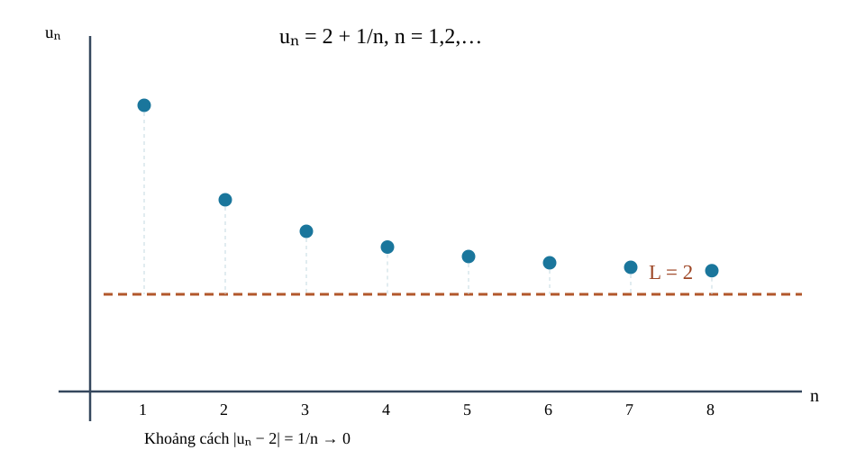
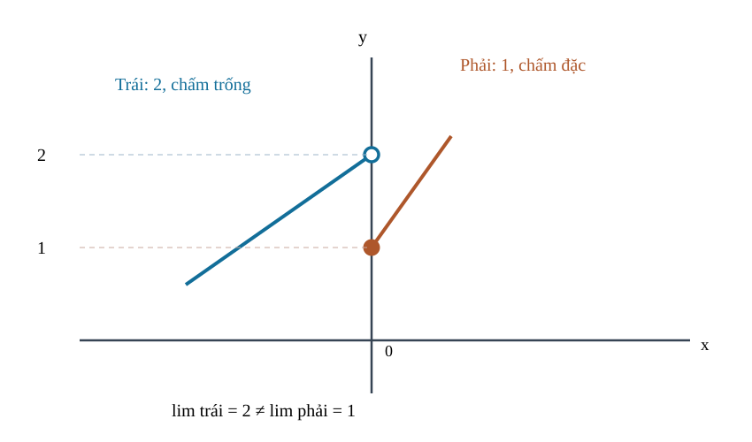
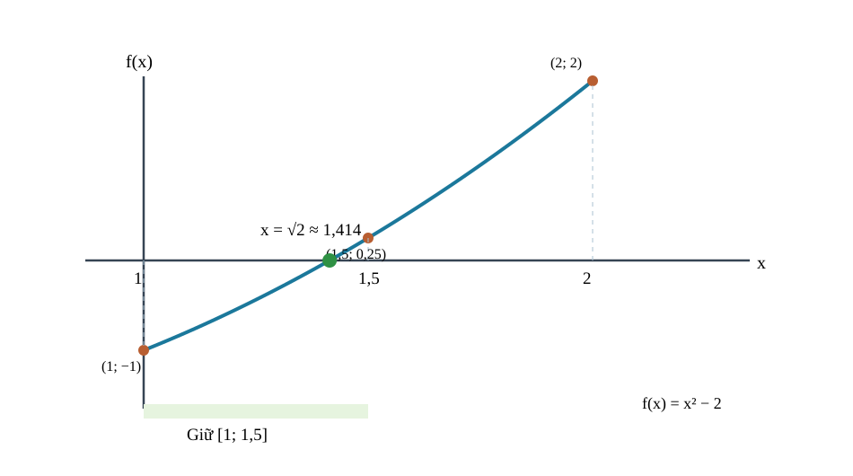

<!-- AUTHORING R04; immutable R03 Git blob bbb0169bd4809691b08963413abd16d20ae50073. Q18 source-lock verification required; no website integration. -->
<!-- STANDARD_ID=SLM-THPT-QUALITY-ONE; STANDARD_VERSION=3.1.0; LEARNING_PATH=TOPIC; OUTER_PAGES=Kiến thức|Luyện tập|Tự kiểm tra; SOURCE_VERSION=R04_AUTHORING_READY; AUTHORING_ONLY_METADATA=prototypes/thpt/content-drafts/topic08-limits-continuity/Temp_TOPIC08_R04_AUTHORING_ONLY_CUSTODY_METADATA_20261113.md -->
# CĐ08 — Giới hạn và tính liên tục

# Kiến thức

## Từ một điểm đến gần, đến sát và đến đúng

Khi muốn đo chính xác một độ dài, ta có thể thu nhỏ sai số đo mãi, dù chưa bao giờ ghi được giá trị hoàn toàn chính xác ở một lần thử. Một dãy số cũng có thể tiến sát giá trị đích mà không có số hạng nào bằng đích. Sau đó ta sẽ gặp hiện tượng tương tự ở hàm số: điều xảy ra **gần một điểm** không nhất thiết trùng giá trị của hàm tại chính điểm ấy. Hiểu sự khác biệt đó là chìa khóa để xét tính liên tục, phân biệt các kiểu gián đoạn và chứng minh sự tồn tại nghiệm bằng định lý giá trị trung gian.

Ta bắt đầu bằng câu hỏi đơn giản: muốn nói “càng ngày càng gần 2”, khoảng cách phải nhỏ đi như thế nào? Khi trả lời được bằng sai số, ta mới dùng quy tắc đại số để tính giới hạn và mở rộng sang đồ thị.

<!-- LESSON_ID: TOP08-M01; OUTCOME_ID: TOP08-O01 -->

Ta xét dãy \(u_n=2+1/n\) với \(n\) nguyên dương. Mọi số hạng đều lớn hơn 2, nên không số hạng nào bằng 2. Tuy vậy, khi \(n\) tăng, khoảng cách \(|u_n-2|=1/n\) nhỏ dần và có thể nhỏ hơn **bất kỳ độ sai lệch dương nào** nếu \(n\) đủ lớn. Đó là ý nghĩa của câu “dãy tiến tới giới hạn 2”: không đòi chạm giá trị đích ở một chỉ số hữu hạn.

Nói chính xác, \(u_n\to L\) nếu với mọi \(\varepsilon>0\), từ một chỉ số đủ lớn trở đi luôn có \(|u_n-L|<\varepsilon\). Trong ví dụ, chỉ cần chọn \(N>1/\varepsilon\) và \(n\ge N\), ta được \(1/n<\varepsilon\). Việc chứng minh bằng khoảng cách cho thấy công thức giới hạn không chỉ là phép thế \(n=\infty\), mà là một khẳng định về mọi mức sai số.

*Đọc hình:* Đồ thị gồm đúng **tám điểm** \((n,2+1/n)\) với \(n=1,\ldots,8\). Từng điểm đều nằm trên đường ngang \(L=2\) nhưng không chạm đường này; chỉ số \(n\) là số nguyên. Chính khoảng cách \(1/n\) giảm dần mới giải thích giới hạn, không phải việc kéo dài nét vẽ thành một đường liên tục.

<!-- LESSON_ID: TOP08-M02; OUTCOME_ID: TOP08-O02 -->

Một dãy không tiến gần số hữu hạn nào có thể tăng ra vô hạn hoặc dao động. Nếu các số hạng không tiến tới một số hữu hạn thì chắc chắn tiến +∞ hoặc −∞? Ta đã biết dấu số, n tăng, dãy chỉ số chẵn/lẻ. Có ba hành vi cần tách: hữu hạn, tiến vô cực có dấu, và không có giới hạn (dao động, có thể không bị chặn). u_n→+∞ nếu cuối cùng vượt mọi ngưỡng M, u_n→−∞ nếu cuối cùng nhỏ hơn −M. Dãy (−1)^n dao động giữa ±1: không có giới hạn hữu hạn nhưng cũng không tiến đến vô cực; xem hai dãy con chẵn/lẻ.

Chẳng hạn, v_n=−n² với n≥1 đi về −∞ vì với mọi M>0, n>√M thì v_n<−M. Còn w_n=(−1)^n có dãy con chẵn=1, lẻ=−1, nên không thể có cùng giới hạn. Chọn kiểm dãy con thay vì dựa trên vài số hạng.

<!-- LESSON_ID: TOP08-M03; OUTCOME_ID: TOP08-O03 -->

Dãy q^n cho thấy điều kiện về trị tuyệt đối q quyết định giới hạn. Số hạng đổi dấu luân phiên có nhất thiết không hội tụ? Ta sử dụng lũy thừa số thực và trị tuyệt đối. Khi |q|<1, |q^n|=|q|^n→0 nên q^n→0, kể cả q âm. Nếu q=1 thì q^n=1; q=−1 dao động; nếu q>1 thì q^n→+∞; q<−1 cho các nhánh dấu luân phiên với độ lớn tăng, không có giới hạn vô cực có dấu. Trường hợp q=0 cho 0^n=0 với n≥1.

Xét ví dụ: Với q=−1/4, số hạng q^n đổi dấu nhưng có độ lớn 1/4^n→0, nên giới hạn là 0. Chọn trị tuyệt đối để nhìn thấy cơ chế hội tụ trước khi hỏi dấu.

<!-- LESSON_ID: TOP08-M04; OUTCOME_ID: TOP08-O04 -->

Ta tính giới hạn các tổng và tỉ số nhưng mẫu cần được kiểm soát. Tại sao ký hiệu ∞/∞ không giúp tính giới hạn dãy phân thức? Ta bắt đầu từ giới hạn của 1/n, phép cộng/nhân/chia với mẫu giới hạn khác 0. Quy tắc cộng, nhân, chia giới hạn hữu hạn chỉ dùng trực tiếp khi các giới hạn liên quan hữu hạn và mẫu giới hạn khác 0. Đối với tỉ số đa thức theo n, chia cho lũy thừa cao nhất để các hạng 1/n^k tiến 0. Nếu có căn chứa n², nhớ n>0 nên √(n²)=n, còn với biến thực x có thể âm phải giữ |x|.

Chẳng hạn, lim(n→∞)(3n²+n)/(n²+7)=lim(3+1/n)/(1+7/n²)=3. Chọn bậc 2 vì đây là lũy thừa lớn nhất; sau chia mẫu tiến 1 khác 0.

<!-- LESSON_ID: TOP08-M05; OUTCOME_ID: TOP08-O05 -->

Tổng vô hạn của cấp số nhân chỉ hữu hạn khi điều kiện hội tụ được thỏa. Vô hạn số hạng có thể cộng thành hữu hạn như thế nào mà không mâu thuẫn? Cần nhớ cĐ07 định nghĩa CSN và tổng S_n hữu hạn, giới hạn q^n. Số S=∑_{k=0}^∞ a q^k được định nghĩa là giới hạn của các tổng riêng S_n, không phải phép cộng xong vô hạn bước. Nếu |q|<1, q^n→0 và S_n=a(1−q^n)/(1−q)→a/(1−q). Nếu |q|≥1 với a≠0 thì số hạng không tiến 0 nên tổng riêng không thể hội tụ. Phần dư R_n=a q^n/(1−q) quyết định sai số.

Chẳng hạn, 10+5+2,5+… có a=10,q=1/2; S_n=20(1−(1/2)^n), phần dư=20/2^n nên tổng tiến 20. Ta chọn xem S_n trước S∞ để thấy nguồn gốc điều kiện hội tụ.

### Vận dụng và tự đối chiếu

<!-- First Try TOP08-M01; formative only -->
**1.** Với \(v_n=1+3/n\), \(n\ge1\), dãy tiến tới số nào? Giải thích bằng khoảng cách.

Đối chiếu

Giới hạn bằng 1 vì \(|v_n-1|=3/n\to0\). Nếu em cho rằng giới hạn phải là một số hạng, hãy thử giải \(1+3/n=1\) để thấy không có \(n\) hữu hạn nào thỏa, dù dãy vẫn tiến tới 1.

<!-- First Try TOP08-M02; formative only -->
**2.** u_n=n², n≥1, giới hạn là gì?

Đối chiếu

+∞, vì n vượt mọi căn của ngưỡng dương.

Nếu cách làm của em chưa đúng, hãy kiểm tra lại điều kiện và lý do chọn phương pháp. Nếu viết 'vô hạn' cho (−1)^n, hãy liệt kê các số hạng chẵn và lẻ rồi xét giới hạn từng dãy con.

<!-- First Try TOP08-M03; formative only -->
**3.** lim(n→∞)(3/2)^n là gì?

Đối chiếu

+∞ vì 3/2>1 và lũy thừa tăng không bị chặn.

Nếu cách làm của em chưa đúng, hãy kiểm tra lại điều kiện và lý do chọn phương pháp. Nếu nhầm q âm với không hội tụ, so (−1/4)^n và (−1)^n qua |q|.

<!-- First Try TOP08-M04; formative only -->
**4.** lim(n→∞)(4n+3)/(2n−1) bằng bao nhiêu?

Đối chiếu

2, vì chia cho n cho (4+3/n)/(2−1/n)→2.

Nếu cách làm của em chưa đúng, hãy kiểm tra lại điều kiện và lý do chọn phương pháp. Nếu thế 'n=∞', hãy thực hiện phép chia n^k để chuyển sang giới hạn có thể tính.

<!-- First Try TOP08-M05; formative only -->
**5.** 6+2+2/3+… có tổng vô hạn bao nhiêu?

Đối chiếu

9, vì q=1/3 và S=6/(1−1/3)=9.

Nếu cách làm của em chưa đúng, hãy kiểm tra lại điều kiện và lý do chọn phương pháp. Nếu dùng công thức khi q=1 hoặc −1, hãy xét giới hạn của số hạng trước: nó không về 0.

## Từ dãy rời rạc tới hành vi của hàm số gần một điểm

Ở dãy số, ta tiến bằng những chỉ số nguyên ngày càng lớn. Với hàm số, ta có thể tiến tới cùng một hoành độ từ **bên trái hoặc bên phải** bằng các giá trị thực rất gần nhau. Đôi khi hàm bị khuyết ngay tại điểm đó, nhưng hai phía vẫn có thể cùng tiến tới một số. Ngược lại, khi hai phía tiến tới hai giá trị khác nhau, ta không thể gọi đó là một giới hạn hai phía. Nhìn lần lượt hai phía sẽ giúp em tự chọn đúng phép biến đổi khi gặp dạng chưa xác định.

<!-- LESSON_ID: TOP08-M06; OUTCOME_ID: TOP08-O06 -->

Vì sao một hàm không được định nghĩa tại x=a mà vẫn có giới hạn ở a? Để xác định điều đó, cần xét hàm số và phép biến đổi trên miền xác định. lim(x→a)f(x)=L hỏi giá trị f(x) khi x đủ gần a nhưng x≠a và thuộc miền xác định. Giá trị f(a) có thể khác L hoặc không tồn tại. Để tính giới hạn của phân thức có dạng 0/0, trước tiên nêu điều kiện loại điểm rồi biến đổi tương đương trên lân cận bỏ điểm, tuyệt đối không dùng kết quả để tự cho f(a) bằng L.

Chẳng hạn, f(x)=(x²−5x+6)/(x−2) với x≠2. Tử=(x−2)(x−3), rút còn x−3 trên miền x≠2; lim(x→2)f(x)=−1 dù f(2) không xác định. Chọn phân tích nhân tử vì thế trực tiếp cho 0/0.

<!-- LESSON_ID: TOP08-M07; OUTCOME_ID: TOP08-O07 -->

Tiến đến điểm từ trái và phải có thể cho hai kết quả khác nhau. Hàm có thể tiến đến hai giá trị khác nhau khi ta lại gần từ trái và từ phải không? Ta đã biết bất đẳng thức x<a/x>a, hàm xác định từng phần. Giới hạn trái lim(x→a⁻) xét x<a, phải lim(x→a⁺) xét x>a, đều đi trong miền xác định. Giới hạn hai phía hữu hạn tồn tại và bằng L khi và chỉ khi cả hai giới hạn một phía cùng tồn tại và bằng L. f(a) không quyết định hai giới hạn này; đọc điều kiện từng nhánh trước khi thế.

Chẳng hạn, f(x)=x+2 nếu x<0; f(x)=2x+1 nếu x≥0. Khi x→0⁻, f→2; khi x→0⁺, f→1. Hai giá trị khác nên không có giới hạn hai phía, mặc dù f(0)=1. Chọn phương pháp tách nhánh vì hàm từng phần.

<!-- LESSON_ID: TOP08-M08; OUTCOME_ID: TOP08-O08 -->

Khi hàm tăng không bị chặn gần điểm, ta gặp giới hạn vô cực. Một phân thức có mẫu tiến đến 0 thì luôn tiến +∞ không? Ta sử dụng bảng dấu, 0⁺ và 0⁻, tử khác 0 gần điểm. Khi tử tiến đến một số khác 0 và mẫu tiến 0, giới hạn có thể là +∞ hoặc −∞ tùy dấu tử/mẫu trên từng phía. Kí hiệu f(x)→+∞ hay −∞ mô tả không bị chặn theo dấu, không phải giới hạn hữu hạn. Nếu trái và phải vô cực khác dấu thì không thể nói có giới hạn vô cực chung có một dấu.

Xét ví dụ: f(x)=1/(x−5): x→5⁻ thì mẫu âm nhỏ ⇒ f→−∞; x→5⁺ thì mẫu dương nhỏ ⇒ f→+∞. Chọn bảng dấu mẫu vì tử dương không đổi.

<!-- LESSON_ID: TOP08-M09; OUTCOME_ID: TOP08-O09 -->

Ra xa trên trục hoành lại dẫn đến giới hạn ở vô cực. Hai đa thức đều rất lớn thì tỉ số sẽ luôn tiến đến 1? Ta bắt đầu từ quy tắc giới hạn 1/x^k→0 và dấu x âm. Với phân thức đa thức, so bậc tử/mẫu và chia cho lũy thừa x thích hợp. Nếu bậc bằng nhau thì giới hạn là tỉ số hệ số đầu (mẫu đầu khác 0); nếu bậc tử nhỏ hơn, giới hạn 0. Nếu bậc tử lớn hơn, cần xét dấu và bậc của phần còn lại, không tự viết ∞. Khi x→−∞, x lũy thừa chẵn dương, lẻ âm.

Chẳng hạn, lim(x→−∞)(2x²+5x)/(5x²−1) = lim(2+5/x)/(5−1/x²)=2/5. Chọn chia x² vì hai đa thức cùng bậc; −∞ không đổi dấu x².

<!-- LESSON_ID: TOP08-M10; OUTCOME_ID: TOP08-O10 -->

Thế trực tiếp cho dạng 0/0 đòi hỏi biến đổi có thể khử hợp lệ. Làm sao biến một biểu thức 'không xác định ở điểm' thành giới hạn tính được? Cần nhớ hằng đẳng thức và phân thức khác 0 ở lân cận bỏ điểm. 0/0 là dạng vô định khi thế thử, không phải kết quả. Tìm nhân tử chung và khử chỉ trên các x khác điểm cấm; biểu thức sau khử giúp tính giới hạn nhưng không mở rộng miền của hàm gốc. Khi nhân tử không triệt tiêu hoặc hàm từng nhánh khác, phải kiểm lại một phía.

Chẳng hạn, (x²−7x+12)/(x−3) có tử (x−3)(x−4); với x≠3 rút thành x−4, giới hạn tại 3 là −1. Chọn phân tích nhân tử vì nghiệm tử trùng nghiệm mẫu.

<!-- LESSON_ID: TOP08-M11; OUTCOME_ID: TOP08-O11 -->

Với căn thức, nhân liên hợp làm lộ nhân tử chung. Khi tử chứa √(x+a)−b, vì sao nhân liên hợp giúp thay dạng 0/0 bằng một phân thức có giới hạn? Để xác định điều đó, cần xét (A−B)(A+B)=A²−B², miền căn. Với phân thức chứa √(x+c)−d và điểm thế cho tử/mẫu đều 0, nhân cả tử và mẫu với liên hợp √(x+c)+d để trừ hai bình phương, lộ nhân tử khử. Phép biến đổi chỉ hợp lệ trên miền gốc, khi mẫu liên hợp khác 0; sau khử mới thế giới hạn. Không dùng phép nhân liên hợp để 'thay' điều kiện căn.

Chẳng hạn, lim(x→0)(√(x+16)−4)/x: nhân liên hợp (√(x+16)+4), được 1/(√(x+16)+4) với x≠0 nên giới hạn 1/8. Chọn liên hợp vì bình phương sẽ tạo x để khử.

<!-- LESSON_ID: TOP08-M12; OUTCOME_ID: TOP08-O12 -->

Dạng vô cực trừ vô cực cần biến đổi mà không được bỏ dấu. Tại sao √(x²) không luôn bằng x? Ta đã biết trị tuyệt đối |x|, nhân liên hợp, giới hạn 1/x. Khi x→+∞, √(x²)=x vì x>0; khi x→−∞, √(x²)=−x. Với √(x²+a x)−x ở +∞, nhân liên hợp để biến hiệu hai lượng lớn thành phân thức có giới hạn. Ở −∞ không được chia bằng cùng giả thiết x>0. Giới hạn có thể hữu hạn dù hai thành phần đều vô hạn.

Chẳng hạn, lim(x→+∞)[√(x²+6x)−x] = lim(6x)/[√(x²+6x)+x]=lim 6/[√(1+6/x)+1]=3. Chọn nhân liên hợp thay cho viết '∞−∞'.

### Vận dụng và tự đối chiếu

<!-- First Try TOP08-M06; formative only -->
**1.** lim(x→0) [x(x−4)]/x (x≠0) bằng bao nhiêu?

Đối chiếu

−4 do biểu thức rút còn x−4 trên miền x≠0.

Nếu cách làm của em chưa đúng, hãy kiểm tra lại điều kiện và lý do chọn phương pháp. Nếu gọi 0/0 là giới hạn, xem hai hàm (x−2)/(x−2) và 2(x−2)/(x−2), cùng thế 0/0 nhưng có giới hạn 1 và 2.

<!-- First Try TOP08-M07; formative only -->
**2.** lim(x→0⁻)|x|/x và lim(x→0⁺)|x|/x bằng gì?

Đối chiếu

−1 và +1, nên giới hạn hai phía không tồn tại.

Nếu cách làm của em chưa đúng, hãy kiểm tra lại điều kiện và lý do chọn phương pháp. Nếu chỉ thế nhánh x≥0 tại 0, hãy vẽ hai mũi tên tiến vào 0 từ hai phía.

<!-- First Try TOP08-M08; formative only -->
**3.** lim(x→3⁻) 1/(3−x) là gì?

Đối chiếu

+∞ vì 3−x tiến 0 từ phía dương.

Nếu cách làm của em chưa đúng, hãy kiểm tra lại điều kiện và lý do chọn phương pháp. Nếu cứ thấy mẫu 0 là +∞, đặt x=4,99 và 5,01 để kiểm dấu mẫu.

<!-- First Try TOP08-M09; formative only -->
**4.** lim(x→+∞)(−3x³+1)/(x³+4) bằng bao nhiêu?

Đối chiếu

−3; chia cả tử/mẫu cho x³.

Nếu cách làm của em chưa đúng, hãy kiểm tra lại điều kiện và lý do chọn phương pháp. Nếu giữ dấu 'x âm' ở mọi hạng, tách x² và x³ ra để so dấu của từng lũy thừa.

<!-- First Try TOP08-M10; formative only -->
**5.** lim(x→6)(x²−36)/(x−6) bằng gì?

Đối chiếu

12, vì tử=(x−6)(x+6) và x≠6.

Nếu cách làm của em chưa đúng, hãy kiểm tra lại điều kiện và lý do chọn phương pháp. Nếu viết 0/0 hoặc giá trị hàm tại x=3, trở lại định nghĩa lân cận loại điểm.

<!-- First Try TOP08-M11; formative only -->
**6.** lim(x→0)(√(x+25)−5)/x bằng bao nhiêu?

Đối chiếu

1/10, vì bằng 1/(√(x+25)+5) gần x=0.

Nếu cách làm của em chưa đúng, hãy kiểm tra lại điều kiện và lý do chọn phương pháp. Nếu căn khiến bạn 'bình phương cả phân thức', thử nhân liên hợp đúng dạng và giữ điều kiện x+c≥0.

<!-- First Try TOP08-M12; formative only -->
**7.** lim(x→+∞)[√(x²+8x)−x] bằng bao nhiêu?

Đối chiếu

4, bằng 8/[√(1+8/x)+1]→4.

Nếu cách làm của em chưa đúng, hãy kiểm tra lại điều kiện và lý do chọn phương pháp. Nếu quên dấu x, thay x=−10 để thấy √(x²)=10 chứ không phải −10.

## Khi giới hạn gần điểm khớp với chính giá trị tại điểm

Một đường cong có thể đi sát tới cùng một độ cao từ hai phía, nhưng điểm được tô đặc trên đồ thị lại nằm ở nơi khác. Ta chỉ gọi hàm **liên tục tại điểm** nếu giá trị được xác định ở điểm đó và bằng giới hạn từ hai phía. Nhờ vậy, hình vẽ không phải dấu hiệu để đoán bằng mắt: ta có thể kiểm chính xác một lỗ thủng, một bước nhảy hay một tiệm cận vô cực.

Tính liên tục nối giới hạn với giá trị hàm. Ta sẽ thấy sự khác biệt giữa một lỗ có thể vá, một bước nhảy và một nhánh lao ra vô cực trước khi dùng quy tắc liên tục.

<!-- LESSON_ID: TOP08-M13; OUTCOME_ID: TOP08-O13 -->

Giới hạn có thể tồn tại nhưng hàm vẫn 'đứt' tại đúng điểm không? Ta sử dụng giới hạn hai phía, giá trị hàm và đẳng thức. f liên tục tại a khi a thuộc miền xác định, lim(x→a)f(x) tồn tại hữu hạn và bằng f(a). Chỉ một trong ba điều không đủ. Hàm có thể sửa bằng gán lại f(a) nếu giới hạn hữu hạn tồn tại; không thể sửa một cú nhảy với hai giới hạn một phía khác nhau chỉ bằng đổi một giá trị.

Xét ví dụ: Đặt f(x)=(x²−5x+6)/(x−2) nếu x≠2 và f(2)=k. Như M06, lim tại 2 là −1 nên chỉ k=−1 cho liên tục. Chọn so giới hạn đã tính với điểm thay vì giả định thế được phân thức gốc.

<!-- LESSON_ID: TOP08-M14; OUTCOME_ID: TOP08-O14 -->

Giới hạn và giá trị tại điểm có thể lệch nhau theo những cách rất khác. Đồ thị 'đứt' có phải lúc nào cũng vá được bằng một điểm mới? Ta bắt đầu từ giới hạn trái/phải và miền xác định. Gián đoạn khử được khi giới hạn hai phía hữu hạn tồn tại nhưng giá trị tại điểm thiếu/khác; có thể đặt lại f(a)=L. Gián đoạn nhảy khi hai giới hạn hữu hạn một phía khác nhau, không thể vá bằng một giá trị. Gián đoạn vô cực khi ít nhất một phía tăng không bị chặn; cần xem chiều và dấu. Nhận dạng dựa vào giới hạn, không chỉ nét đồ thị.

Chẳng hạn, f=|x|/x (x≠0) có giới hạn trái −1, phải +1 ⇒ gián đoạn nhảy tại 0. g=1/x có hai phía ±∞ ⇒ gián đoạn vô cực tại 0. h=(x²−4)/(x−2) nếu x≠2 rút x+2, lim=4 ⇒ hole khử được ở 2. Chọn so một phía trước khi kết luận.

Ngay tại hình này, ta xét hàm từng đoạn \(f(x)=x+2\) khi \(x<0\), còn \(f(x)=2x+1\) khi \(x\ge0\). Khi \(x\to0^-\), nhánh trái tiến tới 2 nhưng **không lấy** \((0,2)\); khi \(x\to0^+\), nhánh phải tiến tới 1 và có điểm đặc \((0,1)\), nên \(f(0)=1\). Vì 2 khác 1, hàm **không có giới hạn hai phía** ở 0 và không liên tục tại 0. Điều này khác ví dụ \(|x|/x\) ở trên: cả hai là gián đoạn nhảy nhưng độ cao một phía không giống nhau.

*Đọc hình:* Nhánh trái \(y=x+2\) có chấm rỗng \((0,2)\); nhánh phải \(y=2x+1\) có chấm đặc \((0,1)\). Chấm đặc cho biết giá trị **tại** 0, còn độ cao khi tiến tới 0 từ hai phía là hai giới hạn riêng, khác nhau.

<!-- LESSON_ID: TOP08-M15; OUTCOME_ID: TOP08-O15 -->

Trên khoảng và đoạn, tính liên tục phải được xét cả đầu mút. Hàm √x có thiếu 'giới hạn trái' tại x=0 trong miền của nó, vậy có thể liên tục trên [0,9] không? Cần nhớ miền căn không âm, giới hạn một phía. Hàm liên tục trên (a,b) khi liên tục tại từng điểm bên trong; liên tục trên [a,b] còn yêu cầu liên tục từ phải tại a và từ trái tại b, theo miền xác định. Ở đầu mút không yêu cầu xét bên ngoài miền. Nếu miền là tập hợp nhiều khoảng rời, không tuyên bố 'liên tục qua lỗ' ở điểm ngoài miền.

Chẳng hạn, f(x)=√x trên [0,9] liên tục bên trong vì căn liên tục trên [0,+∞), tại 0 giới hạn phải=0=f(0) và tại 9 giới hạn trái=3=f(9). Chọn kiểm đầu mút theo đúng phía trong đoạn.

<!-- LESSON_ID: TOP08-M16; OUTCOME_ID: TOP08-O16 -->

Phép toán giữ tính liên tục khi miền và điều kiện phù hợp. Nếu mỗi phép tính trong hàm trông quen thuộc, có thể bỏ qua miền xác định khi kết luận liên tục? Để xác định điều đó, cần xét đa thức, căn, mẫu khác 0, hợp hàm. Đa thức liên tục trên ℝ; căn liên tục nơi đối số không âm; phân thức liên tục tại điểm có mẫu khác 0, và tổng/tích/hợp các hàm liên tục vẫn liên tục khi các điều kiện miền được giữ. Luôn tìm miền chung của căn và mẫu trước khi viết khoảng liên tục. Tại đầu mút của miền liên tục tương đối có thể chỉ xét một phía.

Chẳng hạn, f(x)=(x²+1)/(x−1) có miền ℝ\{1} nên liên tục trên (−∞,1) và (1,∞), không thể nói liên tục trên toàn ℝ. Phép chia thất bại tại 1 dù tử vẫn có nghĩa.

### Vận dụng và tự đối chiếu

<!-- First Try TOP08-M13; formative only -->
**1.** Cho f(x)=sin x khi x≠0 và f(0)=c; cần c bằng gì để liên tục?

Đối chiếu

c=0 vì lim(x→0)sin x=0, bằng giá trị ở điểm.

Nếu cách làm của em chưa đúng, hãy kiểm tra lại điều kiện và lý do chọn phương pháp. Nếu quên hàm phải được định nghĩa tại a, so 'hole' và 'point f(a)=...' trên đồ thị.

<!-- First Try TOP08-M14; formative only -->
**2.** Nếu g(x)=(x²−1)/(x−1) với x≠1 và g(1)=3, thuộc kiểu gián đoạn nào?

Đối chiếu

Khử được: lim(x→1)g(x)=2 nhưng g(1)=3; đổi g(1)=2 thì liên tục.

Nếu cách làm của em chưa đúng, hãy kiểm tra lại điều kiện và lý do chọn phương pháp. Nếu gọi tất cả lỗ bằng vô cực, kiểm có khử được nhân tử chung hay không.

<!-- First Try TOP08-M15; formative only -->
**3.** g(x)=√(16−x²) có liên tục trên [−4,4] không?

Đối chiếu

Có; trong đoạn biểu thức trong căn không âm và liên tục, tại −4 chỉ cần giới hạn phải, tại 4 chỉ cần trái.

Nếu cách làm của em chưa đúng, hãy kiểm tra lại điều kiện và lý do chọn phương pháp. Nếu hỏi giới hạn trái của √x ở 0 trong ℝ và nói 'không liên tục', hãy trở về định nghĩa liên tục trên miền [0,9].

<!-- First Try TOP08-M16; formative only -->
**4.** h(x)=√(x+2)/(x+1): miền xác định là gì?

Đối chiếu

x≥−2 và x≠−1; liên tục trên [−2,−1) và (−1,∞) theo miền.

Nếu cách làm của em chưa đúng, hãy kiểm tra lại điều kiện và lý do chọn phương pháp. Nếu kiểm căn x+2≥0 nhưng bỏ mẫu x+1≠0, hãy ghi hai điều kiện bằng dấu 'và'.

## Từ đường cong không đứt tới khẳng định có nghiệm

Nếu một hàm liên tục trên đoạn và nhận giá trị âm ở đầu này, dương ở đầu kia, nó buộc phải đi qua mức 0 ở một vị trí giữa hai đầu. Đây không phải suy đoán từ vài điểm trên đồ thị mà là định lý giá trị trung gian. Từ bảo đảm **tồn tại** ấy, ta có thể dùng phép chia đôi để tìm khoảng ngày càng nhỏ chứa nghiệm, dù chưa biết công thức nghiệm chính xác.

Biết đồ thị không đứt và hai đầu một khoảng có dấu trái nhau, ta có thể kết luận có điểm cắt trục ngay cả khi chưa giải phương trình chính xác. Phương pháp chia đôi biến kết luận tồn tại ấy thành cách tìm xấp xỉ.

<!-- LESSON_ID: TOP08-M17; OUTCOME_ID: TOP08-O17 -->

Làm sao biết một phương trình có nghiệm dù chưa tìm được công thức nghiệm? Ta đã biết liên tục trên đoạn đóng, dấu âm/dương. Nếu f liên tục trên [a,b] và f(a)f(b)<0 thì theo định lí giá trị trung gian có ít nhất một c∈(a,b) với f(c)=0. Định lí cho tồn tại, không tự cho duy nhất; nếu f(a)f(b)>0 cũng không đủ kết luận vô nghiệm. Muốn duy nhất cần lý do độc lập (đơn điệu, v.v.). Không dùng IVT khi có điểm gián đoạn trong đoạn.

Chẳng hạn, g(x)=x³−2 liên tục trên [1,2]; g(1)=−1, g(2)=6, nên tồn tại c∈(1,2) với g(c)=0. Có nghiệm thực ∛2, nhưng IVT chỉ khẳng định tồn tại; ta chọn IVT để làm chứng cứ không cần tính căn chính xác.

<!-- LESSON_ID: TOP08-M18; OUTCOME_ID: TOP08-O18 -->

Sau kết luận tồn tại nghiệm, chia đôi giúp khoanh nghiệm bằng phép tính. Sau khi biết có nghiệm, làm thế nào khoanh vùng được nó mà chưa dùng máy tính? Ta sử dụng iVT, giá trị tại trung điểm, dấu trái/phải. Chia đôi đoạn [a,b] có f liên tục và hai đầu trái dấu: tại m=(a+b)/2, nếu f(m)=0 thì tìm xong; nếu không, giữ nửa đoạn có hai giá trị đầu trái dấu. Lặp lại, độ dài đoạn sau k bước bằng (b−a)/2^k. Phải nói rõ mô hình toán có miền t và đơn vị; nghiệm mô hình không tự là kết luận thực nghiệm.

Xét ví dụ: Với g(x)=x²−2 trên [1,2], g(1)=−1,g(2)=2. Bước 1 m=1,5: g=0,25>0 giữ [1,1,5]. Bước 2 m=1,25: g=−0,4375<0 giữ [1,25,1,5]; nghiệm √2 vẫn trong khoảng dài 0,25. Chọn dấu bảo toàn điều kiện IVT sau mỗi bước.

*Đọc hình:* Với \(f(x)=x^2-2\), đầu \(x=1\) có \(f=-1\) và \(x=2\) có \(f=2\), nên có ít nhất một nghiệm giữa chúng. Tại trung điểm \(1{,}5\), \(f=0{,}25>0\), vì thế bước đầu giữ \([1,1{,}5]\). Định lý bảo đảm **tồn tại**, còn tính duy nhất cần lập luận riêng.

### Vận dụng và tự đối chiếu

<!-- First Try TOP08-M17; formative only -->
**1.** x²−3 có nghiệm trong (1,2) theo IVT không?

Đối chiếu

Có; f(1)=−2<0, f(2)=1>0 và đa thức liên tục.

Nếu cách làm của em chưa đúng, hãy kiểm tra lại điều kiện và lý do chọn phương pháp. Nếu viết 'duy nhất do IVT', thử g(x)=x(x−1)(x+1) trên [−2,2] có nhiều nghiệm mặc dù đổi dấu hai đầu.

<!-- First Try TOP08-M18; formative only -->
**2.** Với x²−3 trên [1,2], sau một bước chia đôi giữ nửa nào?

Đối chiếu

g(1,5)=−0,75, g(2)=1 nên giữ [1,5; 2]; g vẫn đổi dấu.

Nếu cách làm của em chưa đúng, hãy kiểm tra lại điều kiện và lý do chọn phương pháp. Nếu chọn nửa không trái dấu, viết bảng f(a),f(m),f(b) và tìm cặp tích âm trước khi loại nửa còn lại.

<!-- AUTHORING_ONLY: source-locked figure custody and interaction SPEC_ONLY notes preserved in original R02 blob ef118d499f0c6bb4828f5f2db169e3135b187169. The learner text already places verified SVG inline. -->

# Luyện tập

Em bắt đầu với **giới hạn của dãy số**: chứng minh khoảng cách giảm, xét dãy dao động, phân biệt tổng hữu hạn với tổng vô hạn hội tụ. Tiếp theo, với **giới hạn hàm**, hãy nhìn hai phía, xác định điểm cấm trước khi rút gọn phân thức hoặc nhân liên hợp. Khi học **liên tục**, em kiểm đồng thời giá trị tại điểm và giới hạn tiến tới điểm; đừng kết luận chỉ bằng một chấm trên hình.

Cuối cùng, em luyện dùng dấu ở hai đầu một đoạn để chứng minh **có ít nhất một nghiệm**, rồi chia đôi đoạn và giải thích vì sao khoảng giữ lại vẫn chứa nghiệm. Phần Luyện tập phải hiển thị trực tiếp các câu hỏi từ ngân hàng canonical: 36 câu SGK tái sử dụng và 22 câu mới (18 bài luyện, 4 tự luận). Hãy làm trước khi xem hướng dẫn, tự đối chiếu điều kiện rồi quay về đoạn kiến thức liên quan; không phải tìm các tệp kỹ thuật.

# Tự kiểm tra

Em thực hiện 18 câu đã được chọn trải đều 18 mục tiêu, từ dãy hội tụ đến giới hạn hai phía, tính liên tục và định lý giá trị trung gian. Chỉ sau khi **Final Submit** mới đối chiếu đúng/sai, lời giải và hướng khắc phục. Đây là phần tự xem lại kiến thức, dùng lại các câu đã luyện nên **không phải** kiểm tra độc lập hay điểm thành thạo chính thức.

Sau khi nộp, em tự tìm lý do sai, quay lại phần giải thích tương ứng và thử một bài khác trước khi kết luận mình đã hiểu.

<!-- AUTHORING-ONLY CANONICAL SOURCE IDS, not duplicate stems/keys and not learner-visible:
- THPT-G11-CHV-B15-C01
- THPT-G11-CHV-B15-C02
- THPT-G11-CHV-B15-C03
- THPT-G11-CHV-B15-P01
- THPT-G11-CHV-B15-P02
- THPT-G11-CHV-B15-P03
- THPT-G11-CHV-B15-P04
- THPT-G11-CHV-B15-P05
- THPT-G11-CHV-B15-P06
- THPT-G11-CHV-B15-P07
- THPT-G11-CHV-B16-C01
- THPT-G11-CHV-B16-C02
- THPT-G11-CHV-B16-C03
- THPT-G11-CHV-B16-P01
- THPT-G11-CHV-B16-P02
- THPT-G11-CHV-B16-P03
- THPT-G11-CHV-B16-P04
- THPT-G11-CHV-B16-P05
- THPT-G11-CHV-B16-P06
- THPT-G11-CHV-B16-P07
- THPT-G11-CHV-B17-C01
- THPT-G11-CHV-B17-C02
- THPT-G11-CHV-B17-C03
- THPT-G11-CHV-B17-P01
- THPT-G11-CHV-B17-P02
- THPT-G11-CHV-B17-P03
- THPT-G11-CHV-B17-P04
- THPT-G11-CHV-B17-P05
- THPT-G11-CHV-B17-P06
- THPT-G11-CHV-B17-P07
- THPT-G11-CHV-B15-W01
- THPT-G11-CHV-B15-W02-ANCHOR
- THPT-G11-CHV-B16-W01
- THPT-G11-CHV-B16-W02-ANCHOR
- THPT-G11-CHV-B17-W01
- THPT-G11-CHV-B17-W02-ANCHOR
- THPT-TOP08-P01
- THPT-TOP08-P02
- THPT-TOP08-P03
- THPT-TOP08-P04
- THPT-TOP08-P05
- THPT-TOP08-P06
- THPT-TOP08-P07
- THPT-TOP08-P08
- THPT-TOP08-P09
- THPT-TOP08-P10
- THPT-TOP08-P11
- THPT-TOP08-P12
- THPT-TOP08-P13
- THPT-TOP08-P14
- THPT-TOP08-P15
- THPT-TOP08-P16
- THPT-TOP08-P17
- THPT-TOP08-P18
- THPT-TOP08-W01
- THPT-TOP08-W02
- THPT-TOP08-W03
- THPT-TOP08-W04
-->
