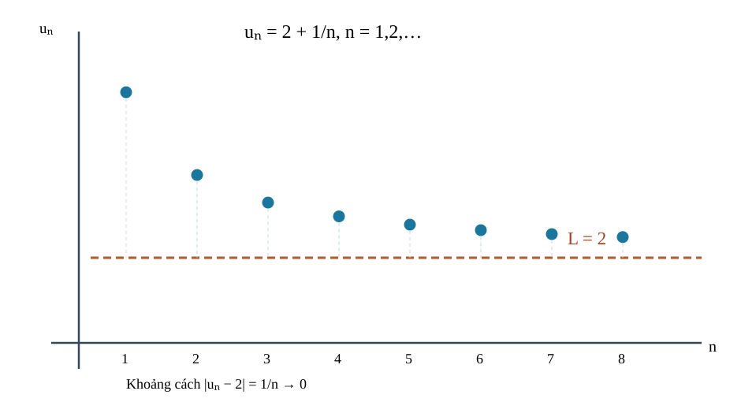
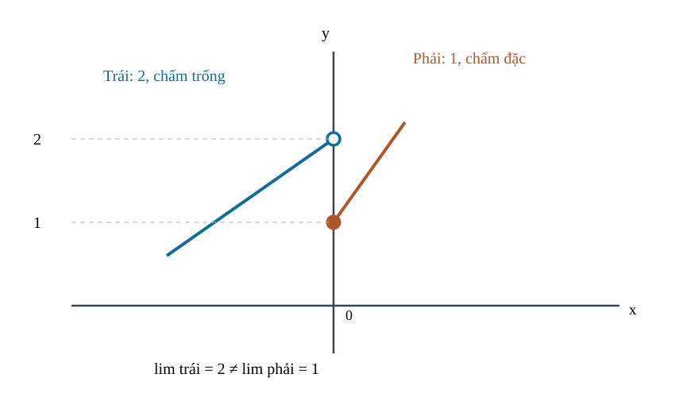
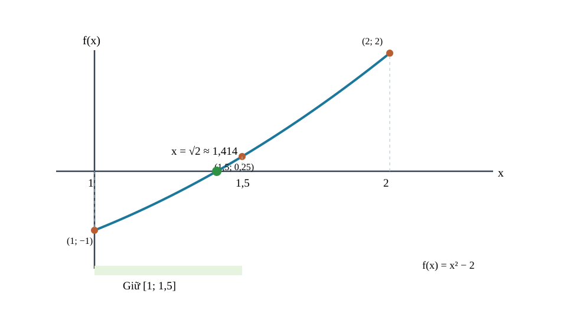

<!-- AUTHORING_ONLY_NOT_FOR_STUDENT_VIEW: CĐ08 R05 is current one source-author-self-verified learner canonical; R04 was immutable historical source, not the active release handoff. -->
<!-- AUTHORING_ONLY_NOT_FOR_STUDENT_VIEW: STANDARD_ID=SLM-THPT-QUALITY-ONE; STANDARD_VERSION=3.2.0; LEARNING_PATH=TOPIC; OUTER_PAGES=Kiến thức|Luyện tập|Tự kiểm tra; SOURCE_VERSION=R05_CANONICAL_AUTHOR_SELF_Q18; ORIGINAL36_INDEX_BLOB=43cbb73bd06e0da6bf8838d925186bc4db4194a7; NEW22_BANK_BLOB=2e93db80384de53e208248eaa0396a7f487302ac -->
# CĐ08 — Giới hạn và tính liên tục

# Kiến thức

## 1. Từ một điểm đến gần, đến sát và đến đúng

Khi muốn đo chính xác một độ dài, ta có thể thu nhỏ sai số đo mãi, dù chưa bao giờ ghi được giá trị hoàn toàn chính xác ở một lần thử. Một dãy số cũng có thể tiến sát giá trị đích mà không có số hạng nào bằng đích. Sau đó ta sẽ gặp hiện tượng tương tự ở hàm số: điều xảy ra **gần một điểm** không nhất thiết trùng giá trị của hàm tại chính điểm ấy. Hiểu sự khác biệt đó là chìa khóa để xét tính liên tục, phân biệt các kiểu gián đoạn và chứng minh sự tồn tại nghiệm bằng định lý giá trị trung gian.

Ta bắt đầu bằng câu hỏi đơn giản: muốn nói “càng ngày càng gần 2”, khoảng cách phải nhỏ đi như thế nào? Khi trả lời được bằng sai số, ta mới dùng quy tắc đại số để tính giới hạn và mở rộng sang đồ thị.

### 1.1. Giới hạn dãy số qua sai số

<!-- LESSON_ID: TOP08-M01; OUTCOME_ID: TOP08-O01 -->

Ta xét dãy \(u_n=2+\frac1n\) với \(n\) nguyên dương. Mọi số hạng đều lớn hơn 2, nên không số hạng nào bằng 2. Tuy vậy, khi \(n\) tăng, khoảng cách \(|u_n-2|=\frac1n\) nhỏ dần và có thể nhỏ hơn **bất kỳ độ sai lệch dương nào** nếu \(n\) đủ lớn. Đó là ý nghĩa của câu “dãy tiến tới giới hạn 2”: không đòi chạm giá trị đích ở một chỉ số hữu hạn.

> **ĐỊNH NGHĨA — Giới hạn hữu hạn của dãy số.** Viết \(\lim_{n\to\infty}u_n=L\) khi với **mọi** \(\varepsilon>0\) đều có một chỉ số \(N\) sao cho \(|u_n-L|<\varepsilon\) với **mọi** \(n\ge N\) thuộc miền chỉ số. Không yêu cầu dãy có số hạng bằng \(L\).

 Trong ví dụ, chỉ cần chọn \(N>\frac1\varepsilon\) và \(n\ge N\), ta được \(\frac1n<\varepsilon\). Ví dụ, nếu yêu cầu sai số nhỏ hơn \(0{,}01\), chọn \(N=101\): mọi \(n\ge101\) đều có \(\frac1n\le\frac1{101}<0{,}01\). Nếu đổi yêu cầu thành \(0{,}001\), ta chọn \(N=1001\). Việc chứng minh bằng khoảng cách cho thấy công thức giới hạn không chỉ là phép thế \(n=\infty\), mà là một khẳng định về mọi mức sai số.

*Đọc hình:* Đồ thị gồm đúng **tám điểm** \((n;2+\frac1n)\) với \(n=1,\ldots,8\). Từng điểm đều nằm **phía trên** đường ngang \(L=2\) và không chạm đường này; chỉ số \(n\) là số nguyên. Chính khoảng cách \(\frac1n\) giảm dần mới giải thích giới hạn, không phải việc kéo dài nét vẽ thành một đường liên tục.

**Ví dụ**

**Đề bài.** Cho dãy \(v_n=4-\dfrac2n\), \(n\ge1\). Chứng minh \(\lim_{n\to\infty}v_n=4\) bằng sai số và xem dãy có nhận giá trị \(4\) không.

**Lời giải.** Khoảng cách \(|v_n-4|=\frac2n\). Với bất kỳ \(\varepsilon>0\), lấy \(N\) nguyên lớn hơn \(\frac2\varepsilon\); mọi \(n\ge N\) đều cho \(\frac2n<\varepsilon\), nên \(v_n\to4\). Không số hạng nào bằng \(4\) vì \(\frac2n>0\) khi \(n\ge1\).

**Vận dụng** Với \(v_n=1+\frac3n\), \(n\ge1\), dãy tiến tới số nào? Giải thích bằng khoảng cách.

Đối chiếu

Giới hạn bằng 1 vì \(|v_n-1|=\frac3n\to0\). Nếu em cho rằng giới hạn phải là một số hạng, hãy thử giải \(1+\frac3n=1\) để thấy không có \(n\) hữu hạn nào thỏa, dù dãy vẫn tiến tới 1.

**Kiểm lỗi**

Nếu em cho rằng giới hạn phải là một số hạng của dãy, đọc lại **Kiến thức 1.1** rồi giải **Bài 1** và **Bài 3** trong Luyện tập. Tách điều kiện chỉ số nguyên dương khỏi việc khoảng cách tới giá trị giới hạn tiến về 0.

### 1.2. Dãy tiến vô cực và dãy dao động

<!-- LESSON_ID: TOP08-M02; OUTCOME_ID: TOP08-O02 -->

> **ĐỊNH NGHĨA — Dãy tiến vô cực và dãy dao động.** Một dãy không tiến gần số hữu hạn nào có thể tăng ra vô hạn hoặc dao động. Nếu các số hạng không tiến tới một số hữu hạn thì chắc chắn tiến \(+\infty\) hoặc \(-\infty\)? Ta đã biết dấu số, chỉ số \(n\) tăng, dãy chỉ số chẵn/lẻ. Có ba hành vi cần tách: hữu hạn, tiến vô cực có dấu, và không có giới hạn (dao động, có thể không bị chặn). \(u_n\to+\infty\) nếu với mỗi \(M>0\), mọi số hạng từ một chỉ số đủ lớn trở đi đều lớn hơn \(M\); \(u_n\to-\infty\) nếu cuối cùng mọi số hạng nhỏ hơn \(-M\). Dãy \((-1)^n\) dao động giữa \(\pm1\): không có giới hạn hữu hạn nhưng cũng không tiến đến vô cực; xem hai dãy con chẵn/lẻ.

Một quy tắc hữu ích khi một dãy hữu hạn được chia cho dãy tiến tới vô cực: nếu \(u_n\to A\) hữu hạn và \(v_n\to+\infty\) hoặc \(-\infty\), thì \(\frac{u_n}{v_n}\to0\). Khi \(u_n\to+\infty\) và \(v_n\to A>0\), tích \(u_nv_n\to+\infty\) (vì từ một chỉ số đủ lớn, \(v_n>\frac A2\)). Nếu \(u_n\to A>0\), \(v_n\to0\) và \(v_n>0\) từ một chỉ số đủ lớn, thương \(\frac{u_n}{v_n}\to+\infty\). Các trường hợp dấu âm xét tương tự. Chẳng hạn, \(n^2-2n=n^2(1-\frac2n)\to+\infty\), vì thừa số sau tiến tới 1 dương. Không thực hiện phép tính với \(\infty\) như một số thực.

Chẳng hạn, \(v_n=-n^2\) với \(n\ge1\) đi về \(-\infty\) vì với mọi \(M>0\), \(n>\sqrt M\) thì \(v_n<-M\). Còn \(w_n=(-1)^n\) có dãy con chẵn bằng 1, lẻ bằng \(-1\), nên không thể có cùng giới hạn. Chọn kiểm dãy con thay vì dựa trên vài số hạng.

**Ví dụ**

**Đề bài.** Xét \(a_n=n+(-1)^n\) và \(b_n=(-1)^n\). Dãy nào tiến tới \(+\infty\), dãy nào dao động?

**Lời giải.** Với \(a_n\), luôn có \(a_n\ge n-1\); khi \(n\) đủ lớn thì \(a_n\) vượt mọi ngưỡng dương, vậy \(a_n\to+\infty\) dù có thành phần đổi dấu. Với \(b_n\), hai dãy con chẵn và lẻ bằng \(1\) và \(-1\), nên không có giới hạn chung hay giới hạn vô cực có dấu.

**Vận dụng** So sánh hành vi của \(u_n=n^2\) và \(w_n=(-1)^n n\), \(n\ge1\). Dãy nào tiến đến \(+\infty\)?

Đối chiếu

Dãy \(u_n\to+\infty\), vì với mỗi \(M>0\), mọi \(n>\sqrt M\) cho \(n^2>M\). Dãy \(w_n\) có các số hạng chẵn \(2,4,6,\ldots\) tiến tới \(+\infty\), còn các số hạng lẻ \(-1,-3,-5,\ldots\) tiến tới \(-\infty\); không có giới hạn chung. Không bị chặn không đồng nghĩa với tiến tới vô cực có một dấu.

Nếu viết 'vô hạn' cho \((-1)^n\), hãy liệt kê các số hạng chẵn và lẻ rồi xét giới hạn từng dãy con.

**Kiểm lỗi**

Nếu em cho rằng mọi dãy không hội tụ hữu hạn đều tiến ra vô cực có dấu, đọc lại **Kiến thức 1.2**, làm **Bài 4** (dao động chẵn/lẻ), **Bài 5** (tiến −∞) rồi **Bài 6** (dãy con có hai giới hạn khác nhau).

### 1.3. Giới hạn dãy lũy thừa

<!-- LESSON_ID: TOP08-M03; OUTCOME_ID: TOP08-O03 -->

> **TÍNH CHẤT — Giới hạn dãy lũy thừa.** Dãy \(q^n\) cho thấy điều kiện về trị tuyệt đối của \(q\) quyết định giới hạn. Số hạng đổi dấu luân phiên có nhất thiết không hội tụ? Ta sử dụng lũy thừa số thực và trị tuyệt đối. Khi \(|q|<1\), \(|q^n|=|q|^n\to0\) nên \(q^n\to0\), kể cả \(q\) âm. Nếu \(q=1\) thì \(q^n=1\); \(q=-1\) dao động; nếu \(q>1\) thì \(q^n\to+\infty\); \(q<-1\) cho các nhánh dấu luân phiên với độ lớn tăng, không có giới hạn vô cực có dấu. Trường hợp \(q=0\) cho \(0^n=0\) với \(n\ge1\).

Xét ví dụ: Với \(q=-\frac14\), số hạng \(q^n\) đổi dấu nhưng có độ lớn \(\frac1{4^n}\to0\), nên giới hạn là 0. Chọn trị tuyệt đối để nhìn thấy cơ chế hội tụ trước khi hỏi dấu.

Quy tắc kẹp về 0: nếu \(|u_n|\le v_n\) với mọi \(n\) đủ lớn và \(v_n\to0\), thì \(u_n\to0\). Khoảng cách \(|u_n|\) bị chặn trên bởi một số dương ngày càng nhỏ. Ví dụ \(\left|\frac{(-1)^n}{n^2}\right|=\frac1{n^2}\to0\), nên dãy \(\frac{(-1)^n}{n^2}\) tiến về 0 dù đổi dấu.

**Ví dụ**

**Đề bài.** Tính \(\lim_{n\to\infty}(-\frac35)^n\) và so với \((-1)^n\).

**Lời giải.** Vì \(|-\frac35|=\frac35<1\), độ lớn \((\frac35)^n\to0\), nên \((-\frac35)^n\to0\) dù luân phiên dấu. Ngược lại \((-1)^n\) có độ lớn luôn bằng \(1\), hai dãy con trái dấu, không hội tụ.

**Vận dụng** \(\lim_{n\to\infty}(\frac32)^n\) là gì?

Đối chiếu

\(+\infty\) vì \(\frac32>1\) và lũy thừa tăng vượt mọi ngưỡng.

Nếu nhầm \(q\) âm với không hội tụ, so \((-\frac14)^n\) và \((-1)^n\) qua \(|q|\).

**Kiểm lỗi**

Nếu nhầm lũy thừa cơ số âm có độ lớn nhỏ hơn 1 với dãy dao động không hội tụ, đọc **Kiến thức 1.3** rồi giải **Bài 7** và so sánh **Bài 4**. Hãy xét \(|q|^n\) trước, sau đó mới xét dấu.

### 1.4. Tính giới hạn dãy phân thức

<!-- LESSON_ID: TOP08-M04; OUTCOME_ID: TOP08-O04 -->

> **PHƯƠNG PHÁP — Tính giới hạn dãy phân thức.** Ta tính giới hạn các tổng và tỉ số nhưng mẫu cần được kiểm soát. Tại sao ký hiệu \(\frac{\infty}{\infty}\) không giúp tính giới hạn dãy phân thức? Ta bắt đầu từ giới hạn của \(\frac1n\), phép cộng/nhân/chia với mẫu giới hạn khác 0. Quy tắc cộng, nhân, chia giới hạn hữu hạn chỉ dùng trực tiếp khi các giới hạn liên quan hữu hạn và mẫu giới hạn khác 0. Đối với tỉ số đa thức theo \(n\), chia tử và mẫu cho lũy thừa bậc cao nhất của mẫu để mẫu tiến đến hệ số khác 0. Nếu tử có bậc cao hơn mẫu, còn lại lũy thừa dương của \(n\) và cần xét dấu; các hạng \(\frac1{n^k}\) tiến 0. Nếu có căn chứa \(n^2\), nhớ \(n>0\) nên \(\sqrt{n^2}=n\), còn với biến thực \(x\) có thể âm phải giữ \(|x|\).

> **ĐỊNH LÍ — Phép toán với giới hạn hữu hạn của dãy số.** Giả sử \(u_n\to A\) và \(v_n\to B\), với \(A,B\) là các số thực. Khi đó

\[
\begin{aligned}
\lim_{n\to\infty}(u_n\pm v_n)&=A\pm B,\\
\lim_{n\to\infty}(u_nv_n)&=AB,\\
\lim_{n\to\infty}(cu_n)&=cA
\end{aligned}
\]

với hằng số \(c\in\mathbb R\). Nếu \(B\ne0\), thì \(v_n\ne0\) từ một chỉ số đủ lớn trở đi và \(\lim_{n\to\infty}\frac{u_n}{v_n}=\frac AB\). **Không** áp dụng trực tiếp công thức thương khi \(B=0\); cần biến đổi biểu thức hoặc xét dấu. Tất cả giới hạn trong định lí này đều là **giới hạn hữu hạn**; các ký hiệu \(\frac00,\frac{\infty}{\infty},\infty-\infty\) không phải những phép tính số thực.

Nếu \(u_n\ge0\) với mọi \(n\) đủ lớn và \(u_n\to A\) hữu hạn, thì \(A\ge0\) và \(\sqrt{u_n}\to\sqrt A\). Khi \(A=0\), từ \(0\le u_n<\varepsilon^2\) suy ra \(0\le\sqrt{u_n}<\varepsilon\). Khi \(A>0\), hiệu \(|\sqrt{u_n}-\sqrt A|=\frac{|u_n-A|}{\sqrt{u_n}+\sqrt A}\) tiến về 0. Ví dụ \(\sqrt{4+\frac1n}\to2\).

Vì sao được làm như vậy? Nếu \(u_n=A+\varepsilon_n\), \(v_n=B+\eta_n\) với \(\varepsilon_n,\eta_n\to0\), thì tổng và tích của chúng vẫn có phần sai lệch tiến về \(0\); với thương, cần \(B\ne0\) để mẫu không tiến sát \(0\). Định lí này là lý do toán học của phép tính giới hạn theo từng hạng, **không** chỉ là mẹo thay \(n=\infty\).

Chẳng hạn, \(\lim_{n\to\infty}\frac{3n^2+n}{n^2+7}=\lim_{n\to\infty}\frac{3+\frac1n}{1+\frac7{n^2}}=3\). Chọn bậc 2 vì đây là lũy thừa lớn nhất; sau chia mẫu tiến 1 khác 0.

Cùng phương pháp, \(\frac{2n+1}{n^2+1}\to0\), vì chia cho \(n^2\) cho tử tiến 0 và mẫu tiến 1. Ngược lại, \(\frac{n^2+1}{2n-1}=n\frac{1+\frac1{n^2}}{2-\frac1n}\to+\infty\), vì thừa số phân thức tiến \(\frac12>0\). Như vậy chỉ lấy tỉ số hệ số đầu khi bậc tử bằng bậc mẫu.

**Ví dụ**

**Đề bài.** Tính \(\lim_{n\to\infty}\dfrac{5n^2-n+2}{2n^2+3}\).

**Lời giải.** Chia cả tử và mẫu cho \(n^2\): \(\frac{5-\frac1n+\frac2{n^2}}{2+\frac3{n^2}}\to\frac52\). Mẫu mới tiến tới \(2\ne0\), nên quy tắc giới hạn của thương được phép áp dụng.

**Vận dụng** \(\lim_{n\to\infty}\frac{4n+3}{2n-1}\) bằng bao nhiêu?

Đối chiếu

2, vì chia cho \(n\) cho \(\frac{4+\frac3n}{2-\frac1n}\to2\).

Nếu thế '\(n=\infty\)', hãy thực hiện phép chia \(n^k\) để chuyển sang giới hạn có thể tính.

**Kiểm lỗi**

Nếu lấy các hệ số khác bậc hoặc thế máy móc \(n=\infty\), đọc lại **Kiến thức 1.4**, làm **Bài 11** và **Bài 12**: chia đúng lũy thừa bậc cao nhất và kiểm mẫu giới hạn khác 0.

### 1.5. Tổng cấp số nhân vô hạn

<!-- LESSON_ID: TOP08-M05; OUTCOME_ID: TOP08-O05 -->

Với cấp số nhân có số hạng đầu khác 0, tổng vô hạn chỉ hữu hạn khi trị tuyệt đối của công bội nhỏ hơn 1. Vô hạn số hạng có thể cộng thành hữu hạn như thế nào mà không mâu thuẫn? Cần nhớ CĐ07 định nghĩa cấp số nhân và tổng \(S_n\) hữu hạn, giới hạn \(q^n\). Số \(S=\sum_{k=0}^{\infty}aq^k\) được định nghĩa là giới hạn của các tổng riêng \(S_n\), không phải phép cộng xong vô hạn bước.

> **CÔNG THỨC — Tổng cấp số nhân vô hạn.** Với \(|q|<1\), tổng \(\sum_{k=0}^{\infty}aq^k\) hội tụ và bằng \(\frac{a}{1-q}\), vì các tổng hữu hạn \(\frac{a(1-q^n)}{1-q}\) tiến đến giá trị ấy. Với \(|q|\ge1\) và \(a\ne0\), số hạng không tiến 0 nên tổng không hội tụ. Trường hợp \(a=0\), nếu xét dãy \(aq^k\) thì mọi số hạng đều bằng 0 và tổng bằng 0.

Với \(S_n\) là tổng \(n\) số hạng đầu, phần dư có dấu là \(R_n=S_\infty-S_n=\frac{aq^n}{1-q}\). Sai số tuyệt đối là \(|R_n|\), tiến về 0 khi \(|q|<1\); nếu \(q<0\), chính \(R_n\) có thể đổi dấu qua từng bước.

Chẳng hạn, \(10+5+2{,}5+\cdots\) có \(a=10,\ q=\frac12\); \(S_n=20(1-(\frac12)^n)\), phần dư \(\frac{20}{2^n}\) nên tổng tiến 20. Ta chọn xem \(S_n\) trước \(S_\infty\) để thấy nguồn gốc điều kiện hội tụ.

**Ví dụ**

**Đề bài.** Tính tổng vô hạn của \(8-4+2-1+\cdots\), và tính phần dư sau hai số hạng đầu.

**Lời giải.** Đây là cấp số nhân với \(a=8,\ q=-\frac12\) và \(|q|<1\). Tổng vô hạn là \(S_\infty=\frac8{1+\frac12}=\frac{16}3\). Hai số hạng đầu có tổng \(S_2=8-4=4\); phần dư có dấu \(S_\infty-S_2=\frac43\), đúng công thức \(R_2=\frac{8(-\frac12)^2}{1+\frac12}=\frac43\).

**Vận dụng** \(6+2+\frac23+\cdots\) có tổng vô hạn bao nhiêu?

Đối chiếu

9, vì \(q=\frac13\) và \(S=\frac6{1-\frac13}=9\).

Nếu \(a\ne0\) và \(q=1\) hoặc \(q=-1\), hãy xét giới hạn của số hạng trước: nó không về 0.

**Kiểm lỗi**

Nếu áp dụng tổng cấp số nhân vô hạn khi \(|q|\ge1\) hoặc nhầm dấu phần dư, đọc lại **Kiến thức 1.5**, giải **Bài 16** và **Bài 18**; thử thêm **Bài 19** để kiểm điều kiện sai số nghiêm ngặt.

## 2. Từ dãy rời rạc tới hành vi của hàm số gần một điểm

Ở dãy số, ta tiến bằng những chỉ số nguyên ngày càng lớn. Với hàm số, ta có thể tiến tới cùng một hoành độ từ **bên trái hoặc bên phải** bằng các giá trị thực rất gần nhau. Đôi khi hàm bị khuyết ngay tại điểm đó, nhưng hai phía vẫn có thể cùng tiến tới một số. Ngược lại, khi hai phía tiến tới hai giá trị khác nhau, ta không thể gọi đó là một giới hạn hai phía. Nhìn lần lượt hai phía sẽ giúp em tự chọn đúng phép biến đổi khi gặp dạng chưa xác định.

### 2.1. Giới hạn hàm tại một điểm

<!-- LESSON_ID: TOP08-M06; OUTCOME_ID: TOP08-O06 -->

> **ĐỊNH NGHĨA — Giới hạn hàm tại một điểm.** Vì sao một hàm không được định nghĩa tại \(x=a\) mà vẫn có giới hạn ở \(a\)? Để xác định điều đó, cần xét hàm số và phép biến đổi trên miền xác định. \(\lim_{x\to a}f(x)=L\) hỏi giá trị \(f(x)\) khi \(x\) đủ gần \(a\) nhưng \(x\ne a\) và thuộc miền xác định. Giá trị \(f(a)\) có thể khác \(L\) hoặc không tồn tại. Để tính giới hạn của phân thức có dạng \(\frac00\), trước tiên nêu điều kiện loại điểm rồi biến đổi tương đương trên lân cận bỏ điểm, tuyệt đối không dùng kết quả để tự cho \(f(a)=L\).

> **ĐỊNH NGHĨA — Giới hạn hàm số qua dãy tiến tới điểm.** Giả sử \(a\) là điểm mà miền xác định \(D\) có các điểm khác \(a\) nằm gần tùy ý, và \(L\in\mathbb R\). Ta viết \(\lim_{x\to a}f(x)=L\) nếu **với mọi** dãy \(x_n\in D\setminus\{a\}\) thỏa \(x_n\to a\), ta đều có \(f(x_n)\to L\). Điều kiện \(x_n\ne a\) cho thấy **không cần biết** \(f(a)\). Khi \(a\) là điểm trong của miền, các dãy có thể tiến từ cả hai phía; nếu hai phía cho giới hạn khác nhau thì giới hạn hai phía không tồn tại.

Với hàm có giới hạn hữu hạn, các quy tắc cộng, trừ, nhân và chia cũng hoạt động tương tự như ở dãy số: nếu \(f(x)\to A\), \(g(x)\to B\) khi \(x\to a\), thì \(f\pm g\to A\pm B\), \(fg\to AB\), và \(\frac fg\to\frac AB\) **chỉ khi \(B\ne0\)** và thương có nghĩa trong lân cận đang xét. Khi gặp dạng \(\frac00\), không thể chia các giới hạn ngay mà phải phân tích nhân tử, liên hợp hoặc dùng phương pháp khác.

Chẳng hạn, \(f(x)=\frac{x^2-5x+6}{x-2}\) với \(x\ne2\). Tử là \((x-2)(x-3)\), rút còn \(x-3\) trên miền \(x\ne2\); \(\lim_{x\to2}f(x)=-1\) dù \(f(2)\) không xác định. Chọn phân tích nhân tử vì thế trực tiếp cho \(\frac00\).

**Ví dụ**

**Đề bài.** Với \(f(x)=\dfrac{x^2-49}{x-7}\), \(x\ne7\), tính \(\lim_{x\to7}f(x)\). Có tự suy ra \(f(7)=14\) được không?

**Lời giải.** Với \(x\ne7\), \(x^2-49=(x-7)(x+7)\), nên \(f(x)=x+7\). Do đó giới hạn tại \(7\) là \(14\). Tuy vậy \(f(7)\) vẫn không xác định trong hàm gốc, vì phép khử chỉ hợp lệ ở các \(x\ne7\).

**Vận dụng** \(\lim_{x\to0}\frac{x(x-4)}x\) (\(x\ne0\)) bằng bao nhiêu?

Đối chiếu

\(-4\) do biểu thức rút còn \(x-4\) trên miền \(x\ne0\).

Nếu gọi \(\frac00\) là giới hạn, xem hai hàm \(\frac{x-2}{x-2}\) và \(\frac{2(x-2)}{x-2}\), cùng thế \(\frac00\) nhưng có giới hạn 1 và 2.

**Kiểm lỗi**

Nếu coi dạng \(\frac00\) là đáp số hoặc tự gán giá trị của hàm tại điểm cấm, đọc **Kiến thức 2.1**, làm **Bài 21** và **Bài 22**. Chỉ rút gọn trên lân cận bỏ điểm rồi mới tính giới hạn.

### 2.2. Giới hạn trái và phải

<!-- LESSON_ID: TOP08-M07; OUTCOME_ID: TOP08-O07 -->

> **ĐỊNH NGHĨA — Giới hạn trái và phải.** Tiến đến điểm từ trái và phải có thể cho hai kết quả khác nhau. Hàm có thể tiến đến hai giá trị khác nhau khi ta lại gần từ trái và từ phải không? Ta đã biết bất đẳng thức \(x<a\) hoặc \(x>a\), hàm xác định từng phần. Giới hạn trái \(\lim_{x\to a^-}f(x)\) xét \(x<a\), phải \(\lim_{x\to a^+}f(x)\) xét \(x>a\), đều đi trong miền xác định. Khi miền có điểm tiến tới \(a\) từ cả hai phía, giới hạn hai phía hữu hạn tồn tại và bằng \(L\) khi và chỉ khi hai giới hạn một phía cùng bằng \(L\). Nếu miền chỉ có một phía, xét giới hạn từ phía đó. \(f(a)\) không quyết định hai giới hạn này; đọc điều kiện từng nhánh trước khi thế.

Chẳng hạn, \(f(x)=x+2\) nếu \(x<0\); \(f(x)=2x+1\) nếu \(x\ge0\). Khi \(x\to0^-\), \(f(x)\to2\); khi \(x\to0^+\), \(f(x)\to1\). Hai giá trị khác nên không có giới hạn hai phía, mặc dù \(f(0)=1\). Chọn phương pháp tách nhánh vì hàm từng phần.

**Ví dụ**

**Đề bài.** Cho \(f(x)=x+3\) khi \(x<1\), \(f(x)=x^2+1\) khi \(x\ge1\). Tính hai giới hạn một phía ở \(1\).

**Lời giải.** Từ trái dùng nhánh \(x+3\), được \(4\); từ phải dùng \(x^2+1\), được \(2\). Hai phía khác nhau nên giới hạn hai phía tại \(1\) không tồn tại, dù \(f(1)=2\) xác định. Hình nhảy ở bài sau có điểm nhảy ở \(0\), không phải ví dụ này.

**Vận dụng** \(\lim_{x\to0^-}\frac{|x|}{x}\) và \(\lim_{x\to0^+}\frac{|x|}{x}\) bằng gì?

Đối chiếu

−1 và +1, nên giới hạn hai phía không tồn tại.

Nếu chỉ thế nhánh \(x\ge0\) tại 0, hãy vẽ hai mũi tên tiến vào 0 từ hai phía.

**Kiểm lỗi**

Nếu dùng cùng một nhánh của hàm cho cả trái và phải, đọc lại **Kiến thức 2.2**, làm **Bài 24** rồi **Bài 25**. Tính hai giới hạn một phía riêng; chỉ ghép thành giới hạn hai phía khi chúng bằng nhau.

### 2.3. Giới hạn vô cực gần điểm

<!-- LESSON_ID: TOP08-M08; OUTCOME_ID: TOP08-O08 -->

> **ĐỊNH NGHĨA — Giới hạn vô cực gần điểm.** Một phân thức có mẫu tiến đến 0 có luôn tiến tới \(+\infty\) không? Hãy phân biệt giá trị rất lớn ở vài điểm với việc vượt mọi ngưỡng ở **tất cả** các điểm đủ gần.

Giả sử miền xác định có các điểm lớn hơn \(a\) và gần \(a\) tùy ý. Theo cách định nghĩa bằng dãy số đã dùng ở mục 2.1, \(\lim_{x\to a^+}f(x)=+\infty\) tương đương với việc mọi dãy \(x_n>a\) thuộc miền, \(x_n\to a\), đều cho \(f(x_n)\to+\infty\). Đổi phía hoặc dấu thì thay điều kiện tương ứng; nếu miền không có điểm tiến tới từ một phía thì không đặt giới hạn theo phía đó.

> Viết \(\lim_{x\to a^+}f(x)=+\infty\) nếu với mỗi \(M>0\), có \(\delta>0\) sao cho mọi \(x\) thuộc miền xác định thỏa \(0<x-a<\delta\) đều có \(f(x)>M\). Với giới hạn trái, dùng \(0<a-x<\delta\). Giới hạn \(-\infty\) được định nghĩa tương tự, nhưng yêu cầu \(f(x)<-M\). Khi miền có điểm tiến tới từ cả hai phía, nếu cả hai phía cùng tiến tới một vô cực có dấu, ta có giới hạn hai phía tương ứng; trái dấu thì không.

Chẳng hạn, \(f(x)=\frac{\sin^2(\frac1x)}{x^2}\) với \(x\ne0\) không bị chặn gần 0: tại \(x=\frac1{\frac\pi2+k\pi}\), \(f(x)=\frac1{x^2}\to+\infty\) khi \(k\to+\infty\) qua các số nguyên dương. Nhưng tại \(x=\frac1{k\pi}\), \(k\) nguyên dương, \(f(x)=0\). Vì thế hàm không tiến tới \(+\infty\) ngay cả từ bên phải. Không được thay điều kiện “mọi \(x\) đủ gần” bằng “không bị chặn”.

Khi tử tiến đến một số khác 0 và mẫu tiến 0, xét dấu tử và mẫu theo từng phía để xác định giới hạn \(+\infty\) hoặc \(-\infty\).

Xét ví dụ: \(f(x)=\frac1{x-5}\): \(x\to5^-\) thì mẫu âm nhỏ về độ lớn, nên \(f(x)\to-\infty\); \(x\to5^+\) thì mẫu dương nhỏ về độ lớn, nên \(f(x)\to+\infty\). Chọn bảng dấu mẫu vì tử dương không đổi.

**Ví dụ**

**Đề bài.** Xét \(f(x)=\dfrac{x-4}{x-3}\). Nêu giới hạn khi \(x\to3^-\) và \(x\to3^+\).

**Lời giải.** Gần \(3\), tử \(x-4\) âm và gần \(-1\). Từ trái, mẫu \(x-3<0\) rất nhỏ nên \(f(x)\to+\infty\); từ phải, mẫu dương rất nhỏ nên \(f(x)\to-\infty\). Không nhập hai giới hạn khác dấu thành một kết quả hữu hạn.

**Vận dụng** \(\lim_{x\to3^-}\frac1{3-x}\) là gì?

Đối chiếu

\(+\infty\) vì \(3-x\) tiến 0 từ phía dương.

Nếu cứ thấy mẫu tiến tới 0 là tự kết luận \(+\infty\), thử \(x=2{,}99\) (từ trái 3) và \(x=3{,}01\) (từ phải 3) để kiểm: \(3-x\) lần lượt dương và âm, nên hai phía có dấu giới hạn khác nhau.

**Kiểm lỗi**

Nếu thấy mẫu về 0 rồi tự kết luận \(+\infty\), đọc **Kiến thức 2.3**, làm **Bài 27** và **Bài 29**. Lập bảng dấu tử/mẫu theo từng phía; đừng kết luận theo mẫu số bằng 0 ở đúng điểm.

### 2.4. Giới hạn khi x tiến vô cực

<!-- LESSON_ID: TOP08-M09; OUTCOME_ID: TOP08-O09 -->

> **ĐỊNH NGHĨA — Giới hạn khi x tiến vô cực.** Ra xa trên trục hoành, ta hỏi giá trị hàm có tiến sát một số \(L\) hay không. Viết \(\lim_{x\to+\infty}f(x)=L\) nếu với mỗi \(\varepsilon>0\), có \(R>0\) sao cho mọi \(x>R\) thuộc miền xác định đều có \(|f(x)-L|<\varepsilon\); với \(x\to-\infty\), thay bằng \(x<-R\) (miền có các giá trị ra xa theo phía đang xét). Ví dụ \(2+\frac1x\) tiến tới 2 ở cả hai phía: nếu \(|x|>100\), sai số nhỏ hơn \(0{,}01\).

Cũng có thể diễn đạt theo cách SGK dùng dãy số: trên miền ra vô cực về phía đang xét, với mọi dãy \(x_n\to+\infty\) (hoặc \(-\infty\)), ta có \(f(x_n)\to L\). Nếu giá trị hàm tiến tới vô cực có dấu, thay yêu cầu sai số bằng yêu cầu vượt mọi ngưỡng dương (hoặc nhỏ hơn mọi ngưỡng âm) khi \(x\) đủ xa về phía đó.

**PHƯƠNG PHÁP — Phân thức đa thức.** Hai đa thức đều rất lớn thì tỉ số có luôn tiến đến 1? Ta bắt đầu từ \(\frac1{x^k}\to0\) với \(k\) nguyên dương, và xét dấu khi \(x\) âm. Với phân thức đa thức, so bậc tử/mẫu và chia cho lũy thừa x thích hợp. Nếu bậc bằng nhau thì giới hạn là tỉ số hệ số đầu (mẫu đầu khác 0); nếu bậc tử nhỏ hơn, giới hạn 0. Nếu bậc tử lớn hơn, cần xét dấu và bậc của phần còn lại, không tự viết ∞. Khi \(x\to-\infty\), \(x\) lũy thừa chẵn dương, lẻ âm.

Chẳng hạn, \(\lim_{x\to-\infty}\frac{2x^2+5x}{5x^2-1}=\lim_{x\to-\infty}\frac{2+\frac5x}{5-\frac1{x^2}}=\frac25\). Chọn chia \(x^2\) vì hai đa thức cùng bậc; \(-\infty\) không đổi dấu \(x^2\).

**Ví dụ**

**Đề bài.** Tính \(\lim_{x\to-\infty}\dfrac{3x^2-2x}{x^2+1}\).

**Lời giải.** Chia tử và mẫu cho \(x^2\ne0\) với \(|x|\) lớn: \(\frac{3-\frac2x}{1+\frac1{x^2}}\to3\). Dù \(x\) âm khi tiến về \(-\infty\), \(x^2\) vẫn dương; mẫu mới tiến về \(1\ne0\).

Nếu tử thấp bậc hơn mẫu, chẳng hạn \(\frac{x+2}{x^2+1}\), chia cho \(x^2\) cho giới hạn 0. Nếu tử cao hơn mẫu, \(\frac{x^3}{x^2+1}=\frac{x}{1+\frac1{x^2}}\) tiến tới \(+\infty\) khi \(x\to+\infty\), nhưng tới \(-\infty\) khi \(x\to-\infty\).

**Vận dụng** Tính \(\lim_{x\to+\infty}\frac{-3x^3+1}{x^3+4}\) và \(\lim_{x\to-\infty}\frac{2x^3}{x^2+1}\).

Đối chiếu

Giới hạn thứ nhất bằng \(-3\) khi chia cả tử và mẫu cho \(x^3\). Giới hạn thứ hai bằng \(-\infty\), vì \(\frac{2x^3}{x^2+1}=\frac{2x}{1+\frac1{x^2}}\), mẫu tiến tới 1 còn tử tiến tới \(-\infty\).

Nếu giữ dấu 'x âm' ở mọi hạng, tách \(x^2\) và \(x^3\) ra để so dấu của từng lũy thừa.

**Kiểm lỗi**

Nếu dùng dấu của x thay cho dấu của \(x^2\), hoặc chọn sai bậc chia, đọc lại **Kiến thức 2.4**, làm **Bài 31** và **Bài 32**; kiểm riêng x tiến \(+\infty\) và \(-\infty\).

### 2.5. Khử dạng 0/0 bằng nhân tử

<!-- LESSON_ID: TOP08-M10; OUTCOME_ID: TOP08-O10 -->

> **PHƯƠNG PHÁP — Khử dạng 0/0 bằng nhân tử.** Thế trực tiếp cho dạng \(\frac00\) đòi hỏi biến đổi có thể khử hợp lệ. Làm sao biến một biểu thức 'không xác định ở điểm' thành giới hạn tính được? Cần nhớ hằng đẳng thức và nhân tử được khử và mẫu số khác 0 ở lân cận bỏ điểm. \(\frac00\) là dạng vô định khi thế thử, không phải kết quả. Tìm nhân tử chung và khử chỉ trên các x khác điểm cấm; biểu thức sau khử giúp tính giới hạn nhưng không mở rộng miền của hàm gốc. Khi nhân tử không triệt tiêu hoặc hàm từng nhánh khác, phải kiểm lại một phía.

Chẳng hạn, \(\frac{x^2-7x+12}{x-3}\) có tử \((x-3)(x-4)\); với \(x\ne3\) rút thành \(x-4\), giới hạn tại 3 là \(-1\). Chọn phân tích nhân tử vì nghiệm tử trùng nghiệm mẫu.

**Ví dụ**

**Đề bài.** Tính \(\lim_{x\to-2}\dfrac{x^2+5x+6}{x+2}\).

**Lời giải.** Tử \((x+2)(x+3)\). Với \(x\ne-2\), phân thức bằng \(x+3\), do đó giới hạn tại \(-2\) là \(1\). Dạng \(\frac00\) ban đầu chỉ báo cần biến đổi, không phải đáp án.

**Vận dụng** \(\lim_{x\to6}\frac{x^2-36}{x-6}\) bằng gì?

Đối chiếu

12, vì tử là \((x-6)(x+6)\) và \(x\ne6\).

Nếu viết \(\frac00\) như đáp số hoặc nhầm giới hạn với giá trị hàm tại \(x=6\), hãy trở lại lân cận bỏ điểm \(x=6\); phân thức gốc không xác định ở đúng điểm ấy.

**Kiểm lỗi**

Nếu khử nhân tử chung ngay tại điểm cấm rồi kết luận hàm gốc được định nghĩa ở đó, đọc **Kiến thức 2.5**, làm **Bài 33** và **Bài 34**. Phép khử chỉ đúng trên lân cận bỏ điểm; giới hạn không phải giá trị hàm tại điểm ấy.

### 2.6. Khử dạng 0/0 bằng liên hợp

<!-- LESSON_ID: TOP08-M11; OUTCOME_ID: TOP08-O11 -->

> **PHƯƠNG PHÁP — Khử dạng 0/0 bằng liên hợp.** Với căn thức, nhân liên hợp làm lộ nhân tử chung. Khi tử chứa \(\sqrt{x+a}-b\), vì sao nhân liên hợp giúp thay dạng \(\frac00\) bằng một phân thức có giới hạn? Để xác định điều đó, cần xét \((A-B)(A+B)=A^2-B^2\), miền căn. Với phân thức chứa \(\sqrt{x+c}-d\) và điểm thế cho tử/mẫu đều 0, nhân cả tử và mẫu với liên hợp \(\sqrt{x+c}+d\) để trừ hai bình phương, lộ nhân tử khử. Phép biến đổi chỉ hợp lệ trên miền gốc, khi mẫu liên hợp khác 0; sau khử mới thế giới hạn. Không dùng phép nhân liên hợp để 'thay' điều kiện căn.

Chẳng hạn, \(\lim_{x\to0}\frac{\sqrt{x+16}-4}{x}\): nhân liên hợp \(\sqrt{x+16}+4\), được \(\frac1{\sqrt{x+16}+4}\) với \(x\ne0\) nên giới hạn \(\frac18\). Chọn liên hợp vì bình phương sẽ tạo \(x\) để khử.

**Ví dụ**

**Đề bài.** Tính \(\lim_{x\to1}\dfrac{\sqrt{x+3}-2}{x-1}\).

**Lời giải.** Trong miền \(x+3\ge0\) và \(x\ne1\), nhân liên hợp: \(\dfrac{(\sqrt{x+3}-2)(\sqrt{x+3}+2)}{(x-1)(\sqrt{x+3}+2)}=\dfrac{(x+3)-4}{(x-1)(\sqrt{x+3}+2)}=\dfrac1{\sqrt{x+3}+2}\). Khi \(x\to1\), mẫu tiến tới \(4\), nên giới hạn bằng \(\frac14\).

**Vận dụng** \(\lim_{x\to0}\frac{\sqrt{x+25}-5}{x}\) bằng bao nhiêu?

Đối chiếu

\(\frac1{10}\), vì phân thức bằng \(\frac1{\sqrt{x+25}+5}\) gần \(x=0\) (với \(x\ne0\)).

Nếu căn khiến bạn 'bình phương cả phân thức', thử nhân liên hợp đúng dạng và giữ điều kiện \(x+c\ge0\).

**Kiểm lỗi**

Nếu biến đổi căn bằng cách bình phương tùy ý hoặc bỏ điều kiện trong căn, đọc **Kiến thức 2.6**, làm **Bài 35** và **Bài 36**: nhân **liên hợp** đúng cả tử/mẫu và kiểm miền xác định.

### 2.7. Biến đổi dạng vô cực trừ vô cực

<!-- LESSON_ID: TOP08-M12; OUTCOME_ID: TOP08-O12 -->

> **PHƯƠNG PHÁP — Biến đổi dạng vô cực trừ vô cực.** Dạng vô cực trừ vô cực cần biến đổi mà không được bỏ dấu. Tại sao \(\sqrt{x^2}\) không luôn bằng \(x\)? Ta đã biết trị tuyệt đối \(|x|\), nhân liên hợp, giới hạn \(\frac1x\). Khi \(x\to+\infty\), \(\sqrt{x^2}=x\) vì \(x>0\); khi \(x\to-\infty\), \(\sqrt{x^2}=-x\). Với \(\sqrt{x^2+ax}-x\) ở \(+\infty\), nhân liên hợp để biến hiệu hai lượng lớn thành phân thức có giới hạn. Ở \(-\infty\) không được chia bằng cùng giả thiết \(x>0\). Giới hạn có thể hữu hạn dù hai thành phần đều vô hạn.

Chẳng hạn,

\[
\begin{aligned}
\lim_{x\to+\infty}(\sqrt{x^2+6x}-x)
&=\lim_{x\to+\infty}\frac{6x}{\sqrt{x^2+6x}+x}\\
&=\lim_{x\to+\infty}\frac6{\sqrt{1+\frac6x}+1}=3.
\end{aligned}
\]

Chọn nhân liên hợp thay cho viết '\(\infty-\infty\)'.

**Ví dụ**

**Đề bài.** Tính \(\lim_{x\to+\infty}\left(\sqrt{x^2+8x}-x\right)\).

**Lời giải.** Nhân liên hợp được \(\dfrac{8x}{\sqrt{x^2+8x}+x}\). Vì \(x>0\) khi đủ lớn, chia cho \(x\) được \(\frac8{\sqrt{1+\frac8x}+1}\to4\). Không dùng \(\sqrt{x^2}=x\) nếu biến tiến về \(-\infty\).

**Vận dụng** Tính \(\lim_{x\to-\infty}\bigl(\sqrt{x^2+6x}+x\bigr)\). Vì sao không thể thay \(\sqrt{x^2}\) bằng x trong bước biến đổi?

Đối chiếu

Với x đủ âm, biểu thức trong căn không âm. Nhân liên hợp: \(\sqrt{x^2+6x}+x=\dfrac{6x}{\sqrt{x^2+6x}-x}\). Do \(x<0\), ta có \(\sqrt{x^2+6x}=(-x)\sqrt{1+\frac6x}\). Bởi vậy phân thức bằng \(\frac{-6}{\sqrt{1+\frac6x}+1}\to-3\). Nếu thay sai \(\sqrt{x^2}=x\), em sẽ đánh mất dấu khi chia cho x âm. Chỉ dùng công thức trong miền xác định và ở phía \(x\to-\infty\).

**Kiểm lỗi**

Nếu thay \(\sqrt{x^2}=x\) cả khi x âm, đọc **Kiến thức 2.7**, làm **Bài 37** và **Bài 38** trước khi đối chiếu **Bài 39**. Với \(x\to-\infty\), phải dùng \(\sqrt{x^2}=|x|=-x\), không tự bỏ dấu.

## 3. Khi giới hạn gần điểm khớp với chính giá trị tại điểm

Một đường cong có thể đi sát tới cùng một độ cao từ hai phía, nhưng điểm được tô đặc trên đồ thị lại nằm ở nơi khác. Tại điểm trong một khoảng, ta chỉ gọi hàm **liên tục tại điểm** nếu giá trị được xác định ở điểm đó và bằng giới hạn hai phía; ở đầu mút đoạn sẽ xét từ phía trong. Nhờ vậy, hình vẽ không phải dấu hiệu để đoán bằng mắt: ta có thể kiểm chính xác một lỗ thủng, một bước nhảy hay một tiệm cận vô cực.

Tính liên tục nối giới hạn với giá trị hàm. Ta sẽ thấy sự khác biệt giữa một lỗ có thể vá, một bước nhảy và một nhánh lao ra vô cực trước khi dùng quy tắc liên tục.

### 3.1. Liên tục tại một điểm

<!-- LESSON_ID: TOP08-M13; OUTCOME_ID: TOP08-O13 -->

Giới hạn có thể tồn tại nhưng hàm vẫn 'đứt' tại đúng điểm không? Ta sử dụng giới hạn hai phía, giá trị hàm và đẳng thức. 

> **ĐỊNH NGHĨA — Liên tục tại một điểm.** Khi \(a\) nằm trong khoảng đang xét và thuộc miền xác định của \(f\), hàm \(f\) liên tục tại \(a\) nếu \(\lim_{x\to a}f(x)=f(a)\) là một giá trị hữu hạn. Tại đầu mút của đoạn chỉ cần giới hạn **một phía bên trong miền**, như mục 3.3.

 Hàm có thể sửa bằng gán lại \(f(a)\) nếu giới hạn hữu hạn tồn tại; không thể sửa một cú nhảy với hai giới hạn một phía khác nhau chỉ bằng đổi một giá trị.

Xét ví dụ: Đặt \(f(x)=\frac{x^2-5x+6}{x-2}\) khi \(x\ne2\) và \(f(2)=k\). Với \(x\ne2\), rút gọn được \(f(x)=x-3\), nên \(\lim_{x\to2}f(x)=-1\). Vì tính liên tục đòi giá trị tại điểm đúng bằng giới hạn, chỉ \(k=-1\) làm hàm liên tục. Không thế trực tiếp \(x=2\) vào phân thức gốc vì mẫu bằng 0.

**Ví dụ**

**Đề bài.** Cho \(f(x)=\dfrac{x^2-64}{x-8}\) khi \(x\ne8\) và \(f(8)=k\). Tìm \(k\) để liên tục tại \(8\).

**Lời giải.** Khi \(x\ne8\), ta có \(f(x)=x+8\). Do đó \(\lim_{x\to8}f(x)=16\), và liên tục tại \(8\) đòi \(f(8)=k=16\). Nếu \(k\ne16\), đó là gián đoạn có thể khử bằng một giá trị đúng tại điểm.

**Vận dụng** Cho \(f(x)=\sin x\) khi \(x\ne0\) và \(f(0)=c\); cần \(c\) bằng gì để liên tục?

Đối chiếu

\(c=0\) vì \(\lim_{x\to0}\sin x=0\), bằng giá trị ở điểm.

Nếu quên hàm phải được định nghĩa tại \(a\), hãy phân biệt chấm rỗng biểu thị điểm bị khuyết với chấm đặc biểu thị giá trị thực \(f(a)\). Ví dụ đồ thị \(y=x+8\) với \(x\ne8\) có chấm rỗng tại \((8;16)\); gán \(f(8)=16\) mới lấp đúng chỗ khuyết.

**Kiểm lỗi**

Nếu tính được giới hạn nhưng quên điều kiện giá trị hàm phải bằng giới hạn tại điểm, đọc **Kiến thức 3.1**, làm **Bài 42** và **Bài 43**. Kiểm đủ: có \(f(a)\), có giới hạn khi \(x\to a\) và chúng bằng nhau.

### 3.2. Ba kiểu gián đoạn thường gặp

<!-- LESSON_ID: TOP08-M14; OUTCOME_ID: TOP08-O14 -->

Giới hạn và giá trị tại điểm có thể lệch nhau theo những cách rất khác. Đồ thị 'đứt' có phải lúc nào cũng vá được bằng một điểm mới? Ta bắt đầu từ giới hạn trái/phải và miền xác định. Gián đoạn khử được khi giới hạn hai phía hữu hạn tồn tại nhưng giá trị tại điểm thiếu/khác; có thể đặt lại \(f(a)=L\). Gián đoạn nhảy khi hai giới hạn hữu hạn một phía khác nhau, không thể vá bằng một giá trị. Gián đoạn vô cực khi ít nhất một giới hạn một phía bằng \(+\infty\) hoặc \(-\infty\) theo định nghĩa mọi ngưỡng ở mục 2.3; chỉ không bị chặn thì chưa đủ. Nhận dạng dựa vào giới hạn, không chỉ nét đồ thị.

Chẳng hạn, \(f(x)=\frac{|x|}{x}\) (\(x\ne0\)) có giới hạn trái \(-1\), phải \(+1\), nên gián đoạn nhảy tại 0. \(g(x)=\frac1x\) có giới hạn trái \(-\infty\), phải \(+\infty\), nên gián đoạn vô cực tại 0. \(h(x)=\frac{x^2-36}{x-6}\) khi \(x\ne6\) rút thành \(x+6\), nên \(\lim_{x\to6}h(x)=12\): gián đoạn có thể khử ở 6. Chọn so một phía trước khi kết luận.

> **TÍNH CHẤT — Ba kiểu gián đoạn thường gặp.** Xét hàm từng đoạn \(f(x)=x+2\) khi \(x<0\), còn \(f(x)=2x+1\) khi \(x\ge0\), được minh họa bằng hình ngay bên dưới. Khi \(x\to0^-\), nhánh trái tiến tới 2 nhưng **không lấy** \((0;2)\); khi \(x\to0^+\), nhánh phải tiến tới 1 và có điểm đặc \((0;1)\), nên \(f(0)=1\). Vì 2 khác 1, hàm **không có giới hạn hai phía** ở 0 và không liên tục tại 0. Đây cũng là gián đoạn nhảy như \(\frac{|x|}x\), nhưng cặp giới hạn một phía của \(\frac{|x|}x\) là \((-1;1)\), còn ở hình này là \((2;1)\).

*Đọc hình:* Nhánh trái \(y=x+2\) có chấm rỗng \((0;2)\); nhánh phải \(y=2x+1\) có chấm đặc \((0;1)\). Chấm đặc cho biết giá trị **tại** 0, còn độ cao khi tiến tới 0 từ hai phía là hai giới hạn riêng, khác nhau.

**Ví dụ**

**Đề bài.** Xét \(g(x)=\dfrac1{(x-3)^2}\) khi \(x\ne3\). Phân loại hành vi tại \(x=3\); có thể làm liên tục bằng cách bổ sung duy nhất \(g(3)\) không?

**Lời giải.** Khi \(x\to3^-\) hoặc \(x\to3^+\), mẫu \((x-3)^2\) luôn dương và tiến \(0^+\), nên cả hai phía \(g(x)\to+\infty\). Đây là gián đoạn vô cực: không có giới hạn hữu hạn ở \(3\), vì vậy không thể sửa tính liên tục chỉ bằng gán một giá trị tại \(3\).

**Vận dụng** Nếu \(g(x)=\frac{x^2-1}{x-1}\) với \(x\ne1\) và \(g(1)=3\), thuộc kiểu gián đoạn nào?

Đối chiếu

Khử được: \(\lim_{x\to1}g(x)=2\) nhưng \(g(1)=3\); đổi \(g(1)=2\) thì liên tục.

Nếu gọi tất cả lỗ bằng vô cực, kiểm có khử được nhân tử chung hay không.

**Kiểm lỗi**

Nếu thấy mẫu số bằng 0 rồi gọi tất cả là gián đoạn vô cực, đọc **Kiến thức 3.2**, làm **Bài 45** và **Bài 46**: xét giới hạn trái/phải và xem có thể sửa bằng một giá trị tại điểm hay không.

### 3.3. Liên tục trên khoảng và đoạn

<!-- LESSON_ID: TOP08-M15; OUTCOME_ID: TOP08-O15 -->

> **ĐỊNH NGHĨA — Liên tục trên khoảng và đoạn.** Chỉ kiểm tính liên tục tại các điểm thuộc khoảng hoặc đoạn đang xét; nếu đầu mút được lấy, xét giới hạn từ phía bên trong. Hàm \(\sqrt x\) có thiếu 'giới hạn trái' tại \(x=0\) trong miền của nó, vậy có thể liên tục trên \([0;9]\) không? Cần nhớ miền căn không âm, giới hạn một phía. Hàm liên tục trên \((a;b)\) khi liên tục tại từng điểm bên trong; liên tục trên \([a;b]\) còn yêu cầu liên tục từ phải tại \(a\) và từ trái tại \(b\), theo miền xác định. Ở đầu mút không yêu cầu xét bên ngoài miền. Nếu miền là tập hợp nhiều khoảng rời, không tuyên bố 'liên tục qua lỗ' ở điểm ngoài miền.

Với **nửa khoảng**, ta áp dụng cùng ý tưởng nhưng chỉ kiểm đầu mút **được lấy**. Trên \([a;+\infty)\), hàm phải liên tục tại mọi \(x>a\) và có giới hạn phải ở \(a\) bằng \(f(a)\); trên \((a;b]\), hàm liên tục trong \((a;b)\) và giới hạn trái ở \(b\) bằng \(f(b)\). Không cần kiểm phía của đầu mút bị loại khỏi miền. Chẳng hạn, \(g(x)=x^2\) liên tục trên \((-\infty;2]\), bởi đa thức liên tục ở mọi điểm trong khoảng và khi \(x\to2^-\), giới hạn bằng \(g(2)=4\).

Chẳng hạn, \(f(x)=\sqrt x\) trên \([0;9]\) liên tục bên trong vì căn liên tục trên \([0;+\infty)\), tại 0 giới hạn phải bằng \(0=f(0)\) và tại 9 giới hạn trái bằng \(3=f(9)\). Chọn kiểm đầu mút theo đúng phía trong đoạn.

**Ví dụ**

**Đề bài.** Xét \(f(x)=\sqrt{16-(x-2)^2}\). Tìm miền xác định và giải thích tính liên tục tại hai đầu mút.

**Lời giải.** Điều kiện \(16-(x-2)^2\ge0\) tương đương \(|x-2|\le4\), nên miền xác định là \([-2;6]\). Hàm là hợp của đa thức và căn không âm, liên tục bên trong. Tại \(-2\) dùng giới hạn phải và tại \(6\) giới hạn trái, đều bằng \(0\), đúng các giá trị \(f(-2)=f(6)=0\).

**Vận dụng** Hàm \(g(x)=\frac1x\) có liên tục trên \((0;1)\) không? Có thể kết luận như vậy trên \([0;1]\) không? Vì sao?

Đối chiếu

Có trên \((0;1)\), vì tại mọi điểm của khoảng, mẫu khác 0. Không thể liên tục trên \([0;1]\), vì \(g(0)\) không xác định. Điểm 0 không thuộc khoảng mở, nên khi xét \((0;1)\) không phải kiểm liên tục tại 0.

Nếu hỏi giới hạn trái của \(\sqrt x\) ở 0 trong \(\mathbb R\) và nói 'không liên tục', hãy trở về định nghĩa liên tục trên miền \([0;9]\).

**Kiểm lỗi**

Nếu cho rằng đầu mút không liên tục vì thiếu một phía nằm ngoài miền xác định, đọc **Kiến thức 3.3**, làm **Bài 48** và **Bài 50**. Tại đầu đoạn dùng giới hạn từ phía **trong miền**, không yêu cầu một phía không có giá trị.

### 3.4. Miền xác định và phép toán liên tục

<!-- LESSON_ID: TOP08-M16; OUTCOME_ID: TOP08-O16 -->

> **TÍNH CHẤT — Miền xác định và phép toán liên tục.** Phép toán giữ tính liên tục khi miền và điều kiện phù hợp. Nếu mỗi phép tính trong hàm trông quen thuộc, có thể bỏ qua miền xác định khi kết luận liên tục? Để xác định điều đó, cần xét đa thức, căn, mẫu khác 0, hợp hàm. Đa thức, \(\sin x\) và \(\cos x\) liên tục trên toàn \(\mathbb R\); căn liên tục nơi đối số không âm; phân thức liên tục tại điểm có mẫu khác \(0\). Vì \(\tan x=\frac{\sin x}{\cos x}\) và \(\cot x=\frac{\cos x}{\sin x}\), \(\tan x\) liên tục tại các điểm \(\cos x\ne0\), còn \(\cot x\) liên tục tại các điểm \(\sin x\ne0\); không được kết luận qua điểm cấm mẫu. Tổng, hiệu, tích, thương (khi mẫu khác \(0\)) và hợp các hàm liên tục vẫn liên tục khi giữ đúng điều kiện miền. Luôn tìm miền chung của căn và mẫu trước khi viết khoảng liên tục. Tại đầu mút của miền liên tục tương đối có thể chỉ xét một phía.

Chẳng hạn, \(f(x)=\frac{x^2+1}{x-1}\) có miền \(\mathbb R\setminus\{1\}\) nên liên tục trên \((-\infty;1)\) và \((1;+\infty)\), không thể nói liên tục trên toàn \(\mathbb R\). Phép chia thất bại tại 1 dù tử vẫn có nghĩa.

**Ví dụ**

**Đề bài.** Tìm miền xác định và các phần liên tục của \(g(x)=\dfrac{\sqrt{(x-1)(x-4)}}{x-3}\).

**Lời giải.** Điều kiện căn: \((x-1)(x-4)\ge0\) nên \(x\le1\) hoặc \(x\ge4\). Điều kiện mẫu \(x\ne3\) tự thỏa trong miền vừa tìm. Vậy \(D=(-\infty;1]\cup[4;+\infty)\), và hàm liên tục trên từng thành phần; ở \(1\), \(4\) dùng giới hạn một phía trong miền. Không kết luận liên tục xuyên khoảng trống \((1;4)\).

**Vận dụng** \(h(x)=\frac{\sqrt{x+2}}{x+1}\): miền xác định là gì?

Đối chiếu

\(x\ge-2\) và \(x\ne-1\); liên tục trên \([-2;-1)\) và \((-1;+\infty)\) theo miền.

Nếu kiểm căn \(x+2\ge0\) nhưng bỏ mẫu \(x+1\ne0\), hãy ghi hai điều kiện bằng dấu 'và'.

**Kiểm lỗi**

Nếu xét mỗi điều kiện căn nhưng quên mẫu khác 0, hoặc nói liên tục xuyên khoảng bị loại, đọc **Kiến thức 3.4**, làm **Bài 51** và **Bài 52**; giao tất cả điều kiện miền trước khi kết luận các thành phần liên tục.

## 4. Từ đường cong không đứt tới khẳng định có nghiệm

Nếu một hàm liên tục trên đoạn và nhận giá trị âm ở đầu này, dương ở đầu kia, nó buộc phải đi qua mức 0 ở một vị trí giữa hai đầu. Đây không phải suy đoán từ vài điểm trên đồ thị mà là định lý giá trị trung gian. Từ bảo đảm **tồn tại** ấy, ta có thể dùng phép chia đôi để tìm khoảng ngày càng nhỏ chứa nghiệm, dù chưa biết công thức nghiệm chính xác.

### 4.1. Định lí giá trị trung gian

<!-- LESSON_ID: TOP08-M17; OUTCOME_ID: TOP08-O17 -->

Làm sao biết một phương trình có nghiệm dù chưa tìm được công thức nghiệm? Ta đã biết liên tục trên đoạn đóng, dấu âm/dương. 

> **ĐỊNH LÝ — Trường hợp đổi dấu của định lý giá trị trung gian.** Nếu \(f\) **liên tục trên đoạn** \([a;b]\), \(a<b\), và \(f(a)f(b)<0\), thì tồn tại **ít nhất một** \(c\in(a;b)\) sao cho \(f(c)=0\). Kết luận tồn tại không tự khẳng định nghiệm duy nhất.

Vì sao đổi dấu có tác dụng? Một hàm liên tục trên đoạn nhận mọi giá trị nằm giữa hai giá trị ở đầu đoạn. Khi một giá trị âm, một giá trị dương, số 0 nằm giữa chúng. Đây chính là trường hợp đổi dấu của định lí giá trị trung gian.

Định lí cho tồn tại, không tự cho duy nhất; nếu \(f(a)f(b)>0\) cũng không đủ kết luận vô nghiệm. Muốn duy nhất cần lý do độc lập (đơn điệu, v.v.). IVT là viết tắt của định lý giá trị trung gian (Intermediate Value Theorem). Không dùng IVT khi hàm không liên tục trên cả đoạn. Chẳng hạn, \(f(x)=\frac1x\) có \(f(-1)=-1\), \(f(1)=1\), nhưng không xác định tại 0 và không có nghiệm \(f(x)=0\). Đổi dấu hai đầu không đủ nếu thiếu điều kiện liên tục.

Chẳng hạn, \(g(x)=x^3-2\) liên tục trên \([1;2]\); \(g(1)=-1\), \(g(2)=6\), nên tồn tại \(c\in(1;2)\) với \(g(c)=0\). Có nghiệm thực \(\sqrt[3]2\), nhưng IVT chỉ khẳng định tồn tại; ta chọn IVT để làm chứng cứ không cần tính căn chính xác.

**Ví dụ**

**Đề bài.** Dùng định lí giá trị trung gian chứng minh \(x^3-7=0\) có ít nhất một nghiệm trong \((1;2)\).

**Lời giải.** Đặt \(g(x)=x^3-7\), là đa thức liên tục trên \([1;2]\). Vì \(g(1)=-6<0\), \(g(2)=1>0\), IVT đảm bảo có \(c\in(1;2)\) sao cho \(g(c)=0\). Kết luận **ít nhất một**, không tự nhận duy nhất nếu chưa chứng minh thêm.

**Vận dụng** \(x^2-3\) có nghiệm trong \((1;2)\) theo IVT không?

Đối chiếu

Có. Đặt \(f(x)=x^2-3\); hàm đa thức liên tục trên \([1;2]\), \(f(1)=-2<0\), \(f(2)=1>0\), nên có ít nhất một nghiệm trong \((1;2)\).

Nếu viết 'duy nhất do IVT', thử \(g(x)=x(x-1)(x+1)\) trên \([-2;2]\) có nhiều nghiệm mặc dù đổi dấu hai đầu.

**Kiểm lỗi**

Nếu suy ngay nghiệm **duy nhất** chỉ từ trái dấu ở hai đầu, đọc **Kiến thức 4.1**, làm **Bài 54** và **Bài 56**. Định lí giá trị trung gian cho tồn tại **ít nhất một** nghiệm trên đoạn liên tục; tính duy nhất cần lập luận riêng.

### 4.2. Chia đôi khoảng để khoanh nghiệm

<!-- LESSON_ID: TOP08-M18; OUTCOME_ID: TOP08-O18 -->

> **PHƯƠNG PHÁP — Chia đôi khoảng để khoanh nghiệm.** Sau kết luận tồn tại nghiệm, chia đôi giúp khoanh nghiệm bằng phép tính. Sau khi biết có nghiệm, làm thế nào khoanh vùng được nó mà chưa dùng máy tính? Ta sử dụng IVT, giá trị tại trung điểm, dấu trái/phải. Chia đôi đoạn \([a;b]\) có \(f\) liên tục và hai đầu trái dấu: tại \(m=\frac{a+b}{2}\), nếu \(f(m)=0\) thì tìm xong; nếu không, giữ nửa đoạn có hai giá trị đầu trái dấu. Nếu chưa gặp trung điểm là nghiệm, lặp lại. Sau \(k\) lần chia và giữ lại một nửa, đoạn còn lại dài \(\frac{b-a}{2^k}\).

Xét ví dụ \(g(x)=x^2-2\) trên \([1;2]\), với \(g(1)=-1\), \(g(2)=2\). Theo dõi từng bước:

| Bước | Đoạn trước khi chia | Trung điểm \(m\) | \(g(m)\) | Đoạn giữ lại |
|---|---|---|---|---|
| 1 | \([1;2]\) | \(1{,}5\) | \(0{,}25>0\) | \([1;1{,}5]\) |
| 2 | \([1;1{,}5]\) | \(1{,}25\) | \(-0{,}4375<0\) | \([1{,}25;1{,}5]\) |

Sau mỗi bước, hai đầu đoạn giữ lại vẫn trái dấu. Nghiệm \(\sqrt2\) nằm trong đoạn cuối dài \(0{,}25\).

*Đọc hình:* Với \(f(x)=x^2-2\), đầu \(x=1\) có \(f=-1\) và \(x=2\) có \(f=2\), nên có ít nhất một nghiệm giữa chúng. Tại trung điểm \(1{,}5\), \(f=0{,}25>0\), vì thế bước đầu giữ \([1;1{,}5]\). Định lý bảo đảm **tồn tại**, còn tính duy nhất cần lập luận riêng.

**Ví dụ**

**Đề bài.** Dùng hai bước chia đôi để khoanh nghiệm của \(x^2-5=0\) trong \([2;3]\).

**Lời giải.** Đặt \(g(x)=x^2-5\), liên tục trên \([2;3]\). Vì \(g(2)=-1<0\), \(g(3)=4>0\), bước 1 lấy \(m=2{,}5\) có \(g(m)=1{,}25>0\), giữ \([2;2{,}5]\). Bước 2 có \(m=2{,}25\), \(g(m)=0{,}0625>0\), giữ \([2;2{,}25]\), dài \(0{,}25\). Các đầu đoạn luôn trái dấu; hình phía trên dùng \(x^2-2\), không phải phương trình này.

**Vận dụng** Với \(x^2-3\) trên \([1;2]\), sau một bước chia đôi giữ nửa nào?

Đối chiếu

Đặt \(g(x)=x^2-3\). Vì \(g(1)=-2<0\), \(g(1{,}5)=-0{,}75\) và \(g(2)=1>0\), nên giữ \([1{,}5;2]\); \(g\) vẫn đổi dấu.

Nếu chọn nửa không trái dấu, viết bảng \(f(a),f(m),f(b)\) và tìm cặp tích âm trước khi loại nửa còn lại.

**Kiểm lỗi**

Nếu chọn nửa khoảng không còn đổi dấu hoặc đếm sai độ dài sau mỗi bước, đọc **Kiến thức 4.2**, làm **Bài 57** và **Bài 58**; lập bảng dấu \(g(a),g(m),g(b)\), mỗi lần chỉ giữ nửa có hai đầu trái dấu.

<!-- AUTHORING_ONLY: source-locked figure custody and interaction SPEC_ONLY notes preserved in original R02 blob ef118d499f0c6bb4828f5f2db169e3135b187169. The learner text already places verified SVG inline. -->

> **Kiến thức cần ghi nhớ**
>
> - **Giới hạn:** một dãy có thể tiến đến \(L\) mà không bao giờ bằng \(L\). Khi tính giới hạn hàm tại \(a\), xét \(x\) tiến gần \(a\) trong miền, không tự gán giá trị \(f(a)\).
> - **Cấp số nhân vô hạn:** công thức \(S=\frac a{1-q}\) dùng khi \(|q|<1\); phải hiểu tổng là giới hạn các tổng riêng. Với \(a\ne0\), nếu \(|q|\ge1\) thì không có tổng hữu hạn.
> - **Liên tục:** ở điểm trong miền, cần \(\lim_{x\to a}f(x)=f(a)\); ở đầu mút đoạn chỉ kiểm phía thuộc miền. Một điểm mất hoặc sai giá trị có thể khử gián đoạn nếu giới hạn hữu hạn tồn tại.
> - **Hệ quả đổi dấu:** nếu hàm liên tục trên **cả đoạn** và hai đầu trái dấu, chắc chắn **tồn tại** ít nhất một nghiệm ở giữa. Đây là điều kiện đủ, không phải điều kiện cần; không suy nghiệm duy nhất nếu thiếu lập luận thêm.

# Luyện tập

Em hãy tự giải từng bài, kiểm **điểm tiến tới, hướng tiếp cận và điều kiện miền** trước khi mở Lời giải. Với liên tục, đối chiếu giá trị tại điểm và giới hạn; với IVT, phải chứng minh liên tục rồi so dấu hai đầu. Khi sai, tìm lại đúng khái niệm và sửa cách lập luận trước khi tính lại.

## 1. Giới hạn của dãy số

<!-- DISPLAY_ONLY_CANONICAL: THPT-G11-CHV-B15-P02; SOURCE_BLOB: 7934757ed06de4ae4b63dbc351ef524fc054e0d0; OUTCOME: TOP08-O01; NOT_NEW_ID -->

**Bài 1.** Với \(u_n=-4+\frac9n\), hãy chỉ ra giới hạn và giải thích vì sao không phải \(-4+9\).

Lời giải

**Đáp án:** −4.

**Lời giải và lời giải thích:** Hiệu \(u_n-(-4)=\frac9n\to0\); số 9 không giữ nguyên mà được chia cho n đang tăng.

<!-- DISPLAY_ONLY_CANONICAL: THPT-G11-CHV-B15-C01; SOURCE_BLOB: 7934757ed06de4ae4b63dbc351ef524fc054e0d0; OUTCOME: TOP08-O01; NOT_NEW_ID -->

**Bài 2.** Với \(u_n=7+\frac3n\), số 7 có ý nghĩa gì khi n tăng mãi?

Lời giải

**Đáp án:** Giới hạn của dãy là 7.

**Lời giải và lời giải thích:** Khoảng cách từ \(u_n\) đến 7 bằng \(\frac3n\), tiến về 0. Như vậy 7 không cần là một số hạng của dãy.

<!-- DISPLAY_ONLY_CANONICAL: THPT-TOP08-P01; SOURCE_BLOB: 2e93db80384de53e208248eaa0396a7f487302ac; OUTCOME: TOP08-O01; NOT_NEW_ID -->

**Bài 3.** Dãy \(u_n=5+\frac4n\) với n nguyên dương. Tìm giới hạn khi \(n\to\infty\); số 5 có nhất thiết là số hạng nào đó của dãy không?

Lời giải

**Đáp án:** \(\lim_{n\to\infty}u_n=5\); không số hạng nào bằng 5.

**Lời giải có suy luận:** Vì \(\frac4n\to0\) nên \(5+\frac4n\to5\). Với mọi \(n\ge1\), \(u_n-5=\frac4n>0\) nên \(u_n\) không bao giờ bằng 5. Giới hạn nói về giá trị tiến tới, không yêu cầu dãy đạt giá trị đó.

**Nếu làm sai:** Nếu cho rằng giới hạn phải là số hạng, thử giải \(\frac4n=0\) với n hữu hạn.

<!-- DISPLAY_ONLY_CANONICAL: THPT-G11-CHV-B15-P05; SOURCE_BLOB: 7934757ed06de4ae4b63dbc351ef524fc054e0d0; OUTCOME: TOP08-O02; NOT_NEW_ID -->

**Bài 4.** Dãy \(v_n=(-1)^n\) có giới hạn hữu hạn hoặc ±∞ không?

Lời giải

**Đáp án:** Không có giới hạn theo các loại đã học.

**Lời giải và lời giải thích:** Các số hạng chẵn bằng 1 và lẻ bằng −1, nên không dần về một số hay vô cực có dấu.

<!-- DISPLAY_ONLY_CANONICAL: THPT-G11-CHV-B15-C02; SOURCE_BLOB: 7934757ed06de4ae4b63dbc351ef524fc054e0d0; OUTCOME: TOP08-O02; NOT_NEW_ID -->

**Bài 5.** Dãy \(u_n=-2n\) có tiến đến −∞ hay không? Giải thích bằng lời.

Lời giải

**Đáp án:** Có, \(u_n\to-\infty\).

**Lời giải và lời giải thích:** Với mọi \(M>0\), từ \(n>\frac M2\) thì \(-2n<-M\); các số hạng ngày càng nhỏ theo chiều âm.

<!-- DISPLAY_ONLY_CANONICAL: THPT-TOP08-P02; SOURCE_BLOB: 2e93db80384de53e208248eaa0396a7f487302ac; OUTCOME: TOP08-O02; NOT_NEW_ID -->

**Bài 6.** Xét \(v_n=(-1)^n+\frac1n\), \(n\ge1\). Dãy có giới hạn hữu hạn hay giới hạn ±∞ không? Giải thích bằng hai dãy chỉ số chẵn/lẻ.

Lời giải

**Đáp án:** Không có giới hạn hữu hạn hay ±∞.

**Lời giải có suy luận:** Với \(n=2k\), \(v_{2k}=1+\frac1{2k}\to1\). Với \(n=2k+1\), \(v_{2k+1}=-1+\frac1{2k+1}\to-1\). Hai dãy con tiến tới hai số khác nhau; không thể có giới hạn chung, và cũng không tiến tới vô cực cùng dấu.

**Nếu làm sai:** Đừng chỉ nhìn \(\frac1n\to0\) rồi kết luận cả dãy về 0: thành phần \((-1)^n\) vẫn dao động.

<!-- DISPLAY_ONLY_CANONICAL: THPT-TOP08-P03; SOURCE_BLOB: 2e93db80384de53e208248eaa0396a7f487302ac; OUTCOME: TOP08-O03; NOT_NEW_ID -->

**Bài 7.** Tính \(\lim_{n\to\infty}\left(-\frac25\right)^n\) và cho biết việc luân phiên dấu có ngăn dãy hội tụ không.

Lời giải

**Đáp án:** Giới hạn bằng 0; luân phiên dấu không ngăn hội tụ.

**Lời giải có suy luận:** Do \(\left|-\frac25\right|=\frac25<1\), trị tuyệt đối \(\left|(-\frac25)^n\right|=(\frac25)^n\to0\). Suy ra chính dãy tiến về 0 theo định lí kẹp; dấu có thể luân phiên nhưng độ lớn giảm về 0.

**Nếu làm sai:** So sánh \(q=-1\) (không hội tụ) với \(q=-\frac25\) (hội tụ) bằng độ lớn \(|q|\).

<!-- DISPLAY_ONLY_CANONICAL: THPT-G11-CHV-B15-W01; SOURCE_BLOB: 7934757ed06de4ae4b63dbc351ef524fc054e0d0; OUTCOME: TOP08-O04; NOT_NEW_ID -->

**Bài 8.** (a) Tính \(\lim_{n\to\infty}\frac{2n^2+3n}{n^2+1}\). (b) Giải thích vì sao dãy \(v_n=(-1)^n\) không có giới hạn hữu hạn. (c) Tính \(4+2+1+\frac12+\cdots\) và nêu điều kiện công bội.

Lời giải và rubric

**Lời giải và lí do:** (a) Chia tử mẫu cho \(n^2\): \(\frac{2+\frac3n}{1+\frac1{n^2}}\to2\). (b) Dãy con ở chỉ số chẵn bằng 1, ở chỉ số lẻ bằng −1, nên không thể tiến về một giá trị chung. (c) \(a=4\), \(q=\frac12\) có \(|q|<1\); \(S=\frac4{1-\frac12}=8\).

**Rubric 4 điểm:**
1. Chia tử và mẫu đúng theo bậc \(n^2\), kết luận giới hạn 2. — 1 điểm.
2. Giải thích hai dãy con chẵn/lẻ có giới hạn khác nhau. — 1 điểm.
3. Nhận diện \(a=4,\ q=\frac12\), kiểm tra \(|q|<1\). — 1 điểm.
4. Tính tổng vô hạn 8, giải thích do \(q^n\to0\). — 1 điểm.

<!-- DISPLAY_ONLY_CANONICAL: THPT-G11-CHV-B15-P04; SOURCE_BLOB: 7934757ed06de4ae4b63dbc351ef524fc054e0d0; OUTCOME: TOP08-O04; NOT_NEW_ID -->

**Bài 9.** Tính \(\lim_{n\to\infty}\frac{\sqrt{n^2+2n}}n\) với n nguyên dương.

Lời giải

**Đáp án:** 1.

**Lời giải và lời giải thích:** Do \(n>0\), chia trong căn cho \(n^2\): \(\sqrt{1+\frac2n}\to1\); không nhầm \(\sqrt{n^2}\) với \(|n|\) cho n âm.

<!-- DISPLAY_ONLY_CANONICAL: THPT-G11-CHV-B15-P03; SOURCE_BLOB: 7934757ed06de4ae4b63dbc351ef524fc054e0d0; OUTCOME: TOP08-O04; NOT_NEW_ID -->

**Bài 10.** Tính \(\lim_{n\to\infty}\left(1-\frac2n\right)\left(4+\frac1n\right)\).

Lời giải

**Đáp án:** 4.

**Lời giải và lời giải thích:** Hai thừa số có giới hạn hữu hạn 1 và 4, nên giới hạn tích là 1×4.

<!-- DISPLAY_ONLY_CANONICAL: THPT-G11-CHV-B15-P01; SOURCE_BLOB: 7934757ed06de4ae4b63dbc351ef524fc054e0d0; OUTCOME: TOP08-O04; NOT_NEW_ID -->

**Bài 11.** Tìm \(\lim_{n\to\infty}\frac{5n^2+2}{2n^2+n}\).

Lời giải

**Đáp án:** \(\frac{5}{2}\).

**Lời giải và lời giải thích:** Chia tử và mẫu cho \(n^2\); các phần \(\frac2{n^2}\) và \(\frac1n\) tiến về 0; mẫu giới hạn 2 khác 0.

<!-- DISPLAY_ONLY_CANONICAL: THPT-TOP08-P04; SOURCE_BLOB: 2e93db80384de53e208248eaa0396a7f487302ac; OUTCOME: TOP08-O04; NOT_NEW_ID -->

**Bài 12.** Tính \(\lim_{n\to\infty}\frac{7n^2-3n+1}{2n^2+n}\) với \(n\ge1\).

Lời giải

**Đáp án:** \(\frac{7}{2}\).

**Lời giải có suy luận:** Chia cả tử/mẫu cho \(n^2\): \(\frac{7-\frac3n+\frac1{n^2}}{2+\frac1n}\to\frac72\). Mẫu giới hạn bằng 2 khác 0 nên luật thương hợp lệ.

**Nếu làm sai:** Không cho rằng \(\frac{\infty}{\infty}\) là đáp số; đưa về biểu thức có giới hạn hữu hạn.

<!-- DISPLAY_ONLY_CANONICAL: THPT-TOP08-W01; SOURCE_BLOB: 2e93db80384de53e208248eaa0396a7f487302ac; OUTCOME: TOP08-O04; NOT_NEW_ID -->

**Bài 13.** Cho \(u_n=\frac{4n+7}{n+3}\), \(n\ge1\). (a) Biến đổi về \(4-\frac5{n+3}\). (b) Tìm cận dưới đạt và cận trên không đạt. (c) Chứng minh tăng. (d) Tính \(\lim_{n\to\infty}u_n\) và lý giải giới hạn không phải số hạng.

Lời giải và rubric

**Đáp án:** \(u_n=4-\frac5{n+3}\), tăng nghiêm ngặt, \(\frac{11}4\le u_n<4\); \(u_1=\frac{11}4\), \(\lim_{n\to\infty}u_n=4\), không đạt 4.

**Lời giải đầy đủ:** (a) \(\frac{4n+7}{n+3}=4-\frac5{n+3}\). (b) Với \(n\ge1\), \(0<\frac5{n+3}\le\frac54\) nên \(\frac{11}4\le u_n<4\); dấu bằng trái tại \(n=1\); 4 không đạt ở n hữu hạn. (c) \(u_{n+1}-u_n=\frac5{n+3}-\frac5{n+4}=\frac5{(n+3)(n+4)}>0\). (d) Vì \(\frac5{n+3}\to0\), giới hạn \(u_n\) là 4 mặc dù không có số hạng bằng 4.

**Rubric tự đối chiếu /7 điểm:**
1. Đổi đúng về \(4-\frac5{n+3}\) (1đ)
2. Chứng minh \(\frac{11}4\le u_n\) (1đ)
3. Chứng minh \(u_n<4\) và không đạt 4 (1đ)
4. Tính hiệu hai số hạng đúng (1đ)
5. Kết luận tăng cho mọi \(n\ge1\) (1đ)
6. Tính \(\lim_{n\to\infty}u_n=4\) (1đ)
7. Phân biệt giá trị giới hạn và số hạng (1đ)

**Nếu làm sai:** Viết \(u_n=4-\frac5{n+3}\), kiểm phần bị trừ có dấu dương, rồi xét cận, hiệu và giới hạn.

<!-- DISPLAY_ONLY_CANONICAL: THPT-G11-CHV-B15-W02-ANCHOR; SOURCE_BLOB: 7934757ed06de4ae4b63dbc351ef524fc054e0d0; OUTCOME: TOP08-O05; NOT_NEW_ID -->

**Bài 14.** Một thiết bị trong lần thử đầu tiêu thụ 1,2 đơn vị năng lượng. Mỗi lần thử tiếp theo tiêu thụ \(\frac{3}{4}\) lần liền trước. (a) Viết ba mức tiêu thụ đầu. (b) Thiết lập tổng n lần thử. (c) Tính tổng lý thuyết vô hạn. (d) Giải thích vì sao công thức không áp dụng với \(q=1\).

Lời giải và rubric

**Lời giải và lí do:** (a) 1,2; 0,9; 0,675. (b) \(S_n=\frac{1{,}2(1-(\frac34)^n)}{1-\frac34}\). (c) Vì \(\left|\frac34\right|<1\) nên \((\frac34)^n\to0\), \(S=\frac{1{,}2}{\frac14}=4{,}8\). (d) Nếu \(q=1\), mỗi số hạng bằng 1,2, tổng n lần là \(1{,}2n\) tăng không bị chặn; không có tổng hữu hạn.

**Rubric 4 điểm:**
1. Tính đúng ba mức đầu và công bội. — 1 điểm.
2. Thiết lập đúng tổng riêng \(S_n\), ghi điều kiện. — 1 điểm.
3. Lấy giới hạn và kết luận 4,8 đơn vị. — 1 điểm.
4. Lí giải đúng \(q=1\) làm tổng không hội tụ hữu hạn. — 1 điểm.

<!-- DISPLAY_ONLY_CANONICAL: THPT-G11-CHV-B15-P07; SOURCE_BLOB: 7934757ed06de4ae4b63dbc351ef524fc054e0d0; OUTCOME: TOP08-O05; NOT_NEW_ID -->

**Bài 15.** Bóng rơi từ độ cao 3 m, mỗi lần bật lên cao bằng \(\frac{1}{2}\) lần trước; mô hình vô hạn. Tổng quãng đường theo phương thẳng đứng là bao nhiêu?

Lời giải

**Đáp án:** 9 m.

**Lời giải và lời giải thích:** Lần đầu đi xuống 3 m. Những lần sau gồm đi lên và xuống ở các độ cao \(\frac{3}{2}\),\(\frac{3}{4}\),… nên tổng là \(3+2\cdot\frac{\frac32}{1-\frac12}=9\) m. Nêu rõ đây là mô hình lí tưởng.

<!-- DISPLAY_ONLY_CANONICAL: THPT-G11-CHV-B15-P06; SOURCE_BLOB: 7934757ed06de4ae4b63dbc351ef524fc054e0d0; OUTCOME: TOP08-O05; NOT_NEW_ID -->

**Bài 16.** Tính tổng lý thuyết \(8-4+2-1+\cdots\); vì sao tổng vẫn hữu hạn dù có vô hạn số hạng?

Lời giải

**Đáp án:** \(\frac{16}{3}\).

**Lời giải và lời giải thích:** Đây là cấp số nhân \(a=8\), \(q=-\frac12\), \(|q|<1\); tổng bằng \(\frac8{1+\frac12}=\frac{16}3\); số hạng và phần dư tiến về 0.

<!-- DISPLAY_ONLY_CANONICAL: THPT-G11-CHV-B15-C03; SOURCE_BLOB: 7934757ed06de4ae4b63dbc351ef524fc054e0d0; OUTCOME: TOP08-O05; NOT_NEW_ID -->

**Bài 17.** Tổng vô hạn \(3+\frac35+\frac3{25}+\cdots\) có thể dùng công thức cấp số nhân lùi vô hạn không?

Lời giải

**Đáp án:** Có; tổng bằng \(\frac{15}{4}\).

**Lời giải và lời giải thích:** Số hạng đầu 3, công bội \(\frac{1}{5}\) có trị tuyệt đối nhỏ hơn 1; tổng \(\frac3{1-\frac15}=\frac{15}4\).

<!-- DISPLAY_ONLY_CANONICAL: THPT-TOP08-P05; SOURCE_BLOB: 2e93db80384de53e208248eaa0396a7f487302ac; OUTCOME: TOP08-O05; NOT_NEW_ID -->

**Bài 18.** Tính tổng vô hạn \(12+3+\frac34+\frac3{16}+\cdots\), và nêu điều kiện dùng công thức.

Lời giải

**Đáp án:** 16; công bội \(q=\frac14\) thỏa \(|q|<1\).

**Lời giải có suy luận:** Đây là CSN \(a=12\), \(q=\frac3{12}=\frac14\). \(S_n=\frac{12(1-(\frac14)^n)}{1-\frac14}\); khi \(n\to\infty\) thì \((\frac14)^n\to0\) nên tổng vô hạn bằng \(\frac{12}{\frac34}=16\).

**Nếu làm sai:** Nếu áp dụng khi \(|q|\ge1\) thì không được dùng công thức tổng lùi vô hạn; quay lại kiểm giới hạn số hạng.

<!-- DISPLAY_ONLY_CANONICAL: THPT-TOP08-W02; SOURCE_BLOB: 2e93db80384de53e208248eaa0396a7f487302ac; OUTCOME: TOP08-O05; NOT_NEW_ID -->

**Bài 19.** CSN có \(u_1=15,\ q=-\frac14\). (a) Viết \(S_n\) và điều kiện tính tổng vô hạn. (b) Tính \(S_\infty\). (c) Tìm n nguyên dương nhỏ nhất để \(|S_\infty-S_n|<\frac3{64}\); vì sao \(n=4\) không đủ?

Lời giải và rubric

**Đáp án:** \(S_n=12[1-(-\frac14)^n]\), \(S_\infty=12\); n nhỏ nhất 5, \(n=4\) sai số đúng \(\frac{3}{64}\).

**Lời giải đầy đủ:** \(S_n=\frac{15[1-(-\frac14)^n]}{1+\frac14}=12[1-(-\frac14)^n]\). Do \(|q|=\frac14<1\), \(q^n\to0\) và \(S_\infty=12\). Sai số \(|S_\infty-S_n|=\frac{12}{4^n}\). Muốn \(\frac{12}{4^n}<\frac3{64}\iff4^n>256=4^4\), nên n nguyên dương nhỏ nhất là 5. Khi \(n=4\), sai số đúng \(\frac{12}{256}=\frac3{64}\), không thỏa dấu nhỏ hơn nghiêm ngặt.

**Rubric tự đối chiếu /7 điểm:**
1. Chỉ rõ \(q=-\frac14\) và \(|q|<1\) (1đ)
2. Lập \(S_n\) đúng dấu (1đ)
3. Tính \(S_\infty=12\) (1đ)
4. Viết đúng sai số \(\frac{12}{4^n}\) (1đ)
5. Chuyển bất đẳng thức thành \(4^n>256\) (1đ)
6. Tìm n nhỏ nhất bằng 5 (1đ)
7. Chỉ rõ \(n=4\) chỉ đạt bằng \(\frac{3}{64}\) (1đ)

**Nếu làm sai:** Nếu chọn \(n=4\), hãy thay vào sai số và so dấu < với =; luôn lấy trị tuyệt đối khi q âm.

## 2. Giới hạn hàm số và các phép biến đổi

<!-- DISPLAY_ONLY_CANONICAL: THPT-G11-CHV-B16-W01; SOURCE_BLOB: 7934757ed06de4ae4b63dbc351ef524fc054e0d0; OUTCOME: TOP08-O06; NOT_NEW_ID -->

**Bài 20.** Cho \(f(x)=\frac{x^2-25}{x-5}\) khi \(x\ne5\), và \(f(5)=m\). (a) Tìm \(\lim_{x\to5}f(x)\). (b) Tìm m để f liên tục tại 5. (c) Tính \(\lim_{x\to-1^+}\frac1{x+1}\) và \(\lim_{x\to-1^-}\frac1{x+1}\).

Lời giải và rubric

**Lời giải và lí do:** (a) Với \(x\ne5\), \(\frac{x^2-25}{x-5}=x+5\), nên giới hạn bằng 10. (b) Cần \(f(5)=10\), tức \(m=10\). (c) Mẫu tiến đến 0 từ phía dương bên phải −1 nên giới hạn +∞; từ phía âm bên trái nên −∞.

**Rubric 4 điểm:**
1. Phân tích nhân tử và rút gọn đúng với \(x\ne5\). — 1 điểm.
2. Tính giới hạn bằng 10, không thay \(x=5\) vào phân thức gốc. — 1 điểm.
3. Áp điều kiện liên tục, được \(m=10\). — 1 điểm.
4. Giải thích dấu mẫu và hai giới hạn một phía đúng. — 1 điểm.

<!-- DISPLAY_ONLY_CANONICAL: THPT-G11-CHV-B16-C01; SOURCE_BLOB: 7934757ed06de4ae4b63dbc351ef524fc054e0d0; OUTCOME: TOP08-O06; NOT_NEW_ID -->

**Bài 21.** Hàm \(f(x)=\frac{x^2-9}{x-3}\) (x≠3) không xác định ở \(x=3\). Nó có giới hạn khi \(x\to3\) không?

Lời giải

**Đáp án:** Có, giới hạn bằng 6.

**Lời giải và lời giải thích:** Với \(x\ne3\), \(f(x)=x+3\). Khi x tiến đến 3, \(f(x)\) tiến đến 6; giới hạn không yêu cầu \(f(3)\) tồn tại.

<!-- DISPLAY_ONLY_CANONICAL: THPT-TOP08-P06; SOURCE_BLOB: 2e93db80384de53e208248eaa0396a7f487302ac; OUTCOME: TOP08-O06; NOT_NEW_ID -->

**Bài 22.** Với \(f(x)=\frac{x^2-6x+8}{x-2}\), \(x\ne2\), tính \(\lim_{x\to2}f(x)\). Hàm có cần định nghĩa tại \(x=2\) để có giới hạn không?

Lời giải

**Đáp án:** Giới hạn −2; \(f(2)\) không cần được định nghĩa.

**Lời giải có suy luận:** Tử \((x-2)(x-4)\). Với \(x\ne2\), \(f(x)=x-4\), nên khi \(x\to2\) thì \(f(x)\to-2\). Phép rút gọn chỉ đúng trong lân cận loại điểm; giới hạn không xác nhận \(f(2)\).

**Nếu làm sai:** Nếu thế trực tiếp ra \(\frac{0}{0}\), đó là tín hiệu cần biến đổi, không phải kết quả.

<!-- DISPLAY_ONLY_CANONICAL: THPT-G11-CHV-B16-P03; SOURCE_BLOB: 7934757ed06de4ae4b63dbc351ef524fc054e0d0; OUTCOME: TOP08-O07; NOT_NEW_ID -->

**Bài 23.** \(f(x)=x^2\) khi \(x\le2\) và \(f(x)=3x-2\) khi \(x>2\). Hai giới hạn một phía ở 2 có bằng nhau không?

Lời giải

**Đáp án:** Có, đều bằng 4.

**Lời giải và lời giải thích:** Từ trái \(x^2\to4\); từ phải \(3x-2\to4\), nên giới hạn hai phía bằng 4.

<!-- DISPLAY_ONLY_CANONICAL: THPT-G11-CHV-B16-C02; SOURCE_BLOB: 7934757ed06de4ae4b63dbc351ef524fc054e0d0; OUTCOME: TOP08-O07; NOT_NEW_ID -->

**Bài 24.** Cho \(f(x)=x+2\) nếu \(x<0\) và \(f(x)=3-x\) nếu \(x\ge0\). Giới hạn hai phía tại 0 có tồn tại không?

Lời giải

**Đáp án:** Không.

**Lời giải và lời giải thích:** Phía trái tiến đến 2, phía phải tiến đến 3. Hai giới hạn một phía khác nhau nên giới hạn hai phía không tồn tại.

<!-- DISPLAY_ONLY_CANONICAL: THPT-TOP08-P07; SOURCE_BLOB: 2e93db80384de53e208248eaa0396a7f487302ac; OUTCOME: TOP08-O07; NOT_NEW_ID -->

**Bài 25.** Cho \(f(x)=x+1\) nếu \(x<1\), và \(f(x)=x^2+3\) nếu \(x\ge1\). Tính hai giới hạn một phía tại 1 và quyết định có \(\lim_{x\to1}f(x)\) không.

Lời giải

**Đáp án:** Trái 2, phải 4; không tồn tại giới hạn hai phía hữu hạn.

**Lời giải có suy luận:** Khi \(x\to1^-\) dùng nhánh \(x+1\) nên được 2. Khi \(x\to1^+\) dùng nhánh \(x^2+3\) nên được 4. Hai giới hạn một phía khác nhau thì giới hạn hai phía không tồn tại dù \(f(1)=4\) xác định.

**Nếu làm sai:** Không lấy giá trị \(f(1)\) thay giới hạn bên trái; đọc điều kiện từng nhánh.

<!-- DISPLAY_ONLY_CANONICAL: THPT-TOP08-W03; SOURCE_BLOB: 2e93db80384de53e208248eaa0396a7f487302ac; OUTCOME: TOP08-O07; NOT_NEW_ID -->

**Bài 26.** Cho \(f(x)=\frac{x^2-4}{|x-2|}\) với \(x\ne2\). (a) Viết f theo hai phía \(x<2\) và \(x>2\). (b) Tính giới hạn trái/phải tại 2. (c) Kết luận giới hạn hai phía, giải thích vì sao dạng \(\frac{0}{0}\) không cho phép thay bằng 0.

Lời giải và rubric

**Đáp án:** \(x<2\): \(f=-(x+2)\), \(x>2\): \(f=x+2\); trái −4, phải 4, giới hạn hai phía không tồn tại.

**Lời giải đầy đủ:** Với \(x\ne2\), \(x^2-4=(x-2)(x+2)\). Khi \(x<2\), \(|x-2|=-(x-2)\Rightarrow f=-(x+2)\), nên giới hạn trái bằng \(-4\). Khi \(x>2\), \(|x-2|=x-2\Rightarrow f=x+2\), giới hạn phải bằng \(4\). Hai giới hạn một phía khác nhau nên giới hạn hai phía không tồn tại; \(\frac{0}{0}\) là dạng vô định tại điểm, không phải một số.

**Rubric tự đối chiếu /7 điểm:**
1. Nhân tử hóa \(x^2-4\) (1đ)
2. Phân trường hợp \(|x-2|\) đúng (1đ)
3. Rút nhánh \(x<2\) đúng (1đ)
4. Rút nhánh \(x>2\) đúng (1đ)
5. Giới hạn trái −4 (1đ)
6. Giới hạn phải 4 (1đ)
7. Kết luận và nêu \(\frac{0}{0}\) vô định (1đ)

**Nếu làm sai:** Vẽ trục x với 2 là điểm loại, dấu của \(x-2\) đổi khi qua 2.

<!-- DISPLAY_ONLY_CANONICAL: THPT-G11-CHV-B16-P06; SOURCE_BLOB: 7934757ed06de4ae4b63dbc351ef524fc054e0d0; OUTCOME: TOP08-O08; NOT_NEW_ID -->

**Bài 27.** Tính \(\lim_{x\to2^-}\frac{x+1}{2-x}\).

Lời giải

**Đáp án:** +∞.

**Lời giải và lời giải thích:** Tử tiến tới \(3>0\), mẫu dương và tiến đến 0 khi \(x<2\).

<!-- DISPLAY_ONLY_CANONICAL: THPT-G11-CHV-B16-C03; SOURCE_BLOB: 7934757ed06de4ae4b63dbc351ef524fc054e0d0; OUTCOME: TOP08-O08; NOT_NEW_ID -->

**Bài 28.** Khi \(x\to4^+\) và \(x\to4^-\), \(f(x)=\frac1{x-4}\) có xu hướng như thế nào?

Lời giải

**Đáp án:** +∞ ở bên phải và −∞ ở bên trái.

**Lời giải và lời giải thích:** Khi \(x>4\) mẫu dương rất nhỏ; khi \(x<4\) mẫu âm rất nhỏ. Dấu mẫu quyết định dấu giới hạn vô cực.

<!-- DISPLAY_ONLY_CANONICAL: THPT-TOP08-P08; SOURCE_BLOB: 2e93db80384de53e208248eaa0396a7f487302ac; OUTCOME: TOP08-O08; NOT_NEW_ID -->

**Bài 29.** Xét \(f(x)=\frac{x+1}{x-2}\). Khi \(x\to2^-\) và \(x\to2^+\), \(f(x)\) tiến tới đâu? Có giới hạn hữu hạn hai phía không?

Lời giải

**Đáp án:** Giới hạn trái −∞, phải +∞; không có giới hạn hai phía hữu hạn.

**Lời giải có suy luận:** Gần \(x=2\), tử \(x+1\to3>0\). Mẫu \(x-2\) âm rất nhỏ từ trái ⇒ \(f(x)\to-\infty\); dương rất nhỏ từ phải ⇒ \(f(x)\to+\infty\). Không gộp hai vô cực khác dấu thành một giới hạn.

**Nếu làm sai:** Lập bảng dấu tử/mẫu trên hai phía trước khi viết ±∞.

<!-- DISPLAY_ONLY_CANONICAL: THPT-G11-CHV-B16-P07; SOURCE_BLOB: 7934757ed06de4ae4b63dbc351ef524fc054e0d0; OUTCOME: TOP08-O09; NOT_NEW_ID -->

**Bài 30.** Mô hình hiệu suất \(H(t)=\frac{100t}{t+5}\) với \(t\ge0\). Khi t tăng vô hạn, \(H(t)\) tiến đến mức nào? Điều đó có nghĩa gì?

Lời giải

**Đáp án:** 100 (đơn vị hiệu suất của mô hình).

**Lời giải và lời giải thích:** Chia tử mẫu cho t: \(H(t)=\frac{100}{1+\frac5t}\to100\). Mô hình dự báo mức bão hòa, không khẳng định giá trị 100 đạt được ở thời gian hữu hạn.

<!-- DISPLAY_ONLY_CANONICAL: THPT-G11-CHV-B16-P05; SOURCE_BLOB: 7934757ed06de4ae4b63dbc351ef524fc054e0d0; OUTCOME: TOP08-O09; NOT_NEW_ID -->

**Bài 31.** Tính \(\lim_{x\to+\infty}\frac{3x^2-x}{x^2+2}\).

Lời giải

**Đáp án:** 3.

**Lời giải và lời giải thích:** Chia cả tử và mẫu cho \(x^2\); tử tiến tới 3 và mẫu tiến tới 1.

<!-- DISPLAY_ONLY_CANONICAL: THPT-TOP08-P09; SOURCE_BLOB: 2e93db80384de53e208248eaa0396a7f487302ac; OUTCOME: TOP08-O09; NOT_NEW_ID -->

**Bài 32.** Tính \(\lim_{x\to-\infty}\frac{4x^2-3}{2x^2+x}\).

Lời giải

**Đáp án:** 2.

**Lời giải có suy luận:** Chia tử/mẫu cho \(x^2\ne0\) khi \(|x|\) lớn: \(\frac{4-\frac3{x^2}}{2+\frac1x}\to\frac42=2\), dù x tiến −∞. Bậc tử và mẫu bằng nhau, giới hạn là tỉ số hệ số dẫn.

**Nếu làm sai:** Đừng coi dấu x âm quyết định dấu \(x^2\); \(x^2\) dương ở cả hai phía.

<!-- DISPLAY_ONLY_CANONICAL: THPT-G11-CHV-B16-P02; SOURCE_BLOB: 7934757ed06de4ae4b63dbc351ef524fc054e0d0; OUTCOME: TOP08-O10; NOT_NEW_ID -->

**Bài 33.** Tính \(\lim_{x\to1}\frac{x^2-1}{x^2+x-2}\).

Lời giải

**Đáp án:** \(\frac{2}{3}\).

**Lời giải và lời giải thích:** Phân tích \(\frac{(x-1)(x+1)}{(x-1)(x+2)}\) khi \(x\ne1\), sau đó thế giới hạn \(\frac{2}{3}\).

<!-- DISPLAY_ONLY_CANONICAL: THPT-TOP08-P10; SOURCE_BLOB: 2e93db80384de53e208248eaa0396a7f487302ac; OUTCOME: TOP08-O10; NOT_NEW_ID -->

**Bài 34.** Tính \(\lim_{x\to3}\frac{x^2-x-6}{x-3}\). Vì sao phép thế ban đầu chưa có giá trị?

Lời giải

**Đáp án:** 5.

**Lời giải có suy luận:** \(x^2-x-6=(x-3)(x+2)\). Biểu thức không xác định tại \(x=3\) và thế trực tiếp cho \(\frac{0}{0}\), nhưng với \(x\ne3\) ta khử nhân tử \(x-3\), lấy \(\lim_{x\to3}(x+2)=5\). Giới hạn khác việc định nghĩa \(f(3)\).

**Nếu làm sai:** Chỉ khử nhân tử sau khi phân tích và nêu \(x\ne3\); \(\frac{0}{0}\) là dạng vô định.

<!-- DISPLAY_ONLY_CANONICAL: THPT-G11-CHV-B16-P01; SOURCE_BLOB: 7934757ed06de4ae4b63dbc351ef524fc054e0d0; OUTCOME: TOP08-O11; NOT_NEW_ID -->

**Bài 35.** Tính \(\lim_{x\to0}\frac{\sqrt{x+4}-2}x\).

Lời giải

**Đáp án:** \(\frac{1}{4}\).

**Lời giải và lời giải thích:** Với \(x\ne0\), nhân liên hợp: \(\frac{\sqrt{x+4}-2}x=\frac1{\sqrt{x+4}+2}\), rồi cho \(x\to0\).

<!-- DISPLAY_ONLY_CANONICAL: THPT-TOP08-P11; SOURCE_BLOB: 2e93db80384de53e208248eaa0396a7f487302ac; OUTCOME: TOP08-O11; NOT_NEW_ID -->

**Bài 36.** Tính \(\lim_{x\to4}\frac{\sqrt{x+5}-3}{x-4}\).

Lời giải

**Đáp án:** \(\frac{1}{6}\).

**Lời giải có suy luận:** Nhân liên hợp tử: \(\frac{(\sqrt{x+5}-3)(\sqrt{x+5}+3)}{(x-4)(\sqrt{x+5}+3)}=\frac{x-4}{(x-4)(\sqrt{x+5}+3)}=\frac1{\sqrt{x+5}+3}\), \(x\ne4\) trong miền. Khi \(x\to4\), mẫu tiến tới 6, \(\lim_{x\to4}\frac{\sqrt{x+5}-3}{x-4}=\frac16\).

**Nếu làm sai:** Không thay \(\frac{0}{0}\) bằng 0; kiểm \(x+5\ge0\) và mẫu liên hợp khác 0 gần 4.

<!-- DISPLAY_ONLY_CANONICAL: THPT-G11-CHV-B16-W02-ANCHOR; SOURCE_BLOB: 7934757ed06de4ae4b63dbc351ef524fc054e0d0; OUTCOME: TOP08-O12; NOT_NEW_ID -->

**Bài 37.** (a) Tính \(L=\lim_{x\to0}\frac{\sqrt{x+9}-3}x\); chỉ ra vì sao cách thế trực tiếp chưa cho đáp số. (b) Tính \(M=\lim_{x\to-\infty}\left(\sqrt{x^2+1}+x\right)\). Giải thích dấu của x khi biến đổi.

Lời giải và rubric

**Lời giải và lí do:** (a) Thế trực tiếp cho dạng \(\frac{0}{0}\) không xác định. Với \(x\ne0\), nhân liên hợp: \(L=\lim_{x\to0}\frac1{\sqrt{x+9}+3}=\frac16\). (b) Nhân liên hợp: \(\sqrt{x^2+1}+x=\frac1{\sqrt{x^2+1}-x}\). Với \(x\to-\infty\), mẫu = \(|x|\sqrt{1+\frac1{x^2}}-x=-x\left(\sqrt{1+\frac1{x^2}}+1\right)\to+\infty\); do đó \(M=0\) từ phía dương.

**Rubric 4 điểm:**
1. Nêu được \(\frac{0}{0}\) là dạng chưa kết luận, kiểm tra miền \(x+9\ge0\). — 1 điểm.
2. Nhân liên hợp và tìm \(L=\frac16\) chính xác. — 1 điểm.
3. Biến đổi M bằng liên hợp, không nhầm \(\sqrt{x^2}=x\) khi \(x<0\). — 1 điểm.
4. Giải thích mẫu →+∞ nên \(M\to0^+\). — 1 điểm.

<!-- DISPLAY_ONLY_CANONICAL: THPT-G11-CHV-B16-P04; SOURCE_BLOB: 7934757ed06de4ae4b63dbc351ef524fc054e0d0; OUTCOME: TOP08-O12; NOT_NEW_ID -->

**Bài 38.** Tính \(\lim_{x\to-\infty}\frac{\sqrt{x^2+4}}x\).

Lời giải

**Đáp án:** −1.

**Lời giải và lời giải thích:** Vì x âm đủ lớn, \(\sqrt{x^2}=|x|=-x\); biểu thức bằng \(-\sqrt{1+\frac4{x^2}}\to-1\).

<!-- DISPLAY_ONLY_CANONICAL: THPT-TOP08-P12; SOURCE_BLOB: 2e93db80384de53e208248eaa0396a7f487302ac; OUTCOME: TOP08-O12; NOT_NEW_ID -->

**Bài 39.** Tính \(\lim_{x\to+\infty}\left(\sqrt{x^2+2x}-x\right)\).

Lời giải

**Đáp án:** 1.

**Lời giải có suy luận:** Trực tiếp là dạng \(\infty-\infty\). Nhân liên hợp: \(\frac{2x}{\sqrt{x^2+2x}+x}\). Với \(x>0\) chia cho x được \(\frac2{\sqrt{1+\frac2x}+1}\to\frac2{1+1}=1\). Cần \(x\to+\infty\) để \(|x|=x\); không áp cùng cách chia cho \(x>0\) khi \(x\to-\infty\).

**Nếu làm sai:** Trước khi tách \(\sqrt{x^2}\), viết \(\sqrt{x^2}=|x|\), không mặc định bằng x trên toàn trục.

## 3. Tính liên tục

<!-- DISPLAY_ONLY_CANONICAL: THPT-G11-CHV-B17-P06; SOURCE_BLOB: 7934757ed06de4ae4b63dbc351ef524fc054e0d0; OUTCOME: TOP08-O13; NOT_NEW_ID -->

**Bài 40.** \(f(x)=x+1\) với \(x<0\), \(f(x)=x^2+1\) với \(x\ge0\). Liên tục tại 0 không?

Lời giải

**Đáp án:** Có.

**Lời giải và lời giải thích:** Giới hạn trái và phải cùng bằng 1, giá trị \(f(0)=1\).

<!-- DISPLAY_ONLY_CANONICAL: THPT-G11-CHV-B17-P02; SOURCE_BLOB: 7934757ed06de4ae4b63dbc351ef524fc054e0d0; OUTCOME: TOP08-O13; NOT_NEW_ID -->

**Bài 41.** Cho \(f(x)=ax+1\) nếu \(x<2\), và \(f(x)=x^2-1\) nếu \(x\ge2\). Tìm a để liên tục tại 2.

Lời giải

**Đáp án:** \(a=1\).

**Lời giải và lời giải thích:** Giới hạn trái \(2a+1\); giới hạn phải và \(f(2)\) đều bằng 3. Điều kiện khớp \(2a+1=3\).

<!-- DISPLAY_ONLY_CANONICAL: THPT-G11-CHV-B17-C01; SOURCE_BLOB: 7934757ed06de4ae4b63dbc351ef524fc054e0d0; OUTCOME: TOP08-O13; NOT_NEW_ID -->

**Bài 42.** Cho \(f(x)=\frac{x^2-1}{x-1}\) khi \(x\ne1\) và \(f(1)=2\). Hàm có liên tục ở 1 không?

Lời giải

**Đáp án:** Có.

**Lời giải và lời giải thích:** Giới hạn khi \(x\to1\) bằng \(\lim_{x\to1}(x+1)=2\), khớp với giá trị \(f(1)=2\).

<!-- DISPLAY_ONLY_CANONICAL: THPT-TOP08-P13; SOURCE_BLOB: 2e93db80384de53e208248eaa0396a7f487302ac; OUTCOME: TOP08-O13; NOT_NEW_ID -->

**Bài 43.** \(f(x)=\frac{x^2-4}{x-2}\) với \(x\ne2\), \(f(2)=k\). Tìm k để f liên tục tại 2.

Lời giải

**Đáp án:** \(k=4\).

**Lời giải có suy luận:** Trong lân cận \(x\ne2\), \(f=x+2\) ⇒ \(\lim_{x\to2}f(x)=4\). Liên tục tại 2 đòi \(f(2)\) được định nghĩa và bằng giới hạn, nên \(k=4\); các k khác tạo gián đoạn có thể sửa được.

**Nếu làm sai:** Nhớ kiểm đủ: giá trị tại điểm, giới hạn hai phía, sự bằng nhau.

<!-- DISPLAY_ONLY_CANONICAL: THPT-G11-CHV-B17-P04; SOURCE_BLOB: 7934757ed06de4ae4b63dbc351ef524fc054e0d0; OUTCOME: TOP08-O14; NOT_NEW_ID -->

**Bài 44.** Đặt \(f(x)=\frac{x^2-16}{x-4}\) khi \(x\ne4\) và \(f(4)=m\). Tìm m để liên tục ở 4.

Lời giải

**Đáp án:** \(m=8\).

**Lời giải và lời giải thích:** Với \(x\ne4\) rút gọn thành \(x+4\); giới hạn khi \(x\to4\) bằng 8, nên cần \(f(4)=8\).

<!-- DISPLAY_ONLY_CANONICAL: THPT-G11-CHV-B17-C02; SOURCE_BLOB: 7934757ed06de4ae4b63dbc351ef524fc054e0d0; OUTCOME: TOP08-O14; NOT_NEW_ID -->

**Bài 45.** Cùng biểu thức \(\frac{x^2-1}{x-1}\) khi \(x\ne1\) nhưng đặt \(f(1)=0\). Hàm có liên tục ở 1 không?

Lời giải

**Đáp án:** Không.

**Lời giải và lời giải thích:** Giới hạn bằng 2 nhưng giá trị ở điểm lại bằng 0. Thiếu điều kiện giới hạn bằng giá trị hàm.

<!-- DISPLAY_ONLY_CANONICAL: THPT-TOP08-P14; SOURCE_BLOB: 2e93db80384de53e208248eaa0396a7f487302ac; OUTCOME: TOP08-O14; NOT_NEW_ID -->

**Bài 46.** Với \(f(x)=\frac{x^2-4x+3}{x-1}\) khi \(x\ne1\) và \(f(1)=9\), hãy phân loại gián đoạn tại 1 và tìm giá trị thay thế để liên tục.

Lời giải

**Đáp án:** Gián đoạn có thể khử; thay \(f(1)=-2\).

**Lời giải có suy luận:** Tử \(=(x-1)(x-3)\). Khi \(x\ne1\), \(f=x-3\) nên giới hạn tại 1 là −2; hiện \(f(1)=9\) khác giới hạn. Đổi riêng giá trị ở điểm thành −2 sẽ làm liên tục; đây không phải gián đoạn nhảy hay vô cực.

**Nếu làm sai:** Nếu thấy mẫu ban đầu bằng 0 rồi gọi 'vô cực', trước hết thử phân tích tử và xem có triệt tiêu không.

<!-- DISPLAY_ONLY_CANONICAL: THPT-G11-CHV-B17-W02-ANCHOR; SOURCE_BLOB: 7934757ed06de4ae4b63dbc351ef524fc054e0d0; OUTCOME: TOP08-O15; NOT_NEW_ID -->

**Bài 47.** (a) Xét tính liên tục của \(f(x)=\sqrt{x+1}\) trên \([-1;3]\), kể cả hai đầu mút. (b) Cho \(h(x)=x^2+1\) nếu \(x<0\), và \(h(x)=3x+1\) nếu \(x\ge0\). Chứng minh h liên tục tại 0. (c) Nếu đổi nhánh \(x\ge0\) thành \(3x+2\), điều gì thay đổi?

Lời giải và rubric

**Lời giải và lí do:** (a) f có miền xác định \(x\ge-1\); liên tục trên \((-1;3)\), lim bên phải ở −1 bằng \(f(-1)=0\) và lim bên trái ở 3 bằng \(f(3)=2\), nên liên tục trên \([-1;3]\). (b) Giới hạn trái của \(h\) bằng 1, giới hạn phải của \(h\) bằng 1, \(h(0)=1\), nên liên tục. (c) Lim trái vẫn 1 nhưng lim phải và \(h(0)=2\): hai giới hạn một phía không khớp, nên gián đoạn tại 0.

**Rubric 4 điểm:**
1. Xác định đúng miền và tính liên tục bên trong đoạn. — 1 điểm.
2. Kiểm tra giới hạn một phía đúng tại −1 và 3. — 1 điểm.
3. So sánh hai giới hạn một phía và giá trị \(h(0)\), kết luận liên tục. — 1 điểm.
4. Phân tích nhánh thay đổi và lí giải gián đoạn, không chỉ nói 'không'. — 1 điểm.

<!-- DISPLAY_ONLY_CANONICAL: THPT-G11-CHV-B17-P05; SOURCE_BLOB: 7934757ed06de4ae4b63dbc351ef524fc054e0d0; OUTCOME: TOP08-O15; NOT_NEW_ID -->

**Bài 48.** Hàm \(f(x)=\sqrt{9-x^2}\) có liên tục trên đoạn \([-3;3]\) không?

Lời giải

**Đáp án:** Có.

**Lời giải và lời giải thích:** Miền xác định là \([-3;3]\). Hàm liên tục ở bên trong và có giới hạn một phía tại hai đầu mút bằng giá trị hàm.

<!-- DISPLAY_ONLY_CANONICAL: THPT-G11-CHV-B17-C03; SOURCE_BLOB: 7934757ed06de4ae4b63dbc351ef524fc054e0d0; OUTCOME: TOP08-O15; NOT_NEW_ID -->

**Bài 49.** Hàm \(h(x)=\sqrt{x+2}\) có liên tục tại đầu mút \(x=-2\) trên miền xác định không?

Lời giải

**Đáp án:** Có, liên tục từ bên phải tại −2.

**Lời giải và lời giải thích:** Hàm xác định với \(x\ge-2\); \(\lim_{x\to-2^+}\sqrt{x+2}=0=h(-2)\). Không kiểm tra từ phía trái ngoài miền xác định.

<!-- DISPLAY_ONLY_CANONICAL: THPT-TOP08-P15; SOURCE_BLOB: 2e93db80384de53e208248eaa0396a7f487302ac; OUTCOME: TOP08-O15; NOT_NEW_ID -->

**Bài 50.** Xét \(f(x)=\sqrt{x(4-x)}\) trên miền \([0;4]\). Hàm có liên tục trên đoạn \([0;4]\) theo nghĩa tương đối không? Giá trị ở hai đầu là gì?

Lời giải

**Đáp án:** Có; \(f(0)=f(4)=0\).

**Lời giải có suy luận:** Biểu thức \(x(4-x)\ge0\) đúng trên \([0;4]\); đa thức và căn bậc hai liên tục trên miền thích hợp, nên hàm liên tục bên trong. Tại 0 dùng giới hạn phải bằng \(f(0)=0\); tại 4 dùng giới hạn trái bằng \(f(4)=0\). Không cần giới hạn từ ngoài miền.

**Nếu làm sai:** Ở đầu mút, dùng đúng giới hạn một phía phía trong miền thay vì đòi hai phía ngoài miền.

<!-- DISPLAY_ONLY_CANONICAL: THPT-G11-CHV-B17-P01; SOURCE_BLOB: 7934757ed06de4ae4b63dbc351ef524fc054e0d0; OUTCOME: TOP08-O16; NOT_NEW_ID -->

**Bài 51.** Hàm \(g(x)=\frac{x+2}{x-1}\) liên tục trên những khoảng nào?

Lời giải

**Đáp án:** \((-\infty;1)\) và \((1;+\infty)\).

**Lời giải và lời giải thích:** Tử và mẫu là đa thức liên tục, thương liên tục khi mẫu khác 0; phải loại \(x=1\).

<!-- DISPLAY_ONLY_CANONICAL: THPT-TOP08-P16; SOURCE_BLOB: 2e93db80384de53e208248eaa0396a7f487302ac; OUTCOME: TOP08-O16; NOT_NEW_ID -->

**Bài 52.** Tìm miền xác định và các khoảng/đoạn liên tục theo miền cho \(f(x)=\frac{\sqrt{x-1}}{x-3}\).

Lời giải

**Đáp án:** \(D=[1;3)\cup(3;+\infty)\); liên tục trên mỗi thành phần theo nghĩa tương đối, tại \(x=1\) liên tục phải.

**Lời giải có suy luận:** Cần \(x-1\ge0\) ⇒ \(x\ge1\), đồng thời \(x-3\ne0\) ⇒ \(x\ne3\). Căn và phép chia liên tục nơi xác định; tại \(x=1\), \(f(1)=\frac0{-2}=0\) và giới hạn phải cùng bằng 0. Không nói f liên tục xuyên điểm loại 3.

**Nếu làm sai:** Ghi đồng thời điều kiện căn và mẫu; tại 1 chỉ xét từ phải.

## 4. Định lí giá trị trung gian, chia đôi

<!-- DISPLAY_ONLY_CANONICAL: THPT-G11-CHV-B17-W01; SOURCE_BLOB: 7934757ed06de4ae4b63dbc351ef524fc054e0d0; OUTCOME: TOP08-O17; NOT_NEW_ID -->

**Bài 53.** Cho \(f(x)=2x+k\) nếu \(x<1\), và \(f(x)=x^2+3\) nếu \(x\ge1\). (a) Tìm k để f liên tục tại 1. (b) Với \(g(x)=x^3-x-1\), chứng minh có ít nhất một nghiệm của \(g(x)=0\) trong \((1;2)\); nói rõ điều gì chưa thể kết luận bằng định lí đổi dấu.

Lời giải và rubric

**Lời giải và lí do:** (a) lim trái tại 1 bằng \(2+k\); lim phải và \(f(1)\) bằng 4, nên \(2+k=4\Rightarrow k=2\). (b) g liên tục trên \([1;2]\) vì là đa thức; \(g(1)=-1\), \(g(2)=5\) trái dấu, nên tồn tại ít nhất một \(c\in(1;2)\) có \(g(c)=0\). Chỉ từ đổi dấu chưa suy nghiệm duy nhất.

**Rubric 4 điểm:**
1. Tìm và so sánh giới hạn trái, phải và \(f(1)\). — 1 điểm.
2. Giải phương trình điều kiện liên tục \(k=2\). — 1 điểm.
3. Kiểm tra tính liên tục của g và dấu tại hai đầu mút. — 1 điểm.
4. Kết luận tồn tại nghiệm, không tự suy tính duy nhất. — 1 điểm.

<!-- DISPLAY_ONLY_CANONICAL: THPT-G11-CHV-B17-P07; SOURCE_BLOB: 7934757ed06de4ae4b63dbc351ef524fc054e0d0; OUTCOME: TOP08-O17; NOT_NEW_ID -->

**Bài 54.** \(f(x)=x^3-5\) liên tục trên \([1;2]\); \(f(1)\) và \(f(2)\) trái dấu. Kết luận nào chắc chắn đúng, và có được suy ngay nghiệm duy nhất không?

Lời giải

**Đáp án:** Có ít nhất một nghiệm trong \((1;2)\); chưa thể suy duy nhất chỉ từ định lí đổi dấu.

**Lời giải và lời giải thích:** \(f(1)=-4<0\), \(f(2)=3>0\). Định lí cho sự tồn tại, còn tính duy nhất cần luận cứ khác.

<!-- DISPLAY_ONLY_CANONICAL: THPT-G11-CHV-B17-P03; SOURCE_BLOB: 7934757ed06de4ae4b63dbc351ef524fc054e0d0; OUTCOME: TOP08-O17; NOT_NEW_ID -->

**Bài 55.** Chứng minh \(f(x)=x^2-2\) có ít nhất một nghiệm trong \((1;2)\).

Lời giải

**Đáp án:** Có ít nhất một nghiệm.

**Lời giải và lời giải thích:** Đa thức liên tục trên \([1;2]\), \(f(1)=-1<0\), \(f(2)=2>0\). Theo định lí giá trị trung gian, tồn tại \(c\in(1;2)\) với \(f(c)=0\).

<!-- DISPLAY_ONLY_CANONICAL: THPT-TOP08-P17; SOURCE_BLOB: 2e93db80384de53e208248eaa0396a7f487302ac; OUTCOME: TOP08-O17; NOT_NEW_ID -->

**Bài 56.** Chứng minh \(x^3+x-1=0\) có ít nhất một nghiệm trong \((0;1)\). Định lí giá trị trung gian đã chứng minh tính duy nhất chưa?

Lời giải

**Đáp án:** Ít nhất một nghiệm ở \((0;1)\); chưa suy ra duy nhất chỉ từ IVT.

**Lời giải có suy luận:** \(g(x)=x^3+x-1\) là đa thức nên liên tục trên \([0;1]\). \(g(0)=-1<0\), \(g(1)=1>0\). Theo định lí giá trị trung gian, có \(c\in(0;1)\) với \(g(c)=0\). Muốn kết luận duy nhất phải dùng lập luận thêm (chẳng hạn g tăng do \(x^3\) và x đều tăng).

**Nếu làm sai:** Không viết 'nghiệm duy nhất theo IVT'; IVT chỉ cho tồn tại khi có liên tục và trái dấu.

<!-- DISPLAY_ONLY_CANONICAL: THPT-TOP08-P18; SOURCE_BLOB: 2e93db80384de53e208248eaa0396a7f487302ac; OUTCOME: TOP08-O18; NOT_NEW_ID -->

**Bài 57.** Mô hình giả định \(g(t)=t^2+t-3\), \(t\in[1;2]\). Chứng minh có thời điểm \(g(t)=0\); sau hai bước chia đôi nêu một khoảng dài \(\frac{1}{4}\) chứa nghiệm.

Lời giải

**Đáp án:** Có nghiệm; khoảng \([\frac54;\frac32]\) sau 2 bước chia đôi.

**Lời giải có suy luận:** g là đa thức nên liên tục; \(g(1)=-1<0,\ g(2)=3>0\). Giữa \([1;2]\) tại \(\frac{3}{2}\): \(g(\frac32)=\frac34>0\) nên giữ \([1;\frac32]\); giữa khoảng đó tại \(\frac{5}{4}\): \(g(\frac54)=\frac{25}{16}+\frac54-3=-\frac3{16}<0\) nên giữ \([\frac54;\frac32]\) dài \(\frac14\). Đây là một mô hình toán giả định, không tự suy diễn dữ liệu thực tế.

**Nếu làm sai:** Nếu đổi dấu không đúng khi chia đôi, lập bảng g(đầu),g(giữa),g(cuối), giữ cặp trái dấu.

<!-- DISPLAY_ONLY_CANONICAL: THPT-TOP08-W04; SOURCE_BLOB: 2e93db80384de53e208248eaa0396a7f487302ac; OUTCOME: TOP08-O18; NOT_NEW_ID -->

**Bài 58.** Cho \(f(x)=2-x^2\) khi \(x\le1\), và \(f(x)=ax+3\) khi \(x>1\). (a) Tìm a để f liên tục tại \(x=1\). (b) Với a đó, chứng minh có nghiệm \(f(x)=0\) trong \((0;2)\). (c) Tìm nghiệm và giải thích vì sao duy nhất trên \([0;2]\) (không chỉ viện dẫn IVT).

Lời giải và rubric

**Đáp án:** \(a=-2\), \(f(0)=2>0\), \(f(2)=-1<0\), nghiệm duy nhất \(x=\frac32\).

**Lời giải đầy đủ:** Tại 1: \(f(1)=2-1=1\), giới hạn trái bằng 1, giới hạn phải bằng \(a+3\) ⇒ \(a+3=1\), \(a=-2\). Khi đó f liên tục trên \([0;2]\) vì mỗi nhánh là đa thức và khớp tại 1. \(f(0)=2>0,\ f(2)=-4+3=-1<0\) nên theo IVT có \(c\in(0;2)\) với \(f(c)=0\). Với \(0\le x\le1\), \(2-x^2\ge1>0\) nên không có nghiệm; với \(1<x\le2\), \(f(x)=-2x+3=0\) ⇒ \(x=\frac32\) là nghiệm duy nhất. IVT bảo đảm tồn tại, tính duy nhất cần xét hai nhánh.

**Rubric tự đối chiếu /7 điểm:**
1. Tính \(f(1)=1\) (1đ)
2. Tính giới hạn phải \(a+3\) (1đ)
3. Tìm \(a=-2\) (1đ)
4. Chứng minh f liên tục trên đoạn (1đ)
5. Kiểm hai đầu trái dấu và áp IVT (1đ)
6. Giải \(x=\frac32\) ở nhánh phải (1đ)
7. Loại nghiệm nhánh trái, kết luận duy nhất (1đ)

**Nếu làm sai:** Đừng kết luận duy nhất nhờ IVT; xét dấu trên \([0;1]\) và giải phương trình tuyến tính trên \((1;2]\).

# Tự kiểm tra

Hãy tự làm đủ 18 câu sau đây trên giấy hoặc phần trả lời riêng, giải thích cách chọn phương pháp và điều kiện trước khi đối chiếu. Đây là các câu **công khai đã có trong Luyện tập**, nhằm tự phát hiện lỗ hổng, không phải bài kiểm tra độc lập hay điểm thành thạo chính thức.

<!-- PUBLIC_REPLAY_ONLY: THPT-TOP08-P01; NO_RD1; NO_MASTERY -->

**Câu 1.** Dãy \(u_n=5+\frac4n\) với n nguyên dương. Tìm giới hạn khi \(n\to\infty\); số 5 có nhất thiết là số hạng nào đó của dãy không?

<!-- PUBLIC_REPLAY_ONLY: THPT-TOP08-P02; NO_RD1; NO_MASTERY -->

**Câu 2.** Xét \(v_n=(-1)^n+\frac1n\), \(n\ge1\). Dãy có giới hạn hữu hạn hay giới hạn ±∞ không? Giải thích bằng hai dãy chỉ số chẵn/lẻ.

<!-- PUBLIC_REPLAY_ONLY: THPT-TOP08-P03; NO_RD1; NO_MASTERY -->

**Câu 3.** Tính \(\lim_{n\to\infty}\left(-\frac25\right)^n\) và cho biết việc luân phiên dấu có ngăn dãy hội tụ không.

<!-- PUBLIC_REPLAY_ONLY: THPT-TOP08-P04; NO_RD1; NO_MASTERY -->

**Câu 4.** Tính \(\lim_{n\to\infty}\frac{7n^2-3n+1}{2n^2+n}\) với \(n\ge1\).

<!-- PUBLIC_REPLAY_ONLY: THPT-TOP08-P05; NO_RD1; NO_MASTERY -->

**Câu 5.** Tính tổng vô hạn \(12+3+\frac34+\frac3{16}+\cdots\), và nêu điều kiện dùng công thức.

<!-- PUBLIC_REPLAY_ONLY: THPT-TOP08-P06; NO_RD1; NO_MASTERY -->

**Câu 6.** Với \(f(x)=\frac{x^2-6x+8}{x-2}\), \(x\ne2\), tính \(\lim_{x\to2}f(x)\). Hàm có cần định nghĩa tại \(x=2\) để có giới hạn không?

<!-- PUBLIC_REPLAY_ONLY: THPT-TOP08-P07; NO_RD1; NO_MASTERY -->

**Câu 7.** Cho \(f(x)=x+1\) nếu \(x<1\), và \(f(x)=x^2+3\) nếu \(x\ge1\). Tính hai giới hạn một phía tại 1 và quyết định có \(\lim_{x\to1}f(x)\) không.

<!-- PUBLIC_REPLAY_ONLY: THPT-TOP08-P08; NO_RD1; NO_MASTERY -->

**Câu 8.** Xét \(f(x)=\frac{x+1}{x-2}\). Khi \(x\to2^-\) và \(x\to2^+\), \(f(x)\) tiến tới đâu? Có giới hạn hữu hạn hai phía không?

<!-- PUBLIC_REPLAY_ONLY: THPT-TOP08-P09; NO_RD1; NO_MASTERY -->

**Câu 9.** Tính \(\lim_{x\to-\infty}\frac{4x^2-3}{2x^2+x}\).

<!-- PUBLIC_REPLAY_ONLY: THPT-TOP08-P10; NO_RD1; NO_MASTERY -->

**Câu 10.** Tính \(\lim_{x\to3}\frac{x^2-x-6}{x-3}\). Vì sao phép thế ban đầu chưa có giá trị?

<!-- PUBLIC_REPLAY_ONLY: THPT-TOP08-P11; NO_RD1; NO_MASTERY -->

**Câu 11.** Tính \(\lim_{x\to4}\frac{\sqrt{x+5}-3}{x-4}\).

<!-- PUBLIC_REPLAY_ONLY: THPT-TOP08-P12; NO_RD1; NO_MASTERY -->

**Câu 12.** Tính \(\lim_{x\to+\infty}\left(\sqrt{x^2+2x}-x\right)\).

<!-- PUBLIC_REPLAY_ONLY: THPT-TOP08-P13; NO_RD1; NO_MASTERY -->

**Câu 13.** \(f(x)=\frac{x^2-4}{x-2}\) với \(x\ne2\), \(f(2)=k\). Tìm k để f liên tục tại 2.

<!-- PUBLIC_REPLAY_ONLY: THPT-TOP08-P14; NO_RD1; NO_MASTERY -->

**Câu 14.** Với \(f(x)=\frac{x^2-4x+3}{x-1}\) khi \(x\ne1\) và \(f(1)=9\), hãy phân loại gián đoạn tại 1 và tìm giá trị thay thế để liên tục.

<!-- PUBLIC_REPLAY_ONLY: THPT-TOP08-P15; NO_RD1; NO_MASTERY -->

**Câu 15.** Xét \(f(x)=\sqrt{x(4-x)}\) trên miền \([0;4]\). Hàm có liên tục trên đoạn \([0;4]\) theo nghĩa tương đối không? Giá trị ở hai đầu là gì?

<!-- PUBLIC_REPLAY_ONLY: THPT-TOP08-P16; NO_RD1; NO_MASTERY -->

**Câu 16.** Tìm miền xác định và các khoảng/đoạn liên tục theo miền cho \(f(x)=\frac{\sqrt{x-1}}{x-3}\).

<!-- PUBLIC_REPLAY_ONLY: THPT-TOP08-P17; NO_RD1; NO_MASTERY -->

**Câu 17.** Chứng minh \(x^3+x-1=0\) có ít nhất một nghiệm trong \((0;1)\). Định lí giá trị trung gian đã chứng minh tính duy nhất chưa?

<!-- PUBLIC_REPLAY_ONLY: THPT-TOP08-P18; NO_RD1; NO_MASTERY -->

**Câu 18.** Mô hình giả định \(g(t)=t^2+t-3\), \(t\in[1;2]\). Chứng minh có thời điểm \(g(t)=0\); sau hai bước chia đôi nêu một khoảng dài \(\frac{1}{4}\) chứa nghiệm.

Đối chiếu

Sau khi tự giải đủ 18 câu, em có thể mở **Lời giải** của đúng bài trong **Luyện tập** theo bảng này. Chỉ xem khi đã tự thử; nếu còn nhầm, quay lại Kiến thức của dạng đó và giải lại.

| Câu tự kiểm tra | Bài luyện tập có lời giải |
| --- | --- |
| Câu 1 – 2 – 3 – 4 – 5 | Bài 3 – 6 – 7 – 12 – 18 |
| Câu 6 – 7 – 8 – 9 – 10 | Bài 22 – 25 – 29 – 32 – 34 |
| Câu 11 – 12 – 13 – 14 – 15 | Bài 36 – 39 – 43 – 46 – 50 |
| Câu 16 – 17 – 18 | Bài 52 – 56 – 57 |

Đây là phần tự đối chiếu các câu hỏi **công khai đã học**, không phải bài kiểm tra năng lực độc lập và không ghi Mastery.

Nguồn kiến thức: SGK Toán 11, tập 1, Chương V (Bài 15–17), bộ Kết nối tri thức với cuộc sống. Các câu vận dụng mô hình mở rộng được xây dựng riêng cho Chuyên đề.
