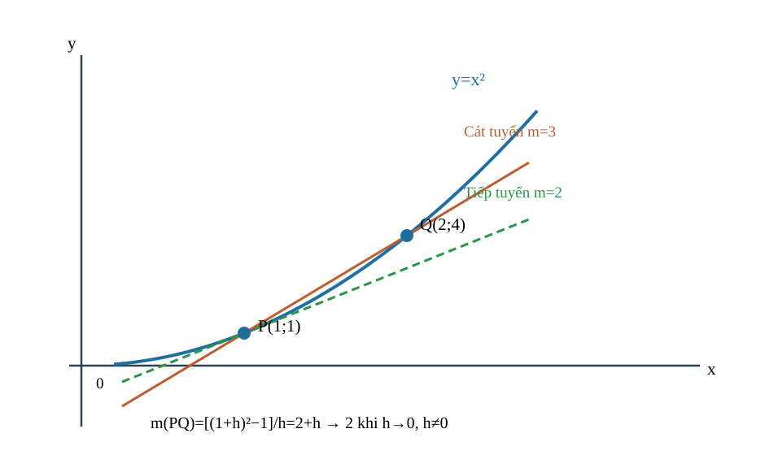
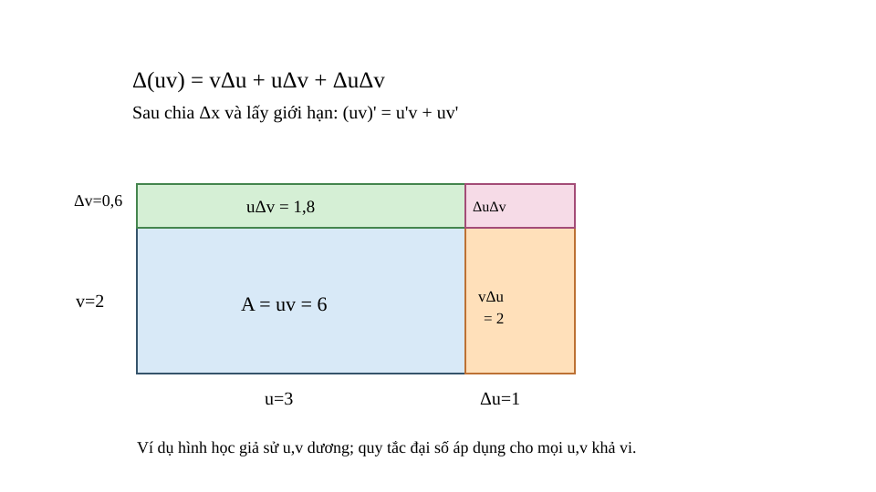
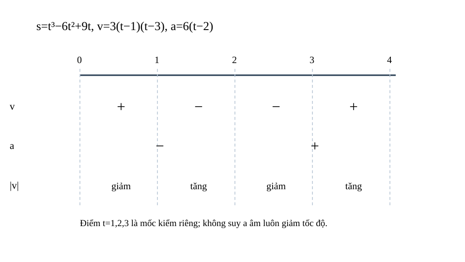
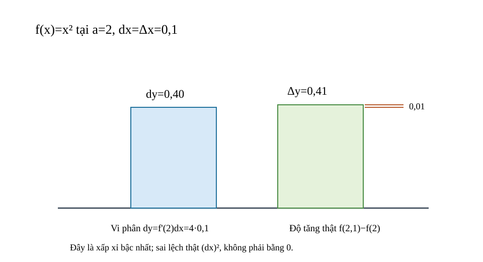

<!-- AUTHORING R04: immutable predecessor R03 blob 52be5ef6b8684632435ae22429bf7b5db5cf50cf; source-locked Q18 self-QA, no release. -->
<!-- STANDARD_ID=SLM-THPT-QUALITY-ONE; STANDARD_VERSION=3.1.0; LEARNING_PATH=TOPIC; OUTER_PAGES=Kiến thức|Luyện tập|Tự kiểm tra; SOURCE_VERSION=R04_AUTHORING_READY; AUTHORING_ONLY_METADATA=prototypes/thpt/content-drafts/topic09-derivative/Temp_TOPIC09_R04_AUTHORING_ONLY_CUSTODY_METADATA_20261113.md -->
# CĐ09 — Đạo hàm và ý nghĩa vi phân

# Kiến thức

## Từ tốc độ trung bình đến độ dốc tại một điểm

Nếu một chiếc xe đi được 16 mét trong 2 giây, vận tốc trung bình bằng 8 m/s. Nhưng nó có thể tăng tốc rồi giảm tốc trong khoảng đó: **8 m/s không nhất thiết là vận tốc tại một thời điểm cụ thể**. Để biết điều gì xảy ra ngay lúc đang xét, ta cho hai thời điểm lại gần nhau, giống như thu hai điểm trên đồ thị cho một cát tuyến tiến gần vị trí tiếp tuyến. Đó là con đường hình thành đạo hàm từ một câu hỏi thực tế, chứ không phải bắt đầu bằng bảng công thức.

Để đo độ biến thiên tức thời, phải hiểu thương sai phân có nghĩa khi hai thời điểm khác nhau và giới hạn hai phía tồn tại. Khi đã làm chủ giới hạn này, ta mới tính đạo hàm bằng quy tắc, dùng nó giải thích độ dốc, vận tốc, gia tốc và xấp xỉ gần điểm.

<!-- LESSON_ID: TOP09-M01; OUTCOME_ID: TOP09-O01 -->

Nếu một chiếc xe đi thêm 16 mét trong 2 giây, ta nói vận tốc trung bình trên khoảng đó là 8 m/s. Nhưng con số 8 chưa nói xe chuyển động nhanh bao nhiêu **đúng tại một thời điểm**. Để hiểu sự khác biệt, hãy bắt đầu với một đại lượng \(s(t)\) biểu diễn tọa độ theo thời gian. Trên khoảng \([a,b]\), vận tốc trung bình có hướng bằng \([s(b)-s(a)]/(b-a)\) với \(a\ne b\); tử số là độ dời, mẫu số là khoảng thời gian và đơn vị là mét trên giây nếu \(s\) đo bằng mét.

Xét \(s(t)=2t^2\) (m) trong khoảng từ \(t=1\) đến \(t=3\) giây. Tọa độ tăng từ \(s(1)=2\) đến \(s(3)=18\), tức độ dời 16 m trong 2 s. Vận tốc trung bình là \((18-2)/(3-1)=8\) m/s. Ta phải dùng **hiệu hai tọa độ chia hiệu hai thời điểm**, không phải \(s(3)/3\). Ở bước tiếp theo, khi hai thời điểm tiến sát nhau, ý tưởng này sẽ dẫn tới đạo hàm và vận tốc tức thời.

<!-- LESSON_ID: TOP09-M02; OUTCOME_ID: TOP09-O02 -->

Để thấy tốc độ tức thời, ta cho hai điểm trên đồ thị tiến sát nhau. Đường thẳng qua hai điểm tiến gần nhau có thể tiết lộ độ nghiêng của đồ thị tại một điểm? Ta đã biết p(a,f(a)), Q(a+h,f(a+h)), giới hạn h→0 từ hai phía. Cát tuyến PQ có hệ số góc [f(a+h)−f(a)]/h với h≠0. Nếu thương có giới hạn hữu hạn khi h→0 từ cả hai phía thuộc miền, ta có độ dốc tiếp tuyến; không thế h=0 trước khi rút. 'Cát tuyến' là qua hai điểm phân biệt, 'tiếp tuyến' là giới hạn vị trí/hệ số góc.

Chẳng hạn, f(x)=x², a=1: thương [(1+h)²−1]/h=2+h, h≠0; khi h→0 thu 2. Chọn khai triển vì thương ban đầu cho 0/0.

<!-- LESSON_ID: TOP09-M03; OUTCOME_ID: TOP09-O03 -->

Giới hạn thương sai phân đưa ta tới định nghĩa đạo hàm. Vì sao một đạo hàm là một giới hạn chứ không chỉ là bảng công thức? Ta sử dụng giới hạn hàm số CĐ08 và f(a), f(a+h) thuộc miền. f'(a)=lim_{h→0}[f(a+h)−f(a)]/h nếu giới hạn hữu hạn hai phía tồn tại. Một điểm bên trong miền có lân cận đủ ở hai phía; nếu chỉ biết một phía, chưa có đạo hàm thông thường. Tính bằng định nghĩa giúp kiểm công thức có áp dụng hay không.

Xét ví dụ: f=x³ tại a=2: (2+h)³−8=12h+6h²+h³, chia h→12. Chọn khai triển vì yêu cầu định nghĩa, không dùng ngay quy tắc 3x².

Hình minh họa riêng \(f(x)=x^2\) tại \(a=1\): điểm cố định \(P=(1,1)\), điểm \(Q=(2,4)\) ứng với \(h=1\) cho hệ số góc cát tuyến \((4-1)/(2-1)=3\). Khi \(Q=(1+h,(1+h)^2)\) tiến gần \(P\), hệ số góc \(2+h\) tiến tới 2; tiếp tuyến tại \(P\) có phương trình \(y=2x-1\). Khác với ví dụ \(f=x^3\) phía trên, hình đang vẽ **parabol bình phương tại x=1**.

*Đọc hình:* Điểm \(P=(1,1)\) trên \(y=x^2\) được giữ cố định; \(Q=(2,4)\) cho độ dốc 3. Khi \(h\to0\), cát tuyến \(PQ\) tiến về tiếp tuyến \(y=2x-1\) có độ dốc 2. Không được thế \(h=0\) trực tiếp vào mẫu số thương sai phân.

<!-- LESSON_ID: TOP09-M04; OUTCOME_ID: TOP09-O04 -->

Khả vi tại một điểm và trên cả khoảng là hai yêu cầu khác nhau. Một hàm có đạo hàm tại x=2 có nghĩa có đạo hàm tại mọi x? Ta bắt đầu từ phân biệt tại điểm, trên khoảng, một phía ở đầu miền. f có đạo hàm trên (a,b) nếu đạo hàm hữu hạn tại mọi điểm trong khoảng đó. Đạo hàm f' là một hàm mới trên miền các điểm khả vi; nó không bắt buộc có nghĩa tại mọi điểm mà f xác định. Với căn bậc hai chỉ có đạo hàm hữu hạn tại x>0; tại biên x=0 không có đạo hàm hai phía.

Chẳng hạn, f(x)=√x xác định x≥0; với x>0 f'(x)=1/(2√x), suy được bằng nhân liên hợp. Tại x=0, không thể lấy đạo hàm hai phía trên ℝ và thương phải→+∞; không ghi f'(0)=∞ như đạo hàm hữu hạn.

<!-- LESSON_ID: TOP09-M05; OUTCOME_ID: TOP09-O05 -->

Có đạo hàm kéo theo liên tục, nhưng điều ngược lại chưa chắc đúng. Có thể đồ thị liên tục vẫn có một góc gãy không? Cần nhớ tiêu chuẩn liên tục tại điểm và giới hạn h→0. Nếu f'(a) hữu hạn tồn tại, f(a+h)−f(a)=h·[(f(a+h)−f(a))/h]→0, nên f liên tục tại a. Chiều ngược sai: |x| liên tục tại0 nhưng thương từ trái −1, phải+1. Không coi mọi đường không đứt đều khả vi.

Chẳng hạn, Xét |x−1| tại1: f liên tục vì |x−1|→0; đạo hàm trái−1, phải+1 nên không khả vi. Chọn xét thương để bác bỏ mệnh đề đảo.

<!-- LESSON_ID: TOP09-M06; OUTCOME_ID: TOP09-O06 -->

Góc nhọn cho thấy hai đạo hàm một phía có thể khác nhau. Một tiếp tuyến duy nhất có độ dốc hữu hạn có hình thành tại điểm gấp khúc? Để xác định điều đó, cần xét hàm trị tuyệt đối và xét dấu h. Để có đạo hàm thông thường tại a, hai giới hạn thương sai phân một phía phải hữu hạn và bằng nhau. Tại góc nhọn |x−a| chúng thường trái dấu. Có thể có đạo hàm một phía nhưng không có đạo hàm hai phía; không gộp hai độ dốc thành 0.

Chẳng hạn, f(x)=|x−3| tại 3: [|h|−0]/h=−1 khi h<0, +1 khi h>0. Chọn xét dấu tuyệt đối trước, nên không có f'(3).

### Vận dụng và tự đối chiếu

<!-- First Try TOP09-M01; formative only -->
**1.** Hàm \(f(x)=x^2\) biến đổi trung bình bao nhiêu trên khoảng \([0,2]\)?

Đối chiếu

\([f(2)-f(0)]/(2-0)=(4-0)/2=2\) đơn vị đầu ra trên một đơn vị đầu vào. Nếu em dùng \(f(2)/2\) ở trường hợp này thì may mắn ra cùng kết quả vì \(f(0)=0\); hãy thử khoảng \([1,3]\) để thấy công thức đúng phải dùng **hai hiệu**.

<!-- First Try TOP09-M02; formative only -->
**2.** f(x)=x²,a=3: hệ số góc cát tuyến theo h là gì?

Đối chiếu

[(3+h)²−9]/h=6+h, h≠0; giới hạn 6.

Nếu gọi 0/0 là độ dốc, cần biểu diễn h khác 0 và khử nhân tử.

<!-- First Try TOP09-M03; formative only -->
**3.** Tính f'(0) theo định nghĩa nếu f(x)=x².

Đối chiếu

[h²−0]/h=h→0, nên f'(0)=0.

Nếu quên 'hai phía', so giới hạn thương khi h>0 và h<0.

<!-- First Try TOP09-M04; formative only -->
**4.** Hàm f(x)=1/x có đạo hàm ở mọi x∈ℝ không?

Đối chiếu

Không; chỉ trên ℝ\{0}, với f'(x)=−1/x².

Nếu áp công thức ngoài miền, bắt đầu bằng định nghĩa miền xác định.

<!-- First Try TOP09-M05; formative only -->
**5.** f(x)=|x| có liên tục tại0 không, đạo hàm tại0 không?

Đối chiếu

Liên tục; không có đạo hàm hai phía vì −1 và +1 khác nhau.

Nếu dùng tính liên tục để suy đạo hàm, đối chiếu phản ví dụ góc nhọn.

<!-- First Try TOP09-M06; formative only -->
**6.** Tại x=0, đạo hàm một phía của |2x| là gì?

Đối chiếu

Trái −2, phải +2, không có đạo hàm hai phía.

Nếu một bài chỉ cho đồ thị, kiểm bên trái và bên phải tại điểm gãy.

## Từ đạo hàm là một số đến ý nghĩa trên hình và trong đời sống

Biết \(f'(a)=2\) chưa đủ nếu không biết \(a\) là vị trí nào và \(f(a)\) mang đơn vị gì. Trên đồ thị, đạo hàm là **độ dốc** của tiếp tuyến tại \((a,f(a))\), không phải tung độ điểm đó; với chuyển động, đạo hàm theo thời gian là vận tốc có hướng. Một đạo hàm dương nói giá trị đang tăng tại điểm theo x, nhưng không có nghĩa bản thân giá trị hàm phải dương.

<!-- LESSON_ID: TOP09-M07; OUTCOME_ID: TOP09-O07 -->

Vì sao biết tọa độ P chưa nói được đường tiếp tuyến nghiêng bao nhiêu? Ta đã biết định nghĩa hệ số góc đường thẳng và đạo hàm. Đạo hàm f'(a) là hệ số góc của tiếp tuyến nếu tồn tại, còn f(a) là tung độ điểm tiếp xúc. Đây là hai số thường khác nhau, có thể một số 0 còn số kia không. Khi đồ thị tăng tại điểm, tiếp tuyến có độ dốc dương; một độ dốc âm không đồng nghĩa tung độ âm.

Chẳng hạn, y=x²+1 tại x=1: P(1,2) và f'(1)=2. Tiếp tuyến có độ dốc2, tung độ tại điểm2; hai giá trị trùng do bài này ngẫu nhiên, không phải quy tắc. Ở x=0 có f(0)=1 nhưng f'(0)=0.

<!-- LESSON_ID: TOP09-M08; OUTCOME_ID: TOP09-O08 -->

Khi có độ dốc, ta viết phương trình tiếp tuyến. Một độ dốc có đủ để viết đường tiếp tuyến không? Ta sử dụng dạng đường thẳng y−y₀=m(x−x₀), giá trị f(a). Tiếp tuyến nếu đạo hàm hữu hạn tại a có phương trình y−f(a)=f'(a)(x−a). Phải lấy đúng cả tọa độ điểm và hệ số góc, không thay f'' hay f(a) làm độ dốc. Nên kiểm đường đã tìm đi qua P.

Xét ví dụ: Với f=x² tại a=2, P(2,4), m=4 ⇒ y−4=4(x−2) ⇒ y=4x−4. Chọn điểm-hệ số góc để tránh sai hằng số.

<!-- LESSON_ID: TOP09-M09; OUTCOME_ID: TOP09-O09 -->

Trong chuyển động, độ dốc ấy là vận tốc có hướng. Vật có thể có vận tốc −2 m/s mà tốc độ vẫn dương không? Ta bắt đầu từ tọa độ có dấu và đơn vị s(t) theo mét/giây. Khi s(t) là tọa độ theo thời gian t, v(t)=s'(t) là vận tốc tức thời (có dấu), đơn vị m/s. Tốc độ bằng |v(t)| và không âm. s'(t)<0 chỉ cho biết chiều chuyển động, không tự nói vật chậm dần.

Chẳng hạn, s(t)=t²−6t (m), t≥0: v(t)=2t−6; tại t=2, v=−2 m/s, tốc độ2 m/s. Chọn trị tuyệt đối chỉ sau khi xác định vận tốc có hướng.

<!-- LESSON_ID: TOP09-M10; OUTCOME_ID: TOP09-O10 -->

Đơn vị của đạo hàm tùy đại lượng đầu vào và đầu ra. Đạo hàm của nhiệt độ theo phút có phải nhiệt độ hay tốc độ nhiệt độ đang thay đổi? Cần nhớ đơn vị, tỷ số Δđầu ra/Δđầu vào. f'(a) có đơn vị [f]/[x]. Nhiệt độ T(t) tính °C, t phút ⇒ T'(t) °C/phút; độ cao s(t) mét và t giây ⇒ s' m/s. Có thể nói đạo hàm dương/âm và mức biến thiên tức thời trong phạm vi mô hình, không dùng giá trị hàm thay tốc độ.

Chẳng hạn, T(t)=15+2t−0,5t² °C; T'(t)=2−t, tại t=1 là +1 °C/phút. Chọn tốc độ biến thiên thay vì tính T(1)=16,5 °C.

### Vận dụng và tự đối chiếu

<!-- First Try TOP09-M07; formative only -->
**1.** f(x)=x²+2 tại x=0, độ dốc và tung độ lần lượt bao nhiêu?

Đối chiếu

Độ dốc f'(0)=0; tung độ f(0)=2.

Nếu nhầm giá trị và độ dốc, ghi riêng P(a,f(a)) và m=f'(a).

<!-- First Try TOP09-M08; formative only -->
**2.** Tiếp tuyến y=x³ tại x=0 là gì?

Đối chiếu

f(0)=0, f'(0)=0 ⇒ y=0.

Nếu kết quả không qua (a,f(a)), thế lại x=a để phát hiện.

<!-- First Try TOP09-M09; formative only -->
**3.** Với s(t)=−3t (m), tốc độ là bao nhiêu?

Đối chiếu

v=−3 m/s, tốc độ3 m/s.

Nếu gọi tốc độ âm, kiểm định nghĩa |v|.

<!-- First Try TOP09-M10; formative only -->
**4.** Nếu giá P(x)=50+3x đồng, x số sản phẩm, P'(x) có đơn vị gì?

Đối chiếu

3 đồng/sản phẩm (tỉ lệ biến thiên cận biên của mô hình).

Nếu viết đơn vị đồng, bạn đang trả giá trị P thay vì đạo hàm.

## Khi một biểu thức có nhiều thành phần cùng biến đổi

Ta đã biết cách tìm đạo hàm từ thương sai phân, nhưng không thể cứ khai triển thương ấy cho mọi hàm dài. Nếu một hàm là tổng, ta xem từng phần biến đổi; nếu là tích, **cả hai thừa số** đều có thể đổi nên phải cộng đóng góp của cả hai; nếu là thương, mẫu không được bằng 0; nếu là hàm lồng, độ biến đổi của phần ngoài phụ thuộc phần trong. Những quy tắc này chính là cách giữ ý nghĩa tốc độ biến thiên mà tính được nhanh hơn.

<!-- LESSON_ID: TOP09-M11; OUTCOME_ID: TOP09-O11 -->

Có thể tìm đạo hàm của đa thức nhanh mà vẫn hiểu vì sao hệ số n xuất hiện? Để xác định điều đó, cần xét hằng số và phép khai triển (x+h)^n (n nguyên dương). Từ định nghĩa và khai triển, [ (x+h)^n−x^n]/h có hạng đầu n x^{n−1}, các hạng khác chứa h và về0. Do đó (x^n)'=n x^{n−1} (n nguyên dương), (c)'=0. Không áp quy tắc đa thức cho cơ số a^x mà không phân biệt biến nằm ở đâu.

Chẳng hạn, y=3x⁴−2: đạo hàm 3·4x³=12x³ và đạo hàm hằng−2 bằng0. Chọn tính từng hạng sau khi đã hiểu giới hạn khai triển.

<!-- LESSON_ID: TOP09-M12; OUTCOME_ID: TOP09-O12 -->

Hàm căn nhắc ta công thức luôn gắn với miền. Có giá trị √0=0 nhưng vì sao vẫn không có công thức f'(0) hữu hạn? Ta đã biết căn không âm, nhân liên hợp và giới hạn một phía. √x được định nghĩa trên x≥0. Trên x>0, thương sai phân nhân liên hợp dẫn (√x)'=1/(2√x). Tại 0, thương phải √h/h=1/√h→+∞, nên không có đạo hàm hữu hạn (và thiếu phía trái). Với √(g(x)), chỉ trên nơi g>0 mới được áp chain trơn theo công thức chuẩn.

Chẳng hạn, f=√(x+4): miền x≥−4, f'(x)=1/(2√(x+4)) với x>−4. Chọn xét miền trước khi áp bảng vì tại biên mẫu sẽ bằng0.

<!-- LESSON_ID: TOP09-M13; OUTCOME_ID: TOP09-O13 -->

Tổng, hiệu và hệ số hằng có cách lấy đạo hàm tương ứng. Đạo hàm của tổng thay đổi thế nào khi từng thành phần thay đổi? Ta sử dụng tính tuyến tính giới hạn, đạo hàm cơ bản. Nếu u,v khả vi, (u±v)'=u'±v' và (c u)'=c u'. Đạo hàm của hằng số bằng0; không giữ hạng hằng. Lý do là thương sai phân của tổng bằng tổng các thương, có thể lấy giới hạn từng phần khi chúng tồn tại.

Xét ví dụ: y=4x³−3x+6 ⇒ y'=12x²−3; hằng6 biến mất. Chọn phân rã vì phép cộng không lồng hàm hay tạo tích cần công thức khác.

<!-- LESSON_ID: TOP09-M14; OUTCOME_ID: TOP09-O14 -->

Với tích, không thể chỉ nhân hai đạo hàm. Tại sao (uv)' không phải chỉ bằng u'v'? Ta bắt đầu từ đạo hàm u,v và phép khai triển Δ(uv). Khi u tăng Δu và v tăng Δv, độ tăng tích =vΔu+uΔv+ΔuΔv. Chia cho Δx và lấy giới hạn khi u,v khả vi, hạng bậc hai không đóng góp: (uv)'=u'v+uv'. Hai dải diện tích trong hình chữ nhật giải thích hai hạng. Chỉ dùng khi cả u,v khả vi tại điểm.

Chẳng hạn, f=x(x²+3): f'=1·(x²+3)+x·2x=3x²+3. Chọn quy tắc tích vì hai thừa số biến theo x. Kiểm rút gọn trước cũng được x³+3x→3x²+3.

Trong hình chữ nhật minh họa, cạnh ngang \(u=3\) và cạnh đứng \(v=2\). Khi \(\Delta u=1\), \(\Delta v=0{,}6\), diện tích tăng bởi ba phần: \(v\Delta u=2\), \(u\Delta v=1{,}8\), phần góc nhỏ \(\Delta u\Delta v=0{,}6\); tổng tăng 4,4. Với các thay đổi do cùng \(\Delta x\to0\), chia độ tăng diện tích cho \(\Delta x\) rồi lấy giới hạn, phần góc bậc hai biến mất, để lại \(u'v+uv'\). Ví dụ số hữu hạn giúp **thấy đủ ba phần**, không có nghĩa bỏ ngay 0,6 trước khi lấy giới hạn.

*Đọc hình:* Hai dải tăng diện tích 2 và 1,8 cộng phần góc 0,6 thành 4,4 trong bước thay đổi hữu hạn. Chỉ **sau** khi chia cho bước tiến tới 0, số hạng tích hai độ tăng mới không đóng góp vào đạo hàm.

<!-- LESSON_ID: TOP09-M15; OUTCOME_ID: TOP09-O15 -->

Với thương, phải giữ điều kiện mẫu khác không. Tại sao tử và mẫu đều có đạo hàm nhưng hàm thương vẫn có điểm bị loại? Cần nhớ mẫu số phải khác0, u/v trên miền chung. (u/v)'=(u'v−uv')/v² khi u,v khả vi và v≠0. Dấu trừ bắt nguồn từ đạo hàm 1/v=−v'/v². Mọi kết quả đạo hàm phải ghi miền nguyên gốc; phép rút gọn không tự nối lỗ hổng ở mẫu.

Chẳng hạn, f=(x+1)/(x−2) có miền x≠2, f'=[1(x−2)−(x+1)·1]/(x−2)²=−3/(x−2)². Chọn quy tắc thương trước khi đơn giản hóa.

<!-- LESSON_ID: TOP09-M16; OUTCOME_ID: TOP09-O16 -->

Hàm hợp cần tính cả sự thay đổi của biểu thức bên trong. Vì sao đạo hàm của (2x+1)^5 phải thêm nhân 2? Để xác định điều đó, cần xét phân biệt biến trong u=g(x) và hàm ngoài f(u). Nếu y=F(g(x)) với g khả vi tại x và F khả vi tại g(x), y'=F'(g(x))g'(x). Đạo hàm biến thiên của đầu ra theo đầu vào bên trong rồi nhân tốc độ thay đổi của đầu vào bên trong; không chỉ đạo hàm lớp ngoài.

Chẳng hạn, y=(2x+1)^5: u=2x+1, u'=2, F'(u)=5u⁴ ⇒ y'=10(2x+1)^4. Chọn tách lớp để không quên nhân 2.

### Vận dụng và tự đối chiếu

<!-- First Try TOP09-M11; formative only -->
**1.** (7x³−4)' bằng bao nhiêu?

Đối chiếu

21x².

Nếu ra 7x², bạn bỏ hệ số mũ 3.

<!-- First Try TOP09-M12; formative only -->
**2.** f(x)=√(x−1), có đạo hàm hữu hạn tại x=1 không?

Đối chiếu

Không; hàm xác định tại1 nhưng thương phải→+∞.

Nếu chỉ xét x−1≥0, còn phải kiểm mẫu đạo hàm khác0.

<!-- First Try TOP09-M13; formative only -->
**3.** (2x²+5x−8)' bằng bao nhiêu?

Đối chiếu

4x+5.

Nếu viết −8 ở đạo hàm, xem lại định nghĩa đạo hàm hằng.

<!-- First Try TOP09-M14; formative only -->
**4.** (x sin x)' là gì (radian)?

Đối chiếu

sin x+x cos x.

Nếu lấy cos x, bạn đã làm mất biến thiên của thừa số x.

<!-- First Try TOP09-M15; formative only -->
**5.** (x/(x+1))' là gì, trên miền nào?

Đối chiếu

1/(x+1)², với x≠−1.

Nếu cho x=−1 hợp lệ vì kết quả nhìn đơn giản, quay lại mẫu gốc.

<!-- First Try TOP09-M16; formative only -->
**6.** (x²+1)^3 có đạo hàm gì?

Đối chiếu

6x(x²+1)².

Nếu ra 3(x²+1)², thiếu u'=2x.

## Đem quy tắc trở lại các hàm quen thuộc

Đối với hàm lượng giác, mũ hay lôgarit, ta vẫn hỏi tốc độ biến thiên tại điểm, nhưng **đơn vị radian, cơ số dương hoặc miền của đối số** quyết định công thức nào có nghĩa. Vì vậy, trước khi chọn quy tắc, hãy ghi miền xác định; sau đó xem biến nằm ở số mũ, trong logarit, trong căn hay bên trong góc để không nhầm đạo hàm của phần ngoài với phần trong.

<!-- LESSON_ID: TOP09-M17; OUTCOME_ID: TOP09-O17 -->

Vì sao trong công thức đạo hàm lượng giác lại phải biết đơn vị góc? Ta đã biết hàm sin/cos liên tục và giới hạn sin h / h khi h đo radian. Với x đo **radian**, (sin x)'=cos x, (cos x)'=−sin x. Nếu tham số nhập độ thì đạo hàm có thêm π/180, không thể dùng công thức radian trực tiếp. Điều kiện về radian là một phần nội dung toán, không phải chi tiết trình bày.

Chẳng hạn, f=3sin x+cos x (radian): f'=3cos x−sin x. Dấu âm của cos xuất hiện từ giới hạn sai phân trig.

<!-- LESSON_ID: TOP09-M18; OUTCOME_ID: TOP09-O18 -->

Tan và cot có điểm cấm phải loại trước. Vì sao tan/cot có chỗ không thể lấy đạo hàm dù sin/cos trơn? Ta sử dụng tan x=sin x/cos x, cot x=cos x/sin x. Với x radian, (tan x)'=1/cos²x khi cos x≠0, (cot x)'=−1/sin²x khi sin x≠0. Dấu và điều kiện theo quy tắc thương; khi mẫu bằng0 hàm gốc không xác định, đạo hàm không thể được báo ở đó.

Xét ví dụ: tan x ở x=π/2 không xác định vì cos π/2=0. Ở x=0: (tan x)'=1 và (cot x)' không có do sin0=0. Chọn phân biệt miền cho từng hàm.

<!-- LESSON_ID: TOP09-M19; OUTCOME_ID: TOP09-O19 -->

Hàm lượng giác hợp dùng tiếp quy tắc dây chuyền. Một góc u(x)=3x² thay đổi nhanh hơn x, vậy đạo hàm sin u khác gì? Ta bắt đầu từ dây chuyền và biến góc radian. Nếu u(x) khả vi, [sin u]'=u' cos u, [cos u]'=−u' sin u; tan u, cot u theo công thức cộng u' và điều kiện cos u hoặc sin u khác0. Quy tắc dây chuyền cho cả hàm ngoài và góc trong; không quên miền trig.

Chẳng hạn, y=cos(3x²) ⇒ u=3x², u'=6x, y'=−6x sin(3x²). Chọn xác định hàm ngoài cos và trong đa thức trước.

<!-- LESSON_ID: TOP09-M20; OUTCOME_ID: TOP09-O20 -->

Đạo hàm của hàm mũ liên hệ với giá trị chính nó. Tại sao e^x tự là đạo hàm của nó mà 2^x cần thêm ln2? Cần nhớ lũy thừa x^n khác hàm mũ a^x, log tự nhiên. Với cơ số a>0 và a≠1, (a^x)'=a^x ln a; riêng e^x vì ln e=1 nên đạo hàm bằng chính e^x. Đây không phải (x^n)'=n x^{n−1}, vì biến đứng ở số mũ. Với cơ số a=1, hàm hằng bằng1 và đạo hàm0, xử lý riêng.

Chẳng hạn, f=5^x tại x=0: f'(x)=5^x ln5, f'(0)=ln5. Chọn công thức mũ vì x là số mũ, không phải cơ số.

<!-- LESSON_ID: TOP09-M21; OUTCOME_ID: TOP09-O21 -->

Hàm logarit còn đòi hỏi xét miền của đối số. Khi lấy đạo hàm ln x, tại sao phải giữ x>0 ngay cả khi 1/x có nghĩa với x<0? Để xác định điều đó, cần xét miền của logarit và đạo hàm 1/x. (ln x)'=1/x với x>0; [log_a x]'=1/(x ln a) với a>0,a≠1 và x>0. Công thức đạo hàm không mở rộng miền logarit gốc sang x<0. Với ln|x| có miền x≠0 và derivative1/x nhưng đó là hàm khác (không tự đồng nhất với ln x).

Chẳng hạn, f=log₂ x, x>0: f'=1/(x ln2). Đơn vị ln2 là hằng dương, không là biến.

<!-- LESSON_ID: TOP09-M22; OUTCOME_ID: TOP09-O22 -->

Khi mũ/log chứa biểu thức, quy tắc dây chuyền xuất hiện. Vì sao ln(g(x)) chỉ lấy đạo hàm tại nơi g(x)>0? Ta đã biết dây chuyền và miền ln, cơ số a>0. [ln g]'=g'/g trên g>0; [a^{g}]'=a^{g} ln a ·g' với a>0,a≠1; [log_a g]'=g'/(g ln a) trên g>0. Cần kiểm g khả vi và miền của hàm ngoài. Không dùng công thức ở g≤0 dù biểu thức g'/g có vẻ tồn tại.

Chẳng hạn, f=ln(x²+1) xác định mọi x, f'=2x/(x²+1). Chọn chain vì đối số là x²+1; đối số dương mọi x nên không phải loại điểm.

<!-- LESSON_ID: TOP09-M23; OUTCOME_ID: TOP09-O23 -->

Miền cần kiểm cả trước và sau lấy đạo hàm. Công thức đạo hàm có thể làm mình 'quên' một điểm hàm gốc không xác định không? Ta sử dụng điều kiện căn, mẫu, log và mẫu trig. Bước 1 giải miền xác định của biểu thức gốc. Bước 2 chọn công thức đạo hàm trên các khoảng nội điểm miền có thể lấy đạo hàm. Bước 3 so miền đạo hàm và miền gốc, đặc biệt đầu mút căn và điểm loại mẫu. Một biểu thức đại số sau rút không được tự dùng ở điểm gốc cấm.

Xét ví dụ: f=√(x−3)/(x−4) có miền x≥3, x≠4. Công thức derivative theo tích/thương chỉ áp ở x>3, x≠4. Tại x=3 hàm có giá trị0 nhưng không có đạo hàm hữu hạn hai phía.

<!-- LESSON_ID: TOP09-M24; OUTCOME_ID: TOP09-O24 -->

Cấu trúc biểu thức quyết định thứ tự quy tắc. Một biểu thức có tích và hàm hợp nên khai triển hay lấy đạo hàm trực tiếp? Ta bắt đầu từ tích, hợp, tổng, thương. Nhìn cấu trúc ngoài cùng của biểu thức trước: tổng thì tách; tích thì 2 hạng; thương thì dấu trừ/mẫu bình phương; hàm hợp thì đạo hàm ngoài nhân đạo hàm trong; thường phải kết hợp nhiều quy tắc theo thứ tự. Không có 'đạo hàm của tích = tích đạo hàm'.

Chẳng hạn, f=x e^{2x}: ngoài cùng tích, f'=e^{2x}+x·2e^{2x}=e^{2x}(1+2x). Chọn tích trước, sau đó chain cho thừa số mũ.

### Vận dụng và tự đối chiếu

<!-- First Try TOP09-M17; formative only -->
**1.** (4cos x−sin x)' là gì?

Đối chiếu

−4sin x−cos x.

Nếu ra +4sin x, kiểm đạo hàm cos âm.

<!-- First Try TOP09-M18; formative only -->
**2.** (cot x)' và miền là gì?

Đối chiếu

−1/sin²x, x≠kπ với k nguyên.

Nếu thiếu dấu trừ, dùng quy tắc thương cos/sin để tự tái lập.

<!-- First Try TOP09-M19; formative only -->
**3.** [sin(5x)]' là gì?

Đối chiếu

5cos(5x) trong radian.

Nếu ra cos(5x), đạo hàm trong 5x chưa được nhân.

<!-- First Try TOP09-M20; formative only -->
**4.** (e^{3x})' bằng gì?

Đối chiếu

3e^{3x}.

Nếu thiếu hệ số3, kết hợp quy tắc mũ với dây chuyền.

<!-- First Try TOP09-M21; formative only -->
**5.** [ln(4x)]' trên x>0 là gì?

Đối chiếu

(4)/(4x)=1/x; miền x>0.

Nếu tính với x<0, ln(4x) không có nghĩa trong số thực.

<!-- First Try TOP09-M22; formative only -->
**6.** [ln(3x−2)]' là gì và miền?

Đối chiếu

3/(3x−2), x>2/3.

Nếu chỉ ghi mẫu≠0 mà cho x<2/3, điều kiện log phải dương bị vi phạm.

<!-- First Try TOP09-M23; formative only -->
**7.** [ln x/(x−2)] xác định ở những x nào?

Đối chiếu

x>0 và x≠2.

Nếu chỉ đặt x≠2, quên điều kiện ln x và đạo hàm được ở x≤0 sai.

<!-- First Try TOP09-M24; formative only -->
**8.** [(x²+1)sin x]' là gì?

Đối chiếu

2x sin x+(x²+1)cos x.

Nếu thử nhân hai đạo hàm, so lại với ví dụ f=x·x=x² cho thấy lỗi.

## Từ vận tốc tức thời đến gia tốc và xấp xỉ gần điểm

Khi đạo hàm của vị trí cho vận tốc, đạo hàm **thêm một lần** cho gia tốc. Tuy nhiên, dấu gia tốc chỉ cho biết vận tốc có hướng đang tăng hay giảm; muốn nói vật **nhanh dần hay chậm dần** phải xét đồng thời dấu của vận tốc. Cùng phép đo tốc độ biến đổi đó còn cho ta một đường thẳng xấp xỉ đồ thị ở rất gần điểm — vi phân giúp ước lượng nhanh, nhưng sai số không mất hẳn.

<!-- LESSON_ID: TOP09-M25; OUTCOME_ID: TOP09-O25 -->

Từ s(t) làm sao biết chiều chuyển động tại thời điểm t? Cần nhớ miền thời gian t≥0, quy tắc đạo hàm và dấu. Vận tốc có hướng v(t)=s'(t), speed=|v(t)|. Dùng đạo hàm trong miền mô hình, không kéo mô hình toán ra thời gian âm nếu không được định nghĩa. v=0 là đứng yên tức thời nhưng chưa tự nói dừng mãi, v đổi dấu thì có đổi chiều.

Chẳng hạn, s(t)=t²−4t, t≥0: v=2t−4; t=1 vận tốc−2 m/s, t=3 +2 m/s, chỉ hướng chuyển động ngược nhau. Chọn dấu của v thay vì dấu của tọa độ s.

<!-- LESSON_ID: TOP09-M26; OUTCOME_ID: TOP09-O26 -->

Đạo hàm của đạo hàm là đạo hàm cấp hai. Một tốc độ biến đổi có thể chính nó biến thiên không? Để xác định điều đó, cần xét f' tồn tại trên khoảng và có thể tiếp tục lấy đạo hàm. Nếu f' khả vi, f''=(f')'. Đây là phép lấy đạo hàm **hai lần**, không phải bình phương (f')². Nếu f' chỉ tồn tại tại một điểm nhưng không tồn tại trong lân cận, cần xem định nghĩa f'' cẩn thận. f'' có thể là 0 với hàm bậc nhất.

Chẳng hạn, f=x³: f'=3x², f''=6x. Chọn lấy đạo hàm lại vì ta muốn tốc độ biến thiên của độ dốc.

<!-- LESSON_ID: TOP09-M27; OUTCOME_ID: TOP09-O27 -->

Với đa thức, tính đạo hàm cấp hai qua hai bước. Vì sao bậc của đa thức giảm sau mỗi lượt đạo hàm? Ta đã biết (x^n)'=n x^{n−1} và đạo hàm tổng. Lấy đạo hàm bậc nhất từng hạng rồi áp lần thứ hai; với đa thức n≥2, (x^n)''=n(n−1)x^{n−2}. Hằng và hạng tuyến tính có đạo hàm cấp hai bằng0. Kiểm cả kết quả f' lẫn f'' thay vì nhảy thẳng dễ thiếu hệ số.

Chẳng hạn, f=3x⁴−2x²+1: f'=12x³−4x, f''=36x²−4. Chọn hai bước để không bỏ hệ số.

<!-- LESSON_ID: TOP09-M28; OUTCOME_ID: TOP09-O28 -->

Hàm mũ và lượng giác cũng có đạo hàm cấp hai. Tại sao đạo hàm lần hai của sin(2x) lại xuất hiện bình phương hệ số 2? Ta sử dụng chain rule và sin/cos radian, hàm mũ. Nếu f=sin(kx) thì f'=k cos(kx), f''=−k² sin(kx); nếu f=e^{kx}, f'=k e^{kx}, f''=k² e^{kx}. Hệ số k nhân mỗi lần do dây chuyền, không phải do bình phương f'. Giữ đúng dấu đạo hàm cos.

Xét ví dụ: f=cos(3x): f'=−3sin(3x), f''=−9cos(3x). Chọn đạo hàm hai lần với chain ở cả hai.

<!-- LESSON_ID: TOP09-M29; OUTCOME_ID: TOP09-O29 -->

Trong chuyển động, đạo hàm vận tốc là gia tốc. Vật có thể đang chuyển động nhưng gia tốc bằng 0 đúng lúc đó không? Ta bắt đầu từ vận tốc v=s' và đơn vị m/s, thời gian s. Từ tọa độ s(t), v(t)=s'(t), a(t)=v'(t)=s''(t). Đơn vị a là m/s²; dấu của a cho biết **vận tốc có hướng** đang tăng hay giảm, không phải trực tiếp tốc độ |v|. Muốn nói nhanh/chậm cần kết hợp dấu v và a.

Chẳng hạn, s(t)=t³−3t²+2t: v=3t²−6t+2, a=6t−6; tại t=1, a=0 nhưng v=−1 m/s. Chọn lấy đạo hàm lần hai thay vì kết luận từ s(t).

Đọc riêng đồ thị của \(s(t)=t^3-6t^2+9t\) trên \([0,4]\): \(v(t)=3(t-1)(t-3)\), \(a(t)=6(t-2)\). Vận tốc dương trước 1 và sau 3, âm giữa 1 và 3; gia tốc âm trước 2, dương sau 2. Vì vậy tốc độ \(|v|\) **giảm** trên (0,1) và (2,3), **tăng** trên (1,2) và (3,4). Tại \(t=1,2,3\) phải kiểm ranh giới. Đây là đồ thị của một chuyển động khác với ví dụ \(s=t^3-3t^2+2t\) vừa tính.

*Đọc hình:* Bảng dấu là của \(v=3(t-1)(t-3)\) và \(a=6(t-2)\), không phải một công thức chuyển động bất kỳ. Khi \(v,a\) cùng dấu thì \(|v|\) tăng, trái dấu thì \(|v|\) giảm; ở các mốc 1,2,3 phải xét hai phía.

<!-- LESSON_ID: TOP09-M30; OUTCOME_ID: TOP09-O30 -->

Dấu gia tốc phải đọc cùng dấu vận tốc. Gia tốc âm có nhất thiết khiến vật chậm đi? Cần nhớ tốc độ |v| và dấu của hai hàm v,a. Khi v≠0, đạo hàm tốc độ |v| bằng sign(v)·a: v,a cùng dấu → tốc độ tăng; trái dấu → giảm. Nếu v=0 phải xét riêng; a âm chỉ nói v có hướng đang giảm. Đây là ý nghĩa cơ học, không phải bài tối ưu CĐ10.

Chẳng hạn, s(t)=−t², t>0: v=−2t<0, a=−2<0. Vì cùng dấu, |v|=2t đang tăng dù gia tốc âm. Chọn xét tích v·a để không suy từ dấu gia tốc riêng.

<!-- LESSON_ID: TOP09-M31; OUTCOME_ID: TOP09-O31 -->

Tổng hợp quy tắc cần kiểm cả miền và đơn vị. Một đề có f, f', f'' yêu cầu những thông tin khác nhau như thế nào? Để xác định điều đó, cần xét tích, chain, giá trị tại điểm, phương trình tiếp tuyến. Đối chiếu yêu cầu: f(a) là tung độ, f'(a) là độ dốc/tốc độ thay đổi, f''(a) là tốc độ thay đổi của độ dốc. Tính đạo hàm đúng với miền rồi dùng f'(a) chứ không dùng f''(a) để lập tiếp tuyến. Đây là bước tổng hợp, không chuyển sang khảo sát cực trị CĐ10.

Chẳng hạn, f=x e^x: f'=e^x(1+x), f''=e^x(2+x); tại x=0 f=0, f'=1, f''=2, tiếp tuyến y=x. Chọn khai triển từng bước và kiểm qua (0,0).

<!-- LESSON_ID: TOP09-M32; OUTCOME_ID: TOP09-O32 -->

Tốc độ tức thời còn dùng để xấp xỉ sự thay đổi rất nhỏ. Khi đầu vào đổi rất nhỏ, có cần tính lại toàn bộ giá trị hàm mới để dự đoán đầu ra không? Ta đã biết giới hạn đạo hàm f'(a), ký hiệu Δx, đại số bình phương. Nếu f khả vi tại a, f(a+Δx)−f(a)=f'(a)Δx+o(Δx) khi Δx→0. Phần tuyến tính dy=f'(a)dx với dx=Δx gọi là **vi phân**; với bước đủ nhỏ, Δy≈dy, KHÔNG luôn bằng nhau. Vi phân là công cụ xấp xỉ cục bộ, không nên gọi là toàn bộ 'độ tăng'. Đây là **mở rộng Topic CĐ09**, không gán là định nghĩa/bài SGK ChIX Core.

Chẳng hạn, f=x²,a=3,dx=0,02: f'(3)=6 nên dy=0,12; Δy=(3,02)²−9=0,1204, sai lệch0,0004=(dx)². Chọn vi phân để ước lượng nhanh và định lượng phần dư, không hứa chính xác cho bước lớn.

Ngay trên hình, chọn \(f(x)=x^2\), \(a=2\), \(dx=0{,}1\). Vì \(f'(2)=4\), vi phân dự đoán \(dy=4\cdot0{,}1=0{,}4\). Độ tăng thật là \(\Delta y=(2{,}1)^2-2^2=0{,}41\), lớn hơn 0,01. Bước lớn hơn có thể tạo sai số đáng kể hơn; ví dụ \(a=3,dx=0{,}02\) phía trên là **trường hợp khác**, không phải các cột đang vẽ.

*Đọc hình:* Hai cột 0,4 (vi phân) và 0,41 (độ tăng thật) tại \(a=2,dx=0{,}1\) khác nhau đúng 0,01. Vi phân là **xấp xỉ bậc nhất**, không tự nhận bằng độ tăng thật.

### Vận dụng và tự đối chiếu

<!-- First Try TOP09-M25; formative only -->
**1.** Nếu s(t)=t³−3t, v(1) bằng?

Đối chiếu

v=3t²−3, v(1)=0 m/s.

Nếu dùng s(1)=−2 thay v(1), phân biệt vị trí với đạo hàm.

<!-- First Try TOP09-M26; formative only -->
**2.** f=x²+3x thì f'' bằng?

Đối chiếu

f'=2x+3, f''=2.

Nếu ra (2x+3)², bạn đã bình phương f'.

<!-- First Try TOP09-M27; formative only -->
**3.** f=x⁵: f''=?

Đối chiếu

20x³.

Nếu ra 5x³, thiếu nhân n−1.

<!-- First Try TOP09-M28; formative only -->
**4.** f=e^{2x}, f'' là gì?

Đối chiếu

4e^{2x}.

Nếu ra 2e^{2x}, bạn chỉ lấy đạo hàm một lần.

<!-- First Try TOP09-M29; formative only -->
**5.** s(t)=5t² (m), a(t) bằng?

Đối chiếu

v=10t m/s, a=10 m/s².

Nếu nhầm đơn vị m/s, đó là vận tốc chứ không phải gia tốc.

<!-- First Try TOP09-M30; formative only -->
**6.** Nếu v=−3 m/s và a=−2 m/s², tốc độ đang tăng hay giảm?

Đối chiếu

Đang tăng tại thời điểm xét (v,a cùng dấu).

Nếu viết gia tốc âm = giảm tốc độ, hãy thử v âm xem điều gì xảy ra với |v|.

<!-- First Try TOP09-M31; formative only -->
**7.** f=x²+1 tại x=0, tiếp tuyến y=?

Đối chiếu

f(0)=1, f'(0)=0 ⇒ y=1; f''=2 không phải độ dốc.

Nếu đặt f'' vào phương trình tiếp tuyến, quay lại ý nghĩa hình học O07–O08.

<!-- First Try TOP09-M32; formative only -->
**8.** f=x²,a=1,dx=0,1: dy và Δy lần lượt bằng?

Đối chiếu

dy=2·0,1=0,2; Δy=1,1²−1=0,21; sai lệch0,01.

Nếu nói dy=Δy chính xác, khai triển bình phương để thấy thêm dx².

<!-- AUTHORING_ONLY: source-locked figure custody and interaction SPEC_ONLY notes preserved in original R02 blob e7a4d74c142597b1d27d94f90a6f3abacb83ab59. The learner text already places verified SVG inline. -->

# Luyện tập

Ở phần **hình thành đạo hàm**, em làm các bài về vận tốc trung bình, thương sai phân, giới hạn hai phía và góc gãy. Tiếp đó, em giải các bài **ý nghĩa hình học và vật lý**: đọc \(f(a)\) khác \(f'(a)\), viết tiếp tuyến, kiểm đơn vị tốc độ. Khi chuyển sang **quy tắc tính**, hãy tự xác định biểu thức là tổng, tích, thương hay hàm hợp trước khi đạo hàm; mọi căn, mẫu, logarit và tang đều cần miền hợp lệ.

Cuối cùng, em dùng **đạo hàm cấp hai, vận tốc và gia tốc**, rồi thử vi phân tuyến tính để ước lượng gần điểm và tính sai số thực. Ngân hàng public có 71 câu nguồn SGK được sử dụng lại cùng 37 bài mới (32 bài luyện và 5 tự luận có rubric). Từng câu và lời giải phải được hiển thị trong phần Luyện tập của chuyên đề; không buộc em tìm mã tệp. Hãy làm trước khi tự mở đối chiếu và quay về giải thích phù hợp khi sai.

# Tự kiểm tra

Em tự giải 32 câu đại diện cho 32 mục tiêu của chuyên đề. **Final Submit** phải diễn ra trước khi em xem đúng/sai, lời giải, gợi ý hay hướng khắc phục. Các câu này được tái sử dụng từ phần Luyện tập nên chỉ giúp em tự phát hiện lỗ hổng; kết quả **không phải đánh giá độc lập hay điểm thành thạo chính thức**. Sau khi nộp, xác định vì sao sai, quay về phần kiến thức và làm câu khác cùng dạng.

<!-- AUTHORING source-locked item-ID pointers only; not learner-visible or duplicated stems/answers:
- THPT-G11-CHIX-B31-C01
- THPT-G11-CHIX-B31-P01
- THPT-G11-CHIX-B31-C02
- THPT-G11-CHIX-B31-P02
- THPT-G11-CHIX-B31-C03
- THPT-G11-CHIX-B31-P03
- THPT-G11-CHIX-B31-C04
- THPT-G11-CHIX-B31-P04
- THPT-G11-CHIX-B31-C05
- THPT-G11-CHIX-B31-P05
- THPT-G11-CHIX-B31-C06
- THPT-G11-CHIX-B31-P06
- THPT-G11-CHIX-B31-C07
- THPT-G11-CHIX-B31-P07
- THPT-G11-CHIX-B31-C08
- THPT-G11-CHIX-B31-P08
- THPT-G11-CHIX-B31-C09
- THPT-G11-CHIX-B31-P09
- THPT-G11-CHIX-B31-C10
- THPT-G11-CHIX-B31-P10
- THPT-G11-CHIX-B32-C01
- THPT-G11-CHIX-B32-P01
- THPT-G11-CHIX-B32-C02
- THPT-G11-CHIX-B32-P02
- THPT-G11-CHIX-B32-C03
- THPT-G11-CHIX-B32-P03
- THPT-G11-CHIX-B32-C04
- THPT-G11-CHIX-B32-P04
- THPT-G11-CHIX-B32-C05
- THPT-G11-CHIX-B32-P05
- THPT-G11-CHIX-B32-C06
- THPT-G11-CHIX-B32-P06
- THPT-G11-CHIX-B32-C07
- THPT-G11-CHIX-B32-P07
- THPT-G11-CHIX-B32-C08
- THPT-G11-CHIX-B32-P08
- THPT-G11-CHIX-B32-C09
- THPT-G11-CHIX-B32-P09
- THPT-G11-CHIX-B32-C10
- THPT-G11-CHIX-B32-P10
- THPT-G11-CHIX-B32-C11
- THPT-G11-CHIX-B32-P11
- THPT-G11-CHIX-B32-C12
- THPT-G11-CHIX-B32-P12
- THPT-G11-CHIX-B32-C13
- THPT-G11-CHIX-B32-P13
- THPT-G11-CHIX-B32-C14
- THPT-G11-CHIX-B32-P14
- THPT-G11-CHIX-B32-C15
- THPT-G11-CHIX-B32-P15
- THPT-G11-CHIX-B33-C01
- THPT-G11-CHIX-B33-P01
- THPT-G11-CHIX-B33-C02
- THPT-G11-CHIX-B33-P02
- THPT-G11-CHIX-B33-C03
- THPT-G11-CHIX-B33-P03
- THPT-G11-CHIX-B33-C04
- THPT-G11-CHIX-B33-P04
- THPT-G11-CHIX-B33-C05
- THPT-G11-CHIX-B33-P05
- THPT-G11-CHIX-CHIX-C01
- THPT-G11-CHIX-CHIX-P01
- THPT-G11-CHIX-B31-W01
- THPT-G11-CHIX-B31-W02
- THPT-G11-CHIX-B31-W03
- THPT-G11-CHIX-B32-W01
- THPT-G11-CHIX-B32-W02
- THPT-G11-CHIX-B32-W03
- THPT-G11-CHIX-B33-W01
- THPT-G11-CHIX-B33-W02
- THPT-G11-CHIX-B33-W03
- THPT-TOP09-P01
- THPT-TOP09-P02
- THPT-TOP09-P03
- THPT-TOP09-P04
- THPT-TOP09-P05
- THPT-TOP09-P06
- THPT-TOP09-P07
- THPT-TOP09-P08
- THPT-TOP09-P09
- THPT-TOP09-P10
- THPT-TOP09-P11
- THPT-TOP09-P12
- THPT-TOP09-P13
- THPT-TOP09-P14
- THPT-TOP09-P15
- THPT-TOP09-P16
- THPT-TOP09-P17
- THPT-TOP09-P18
- THPT-TOP09-P19
- THPT-TOP09-P20
- THPT-TOP09-P21
- THPT-TOP09-P22
- THPT-TOP09-P23
- THPT-TOP09-P24
- THPT-TOP09-P25
- THPT-TOP09-P26
- THPT-TOP09-P27
- THPT-TOP09-P28
- THPT-TOP09-P29
- THPT-TOP09-P30
- THPT-TOP09-P31
- THPT-TOP09-W01
- THPT-TOP09-W02
- THPT-TOP09-W03
- THPT-TOP09-W04
- THPT-TOP09-W05
- THPT-TOP09-P32
-->
