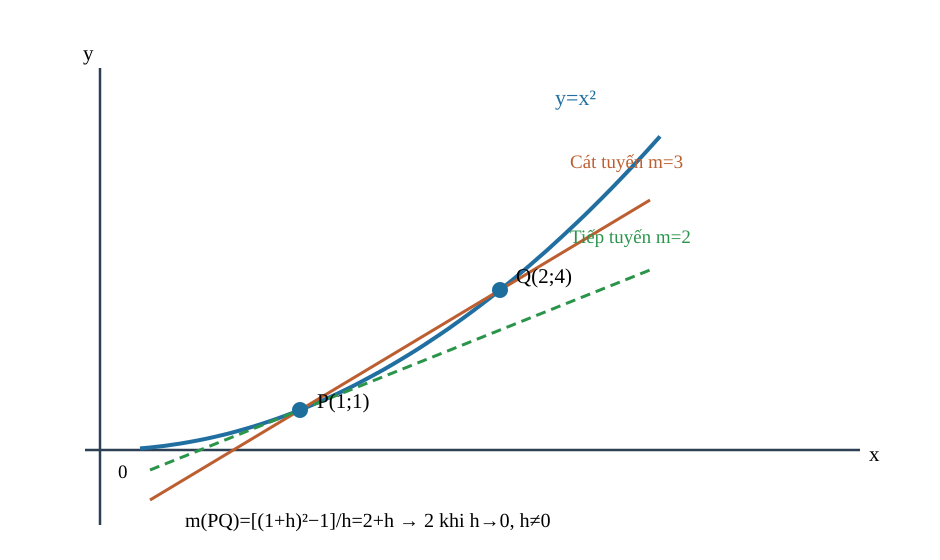
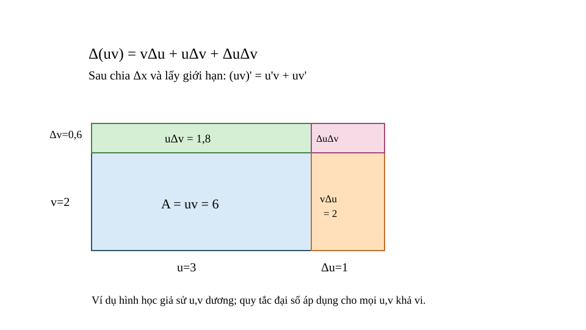
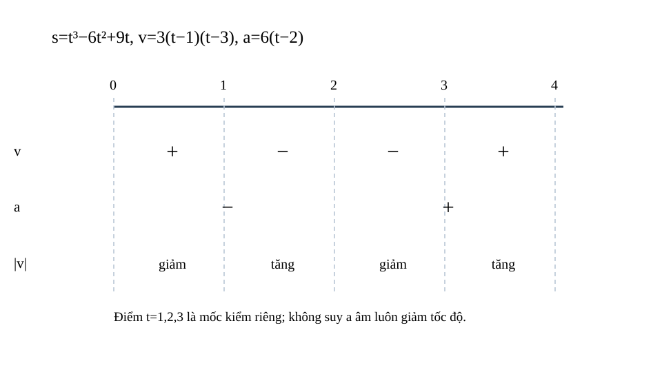
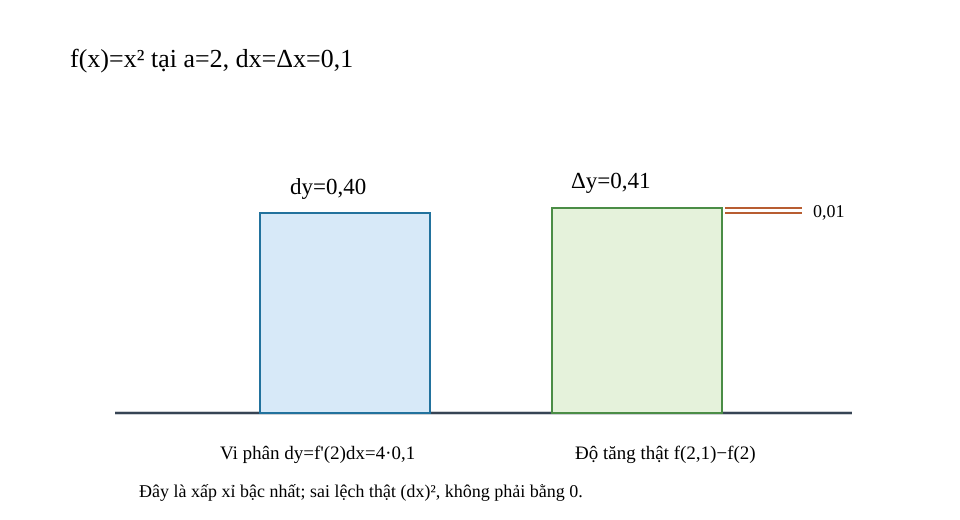

<!-- AUTHORING_ONLY_NOT_FOR_STUDENT_VIEW: CĐ09 one current R05 learner canonical; older R04 remains immutable historical; active source and Q18 verified by source SHA. -->
<!-- AUTHORING_ONLY_NOT_FOR_STUDENT_VIEW: STANDARD_ID=SLM-THPT-QUALITY-ONE; STANDARD_VERSION=3.2.0; LEARNING_PATH=TOPIC; SOURCE_VERSION=R05_CANONICAL_AUTHOR_SELF_Q18; SGK71_BLOB=3fe3b1a12fac656b543ba3ba2743e3ba855c4fe0; INDEX71_BLOB=3c025ce2dfb8e16743873ac2b3f35bfb37c27ef8; NEW37_BLOB=f249949be3b254a29c8859301b6c4904e636c505 -->
# CĐ09 — Đạo hàm và ý nghĩa vi phân

# Kiến thức

## 1. Từ tốc độ trung bình đến độ dốc tại một điểm

Nếu tọa độ của một chiếc xe trên đường thẳng tăng 16 mét trong 2 giây (theo chiều dương đã chọn), vận tốc trung bình bằng 8 m/s. Nhưng nó có thể tăng tốc rồi giảm tốc trong khoảng đó: **8 m/s không nhất thiết là vận tốc tại một thời điểm cụ thể**. Để biết điều gì xảy ra ngay lúc đang xét, ta cho hai thời điểm lại gần nhau, giống như thu hai điểm trên đồ thị cho một cát tuyến tiến gần vị trí tiếp tuyến. Đó là con đường hình thành đạo hàm từ một câu hỏi thực tế, chứ không phải bắt đầu bằng bảng công thức.

Để đo độ biến thiên tức thời, phải hiểu thương sai phân có nghĩa khi hai thời điểm khác nhau và giới hạn hai phía tồn tại. Khi đã làm chủ giới hạn này, ta mới tính đạo hàm bằng quy tắc, dùng nó giải thích độ dốc, vận tốc, gia tốc và xấp xỉ gần điểm.

### 1.1. Vận tốc trung bình

<!-- LESSON_ID: TOP09-M01; OUTCOME_ID: TOP09-O01 -->

Nếu tọa độ của xe tăng 16 mét trong 2 giây, vận tốc trung bình là 8 m/s. Nhưng nếu xe đi 8 mét rồi quay lại 8 mét, quãng đường vẫn là 16 mét, tốc độ trung bình là 8 m/s, còn độ dời và vận tốc trung bình đều bằng 0. Nhưng con số 8 chưa nói xe chuyển động nhanh bao nhiêu **đúng tại một thời điểm**. Để hiểu sự khác biệt, hãy bắt đầu với một đại lượng \(s(t)\) biểu diễn tọa độ theo thời gian. Trên đoạn thời gian \([a;b]\) với \(a<b\), vận tốc trung bình có hướng bằng \(\frac{s(b)-s(a)}{b-a}\); tử số là độ dời, mẫu số là khoảng thời gian và đơn vị là mét trên giây nếu \(s\) đo bằng mét.

> **CÔNG THỨC — Vận tốc trung bình.** Xét \(s(t)=2t^2\) (m) trong khoảng từ \(t=1\) đến \(t=3\) giây. Tọa độ tăng từ \(s(1)=2\) đến \(s(3)=18\), tức độ dời 16 m trong 2 s. Vận tốc trung bình là \(\frac{18-2}{3-1}=8\) m/s. Ta phải dùng **hiệu hai tọa độ chia hiệu hai thời điểm**, không phải \(\frac{s(3)}3\). Ở bước tiếp theo, khi hai thời điểm tiến sát nhau, ý tưởng này sẽ dẫn tới đạo hàm và vận tốc tức thời.

**Ví dụ**

**Đề bài:** \(s(t)=3t^2+2\) (m), \(t\ge0\) (s). Tính vận tốc trung bình trên \([1;2]\).

**Lời giải:** \(s(1)=5\), \(s(2)=14\); độ dời 9 m trong 1 s, nên vận tốc trung bình \(\frac{14-5}{2-1}=9\) m/s. Không đồng nhất vận tốc trung bình và tức thời.

**Vận dụng** Hàm \(f(x)=x^2\) biến đổi trung bình bao nhiêu trên khoảng \([0;2]\)?

Đối chiếu

\(\frac{f(2)-f(0)}{2-0}=\frac{4-0}2=2\) đơn vị đầu ra trên một đơn vị đầu vào. Nếu em dùng \(\frac{f(2)}2\) ở trường hợp này thì may mắn ra cùng kết quả vì \(f(0)=0\); hãy thử khoảng \([1;3]\) để thấy công thức đúng phải dùng **hai hiệu**.

**Kiểm lỗi**

Nếu dùng giá trị tại cuối khoảng chia cho thời gian thay vì **độ dời**, đọc **Kiến thức 1.1** rồi giải **Bài 1** và **Bài 3**. Tách hiệu tọa độ khỏi quãng đường và giữ đơn vị m/s.

### 1.2. Cát tuyến và giới hạn độ dốc

<!-- LESSON_ID: TOP09-M02; OUTCOME_ID: TOP09-O02 -->

> **PHƯƠNG PHÁP — Cát tuyến và giới hạn độ dốc.** Để thấy tốc độ tức thời, ta cho hai điểm trên đồ thị tiến sát nhau. Đường thẳng qua hai điểm tiến gần nhau có thể tiết lộ độ nghiêng của đồ thị tại một điểm? Ta đã biết \(P(a;f(a))\), \(Q(a+h;f(a+h))\), giới hạn \(h\to0\) từ hai phía. Cát tuyến PQ có hệ số góc \(\frac{f(a+h)-f(a)}h\) với \(h\ne0\). Nếu thương có giới hạn hữu hạn khi \(h\to0\) từ cả hai phía thuộc miền, ta có độ dốc tiếp tuyến; không thế \(h=0\) trước khi rút. 'Cát tuyến' là qua hai điểm phân biệt, 'tiếp tuyến' là giới hạn vị trí/hệ số góc.

Chẳng hạn, \(f(x)=x^2\), \(a=1\): thương \(\frac{(1+h)^2-1}h=2+h\), \(h\ne0\); khi \(h\to0\) thu 2. Chọn khai triển vì thương ban đầu cho \(\frac00\).

**Ví dụ**

**Đề bài:** Với \(f(x)=x^2\) tại \(a=-2\), tính hệ số góc cát tuyến ứng với bước \(h\ne0\) và giới hạn.

**Lời giải:** \(\frac{(-2+h)^2-4}h=-4+h\) (\(h\ne0\)); khi \(h\to0\), độ dốc tiếp tuyến bằng −4. Hình cát tuyến ở mục 1.3 dùng điểm có hoành độ 1, không phải −2 trong ví dụ này.

**Vận dụng** \(f(x)=x^2\),\(a=3\): hệ số góc cát tuyến theo h là gì?

Đối chiếu

\(\frac{(3+h)^2-9}h=6+h\), \(h\ne0\); giới hạn 6.

Nếu gọi \(\frac00\) là độ dốc, cần biểu diễn h khác 0 và khử nhân tử.

**Kiểm lỗi**

Nếu thay \(h=0\) trực tiếp vào thương sai phân rồi viết \(\frac00\), đọc **Kiến thức 1.2**, làm **Bài 4** và **Bài 6**; rút gọn khi \(h\ne0\) trước khi cho \(h\to0\).

### 1.3. Đạo hàm bằng định nghĩa

<!-- LESSON_ID: TOP09-M03; OUTCOME_ID: TOP09-O03 -->

Giới hạn thương sai phân đưa ta tới định nghĩa đạo hàm. Vì sao một đạo hàm là một giới hạn chứ không chỉ là bảng công thức? Ta sử dụng giới hạn hàm số CĐ08 và \(f(a)\), \(f(a+h)\) thuộc miền. 

> **ĐỊNH NGHĨA — Đạo hàm tại một điểm.** Với hàm xác định trên một khoảng mở chứa \(a\), \(f'(a)=\displaystyle\lim_{h\to0}\frac{f(a+h)-f(a)}h\), nếu giới hạn **hữu hạn từ cả hai phía** tồn tại. Đạo hàm một phía riêng lẻ chưa đủ kết luận có đạo hàm thông thường tại \(a\).

Đặt \(h=x-a\), ta có cách viết tương đương trong SGK:

\[
f'(a)=\lim_{x\to a}\frac{f(x)-f(a)}{x-a}.
\]

Để tính bằng định nghĩa: tính \(f(x)-f(a)\), lập thương khi \(x\ne a\), rồi tìm giới hạn hữu hạn. Tính bằng định nghĩa giúp kiểm công thức có áp dụng hay không.

Xét ví dụ: \(f=x^3\) tại \(a=2\): \((2+h)^3-8=12h+6h^2+h^3\), chia cho \(h\ne0\), được \(12+6h+h^2\to12\) khi \(h\to0\). Chọn khai triển vì yêu cầu định nghĩa, không dùng ngay quy tắc \(3x^2\).

Hình minh họa riêng \(f(x)=x^2\) tại \(a=1\): điểm cố định \(P=(1;1)\), điểm \(Q=(2;4)\) ứng với \(h=1\) cho hệ số góc cát tuyến \(\frac{4-1}{2-1}=3\). Khi \(Q=(1+h;(1+h)^2)\) tiến gần \(P\), hệ số góc \(2+h\) tiến tới 2; tiếp tuyến tại \(P\) có phương trình \(y=2x-1\). Khác với ví dụ \(f=x^3\) phía trên, hình đang vẽ **parabol bình phương tại \(x=1\)**.

*Đọc hình:* Điểm \(P=(1;1)\) trên \(y=x^2\) được giữ cố định; \(Q=(2;4)\) cho độ dốc 3. Khi \(h\to0\), cát tuyến \(PQ\) tiến về tiếp tuyến \(y=2x-1\) có độ dốc 2. Không được thế \(h=0\) trực tiếp vào mẫu số thương sai phân.

**Ví dụ**

**Đề bài:** Dùng định nghĩa tính \(f'(1)\) cho \(f(x)=x^3\).

**Lời giải:** \(\frac{(1+h)^3-1}h=3+3h+h^2\) với \(h\ne0\), tiến 3 khi \(h\to0\) từ hai phía. Vậy \(f'(1)=3\).

**Vận dụng** Tính \(f'(0)\) theo định nghĩa nếu \(f(x)=x^2\).

Đối chiếu

\(\frac{h^2-0}h=h\to0\), nên \(f'(0)=0\).

Nếu quên 'hai phía', so giới hạn thương khi \(h>0\) và \(h<0\).

**Kiểm lỗi**

Nếu dùng quy tắc lũy thừa mà đề yêu cầu định nghĩa, đọc **Kiến thức 1.3**, làm **Bài 8** rồi **Bài 10**; dựng thương sai phân tại đúng a và kiểm giới hạn hai phía.

### 1.4. Miền khả vi

<!-- LESSON_ID: TOP09-M04; OUTCOME_ID: TOP09-O04 -->

Không chỉ xét một điểm riêng lẻ, ta còn cần biết đạo hàm tồn tại **trên cả một khoảng** hay không. 

> **ĐỊNH NGHĨA — Đạo hàm trên một khoảng.** Hàm số \(f\) có đạo hàm trên khoảng \((a;b)\) nếu tại **mọi** \(x\in(a;b)\), giới hạn thương sai phân xác định một đạo hàm hữu hạn \(f'(x)\). Khi đó \(x\mapsto f'(x)\) là **hàm số đạo hàm**, kí hiệu \(y'=f'(x)\). Một điểm thuộc miền xác định của \(f\) chưa chắc thuộc miền xác định của \(f'\).

Biết hàm số có đạo hàm tại một điểm, chẳng hạn \(x=2\), chưa thể suy ra có đạo hàm ở mọi điểm trên một khoảng. Có thể chứng minh đạo hàm tồn tại tại một điểm bất kỳ của khoảng (không cần liệt kê từng điểm) và không được đồng nhất **miền xác định của hàm gốc** với **miền mà đạo hàm tồn tại**. Với hàm căn bậc hai, công thức đạo hàm chỉ dùng được khi \(x>0\); tại biên \(x=0\), thương sai phân từ bên phải không có giới hạn hữu hạn.

Chẳng hạn, \(f(x)=\sqrt{x}\) xác định khi \(x\ge0\). Với \(x>0\) bất kỳ và \(h\ne0\) đủ nhỏ để \(x+h>0\), nhân liên hợp:

\[
\frac{\sqrt{x+h}-\sqrt{x}}{h}
=\frac{1}{\sqrt{x+h}+\sqrt{x}}\longrightarrow\frac{1}{2\sqrt{x}}.
\]

Vì giới hạn hữu hạn này tồn tại tại mọi \(x>0\), đó là miền khả vi của hàm căn. Tại \(x=0\), không thể lấy đạo hàm hai phía trên ℝ và thương sai phân từ bên phải tiến tới \(+\infty\); không ghi \(f'(0)=\infty\) như đạo hàm hữu hạn.

**Ví dụ**

**Đề bài:** Xác định nơi khả vi của \(f(x)=\sqrt{x-5}\).

**Lời giải:** Miền \(x\ge5\). Với \(x>5\), nhân liên hợp tương tự cho thương \(\frac{1}{\sqrt{x+h-5}+\sqrt{x-5}}\to\frac{1}{2\sqrt{x-5}}\). Ở \(x=5\) thiếu phía trái và thương sai phân phải \(\frac1{\sqrt h}\to+\infty\), nên không có đạo hàm hai phía hữu hạn.

**Vận dụng** Hàm \(f(x)=\frac1x\) có đạo hàm ở mọi \(x\in\mathbb R\) không?

Đối chiếu

Không; chỉ trên \(\mathbb R\setminus\{0\}\). Với \(x\ne0\) và \(h\) đủ nhỏ khác 0, thương sai phân \(\frac{\frac1{x+h}-\frac1x}{h}=-\frac1{x(x+h)}\to-\frac1{x^2}\), nên đạo hàm tồn tại ở mỗi điểm đó.

Nếu áp công thức ngoài miền, bắt đầu bằng định nghĩa miền xác định.

**Kiểm lỗi**

Nếu ghi đạo hàm tại điểm ngoài miền hoặc cho căn có đạo hàm hữu hạn tại đầu mút một phía, đọc **Kiến thức 1.4**, làm **Bài 11** và **Bài 13**; phân biệt miền xác định với khả vi hai phía.

### 1.5. Khả vi kéo theo liên tục

<!-- LESSON_ID: TOP09-M05; OUTCOME_ID: TOP09-O05 -->

Có đạo hàm kéo theo liên tục, nhưng điều ngược lại chưa chắc đúng. Có thể đồ thị liên tục vẫn có một góc gãy không? Cần nhớ tiêu chuẩn liên tục tại điểm và giới hạn \(h\to0\). 

> **ĐỊNH LÝ — Khả vi kéo theo liên tục.** Nếu \(f\) có đạo hàm hữu hạn tại điểm trong \(a\), thì \(f\) liên tục tại \(a\). Chiều đảo **không đúng nói chung**: \(f(x)=|x|\) liên tục tại \(0\) nhưng không có đạo hàm hai phía vì các độ dốc một phía lần lượt là \(-1\) và \(1\).

Vì sao? Khi \(h\to0\), nếu đạo hàm hữu hạn tồn tại thì \(\frac{f(a+h)-f(a)}{h}\to f'(a)\). Do đó

\[
f(a+h)-f(a)=h\frac{f(a+h)-f(a)}h\longrightarrow0.
\]

Suy ra \(f(a+h)\to f(a)\), đúng điều kiện liên tục. Chiều đảo sai: liên tục không đảm bảo hai độ dốc một phía bằng nhau.

Chẳng hạn, Xét \(|x-1|\) tại1: f liên tục vì \(|x-1|\to0\); đạo hàm trái−1, phải+1 nên không khả vi. Chọn xét thương để bác bỏ mệnh đề đảo.

**Ví dụ**

**Đề bài:** Xét \(f(x)=|2x+3|\) tại \(a=-\frac32\): có liên tục và khả vi không?

**Lời giải:** Tại \(a=-\frac32\), \(f(a)=0\) và \(f(a+h)=|2h|\), tiến tới 0 nên hàm liên tục. Với \(h\ne0\), thương sai phân là \(\frac{|2h|}h\), bằng \(-2\) khi \(h<0\), bằng \(2\) khi \(h>0\); hai giới hạn khác nhau nên không khả vi tại a.

**Vận dụng** Xét \(f(x)=|x|+x\) tại \(0\). Hàm có liên tục không? Tính thương sai phân từ trái và phải để quyết định có đạo hàm hay không.

Đối chiếu

Hàm liên tục tại \(0\) vì \(|h|+h\to0=f(0)\). Với \(h<0\), \(|h|+h=0\) nên thương bằng 0; với \(h>0\), thương bằng 2. Hai giới hạn khác nhau, nên hàm không khả vi tại 0.

Nếu dùng tính liên tục để suy đạo hàm, đối chiếu phản ví dụ góc nhọn.

**Kiểm lỗi**

Nếu suy ngược 'liên tục ⇒ khả vi', đọc **Kiến thức 1.5**, làm **Bài 14** và **Bài 16**; \(|x|\) liên tục tại góc nhọn nhưng đạo hàm trái/phải khác nhau.

### 1.6. Đạo hàm một phía

<!-- LESSON_ID: TOP09-M06; OUTCOME_ID: TOP09-O06 -->

> **ĐỊNH NGHĨA — Đạo hàm một phía.** Góc nhọn cho thấy hai đạo hàm một phía có thể khác nhau. Một tiếp tuyến duy nhất có độ dốc hữu hạn có hình thành tại điểm gấp khúc? Để xác định điều đó, cần xét hàm trị tuyệt đối và xét dấu h. Khi các phía tương ứng thuộc miền xác định, ta đặt

\[
f'_-(a)=\lim_{h\to0^-}\frac{f(a+h)-f(a)}h,\qquad
f'_+(a)=\lim_{h\to0^+}\frac{f(a+h)-f(a)}h.
\]

Tại một điểm trong, đạo hàm thông thường tồn tại khi và chỉ khi hai giới hạn này cùng hữu hạn và bằng nhau. Tại góc nhọn \(|x-a|\) chúng thường trái dấu. Có thể có đạo hàm một phía nhưng không có đạo hàm hai phía; không gộp hai độ dốc thành 0.

Chẳng hạn, \(f(x)=|x-3|\) tại 3: \(\frac{|h|-0}h=-1\) khi \(h<0\), +1 khi \(h>0\). Chọn xét dấu tuyệt đối trước, nên không có \(f'(3)\).

**Ví dụ**

**Đề bài:** Cho \(f(x)=3x\) nếu \(x<0\), \(f(x)=x^2\) nếu \(x\ge0\). Xét tại 0.

**Lời giải:** Giới hạn hai phía bằng \(0=f(0)\) nên liên tục. Với \(h<0\), thương sai phân là \(\frac{3h-0}h=3\); với \(h>0\), thương là \(\frac{h^2-0}h=h\to0\). Hai giới hạn khác nhau; đạo hàm hai phía tại 0 không tồn tại.

**Vận dụng** Tại \(x=0\), đạo hàm một phía của \(|2x|\) là gì?

Đối chiếu

Trái −2, phải +2, không có đạo hàm hai phía.

Nếu một bài chỉ cho đồ thị, kiểm bên trái và bên phải tại điểm gãy.

**Kiểm lỗi**

Nếu lấy một độ dốc cho cả trái và phải ở điểm gãy, đọc **Kiến thức 1.6**, làm **Bài 18** và **Bài 20**; vẽ hai nhánh rồi xét hai giới hạn thương riêng.

## 2. Từ đạo hàm là một số đến ý nghĩa trên hình và trong đời sống

Biết \(f'(a)=2\) chưa đủ nếu không biết \(a\) là vị trí nào và \(f(a)\) mang đơn vị gì. Trên đồ thị, đạo hàm là **độ dốc** của tiếp tuyến tại \((a,f(a))\), không phải tung độ điểm đó; với chuyển động, đạo hàm theo thời gian là vận tốc có hướng. Đạo hàm dương cho biết độ dốc tiếp tuyến dương, không có nghĩa bản thân giá trị hàm phải dương hoặc hàm đồng biến trên cả một khoảng.

### 2.1. Hệ số góc tiếp tuyến

<!-- LESSON_ID: TOP09-M07; OUTCOME_ID: TOP09-O07 -->

> **TÍNH CHẤT — Hệ số góc tiếp tuyến.** Vì sao biết tọa độ P chưa nói được đường tiếp tuyến nghiêng bao nhiêu? Ta đã biết định nghĩa hệ số góc đường thẳng và đạo hàm. Đạo hàm \(f'(a)\) là hệ số góc của tiếp tuyến nếu tồn tại, còn \(f(a)\) là tung độ điểm tiếp xúc. Đây là hai số thường khác nhau, có thể một số 0 còn số kia không. Nếu \(f'(a)>0\), thương sai phân \(\frac{f(a+h)-f(a)}h\) dương với mọi \(h\ne0\) đủ nhỏ; điều đó mô tả chiều biến thiên so với giá trị tại \(a\). Không được suy ngược rằng hàm đồng biến nghiêm ngặt thì đạo hàm phải dương ở mọi điểm: \(f(x)=x^3\) đồng biến nghiêm ngặt trên \(\mathbb R\), nhưng \(f'(0)=0\) (thương sai phân tại 0 là \(h^2\to0\)). Độ dốc âm cũng không đồng nghĩa tung độ âm.

Chẳng hạn, \(y=x^2+1\) tại \(x=1\): \(P(1;2)\) và \(f'(1)=2\). Tiếp tuyến có độ dốc2, tung độ tại điểm2; hai giá trị trùng do bài này ngẫu nhiên, không phải quy tắc. Ở \(x=0\) có \(f(0)=1\) nhưng \(f'(0)=0\).

Nếu gọi \(\alpha\) là góc định hướng từ chiều dương trục hoành đến tiếp tuyến không thẳng đứng, thì hệ số góc \(k=\tan\alpha=f'(a)\). Vì vậy một giới hạn về góc nghiêng trong bài toán thiết kế đường dốc phải được chuyển thành **giới hạn về hệ số góc** bằng hàm tang; không nhầm số \(f'(a)\) với một góc đo bằng độ.

**Ví dụ**

**Đề bài:** Cho \(f(x)=x^2+4x-5\). Tìm tung độ và hệ số góc tiếp tuyến tại \(x=1\).

**Lời giải:** \(f(1)=1+4-5=0\), nên điểm tiếp xúc là \(P(1;0)\). \(f'(x)=2x+4\), suy ra \(f'(1)=6\) là hệ số góc của tiếp tuyến, không phải tung độ. Độ dốc bằng 6 trong khi tung độ bằng 0, nên cần phân biệt rõ hai đại lượng.

**Vận dụng** \(f(x)=x^2+2\) tại \(x=0\), độ dốc và tung độ lần lượt bao nhiêu?

Đối chiếu

Độ dốc \(f'(0)=0\); tung độ \(f(0)=2\).

Nếu nhầm giá trị và độ dốc, ghi riêng \(P(a;f(a))\) và \(m=f'(a)\).

**Kiểm lỗi**

Nếu lấy \(f(a)\) làm hệ số góc, đọc **Kiến thức 2.1**, giải **Bài 23** rồi **Bài 24**; tọa độ điểm tiếp xúc và \(f'(a)\) là hai đại lượng khác nhau.

### 2.2. Viết phương trình tiếp tuyến

<!-- LESSON_ID: TOP09-M08; OUTCOME_ID: TOP09-O08 -->

> **CÔNG THỨC — Viết phương trình tiếp tuyến.** Khi có độ dốc, ta viết phương trình tiếp tuyến. Một độ dốc có đủ để viết đường tiếp tuyến không? Ta sử dụng dạng đường thẳng \(y-y_0=m(x-x_0)\), giá trị \(f(a)\). Tiếp tuyến nếu đạo hàm hữu hạn tại a có phương trình \(y-f(a)=f'(a)(x-a)\). Phải lấy đúng cả tọa độ điểm và hệ số góc, không thay \(f''\) hay \(f(a)\) làm độ dốc. Nên kiểm đường đã tìm đi qua P.

Xét ví dụ: Với \(f=x^2\) tại \(a=2\), \(P(2;4)\), \(m=4\) ⇒ \(y-4=4(x-2)\) ⇒ \(y=4x-4\). Chọn điểm-hệ số góc để tránh sai hằng số.

**Ví dụ**

**Đề bài:** Viết tiếp tuyến với \(y=x^2+3x\) tại \(x=1\).

**Lời giải:** Điểm \(P(1;4)\), đạo hàm \(2x+3\) cho \(m=5\); tiếp tuyến \(y-4=5(x-1)\), tức \(y=5x-1\). Thay \(x=1\) kiểm đi qua P.

**Vận dụng** Phương trình tiếp tuyến của đồ thị \(y=x^3\) tại \(x=0\) là gì?

Đối chiếu

\(f(0)=0\), \(f'(0)=0\) ⇒ \(y=0\).

Nếu kết quả không qua \((a;f(a))\), thế lại \(x=a\) để phát hiện.

**Kiểm lỗi**

Nếu viết đường thẳng không đi qua \((a;f(a))\) hoặc nhầm tung độ với đạo hàm, đọc **Kiến thức 2.2**, giải **Bài 25** và **Bài 27**, thử thế \(x=a\) vào phương trình tiếp tuyến.

### 2.3. Vận tốc có hướng

<!-- LESSON_ID: TOP09-M09; OUTCOME_ID: TOP09-O09 -->

> **CÔNG THỨC — Vận tốc có hướng.** Trong chuyển động trên một trục thẳng, nếu \(s(t)\) là **tọa độ có dấu** của vật đo bằng mét tại thời điểm \(t\) đo bằng giây, thì độ dốc của đồ thị \(s(t)\) cho **vận tốc có hướng** \(v(t)=s'(t)\), đơn vị m/s. Vật có thể có vận tốc \(-2\) m/s mà tốc độ vẫn dương không? Có: **tốc độ** là \(|v(t)|\), luôn không âm; còn \(v(t)<0\) chỉ nói vật đang chuyển động theo chiều âm, không tự khẳng định đang chậm dần.

Chẳng hạn, \(s(t)=t^2-6t\) (m), \(t\ge0\): \(v(t)=2t-6\); tại \(t=2\), \(v=-2\) m/s, tốc độ2 m/s. Chọn trị tuyệt đối chỉ sau khi xác định vận tốc có hướng.

**Ví dụ**

**Đề bài:** \(s(t)=t^2-5t+2\) (m), \(t\ge0\) (s). Tính vận tốc và tốc độ tại \(t=1\).

**Lời giải:** \(v(t)=2t-5\), \(v(1)=-3\) m/s có hướng âm; tốc độ \(|v(1)|=3\) m/s. Dấu v chưa đủ kết luận đang chậm dần.

**Vận dụng** Với \(s(t)=-3t\) (m), tốc độ là bao nhiêu?

Đối chiếu

\(v=-3\) m/s, tốc độ3 m/s.

Nếu gọi tốc độ âm, kiểm định nghĩa |v|.

**Kiểm lỗi**

Nếu gọi vận tốc âm là tốc độ âm, đọc **Kiến thức 2.3**, làm **Bài 29** và **Bài 31**; vận tốc \(s'(t)\) có hướng còn tốc độ là \(|s'(t)|\).

### 2.4. Đơn vị của đạo hàm

<!-- LESSON_ID: TOP09-M10; OUTCOME_ID: TOP09-O10 -->

> **TÍNH CHẤT — Đơn vị của đạo hàm.** Đơn vị của đạo hàm tùy đại lượng đầu vào và đầu ra. Đạo hàm của nhiệt độ theo phút có phải nhiệt độ hay tốc độ nhiệt độ đang thay đổi? Cần nhớ đơn vị, tỉ số độ biến thiên đầu ra và độ biến thiên đầu vào. \(f'(a)\) có đơn vị bằng đơn vị của đầu ra chia cho đơn vị của đầu vào. Nhiệt độ \(T(t)\) tính bằng °C, \(t\) tính bằng phút thì \(T'(t)\) có đơn vị °C/phút; độ cao \(s(t)\) tính bằng mét và \(t\) tính bằng giây thì \(s'(t)\) có đơn vị m/s. Có thể nói đạo hàm dương/âm và mức biến thiên tức thời trong phạm vi mô hình, không dùng giá trị hàm thay tốc độ.

Chẳng hạn, \(T(t)=15+2t-0{,}5t^2\) °C; \(T'(t)=2-t\), tại \(t=1\) là +1 °C/phút. Chọn tốc độ biến thiên thay vì tính \(T(1)=16{,}5\) °C.

Không chỉ vận tốc và nhiệt độ: trong mạch điện, nếu điện lượng \(Q(t)\) tính bằng coulomb đi qua tiết diện dây trong \(t\) giây, cường độ dòng điện **trung bình** là \(\dfrac{Q(t_2)-Q(t_1)}{t_2-t_1}\), còn cường độ **tức thời** là \(I(t)=Q'(t)\), tính bằng ampere. Ví dụ \(Q(t)=t^2+3t\) (C) trên \(t\ge0\) cho \(I(t)=2t+3\) (A), nên tại \(t=2\) s ta được \(I(2)=7\) A. Đây cũng là cùng một ý tưởng thương sai phân tiến đến giới hạn, không phải một quy tắc đạo hàm mới. Tương tự, trong kinh tế, nếu \(C(x)\) là mô hình chi phí sản xuất \(x\) sản phẩm, \(C'(x)\) là chi phí cận biên (đồng/sản phẩm). Với số lượng nguyên và bước tăng một sản phẩm, \(C'(x)\) chỉ là xấp xỉ của \(C(x+1)-C(x)\) khi mô hình thay đổi đủ chậm, không phải đẳng thức tổng quát.

**Ví dụ**

**Đề bài:** \(T(t)=18+t^2-3t\) °C, t tính phút. Tính \(T'(2)\) và nêu đơn vị.

**Lời giải:** \(T'(t)=2t-3\); \(T'(2)=1\) °C/phút, tức nhiệt độ tăng tức thời. Giá trị \(T(2)=16\) °C là đại lượng khác.

**Vận dụng** Nếu giá \(P(x)=50+3x\) đồng, x là số sản phẩm được mô hình hóa bằng biến thực không âm, \(P'(x)\) có đơn vị gì?

Đối chiếu

3 đồng/sản phẩm (tỉ lệ biến thiên cận biên của mô hình).

Nếu viết đơn vị đồng, bạn đang trả giá trị P thay vì đạo hàm.

**Kiểm lỗi**

Nếu bỏ đơn vị mẫu của đạo hàm, đọc **Kiến thức 2.4**, làm **Bài 33** và **Bài 35**; đơn vị của tốc độ biến thiên phải là đơn vị đầu ra trên một đơn vị đầu vào.

## 3. Khi một biểu thức có nhiều thành phần cùng biến đổi

Ta đã biết cách tìm đạo hàm từ thương sai phân, nhưng không thể cứ khai triển thương ấy cho mọi hàm dài. Nếu một hàm là tổng, ta xem từng phần biến đổi; nếu là tích, **cả hai thừa số** đều có thể đổi nên phải cộng đóng góp của cả hai; nếu là thương, mẫu không được bằng 0; nếu là hàm lồng, độ biến đổi của phần ngoài phụ thuộc phần trong. Những quy tắc này chính là cách giữ ý nghĩa tốc độ biến thiên mà tính được nhanh hơn.

### 3.1. Lũy thừa và hằng số

<!-- LESSON_ID: TOP09-M11; OUTCOME_ID: TOP09-O11 -->

> **CÔNG THỨC — Lũy thừa và hằng số.** Có thể tìm đạo hàm của đa thức nhanh mà vẫn hiểu vì sao hệ số n xuất hiện? Để xác định điều đó, cần xét hằng số và phép khai triển \((x+h)^n\) (n nguyên dương). Từ định nghĩa và khai triển, \(\frac{(x+h)^n-x^n}h\) có hạng đầu \(nx^{n-1}\), các hạng khác chứa h và về0. Do đó \((x^n)'=nx^{n-1}\) (n nguyên dương), \((c)'=0\). Không áp quy tắc đa thức cho cơ số \(a^x\) mà không phân biệt biến nằm ở đâu.

Chẳng hạn, \(y=3x^4-2\): đạo hàm \(3\cdot4x^3=12x^3\) và đạo hàm hằng−2 bằng0. Chọn tính từng hạng sau khi đã hiểu giới hạn khai triển.

**Ví dụ**

**Đề bài:** Lấy đạo hàm \(y=4x^5-3x^3+7\).

**Lời giải:** Dùng đạo hàm từng hạng: \(y'=4\cdot5x^4-3\cdot3x^2+0=20x^4-9x^2\). Biến ở cơ số x, không phải ở số mũ như \(a^x\).

**Vận dụng** \((7x^3-4)'\) bằng bao nhiêu?

Đối chiếu

\(21x^2\).

Nếu ra \(7x^2\), bạn bỏ hệ số mũ 3.

**Kiểm lỗi**

Nếu quên nhân số mũ hoặc đạo hàm hằng số khác 0, đọc **Kiến thức 3.1**, làm **Bài 36** và **Bài 38**; kiểm từng hạng của đa thức.

### 3.2. Căn thức và điểm biên

<!-- LESSON_ID: TOP09-M12; OUTCOME_ID: TOP09-O12 -->

> **CÔNG THỨC — Căn thức và điểm biên.** Hàm căn nhắc ta công thức luôn gắn với miền. Có giá trị \(\sqrt0=0\) nhưng vì sao vẫn không có công thức \(f'(0)\) hữu hạn? Ta đã biết căn không âm, nhân liên hợp và giới hạn một phía. \(\sqrt x\) được định nghĩa trên \(x\ge0\). Trên \(x>0\), thương sai phân nhân liên hợp dẫn \((\sqrt x)'=\frac1{2\sqrt x}\). Tại 0, thương phải \(\frac{\sqrt h}h=\frac1{\sqrt h}\to+\infty\), nên không có đạo hàm hữu hạn (và thiếu phía trái). Với \(\sqrt{g(x)}\), công thức đạo hàm hàm hợp ở mục 3.6 áp dụng nơi \(g(x)>0\) và \(g\) khả vi. Nếu \(g(x)=0\), cần xét trực tiếp, không tự kết luận từ mẫu bằng 0 của công thức.

Chẳng hạn, \(f=\sqrt{x+4}\): miền \(x\ge-4\), \(f'(x)=\frac1{2\sqrt{x+4}}\) với \(x>-4\). Chọn xét miền trước khi áp bảng vì tại biên mẫu sẽ bằng0.

**Ví dụ**

**Đề bài:** Tìm miền và đạo hàm của \(g(x)=\sqrt{2x+5}\).

**Lời giải:** \(D=[-\frac52;+\infty)\). Với \(x>-\frac52\), dùng liên hợp ngay từ thương sai phân (chưa cần quy tắc hàm hợp):

\[
\frac{\sqrt{2x+2h+5}-\sqrt{2x+5}}h
=\frac{2}{\sqrt{2x+2h+5}+\sqrt{2x+5}}
\longrightarrow\frac1{\sqrt{2x+5}}.
\]

Hệ số 2 ở tử xuất phát từ hiệu hai biểu thức trong căn bằng \(2h\). Ở biên không có đạo hàm hai phía hữu hạn.

**Vận dụng** \(f(x)=\sqrt{x-1}\), có đạo hàm hữu hạn tại \(x=1\) không?

Đối chiếu

Không; hàm xác định tại 1 nhưng thương sai phân từ bên phải tiến tới \(+\infty\).

Nếu chỉ xét \(x-1\ge0\), còn phải kiểm mẫu đạo hàm khác0.

**Kiểm lỗi**

Nếu dùng công thức căn ngay ở điểm biên mà mẫu trở thành 0, đọc **Kiến thức 3.2**, làm **Bài 39** và **Bài 41**; kiểm điều kiện công thức đạo hàm, khác với điều kiện chỉ cần xác định hàm.

### 3.3. Quy tắc tổng

<!-- LESSON_ID: TOP09-M13; OUTCOME_ID: TOP09-O13 -->

> **CÔNG THỨC — Quy tắc tổng.** Tổng, hiệu và hệ số hằng có cách lấy đạo hàm tương ứng. Đạo hàm của tổng thay đổi thế nào khi từng thành phần thay đổi? Ta sử dụng tính tuyến tính giới hạn, đạo hàm cơ bản. Nếu u,v khả vi, \((u\pm v)'=u'\pm v'\) và \((cu)'=cu'\). Đạo hàm của hằng số bằng0; không giữ hạng hằng. Lý do là thương sai phân của tổng bằng tổng các thương, có thể lấy giới hạn từng phần khi chúng tồn tại.

Xét ví dụ: \(y=4x^3-3x+6\) ⇒ \(y'=12x^2-3\); hằng6 biến mất. Chọn phân rã vì phép cộng không lồng hàm hay tạo tích cần công thức khác.

**Ví dụ**

**Đề bài:** Tính \(y'\) nếu \(y=2x^4-5x^2+8\).

**Lời giải:** Theo tuyến tính, \(y'=8x^3-10x\); hằng 8 có đạo hàm bằng 0.

**Vận dụng** \((2x^2+5x-8)'\) bằng bao nhiêu?

Đối chiếu

\(4x+5\).

Nếu viết −8 ở đạo hàm, xem lại định nghĩa đạo hàm hằng.

**Kiểm lỗi**

Nếu giữ nguyên hằng số khi đạo hàm tổng, đọc **Kiến thức 3.3**, làm **Bài 43** và **Bài 44**; lấy đạo hàm từng hạng rồi cộng.

### 3.4. Quy tắc tích

<!-- LESSON_ID: TOP09-M14; OUTCOME_ID: TOP09-O14 -->

Với tích, không thể chỉ nhân hai đạo hàm. Tại sao \((uv)'\) không phải chỉ bằng \(u'v'\)? Ta bắt đầu từ đạo hàm u,v và phép khai triển \(\Delta(uv)\). Khi u tăng \(\Delta u\) và v tăng \(\Delta v\), độ tăng tích là \(v\Delta u+u\Delta v+\Delta u\Delta v\). Chia cho \(\Delta x\) và lấy giới hạn giúp giải thích vì sao không thể chỉ lấy tích hai đạo hàm.

> **CÔNG THỨC — Đạo hàm của tích.** Khi \(u,v\) đều khả vi, \((uv)'=u'v+uv'\). Cần lấy đúng **hai** hạng và giữ nguyên miền khả vi chung; không viết \((uv)'=u'v'\). Hai dải diện tích trong hình chữ nhật giải thích hai hạng. Chỉ dùng khi cả u,v khả vi tại điểm.

Chẳng hạn, \(f=x(x^2+3)\): \(f'=1\cdot(x^2+3)+x\cdot2x=3x^2+3\). Chọn quy tắc tích vì hai thừa số biến theo x. Kiểm rút gọn trước cũng được \((x^3+3x)'=3x^2+3\).

Trong hình chữ nhật minh họa, cạnh ngang \(u=3\) và cạnh đứng \(v=2\). Khi \(\Delta u=1\), \(\Delta v=0{,}6\), diện tích tăng bởi ba phần: \(v\Delta u=2\), \(u\Delta v=1{,}8\), phần góc nhỏ \(\Delta u\Delta v=0{,}6\); tổng tăng 4,4. Với các thay đổi do cùng \(\Delta x\to0\), chia độ tăng diện tích cho \(\Delta x\) rồi lấy giới hạn, phần góc bậc hai biến mất, để lại \(u'v+uv'\). Ví dụ số hữu hạn giúp **thấy đủ ba phần**, không có nghĩa bỏ ngay 0,6 trước khi lấy giới hạn.

*Đọc hình:* Hai dải tăng diện tích 2 và 1,8 cộng phần góc 0,6 thành 4,4 trong bước thay đổi hữu hạn. Chỉ **sau** khi chia cho bước tiến tới 0, số hạng tích hai độ tăng mới không đóng góp vào đạo hàm.

**Ví dụ**

**Đề bài:** Tính \([(x+2)(x^2-1)]'\) bằng quy tắc tích và kiểm.

**Lời giải:** \(y'=(x^2-1)+2x(x+2)=3x^2+4x-1\); khai triển \(x^3+2x^2-x-2\) rồi lấy đạo hàm cũng được kết quả đó.

**Vận dụng** Tính đạo hàm của \(y=(2x-1)(x^2+1)\) bằng quy tắc tích, rồi kiểm bằng khai triển.

Đối chiếu

\(y'=2(x^2+1)+(2x-1)\cdot2x=6x^2-2x+2\). Khai triển \(y=2x^3-x^2+2x-1\) rồi lấy đạo hàm cũng được kết quả ấy. Nếu chỉ lấy \(2\cdot2x\), em đã nhân hai đạo hàm thay vì cộng hai đóng góp.

**Kiểm lỗi**

Nếu cho \((uv)'=u'v'\) hoặc quên đạo hàm một thừa số, đọc **Kiến thức 3.4**, làm **Bài 46** và **Bài 48**; viết \(u'v+uv'\) trước khi thu gọn.

### 3.5. Quy tắc thương

<!-- LESSON_ID: TOP09-M15; OUTCOME_ID: TOP09-O15 -->

> **CÔNG THỨC — Quy tắc thương.** Với thương, phải giữ điều kiện mẫu khác không. Tại sao tử và mẫu đều có đạo hàm nhưng hàm thương vẫn có điểm bị loại? Cần nhớ mẫu số phải khác0, \(\frac uv\) trên miền chung. \((\frac uv)'=\frac{u'v-uv'}{v^2}\) khi u,v khả vi và \(v\ne0\). Dấu trừ bắt nguồn từ đạo hàm \((\frac1v)'=-\frac{v'}{v^2}\). Mọi kết quả đạo hàm phải ghi miền nguyên gốc; phép rút gọn không tự nối lỗ hổng ở mẫu.

Chẳng hạn, \(f=\frac{x+1}{x-2}\) có miền \(x\ne2\), \(f'=\frac{1(x-2)-(x+1)\cdot1}{(x-2)^2}=-\frac3{(x-2)^2}\). Chọn quy tắc thương trước khi đơn giản hóa.

**Ví dụ**

**Đề bài:** Lấy đạo hàm \(f(x)=\frac{x-1}{x+2}\) và nêu miền.

**Lời giải:** \(D=\mathbb R\setminus\{-2\}\). Quy tắc thương: \(f'=\frac{(x+2)-(x-1)}{(x+2)^2}=\frac3{(x+2)^2}\), chỉ có nghĩa \(x\ne-2\).

**Vận dụng** \((\frac{x}{x+1})'\) là gì, trên miền nào?

Đối chiếu

\(\frac1{(x+1)^2}\), với \(x\ne-1\).

Nếu cho \(x=-1\) hợp lệ vì kết quả nhìn đơn giản, quay lại mẫu gốc.

**Kiểm lỗi**

Nếu áp quy tắc thương tại mẫu 0 hoặc đảo thứ tự tử số, đọc **Kiến thức 3.5**, làm **Bài 50** và **Bài 52**; ghi miền rồi dùng \(\frac{u'v-uv'}{v^2}\).

### 3.6. Quy tắc dây chuyền

<!-- LESSON_ID: TOP09-M16; OUTCOME_ID: TOP09-O16 -->

Hàm hợp cần tính cả sự thay đổi của biểu thức bên trong. Vì sao đạo hàm của \((2x+1)^5\) phải thêm nhân 2? Để xác định điều đó, cần xét phân biệt biến trong \(u=g(x)\) và hàm ngoài \(f(u)\). 

> **ĐỊNH NGHĨA — Hàm số hợp.** Nếu \(u=g(x)\) là hàm bên trong và \(y=F(u)\) là hàm bên ngoài, thì \(y=F(g(x))\) là **hàm hợp**. Biểu thức chỉ xác định ở những \(x\) mà \(g(x)\) có nghĩa **và** \(g(x)\) thuộc miền xác định của \(F\). Chẳng hạn \(F(u)=\sqrt{u}\), \(g(x)=1-x^2\) tạo thành \(y=\sqrt{1-x^2}\) trên \([-1;1]\); công thức đạo hàm qua quy tắc dây chuyền áp dụng trên \((-1;1)\), không tự cho đạo hàm hữu hạn tại hai đầu mút.

> **CÔNG THỨC — Quy tắc hàm hợp (dây chuyền).** Nếu \(g\) khả vi tại \(x\) và \(F\) khả vi tại \(g(x)\), thì \(\bigl(F(g(x))\bigr)'=F'(g(x))g'(x)\). Luôn lấy đạo hàm **lớp ngoài** rồi nhân đạo hàm **lớp trong**.

 Đạo hàm biến thiên của đầu ra theo đầu vào bên trong rồi nhân tốc độ thay đổi của đầu vào bên trong; không chỉ đạo hàm lớp ngoài.

Chẳng hạn, \(y=(2x+1)^5\): \(u=2x+1\), \(u'=2\), \(F'(u)=5u^4\) ⇒ \(y'=10(2x+1)^4\). Chọn tách lớp để không quên nhân 2.

**Ví dụ**

**Đề bài:** Lấy đạo hàm \(y=(x^2+2)^3\), chỉ rõ lớp trong/ngoài.

**Lời giải:** Đặt \(u=x^2+2\), \(u'=2x\); lớp ngoài \(u^3\) có đạo hàm \(3u^2\). Vậy \(y'=3(x^2+2)^2\cdot2x=6x(x^2+2)^2\).

**Vận dụng** Tính đạo hàm của \(y=\sqrt{3x+1}\) tại những điểm \(3x+1>0\), chỉ rõ lớp trong và lớp ngoài.

Đối chiếu

Lớp trong \(u=3x+1\), \(u'=3\); lớp ngoài \(F(u)=\sqrt u\), \(F'(u)=\frac1{2\sqrt u}\) khi \(u>0\) (mục 3.2). Vậy \(y'=\frac{3}{2\sqrt{3x+1}}\) với \(x>-\frac13\). Nếu thiếu 3 ở tử, em đã quên đạo hàm lớp trong.

**Kiểm lỗi**

Nếu đạo hàm \((u(x))^n\) nhưng quên \(u'\), đọc **Kiến thức 3.6**, làm **Bài 55** và **Bài 56**; phân biệt hàm ngoài với hàm trong.

## 4. Đem quy tắc trở lại các hàm quen thuộc

Đối với hàm lượng giác, mũ hay lôgarit, ta vẫn hỏi tốc độ biến thiên tại điểm, nhưng **đơn vị radian, cơ số dương hoặc miền của đối số** quyết định công thức nào có nghĩa. Vì vậy, trước khi chọn quy tắc, hãy ghi miền xác định; sau đó xem biến nằm ở số mũ, trong logarit, trong căn hay bên trong góc để không nhầm đạo hàm của phần ngoài với phần trong.

### 4.1. Sin và cos

<!-- LESSON_ID: TOP09-M17; OUTCOME_ID: TOP09-O17 -->

> **CÔNG THỨC — Sin và cos.** Vì sao trong công thức đạo hàm lượng giác lại phải biết đơn vị góc? Ta đã biết hàm sin/cos liên tục và giới hạn \(\lim_{h\to0}\frac{\sin h}{h}=1\) khi \(h\) đo bằng radian. Với x đo **radian**, \((\sin x)'=\cos x\), \((\cos x)'=-\sin x\). Nếu góc được biểu diễn bằng số đo độ \(x\), trước hết phải đổi sang radian \(\frac{\pi x}{180}\); đạo hàm theo \(x\) có thêm hệ số \(\frac{\pi}{180}\), không thể dùng công thức radian trực tiếp. Điều kiện về radian là một phần nội dung toán, không phải chi tiết trình bày.

Chẳng hạn, \(f=3\sin x+\cos x\) (radian): \(f'=3\cos x-\sin x\). Dấu âm xuất phát từ công thức cộng cos. Dùng \(\cos h-1=-2\sin^2(\frac h2)\) suy ra \(\frac{\cos h-1}{h}\to0\). Vì thế thương sai phân của cos bằng \(\cos x\frac{\cos h-1}{h}-\sin x\frac{\sin h}{h}\to-\sin x\). Tương tự, công thức cộng sin cho giới hạn bằng \(\cos x\).

**Ví dụ**

**Đề bài:** Tính đạo hàm \(y=4\sin x-2\cos x\) (x radian).

**Lời giải:** \((\sin x)'=\cos x\), \((\cos x)'=-\sin x\), nên \(y'=4\cos x+2\sin x\); công thức chuẩn giả định radian.

**Vận dụng** \((4\cos x-\sin x)'\) là gì?

Đối chiếu

\(-4\sin x-\cos x\).

Nếu ra \(+4\sin x\), kiểm đạo hàm cos âm.

**Kiểm lỗi**

Nếu nhầm dấu đạo hàm cos hoặc áp công thức lượng giác khi góc đo độ, đọc **Kiến thức 4.1**, làm **Bài 57** và **Bài 59**; các công thức đang dùng góc radian.

### 4.2. Tan và cot

<!-- LESSON_ID: TOP09-M18; OUTCOME_ID: TOP09-O18 -->

> **CÔNG THỨC — Tan và cot.** Tan và cot có điểm cấm phải loại trước. Vì sao tan/cot có chỗ không thể lấy đạo hàm dù sin/cos trơn? Ta sử dụng \(\tan x=\frac{\sin x}{\cos x}\), \(\cot x=\frac{\cos x}{\sin x}\). Với x radian, \((\tan x)'=\frac1{\cos^2 x}\) khi \(\cos x\ne0\), \((\cot x)'=-\frac1{\sin^2 x}\) khi \(\sin x\ne0\). Dấu và điều kiện theo quy tắc thương; khi mẫu bằng0 hàm gốc không xác định, đạo hàm không thể được báo ở đó.

Ví dụ, dùng quy tắc thương và \(\sin^2 x+\cos^2 x=1\) ta được

\[
(\tan x)'=\frac{\cos^2 x+\sin^2 x}{\cos^2 x}=\frac1{\cos^2 x}\quad(\cos x\ne0).
\]

Tương tự, thương \(\frac{\cos x}{\sin x}\) cho tử \(-\sin^2 x-\cos^2 x=-1\), nên đạo hàm cot mang dấu âm.

Xét ví dụ: tan x ở \(x=\frac\pi2\) không xác định vì \(\cos\frac\pi2=0\). Ở \(x=0\): \((\tan x)'=1\) và \((\cot x)'\) không có do \(\sin0=0\). Chọn phân biệt miền cho từng hàm.

**Ví dụ**

**Đề bài:** Cho \(f(x)=\tan x-\cot x\). Tìm miền và \(f'\).

**Lời giải:** \(D=\{x:\sin x\ne0,\ \cos x\ne0\}\). Trên D, \(f'=\frac1{\cos^2 x}+\frac1{\sin^2 x}\), do \((-\cot x)'\) dương.

**Vận dụng** \((\cot x)'\) và miền là gì?

Đối chiếu

\(-\frac1{\sin^2 x}\), \(x\ne k\pi\) với k nguyên.

Nếu thiếu dấu trừ, dùng quy tắc thương \(\frac{\cos x}{\sin x}\) để tự tái lập.

**Kiểm lỗi**

Nếu thiếu miền \(\cos x\ne0\) đối với tan hay \(\sin x\ne0\) đối với cot, đọc **Kiến thức 4.2**, làm **Bài 60** và **Bài 62**; đạo hàm chỉ xét nơi hàm gốc xác định.

### 4.3. Hàm lượng giác hợp

<!-- LESSON_ID: TOP09-M19; OUTCOME_ID: TOP09-O19 -->

> **CÔNG THỨC — Hàm lượng giác hợp.** Hàm lượng giác hợp dùng tiếp quy tắc dây chuyền. Nếu góc \(u(x)=3x^2\), tốc độ biến thiên của góc là \(u'(x)=6x\), phụ thuộc vào vị trí: tại \(x=0\) bằng 0, tại \(x=1\) bằng 6. Đạo hàm của \(\sin u\) thay đổi ra sao khi góc trong có tốc độ như vậy? Ta bắt đầu từ dây chuyền và biến góc radian. Nếu u(x) khả vi, \((\sin u)'=u'\cos u\), \((\cos u)'=-u'\sin u\); cụ thể \((\tan u)'=\dfrac{u'}{\cos^2u}\) khi \(\cos u\ne0\) và \((\cot u)'=-\dfrac{u'}{\sin^2u}\) khi \(\sin u\ne0\). Quy tắc dây chuyền cho cả hàm ngoài và góc trong; không quên miền trig.

Chẳng hạn, \(y=\cos(3x^2)\) ⇒ \(u=3x^2\), \(u'=6x\), \(y'=-6x\sin(3x^2)\). Chọn xác định hàm ngoài cos và trong đa thức trước.

**Ví dụ**

**Đề bài:** Lấy đạo hàm \(\sin(5x^2+1)\) (đối số radian).

**Lời giải:** \(u=5x^2+1\), \(u'=10x\); \(y'=10x\cos(5x^2+1)\) nhờ dây chuyền, không bỏ \(u'\).

**Vận dụng** \((\sin(5x))'\) là gì?

Đối chiếu

\(5\cos(5x)\) khi góc đo bằng radian.

Nếu ra cos(5x), đạo hàm trong 5x chưa được nhân.

**Kiểm lỗi**

Nếu lấy đạo hàm \(\sin(2x^2)\) mà quên đạo hàm \(2x^2\) hoặc bỏ điều kiện của tan hợp, đọc **Kiến thức 4.3**, làm **Bài 63** và **Bài 65**; áp quy tắc dây chuyền sau khi kiểm miền.

### 4.4. Hàm mũ

<!-- LESSON_ID: TOP09-M20; OUTCOME_ID: TOP09-O20 -->

Vì sao \(e^x\) có đạo hàm là chính nó? Từ cách hình thành số \(e\), SGK sử dụng ba giới hạn nền:

\[
\lim_{h\to0}(1+h)^{\frac1h}=e,\qquad
\lim_{h\to0}\frac{\ln(1+h)}h=1,\qquad
\lim_{h\to0}\frac{e^h-1}h=1.
\]

Trong hai giới hạn đầu, xét \(1+h>0\). Lấy lôgarit tự nhiên ở giới hạn thứ nhất và dùng tính liên tục của \(\ln\), ta có giới hạn thứ hai. Đặt \(u=e^h-1\), khi \(h\to0\) thì \(u\to0\) và \(h=\ln(1+u)\); giới hạn thứ ba là giới hạn của \(\frac{u}{\ln(1+u)}\), tức 1. Bởi vậy, thương sai phân của \(e^x\) viết được thành \(\displaystyle e^x\frac{e^h-1}{h}\), có giới hạn \(e^x\). Với \(a>0\), đặt \(a^x=e^{x\ln a}\) rồi dùng quy tắc hàm hợp; hệ số \(\ln a\) xuất hiện do đạo hàm của \(x\ln a\), chứ không phải là một hệ số phải học thuộc vô cớ.

> **CÔNG THỨC — Hàm mũ.** Đạo hàm của hàm mũ liên hệ với giá trị chính nó. Tại sao \(e^x\) tự là đạo hàm của nó mà \(2^x\) cần thêm \(\ln2\)? Cần nhớ lũy thừa \(x^n\) khác hàm mũ \(a^x\), log tự nhiên. Với cơ số \(a>0\) và \(a\ne1\), \((a^x)'=a^x\ln a\); riêng \(e^x\) vì \(\ln e=1\) nên đạo hàm bằng chính \(e^x\). Đây không phải \((x^n)'=nx^{n-1}\), vì biến đứng ở số mũ. Với cơ số \(a=1\), hàm hằng bằng1 và đạo hàm0, xử lý riêng.

Chẳng hạn, \(f=5^x\) tại \(x=0\): \(f'(x)=5^x\ln5\), \(f'(0)=\ln5\). Chọn công thức mũ vì x là số mũ, không phải cơ số.

**Ví dụ**

**Đề bài:** Tính \(f'(x)\), \(f'(0)\) cho \(f(x)=7^x\).

**Lời giải:** Với \(a=7>0\) khác 1, \(f'(x)=7^x\ln7\), \(f'(0)=\ln7\). Khác \(x^7\) vì biến đứng trên số mũ.

**Vận dụng** \((e^{3x})'\) bằng gì?

Đối chiếu

\(3e^{3x}\).

Nếu thiếu hệ số3, kết hợp quy tắc mũ với dây chuyền.

**Kiểm lỗi**

Nếu đạo hàm \(a^x\) thiếu \(\ln a\) hoặc đạo hàm \(e^u\) quên \(u'\), đọc **Kiến thức 4.4**, làm **Bài 66** và **Bài 68**; cơ số \(a>0\), \(a\ne1\) với hàm mũ cơ số a.

### 4.5. Logarit và miền

<!-- LESSON_ID: TOP09-M21; OUTCOME_ID: TOP09-O21 -->

Để hiểu nguồn gốc công thức đạo hàm lôgarit, dùng giới hạn \(\displaystyle\lim_{u\to0}\frac{\ln(1+u)}{u}=1\). Với \(x>0\), khi \(h\) đủ nhỏ để \(x+h>0\), ta có

\[
\frac{\ln(x+h)-\ln x}{h}=\frac1x\frac{\ln(1+h/x)}{h/x}\longrightarrow\frac1x.
\]

Từ \(\log_a x=\dfrac{\ln x}{\ln a}\) với \(a>0,\ a\ne1\), ta suy ra hệ số \(\frac1{\ln a}\). Các phép biến đổi này chỉ có nghĩa khi đối số lôgarit **dương**.

> **CÔNG THỨC — Logarit và miền.** Hàm logarit còn đòi hỏi xét miền của đối số. Khi lấy đạo hàm \(\ln x\), tại sao phải giữ \(x>0\) ngay cả khi \(\frac1x\) có nghĩa với \(x<0\)? Để xác định điều đó, cần xét miền của logarit và công thức đạo hàm của logarit tự nhiên. \((\ln x)'=\frac1x\) với \(x>0\); \((\log_a x)'=\frac1{x\ln a}\) với \(a>0\),\(a\ne1\) và \(x>0\). Công thức đạo hàm không mở rộng miền logarit gốc sang \(x<0\). Với \(\ln|x|\) có miền \(x\ne0\) và đạo hàm \(\frac1x\) nhưng đó là hàm khác (không tự đồng nhất với ln x).

Chẳng hạn, \(f=\log_2 x\), \(x>0\): \(f'=\frac1{x\ln2}\). \(\ln 2\) là một hằng số dương, không phải biến hay đơn vị đo.

**Ví dụ**

**Đề bài:** Tìm miền và đạo hàm của \(\log_5 x\), rồi giải thích vì sao kết quả không dùng tại \(x=-2\).

**Lời giải:** Vì cơ số \(5>0\), \(5\ne1\) và đối số phải dương, miền là \((0;+\infty)\). Trên miền đó, \((\log_5 x)'=\frac1{x\ln 5}\). Dù biểu thức \(\frac1{x\ln 5}\) tính được tại \(x=-2\), hàm gốc \(\log_5(-2)\) không có nghĩa trong tập số thực, nên không thể lấy đạo hàm của nó tại đó.

**Vận dụng** \((\ln(4x))'\) trên \(x>0\) là gì?

Đối chiếu

\(\frac4{4x}=\frac1x\); miền \(x>0\).

Nếu tính với \(x<0\), \(\ln(4x)\) không có nghĩa trong số thực.

**Kiểm lỗi**

Nếu dùng công thức \(\ln x\) cho \(\log_a x\) mà bỏ \(\ln a\) hoặc nhận \(x\le0\), đọc **Kiến thức 4.5**, làm **Bài 69** và **Bài 71**; kiểm đối số dương trước.

### 4.6. Mũ–logarit hợp

<!-- LESSON_ID: TOP09-M22; OUTCOME_ID: TOP09-O22 -->

> **CÔNG THỨC — Mũ–logarit hợp.** Khi mũ/log chứa biểu thức, quy tắc dây chuyền xuất hiện. Vì sao \(\ln(g(x))\) chỉ lấy đạo hàm tại nơi \(g(x)>0\)? Ta đã biết dây chuyền và miền ln, cơ số \(a>0\). \((\ln g)'=\frac{g'}g\) trên \(g>0\); \((a^g)'=a^g\ln a\cdot g'\) với \(a>0\),\(a\ne1\); \((\log_a g)'=\frac{g'}{g\ln a}\) trên \(g>0\). Cần kiểm g khả vi và miền của hàm ngoài. Không dùng công thức ở \(g\le0\) dù biểu thức \(\frac{g'}g\) có vẻ tồn tại.

Cần phân biệt \(\ln(g(x))\), chỉ có nghĩa khi \(g(x)>0\), với \(\ln|g(x)|\), có nghĩa khi \(g(x)\ne0\). Trên khoảng \(g(x)\ne0\) và \(g\) khả vi, \([\ln|g(x)|]'=\dfrac{g'(x)}{g(x)}\); ví dụ \(g=x-2\), công thức đúng cả khi \(x<2\), dù \(\ln(x-2)\) không xác định tại đó. Không dùng \(\ln|g|\) ở điểm \(g=0\).

Chẳng hạn, \(f=\ln(x^2+1)\) xác định mọi x, \(f'=\frac{2x}{x^2+1}\). Chọn **quy tắc dây chuyền** vì đối số là \(x^2+1\); đối số dương mọi x nên không phải loại điểm.

**Ví dụ**

**Đề bài:** Tính đạo hàm \(\ln(x^2+4)+2^x\), nêu miền.

**Lời giải:** \(x^2+4>0\) mọi x, nên \(D=\mathbb R\). \(y'=\frac{2x}{x^2+4}+2^x\ln2\), kết hợp dây chuyền cho logarit.

**Vận dụng** \((\ln(3x-2))'\) là gì và miền?

Đối chiếu

\(\frac3{3x-2}\), \(x>\frac23\).

Nếu chỉ ghi mẫu khác 0 mà cho \(x<\frac23\), điều kiện log phải dương bị vi phạm.

**Kiểm lỗi**

Nếu cho \(\ln(3x-2)\) trên \(x\le\frac23\) hoặc quên nhân đạo hàm hàm trong, đọc **Kiến thức 4.6**, giải **Bài 72** và **Bài 74**; kết hợp điều kiện miền với dây chuyền.

### 4.7. Đạo hàm và miền gốc

<!-- LESSON_ID: TOP09-M23; OUTCOME_ID: TOP09-O23 -->

> **KIẾN THỨC CẦN GHI NHỚ — Đạo hàm và miền gốc.** Miền cần kiểm cả trước và sau lấy đạo hàm. Công thức đạo hàm có thể làm mình 'quên' một điểm hàm gốc không xác định không? Ta sử dụng điều kiện căn, mẫu, log và mẫu trig. Bước 1 giải miền xác định của biểu thức gốc. Bước 2 chọn công thức đạo hàm trên các khoảng nội điểm miền có thể lấy đạo hàm. Bước 3 so miền đạo hàm và miền gốc, đặc biệt đầu mút căn và điểm loại mẫu. Một biểu thức đại số sau rút không được tự dùng ở điểm gốc cấm.

Xét ví dụ: \(f=\frac{\sqrt{x-3}}{x-4}\) có miền \(x\ge3\), \(x\ne4\). Công thức đạo hàm theo tích/thương chỉ áp ở \(x>3\), \(x\ne4\). Tại \(x=3\) hàm có giá trị0 nhưng không có đạo hàm hữu hạn hai phía.

**Ví dụ**

**Đề bài:** Tìm miền và nơi có thể lấy đạo hàm của \(\frac{\sqrt{5-x}}{x^2-1}\).

**Lời giải:** Điều kiện \(x\le5\), \(x\ne\pm1\), nên \(D=(-\infty;-1)\cup(-1;1)\cup(1;5]\). Có công thức thương trên nội điểm \(x<5\), \(x\ne\pm1\); ở \(x=5\) không có đạo hàm hữu hạn hai phía.

**Vận dụng** \(\frac{\ln x}{x-2}\) xác định ở những x nào?

Đối chiếu

\(x>0\) và \(x\ne2\).

Nếu chỉ đặt \(x\ne2\), quên điều kiện \(\ln x\) và đạo hàm được ở \(x\le0\) sai.

**Kiểm lỗi**

Nếu kiểm mẫu khác 0 mà quên điều kiện căn/log trong tử, đọc **Kiến thức 4.7**, làm **Bài 77** và **Bài 79**; giao miền xác định trước khi đạo hàm.

### 4.8. Chọn đúng quy tắc

<!-- LESSON_ID: TOP09-M24; OUTCOME_ID: TOP09-O24 -->

> **PHƯƠNG PHÁP — Chọn đúng quy tắc.** Cấu trúc biểu thức quyết định thứ tự quy tắc. Một biểu thức có tích và hàm hợp nên khai triển hay lấy đạo hàm trực tiếp? Ta bắt đầu từ tích, hợp, tổng, thương. Nhìn cấu trúc ngoài cùng của biểu thức trước: tổng thì tách; tích thì 2 hạng; thương thì dấu trừ/mẫu bình phương; hàm hợp thì đạo hàm ngoài nhân đạo hàm trong; thường phải kết hợp nhiều quy tắc theo thứ tự. Không có 'đạo hàm của tích = tích đạo hàm'.

Chẳng hạn, \(f=xe^{2x}\): ngoài cùng tích, \(f'=e^{2x}+x\cdot2e^{2x}=e^{2x}(1+2x)\). Chọn tích trước, sau đó áp dụng quy tắc dây chuyền cho thừa số mũ.

**Ví dụ**

**Đề bài:** Lấy đạo hàm \(x\cdot e^{x^2}\), nêu thứ tự quy tắc.

**Lời giải:** Phép ngoài là tích; \(y'=e^{x^2}+x\cdot e^{x^2}\cdot2x=e^{x^2}(1+2x^2)\). Đạo hàm thừa số mũ cần dây chuyền.

**Vận dụng** \(((x^2+1)\sin x)'\) là gì?

Đối chiếu

\(2x\sin x+(x^2+1)\cos x\).

Nếu thử nhân hai đạo hàm, so lại với ví dụ \(f=x\cdot x=x^2\) cho thấy lỗi.

**Kiểm lỗi**

Nếu dùng tích hai đạo hàm hoặc làm dây chuyền trước khi nhận cấu trúc tích, đọc **Kiến thức 4.8**, làm **Bài 80** và **Bài 82**; ghi quy tắc ngoài rồi xử lý từng hàm trong.

## 5. Từ vận tốc tức thời đến gia tốc và xấp xỉ gần điểm

Khi đạo hàm của vị trí cho vận tốc, đạo hàm **thêm một lần** cho gia tốc. Tuy nhiên, dấu gia tốc chỉ cho biết vận tốc có hướng đang tăng hay giảm; muốn nói vật **nhanh dần hay chậm dần** phải xét đồng thời dấu của vận tốc. Cùng phép đo tốc độ biến đổi đó còn cho ta một đường thẳng xấp xỉ đồ thị ở rất gần điểm — vi phân giúp ước lượng nhanh, nhưng sai số không mất hẳn.

### 5.1. Vận tốc từ tọa độ

<!-- LESSON_ID: TOP09-M25; OUTCOME_ID: TOP09-O25 -->

> **CÔNG THỨC — Vận tốc từ tọa độ.** Từ \(s(t)\) làm sao biết chiều chuyển động tại thời điểm t? Cần nhớ miền thời gian \(t\ge0\), quy tắc đạo hàm và dấu. Vận tốc có hướng \(v(t)=s'(t)\), còn **tốc độ** là \(|v(t)|\). Dùng đạo hàm trong miền mô hình, không kéo mô hình toán ra thời gian âm nếu không được định nghĩa. \(v=0\) là đứng yên tức thời nhưng chưa tự nói dừng mãi, v đổi dấu thì có đổi chiều.

Chẳng hạn, \(s(t)=t^2-4t\), \(t\ge0\): \(v=2t-4\); \(t=1\) vận tốc−2 m/s, \(t=3\) +2 m/s, chỉ hướng chuyển động ngược nhau. Chọn dấu của v thay vì dấu của tọa độ s.

**Ví dụ**

**Đề bài:** \(s(t)=t^2-6t\) (m), \(t\ge0\) (s). So sánh hướng và tốc độ tại \(t=2\) và \(t=4\).

**Lời giải:** \(v=2t-6\); tại \(t=2\) có \(v=-2\) m/s, tại \(t=4\) \(v=+2\) m/s. Tốc độ cả hai thời điểm đều 2 m/s nhưng chiều khác nhau.

**Vận dụng** Nếu \(s(t)=t^3-3t\), v(1) bằng?

Đối chiếu

\(v=3t^2-3\), \(v(1)=0\) m/s.

Nếu dùng \(s(1)=-2\) thay v(1), phân biệt vị trí với đạo hàm.

**Kiểm lỗi**

Nếu đánh đồng \(s(t)\) với vận tốc \(v(t)\), đọc **Kiến thức 5.1**, làm **Bài 83** và **Bài 85**; lấy \(s'(t)\), xét dấu vận tốc và cuối cùng mới lấy \(|v|\).

### 5.2. Đạo hàm bậc hai

<!-- LESSON_ID: TOP09-M26; OUTCOME_ID: TOP09-O26 -->

> **ĐỊNH NGHĨA — Đạo hàm bậc hai.** Đạo hàm của đạo hàm là đạo hàm cấp hai. Một tốc độ biến đổi có thể chính nó biến thiên không? Để xác định điều đó, cần xét \(f'\) tồn tại trên khoảng và có thể tiếp tục lấy đạo hàm. Nếu \(f'\) khả vi, \(f''=(f')'\). Đây là phép lấy đạo hàm **hai lần**, không phải bình phương \((f')^2\). Nếu \(f'\) chỉ tồn tại tại một điểm nhưng không tồn tại trong lân cận, cần xem định nghĩa \(f''\) cẩn thận. \(f''\) có thể là 0 với hàm bậc nhất.

Chẳng hạn, \(f=x^3\): \(f'=3x^2\), \(f''=6x\). Chọn lấy đạo hàm lại vì ta muốn tốc độ biến thiên của độ dốc.

**Ví dụ**

**Đề bài:** Cho \(f(x)=x^4-3x\). Tính \(f'\), \(f''\) và \(f''(1)\).

**Lời giải:** \(f'=4x^3-3\); lấy đạo hàm thêm lần nữa \(f''=12x^2\) và \(f''(1)=12\). Không bình phương đạo hàm cấp nhất.

**Vận dụng** \(f=x^2+3x\) thì \(f''\) bằng?

Đối chiếu

\(f'=2x+3\), \(f''=2\).

Nếu ra \((2x+3)^2\), bạn đã bình phương \(f'\).

**Kiểm lỗi**

Nếu viết \(f''=(f')^2\), đọc **Kiến thức 5.2**, làm **Bài 86** và **Bài 88**; đạo hàm lần hai là đạo hàm của \(f'\).

### 5.3. Đạo hàm cấp hai của đa thức

<!-- LESSON_ID: TOP09-M27; OUTCOME_ID: TOP09-O27 -->

> **CÔNG THỨC — Đạo hàm cấp hai của đa thức.** Với đa thức, tính đạo hàm cấp hai qua hai bước. Vì sao bậc của đa thức giảm sau mỗi lượt đạo hàm? Ta đã biết \((x^n)'=nx^{n-1}\) và đạo hàm tổng. Lấy đạo hàm bậc nhất từng hạng rồi áp lần thứ hai; với đa thức \(n\ge2\), \((x^n)''=n(n-1)x^{n-2}\). Hằng và hạng tuyến tính có đạo hàm cấp hai bằng0. Kiểm cả kết quả \(f'\) lẫn \(f''\) thay vì nhảy thẳng dễ thiếu hệ số.

Chẳng hạn, \(f=3x^4-2x^2+1\): \(f'=12x^3-4x\), \(f''=36x^2-4\). Chọn hai bước để không bỏ hệ số.

**Ví dụ**

**Đề bài:** Tính đạo hàm hai cấp của \(f(x)=5x^3-2x^2+7\).

**Lời giải:** \(f'=15x^2-4x\); \(f''=30x-4\). Hệ số phải tính ở cả hai lần.

**Vận dụng** \(f=x^5\): \(f''\) bằng bao nhiêu?

Đối chiếu

\(20x^3\).

Nếu ra \(5x^3\), thiếu nhân \(n-1\).

**Kiểm lỗi**

Nếu bỏ nhân thêm một hệ số số mũ ở lần đạo hàm thứ hai, đọc **Kiến thức 5.3**, làm **Bài 89** và **Bài 91**; kiểm riêng \(f'\) và \(f''\).

### 5.4. Đạo hàm cấp hai của hàm hợp

<!-- LESSON_ID: TOP09-M28; OUTCOME_ID: TOP09-O28 -->

> **CÔNG THỨC — Đạo hàm cấp hai của hàm hợp.** Hàm mũ và lượng giác cũng có đạo hàm cấp hai. Tại sao đạo hàm lần hai của sin(2x) lại xuất hiện bình phương hệ số 2? Ta sử dụng quy tắc dây chuyền và đạo hàm sin/cos khi góc đo bằng radian, hàm mũ. Nếu \(f=\sin(kx)\) thì \(f'=k\cos(kx)\), \(f''=-k^2\sin(kx)\); nếu \(f=e^{kx}\), \(f'=ke^{kx}\), \(f''=k^2e^{kx}\). Hệ số k nhân mỗi lần do dây chuyền, không phải do bình phương \(f'\). Giữ đúng dấu đạo hàm cos. Mẫu hệ số \(k^2\) ở đây do lớp trong \(kx\) có đạo hàm hằng. Nếu lớp trong \(u(x)\) không tuyến tính, phải dùng cả quy tắc tích: \((F(u))''=F''(u)(u')^2+F'(u)u''\) khi các đạo hàm cần thiết tồn tại. Chẳng hạn, \((e^{x^2})'=2xe^{x^2}\), nên \((e^{x^2})''=(2+4x^2)e^{x^2}\), không chỉ là \(4x^2e^{x^2}\).

Xét ví dụ: \(f=\cos(3x)\): \(f'=-3\sin(3x)\), \(f''=-9\cos(3x)\). Chọn lấy đạo hàm hai lần, mỗi lần đều dùng quy tắc dây chuyền.

**Ví dụ**

**Đề bài:** Tính \(f''(x)\) nếu \(f(x)=\sin(4x)+e^{3x}\), góc radian.

**Lời giải:** \(f'=4\cos(4x)+3e^{3x}\), \(f''=-16\sin(4x)+9e^{3x}\); nhân hệ số trong cả hai lượt.

**Vận dụng** \(f=e^{2x}\), \(f''\) là gì?

Đối chiếu

\(4e^{2x}\).

Nếu ra \(2e^{2x}\), bạn chỉ lấy đạo hàm một lần.

**Kiểm lỗi**

Nếu quên đạo hàm dây chuyền ở lần thứ hai với sin/cos hoặc mũ, đọc **Kiến thức 5.4**, làm **Bài 93** và **Bài 95**; lấy đạo hàm lần một chính xác rồi mới đạo hàm lần hai.

### 5.5. Gia tốc

<!-- LESSON_ID: TOP09-M29; OUTCOME_ID: TOP09-O29 -->

Trong chuyển động, đạo hàm vận tốc là gia tốc. Vật có thể đang chuyển động nhưng gia tốc bằng 0 đúng lúc đó không? Ta bắt đầu từ vận tốc \(v=s'\) và đơn vị m/s, thời gian s. Từ tọa độ \(s(t)\), \(v(t)=s'(t)\), \(a(t)=v'(t)=s''(t)\). Đơn vị của gia tốc là m/s²; dấu của a cho biết **vận tốc có hướng** đang tăng hay giảm, không phải trực tiếp tốc độ \(|v|\). Muốn nói nhanh/chậm cần kết hợp dấu v và a.

Giống như đi từ vận tốc trung bình đến vận tốc tức thời, gia tốc trung bình trong khoảng thời gian \(\Delta t\ne0\) là \(\frac{\Delta v}{\Delta t}\); cho \(\Delta t\to0\) và lấy giới hạn hữu hạn thì được \(a(t)=v'(t)=s''(t)\). Cách hiểu này giải thích vì sao đạo hàm cấp hai biểu diễn sự biến thiên **của vận tốc**, chứ không phải chỉ là thao tác lấy đạo hàm hai lần.

Chẳng hạn, \(s(t)=t^3-3t^2+2t\): \(v=3t^2-6t+2\), \(a=6t-6\); tại \(t=1\), \(a=0\) nhưng \(v=-1\) m/s. Chọn lấy đạo hàm lần hai thay vì kết luận từ \(s(t)\).

> **CÔNG THỨC — Gia tốc.** Đọc riêng đồ thị của \(s(t)=t^3-6t^2+9t\) trên \([0;4]\): \(v(t)=3(t-1)(t-3)\), \(a(t)=6(t-2)\). Vận tốc dương trước 1 và sau 3, âm giữa 1 và 3; gia tốc âm trước 2, dương sau 2. Vì vậy tốc độ \(|v|\) **giảm** trên \((0;1)\) và \((2;3)\), **tăng** trên \((1;2)\) và \((3;4)\). Tại các thời điểm \(t=1\), \(t=2\), \(t=3\) phải kiểm ranh giới. Đây là đồ thị của một chuyển động khác với ví dụ \(s=t^3-3t^2+2t\) vừa tính.

*Đọc hình:* Bảng dấu là của \(v=3(t-1)(t-3)\) và \(a=6(t-2)\), không phải một công thức chuyển động bất kỳ. Khi \(v,a\) cùng dấu thì \(|v|\) tăng, trái dấu thì \(|v|\) giảm; ở các mốc 1,2,3 phải xét hai phía.

**Ví dụ**

**Đề bài:** \(s(t)=t^3-4t^2+t\) (m), \(t\ge0\) (s). Tính v(1), a(1).

**Lời giải:** \(v(t)=3t^2-8t+1\) nên \(v(1)=-4\) m/s; \(a(t)=6t-8\) nên \(a(1)=-2\) m/s². Tốc độ đang tăng vì v,a cùng dấu tại \(t=1\).

**Vận dụng** \(s(t)=5t^2\) (m), a(t) bằng?

Đối chiếu

\(v=10t\) m/s, \(a=10\) m/s².

Nếu nhầm đơn vị m/s, đó là vận tốc chứ không phải gia tốc.

**Kiểm lỗi**

Nếu nhầm gia tốc với vận tốc hoặc đơn vị m/s² thành m/s, đọc **Kiến thức 5.5**, làm **Bài 97** và **Bài 99**, tính \(a(t)=s''(t)\) sau \(v(t)=s'(t)\).

### 5.6. Dấu vận tốc và gia tốc

<!-- LESSON_ID: TOP09-M30; OUTCOME_ID: TOP09-O30 -->

> **TÍNH CHẤT — Dấu vận tốc và gia tốc.** Dấu gia tốc phải đọc cùng dấu vận tốc. Gia tốc âm có nhất thiết khiến vật chậm đi? Cần nhớ tốc độ \(|v|\) và dấu của hai hàm v,a. Khi \(v>0\), tốc độ \(|v|=v\) có đạo hàm bằng \(a\); khi \(v<0\), tốc độ \(|v|=-v\) có đạo hàm bằng \(-a\). Vì thế, với \(v\ne0\), vận tốc và gia tốc cùng dấu thì tốc độ có tốc độ biến thiên dương, trái dấu thì âm. Nếu \(v=0\) hoặc \(a=0\), không tự kết luận từ quy tắc hai dấu khác 0; xét hành vi cụ thể. Gia tốc âm chỉ nói vận tốc có hướng đang giảm tức thời.

Chẳng hạn, \(s(t)=-t^2\), \(t>0\): \(v=-2t<0\), \(a=-2<0\). Vì cùng dấu, \(|v|=2t\) đang tăng dù gia tốc âm. Chọn xét tích \(v\cdot a\) để không suy từ dấu gia tốc riêng.

**Ví dụ**

**Đề bài:** \(s(t)=t^3-9t^2+12t\), \(t\ge0\). Ở \(t=1\), a âm khiến tốc độ giảm không?

**Lời giải:** \(v=3t^2-18t+12\), \(a=6t-18\). Tại \(t=1\), \(v=-3\), \(a=-12\), tích \(va>0\); tốc độ tăng, không giảm.

**Vận dụng** Nếu \(v=-3\) m/s và \(a=-2\) m/s², tốc độ đang tăng hay giảm?

Đối chiếu

Đang tăng tại thời điểm xét (v,a cùng dấu).

Nếu viết gia tốc âm = giảm tốc độ, hãy thử v âm xem điều gì xảy ra với \(|v|\).

**Kiểm lỗi**

Nếu cho rằng gia tốc âm luôn làm tốc độ giảm, đọc **Kiến thức 5.6**, làm **Bài 101** và **Bài 103**; khi \(v\ne0\) hãy xét dấu \(v\cdot a\), lưu ý điểm dừng phải xử lý riêng.

### 5.7. Phối hợp ba đại lượng

<!-- LESSON_ID: TOP09-M31; OUTCOME_ID: TOP09-O31 -->

> **PHƯƠNG PHÁP — Phối hợp ba đại lượng.** Tổng hợp quy tắc cần kiểm cả miền và đơn vị. Một đề có f, \(f'\), \(f''\) yêu cầu những thông tin khác nhau như thế nào? Để xác định điều đó, cần xét quy tắc tích, quy tắc hàm hợp, giá trị tại điểm, phương trình tiếp tuyến. Đối chiếu yêu cầu: \(f(a)\) là tung độ, \(f'(a)\) là độ dốc/tốc độ thay đổi, \(f''(a)\) là tốc độ thay đổi của độ dốc. Tính đạo hàm đúng với miền rồi dùng \(f'(a)\) chứ không dùng \(f''(a)\) để lập tiếp tuyến. Đây là bước tổng hợp, không chuyển sang khảo sát cực trị CĐ10.

Chẳng hạn, \(f=xe^x\): \(f'=e^x(1+x)\), \(f''=e^x(2+x)\); tại \(x=0\) \(f(0)=0,\ f'(0)=1\), \(f''(0)=2\), tiếp tuyến \(y=x\). Chọn khai triển từng bước và kiểm qua \((0;0)\).

**Ví dụ**

**Đề bài:** Với \(f(x)=(x+2)e^x\), tính f(0), \(f'(0)\), \(f''(0)\) và tiếp tuyến.

**Lời giải:** \(f'=e^x(x+3)\), \(f''=e^x(x+4)\); tại 0 lần lượt \(f(0)=2,\ f'(0)=3,\ f''(0)=4\). Tiếp tuyến \(y=3x+2\), không lấy \(f''\) làm hệ số góc.

**Vận dụng** \(f=x^2+1\) tại \(x=0\), phương trình tiếp tuyến là gì?

Đối chiếu

\(f(0)=1\), \(f'(0)=0\) ⇒ \(y=1\); \(f''=2\) không phải độ dốc.

Nếu đặt \(f''\) vào phương trình tiếp tuyến, quay lại Kiến thức 2.1–2.2 về hệ số góc và phương trình tiếp tuyến.

**Kiểm lỗi**

Nếu đặt \(f''(a)\) vào hệ số góc tiếp tuyến thay \(f'(a)\), đọc **Kiến thức 5.7**, giải **Bài 105** và **Bài 107**; kiểm điểm tiếp xúc và đạo hàm cấp một.

### 5.8. Vi phân xấp xỉ

<!-- LESSON_ID: TOP09-M32; OUTCOME_ID: TOP09-O32 -->

Tốc độ tức thời còn dùng để xấp xỉ sự thay đổi rất nhỏ. Khi đầu vào đổi rất nhỏ, có cần tính lại toàn bộ giá trị hàm mới để dự đoán đầu ra không? Ta đã biết giới hạn đạo hàm \(f'(a)\), ký hiệu Δx, đại số bình phương. Nếu \(f\) khả vi tại \(a\), đặt phần sai lệch \(r(\Delta x)=f(a+\Delta x)-f(a)-f'(a)\Delta x\). Từ định nghĩa đạo hàm, với \(\Delta x\ne0\),

\[
\frac{r(\Delta x)}{\Delta x}
=\frac{f(a+\Delta x)-f(a)}{\Delta x}-f'(a)\longrightarrow0.
\]

Nghĩa là sai lệch nhỏ hơn bậc của bước thay đổi khi bước tiến về 0. Ví dụ với \(f(x)=x^2\), khai triển cho \(r(\Delta x)=(\Delta x)^2\), nên \(\frac{r(\Delta x)}{\Delta x}=\Delta x\to0\). Ta ký hiệu phần sai lệch có tính chất này là \(o(\Delta x)\) và viết \(f(a+\Delta x)-f(a)=f'(a)\Delta x+o(\Delta x)\). Phần tuyến tính \(dy=f'(a)\,dx\) với \(dx=\Delta x\) gọi là **vi phân**; với bước đủ nhỏ, \(\Delta y\approx dy\), KHÔNG luôn bằng nhau. Vi phân là công cụ xấp xỉ cục bộ, không nên gọi là toàn bộ 'độ tăng'. Đây là một **kiến thức mở rộng của Chuyên đề**, không thay thế các kiến thức cơ bản về đạo hàm vừa học.

Chẳng hạn, \(f=x^2\), \(a=3\), \(dx=0{,}02\): \(f'(3)=6\) nên \(dy=0{,}12\); \(\Delta y=(3{,}02)^2-9=0{,}1204\), sai lệch \(0{,}0004=(dx)^2\). Chọn vi phân để ước lượng nhanh và định lượng phần dư, không hứa chính xác cho bước lớn.

> **CÔNG THỨC — Vi phân xấp xỉ.** Ngay trên hình, chọn \(f(x)=x^2\), \(a=2\), \(dx=0{,}1\). Vì \(f'(2)=4\), vi phân dự đoán \(dy=4\cdot0{,}1=0{,}4\). Độ tăng thật là \(\Delta y=(2{,}1)^2-2^2=0{,}41\), lớn hơn 0,01. Bước lớn hơn có thể tạo sai số đáng kể hơn; ví dụ \(a=3,\ dx=0{,}02\) phía trên là **trường hợp khác**, không phải các cột đang vẽ.

*Đọc hình:* Hai cột 0,4 (vi phân) và 0,41 (độ tăng thật) tại \(a=2,\ dx=0{,}1\) khác nhau đúng 0,01. Vi phân là **xấp xỉ bậc nhất**, không tự nhận bằng độ tăng thật.

**Ví dụ**

**Đề bài:** Dùng vi phân ước lượng \((4{,}05)^2-4^2\) và tính sai số.

**Lời giải:** \(f=x^2\), \(a=4\), \(dx=0{,}05\). \(dy=2\cdot4\cdot0{,}05=0{,}4\); \(\Delta y=0{,}4025\). Sai lệch \(\Delta y-dy=0{,}0025=(dx)^2\). Hình minh họa dùng \(a=2\).

**Vận dụng** Với \(f(x)=\frac1x\), \(a=2\), \(dx=0{,}2\): (a) kiểm miền từ \(a\) tới \(a+dx\); (b) tính vi phân \(dy\) và độ tăng thật \(\Delta y\); (c) tìm \(|\Delta y-dy|\) và giải thích vì sao vi phân chỉ là xấp xỉ.

Đối chiếu

Vì \(f(x)=\frac1x\) có miền \(x\ne0\), cả đoạn \([2;2{,}2]\) đều thuộc miền. Ta có \(f'(x)=-\frac1{x^2}\), nên \(dy=f'(2)\,dx=(-\frac14)(\frac15)=-\frac1{20}=-0{,}05\). Độ tăng thật \(\Delta y=f(2{,}2)-f(2)=\frac5{11}-\frac12=-\frac1{22}\approx-0{,}04545\). Sai số tuyệt đối \(|\Delta y-dy|=|-\frac1{22}+\frac1{20}|=\frac1{220}\approx0{,}00455\). Cả hai độ tăng đều âm, nhưng không bằng nhau khi bước \(dx\) hữu hạn.

Nếu em tính \(dy\) dương, kiểm dấu \(f'(2)<0\); nếu đặt \(dy=\Delta y\), so hai phân số \(-\frac1{20}\) và \(-\frac1{22}\). Với mô hình xấp xỉ phải kiểm tính khả vi tại a và bước đủ nhỏ trong miền.

**Kiểm lỗi**

Nếu cho rằng vi phân dy luôn bằng chính xác độ tăng Δy hoặc bỏ miền xác định, đọc **Kiến thức 5.8**, làm **Bài 50** (hàm phân thức, điều kiện mẫu) và **Bài 108** (tự tính sai số vi phân). Phân biệt xấp xỉ bậc nhất với độ tăng thật.

<!-- AUTHORING_ONLY: source-locked figure custody and interaction SPEC_ONLY notes preserved in original R02 blob e7a4d74c142597b1d27d94f90a6f3abacb83ab59. The learner text already places verified SVG inline. -->

> **Kiến thức cần ghi nhớ**
>
> - **Đạo hàm** là giới hạn hữu hạn của thương sai phân khi \(h\to0\); tại điểm trong, cần giới hạn hai phía bằng nhau. **Khả vi suy ra liên tục**, không có chiều đảo tổng quát.
> - **Ý nghĩa hình học:** \(f'(a)\) là hệ số góc tiếp tuyến, \(y-f(a)=f'(a)(x-a)\). Với \(s(t)\) là tọa độ, \(s'(t)\) là vận tốc có hướng; tốc độ là \(|s'(t)|\).
> - **Các quy tắc:** \((uv)'=u'v+uv'\); \((\frac uv)'=\frac{u'v-uv'}{v^2}\) chỉ nơi \(v\ne0\); \((F\circ g)'(x)=F'(g(x))g'(x)\). Chọn đúng quy tắc theo cấu trúc biểu thức.
> - **Điều kiện:** đạo hàm của căn chỉ trên nơi công thức hợp lệ, đạo hàm lượng giác dùng radian; đạo hàm logarit cần đối số dương và các điểm khả vi. Không ghi đạo hàm hữu hạn tại điểm hàm gốc chưa xác định.

# Luyện tập

Hãy tự giải trước khi mở **Lời giải**. Ghi rõ miền, góc radian khi cần, lý do chọn quy tắc, đơn vị của tốc độ biến thiên. Với bài tự luận, đối chiếu lập luận theo rubric. Nếu sai, quay lại phần Kiến thức phù hợp và làm lại không nhìn lời giải.

## 1. Đạo hàm tại điểm và ý nghĩa

<!-- DISPLAY_ONLY_CANONICAL: THPT-G11-CHIX-B31-P01; SOURCE_BLOB: 3fe3b1a12fac656b543ba3ba2743e3ba855c4fe0; OUTCOME: TOP09-O01; NOT_NEW_ID -->

**Bài 1.** Chiều cao \(H(t)=5+2t+t^2\) m. Tốc độ biến đổi trung bình trên [2,4]?

Lời giải

**Đáp án (chỉ sau khi nộp bài luyện tập formative):** \(\frac{H(4)-H(2)}2=\frac{29-13}2=8\) m/s.

**Giải thích bản chất và cách chọn phương pháp:** Cần chia độ biến thiên 16 m cho thời gian 2 s.

**Nếu làm sai:** Đọc đúng hai thời điểm và tính Δs, Δt riêng trước khi chia; đáp số phải có đơn vị.

<!-- DISPLAY_ONLY_CANONICAL: THPT-G11-CHIX-B31-C01; SOURCE_BLOB: 3fe3b1a12fac656b543ba3ba2743e3ba855c4fe0; OUTCOME: TOP09-O01; NOT_NEW_ID -->

**Bài 2.** Với \(f(x)=x^2\), tính độ biến thiên trung bình từ \(x=1\) đến x=3.

Lời giải

**Đáp án (chỉ sau khi nộp bài luyện tập formative):** \(\frac{9-1}{3-1}=4\).

**Giải thích bản chất và cách chọn phương pháp:** Giá trị này đo trung bình trên cả đoạn, chưa phải đạo hàm tại 1.

**Nếu làm sai:** Đọc đúng hai thời điểm và tính Δs, Δt riêng trước khi chia; đáp số phải có đơn vị.

<!-- DISPLAY_ONLY_CANONICAL: THPT-TOP09-P01; SOURCE_BLOB: f249949be3b254a29c8859301b6c4904e636c505; OUTCOME: TOP09-O01; NOT_NEW_ID -->

**Bài 3.** Vật chuyển động theo \(s(t)=t^2\) mét (t≥0 giây). Tính vận tốc trung bình trong \([1;3]\) và nêu đơn vị.

Lời giải

**Đáp án:** 4 m/s.

**Lời giải có suy luận:** \(s(1)=1,\ s(3)=9\); \(\frac{\Delta s}{\Delta t}=\frac{9-1}{3-1}=4\) m/s. Đây là giá trị trung bình của cả hai giây, chưa phải \(v(1)\).

**Nếu làm sai:** Nếu trả 8 m/s, nhớ chia Δs cho Δ\(t=2\) s.

<!-- DISPLAY_ONLY_CANONICAL: THPT-G11-CHIX-B31-P02; SOURCE_BLOB: 3fe3b1a12fac656b543ba3ba2743e3ba855c4fe0; OUTCOME: TOP09-O02; NOT_NEW_ID -->

**Bài 4.** Với \(f(x)=2x^2\), hãy rút gọn thương sai phân tại a=1 (chưa lấy giới hạn).

Lời giải

**Đáp án (chỉ sau khi nộp bài luyện tập formative):** \(\frac{2(1+h)^2-2}h=4+2h\).

**Giải thích bản chất và cách chọn phương pháp:** Khai triển tử \(4h+2h^2\) và chia h khi \(h\ne0\).

**Nếu làm sai:** Giữ \(h\ne0\) trong thương cát tuyến rồi mới lấy giới hạn \(h\to0\).

<!-- DISPLAY_ONLY_CANONICAL: THPT-G11-CHIX-B31-C02; SOURCE_BLOB: 3fe3b1a12fac656b543ba3ba2743e3ba855c4fe0; OUTCOME: TOP09-O02; NOT_NEW_ID -->

**Bài 5.** Để định nghĩa \(f'(a)\), cần lấy giới hạn nào?

Lời giải

**Đáp án (chỉ sau khi nộp bài luyện tập formative):** \(\lim_{h\to0}\frac{f(a+h)-f(a)}h\), \(h\ne0\).

**Giải thích bản chất và cách chọn phương pháp:** Đạo hàm là giới hạn *thương* của hai độ thay đổi.

**Nếu làm sai:** Giữ \(h\ne0\) trong thương cát tuyến rồi mới lấy giới hạn \(h\to0\).

<!-- DISPLAY_ONLY_CANONICAL: THPT-TOP09-P02; SOURCE_BLOB: f249949be3b254a29c8859301b6c4904e636c505; OUTCOME: TOP09-O02; NOT_NEW_ID -->

**Bài 6.** Trên \(y=x^2\), cát tuyến qua \(P(2;4)\) và \(Q(2+h;(2+h)^2)\), \(h\ne0\), có hệ số góc gì? Khi \(h\to0\) được gì?

Lời giải

**Đáp án:** \(m_{\text{cát}}=4+h\); \(m_{\text{tiếp}}=4\).

**Lời giải có suy luận:** \(\frac{(2+h)^2-2^2}h=\frac{4h+h^2}h=4+h\) (h≠0). Khi \(h\to0\) hai phía, m→4. Phải rút gọn trước khi lấy giới hạn, không cho \(h=0\) vào cát tuyến ban đầu.

**Nếu làm sai:** Nếu gặp \(\frac00\), khai triển \(f(a+h)-f(a)\) và khử h với \(h\ne0\).

<!-- DISPLAY_ONLY_CANONICAL: THPT-G11-CHIX-B31-W01; SOURCE_BLOB: 3fe3b1a12fac656b543ba3ba2743e3ba855c4fe0; OUTCOME: TOP09-O03; NOT_NEW_ID -->

**Bài 7.** \(f(x)=x^2-2x+3\): (a) lập thương sai phân tại \(x=2\); (b) tính \(f'(2)\) theo định nghĩa; (c) lập tiếp tuyến; (d) giải thích hình học.

Lời giải và rubric

**Lời giải chuẩn để học sinh tự đối chiếu sau khi hoàn thành:** Thương \(\frac{f(2+h)-f(2)}h=2+h\), \(f'(2)=2\), \(f(2)=3\), tiếp tuyến \(y-3=2(x-2)\), độ dốc 2.

**Rubric 4 điểm — chấm theo chứng cứ lập luận, không chỉ đáp số:**
1. Viết f(2+h) và f(2) đúng — **1 điểm**.
2. Rút gọn thương 2+h, tìm giới hạn 2 — **1 điểm**.
3. Xác định P(2,3), viết phương trình tiếp tuyến — **1 điểm**.
4. Giải thích đạo hàm là độ dốc cát tuyến giới hạn — **1 điểm**.

**Nếu làm sai:** Khai triển f(a+h) và khử h với \(h\ne0\); kiểm giới hạn từ cả hai phía.

<!-- DISPLAY_ONLY_CANONICAL: THPT-G11-CHIX-B31-P03; SOURCE_BLOB: 3fe3b1a12fac656b543ba3ba2743e3ba855c4fe0; OUTCOME: TOP09-O03; NOT_NEW_ID -->

**Bài 8.** Với \(f(x)=x^2-x\), tính \(f'(3)\) từ thương sai phân tại 3.

Lời giải

**Đáp án (chỉ sau khi nộp bài luyện tập formative):** \(5\).

**Giải thích bản chất và cách chọn phương pháp:** \(f(3+h)-f(3)=5h+h^2\), chia h rồi \(h\to0\).

**Nếu làm sai:** Khai triển f(a+h) và khử h với \(h\ne0\); kiểm giới hạn từ cả hai phía.

<!-- DISPLAY_ONLY_CANONICAL: THPT-G11-CHIX-B31-C03; SOURCE_BLOB: 3fe3b1a12fac656b543ba3ba2743e3ba855c4fe0; OUTCOME: TOP09-O03; NOT_NEW_ID -->

**Bài 9.** Tính \(f'(0)\) bằng định nghĩa nếu \(f(x)=3x^2+2x\).

Lời giải

**Đáp án (chỉ sau khi nộp bài luyện tập formative):** \(2\).

**Giải thích bản chất và cách chọn phương pháp:** Thương tại 0 là \(3h+2\to2\).

**Nếu làm sai:** Khai triển f(a+h) và khử h với \(h\ne0\); kiểm giới hạn từ cả hai phía.

<!-- DISPLAY_ONLY_CANONICAL: THPT-TOP09-P03; SOURCE_BLOB: f249949be3b254a29c8859301b6c4904e636c505; OUTCOME: TOP09-O03; NOT_NEW_ID -->

**Bài 10.** Dùng định nghĩa để tính \(f'(-1)\) cho \(f(x)=x^3\), không chỉ dẫn quy tắc \(x^3\).

Lời giải

**Đáp án:** 3.

**Lời giải có suy luận:** \(f(-1)=-1\); \(f(-1+h)=-1+3h-3h^2+h^3\). Thương sai phân \(\frac{f(-1+h)-f(-1)}h=3-3h+h^2\) với \(h\ne0\), giới hạn \(h\to0\) bằng 3. Đạo hàm tại −1 là 3.

**Nếu làm sai:** Khai triển \((-1+h)^3\) đúng dấu h và kiểm giới hạn hai phía.

<!-- DISPLAY_ONLY_CANONICAL: THPT-G11-CHIX-B31-P04; SOURCE_BLOB: 3fe3b1a12fac656b543ba3ba2743e3ba855c4fe0; OUTCOME: TOP09-O04; NOT_NEW_ID -->

**Bài 11.** Cho \(f(x)=\sqrt{x}\) trên \(x\ge0\), tại \(x=0\) có đạo hàm hữu hạn hai phía không?

Lời giải

**Đáp án (chỉ sau khi nộp bài luyện tập formative):** Không.

**Giải thích bản chất và cách chọn phương pháp:** Đây là điểm biên miền; thương phải khi \(h>0\) là \(\frac1{\sqrt h}\to+\infty\).

**Nếu làm sai:** Phân biệt miền xác định của hàm với miền đạo hàm hữu hạn tại các điểm trong miền.

<!-- DISPLAY_ONLY_CANONICAL: THPT-G11-CHIX-B31-C04; SOURCE_BLOB: 3fe3b1a12fac656b543ba3ba2743e3ba855c4fe0; OUTCOME: TOP09-O04; NOT_NEW_ID -->

**Bài 12.** Có thể khẳng định \(f(x)=\frac1x\) có đạo hàm trên toàn ℝ không?

Lời giải

**Đáp án (chỉ sau khi nộp bài luyện tập formative):** Không, vì f không xác định tại \(x=0\).

**Giải thích bản chất và cách chọn phương pháp:** Đạo hàm không thể tồn tại tại điểm ngoài miền xác định.

**Nếu làm sai:** Phân biệt miền xác định của hàm với miền đạo hàm hữu hạn tại các điểm trong miền.

<!-- DISPLAY_ONLY_CANONICAL: THPT-TOP09-P04; SOURCE_BLOB: f249949be3b254a29c8859301b6c4904e636c505; OUTCOME: TOP09-O04; NOT_NEW_ID -->

**Bài 13.** Cho \(f(x)=x\) nếu \(x<0\), \(f(x)=x^2\) nếu \(x\ge0\). Hàm có đạo hàm tại 0 không? Có liên tục không?

Lời giải

**Đáp án:** Liên tục tại 0 nhưng không có đạo hàm hai phía tại 0.

**Lời giải có suy luận:** \(f(0)=0\), lim trái của x và phải của \(x^2\) đều 0 nên liên tục. Thương \(\frac{f(h)-f(0)}h\) bằng 1 nếu \(h<0\), bằng h nếu \(h>0\); các đạo hàm một phía lần lượt 1 và 0, khác nhau ⇒ \(f'(0)\) không tồn tại.

**Nếu làm sai:** Liên tục chỉ kiểm f(h)→f(0), còn khả vi phải kiểm thương sai phân.

<!-- DISPLAY_ONLY_CANONICAL: THPT-G11-CHIX-B31-P05; SOURCE_BLOB: 3fe3b1a12fac656b543ba3ba2743e3ba855c4fe0; OUTCOME: TOP09-O05; NOT_NEW_ID -->

**Bài 14.** \(f(x)=|x-1|\) liên tục tại 1. Có đạo hàm tại 1 không?

Lời giải

**Đáp án (chỉ sau khi nộp bài luyện tập formative):** Không.

**Giải thích bản chất và cách chọn phương pháp:** Thương trái là -1 và thương phải là +1 tại a=1.

**Nếu làm sai:** Kiểm liên tục bằng giới hạn của f; kiểm khả vi bằng hai thương sai phân, không suy ngược.

<!-- DISPLAY_ONLY_CANONICAL: THPT-G11-CHIX-B31-C05; SOURCE_BLOB: 3fe3b1a12fac656b543ba3ba2743e3ba855c4fe0; OUTCOME: TOP09-O05; NOT_NEW_ID -->

**Bài 15.** Phát biểu đúng quan hệ đạo hàm và liên tục.

Lời giải

**Đáp án (chỉ sau khi nộp bài luyện tập formative):** Có đạo hàm tại a ⇒ liên tục tại a; không có chiều ngược.

**Giải thích bản chất và cách chọn phương pháp:** Nếu thương sai phân có giới hạn hữu hạn thì \(f(a+h)-f(a)=h\cdot\) thương →0.

**Nếu làm sai:** Kiểm liên tục bằng giới hạn của f; kiểm khả vi bằng hai thương sai phân, không suy ngược.

<!-- DISPLAY_ONLY_CANONICAL: THPT-TOP09-P05; SOURCE_BLOB: f249949be3b254a29c8859301b6c4904e636c505; OUTCOME: TOP09-O05; NOT_NEW_ID -->

**Bài 16.** \(f(x)=|x|\) tại \(x=0\): liên tục? Có đạo hàm? Dùng ví dụ bác bỏ chiều ngược của mệnh đề 'có đạo hàm ⇒ liên tục'.

Lời giải

**Đáp án:** Liên tục nhưng không khả vi tại 0.

**Lời giải có suy luận:** |x|→0=|0| khi x→0, nên liên tục. Thương [|h|−0]/h =−1 khi \(h<0\) và +1 khi \(h>0\), không có giới hạn hai phía. Đây là phản ví dụ cho 'liên tục ⇒ có đạo hàm'.

**Nếu làm sai:** Đừng lấy đồ thị không đứt làm bằng chứng tiếp tuyến có một độ dốc duy nhất.

<!-- DISPLAY_ONLY_CANONICAL: THPT-G11-CHIX-B31-W02; SOURCE_BLOB: 3fe3b1a12fac656b543ba3ba2743e3ba855c4fe0; OUTCOME: TOP09-O06; NOT_NEW_ID -->

**Bài 17.** Cho \(g(x)=|x+1|\). Chứng minh g liên tục tại -1 nhưng không có đạo hàm tại -1; giải thích điều kiện hai phía.

Lời giải và rubric

**Lời giải chuẩn để học sinh tự đối chiếu sau khi hoàn thành:** \(g(-1)=0\) và hai giới hạn g(x)→0; thương tại -1 bằng \(\frac{|h|}h\), giới hạn trái -1, phải +1; không khả vi.

**Rubric 4 điểm — chấm theo chứng cứ lập luận, không chỉ đáp số:**
1. Khẳng định và chứng minh liên tục — **1 điểm**.
2. Tạo đúng thương sai phân |h|/h — **1 điểm**.
3. Tìm hai giới hạn một bên -1 và +1 — **1 điểm**.
4. Kết luận không đạo hàm dù liên tục — **1 điểm**.

**Nếu làm sai:** Xét \(h<0\) và \(h>0\) riêng, đặc biệt khi có dấu giá trị tuyệt đối.

<!-- DISPLAY_ONLY_CANONICAL: THPT-G11-CHIX-B31-P06; SOURCE_BLOB: 3fe3b1a12fac656b543ba3ba2743e3ba855c4fe0; OUTCOME: TOP09-O06; NOT_NEW_ID -->

**Bài 18.** Xét \(f(x)=|x+3|\). Tại x=-3, độ dốc hai phía là bao nhiêu?

Lời giải

**Đáp án (chỉ sau khi nộp bài luyện tập formative):** Trái -1, phải +1; không có đạo hàm.

**Giải thích bản chất và cách chọn phương pháp:** Dịch góc nhọn |x| sang trái 3 đơn vị, không làm trơn nó.

**Nếu làm sai:** Xét \(h<0\) và \(h>0\) riêng, đặc biệt khi có dấu giá trị tuyệt đối.

<!-- DISPLAY_ONLY_CANONICAL: THPT-G11-CHIX-B31-C06; SOURCE_BLOB: 3fe3b1a12fac656b543ba3ba2743e3ba855c4fe0; OUTCOME: TOP09-O06; NOT_NEW_ID -->

**Bài 19.** Vì sao \(|x|\) không có đạo hàm tại 0?

Lời giải

**Đáp án (chỉ sau khi nộp bài luyện tập formative):** Thương trái -1, phải +1 khác nhau.

**Giải thích bản chất và cách chọn phương pháp:** Đạo hàm hai phía phải cho cùng giới hạn hữu hạn.

**Nếu làm sai:** Xét \(h<0\) và \(h>0\) riêng, đặc biệt khi có dấu giá trị tuyệt đối.

<!-- DISPLAY_ONLY_CANONICAL: THPT-TOP09-P06; SOURCE_BLOB: f249949be3b254a29c8859301b6c4904e636c505; OUTCOME: TOP09-O06; NOT_NEW_ID -->

**Bài 20.** Xét \(f(x)=|x-2|\) tại \(x=2\). Tính đạo hàm trái và phải; nêu đạo hàm hai phía.

Lời giải

**Đáp án:** Trái −1, phải +1; không có đạo hàm tại 2.

**Lời giải có suy luận:** \(f(2)=0\). Với \(h<0\): \(\frac{|h|}h=-1\); với \(h>0\): \(\frac{|h|}h=+1\). Hai giới hạn hữu hạn nhưng khác nhau, nên không tồn tại \(f'(2)\).

**Nếu làm sai:** Luôn tính từ cả hai phía tại điểm gãy; một phía không đủ.

<!-- DISPLAY_ONLY_CANONICAL: THPT-TOP09-W01; SOURCE_BLOB: f249949be3b254a29c8859301b6c4904e636c505; OUTCOME: TOP09-O06; NOT_NEW_ID -->

**Bài 21.** Cho \(f(x)=x^2\) với \(x\ge0\) và \(f(x)=x^2+cx\) khi \(x<0\). (a) Chứng minh f liên tục tại0 với mọi c. (b) Tính giới hạn thương sai phân trái và phải ở0. (c) Tìm mọi c để f khả vi tại0; (d) viết tiếp tuyến ở0 trong trường hợp ấy.

Lời giải và rubric

**Đáp án:** Liên tục mọi c; f'_-(0)=c, f'_+(0)=0; khả vi iff \(c=0\), \(f'(0)=0\), tiếp tuyến \(y=0\).

**Lời giải đầy đủ:** \(f(0)=0\). Khi \(x\to0^+\), \(f=x^2\to0\); khi \(x\to0^-\), \(f=x^2+cx\to0\) nên liên tục. Với \(h>0\), \(\frac{f(h)-f(0)}h=h\to0\). Với \(h<0\), thương \(\frac{h^2+ch}h=h+c\to c\). Hai đạo hàm một phía bằng nhau khi \(c=0\); khi đó \(f'(0)=0\) và \(P(0;0)\), tiếp tuyến \(y=0\).

**Rubric /7:**
1. Tính \(f(0)\) đúng (1đ)
2. Giới hạn f từ phải 0 (1đ)
3. Giới hạn f từ trái 0 (1đ)
4. Viết thương sai phân phía phải (1đ)
5. Viết thương sai phân phía trái (1đ)
6. Điều kiện \(c=0\) và kết luận khả vi (1đ)
7. Tiếp tuyến \(y=0\) khi \(c=0\) (1đ)

**Nếu làm sai:** Không dùng chỉ tính liên tục để suy khả vi; bắt buộc xét cả hai thương sai phân.

<!-- DISPLAY_ONLY_CANONICAL: THPT-G11-CHIX-B31-P07; SOURCE_BLOB: 3fe3b1a12fac656b543ba3ba2743e3ba855c4fe0; OUTCOME: TOP09-O07; NOT_NEW_ID -->

**Bài 22.** Với \(f(x)=x^3\), hệ số góc tiếp tuyến tại x=-1?

Lời giải

**Đáp án (chỉ sau khi nộp bài luyện tập formative):** \(3\).

**Giải thích bản chất và cách chọn phương pháp:** \(f'(x)=3x^2\), nên f'(-1)=3, dù f(-1)=-1.

**Nếu làm sai:** Viết \(P(a;f(a))\) và \(f'(a)\) trên hai dòng; không coi \(f(a)\) là độ dốc.

<!-- DISPLAY_ONLY_CANONICAL: THPT-G11-CHIX-B31-C07; SOURCE_BLOB: 3fe3b1a12fac656b543ba3ba2743e3ba855c4fe0; OUTCOME: TOP09-O07; NOT_NEW_ID -->

**Bài 23.** Điểm P(2,7) thuộc đồ thị, \(f'(2)=-3\). Hệ số góc tiếp tuyến là gì?

Lời giải

**Đáp án (chỉ sau khi nộp bài luyện tập formative):** \(-3\).

**Giải thích bản chất và cách chọn phương pháp:** Hệ số góc = đạo hàm, không phải tung độ 7.

**Nếu làm sai:** Viết \(P(a;f(a))\) và \(f'(a)\) trên hai dòng; không coi \(f(a)\) là độ dốc.

<!-- DISPLAY_ONLY_CANONICAL: THPT-TOP09-P07; SOURCE_BLOB: f249949be3b254a29c8859301b6c4904e636c505; OUTCOME: TOP09-O07; NOT_NEW_ID -->

**Bài 24.** Với \(f(x)=x^2-2x\), tại \(x=2\) tung độ điểm tiếp xúc và độ dốc tiếp tuyến bằng bao nhiêu?

Lời giải

**Đáp án:** \(f(2)=0\) và \(f'(2)=2\).

**Lời giải có suy luận:** \(f(2)=4-4=0\); \(f'(x)=2x-2\) ⇒ \(f'(2)=2\). Tung độ là 0, độ dốc là 2; không được hoán đổi hai đại lượng.

**Nếu làm sai:** Vẽ P(2,0) rồi viết riêng hai dòng f(2) và \(f'(2)\).

<!-- DISPLAY_ONLY_CANONICAL: THPT-G11-CHIX-B31-P08; SOURCE_BLOB: 3fe3b1a12fac656b543ba3ba2743e3ba855c4fe0; OUTCOME: TOP09-O08; NOT_NEW_ID -->

**Bài 25.** Viết tiếp tuyến của \(f(x)=x^2+1\) tại x=-2.

Lời giải

**Đáp án (chỉ sau khi nộp bài luyện tập formative):** \(y-5=-4(x+2)\), hay \(y=-4x-3\).

**Giải thích bản chất và cách chọn phương pháp:** Điểm (-2,5), đạo hàm -4, rồi viết dạng điểm–hệ số góc.

**Nếu làm sai:** Thay đúng cả điểm P và hệ số góc m trong \(y-f(a)=m(x-a)\).

<!-- DISPLAY_ONLY_CANONICAL: THPT-G11-CHIX-B31-C08; SOURCE_BLOB: 3fe3b1a12fac656b543ba3ba2743e3ba855c4fe0; OUTCOME: TOP09-O08; NOT_NEW_ID -->

**Bài 26.** \(f(1)=4\) và \(f'(1)=2\). Viết tiếp tuyến.

Lời giải

**Đáp án (chỉ sau khi nộp bài luyện tập formative):** \(y-4=2(x-1)\).

**Giải thích bản chất và cách chọn phương pháp:** Tiếp tuyến đi qua (1,4), có hệ số góc 2.

**Nếu làm sai:** Thay đúng cả điểm P và hệ số góc m trong \(y-f(a)=m(x-a)\).

<!-- DISPLAY_ONLY_CANONICAL: THPT-TOP09-P08; SOURCE_BLOB: f249949be3b254a29c8859301b6c4904e636c505; OUTCOME: TOP09-O08; NOT_NEW_ID -->

**Bài 27.** Viết tiếp tuyến của \(y=x^3\) tại \(x=1\).

Lời giải

**Đáp án:** \(y=3x-2\).

**Lời giải có suy luận:** Điểm tiếp xúc \(P(1;1)\), đạo hàm \(f'=3x^2\) ⇒ hệ số góc 3. Tiếp tuyến \(y-1=3(x-1)\) ⇒ \(y=3x-2\). Thay \(x=1\) cho y=1 để kiểm.

**Nếu làm sai:** Thiếu (x−a) sẽ khiến đường thẳng không qua điểm P.

<!-- DISPLAY_ONLY_CANONICAL: THPT-G11-CHIX-B31-W03; SOURCE_BLOB: 3fe3b1a12fac656b543ba3ba2743e3ba855c4fe0; OUTCOME: TOP09-O09; NOT_NEW_ID -->

**Bài 28.** Tọa độ \(s(t)=t^3-6t^2+8t\) m, \(0\le t\le4\): (a) tính vận tốc; (b) tính \(v(1)\), \(v(3)\); (c) so sánh dấu/tốc độ; (d) đơn vị.

Lời giải và rubric

**Lời giải chuẩn để học sinh tự đối chiếu sau khi hoàn thành:** \(v=3t^2-12t+8\) m/s, \(v(1)=-1\) m/s, \(v(3)=-1\) m/s, cùng chuyển theo chiều âm tại hai thời điểm với tốc độ 1 m/s; mô hình t∈[0,4].

**Rubric 4 điểm — chấm theo chứng cứ lập luận, không chỉ đáp số:**
1. Tìm đúng đạo hàm v(t) — **1 điểm**.
2. Tính chính xác \(v(1)=-1\) — **1 điểm**.
3. Tính chính xác \(v(3)=-1\), phân biệt dấu/tốc độ — **1 điểm**.
4. Viết đúng đơn vị và miền thời gian — **1 điểm**.

**Nếu làm sai:** Lấy đạo hàm tọa độ trước, rồi mới lấy giá trị tuyệt đối của vận tốc để ra tốc độ.

<!-- DISPLAY_ONLY_CANONICAL: THPT-G11-CHIX-B31-P09; SOURCE_BLOB: 3fe3b1a12fac656b543ba3ba2743e3ba855c4fe0; OUTCOME: TOP09-O09; NOT_NEW_ID -->

**Bài 29.** \(s(t)=12t-2t^2\) m, tốc độ tại t=4 là?

Lời giải

**Đáp án (chỉ sau khi nộp bài luyện tập formative):** \(|12-4\cdot4|=4\) m/s.

**Giải thích bản chất và cách chọn phương pháp:** Vận tốc là -4 m/s, còn tốc độ là trị tuyệt đối.

**Nếu làm sai:** Lấy đạo hàm tọa độ trước, rồi mới lấy giá trị tuyệt đối của vận tốc để ra tốc độ.

<!-- DISPLAY_ONLY_CANONICAL: THPT-G11-CHIX-B31-C09; SOURCE_BLOB: 3fe3b1a12fac656b543ba3ba2743e3ba855c4fe0; OUTCOME: TOP09-O09; NOT_NEW_ID -->

**Bài 30.** \(s(t)=5t^2\) m, t s; vận tốc tức thời tại \(t=2\)?

Lời giải

**Đáp án (chỉ sau khi nộp bài luyện tập formative):** \(20\) m/s.

**Giải thích bản chất và cách chọn phương pháp:** \(v=s'=10t\), thay 2 được 20 (không phải quãng đường 20 m).

**Nếu làm sai:** Lấy đạo hàm tọa độ trước, rồi mới lấy giá trị tuyệt đối của vận tốc để ra tốc độ.

<!-- DISPLAY_ONLY_CANONICAL: THPT-TOP09-P09; SOURCE_BLOB: f249949be3b254a29c8859301b6c4904e636c505; OUTCOME: TOP09-O09; NOT_NEW_ID -->

**Bài 31.** Tọa độ \(s(t)=t^3-6t^2+9t\) (m), \(t\ge0\) (s). Tại \(t=2\), vận tốc có hướng và tốc độ bằng bao nhiêu?

Lời giải

**Đáp án:** \(v(2)=-3\) m/s; tốc độ=3 m/s.

**Lời giải có suy luận:** \(v(t)=s'(t)=3t^2-12t+9\); \(v(2)=12-24+9=-3\). Âm báo chuyển động ngược chiều tọa độ dương, còn tốc độ là \(|v|=3\), không mang dấu.

**Nếu làm sai:** Không gọi vận tốc âm là 'tốc độ âm'; dùng trị tuyệt đối khi hỏi tốc độ.

<!-- DISPLAY_ONLY_CANONICAL: THPT-TOP09-W02; SOURCE_BLOB: f249949be3b254a29c8859301b6c4904e636c505; OUTCOME: TOP09-O09; NOT_NEW_ID -->

**Bài 32.** Vật chuyển động \(s(t)=t^3-6t^2+9t\), đơn vị m, \(t\ge0\) s. (a) Tính \(s(2)\), \(s(3)\). (b) Tính vận tốc trung bình \([2;3]\). (c) Tính \(v(2)\) và tốc độ. (d) Viết phương trình đường tiếp tuyến với đồ thị s(t) tại \(t=2\) và giải thích hai vận tốc khác nhau.

Lời giải và rubric

**Đáp án:** \(s(2)=2\) m,\(s(3)=0\) m; \(v_{\text{tb}}=-2\) m/s; \(v(2)=-3\) m/s; tốc độ3 m/s; tiếp tuyến \(y-2=-3(t-2)\).

**Lời giải đầy đủ:** \(s(2)=8-24+18=2\); \(s(3)=27-54+27=0\). Vận tốc trung bình \(\frac{0-2}{3-2}=-2\) m/s. \(v=s'=3t^2-12t+9\) nên \(v(2)=-3\) m/s, tốc độ \(|v(2)|=3\). Độ dốc tiếp tuyến tại \((2;2)\) là −3; \(y-2=-3(t-2)\). \(V_{\text{tb}}\) tính trên cả khoảng 1s, \(v(2)\) là giới hạn khi khoảng co lại.

**Rubric /7:**
1. Tính \(s(2)=2\) (1đ)
2. Tính \(s(3)=0\) (1đ)
3. Tính vận tốc trung bình −2 (1đ)
4. Lập v=s' đúng (1đ)
5. Tính \(v(2)=-3\) và tốc độ3 (1đ)
6. Lập đúng tiếp tuyến qua \((2;2)\) (1đ)
7. Giải thích ý nghĩa và đơn vị vận tốc (1đ)

**Nếu làm sai:** Nếu trộn y=s(t) với t hoặc lẫn quãng đường với tọa độ, đặt trục t và ký hiệu độ dốc (m/s).

<!-- DISPLAY_ONLY_CANONICAL: THPT-G11-CHIX-B31-P10; SOURCE_BLOB: 3fe3b1a12fac656b543ba3ba2743e3ba855c4fe0; OUTCOME: TOP09-O10; NOT_NEW_ID -->

**Bài 33.** \(C(q)=100+7q+0{,}1q^2\) nghìn đồng (q sản phẩm). \(C'(10)\) và đơn vị?

Lời giải

**Đáp án (chỉ sau khi nộp bài luyện tập formative):** \(C'(q)=7+0{,}2q\), \(C'(10)=9\) nghìn đồng/sản phẩm.

**Giải thích bản chất và cách chọn phương pháp:** Chi phí cận biên gần đúng, không phải tổng chi phí 180.

**Nếu làm sai:** Viết đơn vị của đầu ra và đầu vào, sau đó chia đơn vị thay vì nhầm f(t) với \(f'(t)\).

<!-- DISPLAY_ONLY_CANONICAL: THPT-G11-CHIX-B31-C10; SOURCE_BLOB: 3fe3b1a12fac656b543ba3ba2743e3ba855c4fe0; OUTCOME: TOP09-O10; NOT_NEW_ID -->

**Bài 34.** \(V(t)\) lít và t phút. Đơn vị của \(V'(t)\) là gì?

Lời giải

**Đáp án (chỉ sau khi nộp bài luyện tập formative):** Lít/phút.

**Giải thích bản chất và cách chọn phương pháp:** Đạo hàm bằng độ biến đổi thể tích chia độ biến đổi thời gian.

**Nếu làm sai:** Viết đơn vị của đầu ra và đầu vào, sau đó chia đơn vị thay vì nhầm f(t) với \(f'(t)\).

<!-- DISPLAY_ONLY_CANONICAL: THPT-TOP09-P10; SOURCE_BLOB: f249949be3b254a29c8859301b6c4904e636c505; OUTCOME: TOP09-O10; NOT_NEW_ID -->

**Bài 35.** Nhiệt độ \(T(t)=20+3t-0{,}5t^2\) (°C), t tính theo phút. \(T'(2)\) bằng bao nhiêu, ý nghĩa và đơn vị?

Lời giải

**Đáp án:** T'(2)=1 °C/phút, nhiệt độ đang tăng tức thời.

**Lời giải có suy luận:** \(T'(t)=3-t\); tại \(t=2\) tốc độ thay đổi +1 °C trên mỗi phút. Đó không phải nhiệt độ \(T(2)=24\) °C. Đơn vị đạo hàm là đơn vị giá trị chia đơn vị biến.

**Nếu làm sai:** Nếu kết luận 24 °C/phút, bạn đã nhầm T(2) với \(T'(2)\).

## 2. Các quy tắc đạo hàm

<!-- DISPLAY_ONLY_CANONICAL: THPT-G11-CHIX-B32-P01; SOURCE_BLOB: 3fe3b1a12fac656b543ba3ba2743e3ba855c4fe0; OUTCOME: TOP09-O11; NOT_NEW_ID -->

**Bài 36.** Với \(f(x)=2x^5-5x^3+1\), tính \(f'(1)\).

Lời giải

**Đáp án (chỉ sau khi nộp bài luyện tập formative):** \(10-15=-5\).

**Giải thích bản chất và cách chọn phương pháp:** \(f'=10x^4-15x^2\), thay 1.

**Nếu làm sai:** Phân biệt \(x^n\) với \(a^x\); mỗi hạng hằng có đạo hàm bằng 0.

<!-- DISPLAY_ONLY_CANONICAL: THPT-G11-CHIX-B32-C01; SOURCE_BLOB: 3fe3b1a12fac656b543ba3ba2743e3ba855c4fe0; OUTCOME: TOP09-O11; NOT_NEW_ID -->

**Bài 37.** Đạo hàm của \(x^6\) là gì?

Lời giải

**Đáp án (chỉ sau khi nộp bài luyện tập formative):** \(6x^5\).

**Giải thích bản chất và cách chọn phương pháp:** Đếm số mũ nguyên dương 6 và giảm số mũ 1.

**Nếu làm sai:** Phân biệt \(x^n\) với \(a^x\); mỗi hạng hằng có đạo hàm bằng 0.

<!-- DISPLAY_ONLY_CANONICAL: THPT-TOP09-P11; SOURCE_BLOB: f249949be3b254a29c8859301b6c4904e636c505; OUTCOME: TOP09-O11; NOT_NEW_ID -->

**Bài 38.** Tính đạo hàm \(y=2x^5-3x^2+7\).

Lời giải

**Đáp án:** \(y'=10x^4-6x\).

**Lời giải có suy luận:** Dùng \((x^n)'=nx^{n-1}\), hệ số nhân giữ nguyên, hằng 7 có đạo hàm 0. \(2\cdot5x^4-3\cdot2x=10x^4-6x\).

**Nếu làm sai:** Nhớ nhân n chứ không chỉ hạ số mũ.

<!-- DISPLAY_ONLY_CANONICAL: THPT-G11-CHIX-B32-P02; SOURCE_BLOB: 3fe3b1a12fac656b543ba3ba2743e3ba855c4fe0; OUTCOME: TOP09-O12; NOT_NEW_ID -->

**Bài 39.** \(f(x)=5\sqrt{x}\), \(f'(4)\)?

Lời giải

**Đáp án (chỉ sau khi nộp bài luyện tập formative):** \(\frac5{2\sqrt4}=\frac54\).

**Giải thích bản chất và cách chọn phương pháp:** Miền công thức \(x>0\); kiểm x=4 hợp lệ.

**Nếu làm sai:** Viết điều kiện biểu thức dưới căn không âm, sau đó chỉ dùng công thức tại nội điểm phù hợp.

<!-- DISPLAY_ONLY_CANONICAL: THPT-G11-CHIX-B32-C02; SOURCE_BLOB: 3fe3b1a12fac656b543ba3ba2743e3ba855c4fe0; OUTCOME: TOP09-O12; NOT_NEW_ID -->

**Bài 40.** \((\sqrt{x})'\) trên \(x>0\) bằng bao nhiêu?

Lời giải

**Đáp án (chỉ sau khi nộp bài luyện tập formative):** \(\frac1{2\sqrt{x}}\).

**Giải thích bản chất và cách chọn phương pháp:** Dùng liên hợp của \(\sqrt{x+h}-\sqrt{x}\); mẫu không triệt tại \(x>0\).

**Nếu làm sai:** Viết điều kiện biểu thức dưới căn không âm, sau đó chỉ dùng công thức tại nội điểm phù hợp.

<!-- DISPLAY_ONLY_CANONICAL: THPT-TOP09-P12; SOURCE_BLOB: f249949be3b254a29c8859301b6c4904e636c505; OUTCOME: TOP09-O12; NOT_NEW_ID -->

**Bài 41.** \(f(x)=\sqrt{x+1}\). Tìm miền xác định và công thức \(f'(x)\) tại các điểm trong miền; có \(f'(-1)\) hữu hạn hai phía không?

Lời giải

**Đáp án:** \(D=[-1;+\infty)\), \(f'(x)=\frac1{2\sqrt{x+1}}\) khi \(x>-1\); không có đạo hàm hai phía tại −1.

**Lời giải có suy luận:** Điều kiện căn \(x+1\ge0\). Trên \(x>-1\), chain rule cho \(\frac1{2\sqrt{x+1}}\). Tại đầu mút x=−1, thương phải \(\frac{\sqrt h}h=\frac1{\sqrt h}\to+\infty\); bên trái không thuộc miền, không có đạo hàm hữu hạn hai phía.

**Nếu làm sai:** Không lầm 'hàm xác định tại −1' với 'có đạo hàm tại −1'.

<!-- DISPLAY_ONLY_CANONICAL: THPT-G11-CHIX-B32-P03; SOURCE_BLOB: 3fe3b1a12fac656b543ba3ba2743e3ba855c4fe0; OUTCOME: TOP09-O13; NOT_NEW_ID -->

**Bài 42.** Cho \(u'=3x^2\), \(v'=2x\), tính \((5u-2v+7)'\).

Lời giải

**Đáp án (chỉ sau khi nộp bài luyện tập formative):** \(15x^2-4x\).

**Giải thích bản chất và cách chọn phương pháp:** Dùng tuyến tính và đạo hàm hằng 0.

**Nếu làm sai:** Tách tổng, tích với hằng và đạo hàm từng thành phần; bỏ hạng hằng.

<!-- DISPLAY_ONLY_CANONICAL: THPT-G11-CHIX-B32-C03; SOURCE_BLOB: 3fe3b1a12fac656b543ba3ba2743e3ba855c4fe0; OUTCOME: TOP09-O13; NOT_NEW_ID -->

**Bài 43.** Đạo hàm của \(6-2x+4x^2\)?

Lời giải

**Đáp án (chỉ sau khi nộp bài luyện tập formative):** \(-2+8x\).

**Giải thích bản chất và cách chọn phương pháp:** Hằng số 6 biến mất, đạo hàm từng số hạng.

**Nếu làm sai:** Tách tổng, tích với hằng và đạo hàm từng thành phần; bỏ hạng hằng.

<!-- DISPLAY_ONLY_CANONICAL: THPT-TOP09-P13; SOURCE_BLOB: f249949be3b254a29c8859301b6c4904e636c505; OUTCOME: TOP09-O13; NOT_NEW_ID -->

**Bài 44.** Tính y' nếu \(y=5-4x+7x^2\), chỉ ra từng hạng đóng góp.

Lời giải

**Đáp án:** y'=−4+14x.

**Lời giải có suy luận:** \((5)'=0\), \((-4x)'=-4\), \((7x^2)'=14x\). Tính tuyến tính cho tổng và hiệu giúp chia bài thành ba hạng.

**Nếu làm sai:** Không để lại số 5 trong kết quả đạo hàm.

<!-- DISPLAY_ONLY_CANONICAL: THPT-G11-CHIX-B32-W01; SOURCE_BLOB: 3fe3b1a12fac656b543ba3ba2743e3ba855c4fe0; OUTCOME: TOP09-O14; NOT_NEW_ID -->

**Bài 45.** Tính đạo hàm \(F(x)=(x^2+3)\sin(2x)\). (a) nêu quy tắc ngoài; (b) đạo hàm hàm trong; (c) kết quả; (d) phát hiện lời giải sai chỉ lấy tích hai đạo hàm.

Lời giải và rubric

**Lời giải chuẩn để học sinh tự đối chiếu sau khi hoàn thành:** \(F'=2x\sin(2x)+2(x^2+3)\cos(2x)\). Nếu chỉ nhân đạo hàm từng thừa số thì thiếu hai thành phần biến thiên của hình chữ nhật.

**Rubric 4 điểm — chấm theo chứng cứ lập luận, không chỉ đáp số:**
1. Chọn quy tắc tích ngoài — **1 điểm**.
2. Lấy đạo hàm \((\sin(2x))'=2\cos(2x)\) — **1 điểm**.
3. Tính F' gồm đủ hai hạng — **1 điểm**.
4. Giải thích vì sao tích hai đạo hàm là sai — **1 điểm**.

**Nếu làm sai:** Đổi u, v và viết hai hạng \(u'v+uv'\); đối chiếu bằng khai triển nếu được.

<!-- DISPLAY_ONLY_CANONICAL: THPT-G11-CHIX-B32-P04; SOURCE_BLOB: 3fe3b1a12fac656b543ba3ba2743e3ba855c4fe0; OUTCOME: TOP09-O14; NOT_NEW_ID -->

**Bài 46.** Tính đạo hàm \(f(x)=x(x^2+4)\).

Lời giải

**Đáp án (chỉ sau khi nộp bài luyện tập formative):** \(f'=x^2+4+2x^2=3x^2+4\).

**Giải thích bản chất và cách chọn phương pháp:** Một nhân tử là x, nhân tử kia \(x^2+4\); lấy đạo hàm tích.

**Nếu làm sai:** Đổi u, v và viết hai hạng \(u'v+uv'\); đối chiếu bằng khai triển nếu được.

<!-- DISPLAY_ONLY_CANONICAL: THPT-G11-CHIX-B32-C04; SOURCE_BLOB: 3fe3b1a12fac656b543ba3ba2743e3ba855c4fe0; OUTCOME: TOP09-O14; NOT_NEW_ID -->

**Bài 47.** Đúng/sai: \((uv)'=u'v'\)?

Lời giải

**Đáp án (chỉ sau khi nộp bài luyện tập formative):** Sai; công thức là \(u'v+uv'\).

**Giải thích bản chất và cách chọn phương pháp:** Khi cả hai nhân tử biến đổi, có hai độ biến thiên chính.

**Nếu làm sai:** Đổi u, v và viết hai hạng \(u'v+uv'\); đối chiếu bằng khai triển nếu được.

<!-- DISPLAY_ONLY_CANONICAL: THPT-TOP09-P14; SOURCE_BLOB: f249949be3b254a29c8859301b6c4904e636c505; OUTCOME: TOP09-O14; NOT_NEW_ID -->

**Bài 48.** Tính đạo hàm \(y=x^2\sin x\) (x đo radian). Giải thích vì sao không lấy \(2x\cos x\).

Lời giải

**Đáp án:** \(y'=2x\sin x+x^2\cos x\).

**Lời giải có suy luận:** \(u=x^2\), \(v=\sin x\); \(u'=2x\), \(v'=\cos x\) (radian). \((uv)'=u'v+uv'=2x\sin x+x^2\cos x\). Tích hai đạo hàm \(2x\cos x\) bỏ sót hai biến thiên tương ứng.

**Nếu làm sai:** Viết đủ hai hạng u'v và uv' trước khi rút gọn.

<!-- DISPLAY_ONLY_CANONICAL: THPT-G11-CHIX-B32-W03; SOURCE_BLOB: 3fe3b1a12fac656b543ba3ba2743e3ba855c4fe0; OUTCOME: TOP09-O15; NOT_NEW_ID -->

**Bài 49.** Hàm \(y=\frac{3x+1}{x^2+1}\): (a) miền; (b) đạo hàm; (c) tính y'(0); (d) giải thích tử của thương.

Lời giải và rubric

**Lời giải chuẩn để học sinh tự đối chiếu sau khi hoàn thành:** Miền ℝ; \(y'=\frac{3(x^2+1)-(3x+1)2x}{(x^2+1)^2}=\frac{-3x^2-2x+3}{(x^2+1)^2}\); y'(0)=3.

**Rubric 4 điểm — chấm theo chứng cứ lập luận, không chỉ đáp số:**
1. Miền ℝ do \(x^2+1>0\) — **1 điểm**.
2. Quy tắc thương đúng tử và mẫu — **1 điểm**.
3. Rút gọn tử \(-3x^2-2x+3\) — **1 điểm**.
4. Tính y'(0)=3 và diễn giải quy tắc — **1 điểm**.

**Nếu làm sai:** Loại điểm mẫu bằng 0 ngay từ đầu và giữ dấu trừ của \(uv'\) trong tử.

<!-- DISPLAY_ONLY_CANONICAL: THPT-G11-CHIX-B32-P05; SOURCE_BLOB: 3fe3b1a12fac656b543ba3ba2743e3ba855c4fe0; OUTCOME: TOP09-O15; NOT_NEW_ID -->

**Bài 50.** \(f(x)=\frac{x}{x+1}\), tính đạo hàm và miền.

Lời giải

**Đáp án (chỉ sau khi nộp bài luyện tập formative):** \(\frac1{(x+1)^2}\) với x≠-1.

**Giải thích bản chất và cách chọn phương pháp:** Tử (x+1)-x=1, mẫu không bằng 0.

**Nếu làm sai:** Loại điểm mẫu bằng 0 ngay từ đầu và giữ dấu trừ của \(uv'\) trong tử.

<!-- DISPLAY_ONLY_CANONICAL: THPT-G11-CHIX-B32-C05; SOURCE_BLOB: 3fe3b1a12fac656b543ba3ba2743e3ba855c4fe0; OUTCOME: TOP09-O15; NOT_NEW_ID -->

**Bài 51.** Quy tắc thương \(\frac uv\) khi \(v\ne0\) có tử là?

Lời giải

**Đáp án (chỉ sau khi nộp bài luyện tập formative):** \(u'v-uv'\).

**Giải thích bản chất và cách chọn phương pháp:** Thứ tự phép trừ quan trọng; mẫu là \(v^2\).

**Nếu làm sai:** Loại điểm mẫu bằng 0 ngay từ đầu và giữ dấu trừ của \(uv'\) trong tử.

<!-- DISPLAY_ONLY_CANONICAL: THPT-TOP09-P15; SOURCE_BLOB: f249949be3b254a29c8859301b6c4904e636c505; OUTCOME: TOP09-O15; NOT_NEW_ID -->

**Bài 52.** Cho \(f(x)=\frac{x^2+1}{x-1}\). Viết miền xác định và \(f'(x)\); tính \(f'(0)\).

Lời giải

**Đáp án:** \(D=\mathbb R\setminus\{1\}\), \(f'=\frac{x^2-2x-1}{(x-1)^2}\), \(f'(0)=-1\).

**Lời giải có suy luận:** \(u=x^2+1\),\(u'=2x\); \(v=x-1\),\(v'=1\). \((\frac uv)'=\frac{2x(x-1)-(x^2+1)}{(x-1)^2}=\frac{x^2-2x-1}{(x-1)^2}\), \(x\ne1\). Thế \(x=0\) được −1.

**Nếu làm sai:** Mẫu \(v^2\) và dấu trừ uv' đều bắt buộc; không tính tại \(x=1\).

<!-- DISPLAY_ONLY_CANONICAL: THPT-TOP09-W03; SOURCE_BLOB: f249949be3b254a29c8859301b6c4904e636c505; OUTCOME: TOP09-O15; NOT_NEW_ID -->

**Bài 53.** Cho \(f(x)=\frac{x^2+1}{x-1}\). (a) Xác định miền. (b) Dùng quy tắc thương tính \(f'(x)\) và rút gọn. (c) Tính \(f(0)\), \(f'(0)\) và tiếp tuyến tại \(x=0\). (d) Nói rõ vì sao không được áp kết quả tại \(x=1\).

Lời giải và rubric

**Đáp án:** \(D=\mathbb R\setminus\{1\}\); \(f'=\frac{x^2-2x-1}{(x-1)^2}\); \(f(0)=-1\); \(f'(0)=-1\); tiếp tuyến \(y=-x-1\).

**Lời giải đầy đủ:** \(D=\mathbb R\setminus\{1\}\). \(u=x^2+1\), \(v=x-1\). \(f'=\frac{2x(x-1)-(x^2+1)}{(x-1)^2}=\frac{x^2-2x-1}{(x-1)^2}\), \(x\ne1\). Tại0, \(f(0)=\frac1{-1}=-1\), \(f'(0)=-1\). Tiếp tuyến \(y+1=-1(x-0)\), tức \(y=-x-1\). \(x=1\) bị loại vì mẫu gốc bằng0; biểu thức đạo hàm cũng không có nghĩa.

**Rubric /7:**
1. Miền loại \(x=1\) (1đ)
2. Xác định u,v và đạo hàm của chúng (1đ)
3. Lập công thức thương với đúng dấu (1đ)
4. Rút gọn tử chính xác (1đ)
5. Tính \(f(0)=-1\) (1đ)
6. Tính \(f'(0)=-1\) và tiếp tuyến (1đ)
7. Khẳng định điều kiện \(x\ne1\) (1đ)

**Nếu làm sai:** Chỉ dùng quy tắc đạo hàm của thương tại nơi mẫu \(v\ne0\). Khi bỏ sót dấu trừ của \(uv'\), hãy quay lại **Bài 52 trong phần Luyện tập**: viết rõ \(u=x^2+1\), \(v=x-1\), lấy đạo hàm từng phần rồi tính lại \(f'(0)\) trước khi làm bài này.

<!-- DISPLAY_ONLY_CANONICAL: THPT-G11-CHIX-B32-P06; SOURCE_BLOB: 3fe3b1a12fac656b543ba3ba2743e3ba855c4fe0; OUTCOME: TOP09-O16; NOT_NEW_ID -->

**Bài 54.** Cho \(f(x)=\sqrt{x^2+1}\). Tính \(f'\).

Lời giải

**Đáp án (chỉ sau khi nộp bài luyện tập formative):** \(\frac{x}{\sqrt{x^2+1}}\) với mọi x thực.

**Giải thích bản chất và cách chọn phương pháp:** Dây chuyền: \(\frac1{2\sqrt{x^2+1}}\) nhân 2x.

**Nếu làm sai:** Nhận diện lớp trong g(x), lấy \(g'\) rồi nhân với đạo hàm của lớp ngoài.

<!-- DISPLAY_ONLY_CANONICAL: THPT-G11-CHIX-B32-C06; SOURCE_BLOB: 3fe3b1a12fac656b543ba3ba2743e3ba855c4fe0; OUTCOME: TOP09-O16; NOT_NEW_ID -->

**Bài 55.** \(f(x)=(2x-1)^3\) có đạo hàm?

Lời giải

**Đáp án (chỉ sau khi nộp bài luyện tập formative):** \(6(2x-1)^2\).

**Giải thích bản chất và cách chọn phương pháp:** \(3u^2\) nhân \(u'=2\).

**Nếu làm sai:** Nhận diện lớp trong g(x), lấy \(g'\) rồi nhân với đạo hàm của lớp ngoài.

<!-- DISPLAY_ONLY_CANONICAL: THPT-TOP09-P16; SOURCE_BLOB: f249949be3b254a29c8859301b6c4904e636c505; OUTCOME: TOP09-O16; NOT_NEW_ID -->

**Bài 56.** Tính đạo hàm \(y=(3x-1)^4\).

Lời giải

**Đáp án:** \(y'=12(3x-1)^3\).

**Lời giải có suy luận:** Đặt \(u=3x-1\), đạo hàm ngoài \(4u^3\), đạo hàm trong \(u'=3\); dây chuyền cho \(y'=4u^3\cdot3=12(3x-1)^3\).

**Nếu làm sai:** Nếu ra \(4(3x-1)^3\) thì thiếu nhân đạo hàm trong 3.

## 3. Hàm hợp, lượng giác, mũ, logarit và miền

<!-- DISPLAY_ONLY_CANONICAL: THPT-G11-CHIX-B32-P07; SOURCE_BLOB: 3fe3b1a12fac656b543ba3ba2743e3ba855c4fe0; OUTCOME: TOP09-O17; NOT_NEW_ID -->

**Bài 57.** \(f(x)=2\sin x-3\cos x\). Tìm \(f'\).

Lời giải

**Đáp án (chỉ sau khi nộp bài luyện tập formative):** \(2\cos x+3\sin x\).

**Giải thích bản chất và cách chọn phương pháp:** Trừ 3 cos x, lấy đạo hàm sẽ cộng 3 sin x.

**Nếu làm sai:** Kiểm đơn vị góc radian và dấu trừ trong đạo hàm của cos.

<!-- DISPLAY_ONLY_CANONICAL: THPT-G11-CHIX-B32-C07; SOURCE_BLOB: 3fe3b1a12fac656b543ba3ba2743e3ba855c4fe0; OUTCOME: TOP09-O17; NOT_NEW_ID -->

**Bài 58.** \((\sin x)'\), \((\cos x)'\) bằng gì khi x đo radian?

Lời giải

**Đáp án (chỉ sau khi nộp bài luyện tập formative):** \(\cos x\) và \(-\sin x\).

**Giải thích bản chất và cách chọn phương pháp:** Dấu âm chỉ xuất hiện ở đạo hàm cos.

**Nếu làm sai:** Kiểm đơn vị góc radian và dấu trừ trong đạo hàm của cos.

<!-- DISPLAY_ONLY_CANONICAL: THPT-TOP09-P17; SOURCE_BLOB: f249949be3b254a29c8859301b6c4904e636c505; OUTCOME: TOP09-O17; NOT_NEW_ID -->

**Bài 59.** Tính đạo hàm y=2sin x−3cos x, x tính radian.

Lời giải

**Đáp án:** y'=2cos x+3sin x.

**Lời giải có suy luận:** Dùng (sin x)'=cos x, (cos x)'=−sin x. Đạo hàm của −3cos x là +3sin x. Quy tắc với góc radian; nếu x là độ cần đổi về radian.

**Nếu làm sai:** Nếu giữ −3sin x, kiểm đạo hàm cos có dấu âm.

<!-- DISPLAY_ONLY_CANONICAL: THPT-G11-CHIX-B32-P08; SOURCE_BLOB: 3fe3b1a12fac656b543ba3ba2743e3ba855c4fe0; OUTCOME: TOP09-O18; NOT_NEW_ID -->

**Bài 60.** Với \(f(x)=4\cot x\), đạo hàm?

Lời giải

**Đáp án (chỉ sau khi nộp bài luyện tập formative):** \(-\frac4{\sin^2x}\) với \(\sin x\ne0\).

**Giải thích bản chất và cách chọn phương pháp:** Đạo hàm cot âm, rồi nhân 4.

**Nếu làm sai:** Ghi miền \(\sin x\ne0\) và \(\cos x\ne0\) trước khi chia; kiểm dấu của đạo hàm cot.

<!-- DISPLAY_ONLY_CANONICAL: THPT-G11-CHIX-B32-C08; SOURCE_BLOB: 3fe3b1a12fac656b543ba3ba2743e3ba855c4fe0; OUTCOME: TOP09-O18; NOT_NEW_ID -->

**Bài 61.** \((\tan x)'\) cần điều kiện nào?

Lời giải

**Đáp án (chỉ sau khi nộp bài luyện tập formative):** \(\frac1{\cos^2x}\), chỉ nơi \(\cos x\ne0\).

**Giải thích bản chất và cách chọn phương pháp:** Tan không có nghĩa khi cos \(x=0\).

**Nếu làm sai:** Ghi miền \(\sin x\ne0\) và \(\cos x\ne0\) trước khi chia; kiểm dấu của đạo hàm cot.

<!-- DISPLAY_ONLY_CANONICAL: THPT-TOP09-P18; SOURCE_BLOB: f249949be3b254a29c8859301b6c4904e636c505; OUTCOME: TOP09-O18; NOT_NEW_ID -->

**Bài 62.** Tính đạo hàm \(f(x)=\tan x+\cot x\) và nêu miền xác định.

Lời giải

**Đáp án:** \(f'=\frac1{\cos^2 x}-\frac1{\sin^2 x}\); \(D=\{x:\sin x\ne0,\ \cos x\ne0\}\).

**Lời giải có suy luận:** Với tan x cần \(\cos x\ne0\), với cot x cần \(\sin x\ne0\). Đạo hàm của \(\tan x\) là \(\sec^2 x\), của \(\cot x\) là \(-\csc^2 x\) trong radian. Không kết luận biểu thức có nghĩa tại các bội \(\frac\pi2\).

**Nếu làm sai:** Cẩn thận dấu trừ của cot và điều kiện cả hai mẫu.

<!-- DISPLAY_ONLY_CANONICAL: THPT-G11-CHIX-B32-P09; SOURCE_BLOB: 3fe3b1a12fac656b543ba3ba2743e3ba855c4fe0; OUTCOME: TOP09-O19; NOT_NEW_ID -->

**Bài 63.** \(f(x)=\tan(x^2)\), tính \(f'\) và miền.

Lời giải

**Đáp án (chỉ sau khi nộp bài luyện tập formative):** \(\frac{2x}{\cos^2(x^2)}\) khi \(\cos(x^2)\ne0\).

**Giải thích bản chất và cách chọn phương pháp:** Tan hợp cần cả chain 2x và miền có nghĩa.

**Nếu làm sai:** Đặt u(x) là góc, rồi nhân \(u'\) sau khi lấy đạo hàm lượng giác bên ngoài.

<!-- DISPLAY_ONLY_CANONICAL: THPT-G11-CHIX-B32-C09; SOURCE_BLOB: 3fe3b1a12fac656b543ba3ba2743e3ba855c4fe0; OUTCOME: TOP09-O19; NOT_NEW_ID -->

**Bài 64.** \((\cos(5x))'\)?

Lời giải

**Đáp án (chỉ sau khi nộp bài luyện tập formative):** \(-5\sin(5x)\).

**Giải thích bản chất và cách chọn phương pháp:** Đạo hàm cos bên ngoài rồi nhân đạo hàm 5x.

**Nếu làm sai:** Đặt u(x) là góc, rồi nhân \(u'\) sau khi lấy đạo hàm lượng giác bên ngoài.

<!-- DISPLAY_ONLY_CANONICAL: THPT-TOP09-P19; SOURCE_BLOB: f249949be3b254a29c8859301b6c4904e636c505; OUTCOME: TOP09-O19; NOT_NEW_ID -->

**Bài 65.** Tính y' nếu \(y=\sin(2x^2)\), x đo radian.

Lời giải

**Đáp án:** \(y'=4x\cos(2x^2)\).

**Lời giải có suy luận:** Hàm ngoài sin u có đạo hàm cos u; \(u=2x^2\) có \(u'=4x\). Theo dây chuyền \(y'=\cos(2x^2)\cdot4x\).

**Nếu làm sai:** Không để đạo hàm trong bằng 2x hoặc thiếu hệ số 4.

<!-- DISPLAY_ONLY_CANONICAL: THPT-G11-CHIX-B32-P10; SOURCE_BLOB: 3fe3b1a12fac656b543ba3ba2743e3ba855c4fe0; OUTCOME: TOP09-O20; NOT_NEW_ID -->

**Bài 66.** \(f(x)=5^x\) có đạo hàm?

Lời giải

**Đáp án (chỉ sau khi nộp bài luyện tập formative):** \(5^x\ln 5\).

**Giải thích bản chất và cách chọn phương pháp:** Cơ số 5>0, khác 1, nên nhân ln5.

**Nếu làm sai:** Xem biến có ở cơ số hay số mũ; \(a^x\) cho aˣln a với \(a>0\).

<!-- DISPLAY_ONLY_CANONICAL: THPT-G11-CHIX-B32-C10; SOURCE_BLOB: 3fe3b1a12fac656b543ba3ba2743e3ba855c4fe0; OUTCOME: TOP09-O20; NOT_NEW_ID -->

**Bài 67.** \((e^x)'\) là gì?

Lời giải

**Đáp án (chỉ sau khi nộp bài luyện tập formative):** \(e^x\).

**Giải thích bản chất và cách chọn phương pháp:** Hàm mũ cơ số e có tốc độ biến đổi đúng bằng giá trị của nó.

**Nếu làm sai:** Xem biến có ở cơ số hay số mũ; \(a^x\) cho aˣln a với \(a>0\).

<!-- DISPLAY_ONLY_CANONICAL: THPT-TOP09-P20; SOURCE_BLOB: f249949be3b254a29c8859301b6c4904e636c505; OUTCOME: TOP09-O20; NOT_NEW_ID -->

**Bài 68.** Tính đạo hàm \(y=2^x+e^x\) và nêu điều kiện cho cơ số.

Lời giải

**Đáp án:** \(y'=2^x\ln2+e^x\).

**Lời giải có suy luận:** Với \(a^x\), \(a>0\),\(a\ne1\), \((a^x)'=a^x\ln a\). Với \(e^x\), \(\ln e=1\). Vì 2>0,2≠1, công thức áp dụng toàn ℝ.

**Nếu làm sai:** Không nhầm \((2^x)'\) thành \(x\cdot2^{x-1}\), đó là đạo hàm của \(x^n\) chứ không phải \(a^x\).

<!-- DISPLAY_ONLY_CANONICAL: THPT-G11-CHIX-B32-P11; SOURCE_BLOB: 3fe3b1a12fac656b543ba3ba2743e3ba855c4fe0; OUTCOME: TOP09-O21; NOT_NEW_ID -->

**Bài 69.** Đạo hàm \(f(x)=\log_4 x\)?

Lời giải

**Đáp án (chỉ sau khi nộp bài luyện tập formative):** \(\frac1{x\ln 4}\), \(x>0\).

**Giải thích bản chất và cách chọn phương pháp:** Đổi cơ số \(\log_4 x=\frac{\ln x}{\ln4}\).

**Nếu làm sai:** Kiểm \(x>0\) và điều kiện cơ số \(a>0\), \(a\ne1\) trước công thức 1/(x ln a).

<!-- DISPLAY_ONLY_CANONICAL: THPT-G11-CHIX-B32-C11; SOURCE_BLOB: 3fe3b1a12fac656b543ba3ba2743e3ba855c4fe0; OUTCOME: TOP09-O21; NOT_NEW_ID -->

**Bài 70.** \((\ln x)'\) có miền nào?

Lời giải

**Đáp án (chỉ sau khi nộp bài luyện tập formative):** \(\frac1x\) trên \(x>0\).

**Giải thích bản chất và cách chọn phương pháp:** Chỉ \(x>0\) cho đối số log dương, không lấy ln âm.

**Nếu làm sai:** Kiểm \(x>0\) và điều kiện cơ số \(a>0\), \(a\ne1\) trước công thức 1/(x ln a).

<!-- DISPLAY_ONLY_CANONICAL: THPT-TOP09-P21; SOURCE_BLOB: f249949be3b254a29c8859301b6c4904e636c505; OUTCOME: TOP09-O21; NOT_NEW_ID -->

**Bài 71.** Tính y' nếu \(y=\ln x+\log_3 x\), nêu miền xác định.

Lời giải

**Đáp án:** D=(0,∞), y'=1/x+1/(x ln3).

**Lời giải có suy luận:** Cả ln và \(\log_3\) chỉ xác định khi \(x>0\). Đạo hàm \((\ln x)'=\frac1x\); đạo hàm \((\log_a x)'=\frac1{x\ln a}\) với \(a>0\),\(a\ne1\). Với a=3, kết quả như trên.

**Nếu làm sai:** Không cho \(x=0\) vì công thức đạo hàm có mẫu x; miền log còn nghiêm ngặt \(x>0\).

<!-- DISPLAY_ONLY_CANONICAL: THPT-G11-CHIX-B32-P12; SOURCE_BLOB: 3fe3b1a12fac656b543ba3ba2743e3ba855c4fe0; OUTCOME: TOP09-O22; NOT_NEW_ID -->

**Bài 72.** \(f(x)=\ln(x^2+4)\), đạo hàm?

Lời giải

**Đáp án (chỉ sau khi nộp bài luyện tập formative):** \(\frac{2x}{x^2+4}\) trên mọi x.

**Giải thích bản chất và cách chọn phương pháp:** Đối số luôn ≥4>0, chain nhân 2x.

**Nếu làm sai:** Kiểm đối số log dương, sau đó áp dụng dây chuyền cho từng hàm hợp.

<!-- DISPLAY_ONLY_CANONICAL: THPT-G11-CHIX-B32-C12; SOURCE_BLOB: 3fe3b1a12fac656b543ba3ba2743e3ba855c4fe0; OUTCOME: TOP09-O22; NOT_NEW_ID -->

**Bài 73.** \(f(x)=e^{3x-2}\) có \(f'\)?

Lời giải

**Đáp án (chỉ sau khi nộp bài luyện tập formative):** \(3e^{3x-2}\).

**Giải thích bản chất và cách chọn phương pháp:** Đạo hàm hàm trong 3x-2 là 3.

**Nếu làm sai:** Kiểm đối số log dương, sau đó áp dụng dây chuyền cho từng hàm hợp.

<!-- DISPLAY_ONLY_CANONICAL: THPT-TOP09-P22; SOURCE_BLOB: f249949be3b254a29c8859301b6c4904e636c505; OUTCOME: TOP09-O22; NOT_NEW_ID -->

**Bài 74.** Tính y' và miền xác định của \(y=\ln(2x+1)+3^{x^2}\).

Lời giải

**Đáp án:** \(D=(-\frac12;+\infty)\), \(y'=\frac2{2x+1}+2x\cdot3^{x^2}\ln3\).

**Lời giải có suy luận:** Điều kiện \(\ln(2x+1)\) là \(2x+1>0\). Chain log: \((\ln u)'=\frac{u'}u=\frac2{2x+1}\). Chain mũ: \((3^{x^2})'=3^{x^2}\ln3\cdot(2x)\). Cộng hai hạng; cơ số 3 hợp lệ.

**Nếu làm sai:** Nếu thiếu 2x ở mũ hoặc 2 ở log, ghi u ngoài/u trong riêng từng thành phần.

<!-- DISPLAY_ONLY_CANONICAL: THPT-TOP09-W04; SOURCE_BLOB: f249949be3b254a29c8859301b6c4904e636c505; OUTCOME: TOP09-O22; NOT_NEW_ID -->

**Bài 75.** Với \(f(x)=\ln(1+x^2)+e^{2x}\). (a) Tìm miền xác định. (b) Tính \(f'(x)\). (c) Tính \(f''(x)\). (d) Tính \(f(0)\), \(f'(0)\), \(f''(0)\) và diễn giải ba đại lượng khác nhau.

Lời giải và rubric

**Đáp án:** \(D=\mathbb R\); \(f'=\frac{2x}{1+x^2}+2e^{2x}\); \(f''=\frac{2(1-x^2)}{(1+x^2)^2}+4e^{2x}\); tại0 lần lượt 1,2,6.

**Lời giải đầy đủ:** \(1+x^2\ge1>0\) nên f xác định toàn ℝ. Chain log cho \(\frac{2x}{1+x^2}\), chain mũ cho \(2e^{2x}\). Đạo hàm tiếp của \(\frac{2x}{1+x^2}\) theo thương là \(\frac{2(1+x^2)-4x^2}{(1+x^2)^2}=\frac{2(1-x^2)}{(1+x^2)^2}\), mũ tiếp cho \(4e^{2x}\). Tại \(x=0\), \(f(0)=\ln1+e^0=1\), \(f'(0)=2\), \(f''(0)=2+4=6\). f là giá trị, \(f'\) là độ dốc, \(f''\) biến thiên độ dốc.

**Rubric /7:**
1. Kiểm miền \(\ln(1+x^2)\) (1đ)
2. Chain của ln chính xác (1đ)
3. Chain của \(e^{2x}\) chính xác (1đ)
4. Lập đạo hàm lần hai của phân thức (1đ)
5. Tính đạo hàm lần hai của mũ (1đ)
6. Tính ba số 1,2,6 (1đ)
7. Giải thích ba ý nghĩa không hoán đổi (1đ)

**Nếu làm sai:** Khi đạo hàm \(\frac{2x}{1+x^2}\), dùng thương; \(f''\) là đạo hàm \(f'\), không phải bình phương.

<!-- DISPLAY_ONLY_CANONICAL: THPT-G11-CHIX-B32-W02; SOURCE_BLOB: 3fe3b1a12fac656b543ba3ba2743e3ba855c4fe0; OUTCOME: TOP09-O23; NOT_NEW_ID -->

**Bài 76.** Với \(F(x)=\ln(9-x^2)\): (a) tìm miền; (b) tính đạo hàm; (c) tính F'(0); (d) giải thích tại sao không thể dùng công thức tại x=4.

Lời giải và rubric

**Lời giải chuẩn để học sinh tự đối chiếu sau khi hoàn thành:** Miền (-3,3); \(F'=-\frac{2x}{9-x^2}\); F'(0)=0; tại x=4 log đối số âm nên hàm gốc vô nghĩa.

**Rubric 4 điểm — chấm theo chứng cứ lập luận, không chỉ đáp số:**
1. Giải \(9-x^2>0\) đúng — **1 điểm**.
2. Dùng chain cho \(-\frac{2x}{9-x^2}\) — **1 điểm**.
3. Tính đạo hàm tại 0 — **1 điểm**.
4. Chỉ rõ tại x=4 hàm không xác định — **1 điểm**.

**Nếu làm sai:** Giải giao điều kiện căn/mẫu/log; đạo hàm có thể không tồn tại tại đầu mút miền.

<!-- DISPLAY_ONLY_CANONICAL: THPT-G11-CHIX-B32-P13; SOURCE_BLOB: 3fe3b1a12fac656b543ba3ba2743e3ba855c4fe0; OUTCOME: TOP09-O23; NOT_NEW_ID -->

**Bài 77.** \(f(x)=\sqrt{9-x^2}\) có đạo hàm hữu hạn trên khoảng nào?

Lời giải

**Đáp án (chỉ sau khi nộp bài luyện tập formative):** \(-\frac{x}{\sqrt{9-x^2}}\) với -3<x<3.

**Giải thích bản chất và cách chọn phương pháp:** Căn có nghĩa trên [-3,3] nhưng đạo hàm công thức chỉ trong khoảng mở.

**Nếu làm sai:** Giải giao điều kiện căn/mẫu/log; đạo hàm có thể không tồn tại tại đầu mút miền.

<!-- DISPLAY_ONLY_CANONICAL: THPT-G11-CHIX-B32-C13; SOURCE_BLOB: 3fe3b1a12fac656b543ba3ba2743e3ba855c4fe0; OUTCOME: TOP09-O23; NOT_NEW_ID -->

**Bài 78.** Vì sao \(\ln(x-2)\) không xác định khi x≤2?

Lời giải

**Đáp án (chỉ sau khi nộp bài luyện tập formative):** Vì đối số x-2 phải >0.

**Giải thích bản chất và cách chọn phương pháp:** Có công thức \(f'=\frac1{x-2}\) trên \(x>2\), không tại x≤2.

**Nếu làm sai:** Giải giao điều kiện căn/mẫu/log; đạo hàm có thể không tồn tại tại đầu mút miền.

<!-- DISPLAY_ONLY_CANONICAL: THPT-TOP09-P23; SOURCE_BLOB: f249949be3b254a29c8859301b6c4904e636c505; OUTCOME: TOP09-O23; NOT_NEW_ID -->

**Bài 79.** Với \(y=\frac{\sqrt{x-2}}{\ln x}\), xác định tập xác định và khoảng có thể tính đạo hàm bằng quy tắc thương.

Lời giải

**Đáp án:** D=[2,∞), có công thức đạo hàm theo quy tắc trên (2,∞); không có đạo hàm hữu hạn hai phía tại \(x=2\).

**Lời giải có suy luận:** \(\sqrt{x-2}\) đòi \(x\ge2\); ln x xác định và khác 0 trên \(x\ge2\) (vì ln2>0). Với \(x>2\), \(y'=\frac{\frac{\ln x}{2\sqrt{x-2}}-\frac{\sqrt{x-2}}x}{(\ln x)^2}\). Tại \(x=2\) hàm định nghĩa bằng0, nhưng thương phải \(\frac{y(2+h)}h\approx\frac1{\sqrt h\ln2}\to+\infty\), không có đạo hàm hữu hạn.

**Nếu làm sai:** Kiểm miền gốc trước khi dùng bảng đạo hàm; căn xác định ở đầu mút chưa chắc khả vi.

<!-- DISPLAY_ONLY_CANONICAL: THPT-G11-CHIX-B32-P14; SOURCE_BLOB: 3fe3b1a12fac656b543ba3ba2743e3ba855c4fe0; OUTCOME: TOP09-O24; NOT_NEW_ID -->

**Bài 80.** Cho \(f(x)=\frac{(x+1)^2}{x-1}\). Nêu đúng chuỗi quy tắc.

Lời giải

**Đáp án (chỉ sau khi nộp bài luyện tập formative):** Quy tắc thương ngoài, chain cho tử \((x+1)^2\), \(x\ne1\).

**Giải thích bản chất và cách chọn phương pháp:** Nếu đạo hàm: \(\frac{2(x+1)(x-1)-(x+1)^2}{(x-1)^2}\).

**Nếu làm sai:** Nhận diện phép toán ngoài cùng trước, rồi xử lý dây chuyền bên trong.

<!-- DISPLAY_ONLY_CANONICAL: THPT-G11-CHIX-B32-C14; SOURCE_BLOB: 3fe3b1a12fac656b543ba3ba2743e3ba855c4fe0; OUTCOME: TOP09-O24; NOT_NEW_ID -->

**Bài 81.** Với \((x^2+1)e^x\), cần quy tắc ngoài nào?

Lời giải

**Đáp án (chỉ sau khi nộp bài luyện tập formative):** Tích, sau đó đạo hàm từng thành phần.

**Giải thích bản chất và cách chọn phương pháp:** Tích hai hàm đều phụ thuộc x không lấy đạo hàm từng hàm rồi nhân.

**Nếu làm sai:** Nhận diện phép toán ngoài cùng trước, rồi xử lý dây chuyền bên trong.

<!-- DISPLAY_ONLY_CANONICAL: THPT-TOP09-P24; SOURCE_BLOB: f249949be3b254a29c8859301b6c4904e636c505; OUTCOME: TOP09-O24; NOT_NEW_ID -->

**Bài 82.** Tính đạo hàm \(y=x^2e^{3x}\). Chỉ ra thứ tự quy tắc tối ưu.

Lời giải

**Đáp án:** \(y'=e^{3x}(2x+3x^2)\).

**Lời giải có suy luận:** Nhận diện tích \(u=x^2\) và \(v=e^{3x}\). Đạo hàm \(u'=2x\); \(v'=3e^{3x}\) theo dây chuyền. Tích: \(y'=2xe^{3x}+x^2\cdot3e^{3x}=e^{3x}(2x+3x^2)\).

**Nếu làm sai:** Không lấy \((x^2)'\cdot(e^{3x})'\) vì đó không phải quy tắc tích.

## 4. Vận tốc, gia tốc và vi phân

<!-- DISPLAY_ONLY_CANONICAL: THPT-G11-CHIX-B32-P15; SOURCE_BLOB: 3fe3b1a12fac656b543ba3ba2743e3ba855c4fe0; OUTCOME: TOP09-O25; NOT_NEW_ID -->

**Bài 83.** Với \(s(t)=2\sin(3t)\) cm, tìm \(v(t)\).

Lời giải

**Đáp án (chỉ sau khi nộp bài luyện tập formative):** \(v(t)=6\cos(3t)\) cm/s khi t đo giây và đối số góc radian.

**Giải thích bản chất và cách chọn phương pháp:** Chain: hệ số 3 của góc trong và 2 ở ngoài.

**Nếu làm sai:** Tính \(v=s'\) và dấu v; chỉ sau đó dùng |v| cho tốc độ.

<!-- DISPLAY_ONLY_CANONICAL: THPT-G11-CHIX-B32-C15; SOURCE_BLOB: 3fe3b1a12fac656b543ba3ba2743e3ba855c4fe0; OUTCOME: TOP09-O25; NOT_NEW_ID -->

**Bài 84.** \(h(t)=18t-3t^2\) m, vận tốc tức thời sau 1 s?

Lời giải

**Đáp án (chỉ sau khi nộp bài luyện tập formative):** \(h'(1)=18-6=12\) m/s.

**Giải thích bản chất và cách chọn phương pháp:** Vận tốc mang đơn vị m/s; không phải độ cao 15 m.

**Nếu làm sai:** Tính \(v=s'\) và dấu v; chỉ sau đó dùng |v| cho tốc độ.

<!-- DISPLAY_ONLY_CANONICAL: THPT-TOP09-P25; SOURCE_BLOB: f249949be3b254a29c8859301b6c4904e636c505; OUTCOME: TOP09-O25; NOT_NEW_ID -->

**Bài 85.** Tọa độ \(s(t)=t^3-3t^2+2t\) (m), \(t\ge0\) s. Tính \(v(1)\) và tốc độ khi đó; nói ý nghĩa dấu.

Lời giải

**Đáp án:** \(v(1)=-1\) m/s; tốc độ=1 m/s.

**Lời giải có suy luận:** \(v(t)=s'(t)=3t^2-6t+2\); \(v(1)=3-6+2=-1\) m/s. Vận tốc âm biểu thị chuyển động ngược chiều dương, còn tốc độ \(|v(1)|=1\).

**Nếu làm sai:** Nếu đáp án tốc độ −1, lấy trị tuyệt đối vận tốc; không thay s(1) thay \(v(1)\).

<!-- DISPLAY_ONLY_CANONICAL: THPT-G11-CHIX-B33-P01; SOURCE_BLOB: 3fe3b1a12fac656b543ba3ba2743e3ba855c4fe0; OUTCOME: TOP09-O26; NOT_NEW_ID -->

**Bài 86.** \(f(x)=x^3\), tìm \(f'\) và \(f''\).

Lời giải

**Đáp án (chỉ sau khi nộp bài luyện tập formative):** \(f'=3x^2\), \(f''=6x\).

**Giải thích bản chất và cách chọn phương pháp:** Lần lượt lấy đạo hàm 2 lần.

**Nếu làm sai:** Đạo hàm cấp hai là lấy đạo hàm của \(f'\), không phải \((f')^2\).

<!-- DISPLAY_ONLY_CANONICAL: THPT-G11-CHIX-B33-C01; SOURCE_BLOB: 3fe3b1a12fac656b543ba3ba2743e3ba855c4fe0; OUTCOME: TOP09-O26; NOT_NEW_ID -->

**Bài 87.** \(f''\) ký hiệu là gì?

Lời giải

**Đáp án (chỉ sau khi nộp bài luyện tập formative):** Đạo hàm của hàm đạo hàm: \(f''=(f')'\).

**Giải thích bản chất và cách chọn phương pháp:** Không phải bình phương \((f')^2\).

**Nếu làm sai:** Đạo hàm cấp hai là lấy đạo hàm của \(f'\), không phải \((f')^2\).

<!-- DISPLAY_ONLY_CANONICAL: THPT-TOP09-P26; SOURCE_BLOB: f249949be3b254a29c8859301b6c4904e636c505; OUTCOME: TOP09-O26; NOT_NEW_ID -->

**Bài 88.** \(f(x)=x^3\). Tính \(f'\), \(f''\) và \(f''(2)\); \(f''\) có phải \((f')^2\) không?

Lời giải

**Đáp án:** \(f'=3x^2\), \(f''=6x\), f''(2)=12; không phải \((3x^2)^2\).

**Lời giải có suy luận:** Lấy đạo hàm f một lần được \(3x^2\), lấy đạo hàm của hàm mới thêm lần nữa được 6x. Ký hiệu f''=(f')' yêu cầu \(f'\) khả vi; không bình phương \(f'\).

**Nếu làm sai:** Nếu tính \(f''=9x^4\), bạn đã bình phương \(f'\) thay vì đạo hàm lần hai.

<!-- DISPLAY_ONLY_CANONICAL: THPT-G11-CHIX-B33-P02; SOURCE_BLOB: 3fe3b1a12fac656b543ba3ba2743e3ba855c4fe0; OUTCOME: TOP09-O27; NOT_NEW_ID -->

**Bài 89.** \(f(x)=x^5+2x^2\), tính \(f''(0)\).

Lời giải

**Đáp án (chỉ sau khi nộp bài luyện tập formative):** \(f''=20x^3+4\), tại 0 được 4.

**Giải thích bản chất và cách chọn phương pháp:** Không thay \(x=0\) vào \(f'\) trước khi lấy đạo hàm lần hai.

**Nếu làm sai:** Viết rõ \(f'\) rồi mới \(f''\) để không bỏ hệ số và dấu.

<!-- DISPLAY_ONLY_CANONICAL: THPT-G11-CHIX-B33-C02; SOURCE_BLOB: 3fe3b1a12fac656b543ba3ba2743e3ba855c4fe0; OUTCOME: TOP09-O27; NOT_NEW_ID -->

**Bài 90.** \(f(x)=4x^3-6x\), tính f''(1).

Lời giải

**Đáp án (chỉ sau khi nộp bài luyện tập formative):** \(f'=12x^2-6\), \(f''=24x\), tại 1 được 24.

**Giải thích bản chất và cách chọn phương pháp:** Đạo hàm cấp hai có thể là một hàm mới của x.

**Nếu làm sai:** Viết rõ \(f'\) rồi mới \(f''\) để không bỏ hệ số và dấu.

<!-- DISPLAY_ONLY_CANONICAL: THPT-TOP09-P27; SOURCE_BLOB: f249949be3b254a29c8859301b6c4904e636c505; OUTCOME: TOP09-O27; NOT_NEW_ID -->

**Bài 91.** Tính \(f'(x)\), \(f''(x)\) cho \(f(x)=2x^4-x^3+5\).

Lời giải

**Đáp án:** \(f'=8x^3-3x^2\); \(f''=24x^2-6x\).

**Lời giải có suy luận:** Từng hạng: \(f'=8x^3-3x^2\); đạo hàm lại cho \(24x^2-6x\). Hằng 5 mất ở lần đầu, không xuất hiện lại.

**Nếu làm sai:** Kiểm bậc đa thức giảm mỗi lần với hạng có hệ số khác0.

<!-- DISPLAY_ONLY_CANONICAL: THPT-G11-CHIX-B33-W02; SOURCE_BLOB: 3fe3b1a12fac656b543ba3ba2743e3ba855c4fe0; OUTCOME: TOP09-O28; NOT_NEW_ID -->

**Bài 92.** \(f(x)=2\sin(3x)+e^x\): (a) \(f'\); (b) \(f''\); (c) \(f''(0)\); (d) lưu ý công thức chain.

Lời giải và rubric

**Lời giải chuẩn để học sinh tự đối chiếu sau khi hoàn thành:** \(f'=6\cos(3x)+e^x\), \(f''=-18\sin(3x)+e^x\), f''(0)=1. Hàm trong 3x góp hệ số 3 mỗi lần.

**Rubric 4 điểm — chấm theo chứng cứ lập luận, không chỉ đáp số:**
1. Đạo hàm lần 1 gồm 6cos 3x — **1 điểm**.
2. Đạo hàm lần 2 gồm -18sin 3x — **1 điểm**.
3. Tính f''(0)=1 — **1 điểm**.
4. Giải thích các hệ số chain và dấu âm — **1 điểm**.

**Nếu làm sai:** Ở cả hai lượt đạo hàm hàm hợp đều nhân đạo hàm của biểu thức bên trong.

<!-- DISPLAY_ONLY_CANONICAL: THPT-G11-CHIX-B33-P03; SOURCE_BLOB: 3fe3b1a12fac656b543ba3ba2743e3ba855c4fe0; OUTCOME: TOP09-O28; NOT_NEW_ID -->

**Bài 93.** \(f(x)=e^{-x}\), \(f''\) bằng?

Lời giải

**Đáp án (chỉ sau khi nộp bài luyện tập formative):** \(e^{-x}\).

**Giải thích bản chất và cách chọn phương pháp:** Lần một \(-e^{-x}\), lần hai \(+e^{-x}\).

**Nếu làm sai:** Ở cả hai lượt đạo hàm hàm hợp đều nhân đạo hàm của biểu thức bên trong.

<!-- DISPLAY_ONLY_CANONICAL: THPT-G11-CHIX-B33-C03; SOURCE_BLOB: 3fe3b1a12fac656b543ba3ba2743e3ba855c4fe0; OUTCOME: TOP09-O28; NOT_NEW_ID -->

**Bài 94.** \(f(x)=\cos(2x)\), \(f''\) bằng?

Lời giải

**Đáp án (chỉ sau khi nộp bài luyện tập formative):** \(-4\cos(2x)\).

**Giải thích bản chất và cách chọn phương pháp:** cos→-sin→-cos, hệ số 2 xuất hiện mỗi lần.

**Nếu làm sai:** Ở cả hai lượt đạo hàm hàm hợp đều nhân đạo hàm của biểu thức bên trong.

<!-- DISPLAY_ONLY_CANONICAL: THPT-TOP09-P28; SOURCE_BLOB: f249949be3b254a29c8859301b6c4904e636c505; OUTCOME: TOP09-O28; NOT_NEW_ID -->

**Bài 95.** Với \(f(x)=e^{2x}+\sin(3x)\), tính \(f''(x)\).

Lời giải

**Đáp án:** \(f''=4e^{2x}-9\sin(3x)\).

**Lời giải có suy luận:** Lần đầu \(f'=2e^{2x}+3\cos(3x)\). Lần hai lấy đạo hàm của \(2e^{2x}\) được \(4e^{2x}\), của \(3\cos(3x)\) được \(-9\sin(3x)\); dùng dây chuyền ở cả hai lần.

**Nếu làm sai:** Nhớ đạo hàm cos là −sin và nhân hệ số bên trong 3 mỗi lần.

<!-- DISPLAY_ONLY_CANONICAL: THPT-G11-CHIX-B33-W03; SOURCE_BLOB: 3fe3b1a12fac656b543ba3ba2743e3ba855c4fe0; OUTCOME: TOP09-O29; NOT_NEW_ID -->

**Bài 96.** Cho vị trí \(s(t)=t^3-9t^2+24t\) cm, t giây: (a) v; (b) a; (c) tính tại \(t=1\); (d) nhận xét vận tốc dương hay âm cùng gia tốc.

Lời giải và rubric

**Lời giải chuẩn để học sinh tự đối chiếu sau khi hoàn thành:** \(v=3t^2-18t+24\), \(a=6t-18\); \(v(1)=9\) cm/s, \(a(1)=-12\) cm/s², tức đang đi theo chiều dương nhưng chậm dần ở thời điểm đó.

**Rubric 4 điểm — chấm theo chứng cứ lập luận, không chỉ đáp số:**
1. Tính v(t) đúng — **1 điểm**.
2. Tính a(t) đúng — **1 điểm**.
3. \(v(1)=9\), \(a(1)=-12\) đúng đơn vị — **1 điểm**.
4. Dấu ngược nhau => tốc độ giảm cục bộ — **1 điểm**.

---

**Nếu làm sai:** Viết s, \(v=s'\), \(a=s''\) và đơn vị lần lượt m, m/s, m/s².

<!-- DISPLAY_ONLY_CANONICAL: THPT-G11-CHIX-B33-P04; SOURCE_BLOB: 3fe3b1a12fac656b543ba3ba2743e3ba855c4fe0; OUTCOME: TOP09-O29; NOT_NEW_ID -->

**Bài 97.** Cho \(s(t)=2t^3-t^2\) m, gia tốc lúc \(t=2\)?

Lời giải

**Đáp án (chỉ sau khi nộp bài luyện tập formative):** \(v=6t^2-2t\), \(a=12t-2\), \(a(2)=22\) m/s².

**Giải thích bản chất và cách chọn phương pháp:** Tăng tốc tức thời theo dấu a cần xem cả vận tốc.

**Nếu làm sai:** Viết s, \(v=s'\), \(a=s''\) và đơn vị lần lượt m, m/s, m/s².

<!-- DISPLAY_ONLY_CANONICAL: THPT-G11-CHIX-B33-C04; SOURCE_BLOB: 3fe3b1a12fac656b543ba3ba2743e3ba855c4fe0; OUTCOME: TOP09-O29; NOT_NEW_ID -->

**Bài 98.** \(s(t)=5t^2\) m, gia tốc là?

Lời giải

**Đáp án (chỉ sau khi nộp bài luyện tập formative):** \(s''=10\) m/s².

**Giải thích bản chất và cách chọn phương pháp:** \(v=s'=10t\) m/s, gia tốc là đạo hàm của v.

**Nếu làm sai:** Viết s, \(v=s'\), \(a=s''\) và đơn vị lần lượt m, m/s, m/s².

<!-- DISPLAY_ONLY_CANONICAL: THPT-TOP09-P29; SOURCE_BLOB: f249949be3b254a29c8859301b6c4904e636c505; OUTCOME: TOP09-O29; NOT_NEW_ID -->

**Bài 99.** \(s(t)=t^3-6t^2+9t\) (m), \(t\ge0\) s. Tính gia tốc \(a(1)\) từ s''.

Lời giải

**Đáp án:** \(a(1)=-6\) m/s².

**Lời giải có suy luận:** \(v(t)=3t^2-12t+9\) (m/s), \(a(t)=v'(t)=6t-12\) (m/s²). Tại \(t=1\), a=6−12=−6. Gia tốc là đạo hàm vận tốc, không phải s(t) hoặc \((s')^2\).

**Nếu làm sai:** Đơn vị gia tốc là m/s², khác đơn vị vận tốc m/s.

<!-- DISPLAY_ONLY_CANONICAL: THPT-G11-CHIX-B33-W01; SOURCE_BLOB: 3fe3b1a12fac656b543ba3ba2743e3ba855c4fe0; OUTCOME: TOP09-O30; NOT_NEW_ID -->

**Bài 100.** Vật có \(s(t)=12t-3t^2\) m với \(0\le t\le4\): (a) v(t); (b) a(t); (c) thời điểm \(v=0\); (d) giải thích a âm không buộc luôn chậm dần.

Lời giải và rubric

**Lời giải chuẩn để học sinh tự đối chiếu sau khi hoàn thành:** \(v=12-6t\) m/s, \(a=-6\) m/s², \(v=0\) tại \(t=2\); khi 0<t<2 \(v>0\) và \(a<0\) nên chậm; khi 2<t<4 \(v<0\) và \(a<0\) nên nhanh theo chiều âm.

**Rubric 4 điểm — chấm theo chứng cứ lập luận, không chỉ đáp số:**
1. Tính v=12-6t — **1 điểm**.
2. Tính gia tốc -6 đúng đơn vị — **1 điểm**.
3. Giải \(v=0\) được \(t=2\) — **1 điểm**.
4. Phân tích vận tốc/gia tốc cùng-trái dấu hai phía \(t=2\) — **1 điểm**.

**Nếu làm sai:** So sánh dấu v và a tại thời điểm; cùng dấu làm |v| tăng khi \(v\ne0\).

<!-- DISPLAY_ONLY_CANONICAL: THPT-G11-CHIX-B33-P05; SOURCE_BLOB: 3fe3b1a12fac656b543ba3ba2743e3ba855c4fe0; OUTCOME: TOP09-O30; NOT_NEW_ID -->

**Bài 101.** Vật v=+4 m/s, a=-2 m/s²; nhận xét tốc độ tức thời?

Lời giải

**Đáp án (chỉ sau khi nộp bài luyện tập formative):** Đang giảm tại thời điểm đó.

**Giải thích bản chất và cách chọn phương pháp:** Vận tốc dương và gia tốc âm trái dấu.

**Nếu làm sai:** So sánh dấu v và a tại thời điểm; cùng dấu làm |v| tăng khi \(v\ne0\).

<!-- DISPLAY_ONLY_CANONICAL: THPT-G11-CHIX-B33-C05; SOURCE_BLOB: 3fe3b1a12fac656b543ba3ba2743e3ba855c4fe0; OUTCOME: TOP09-O30; NOT_NEW_ID -->

**Bài 102.** Nếu v(t0)<0 và a(t0)<0, tốc độ |v| tại t0 tăng hay giảm?

Lời giải

**Đáp án (chỉ sau khi nộp bài luyện tập formative):** Đang tăng cục bộ (nếu v,a liên tục thích hợp).

**Giải thích bản chất và cách chọn phương pháp:** Hai dấu cùng nhau làm độ lớn vận tốc tăng theo chiều âm.

**Nếu làm sai:** So sánh dấu v và a tại thời điểm; cùng dấu làm |v| tăng khi \(v\ne0\).

<!-- DISPLAY_ONLY_CANONICAL: THPT-TOP09-P30; SOURCE_BLOB: f249949be3b254a29c8859301b6c4904e636c505; OUTCOME: TOP09-O30; NOT_NEW_ID -->

**Bài 103.** Chuyển động \(s(t)=t^2-4t\) (m), \(t\ge0\). Ở \(t=1\) và \(t=3\), vật tăng tốc hay giảm tốc theo nghĩa tốc độ |v|?

Lời giải

**Đáp án:** \(t=1\) tốc độ giảm, \(t=3\) tốc độ tăng (ở lân cận các thời điểm này).

**Lời giải có suy luận:** v=2t−4,a=2. Khi \(t=1\), v=−2,a=+2 ngược dấu, vận tốc tiến tới0 nên tốc độ giảm. Khi \(t=3\), v=+2,a=+2 cùng dấu, tốc độ tăng. Tại \(t=2\), \(v=0\) vật đổi chiều, không suy 'gia tốc dương luôn nhanh dần' cho mọi t.

**Nếu làm sai:** Xét dấu tích \(v\cdot a\) tại nơi \(v\ne0\): cùng dấu nhanh dần, trái dấu chậm dần.

<!-- DISPLAY_ONLY_CANONICAL: THPT-TOP09-W05; SOURCE_BLOB: f249949be3b254a29c8859301b6c4904e636c505; OUTCOME: TOP09-O30; NOT_NEW_ID -->

**Bài 104.** Cho \(s(t)=t^3-6t^2+9t\), \(0\le t\le4\), đơn vị m và s. (a) Tính \(v(t),a(t)\). (b) Xác định dấu v trên \((0;1),(1;3),(3;4)\) và thời điểm đổi chiều. (c) Xác định các khoảng tốc độ đang tăng/giảm dựa dấu \(v\cdot a\) (trừ điểm \(v=0\) hoặc \(a=0\)).

Lời giải và rubric

**Đáp án:** v=3(t−1)(t−3), a=6(t−2); v đổi dấu ở \(t=1\),3; tốc độ giảm \((0;1)\),\((2;3)\), tăng \((1;2)\),\((3;4)\).

**Lời giải đầy đủ:** \(v=s'=3t^2-12t+9=3(t-1)(t-3)\), \(a=v'=6t-12=6(t-2)\). \(v>0\) \((0;1)\), \(v<0\) \((1;3)\), \(v>0\) \((3;4)\): đổi chiều tại \(t=1\),3. \(a<0\) \((0;2)\), \(a>0\) \((2;4)\). Khi v·a<0 tốc độ |v| giảm: \((0;1)\) và \((2;3)\); khi v·a>0 tốc độ tăng: \((1;2)\) và \((3;4)\). Điểm \(t=2\) có \(a=0\) và \(t=1\),3 có \(v=0\) được xét riêng; không gọi mọi \(a<0\) là chậm dần.

**Rubric /7:**
1. Tính v=s' (1đ)
2. Phân tích v=3(t−1)(t−3) (1đ)
3. Tính a=6(t−2) (1đ)
4. Bảng dấu v đúng và đổi chiều (1đ)
5. Bảng dấu a đúng (1đ)
6. Khoảng tăng tốc độ đúng (1đ)
7. Khoảng giảm tốc độ và lưu ý điểm biên đúng (1đ)

**Nếu làm sai:** Tăng tốc là \(|v|\) tăng, không đồng nghĩa \(a>0\); v và a cùng dấu mới tăng tốc độ khi \(v\ne0\).

<!-- DISPLAY_ONLY_CANONICAL: THPT-G11-CHIX-CHIX-P01; SOURCE_BLOB: 3fe3b1a12fac656b543ba3ba2743e3ba855c4fe0; OUTCOME: TOP09-O31; NOT_NEW_ID -->

**Bài 105.** Cho \(f(x)=x^2+2x\). Tại \(x=1\), viết tiếp tuyến và đạo hàm cấp hai.

Lời giải

**Đáp án (chỉ sau khi nộp bài luyện tập formative):** \(f(1)=3\), \(f'(1)=4\), tiếp tuyến \(y-3=4(x-1)\); \(f''=2\).

**Giải thích bản chất và cách chọn phương pháp:** Kết hợp ý nghĩa hình học của đạo hàm với đạo hàm lần hai.

---

**Nếu làm sai:** Phân biệt \(f(a)\), \(f'(a)\), \(f''(a)\); tiếp tuyến dùng \(f'(a)\) chứ không dùng \(f''(a)\).

<!-- DISPLAY_ONLY_CANONICAL: THPT-G11-CHIX-CHIX-C01; SOURCE_BLOB: 3fe3b1a12fac656b543ba3ba2743e3ba855c4fe0; OUTCOME: TOP09-O31; NOT_NEW_ID -->

**Bài 106.** Một vật \(s(t)=t^3-3t^2\) m. Cần đại lượng nào để biết vận tốc và gia tốc?

Lời giải

**Đáp án (chỉ sau khi nộp bài luyện tập formative):** \(v=s'=3t^2-6t\) m/s; \(a=s''=6t-6\) m/s².

**Giải thích bản chất và cách chọn phương pháp:** Thứ tự: vị trí → đạo hàm một → đạo hàm hai.

**Nếu làm sai:** Phân biệt \(f(a)\), \(f'(a)\), \(f''(a)\); tiếp tuyến dùng \(f'(a)\) chứ không dùng \(f''(a)\).

<!-- DISPLAY_ONLY_CANONICAL: THPT-TOP09-P31; SOURCE_BLOB: f249949be3b254a29c8859301b6c4904e636c505; OUTCOME: TOP09-O31; NOT_NEW_ID -->

**Bài 107.** Cho \(f(x)=(x^2+1)e^x\). Tính \(f(0)\), \(f'(0)\), \(f''(0)\) và tiếp tuyến tại \(x=0\).

Lời giải

**Đáp án:** \(f(0)=1\); \(f'(0)=1\); \(f''(0)=3\); tiếp tuyến \(y=x+1\).

**Lời giải có suy luận:** Quy tắc tích: \(f'=e^x(2x+x^2+1)\). Lần hai \(f''=e^x(2x+x^2+1)+e^x(2+2x)=e^x(x^2+4x+3)\). Tại0: f=1,f'=1,f''=3. Tiếp tuyến \(y-1=1(x-0)\). Không lấy \(f''\) làm độ dốc tiếp tuyến.

**Nếu làm sai:** Lập bảng ba cột \(f(0)\),\(f'(0)\),\(f''(0)\), dùng đúng \(f'\) cho độ dốc.

<!-- DISPLAY_ONLY_CANONICAL: THPT-TOP09-P32; SOURCE_BLOB: f249949be3b254a29c8859301b6c4904e636c505; OUTCOME: TOP09-O32; NOT_NEW_ID -->

**Bài 108.** \(f(x)=x^2\), x ban đầu a=2 và tăng \(\Delta x=0{,}1\). Tính vi phân tuyến tính \(dy=f'(a)\Delta x\), độ tăng thật \(\Delta y=f(2{,}1)-f(2)\), sai lệch \(|\Delta y-dy|\); phát biểu điều kiện khi dùng xấp xỉ.

Lời giải

**Đáp án:** dy=0,4; Δ\(y=0\),41; sai lệch=0,01.

**Lời giải có suy luận:** \(f'(x)=2x\) nên \(f'(2)=4\). Vi phân tại a=2 ứng với \(dx=0{,}1\) là \(dy=4\cdot0{,}1=0{,}4\). Độ tăng thực là \((2{,}1)^2-2^2=4{,}41-4=0{,}41\). Với \(f=x^2\), \(\Delta y=2a\Delta x+(\Delta x)^2\) nên \(\Delta y-dy=(\Delta x)^2=0{,}01\); vì hàm khả vi tại a và Δx nhỏ, dy là xấp xỉ bậc nhất, không phải đẳng thức \(\Delta y=dy\). Nếu bước thay đổi lớn, phần dư có thể đáng kể.

**Nếu làm sai:** Không coi dy=Δy luôn đúng; khai triển f(a+Δx)−f(a) để thấy phần dư bậc hai.

# Tự kiểm tra

Hãy tự giải 32 câu sau trước khi đối chiếu lại phần Luyện tập. Đây là câu hỏi **công khai đã gặp**, giúp em nhận ra lỗ hổng; không phải đánh giá độc lập hay điểm năng lực chính thức.

<!-- PUBLIC_REPLAY_ONLY: THPT-TOP09-P01; NO_RD1; NO_MASTERY -->

**Câu 1.** Vật chuyển động theo \(s(t)=t^2\) mét (t≥0 giây). Tính vận tốc trung bình trong \([1;3]\) và nêu đơn vị.

<!-- PUBLIC_REPLAY_ONLY: THPT-TOP09-P02; NO_RD1; NO_MASTERY -->

**Câu 2.** Trên \(y=x^2\), cát tuyến qua \(P(2;4)\) và \(Q(2+h;(2+h)^2)\), \(h\ne0\), có hệ số góc gì? Khi \(h\to0\) được gì?

<!-- PUBLIC_REPLAY_ONLY: THPT-TOP09-P03; NO_RD1; NO_MASTERY -->

**Câu 3.** Dùng định nghĩa để tính \(f'(-1)\) cho \(f(x)=x^3\), không chỉ dẫn quy tắc \(x^3\).

<!-- PUBLIC_REPLAY_ONLY: THPT-TOP09-P04; NO_RD1; NO_MASTERY -->

**Câu 4.** Cho \(f(x)=x\) nếu \(x<0\), \(f(x)=x^2\) nếu \(x\ge0\). Hàm có đạo hàm tại 0 không? Có liên tục không?

<!-- PUBLIC_REPLAY_ONLY: THPT-TOP09-P05; NO_RD1; NO_MASTERY -->

**Câu 5.** \(f(x)=|x|\) tại \(x=0\): liên tục? Có đạo hàm? Dùng ví dụ bác bỏ chiều ngược của mệnh đề 'có đạo hàm ⇒ liên tục'.

<!-- PUBLIC_REPLAY_ONLY: THPT-TOP09-P06; NO_RD1; NO_MASTERY -->

**Câu 6.** Xét \(f(x)=|x-2|\) tại \(x=2\). Tính đạo hàm trái và phải; nêu đạo hàm hai phía.

<!-- PUBLIC_REPLAY_ONLY: THPT-TOP09-P07; NO_RD1; NO_MASTERY -->

**Câu 7.** Với \(f(x)=x^2-2x\), tại \(x=2\) tung độ điểm tiếp xúc và độ dốc tiếp tuyến bằng bao nhiêu?

<!-- PUBLIC_REPLAY_ONLY: THPT-TOP09-P08; NO_RD1; NO_MASTERY -->

**Câu 8.** Viết tiếp tuyến của \(y=x^3\) tại \(x=1\).

<!-- PUBLIC_REPLAY_ONLY: THPT-TOP09-P09; NO_RD1; NO_MASTERY -->

**Câu 9.** Tọa độ \(s(t)=t^3-6t^2+9t\) (m), \(t\ge0\) (s). Tại \(t=2\), vận tốc có hướng và tốc độ bằng bao nhiêu?

<!-- PUBLIC_REPLAY_ONLY: THPT-TOP09-P10; NO_RD1; NO_MASTERY -->

**Câu 10.** Nhiệt độ \(T(t)=20+3t-0{,}5t^2\) (°C), t tính theo phút. \(T'(2)\) bằng bao nhiêu, ý nghĩa và đơn vị?

<!-- PUBLIC_REPLAY_ONLY: THPT-TOP09-P11; NO_RD1; NO_MASTERY -->

**Câu 11.** Tính đạo hàm \(y=2x^5-3x^2+7\).

<!-- PUBLIC_REPLAY_ONLY: THPT-TOP09-P12; NO_RD1; NO_MASTERY -->

**Câu 12.** \(f(x)=\sqrt{x+1}\). Tìm miền xác định và công thức \(f'(x)\) tại các điểm trong miền; có \(f'(-1)\) hữu hạn hai phía không?

<!-- PUBLIC_REPLAY_ONLY: THPT-TOP09-P13; NO_RD1; NO_MASTERY -->

**Câu 13.** Tính y' nếu \(y=5-4x+7x^2\), chỉ ra từng hạng đóng góp.

<!-- PUBLIC_REPLAY_ONLY: THPT-TOP09-P14; NO_RD1; NO_MASTERY -->

**Câu 14.** Tính đạo hàm \(y=x^2\sin x\) (x đo radian). Giải thích vì sao không lấy \(2x\cos x\).

<!-- PUBLIC_REPLAY_ONLY: THPT-TOP09-P15; NO_RD1; NO_MASTERY -->

**Câu 15.** Cho \(f(x)=\frac{x^2+1}{x-1}\). Viết miền xác định và \(f'(x)\); tính \(f'(0)\).

<!-- PUBLIC_REPLAY_ONLY: THPT-TOP09-P16; NO_RD1; NO_MASTERY -->

**Câu 16.** Tính đạo hàm \(y=(3x-1)^4\).

<!-- PUBLIC_REPLAY_ONLY: THPT-TOP09-P17; NO_RD1; NO_MASTERY -->

**Câu 17.** Tính đạo hàm y=2sin x−3cos x, x tính radian.

<!-- PUBLIC_REPLAY_ONLY: THPT-TOP09-P18; NO_RD1; NO_MASTERY -->

**Câu 18.** Tính đạo hàm \(f(x)=\tan x+\cot x\) và nêu miền xác định.

<!-- PUBLIC_REPLAY_ONLY: THPT-TOP09-P19; NO_RD1; NO_MASTERY -->

**Câu 19.** Tính y' nếu \(y=\sin(2x^2)\), x đo radian.

<!-- PUBLIC_REPLAY_ONLY: THPT-TOP09-P20; NO_RD1; NO_MASTERY -->

**Câu 20.** Tính đạo hàm \(y=2^x+e^x\) và nêu điều kiện cho cơ số.

<!-- PUBLIC_REPLAY_ONLY: THPT-TOP09-P21; NO_RD1; NO_MASTERY -->

**Câu 21.** Tính y' nếu \(y=\ln x+\log_3 x\), nêu miền xác định.

<!-- PUBLIC_REPLAY_ONLY: THPT-TOP09-P22; NO_RD1; NO_MASTERY -->

**Câu 22.** Tính y' và miền xác định của \(y=\ln(2x+1)+3^{x^2}\).

<!-- PUBLIC_REPLAY_ONLY: THPT-TOP09-P23; NO_RD1; NO_MASTERY -->

**Câu 23.** Với \(y=\frac{\sqrt{x-2}}{\ln x}\), xác định tập xác định và khoảng có thể tính đạo hàm bằng quy tắc thương.

<!-- PUBLIC_REPLAY_ONLY: THPT-TOP09-P24; NO_RD1; NO_MASTERY -->

**Câu 24.** Tính đạo hàm \(y=x^2e^{3x}\). Chỉ ra thứ tự quy tắc tối ưu.

<!-- PUBLIC_REPLAY_ONLY: THPT-TOP09-P25; NO_RD1; NO_MASTERY -->

**Câu 25.** Tọa độ \(s(t)=t^3-3t^2+2t\) (m), \(t\ge0\) s. Tính \(v(1)\) và tốc độ khi đó; nói ý nghĩa dấu.

<!-- PUBLIC_REPLAY_ONLY: THPT-TOP09-P26; NO_RD1; NO_MASTERY -->

**Câu 26.** \(f(x)=x^3\). Tính \(f'\), \(f''\) và \(f''(2)\); \(f''\) có phải \((f')^2\) không?

<!-- PUBLIC_REPLAY_ONLY: THPT-TOP09-P27; NO_RD1; NO_MASTERY -->

**Câu 27.** Tính \(f'(x)\), \(f''(x)\) cho \(f(x)=2x^4-x^3+5\).

<!-- PUBLIC_REPLAY_ONLY: THPT-TOP09-P28; NO_RD1; NO_MASTERY -->

**Câu 28.** Với \(f(x)=e^{2x}+\sin(3x)\), tính \(f''(x)\).

<!-- PUBLIC_REPLAY_ONLY: THPT-TOP09-P29; NO_RD1; NO_MASTERY -->

**Câu 29.** \(s(t)=t^3-6t^2+9t\) (m), \(t\ge0\) s. Tính gia tốc \(a(1)\) từ s''.

<!-- PUBLIC_REPLAY_ONLY: THPT-TOP09-P30; NO_RD1; NO_MASTERY -->

**Câu 30.** Chuyển động \(s(t)=t^2-4t\) (m), \(t\ge0\). Ở \(t=1\) và \(t=3\), vật tăng tốc hay giảm tốc theo nghĩa tốc độ |v|?

<!-- PUBLIC_REPLAY_ONLY: THPT-TOP09-P31; NO_RD1; NO_MASTERY -->

**Câu 31.** Cho \(f(x)=(x^2+1)e^x\). Tính \(f(0)\), \(f'(0)\), \(f''(0)\) và tiếp tuyến tại \(x=0\).

<!-- PUBLIC_REPLAY_ONLY: THPT-TOP09-P32; NO_RD1; NO_MASTERY -->

**Câu 32.** \(f(x)=x^2\), x ban đầu a=2 và tăng \(\Delta x=0{,}1\). Tính vi phân tuyến tính \(dy=f'(a)\Delta x\), độ tăng thật \(\Delta y=f(2{,}1)-f(2)\), sai lệch \(|\Delta y-dy|\); phát biểu điều kiện khi dùng xấp xỉ.

Đối chiếu

Sau khi tự giải đủ 32 câu, em có thể mở **Lời giải** trong phần **Luyện tập** theo đúng bài ở bảng dưới. Nếu sai, quay lại mục Kiến thức tương ứng và tự làm lại trước khi xem lời giải.

| Câu tự kiểm tra | Bài luyện tập chứa lời giải |
| --- | --- |
| Câu 1 – 2 – 3 – 4 – 5 – 6 – 7 – 8 | Bài 3 – 6 – 10 – 13 – 16 – 20 – 24 – 27 |
| Câu 9 – 10 – 11 – 12 – 13 – 14 – 15 – 16 | Bài 31 – 35 – 38 – 41 – 44 – 48 – 52 – 56 |
| Câu 17 – 18 – 19 – 20 – 21 – 22 – 23 – 24 | Bài 59 – 62 – 65 – 68 – 71 – 74 – 79 – 82 |
| Câu 25 – 26 – 27 – 28 – 29 – 30 – 31 – 32 | Bài 85 – 88 – 91 – 95 – 99 – 103 – 107 – 108 |

Các câu này là bài công khai đã xuất hiện trong Luyện tập; đây chỉ là **tự đối chiếu**, không phải kiểm tra năng lực độc lập hoặc ghi Mastery.

Nguồn: SGK Toán 11, tập Hai, Chương IX (Bài 31–33), bộ Kết nối tri thức với cuộc sống. Phần vi phân là mở rộng của Chuyên đề, không gán là Core SGK.
