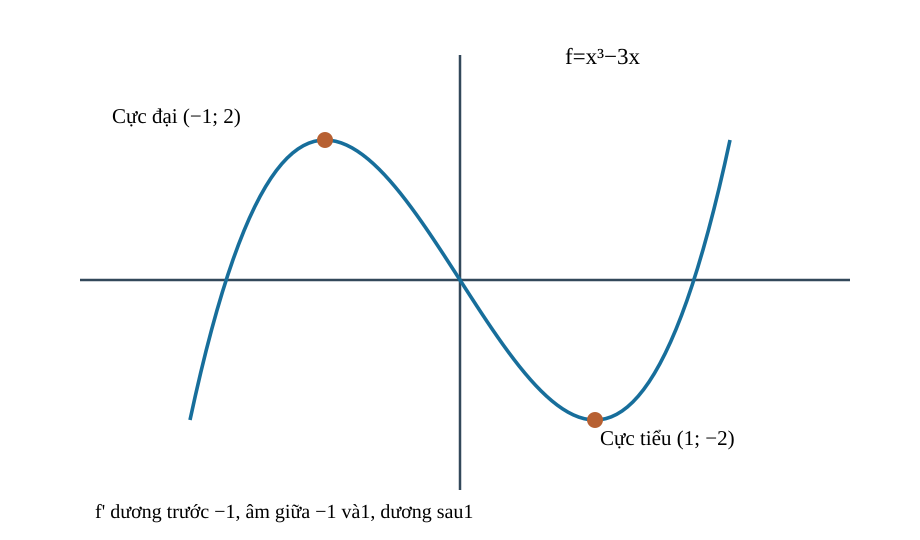
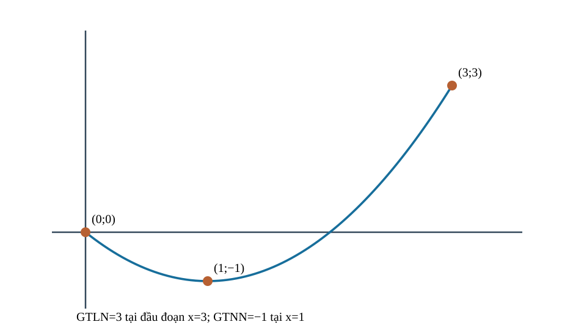
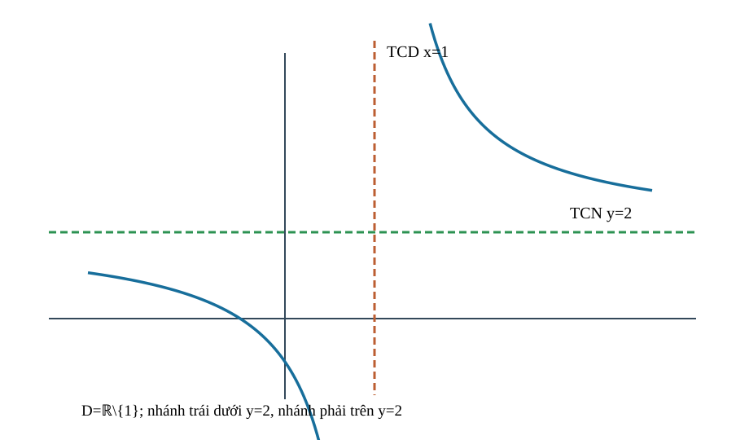
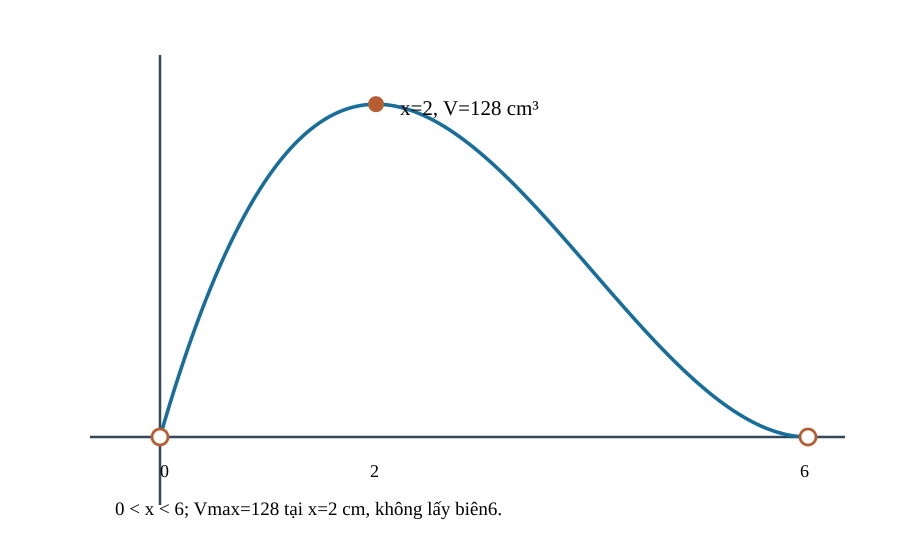

<!-- AUTHORING R04: predecessor R03 Git blob 51cebfe1cb71c5db85c42d40e6167ea4497fa1d9 retained immutably; current Q18 self-QA and V2 source-lock, no website release. -->
<!-- STANDARD_ID=SLM-THPT-QUALITY-ONE; STANDARD_VERSION=3.1.0; LEARNING_PATH=TOPIC; OUTER_PAGES=Kiến thức|Luyện tập|Tự kiểm tra; SOURCE_VERSION=R04_AUTHORING_READY; AUTHORING_ONLY_METADATA=prototypes/thpt/content-drafts/topic10-applied-derivative/Temp_TOPIC10_R04_AUTHORING_ONLY_CUSTODY_METADATA_20261113.md -->
# CĐ10 — Ứng dụng đạo hàm: Khảo sát hàm số và tối ưu hóa

# Kiến thức

## Từ độ dốc tại một điểm đến toàn bộ hình dạng đồ thị

Khi đã biết tính đạo hàm, em có thể biết một đồ thị đang nghiêng lên hay xuống tại một vị trí. Nhưng một người thiết kế hộp giấy không chỉ muốn biết độ nghiêng của đồ thị thể tích: họ cần biết **kích thước nào thật sự làm hộp có thể tích lớn nhất**. Muốn trả lời, ta phải nhìn cả miền được phép, những khoảng tăng giảm, điểm cực trị, giá trị trên biên, hành vi khi x tiến xa và cả khả năng một giá trị lớn nhất **không được đạt**.

Vì vậy ta đi từ định nghĩa đồng biến/nghịch biến đến dấu đạo hàm, từ điểm cực trị địa phương sang bài toán so toàn miền, rồi nối bảng biến thiên với tiệm cận và đồ thị. Chỉ sau khi hiểu toàn bộ hàm số, ta mới đặt điều kiện vật lý và chọn phương án tối ưu; việc giải \(f'(x)=0\) chỉ là một bước tìm **ứng viên**, không phải đáp án cuối.

<!-- LESSON_ID: TOP10-M01; OUTCOME_ID: TOP10-O01 -->

Khi nhìn hai điểm trên đồ thị và thấy điểm phía phải cao hơn, ta mới biết hàm tăng **giữa hai vị trí đó**; chừng ấy chưa đủ để khẳng định hàm tăng trên cả khoảng. Điều cần xét là mọi cặp số \(x_1<x_2\) thuộc cùng một khoảng \(I\). Nếu luôn có \(f(x_1)<f(x_2)\), hàm **đồng biến** trên \(I\); nếu luôn có \(f(x_1)>f(x_2)\), hàm **nghịch biến**. Vì vậy miền xác định và việc hai điểm có thuộc cùng một khoảng là điều kiện phải kiểm trước.

Xét \(f(x)=-2x+5\) trên \(\mathbb R\). Với bất kỳ \(x_1<x_2\), ta có \(f(x_2)-f(x_1)=-2(x_2-x_1)<0\). Do đó \(f(x_2)<f(x_1)\) và hàm nghịch biến trên toàn trục số. Ta chọn cách so hiệu hai giá trị để chứng minh trực tiếp định nghĩa, trước khi dùng công cụ đạo hàm.

<!-- LESSON_ID: TOP10-M02; OUTCOME_ID: TOP10-O02 -->

So hai giá trị đôi khi khó; dấu đạo hàm cho công cụ mạnh hơn khi đủ điều kiện. Cách so trực tiếp \(f(x_2)-f(x_1)\) có thể rất dài với những hàm phức tạp. Khi hàm liên tục trên mỗi đoạn con của khoảng đang xét và khả vi ở các điểm trong khoảng, **đạo hàm** giúp đọc chiều biến thiên hiệu quả hơn. Theo định lý giá trị trung bình, nếu \(f'(x)>0\) khắp khoảng thì hàm tăng nghiêm ngặt; nếu \(f'(x)<0\) thì giảm nghiêm ngặt. Dấu không âm hoặc không dương bảo đảm lần lượt không giảm hoặc không tăng, nhưng muốn nói **nghiêm ngặt** cần loại trường hợp có đoạn hằng.

Chẳng hạn, \(f(x)=x^2\) có \(f'(x)=2x\). Ở phía trái 0, đạo hàm âm nên đồ thị đi xuống; ở phía phải 0, đạo hàm dương nên đồ thị đi lên. Việc chia tại \(x=0\) cho ta hai khoảng biến thiên và cực tiểu. Trái lại, hàm \(x^3\) có đạo hàm bằng 0 ở 0 nhưng vẫn tăng khi đi qua điểm này: một nghiệm \(f'(x)=0\) chưa đủ kết luận có cực trị.

<!-- LESSON_ID: TOP10-M03; OUTCOME_ID: TOP10-O03 -->

Trước bảng dấu, luôn xác định đúng miền. Đạo hàm chỉ giúp đánh giá chiều biến thiên **nơi hàm số được xác định và đủ điều kiện khả vi**. Chẳng hạn, \(f(x)=\dfrac1{x-2}\) có mẫu bằng 0 tại \(x=2\), nên miền là \(\mathbb R\setminus\{2\}\). Đạo hàm \(f'(x)=-\dfrac1{(x-2)^2}<0\) trên miền, nhưng kết luận đúng phải viết: hàm nghịch biến trên **từng khoảng** \(( -\infty,2)\) và \((2,+\infty)\). Hai nhánh không được nối qua một điểm không thuộc miền.

Vì thế, khi khảo sát một hàm số, ta luôn tìm miền trước, rồi mới giải \(f'(x)=0\), xác định điểm đạo hàm không tồn tại trong miền và dựng bảng dấu trên những khoảng hợp lệ. Làm ngược thứ tự dễ dẫn đến ghi một khoảng có chứa điểm cấm hoặc kết luận “nghịch biến trên toàn miền rời” sai theo định nghĩa so mọi cặp.

<!-- LESSON_ID: TOP10-M04; OUTCOME_ID: TOP10-O04 -->

Đổi chiều biến thiên giúp tìm cực trị địa phương. Tại sao đổi dấu đạo hàm quan trọng hơn chỉ giải f'=0? Ta bắt đầu từ dấu f' hai phía, miền và khả vi lân cận. Nếu f' đổi từ dương sang âm khi qua c thuộc D, f có cực đại địa phương ở c; âm sang dương cho cực tiểu. Nếu không đổi dấu, f'=0 có thể là điểm dừng không cực trị. Cực đại địa phương khác giá trị lớn nhất toàn cục.

Chẳng hạn, f=x³−3x: f'=3(x−1)(x+1), dương x<−1, âm −1<x<1, dương x>1. Cực đại ở x=−1 giá trị2, cực tiểu ở x=1 giá trị−2.

*Quan sát hình:* Đọc sự đổi dấu + sang − ở x=−1 và − sang + ở x=1; hai cực trị địa phương phải khớp bảng dấu và tọa độ đồ thị.

<!-- LESSON_ID: TOP10-M05; OUTCOME_ID: TOP10-O05 -->

Không phải nghiệm của f'=0 nào cũng là cực trị. Mọi tiếp tuyến ngang có phải điểm cao nhất hoặc thấp nhất? Cần nhớ đạo hàm 0 và đổi dấu. Điều kiện f'(c)=0 chỉ là ứng viên trong nội miền khả vi, không đủ để khẳng định cực trị. f=x³ tại c=0 có đạo hàm0 nhưng vẫn tăng qua0, không cực đại hoặc cực tiểu. Cũng có cực trị không khả vi như |x| tại0; danh sách ứng viên cần xét cả điểm không khả vi trong miền.

Chẳng hạn, f=x³: f'=3x²≥0, không đổi dấu qua0 nên không có cực trị. Chọn xét dấu chứ không kết luận từ nghiệm đạo hàm.

<!-- LESSON_ID: TOP10-M06; OUTCOME_ID: TOP10-O06 -->

Trong chuyển động, dấu đạo hàm cho biết hướng của tọa độ. Vận tốc âm có nghĩa vật đang đi chậm dần không? Để xác định điều đó, cần xét tọa độ s(t), v=s', tốc độ |v|. Dấu v=s'(t) cho biết chiều chuyển động trong trục đã chọn; v>0 tọa độ tăng, v<0 tọa độ giảm. Nói tốc độ |v| tăng/giảm phải xem gia tốc a=s'' và dấu v·a khi v khác0. Bảng biến thiên s không tự tương đương bảng biến thiên tốc độ.

Chẳng hạn, s(t)=t²−4t, t≥0: v=2t−4, âm t<2, 0 tại2, dương t>2; tọa độ giảm rồi tăng. a=2>0 nhưng trong (0,2), v<0 nên tốc độ giảm.

### Vận dụng và tự đối chiếu

<!-- First Try TOP10-M01; formative only -->
**1.** \(f(x)=3x-1\) đồng biến hay nghịch biến trên \(\mathbb R\)? Hãy giải thích bằng hai giá trị \(x_1<x_2\).

Đối chiếu

\(f(x_2)-f(x_1)=3(x_2-x_1)>0\), nên hàm đồng biến trên \(\mathbb R\). Nếu em chỉ thế hai giá trị cụ thể, hãy quay lại điều kiện **với mọi** cặp \(x_1<x_2\) trong khoảng.

<!-- First Try TOP10-M02; formative only -->
**2.** \(f(x)=x^3\) có tăng nghiêm ngặt trên \(\mathbb R\) không? Vì sao \(f'(0)=0\) không bác bỏ điều đó?

Đối chiếu

Có. Với \(x_1<x_2\) thì \(x_1^3<x_2^3\); đạo hàm \(3x^2\ge0\) và chỉ bằng 0 tại một điểm, không tạo ra đoạn hằng. Nếu em gán mọi nghiệm \(f'=0\) thành cực trị, hãy lập dấu đạo hàm **hai phía** điểm ấy.

<!-- First Try TOP10-M03; formative only -->
**3.** \(g(x)=\sqrt{x-1}\) có miền xác định nào? Có thể nói hàm tăng trên miền đó không?

Đối chiếu

Điều kiện \(x-1\ge0\) cho miền \([1,+\infty)\). Trên \((1,+\infty)\), \(g'(x)=\dfrac1{2\sqrt{x-1}}>0\); từ giá trị ở biên \(x=1\), ta vẫn có thể nói hàm tăng trên \([1,+\infty)\). Nếu em ghi miền \(\mathbb R\), hãy kiểm điều kiện tồn tại của căn trước.

<!-- First Try TOP10-M04; formative only -->
**4.** f=x² có cực tiểu ở đâu?

Đối chiếu

x=0, f' đổi âm→dương, f(0)=0.

Nếu chỉ giải f'=0, lập bảng dấu qua nghiệm.

<!-- First Try TOP10-M05; formative only -->
**5.** f=x⁴ có cực tiểu tại0 không?

Đối chiếu

Có, f'=4x³ đổi âm→dương ở0; f(0)=0.

Nếu bỏ điểm gấp khúc |x|, bổ sung điểm f không khả vi nhưng có giá trị.

<!-- First Try TOP10-M06; formative only -->
**6.** s(t)=t², t>0, tọa độ tăng hay giảm?

Đối chiếu

v=2t>0 nên tăng.

Nếu nhìn s âm hay dương để đo chiều, thay bằng dấu s'.

## Từ một đỉnh lân cận tới giá trị tốt nhất trên miền

Một điểm cao hơn các điểm **rất gần nó** có thể vẫn thấp hơn một đầu đoạn ở xa. Đó là khác biệt giữa cực đại địa phương và giá trị lớn nhất trên miền; tương tự cho cực tiểu. Để tìm giá trị thực sự tốt nhất, phải liệt kê cả điểm tới hạn, nơi đạo hàm không tồn tại và các đầu mút **thuộc miền**, rồi so giá trị. Nếu miền mở hoặc không bị chặn, cần xét thêm giới hạn để biết cận có được đạt hay không.

<!-- LESSON_ID: TOP10-M07; OUTCOME_ID: TOP10-O07 -->

Một đỉnh cục bộ có chắc cao nhất trên toàn miền không? Ta đã biết cực trị qua đổi dấu, miền so sánh. Cực đại địa phương chỉ so các điểm gần c; GTLN/GTNN trên D phải so với MỌI x∈D. Một hàm có thể có nhiều cực trị địa phương, không có max/min toàn cục nếu unbounded hoặc cận không đạt.

Chẳng hạn, f=x³−3x trên ℝ có cực đại địa phương 2 tại−1 và cực tiểu−2 tại1, nhưng f→+∞/−∞ khi x→±∞ nên không có GTLN/GTNN trên ℝ.

<!-- LESSON_ID: TOP10-M08; OUTCOME_ID: TOP10-O08 -->

Liên tục trên đoạn đóng bảo đảm có cực trị toàn cục. Khi nào chắc chắn có GTLN/GTNN dù chưa tìm được điểm đạt? Ta sử dụng định nghĩa liên tục trên đoạn đóng [a,b]. Theo định lí giá trị lớn nhất nhỏ nhất (Weierstrass), hàm liên tục trên đoạn đóng hữu hạn [a,b] chắc chắn đạt GTLN/GTNN. Nếu thiếu 'đóng' hay tính liên tục thì chưa có bảo đảm; vẫn có thể đạt nhưng phải chứng minh riêng. Kết quả chỉ nói tồn tại, chưa cho tọa độ.

Xét ví dụ: f=x²−2x trên [0,3] là đa thức liên tục nên tồn tại hai giá trị. Ta còn tính được GTNN−1 tại x=1, GTLN3 tại x=3 sau so ứng viên.

<!-- LESSON_ID: TOP10-M09; OUTCOME_ID: TOP10-O09 -->

Muốn tìm giá trị ấy, phải so điểm tới hạn và đầu đoạn. Vì sao chỉ giải f'=0 có thể bỏ sót GTLN tại đầu mút? Ta bắt đầu từ hàm liên tục trên [a,b], khả vi từng khoảng, giá trị ứng viên. Trên [a,b] liên tục, GTLN/GTNN đạt ở đầu mút hoặc điểm nội miền f'=0 hay không khả vi. Phương pháp: xác định miền, liệt kê đủ ứng viên, tính chính xác f tại mỗi điểm, so sánh cùng đơn vị. Điểm f'=0 ngoài đoạn phải loại.

Chẳng hạn, f=x³−3x trên [0,2], f'=3x²−3⇒ x=1 trong đoạn. f(0)=0,f(1)=−2,f(2)=2⇒GTNN−2 tại1,GTLN2 tại2. Chọn kiểm hai đầu vì cực đại không nhất thiết nội miền.

Hình bên dưới là **ví dụ khác** đúng với dữ liệu gốc: trên đoạn \([0,3]\), \(g(x)=x^2-2x\) có \(g'(x)=2x-2\), ứng viên nội miền \(x=1\) và hai đầu đoạn \(x=0,3\). Ta tính \(g(0)=0\), \(g(1)=-1\), \(g(3)=3\). Vậy GTNN là −1 tại 1 và GTLN là 3 tại **đầu phải 3**; điều này minh họa lý do không chỉ so các nghiệm đạo hàm bằng 0. Bài \(x^3-3x\) trên \([0,2]\) vừa giải dùng cùng phương pháp nhưng **không phải hình đang vẽ**.

*Đọc hình:* Ba điểm cần so của \(g=x^2-2x\) trên \([0,3]\) là \((0,0),(1,-1),(3,3)\). Đường cong đạt nhỏ nhất tại điểm nội miền nhưng **lớn nhất ở đầu phải**; giá trị đạo hàm ở đầu đoạn không cần bằng 0.

<!-- LESSON_ID: TOP10-M10; OUTCOME_ID: TOP10-O10 -->

Trên miền mở, một cận có thể không được đạt. f(x) tiến đến 1 nhưng không bao giờ bằng 1, có gọi GTLN=1 không? Cần nhớ tập giá trị, cận trên và điều kiện 'đạt'. Cận trên đúng không nhất thiết là maximum. Trên (0,1), f(x)=x có supremum1 nhưng không có GTLN vì x=1 bị loại. Có thể có giá trị lớn nhất trên miền mở nếu hàm có điểm nội miền đạt, phải xét trường hợp cụ thể. Không được suy từ giới hạn ở biên thành giá trị đạt.

Chẳng hạn, f=1−(x−2)² trên (0,3) có GTLN1 tại x=2 (nội miền) dù miền mở. Trái lại g=x trên (0,1) không có GTLN, chỉ supremum1.

<!-- LESSON_ID: TOP10-M11; OUTCOME_ID: TOP10-O11 -->

Ràng buộc có thể loại nghiệm tối ưu nằm ngoài miền. Một đáp số x tối ưu có thể vô nghĩa nếu x vi phạm điều kiện thực tế? Để xác định điều đó, cần xét bất phương trình, khoảng ràng buộc, max/min. Bài toán cực trị có ràng buộc phải lấy miền khả thi từ bối cảnh (độ dài dương, số lượng nguyên, ngân sách, khối lượng, thời gian). Sau tìm cực trị liên tục, kiểm nghiệm tối ưu có trong miền; nếu biến nguyên, so các giá trị nguyên lân cận. Không mở rộng mô hình ra ngoài điều kiện.

Chẳng hạn, Lợi ích P(x)=−(x−4)²+10 với x∈[0,3] không đạt đỉnh 10 ở x=4 vì ngoài miền; P tăng trên [0,3], GTLN P(3)=9. Chọn kiểm miền trước khi tuyên bố cực đại.

<!-- LESSON_ID: TOP10-M12; OUTCOME_ID: TOP10-O12 -->

Tối ưu bắt đầu từ biến và đại lượng mục tiêu. Tại sao một công thức đạo hàm đúng vẫn cho bài toán thực tế sai? Ta đã biết chọn biến và đơn vị, mối ràng buộc, miền. Quy trình mô hình: chọn đại lượng cần tối ưu, chọn biến và đơn vị, dùng ràng buộc để đưa mục tiêu về một biến, lập miền hợp lệ, đạo hàm và kiểm biên, rồi diễn giải kết quả theo mô hình. Không coi việc giải f'=0 là đủ chứng minh tối ưu.

Chẳng hạn, Chu vi hình chữ nhật 20 m, cạnh x∈(0,10), cạnh kia10−x, diện tích A=x(10−x). A'=10−2x=0⇒x=5, diện tích25 m² là lớn nhất vì A=25−(x−5)²≤25, đạt tại x=5.

### Vận dụng và tự đối chiếu

<!-- First Try TOP10-M07; formative only -->
**1.** Hàm f=x² trên ℝ có GTNN không, GTLN không?

Đối chiếu

GTNN0 tại0; không có GTLN vì x²→∞.

Nếu nói cực đại 2 là GTLN của hàm bậc ba, thử x=10.

<!-- First Try TOP10-M08; formative only -->
**2.** f=x² trên [−1,2] có GTLN?

Đối chiếu

Có, GTLN4 tại2 và GTNN0 tại0.

Nếu miền mở, thử xét f=x trên (0,1) không đạt cận1.

<!-- First Try TOP10-M09; formative only -->
**3.** f=x²−4x trên [0,3], GTNN?

Đối chiếu

f'=2x−4=0 tại2: f(0)=0,f(2)=−4,f(3)=−3⇒GTNN−4 tại2.

Nếu thấy nghiệm đạo hàm nằm ngoài đoạn, bỏ ứng viên ấy.

<!-- First Try TOP10-M10; formative only -->
**4.** g(x)=−x trên (0,1) có GTLN0 không?

Đối chiếu

Không, vì g→0 khi x→0⁺ nhưng x=0 bị loại.

Nếu ghi GTLN là cận không đạt, hãy hỏi có x∈D sao cho f(x)=cận không.

<!-- First Try TOP10-M11; formative only -->
**5.** Với f=−(x−5)², x∈[0,2], x tối ưu?

Đối chiếu

x=2, f(2)=−9; x=5 không hợp lệ.

Nếu nghiệm f'=0 ngoài miền, kiểm đầu mút hợp lệ.

<!-- First Try TOP10-M12; formative only -->
**6.** Hình chữ nhật chu vi 12 m, diện tích lớn nhất khi nào?

Đối chiếu

x=3, cạnh còn lại3, diện tích9 m².

Nếu mục tiêu chưa đưa về một biến, quay lại ràng buộc trước khi đạo hàm.

## Đọc hình dạng của đồ thị ở nơi rất xa và gần điểm bị loại

Bảng dấu đạo hàm mô tả chiều đi của các nhánh, nhưng chưa cho biết nhánh vươn tới đâu. Khi \(x\) tiến về vô cực hoặc tiến sát một điểm cấm, **giới hạn** có thể cho thấy một đường tiệm cận. Tiệm cận đứng cần giá trị hàm tiến ra vô cực ở ít nhất một phía; một điểm khuyết có giới hạn hữu hạn không tự trở thành tiệm cận. Ta dùng cùng nguyên tắc xét miền và dấu đã học để tránh nối các nhánh phân thức qua chỗ không có giá trị.

<!-- LESSON_ID: TOP10-M13; OUTCOME_ID: TOP10-O13 -->

Một đồ thị có thể tiến gần một đường thẳng dù không bao giờ chạm? Ta sử dụng giới hạn ở vô cực và phân thức. Đường y=L là tiệm cận ngang nếu lim(x→+∞)f(x)=L hoặc lim(x→−∞)f(x)=L hữu hạn. Chỉ cần một trong hai phía; có thể là hai giới hạn khác nhau nếu hàm thích hợp. Việc đồ thị cắt đường y=L tại điểm hữu hạn không làm mất tính tiệm cận.

Xét ví dụ: f=(2x+1)/(x+3)→2 khi x→±∞, nên y=2 là tiệm cận ngang; không phải y=0 vì tử và mẫu cùng bậc.

<!-- LESSON_ID: TOP10-M14; OUTCOME_ID: TOP10-O14 -->

Gần điểm cấm, giới hạn một phía quyết định tiệm cận đứng. Điểm x=a không xác định có luôn là tiệm cận đứng? Ta bắt đầu từ định nghĩa giới hạn ±∞ một phía, bảng dấu. x=a là tiệm cận đứng nếu ít nhất một trong các giới hạn một phía khi x→a đạt +∞ hoặc −∞. Chỉ có mẫu bằng0 chưa đủ: nếu tử cùng triệt tiêu có thể là lỗ khử. Cần xác định miền và tính dấu mỗi phía.

Chẳng hạn, f=(x+1)/(x−2), tại2 tử→3>0, mẫu âm phía trái/dương phía phải, nên f→−∞ khi x→2⁻, f→+∞ khi x→2⁺, x=2 là TCD.

<!-- LESSON_ID: TOP10-M15; OUTCOME_ID: TOP10-O15 -->

Một đường tiệm cận xiên được nhận qua phần dư tiến 0. Nếu hàm tiến sát đường nghiêng thì cần chứng minh gì, thay vì chỉ chia đa thức? Cần nhớ giới hạn ở ±∞, chia đa thức. Đường y=ax+b (a≠0) là tiệm cận xiên tại một phía vô cực khi lim[f(x)−(ax+b)]=0 phía ấy. Có thể tìm a=lim f(x)/x và b=lim[f(x)−ax] nếu hai giới hạn hữu hạn và a≠0, hoặc chia đa thức trực tiếp. Không phải mọi phép chia ra ax+b đều là tiệm cận nếu phần dư không về0.

Chẳng hạn, f=(x²+1)/(x−1)=x+1+2/(x−1); vì 2/(x−1)→0 khi x→±∞ nên y=x+1 là TC xiên. Chọn chia vì mẫu bậc1 và tử bậc2.

<!-- LESSON_ID: TOP10-M16; OUTCOME_ID: TOP10-O16 -->

Lỗ khử được có giới hạn hữu hạn, khác tiệm cận đứng. Tại sao một đồ thị có thể bị thiếu đúng một điểm nhưng không lao ra vô cực? Để xác định điều đó, cần xét phân tích tử/mẫu, giới hạn hữu hạn. Nếu tử và mẫu có cùng nhân tử x−a, giản ước trên x≠a cho giới hạn hữu hạn, khi đó đồ thị có lỗ/điểm loại chứ không phải TCD tại a. Phép rút gọn không tự bổ sung f(a) vào miền gốc. Có thể có TCD ở điểm khác.

Chẳng hạn, f=(x²−4)/(x−2), x≠2 ⇒ f=x+2 trên miền. Lim tại2 là4 hữu hạn nên không có tiệm cận đứng x=2, chỉ lỗ tại (2,4).

<!-- LESSON_ID: TOP10-M17; OUTCOME_ID: TOP10-O17 -->

Miền quyết định phía nào được lấy giới hạn. Có thể lấy giới hạn phía ngoài miền mà hàm không tồn tại? Ta đã biết đầu mút miền, hàm có mẫu/căn. Giới hạn một phía x→a phải dùng các điểm thuộc miền D gần a ở đúng phía. Ở đầu miền của căn √(x−1), không có lân cận phía trái trong miền thực; không dùng giá trị giả. Ở điểm loại phân thức, nếu D có hai nhánh thì kiểm từng phía. TCD dựa trên đường đi hợp lệ trong miền.

Chẳng hạn, f=1/√(x−1) có D=(1,∞); khi x→1⁺, f→+∞ nên x=1 là TCD từ phía phải. Không có giới hạn thực x→1⁻ từ miền.

<!-- LESSON_ID: TOP10-M18; OUTCOME_ID: TOP10-O18 -->

Đồ thị giúp phân biệt đường giới hạn ngang, đứng, xiên. Vì sao tiệm cận không phải đường mà đồ thị tuyệt đối không được chạm? Ta sử dụng đọc trục và giới hạn, đồ thị phân nhánh. Tiệm cận là mô tả khoảng cách/hành vi giới hạn, không phải cấm giao nhau. Đọc TCD x=a qua một nhánh lao ±∞ gần a, ngang y=L qua xu hướng ở vô cực, xiên y=ax+b khi hiệu f−(ax+b)→0. Phải kiểm tính đúng theo mỗi phía vô cực/điểm cấm, không dựa chỉ nét vẽ.

Xét ví dụ: f=x+1/x, x≠0: TCD x=0 vì 1/x vô cực, TC xiên y=x vì f−x=1/x→0. Không có TCN, mặc dù x lớn đồ thị gần đường xiên.

### Vận dụng và tự đối chiếu

<!-- First Try TOP10-M13; formative only -->
**1.** f=(3x−2)/(x+4) có TCN?

Đối chiếu

y=3 khi x→±∞.

Nếu lấy hệ số hằng ở tử làm tiệm cận, chia cho x bậc cao nhất.

<!-- First Try TOP10-M14; formative only -->
**2.** f=1/(x+1) có TCD ở đâu và hai phía?

Đối chiếu

x=−1; trái −∞, phải+∞.

Nếu viết 0/0 rồi gọi đứng, thử phân tích và rút gọn.

<!-- First Try TOP10-M15; formative only -->
**3.** f=(x²−x+2)/x, x≠0, TC xiên?

Đối chiếu

f=x−1+2/x⇒y=x−1.

Nếu chỉ tính a mà quên b, tiệm cận sẽ dịch sai.

<!-- First Try TOP10-M16; formative only -->
**4.** f=(x²−9)/(x−3), có TCD x=3?

Đối chiếu

Không, vì f=x+3 cho x≠3, giới hạn6.

Nếu rút gọn nhưng tự gán f(3)=6, đã thay đổi hàm gốc.

<!-- First Try TOP10-M17; formative only -->
**5.** f=1/√x tại x=0, phía nào xét TCD?

Đối chiếu

Chỉ x→0⁺; giới hạn +∞, x=0 là TCD.

Nếu viết giới hạn trái của f không có miền thực, đó là sai điều kiện.

<!-- First Try TOP10-M18; formative only -->
**6.** f=(x+1)/x có TCD và TCN?

Đối chiếu

TCD x=0, TCN y=1.

Nếu đọc đường y=1 như trục hoành, hãy ghi phương trình theo trục.

## Ghép các dữ kiện thành một đồ thị có thể kiểm chứng

Giờ đây, miền xác định cho biết nơi được phép vẽ, đạo hàm cho biết từng nhánh lên xuống, giới hạn cho biết các tiệm cận, còn giao trục và cực trị định vị những điểm đặc biệt. Một bản khảo sát tốt phải **khớp tất cả dữ kiện cùng lúc**. Vẽ đúng không phải nối tùy tiện vài chấm, mà là diễn đạt bằng hình một lập luận có điều kiện, bảng biến thiên và giới hạn.

<!-- LESSON_ID: TOP10-M19; OUTCOME_ID: TOP10-O19 -->

Muốn phác đồ thị đúng thì thứ tự nào ngăn bỏ sót nhánh? Ta bắt đầu từ miền, đạo hàm, giới hạn, điểm đặc biệt. Quy trình: (1) tìm D; (2) giải f'=0 và xét dấu trên từng nhánh D; (3) tính cực trị, giới hạn tại biên/±∞, TCD/TCN/TC xiên nếu có; (4) giao trục/điểm hỗ trợ, đối xứng phù hợp; (5) lập bảng biến thiên và vẽ từng nhánh đúng mối liên hệ. Không nối hai nhánh qua điểm bị loại.

Chẳng hạn, f=1/(x−1): D=ℝ\{1}, f'=−1/(x−1)²<0, TCD x=1, TCN y=0; hai nhánh đều giảm nhưng không nối qua x=1. Chọn kiểm miền trước dấu.

<!-- LESSON_ID: TOP10-M20; OUTCOME_ID: TOP10-O20 -->

Với đa thức bậc ba, bảng dấu đạo hàm định hình các nhánh. Đa thức bậc ba có nhất thiết hai cực trị? Cần nhớ đạo hàm bậc hai, dấu f', giới hạn ±∞. Với f bậc ba, f' là tam thức bậc hai: có thể có hai nghiệm phân biệt tạo hai cực trị, nghiệm kép không đổi dấu tạo điểm dừng, hoặc không nghiệm tạo đơn điệu. Chỉ tính f'=0 chưa đủ; phải lập bảng dấu/điểm uốn nếu xét thêm, không gán mọi bậc ba hai cực trị.

Chẳng hạn, f=x³−3x: f'=3(x−1)(x+1), cực đại ở −1 giá trị2, cực tiểu ở1 giá trị−2; khi x→∞ f→∞, x→−∞ f→−∞. Chọn bảng dấu để xác định hai nhánh.

<!-- LESSON_ID: TOP10-M21; OUTCOME_ID: TOP10-O21 -->

Phân thức đòi hỏi xét điểm cấm và tiệm cận. Tại sao bảng biến thiên của phân thức phải có đường phân cách ở x=a? Để xác định điều đó, cần xét quy tắc đạo hàm thương và giới hạn một phía. Đối với f=(ax+b)/(cx+d) với cx+d≠0, f'=(ad−bc)/(cx+d)² (trong miền), nên dấu không đổi trên mỗi khoảng miền. Tiệm cận đứng thường tại nghiệm mẫu khi tử không đồng thời0; ngang tại y=a/c nếu c≠0. Bảng biến thiên ghi riêng các nhánh, không nối qua TCD.

Chẳng hạn, f=(2x+1)/(x−1): D=ℝ\{1}, f'=[2(x−1)−(2x+1)]/(x−1)²=−3/(x−1)²<0; TCD x=1, TCN y=2. Trái gần1→−∞, phải→+∞.

*Quan sát hình:* Đường x=1 là tiệm cận đứng, y=2 tiệm cận ngang của (2x+1)/(x−1); không nối các nhánh qua x=1.

<!-- LESSON_ID: TOP10-M22; OUTCOME_ID: TOP10-O22 -->

Giao trục và điểm đặc biệt định vị đồ thị. Tại sao tìm giao trục không đủ để vẽ đúng đồ thị? Ta đã biết giải f(x)=0, thế x=0 khi x=0 thuộc miền, dấu và giới hạn. Giao Ox là nghiệm f(x)=0 thuộc D; giao Oy chỉ có khi 0∈D và là (0,f(0)). Với phân thức, nghiệm tử tại điểm mẫu=0 phải loại. Giới hạn ở vô cực và điểm loại mô tả nhánh mà hai giao trục không cho biết.

Chẳng hạn, f=(x−2)/(x+1): Ox (2,0), Oy(0,−2), TCD x=−1 và TCN y=1. Ta chọn kiểm mẫu khi giải tử bằng0; x=2 hợp lệ.

<!-- LESSON_ID: TOP10-M23; OUTCOME_ID: TOP10-O23 -->

Một số phân thức có tâm đối xứng tại giao tiệm cận. Hình hai nhánh cong đối nhau có tâm nào và phải chứng minh ra sao? Ta sử dụng tịnh tiến tọa độ X=x−a,Y=y−b, đối xứng tâm. Đồ thị y=b+k/(x−a), a,k≠? với k≠0, có TCD x=a, TCN y=b, tâm đối xứng tại giao (a,b), vì f(a+h)+f(a−h)=2b khi h≠0. Không kết luận mọi phân thức đều đối xứng tâm chỉ từ nét nhìn; kiểm phép tịnh tiến hoặc tính chất đối xứng.

Xét ví dụ: f=(2x+1)/(x−1)=2+3/(x−1) nên tâm I(1,2); TCD x=1, TCN y=2. Chọn phép tách vì chứng minh được đối xứng chứ không chỉ đo bằng mắt.

<!-- LESSON_ID: TOP10-M24; OUTCOME_ID: TOP10-O24 -->

Bảng biến thiên cho ta đọc cực trị và chiều biến thiên. Một bảng mũi tên lên/xuống có thể cho biết GTLN, cực trị và khoảng tăng không? Ta bắt đầu từ ý nghĩa mũi tên, điểm tách miền, giới hạn ở biên. Bảng biến thiên chứa điểm phân chia, dấu f', giá trị tại điểm và giới hạn. Mũi tên giảm→tăng tại c∈D gợi cực tiểu, nhưng muốn GTNN toàn miền phải so mọi nhánh và biên. Điểm đứng đôi biểu diễn loại khỏi miền không phải nơi đạt cực trị.

Chẳng hạn, nếu f' âm trên (−∞,1), dương trên (1,∞) và f(1)=−3, f liên tục trong ℝ, thì f có cực tiểu ở (1,−3). Nếu f' không có trên nhánh bị loại, không gắn nhãn cực tiểu ở đó.

<!-- LESSON_ID: TOP10-M25; OUTCOME_ID: TOP10-O25 -->

Điểm ngoài miền không bao giờ được nối qua các nhánh. Hai nhánh giảm có thể tạo một hàm giảm trên toàn tập miền rời? Cần nhớ khoảng và so cặp trên cùng một tập, điểm cấm. Với miền gồm nhiều khoảng rời, dấu f'<0 trên mỗi thành phần chỉ chứng minh hàm giảm trên từng khoảng, không cho giảm khi so một điểm ở nhánh trái với một điểm nhánh phải. Cách ghi đúng tên các khoảng, giữ tiệm cận/điểm loại trong bảng.

Chẳng hạn, f=1/x, D=ℝ\{0}, f'=−1/x²<0 trên từng nhánh. Nhưng −1<1 mà f(−1)=−1<f(1)=1, ngược bất đẳng thức nghịch biến, nên không được nói f nghịch biến trên D theo mọi cặp.

### Vận dụng và tự đối chiếu

<!-- First Try TOP10-M19; formative only -->
**1.** Khảo sát \(f(x)=x^2\) trên \(\mathbb R\): tìm miền, đạo hàm, khoảng tăng giảm, cực trị và mô tả hình dạng đồ thị theo đúng thứ tự.

Đối chiếu

D=ℝ, f'=2x, giảm trước0 tăng sau0, đỉnh(0,0), không TCD/TC ngang, đồ thị parabol.

Nếu thiếu nhánh phía trái, bảng dấu f' là nơi tìm lại.

<!-- First Try TOP10-M20; formative only -->
**2.** f=x³ có cực trị không?

Đối chiếu

Không; f'=3x²≥0, không đổi dấu ở0.

Nếu vẽ hình có hai đỉnh cho x³, kiểm lại số nghiệm đổi dấu của f'.

<!-- First Try TOP10-M21; formative only -->
**3.** f=(x+3)/(x−2), dấu đạo hàm?

Đối chiếu

f'=−5/(x−2)²<0 trên mỗi nhánh; TCD x=2, TCN y=1.

Nếu đọc 'giảm trên toàn ℝ\{2}' theo mọi cặp, lưu ý hai nhánh không tạo một khoảng.

<!-- First Try TOP10-M22; formative only -->
**4.** f=(x−1)/(x−1), x≠1 có giao Ox không?

Đối chiếu

Không; f=1 trên D nên không có nghiệm f=0, x=1 bị loại.

Nếu rút gọn rồi tự điền điểm bị loại, đã đổi đồ thị.

<!-- First Try TOP10-M23; formative only -->
**5.** f=(x+1)/(x−2) có tâm đối xứng nào?

Đối chiếu

f=1+3/(x−2) nên I(2,1).

Nếu lấy tâm tại giao trục, nhầm với giao tiệm cận.

<!-- First Try TOP10-M24; formative only -->
**6.** Cho \(f\) liên tục tại \(x=2\), khả vi ở hai phía gần 2, \(f'(x)>0\) khi \(x<2\) và \(f'(x)<0\) khi \(x>2\), \(f(2)=5\). Điểm \((2,5)\) là cực trị nào?

Đối chiếu

Do f liên tục tại 2 và tăng trước2, giảm sau2 theo dấu đạo hàm, f đạt cực đại địa phương ở (2,5). Điều kiện liên tục tại 2 rất quan trọng; chỉ biết dấu đạo hàm hai phía và f(2) thì chưa đủ.

Nếu tưởng min, nhớ +→− là đi lên rồi đi xuống.

<!-- First Try TOP10-M25; formative only -->
**7.** f=1/(x−1) giảm ở đâu?

Đối chiếu

Trên từng khoảng (−∞,1) và (1,∞); không trên cả tập gộp theo mọi cặp.

Nếu gộp, thử một cặp điểm ở hai nhánh.

## Từ hàm số trên giấy tới lựa chọn trong đời thực

Một hàm lợi nhuận hoặc thể tích chỉ mô tả các phương án có ý nghĩa khi biến và đơn vị được xác định. Chiều dài cạnh phải dương, hộp phải có đáy, và số sản phẩm đôi khi buộc là số nguyên. Trước khi tính đạo hàm, ta viết miền vật lý và đại lượng cần tối đa hoặc tối thiểu; sau khi tìm ứng viên, ta kiểm lại biên và điều kiện. Đó là cách biến phép khảo sát thành một quyết định hợp lệ, không nhầm nghiệm toán học với phương án thực hiện được.

<!-- LESSON_ID: TOP10-M26; OUTCOME_ID: TOP10-O26 -->

Tại sao tổng chi phí cao không đồng nghĩa tốc độ tăng chi phí cao? Để xác định điều đó, cần xét đạo hàm f' so với f, đơn vị. Trong mô hình thực tế f(x), f'(x) mô tả thay đổi tức thời theo một đơn vị x, có đơn vị [f]/[x]. Giá trị f(x) là mức hiện tại, f' có thể âm dù f dương. Để đọc kết quả phải nói rõ x đơn vị gì và phạm vi mô hình.

Chẳng hạn, C(q)=100+2q+0,1q² (nghìn đồng) với q≥0 sản phẩm, C'(q)=2+0,2q nghìn đồng/sản phẩm; tại q=5 là3, không phải C(5)=112,5. Chọn đạo hàm khi hỏi chi phí cận biên.

<!-- LESSON_ID: TOP10-M27; OUTCOME_ID: TOP10-O27 -->

Vận tốc có hướng và tốc độ khác nhau khi xét dấu. Gia tốc âm có thể đi cùng tốc độ đang tăng không? Ta đã biết cĐ09 v=s',a=s''; dấu v·a khi v≠0. Với tọa độ s(t), vận tốc có hướng v=s', tốc độ |v|, gia tốc a=s''. Khi v·a>0 thì tốc độ đang tăng; khi v·a<0 thì giảm, nếu v=0 phải xét riêng. Tốc độ không âm; gia tốc âm không đủ chứng minh chậm dần.

Chẳng hạn, s(t)=−t², t>0: v=−2t<0, a=−2<0 cùng dấu nên |v|=2t tăng. Chọn dấu tích v·a thay vì chỉ nhìn a.

<!-- LESSON_ID: TOP10-M28; OUTCOME_ID: TOP10-O28 -->

Chi phí cận biên là tốc độ biến thiên, không phải chi phí tổng. Chi phí sản xuất thêm một đơn vị có giống chính xác đạo hàm tại q không? Ta sử dụng đơn vị biến q, đạo hàm và xấp xỉ vi phân. Chi phí cận biên C'(q) là tốc độ biến thiên tức thời theo sản lượng; với số lượng nguyên, chi phí tăng thêm C(q+1)−C(q) không nhất thiết bằng chính xác C'(q). Dùng đạo hàm làm xấp xỉ khi bước nhỏ so với thang mô hình, kiểm đơn vị và tính thực tế.

Xét ví dụ: C(q)=q²+5q+100 (nghìn đồng)⇒C'(q)=2q+5. Tại q=10, C'=25 (nghìn đồng/sản phẩm), nhưng C(11)−C(10)=26, chênh1. Ta chọn so với độ tăng thật để tránh xem đạo hàm là hóa đơn chính xác.

<!-- LESSON_ID: TOP10-M29; OUTCOME_ID: TOP10-O29 -->

Một mô hình tối ưu phải xác định miền khả thi. Vì sao nghiệm phương trình đạo hàm có thể là kích thước âm vô nghĩa? Ta bắt đầu từ độ dài, thời gian, lượng sản phẩm, ràng buộc tổng. Bài toán thực tế cần miền khả thi từ dữ kiện: kích thước dương, thể tích không âm, thời gian trong giai đoạn khảo sát, lượng người/sản phẩm có thể là số nguyên. Miền phải ghi trước khi tối ưu và dùng để loại ứng viên ngoài miền. Lời giải chỉ có nghĩa trong mô hình và giả thiết cho trước.

Chẳng hạn, Hình chữ nhật có tổng hai cạnh bằng10 m, x>0 và 10−x>0 ⇒ 0<x<10. Diện tích A=x(10−x), điểm x=5 hợp lệ; x=−5 dù có thể nằm trong phép tính đại số bị loại.

<!-- LESSON_ID: TOP10-M30; OUTCOME_ID: TOP10-O30 -->

Đạo hàm giúp tìm ứng viên bên trong miền. Có thể biết hàm đạt cực đại nhờ đạo hàm mà không kiểm giá trị biên? Cần nhớ bảng dấu f', điểm khả thi, mục tiêu. Khi tối ưu f trên miền [a,b] hoặc (a,b), lấy f' trong nội miền để tìm ứng viên; so giá trị ở ứng viên hợp lệ và hai đầu nếu thuộc miền, thêm điểm không khả vi. Với miền mở, kiểm giới hạn biên và việc cận đạt. Không tuyên bố f'=0 luôn cho GTLN.

Chẳng hạn, A(x)=x(12−x) trên 0<x<12, A'=12−2x; đổi dương→âm tại x=6, max A=36 đạt tại6. Đầu miền cho A→0 không đạt nhưng không ảnh hưởng max.

Tình huống đúng như hình: từ tấm bìa vuông cạnh **12 cm**, cắt bốn hình vuông cạnh \(x\) rồi gấp thành hộp không nắp. Muốn còn đáy có hai chiều dương, phải có \(0<x<6\). Thể tích là \(V(x)=x(12-2x)^2\) (cm³); đạo hàm \(V'(x)=12(x-2)(x-6)\). Trên \((0,2)\) đạo hàm dương, trên \((2,6)\) âm nên thể tích **lớn nhất 128 cm³** tại \(x=2\) cm, trong khi hai biên tạo hộp suy biến không được lấy. Đây là bài **thể tích**, khác với ví dụ diện tích \(A=x(12-x)\) vừa nêu.

*Đọc hình:* Chiều cao hộp là \(x\), đáy mỗi cạnh \(12-2x\); miền \(0<x<6\). Tại \(x=2\), đáy 8×8, cao2 nên thể tích128 cm³. Khi \(x\) tiến 0 hoặc 6, hộp suy biến nên không được xem biên là phương án hợp lệ.

<!-- LESSON_ID: TOP10-M31; OUTCOME_ID: TOP10-O31 -->

Cả đầu mút và điểm không khả vi cũng cần kiểm. Hai biên có thể làm thay đổi kết luận tối ưu như thế nào? Để xác định điều đó, cần xét đoạn đóng/mở và điểm dừng. Điểm biên thuộc miền có thể là nơi đạt max/min, kể cả đạo hàm trong lòng chưa bằng0. Nếu điểm biên bị loại, chỉ có thể là giới hạn/cận không đạt. Với biến nguyên, ứng viên phải làm tròn so hai giá trị khả thi lân cận; không dùng nghiệm thực phân số như số sản phẩm.

Chẳng hạn, P(x)=−(x−5)²+20 trên x∈[0,4]: P tăng đến x=4 nên GTLN16 tại biên4; không lấy P(5)=20 ngoài miền. Chọn kiểm điểm biên vì f'(x)>0 trên toàn khoảng.

<!-- LESSON_ID: TOP10-M32; OUTCOME_ID: TOP10-O32 -->

Kết luận phải ghi đơn vị và giả thiết. Kết quả tối ưu chính xác về đại số đã đủ là kết luận thực tế chưa? Ta đã biết đơn vị, số nguyên, miền khả thi và định nghĩa mục tiêu. Mọi kết luận mô hình cần ghi giả thiết và đơn vị. Dùng cực trị liên tục có thể phải chuyển thành quyết định số nguyên, so các nguyên lân cận (đặc biệt sản lượng). Nếu hàm chi phí hay doanh thu do mô hình giả định, đừng khẳng định thực tế đã đo như vậy. Dữ kiện đến từ giả định phải được dán nhãn mô hình.

Chẳng hạn, Giả sử lợi nhuận P(q)=−(q−2,4)²+10 (triệu đồng) với q là số máy nguyên ≥0. Cực đại liên tục ở2,4 không khả thi; so q=2 (9,84) với q=3 (9,64), quyết định q=2 trong mô hình. Cần nói giả thiết doanh thu/chi phí là mô hình, không phải thống kê thực.

### Vận dụng và tự đối chiếu

<!-- First Try TOP10-M26; formative only -->
**1.** C(q)=50+3q (nghìn đồng), C'(q) là bao nhiêu?

Đối chiếu

3 nghìn đồng/sản phẩm.

Nếu trả 50+3q, bạn đang nêu mức chi phí chứ không tốc độ.

<!-- First Try TOP10-M27; formative only -->
**2.** Cho v=−4 m/s,a=−1 m/s², tốc độ biến thiên thế nào?

Đối chiếu

Đang tăng tại lúc xét vì v·a>0.

Nếu viết 'a âm nên chậm', kiểm chiều v.

<!-- First Try TOP10-M28; formative only -->
**3.** C(q)=q²+2q, C'(3) và C(4)−C(3) là gì?

Đối chiếu

C'(3)=8, còn 4²+8−(9+6)=9, không bằng nhau.

Không tuyên bố đạo hàm luôn bằng tăng một sản phẩm.

<!-- First Try TOP10-M29; formative only -->
**4.** Với hộp xăng theo mô hình V=x(8−2x)², kích thước đáy sau cắt phải dương, x nằm đâu?

Đối chiếu

0<x<4 để cạnh 8−2x>0.

Nếu xét x=5, đáy có cạnh âm, không có hộp.

<!-- First Try TOP10-M30; formative only -->
**5.** A=x(8−x), 0<x<8: x tối ưu và diện tích?

Đối chiếu

x=4,A=16.

Nếu x>0 nhưng nghiệm ngoài miền, phải loại.

<!-- First Try TOP10-M31; formative only -->
**6.** g=x trên [0,1], GTLN/GTNN?

Đối chiếu

GTLN1 tại1, GTNN0 tại0.

Nếu miền (0,1) kết quả KHÔNG đạt, đọc kí hiệu ngoặc.

<!-- First Try TOP10-M32; formative only -->
**7.** Nếu P(q)=−(q−3,6)²+20, q nguyên, nên so những q nào?

Đối chiếu

q=3 và4; P(3)=19,64, P(4)=19,84 nên q=4.

Đừng dùng q=3,6 sản phẩm trong câu trả lời số nguyên.

## Khép lại lời giải bằng việc kiểm tính đúng và tính khả thi

Ở một bài toán tổng hợp, em sẽ thường phải dùng nhiều ý đã học cùng lúc. Thay vì lập những ô checklist rời nhau, hãy tự kể lại câu chuyện giải: biến được phép ở đâu, dấu đạo hàm cho thấy điều gì, những ứng viên nào đã được kiểm, một cận có thật sự đạt không và đáp số có đúng đơn vị không. Nếu một mắt xích thiếu, kết luận có thể sai dù phép tính đạo hàm hoàn toàn chính xác.

<!-- LESSON_ID: TOP10-M33; OUTCOME_ID: TOP10-O33 -->

Đạo hàm có thể chứng minh cực trị địa phương nhưng không chứng minh toàn cục khi miền ℝ không bị chặn? Ta sử dụng dấu f', giới hạn ở vô cực và giá trị so sánh. Quy trình tổng hợp: tìm D, nghiệm f'=0, điểm f' không có trong D, lập dấu, ghi cực trị địa phương, kiểm giới hạn và biên để quyết định max/min toàn miền. Cùng một f có thể có hai cực trị nhưng không có cực trị toàn cục.

Xét ví dụ: f=x³−3x: cực đại địa phương2 ở−1,cực tiểu−2 ở1 nhưng không có GTLN/GTNN toàn ℝ vì f không bị chặn. Để chứng minh điều này cần giới hạn ±∞, không chỉ bảng dấu.

<!-- LESSON_ID: TOP10-M34; OUTCOME_ID: TOP10-O34 -->

Tiệm cận luôn cần đối chiếu lại miền và biểu thức. Một biểu thức có thể vừa có TCD vừa có TCN hoặc TC xiên không? Ta bắt đầu từ chia đa thức, giới hạn một phía và miền. Đồ thị phân thức có thể có TCD tại x=a nơi giá trị vô cực, và TCN/TC xiên tại x→∞ tùy bậc đa thức. Điểm khử được là lỗ, không TCD. Muốn vẽ chính xác cả hai nhánh phải tính f' và dấu cùng tiệm cận, không kết luận chỉ bằng nhìn phân thức.

Chẳng hạn, f=(x²+1)/(x−1)=x+1+2/(x−1) ⇒ TCD x=1, TC xiên y=x+1. f'= [(2x)(x−1)−(x²+1)]/(x−1)²=(x²−2x−1)/(x−1)², có hai nghiệm 1±√2; một ở mỗi nhánh.

<!-- LESSON_ID: TOP10-M35; OUTCOME_ID: TOP10-O35 -->

Chọn đúng hàm mục tiêu trong bài toán vận tốc và kinh tế. Một mô hình chi phí có tốc độ cận biên không có nghĩa điểm tối ưu cứ tại C'=0? Cần nhớ phân biệt giá trị, tốc độ, lợi nhuận, domain. Chi phí C'(q) giúp biết mức thay đổi chi phí, còn cực đại lợi nhuận cần hàm P=doanh thu R−chi phí C và giải P'=0 (kèm kiểm biên/đơn vị). Nếu đối tượng tối ưu là chi phí thấp nhất thì dùng C, nhưng không tráo với tối ưu doanh thu. Đọc đúng mục tiêu/giả thiết trước đạo hàm.

Chẳng hạn, Giả sử R(q)=12q và C(q)=q²+2q+5 (nghìn đồng), q∈[0,8]. P=−q²+10q−5, P'=10−2q=0 tạiq=5; P(5)=20, P(0)=−5, P(8)=11 nên lợi nhuận lớn nhất20 (nghìn đồng) tạiq=5. C'(5)=12 không phải nghiệm tối ưu.

<!-- LESSON_ID: TOP10-M36; OUTCOME_ID: TOP10-O36 -->

Tự rà điều kiện, dấu, biên và đơn vị trước kết luận. Khi nhìn một lời giải 'đúng công thức', cần kiểm những sai sót nào? Để xác định điều đó, cần xét s1 B01–B05: domain, f', giới hạn, max/min, mô hình. Kiểm danh sách: D có đủ? bảng dấu bị nối qua điểm cấm không? f'=0 có đổi dấu không? giá trị biên có thuộc D không? TCD đã xét một phía chưa? lỗ khử có gọi nhầm đứng không? mục tiêu tối ưu có đúng/đơn vị? Biện luận rõ sẽ tránh các kết luận hấp dẫn nhưng sai.

Chẳng hạn, với f=1/x trên D=ℝ\{0}, f'<0 ở hai nhánh. Lời giải 'f nghịch biến trên D' là sai theo định nghĩa so mọi cặp: x₁=−1<x₂=1 nhưng f(x₁)=−1<f(x₂)=1. Sửa: nghịch biến trên từng khoảng (−∞,0),(0,∞).

### Vận dụng và tự đối chiếu

<!-- First Try TOP10-M33; formative only -->
**1.** f=x²−4x trên ℝ có GTNN gì, GTLN?

Đối chiếu

GTNN−4 tại2, không có GTLN.

Nếu nhầm cực đại địa phương với toàn cục, so f khi x rất lớn.

<!-- First Try TOP10-M34; formative only -->
**2.** f=(x+2)/(x−1), TCD và TCN?

Đối chiếu

x=1,y=1, do tử tại1 bằng3 khác0.

Nếu nói y=x, kiểm bậc tử/mẫu trước.

<!-- First Try TOP10-M35; formative only -->
**3.** Với R=10q,C=q²+2q+1, q∈[0,6], q tối ưu lợi nhuận?

Đối chiếu

P=−q²+8q−1; P'=−2q+8=0⇒q=4; P(4)=15, biên P(0)=−1,P(6)=11.

Phải thiết lập P=R−C thay vì tối ưu trực tiếp C.

<!-- First Try TOP10-M36; formative only -->
**4.** f=(x²−1)/(x−1), x≠1, có TCD tại x=1 không?

Đối chiếu

Không, vì lim f=2 hữu hạn (lỗ).

Nếu chỉ nhìn mẫu bằng0, cần rút nhân tử trên miền bỏ điểm.

<!-- AUTHORING_ONLY: source-locked figure custody and interaction SPEC_ONLY notes preserved in original R02 blob 47fdfd5d12f4e2996e38104f425551b53964ba54. The learner text already places verified SVG inline. -->

# Luyện tập

Em hãy bắt đầu từ **dấu đạo hàm và tính đơn điệu**, rồi học cách phân biệt cực trị địa phương với giá trị lớn nhất/nhỏ nhất trên một miền. Với các bài **tiệm cận**, ghi rõ điểm cấm và giới hạn một phía trước khi vẽ. Khi **khảo sát đồ thị**, tự nối miền, đạo hàm, bảng biến thiên, giao trục và các tiệm cận thành một hình nhất quán.

Ở phần **tối ưu**, hãy viết biến, đơn vị và miền thực tế trước, tìm ứng viên rồi kiểm cả biên hoặc điều kiện số nguyên. Cuối cùng, em làm các bài **tổng hợp** và tự kiểm rằng kết luận được chứng minh trên đúng miền. Toàn bộ 78 câu SGK được sử dụng lại cùng 42 câu mới (36 bài luyện, 6 bài tự luận) phải được hiển thị trực tiếp từ ngân hàng canonical trên trang Luyện tập; không cần tìm tệp kỹ thuật.

# Tự kiểm tra

Em tự giải 36 câu đại diện đủ 36 outcome, không mở đáp án hay hint trước khi bấm **Final Submit**. Sau khi nộp, tự đối chiếu, nêu sai ở miền, dấu, biên, tiệm cận hay đơn vị rồi quay về đoạn kiến thức phù hợp và thử bài khác. Vì các câu này được dùng lại từ phần Luyện tập, kết quả chỉ phục vụ **tự phát hiện lỗ hổng**, không chứng minh năng lực độc lập hay điểm thành thạo chính thức.

<!-- AUTHORING canonical item IDs only; no duplicated stems/answers and not student-visible:
- THPT-G12-CHI-B01-C01
- THPT-G12-CHI-B01-C02
- THPT-G12-CHI-B01-C03
- THPT-G12-CHI-B01-C04
- THPT-G12-CHI-B01-P01
- THPT-G12-CHI-B01-P02
- THPT-G12-CHI-B01-P03
- THPT-G12-CHI-B01-P04
- THPT-G12-CHI-B01-A01
- THPT-G12-CHI-B01-W01
- THPT-G12-CHI-B01-W02
- THPT-G12-CHI-B02-C01
- THPT-G12-CHI-B02-C02
- THPT-G12-CHI-B02-C03
- THPT-G12-CHI-B02-C04
- THPT-G12-CHI-B02-P01
- THPT-G12-CHI-B02-P02
- THPT-G12-CHI-B02-P03
- THPT-G12-CHI-B02-P04
- THPT-G12-CHI-B02-P05
- THPT-G12-CHI-B02-A01
- THPT-G12-CHI-B02-W01
- THPT-G12-CHI-B02-W02
- THPT-G12-CHI-B03-C01
- THPT-G12-CHI-B03-C02
- THPT-G12-CHI-B03-C03
- THPT-G12-CHI-B03-C04
- THPT-G12-CHI-B03-P01
- THPT-G12-CHI-B03-P02
- THPT-G12-CHI-B03-P03
- THPT-G12-CHI-B03-P04
- THPT-G12-CHI-B03-P05
- THPT-G12-CHI-B03-P06
- THPT-G12-CHI-B03-P07
- THPT-G12-CHI-B03-A01
- THPT-G12-CHI-B03-W01
- THPT-G12-CHI-B03-W02
- THPT-G12-CHI-B04-C01
- THPT-G12-CHI-B04-C02
- THPT-G12-CHI-B04-C03
- THPT-G12-CHI-B04-C04
- THPT-G12-CHI-B04-P01
- THPT-G12-CHI-B04-P02
- THPT-G12-CHI-B04-P03
- THPT-G12-CHI-B04-P04
- THPT-G12-CHI-B04-P05
- THPT-G12-CHI-B04-P06
- THPT-G12-CHI-B04-A01
- THPT-G12-CHI-B04-A02
- THPT-G12-CHI-B04-W01
- THPT-G12-CHI-B04-W02
- THPT-G12-CHI-B05-C01
- THPT-G12-CHI-B05-C02
- THPT-G12-CHI-B05-C03
- THPT-G12-CHI-B05-C04
- THPT-G12-CHI-B05-P01
- THPT-G12-CHI-B05-P02
- THPT-G12-CHI-B05-P03
- THPT-G12-CHI-B05-P04
- THPT-G12-CHI-B05-P05
- THPT-G12-CHI-B05-P06
- THPT-G12-CHI-B05-A01
- THPT-G12-CHI-B05-A02
- THPT-G12-CHI-B05-A03
- THPT-G12-CHI-B05-W01
- THPT-G12-CHI-B05-W02
- THPT-G12-CHI-END-C01
- THPT-G12-CHI-END-C02
- THPT-G12-CHI-END-C03
- THPT-G12-CHI-END-C04
- THPT-G12-CHI-END-P01
- THPT-G12-CHI-END-P02
- THPT-G12-CHI-END-P03
- THPT-G12-CHI-END-P04
- THPT-G12-CHI-END-A01
- THPT-G12-CHI-END-A02
- THPT-G12-CHI-END-W01
- THPT-G12-CHI-END-W02
- THPT-TOP10-P01
- THPT-TOP10-P02
- THPT-TOP10-P03
- THPT-TOP10-P04
- THPT-TOP10-P05
- THPT-TOP10-P06
- THPT-TOP10-P07
- THPT-TOP10-P08
- THPT-TOP10-P09
- THPT-TOP10-P10
- THPT-TOP10-P11
- THPT-TOP10-P12
- THPT-TOP10-P13
- THPT-TOP10-P14
- THPT-TOP10-P15
- THPT-TOP10-P16
- THPT-TOP10-P17
- THPT-TOP10-P18
- THPT-TOP10-P19
- THPT-TOP10-P20
- THPT-TOP10-P21
- THPT-TOP10-P22
- THPT-TOP10-P23
- THPT-TOP10-P24
- THPT-TOP10-P25
- THPT-TOP10-P26
- THPT-TOP10-P27
- THPT-TOP10-P28
- THPT-TOP10-P29
- THPT-TOP10-P30
- THPT-TOP10-P31
- THPT-TOP10-P32
- THPT-TOP10-P33
- THPT-TOP10-P34
- THPT-TOP10-P35
- THPT-TOP10-P36
- THPT-TOP10-W01
- THPT-TOP10-W02
- THPT-TOP10-W03
- THPT-TOP10-W04
- THPT-TOP10-W05
- THPT-TOP10-W06
-->
