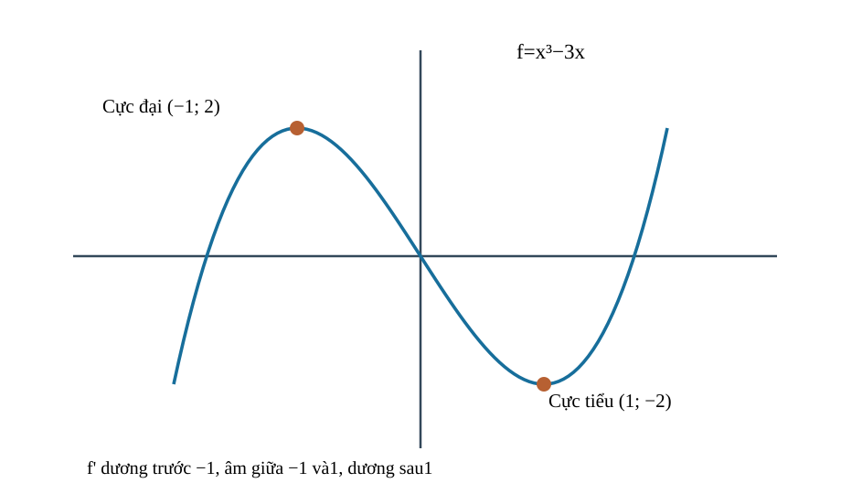
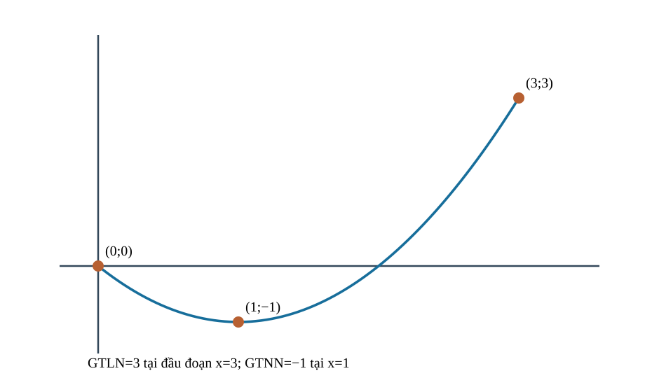
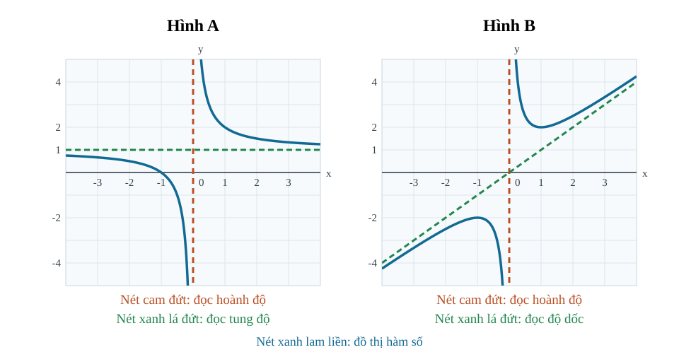
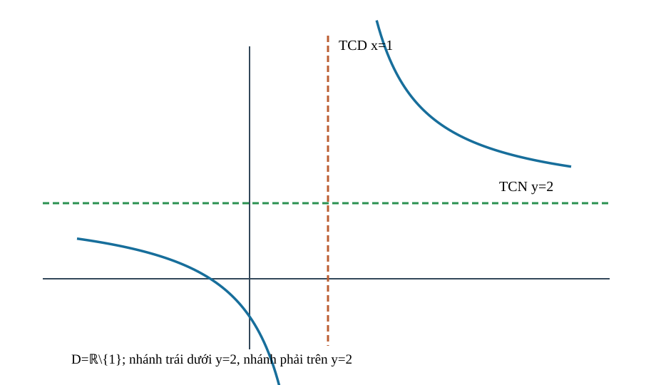
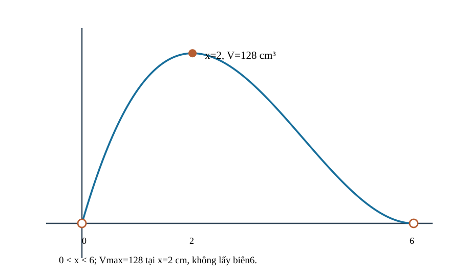

<!-- AUTHORING_ONLY_NOT_FOR_STUDENT_VIEW: CĐ10 R06 one current learner canonical with source-locked author Q18; historical R04/R05 snapshots remain in Git, not competing learner sources. -->
<!-- AUTHORING_ONLY_NOT_FOR_STUDENT_VIEW: STANDARD_ID=SLM-THPT-QUALITY-ONE; STANDARD_VERSION=3.2.0; LEARNING_PATH=TOPIC; SOURCE_VERSION=R06_CANONICAL_AUTHOR_SELF_Q18 -->
# CĐ10 — Ứng dụng đạo hàm: Khảo sát hàm số và tối ưu hóa

# Kiến thức

## 1. Từ độ dốc tại một điểm đến toàn bộ hình dạng đồ thị

Khi đã biết tính đạo hàm, em có thể biết một đồ thị đang nghiêng lên hay xuống tại một vị trí. Nhưng một người thiết kế hộp giấy không chỉ muốn biết độ nghiêng của đồ thị thể tích: họ cần biết **kích thước nào thật sự làm hộp có thể tích lớn nhất**. Muốn trả lời, ta phải nhìn cả miền được phép, những khoảng tăng giảm, điểm cực trị, giá trị trên biên, hành vi khi x tiến xa và cả khả năng một giá trị lớn nhất **không được đạt**.

Vì vậy ta đi từ định nghĩa đồng biến/nghịch biến đến dấu đạo hàm, từ điểm cực trị địa phương sang bài toán so toàn miền, rồi nối bảng biến thiên với tiệm cận và đồ thị. Chỉ sau khi hiểu toàn bộ hàm số, ta mới đặt điều kiện vật lý và chọn phương án tối ưu; việc giải \(f'(x)=0\) chỉ là một bước tìm **ứng viên**, không phải đáp án cuối.

### 1.1. Đồng biến và nghịch biến

<!-- LESSON_ID: TOP10-M01; OUTCOME_ID: TOP10-O01 -->

Khi nhìn hai điểm trên đồ thị và thấy điểm phía phải cao hơn, ta mới biết hàm tăng **giữa hai vị trí đó**; chừng ấy chưa đủ để khẳng định hàm tăng trên cả khoảng. Điều cần xét là mọi cặp số \(x_1<x_2\) thuộc cùng một khoảng \(I\). 

> **ĐỊNH NGHĨA — Đồng biến, nghịch biến.** Hàm \(f\) **đồng biến nghiêm ngặt** trên khoảng, đoạn hoặc nửa khoảng \(I\) khi với mọi \(x_1,x_2\in I\), \(x_1<x_2\Rightarrow f(x_1)<f(x_2)\); **nghịch biến nghiêm ngặt** khi \(x_1<x_2\Rightarrow f(x_1)>f(x_2)\). Phải xét mọi cặp trong cùng khoảng, không chỉ hai điểm minh họa.

 Vì vậy miền xác định và việc hai điểm có thuộc cùng một khoảng là điều kiện phải kiểm trước.

Xét \(f(x)=-2x+5\) trên \(\mathbb R\). Với bất kỳ \(x_1<x_2\), ta có \(f(x_2)-f(x_1)=-2(x_2-x_1)<0\). Do đó \(f(x_2)<f(x_1)\) và hàm nghịch biến trên toàn trục số. Ta chọn cách so hiệu hai giá trị để chứng minh trực tiếp định nghĩa, trước khi dùng công cụ đạo hàm.

**Ví dụ**

**Đề bài:** Chứng minh \(f(x)=-x^3\) nghịch biến trên ℝ bằng định nghĩa.

**Lời giải:** Với \(x_1<x_2\), ta có \(x_2^3-x_1^3=(x_2-x_1)(x_2^2+x_1x_2+x_1^2)\). Thừa số thứ nhất dương. Thừa số thứ hai bằng \((x_2+\frac{x_1}{2})^2+\frac{3x_1^2}{4}\), không âm và chỉ bằng 0 khi \(x_1=x_2=0\), trái với \(x_1<x_2\). Do đó hiệu hai lập phương dương. Suy ra \(f(x_2)-f(x_1)<0\) với mọi cặp, nên f nghịch biến. Thử hai số riêng lẻ chưa đủ.

**Vận dụng** \(f(x)=3x-1\) đồng biến hay nghịch biến trên \(\mathbb R\)? Hãy giải thích bằng hai giá trị \(x_1<x_2\).

Đối chiếu

\(f(x_2)-f(x_1)=3(x_2-x_1)>0\), nên hàm đồng biến trên \(\mathbb R\). Nếu em chỉ thế hai giá trị cụ thể, hãy quay lại điều kiện **với mọi** cặp \(x_1<x_2\) trong khoảng.

**Kiểm lỗi**

Nếu em kết luận chiều biến thiên từ hai điểm mẫu, đọc lại **Kiến thức 1.1** và giải **Bài 1** rồi **Bài 2**. Với mọi \(x_1<x_2\) trong cùng khoảng, phải kiểm dấu hiệu hai giá trị hoặc dấu đạo hàm, không chỉ quan sát hình.

### 1.2. Dấu đạo hàm

<!-- LESSON_ID: TOP10-M02; OUTCOME_ID: TOP10-O02 -->

> **TÍNH CHẤT — Dấu đạo hàm.** So hai giá trị đôi khi khó; dấu đạo hàm cho công cụ mạnh hơn khi đủ điều kiện. Cách so trực tiếp \(f(x_2)-f(x_1)\) có thể rất dài với những hàm phức tạp. Khi hàm liên tục trên mỗi đoạn con của khoảng đang xét và khả vi ở các điểm trong khoảng, **đạo hàm** giúp đọc chiều biến thiên hiệu quả hơn. Theo định lý giá trị trung bình, nếu \(f'(x)>0\) khắp khoảng thì hàm tăng nghiêm ngặt; nếu \(f'(x)<0\) thì giảm nghiêm ngặt. Dấu không âm hoặc không dương bảo đảm lần lượt không giảm hoặc không tăng, nhưng muốn nói **nghiêm ngặt** cần loại trường hợp có đoạn hằng. Đặc biệt, nếu đạo hàm dương (hoặc âm) trừ một số hữu hạn điểm mà tại đó đạo hàm bằng 0, hàm vẫn đồng biến (hoặc nghịch biến) trên khoảng. Nếu \(f'(x)=0\) tại mọi điểm của khoảng thì hàm không đổi trên khoảng ấy. Như vậy, dấu bằng 0 ở một điểm và dấu bằng 0 trên cả khoảng cho hai kết luận rất khác nhau.

Chẳng hạn, \(f(x)=x^2\) có \(f'(x)=2x\). Ở phía trái 0, đạo hàm âm nên đồ thị đi xuống; ở phía phải 0, đạo hàm dương nên đồ thị đi lên. Việc chia tại \(x=0\) cho ta hai khoảng biến thiên và cực tiểu. Trái lại, hàm \(x^3\) có đạo hàm bằng 0 ở 0 nhưng vẫn tăng khi đi qua điểm này: một nghiệm \(f'(x)=0\) chưa đủ kết luận có cực trị.

**Ví dụ**

**Đề bài:** Tìm chiều biến thiên của \(f=x^3-6x\).

**Lời giải:** \(D=\mathbb R\); \(f'=3(x^2-2)\), bằng 0 ở \(\pm\sqrt2\), dương khi \(|x|>\sqrt2\), âm khi \(|x|<\sqrt2\). Hàm đồng biến trên \((-\infty;-\sqrt2)\) và \((\sqrt2;+\infty)\), nghịch biến trên \((-\sqrt2;\sqrt2)\). Để lập bảng dấu, đặt hai nghiệm theo thứ tự tăng dần; vì \(3(x^2-2)\) là tam thức có hệ số đầu dương, dấu lần lượt là dương, âm, dương.

**Vận dụng** \(f(x)=x^3\) có tăng nghiêm ngặt trên \(\mathbb R\) không? Vì sao \(f'(0)=0\) không bác bỏ điều đó?

Đối chiếu

Có. Với \(x_1<x_2\) thì \(x_1^3<x_2^3\); đạo hàm \(3x^2\ge0\) và chỉ bằng 0 tại một điểm, không tạo ra đoạn hằng. Nếu em gán mọi nghiệm \(f'=0\) thành cực trị, hãy lập dấu đạo hàm **hai phía** điểm ấy.

**Kiểm lỗi**

Nếu em gán mọi nghiệm \(f'=0\) thành cực trị hoặc quên các khoảng đổi dấu, đọc **Kiến thức 1.2**, làm **Bài 3** và **Bài 5**. Lập trục dấu \(f'\), phân biệt một điểm dừng với khoảng tăng/giảm.

### 1.3. Điểm cấm và khoảng biến thiên

<!-- LESSON_ID: TOP10-M03; OUTCOME_ID: TOP10-O03 -->

> **KIẾN THỨC CẦN GHI NHỚ — Điểm cấm và khoảng biến thiên.** Trước bảng dấu, luôn xác định đúng miền. Đạo hàm chỉ giúp đánh giá chiều biến thiên **nơi hàm số được xác định và đủ điều kiện khả vi**. Chẳng hạn, \(f(x)=\dfrac1{x-2}\) có mẫu bằng 0 tại \(x=2\), nên miền là \(\mathbb R\setminus\{2\}\). Đạo hàm \(f'(x)=-\dfrac1{(x-2)^2}<0\) trên miền, nhưng kết luận đúng phải viết: hàm nghịch biến trên **từng khoảng** \((-\infty;2)\) và \((2;+\infty)\). Hai nhánh không được nối qua một điểm không thuộc miền.

Vì thế, khi khảo sát một hàm số, ta luôn tìm miền trước, rồi mới giải \(f'(x)=0\), xác định điểm đạo hàm không tồn tại trong miền và dựng bảng dấu trên những khoảng hợp lệ. Làm ngược thứ tự dễ dẫn đến ghi một khoảng có chứa điểm cấm hoặc kết luận “nghịch biến trên toàn miền rời” sai theo định nghĩa so mọi cặp.

**Ví dụ**

**Đề bài:** Tìm miền và các khoảng giảm của \(g=\frac{x+1}{x-3}\).

**Lời giải:** \(D=\mathbb R\setminus\{3\}\), \(g'=-\frac4{(x-3)^2}<0\). Hàm giảm trên \((-\infty;3)\) và \((3;\infty)\) riêng biệt, không nối kết luận qua điểm x=3 không xác định.

**Vận dụng** \(g(x)=\sqrt{x-1}\) có miền xác định nào? Có thể nói hàm tăng trên miền đó không?

Đối chiếu

Điều kiện \(x-1\ge0\) cho miền \([1;+\infty)\). Trên \((1;+\infty)\), \(g'(x)=\dfrac1{2\sqrt{x-1}}>0\); từ giá trị ở biên \(x=1\), ta vẫn có thể nói hàm tăng trên \([1;+\infty)\). Nếu em ghi miền \(\mathbb R\), hãy kiểm điều kiện tồn tại của căn trước.

**Kiểm lỗi**

Nếu em kết luận nghịch biến trên toàn tập rời nhau hoặc dùng đạo hàm tại điểm cấm, đọc **Kiến thức 1.3**, làm **Bài 6** rồi **Bài 8**. Trước tiên tách miền thành các khoảng hợp lệ.

### 1.4. Cực trị qua đổi dấu

<!-- LESSON_ID: TOP10-M04; OUTCOME_ID: TOP10-O04 -->

> **TÍNH CHẤT — Cực trị qua đổi dấu.** Đổi chiều biến thiên giúp tìm cực trị địa phương. Tại sao đổi dấu đạo hàm quan trọng hơn chỉ giải \(f'=0\)? Ta bắt đầu từ dấu f' hai phía, miền và khả vi lân cận. **Điều kiện bắt buộc:** hàm số phải liên tục tại điểm trong (c) và khả vi trên hai khoảng ngay bên trái, bên phải (c). Khi đó, nếu (f') dương trước (c) và âm sau (c), hàm đạt cực đại địa phương tại (c); nếu (f') âm trước và dương sau, hàm đạt cực tiểu. Không thể suy cực trị chỉ từ bảng dấu hai phía nếu giá trị (f(c)) không khớp giới hạn tại (c). Nếu không đổi dấu, \(f'=0\) có thể là điểm dừng không cực trị. Cực đại địa phương khác giá trị lớn nhất toàn cục.

Chẳng hạn, \(f=x^3-3x\): \(f'=3(x-1)(x+1)\), dương x<−1, âm \(-1<x<1\), dương x>1. Cực đại ở x=−1 giá trị2, cực tiểu ở x=1 giá trị−2.

*Quan sát hình:* Đọc sự đổi dấu + sang − ở x=−1 và − sang + ở x=1; hai cực trị địa phương phải khớp bảng dấu và tọa độ đồ thị.

**Ví dụ**

**Đề bài:** Tìm các cực trị địa phương của \(f=-x^4+4x^2\).

**Lời giải:** \(f'=-4x(x^2-2)\), có mốc \(-\sqrt2;\ 0;\ \sqrt2\) với dấu +,−,+,−. Cực đại tại \(x=\pm\sqrt2\), giá trị4; cực tiểu tại x=0, giá trị0. Đổi dấu \(f'\) mới quyết định loại cực trị.

**Vận dụng** \(f=x^2\) có cực tiểu ở đâu?

Đối chiếu

x=0, f' đổi âm→dương, f(0)=0.

Nếu chỉ giải \(f'=0\), lập bảng dấu qua nghiệm.

**Kiểm lỗi**

Nếu em chỉ giải \(f'=0\) mà không xét dấu trái/phải điểm tới hạn, đọc **Kiến thức 1.4**, làm **Bài 9** và **Bài 12**. Dấu \(+\to-\) cho cực đại, \(-\to+\) cho cực tiểu.

### 1.5. Điểm dừng không cực trị

<!-- LESSON_ID: TOP10-M05; OUTCOME_ID: TOP10-O05 -->

> **TÍNH CHẤT — Điểm dừng không cực trị.** Không phải nghiệm của \(f'=0\) nào cũng là cực trị. Mọi tiếp tuyến ngang có phải điểm cao nhất hoặc thấp nhất? Cần nhớ đạo hàm 0 và đổi dấu. Điều kiện \(f'(c)=0\) chỉ là ứng viên trong nội miền khả vi, không đủ để khẳng định cực trị. \(f=x^3\) tại c=0 có đạo hàm0 nhưng vẫn tăng qua0, không cực đại hoặc cực tiểu. Cũng có cực trị không khả vi như |x| tại0; danh sách ứng viên cần xét cả điểm không khả vi trong miền.

Chẳng hạn, \(f=x^3\): \(f'=3x^2\ge0\), không đổi dấu qua0 nên không có cực trị. Chọn xét dấu chứ không kết luận từ nghiệm đạo hàm.

**Ví dụ**

**Đề bài:** \(f=x^5\) có \(f'(0)=0\). Có cực trị tại 0 không?

**Lời giải:** \(f'=5x^4>0\) ở mọi \(x\ne0\) nên f vẫn tăng qua 0, không có cực trị. Tiếp tuyến ngang riêng lẻ không đủ để kết luận.

**Vận dụng** \(f=x^4\) có cực tiểu tại0 không?

Đối chiếu

Có, \(f'=4x^3\) đổi âm→dương ở0; f(0)=0.

Nếu bỏ điểm gấp khúc |x|, bổ sung điểm f không khả vi nhưng có giá trị.

**Kiểm lỗi**

Nếu em nghĩ có \(f'=0\) chắc chắn có cực trị hoặc bỏ điểm không khả vi, đọc **Kiến thức 1.5**, làm **Bài 14** và **Bài 16**. Đối chiếu \(|x|\) với \(x^5\) quanh 0.

### 1.6. Hướng chuyển động so với tốc độ

<!-- LESSON_ID: TOP10-M06; OUTCOME_ID: TOP10-O06 -->

> **TÍNH CHẤT — Hướng chuyển động so với tốc độ.** Trong chuyển động, dấu đạo hàm cho biết hướng của tọa độ. Vận tốc âm có nghĩa vật đang đi chậm dần không? Để xác định điều đó, cần xét tọa độ s(t), \(v=s'\), tốc độ \(|v|\). Dấu v=s'(t) cho biết chiều chuyển động trong trục đã chọn; \(v>0\) tọa độ tăng, \(v<0\) tọa độ giảm. Nói tốc độ \(|v|\) tăng/giảm phải xem gia tốc \(a=s''\) và dấu v·a khi v khác0. Bảng biến thiên s không tự tương đương bảng biến thiên tốc độ.

Chẳng hạn, \(s(t)=t^2-4t\), \(t\ge0\): \(v=2t-4\), âm t<2, 0 tại2, dương t>2; tọa độ giảm rồi tăng. \(a=2>0\) nhưng trong \((0;2)\), \(v<0\) nên tốc độ giảm.

**Ví dụ**

**Đề bài:** Với \(s=t^3-3t^2+1\) (m), t>0, trên \((0;2)\) tốc độ tăng giảm thế nào?

**Lời giải:** \(v=3t(t-2)<0\) trên \((0;2)\), \(a=6t-6\). Trên \((0;1)\), v và a cùng âm nên \(|v|\) tăng; trên \((1;2)\), chúng trái dấu nên \(|v|\) giảm.

**Vận dụng** \(s(t)=t^2\), t>0, tọa độ tăng hay giảm?

Đối chiếu

\(v=2t>0\) nên tăng.

Nếu nhìn s âm hay dương để đo chiều, thay bằng dấu s'.

**Kiểm lỗi**

Nếu em dùng dấu tọa độ \(s(t)\) để kết luận chiều chuyển động, đọc **Kiến thức 1.6**, làm **Bài 17** và **Bài 18**. Xét vận tốc có hướng \(v=s'\), còn tốc độ là \(|v|\).

## 2. Từ một đỉnh lân cận tới giá trị tốt nhất trên miền

Một điểm cao hơn các điểm **rất gần nó** có thể vẫn thấp hơn một đầu đoạn ở xa. Đó là khác biệt giữa cực đại địa phương và giá trị lớn nhất trên miền; tương tự cho cực tiểu. Để tìm giá trị thực sự tốt nhất, phải liệt kê cả điểm tới hạn, nơi đạo hàm không tồn tại và các đầu mút **thuộc miền**, rồi so giá trị. Nếu miền mở hoặc không bị chặn, cần xét thêm giới hạn để biết cận có được đạt hay không.

### 2.1. Cực trị địa phương và toàn cục

<!-- LESSON_ID: TOP10-M07; OUTCOME_ID: TOP10-O07 -->

> **ĐỊNH NGHĨA — Cực trị địa phương và toàn cục.** Một đỉnh cục bộ có chắc cao nhất trên toàn miền không? Ta đã biết cực trị qua đổi dấu, miền so sánh. Cực đại địa phương chỉ so các điểm gần c; GTLN/GTNN trên D phải so với MỌI \(x\in D\). Một hàm có thể có nhiều cực trị địa phương, có thể không có GTLN nếu không bị chặn trên hoặc cận trên đúng không đạt; tương tự cho GTNN khi xét cận dưới.

Chẳng hạn, \(f=x^3-3x\) trên ℝ có cực đại địa phương 2 tại−1 và cực tiểu−2 tại1, nhưng f→+∞/−∞ khi \(x\to\pm\infty\) nên không có GTLN/GTNN trên ℝ.

**Ví dụ**

**Đề bài:** \(f=x^4-2x^2\) trên ℝ có cực đại địa phương ở 0; có GTLN không?

**Lời giải:** \(f'=4x(x^2-1)\) đổi dấu + sang − tại 0 nên f(0)=0 cực đại địa phương. Nhưng \(f\to+\infty\) khi \(|x|\to\infty\) nên không có GTLN; GTNN=−1 tại ±1 vì \(f=(x^2-1)^2-1\).

**Vận dụng** Hàm \(f=x^2\) trên ℝ có GTNN không, GTLN không?

Đối chiếu

GTNN0 tại0; không có GTLN vì \(x^2\to\infty\).

Nếu nói cực đại 2 là GTLN của hàm bậc ba, thử x=10.

**Kiểm lỗi**

Nếu em lấy cực đại địa phương làm GTLN trên toàn miền vô hạn, đọc **Kiến thức 2.1**, làm **Bài 19** và **Bài 21**. So cả biên và hành vi ở xa; muốn có GTLN phải có điểm thực sự đạt.

### 2.2. Tồn tại GTLN/GTNN trên đoạn

<!-- LESSON_ID: TOP10-M08; OUTCOME_ID: TOP10-O08 -->

Liên tục trên đoạn đóng bảo đảm có cực trị toàn cục. Khi nào chắc chắn có GTLN/GTNN dù chưa tìm được điểm đạt? Ta sử dụng định nghĩa liên tục trên đoạn đóng \([a;b]\). 

> **ĐỊNH LÝ — Giá trị lớn nhất, nhỏ nhất trên đoạn.** Nếu \(f\) liên tục trên đoạn đóng, hữu hạn \([a;b]\), \(a<b\), thì tồn tại \(x_{\min},x_{\max}\in[a;b]\) sao cho \(f(x_{\min})\le f(x)\le f(x_{\max})\) với mọi \(x\in[a;b]\). Định lý bảo đảm các giá trị **đạt được**, không xác định sẵn điểm đạt.

 Nếu thiếu 'đóng' hay tính liên tục thì chưa có bảo đảm; vẫn có thể đạt nhưng phải chứng minh riêng. Kết quả chỉ nói tồn tại, chưa cho tọa độ.

Xét ví dụ: \(f=x^2-2x\) trên \([0;3]\) là đa thức liên tục nên tồn tại hai giá trị. Ta còn tính được GTNN−1 tại x=1, GTLN3 tại x=3 sau so ứng viên.

**Ví dụ**

**Đề bài:** Tìm GTLN/GTNN của \(f=x^2+2x+5\) trên \([-3;2]\).

**Lời giải:** Đa thức liên tục trên đoạn đóng nên đạt min/max. \(f=(x+1)^2+4\), f(−3)=8, f(−1)=4, f(2)=13. GTNN4 tại −1, GTLN13 tại 2; phải so ứng viên.

**Vận dụng** \(f=x^2\) trên \([-1;2]\) có GTLN?

Đối chiếu

Có, GTLN4 tại2 và GTNN0 tại0.

Nếu miền mở, thử xét f=x trên \((0;1)\) không đạt cận1.

**Kiểm lỗi**

Nếu em áp dụng định lí GTLN/GTNN cho miền hở hoặc không liên tục, đọc **Kiến thức 2.2**, làm **Bài 22** và **Bài 24**. Điều kiện đủ quen thuộc là **liên tục trên đoạn đóng hữu hạn**.

### 2.3. Ứng viên và biên

<!-- LESSON_ID: TOP10-M09; OUTCOME_ID: TOP10-O09 -->

Muốn tìm giá trị ấy, phải so điểm tới hạn và đầu đoạn. Vì sao chỉ giải \(f'=0\) có thể bỏ sót GTLN tại đầu mút? Ta bắt đầu từ hàm liên tục trên \([a;b]\), khả vi từng khoảng, giá trị ứng viên. Với hàm liên tục trên đoạn \([a;b]\), nếu điểm đạt GTLN hoặc GTNN nằm trong nội miền và tại đó hàm khả vi thì đạo hàm bằng 0 (định lý Fermat); nếu không khả vi, điểm ấy vẫn có thể là nơi đạt. Khi số điểm nội miền có đạo hàm bằng 0 hoặc không tồn tại là hữu hạn, chỉ cần so các giá trị tại chúng và hai đầu đoạn. Nếu danh sách không hữu hạn, phải dùng thêm lập luận về dấu, bảng biến thiên hoặc bất đẳng thức; không giả định luôn có một danh sách hữu hạn. Phương pháp: xác định miền, liệt kê đủ ứng viên, tính chính xác f tại mỗi điểm, so sánh cùng đơn vị. Điểm \(f'=0\) ngoài đoạn phải loại.

Chẳng hạn, \(f=x^3-3x\) trên \([0;2]\), \(f'=3x^2-3\)⇒ x=1 trong đoạn. \(f(0)=0,\ f(1)=-2,\ f(2)=2\)⇒GTNN−2 tại1,GTLN2 tại2. Chọn kiểm hai đầu vì cực đại không nhất thiết nội miền.

> **PHƯƠNG PHÁP — Ứng viên và biên.** Hình bên dưới là **ví dụ khác** đúng với dữ liệu gốc: trên đoạn \([0;3]\), \(g(x)=x^2-2x\) có \(g'(x)=2x-2\), ứng viên nội miền \(x=1\) và hai đầu đoạn \(x=0,3\). Ta tính \(g(0)=0\), \(g(1)=-1\), \(g(3)=3\). Vậy GTNN là −1 tại 1 và GTLN là 3 tại **đầu phải 3**; điều này minh họa lý do không chỉ so các nghiệm đạo hàm bằng 0. Bài \(x^3-3x\) trên \([0;2]\) vừa giải dùng cùng phương pháp nhưng **không phải hình đang vẽ**.

*Đọc hình:* Ba điểm cần so của \(g=x^2-2x\) trên \([0;3]\) là \((0;0),\ (1;-1),\ (3;3)\). Đường cong đạt nhỏ nhất tại điểm nội miền nhưng **lớn nhất ở đầu phải**; giá trị đạo hàm ở đầu đoạn không cần bằng 0.

**Ví dụ**

**Đề bài:** Tìm GTLN/GTNN của \(f=x^2-4x+6\) trên \([-1;5]\).

**Lời giải:** \(f'=2x-4=0\) tại2; so f(−1)=11, f(2)=2, f(5)=11. GTNN2 tại2, GTLN11 tại cả −1 và5. Không bỏ qua đầu đoạn.

**Vận dụng** \(f=x^2-4x\) trên \([0;3]\), GTNN?

Đối chiếu

f'=2x−4=0 tại2: \(f(0)=0,\ f(2)=-4,\ f(3)=-3\)⇒GTNN−4 tại2.

Nếu thấy nghiệm đạo hàm nằm ngoài đoạn, bỏ ứng viên ấy.

**Kiểm lỗi**

Nếu em chỉ kiểm nghiệm \(f'=0\) mà bỏ hai đầu đoạn hoặc điểm không khả vi, đọc **Kiến thức 2.3**, làm **Bài 28** và **Bài 29**. Ghi đủ các giá trị ứng viên rồi so sánh.

### 2.4. Miền mở và khả đạt

<!-- LESSON_ID: TOP10-M10; OUTCOME_ID: TOP10-O10 -->

> **KIẾN THỨC CẦN GHI NHỚ — Miền mở và khả đạt.** Trên miền mở, một cận có thể không được đạt. f(x) tiến đến 1 nhưng không bao giờ bằng 1, có gọi GTLN=1 không? Cần nhớ tập giá trị, cận trên và điều kiện 'đạt'. Cận trên đúng (cận trên nhỏ nhất, supremum) chưa chắc là GTLN vì nó có thể không được đạt. Trên \((0;1)\), f(x)=x có cận trên đúng bằng 1 nhưng không có GTLN vì x=1 bị loại. Có thể có giá trị lớn nhất trên miền mở nếu hàm có điểm nội miền đạt, phải xét trường hợp cụ thể. Không được suy từ giới hạn ở biên thành giá trị đạt.

Chẳng hạn, \(f=1-(x-2)^2\) trên \((0;3)\) có GTLN1 tại x=2 (nội miền) dù miền mở. Trái lại g=x trên \((0;1)\) không có GTLN, chỉ có cận trên đúng bằng 1.

**Ví dụ**

**Đề bài:** \(f=x(1-x)\) trên \((0;1)\) có GTLN và GTNN không?

**Lời giải:** \(f=\frac14-(x-\frac12)^2\) đạt GTLN \(\frac14\) tại \(x=\frac12\). Với \(x\in(0;1)\) thì f>0 nhưng f→0 ở hai biên bị loại, nên không có GTNN; cận dưới0 không đạt.

**Vận dụng** \(g(x)=-x\) trên \((0;1)\) có GTLN0 không?

Đối chiếu

Không, vì g→0 khi \(x\to0^+\) nhưng x=0 bị loại.

Nếu ghi GTLN là cận không đạt, hãy hỏi có \(x\in D\) sao cho f(x)=cận không.

**Kiểm lỗi**

Nếu em gọi một cận tiến tới nhưng không đạt là GTLN/GTNN, đọc **Kiến thức 2.4**, làm **Bài 30** và **Bài 32**. Hỏi rõ có tồn tại \(x\) trong miền để \(f(x)\) bằng cận không.

### 2.5. Miền ràng buộc

<!-- LESSON_ID: TOP10-M11; OUTCOME_ID: TOP10-O11 -->

> **PHƯƠNG PHÁP — Miền ràng buộc.** Ràng buộc có thể loại nghiệm tối ưu nằm ngoài miền. Một đáp số x tối ưu có thể vô nghĩa nếu x vi phạm điều kiện thực tế? Để xác định điều đó, cần xét bất phương trình, khoảng ràng buộc, max/min. Bài toán cực trị có ràng buộc phải lấy miền khả thi từ bối cảnh (độ dài dương, số lượng nguyên, ngân sách, khối lượng, thời gian). Sau tìm cực trị liên tục, kiểm nghiệm tối ưu có trong miền; nếu biến nguyên, so các giá trị nguyên lân cận. Không mở rộng mô hình ra ngoài điều kiện.

Chẳng hạn, Lợi ích \(P(x)=-(x-4)^2+10\) với \(x\in[0;3]\) không đạt đỉnh 10 ở x=4 vì ngoài miền; P tăng trên \([0;3]\), GTLN P(3)=9. Chọn kiểm miền trước khi tuyên bố cực đại.

**Ví dụ**

**Đề bài:** \(A(x)=x(10-x)\), chỉ cho phép \(x\in[7;9]\). Tìm diện tích lớn nhất.

**Lời giải:** \(A'=10-2x<0\) trên \([7;9]\), nên A giảm: GTLN A(7)=21, GTNN A(9)=9. Nghiệm không ràng buộc x=5 bị loại vì không thuộc miền.

**Vận dụng** Với \(f=-(x-5)^2\), \(x\in[0;2]\), x tối ưu?

Đối chiếu

x=2, f(2)=−9; x=5 không hợp lệ.

Nếu nghiệm \(f'=0\) ngoài miền, kiểm đầu mút hợp lệ.

**Kiểm lỗi**

Nếu nghiệm tối ưu không thuộc miền ràng buộc nhưng vẫn được chọn, đọc **Kiến thức 2.5**, làm **Bài 33** và **Bài 34**. Trước khi đạo hàm cần chốt miền; nghiệm ngoài miền bị loại.

### 2.6. Lập mô hình ba cạnh

<!-- LESSON_ID: TOP10-M12; OUTCOME_ID: TOP10-O12 -->

> **PHƯƠNG PHÁP — Lập mô hình ba cạnh.** Tối ưu bắt đầu từ biến và đại lượng mục tiêu. Tại sao một công thức đạo hàm đúng vẫn cho bài toán thực tế sai? Ta đã biết chọn biến và đơn vị, mối ràng buộc, miền. Quy trình mô hình: chọn đại lượng cần tối ưu, chọn biến và đơn vị, dùng ràng buộc để đưa mục tiêu về một biến, lập miền hợp lệ, đạo hàm và kiểm biên, rồi diễn giải kết quả theo mô hình. Không coi việc giải \(f'=0\) là đủ chứng minh tối ưu.

Chẳng hạn, Chu vi hình chữ nhật 20 m, cạnh \(x\in(0;10)\), cạnh kia10−x, diện tích \(A=x(10-x)\). \(A'=10-2x=0\)⇒x=5, diện tích25 m² là lớn nhất vì \(A=25-(x-5)^2\le25\), đạt tại x=5.

**Ví dụ**

**Đề bài:** Dùng 24 m hàng rào làm ba cạnh hình chữ nhật sát bờ sông, tìm diện tích tối đa.

**Lời giải:** Gọi hai cạnh vuông góc dài x>0, cạnh thứ ba \(24-2x>0\); \(0<x<12\). \(A=x(24-2x)=-2(x-6)^2+72\le72\) m², đạt khi x=6 m, cạnh còn lại12 m. Phải mô hình đúng ba cạnh.

**Vận dụng** Có 32 m hàng rào để rào ba cạnh của một mảnh vườn hình chữ nhật dựa vào tường thẳng (cạnh sát tường không cần rào). Hãy đặt biến là chiều dài cạnh song song tường, lập miền khả thi và tìm diện tích lớn nhất.

Đối chiếu

Gọi \(y\) (m) là chiều dài cạnh song song tường, \(x\) (m) là mỗi cạnh vuông góc. Vì chỉ rào ba cạnh, \(y+2x=32\), nên \(x=\frac{32-y}{2}\). Điều kiện \(x,y>0\) cho \(0<y<32\). Diện tích \(A(y)=\frac{y(32-y)}2=128-\frac12(y-16)^2\le128\). Dấu bằng xảy ra tại \(y=16\), \(x=8\), đều khả thi. Diện tích lớn nhất là \(128\ \text{m}^2\). Nếu viết \(2x+2y=32\), em đã tính thêm cạnh sát tường không cần rào.

**Kiểm lỗi**

Nếu em viết ràng buộc cho hình chữ nhật sát tường như phải rào đủ bốn cạnh, đọc **Kiến thức 2.6**, làm **Bài 35** và **Bài 37**. Vẽ rõ những cạnh dùng vật liệu, sau đó đưa diện tích về một biến.

## 3. Đọc hình dạng của đồ thị ở nơi rất xa và gần điểm bị loại

Bảng dấu đạo hàm mô tả chiều đi của các nhánh, nhưng chưa cho biết nhánh vươn tới đâu. Khi \(x\) tiến về vô cực hoặc tiến sát một điểm cấm, **giới hạn** có thể cho thấy một đường tiệm cận. Tiệm cận đứng cần giá trị hàm tiến ra vô cực ở ít nhất một phía; một điểm khuyết có giới hạn hữu hạn không tự trở thành tiệm cận. Ta dùng cùng nguyên tắc xét miền và dấu đã học để tránh nối các nhánh phân thức qua chỗ không có giá trị.

### 3.1. Tiệm cận ngang

<!-- LESSON_ID: TOP10-M13; OUTCOME_ID: TOP10-O13 -->

> **ĐỊNH NGHĨA — Tiệm cận ngang.** Một đồ thị có thể tiến gần một đường thẳng dù không bao giờ chạm? Ta sử dụng giới hạn ở vô cực và phân thức. Đường y=L là tiệm cận ngang nếu \(\lim_{x\to+\infty}f(x)=L\) hoặc \(\lim_{x\to-\infty}f(x)=L\) hữu hạn. Chỉ cần một trong hai phía; có thể là hai giới hạn khác nhau nếu hàm thích hợp. Việc đồ thị cắt đường y=L tại điểm hữu hạn không làm mất tính tiệm cận.

Xét ví dụ: \(f=\frac{2x+1}{x+3}\to2\) khi \(x\to\pm\infty\), nên y=2 là tiệm cận ngang; không phải y=0 vì tử và mẫu cùng bậc.

**Ví dụ**

**Đề bài:** Tìm tiệm cận ngang của \(f=\frac{3x-1}{x+5}\).

**Lời giải:** \(D=\mathbb R\setminus\{-5\}\). Chia tử mẫu cho x: \(f=\frac{3-\frac1x}{1+\frac5x}\to3\) khi \(x\to\pm\infty\). y=3 là tiệm cận ngang; không dựa vào hằng −1.

**Vận dụng** \(f=\frac{3x-2}{x+4}\) có TCN?

Đối chiếu

y=3 khi \(x\to\pm\infty\).

Nếu lấy hệ số hằng ở tử làm tiệm cận, chia cho x bậc cao nhất.

**Kiểm lỗi**

Nếu em nhầm hệ số tự do với tỉ số bậc cao nhất của phân thức, đọc **Kiến thức 3.1**, làm **Bài 39** và **Bài 41**. Tính giới hạn khi \(x\to\pm\infty\), rồi viết tiệm cận ngang \(y=L\).

### 3.2. Tiệm cận đứng

<!-- LESSON_ID: TOP10-M14; OUTCOME_ID: TOP10-O14 -->

Gần điểm cấm, giới hạn một phía quyết định tiệm cận đứng. Điểm x=a không xác định có luôn là tiệm cận đứng? Ta bắt đầu từ định nghĩa giới hạn ±∞ một phía, bảng dấu. 

> **ĐỊNH NGHĨA — Tiệm cận đứng.** Đường \(x=a\) là tiệm cận đứng nếu có ít nhất **một phía hợp lệ trong miền xác định** mà \(f(x)\to+\infty\) hoặc \(f(x)\to-\infty\) khi \(x\to a\). Chỉ thấy mẫu bằng 0 chưa đủ; cần xét giới hạn.

 Chỉ có mẫu bằng0 chưa đủ: nếu tử cùng triệt tiêu có thể là lỗ khử. Cần xác định miền và tính dấu mỗi phía.

Chẳng hạn, \(f=\frac{x+1}{x-2}\), tại2 tử→3>0, mẫu âm phía trái/dương phía phải, nên \(f\to-\infty\) khi \(x\to2^-\), \(f\to+\infty\) khi \(x\to2^+\), x=2 là TCD.

**Ví dụ**

**Đề bài:** Tìm tiệm cận đứng của \(f=\frac1{(x+3)^2}\).

**Lời giải:** \(D=\mathbb R\setminus\{-3\}\). Khi x→−3 từ hai phía, mẫu tiến0⁺ nên \(f\to+\infty\). Vì ít nhất một giới hạn một phía vô cực, x=−3 là tiệm cận đứng.

**Vận dụng** \(f=\frac1{x+1}\) có TCD ở đâu và hai phía?

Đối chiếu

x=−1; trái −∞, phải+∞.

Nếu viết \(\frac00\) rồi gọi đứng, thử phân tích và rút gọn.

**Kiểm lỗi**

Nếu em chỉ thấy mẫu bằng 0 mà không xét giới hạn một phía và dấu, đọc **Kiến thức 3.2**, làm **Bài 42** và **Bài 44**. Điểm tiệm cận đứng đòi giá trị hàm tiến vô cực từ ít nhất một phía trong miền.

### 3.3. Tiệm cận xiên

<!-- LESSON_ID: TOP10-M15; OUTCOME_ID: TOP10-O15 -->

Một đường tiệm cận xiên được nhận qua phần dư tiến 0. Nếu hàm tiến sát đường nghiêng thì cần chứng minh gì, thay vì chỉ chia đa thức? Cần nhớ giới hạn ở ±∞, chia đa thức. 

> **ĐỊNH NGHĨA — Tiệm cận xiên.** Đường thẳng \(y=ax+b\) với \(a\ne0\) là tiệm cận xiên của đồ thị về một phía vô cực nếu \(\lim_{x\to+\infty}[f(x)-(ax+b)]=0\) **hoặc** giới hạn tương ứng khi \(x\to-\infty\) bằng 0. Có thể chỉ đúng về một phía; đồ thị vẫn có thể cắt tiệm cận ở điểm hữu hạn.

 Có thể tìm \(a=\lim_{x\to+\infty}\frac{f(x)}x\) và \(b=\lim_{x\to+\infty}[f(x)-ax]\) nếu cả hai giới hạn hữu hạn và \(a\ne0\); xét tương tự ở \(-\infty\). Phải lấy hai giới hạn về cùng một phía vô cực, hoặc chia đa thức trực tiếp. Không phải mọi phép chia ra \(ax+b\) đều là tiệm cận nếu phần dư không về 0. Về hình học, khoảng cách từ điểm \(M(x;f(x))\) đến đường \(y=ax+b\) bằng \(\frac{|f(x)-(ax+b)|}{\sqrt{a^2+1}}\); do mẫu là hằng số dương, khoảng cách tiến về 0 đúng khi hiệu ở tử tiến về 0. Nếu \(a=0\), ta đang xét tiệm cận ngang thay vì xiên.

Chẳng hạn, \(f=\frac{x^2+1}{x-1}=x+1+\frac2{x-1}\); vì \(\frac2{x-1}\to0\) khi \(x\to\pm\infty\) nên y=x+1 là TC xiên. Chọn chia vì mẫu bậc1 và tử bậc2.

**Ví dụ**

**Đề bài:** Chứng minh tiệm cận xiên của \(f=\frac{x^2+3}{x-2}\).

**Lời giải:** \(D=\mathbb R\setminus\{2\}\); chia đa thức \(f=x+2+\frac7{x-2}\). Hiệu \(f-(x+2)\to0\) khi \(x\to\pm\infty\) nên y=x+2 là tiệm cận xiên; nêu giới hạn phần dư.

**Vận dụng** \(f=\frac{x^2-x+2}{x}\), \(x\ne0\), TC xiên?

Đối chiếu

\(f=x-1+\frac2x\Rightarrow y=x-1\).

Nếu chỉ tính a mà quên b, tiệm cận sẽ dịch sai.

**Kiểm lỗi**

Nếu em ghi \(y=ax\) nhưng bỏ hệ số dịch \(b\), đọc **Kiến thức 3.3**, làm **Bài 46** và **Bài 48**. Chia đa thức, chứng minh phần dư tiến về 0 tại vô cực.

### 3.4. Lỗ khử được

<!-- LESSON_ID: TOP10-M16; OUTCOME_ID: TOP10-O16 -->

> **TÍNH CHẤT — Lỗ khử được.** Lỗ khử được có giới hạn hữu hạn, khác tiệm cận đứng. Tại sao một đồ thị có thể bị thiếu đúng một điểm nhưng không lao ra vô cực? Để xác định điều đó, cần xét phân tích tử/mẫu, giới hạn hữu hạn. Nếu sau khi rút hết nhân tử chung, mẫu còn lại khác 0 tại \(a\), thì giới hạn hữu hạn và điểm bị loại là một lỗ, không phải tiệm cận đứng. Chỉ có nhân tử chung chưa đủ: chẳng hạn \(\frac{x-a}{(x-a)^2}=\frac1{x-a}\) với \(x\ne a\) vẫn có tiệm cận đứng \(x=a\). Phép rút gọn không tự bổ sung f(a) vào miền gốc. Có thể có TCD ở điểm khác.

Chẳng hạn, \(f=\frac{x^2-4}{x-2}\), \(x\ne2\) ⇒ f=x+2 trên miền. Lim tại2 là4 hữu hạn nên không có tiệm cận đứng x=2, chỉ lỗ tại \((2;4)\).

**Ví dụ**

**Đề bài:** \(f=\frac{x^2-25}{x+5}\), \(x\ne-5\) có tiệm cận đứng tại x=−5 không?

**Lời giải:** \(D=\mathbb R\setminus\{-5\}\). Với \(x\ne-5\), \(f=\frac{(x-5)(x+5)}{x+5}=x-5\), nên \(\lim_{x\to-5}f(x)=-10\) hữu hạn. Điểm \((-5;-10)\) là lỗ, không phải tiệm cận đứng; rút gọn không tạo lại giá trị f(−5).

**Vận dụng** \(f=\frac{x^2-9}{x-3}\), có TCD x=3?

Đối chiếu

Không, vì f=x+3 cho \(x\ne3\), giới hạn6.

Nếu rút gọn nhưng tự gán f(3)=6, đã thay đổi hàm gốc.

**Kiểm lỗi**

Nếu em xem lỗ khử được như tiệm cận đứng hoặc tự điền điểm bị loại, đọc **Kiến thức 3.4**, làm **Bài 50** và **Bài 52**. Rút gọn chỉ có giá trị trên miền gốc, rồi mới xét giới hạn.

### 3.5. Giới hạn hợp lệ theo miền

<!-- LESSON_ID: TOP10-M17; OUTCOME_ID: TOP10-O17 -->

> **KIẾN THỨC CẦN GHI NHỚ — Giới hạn hợp lệ theo miền.** Miền quyết định phía nào được lấy giới hạn. Có thể lấy giới hạn phía ngoài miền mà hàm không tồn tại? Ta đã biết đầu mút miền, hàm có mẫu/căn. Giới hạn một phía x→a phải dùng các điểm thuộc miền D gần a ở đúng phía. Ở đầu miền của căn \(\sqrt{x-1}\), không có lân cận phía trái trong miền thực; không dùng giá trị giả. Ở điểm loại phân thức, nếu D có hai nhánh thì kiểm từng phía. TCD dựa trên đường đi hợp lệ trong miền.

Chẳng hạn, \(f=\frac1{\sqrt{x-1}}\) có D=(1,∞); khi \(x\to1^+\), \(f\to+\infty\) nên x=1 là TCD từ phía phải. Không có giới hạn thực \(x\to1^-\) từ miền.

**Ví dụ**

**Đề bài:** Xét \(f=\frac1{\sqrt{5-x}}\). Tìm miền và giới hạn gần x=5.

**Lời giải:** Mẫu căn phải dương nên D=(−∞,5). Khi \(x\to5^-\) từ trong miền, \(f\to+\infty\), vậy x=5 là tiệm cận đứng từ phía trái. Không xét phía x>5 trong số thực.

**Vận dụng** \(f=\frac1{\sqrt{x}}\) tại x=0, phía nào xét TCD?

Đối chiếu

Chỉ \(x\to0^+\); giới hạn +∞, x=0 là TCD.

Nếu viết giới hạn trái của f không có miền thực, đó là sai điều kiện.

**Kiểm lỗi**

Nếu em đòi giới hạn từ phía ngoài miền của một hàm có căn ở mẫu, đọc **Kiến thức 3.5**, làm **Bài 54** và **Bài 55**. Chỉ xét hướng đến điểm nằm trong miền xác định thực.

### 3.6. Tiệm cận qua hình

<!-- LESSON_ID: TOP10-M18; OUTCOME_ID: TOP10-O18 -->

> **PHƯƠNG PHÁP — Tiệm cận qua hình.** Đồ thị giúp phân biệt đường giới hạn ngang, đứng, xiên. Vì sao tiệm cận không phải đường mà đồ thị tuyệt đối không được chạm? Ta sử dụng đọc trục và giới hạn, đồ thị phân nhánh. Tiệm cận là mô tả khoảng cách/hành vi giới hạn, không phải cấm giao nhau. Đọc TCD x=a qua một nhánh lao ±∞ gần a, ngang y=L qua xu hướng ở vô cực, xiên y=ax+b khi hiệu f−(ax+b)→0. Phải kiểm tính đúng theo mỗi phía vô cực/điểm cấm, không dựa chỉ nét vẽ.

Xét ví dụ: \(f=x+\frac1x\), \(x\ne0\): TCD x=0 vì \(\frac1x\) vô cực, TC xiên y=x vì \(f-x=\frac1x\to0\). Không có TCN, mặc dù x lớn đồ thị gần đường xiên.

**Ví dụ**

**Đề bài:** Đọc tiệm cận của \(f=\frac{x^2+2x}{x+1}\).

**Lời giải:** \(D=\mathbb R\setminus\{-1\}\), \(f=x+1-\frac1{x+1}\). Vì \(\frac1{x+1}\) vô cực gần −1, TCD x=−1; vì \(f-(x+1)\to0\) ở vô cực, tiệm cận xiên y=x+1.

**Vận dụng** Quan sát hai hình sau (không cần biết trước biểu thức của hàm). Đọc phương trình đường tiệm cận đứng và đường tiệm cận ngang hoặc xiên của mỗi hình. Mô tả nhánh trái và nhánh phải khi tiến gần tiệm cận đứng.

*Đọc hình:* Nét liền xanh lam là đồ thị; nét đứt biểu thị đường tiệm cận. Dùng vạch chia trên trục để đọc phương trình đường đứt. Hãy phân biệt nhánh đi lên hay xuống khi tiến sát đường đứng; không nối hai nhánh qua đường đó.

Đối chiếu

Cả hai hình có tiệm cận đứng \(x=0\). Khi \(x\to0^-\), nhánh trái đi xuống phía \(-\infty\); khi \(x\to0^+\), nhánh phải đi lên phía \(+\infty\). Ở hình A, đường đứt xanh lá nằm ngang, cắt trục tung ở 1, nên tiệm cận ngang \(y=1\). Hình B có đường đứt đi qua gốc và qua \((2;2)\), nên tiệm cận xiên \(y=x\). Kiểm bằng hai hàm dùng để vẽ: hình A là \(1+\frac1x\), hình B là \(x+\frac1x\), sai khác với đường ngang/xiên tương ứng đều bằng \(\frac1x\to0\) ở hai phía vô cực.

**Kiểm lỗi**

Nếu em nhầm đường xiên với đường ngang hoặc đọc hai nhánh liền nhau qua điểm cấm, đọc **Kiến thức 3.6**, làm **Bài 56** và **Bài 58**. Viết phương trình từng tiệm cận và kiểm giới hạn sai khác.

## 4. Ghép các dữ kiện thành một đồ thị có thể kiểm chứng

Giờ đây, miền xác định cho biết nơi được phép vẽ, đạo hàm cho biết từng nhánh lên xuống, giới hạn cho biết các tiệm cận, còn giao trục và cực trị định vị những điểm đặc biệt. Một bản khảo sát tốt phải **khớp tất cả dữ kiện cùng lúc**. Vẽ đúng không phải nối tùy tiện vài chấm, mà là diễn đạt bằng hình một lập luận có điều kiện, bảng biến thiên và giới hạn.

### 4.1. Các bước khảo sát

<!-- LESSON_ID: TOP10-M19; OUTCOME_ID: TOP10-O19 -->

> **PHƯƠNG PHÁP — Các bước khảo sát.** Muốn phác đồ thị đúng thì thứ tự nào ngăn bỏ sót nhánh? Ta bắt đầu từ miền, đạo hàm, giới hạn, điểm đặc biệt. Quy trình: (1) tìm D; (2) tìm các điểm nội miền mà \(f'=0\) hoặc đạo hàm không tồn tại, rồi xét dấu trên từng nhánh của miền xác định; (3) tính cực trị, giới hạn tại biên/±∞, TCD/TCN/TC xiên nếu có; (4) lập bảng biến thiên, ghi giá trị tại các mốc và giới hạn ở hai đầu mỗi nhánh; (5) tìm giao trục, điểm hỗ trợ, tâm/trục đối xứng phù hợp và phác đồ thị dựa trên bảng biến thiên. Không nối hai nhánh qua điểm bị loại.

Chẳng hạn, \(f=\frac1{x-1}\): \(D=\mathbb R\setminus\{1\}\), \(f'=-\frac1{(x-1)^2}<0\), TCD x=1, TCN y=0; hai nhánh đều giảm nhưng không nối qua x=1. Chọn kiểm miền trước dấu.

**Ví dụ**

**Đề bài:** Dựng các dữ kiện khảo sát \(g=\frac{x+1}{x-2}\).

**Lời giải:** \(D=\mathbb R\setminus\{2\}\), \(g'=-\frac3{(x-2)^2}<0\): giảm mỗi nhánh; TCD x=2, TCN y=1. Giao Ox \((-1;0)\), Oy \((0;-\frac12)\). Vì \(g(x)=1+\frac3{x-2}\), bên trái \(x=2\) đồ thị tiến xuống \(-\infty\), bên phải tiến lên \(+\infty\); tại hai phía vô cực đồ thị tiến gần \(y=1\). Tâm đối xứng là \(I(2;1)\). Ghi các giới hạn ấy vào hai nhánh giảm trong bảng biến thiên, rồi vẽ qua hai giao trục đã tìm; không nối qua \(x=2\).

**Vận dụng** Khảo sát \(f(x)=x^2\) trên \(\mathbb R\): tìm miền, đạo hàm, khoảng tăng giảm, cực trị và mô tả hình dạng đồ thị theo đúng thứ tự.

Đối chiếu

\(D=\mathbb R\), f'=2x, giảm trước0 tăng sau0, đỉnh(0,0), không TCD/TC ngang, đồ thị parabol.

Nếu thiếu nhánh phía trái, bảng dấu f' là nơi tìm lại.

**Kiểm lỗi**

Nếu em bắt đầu phác hình trước khi kiểm miền xác định, đạo hàm và giao trục, đọc **Kiến thức 4.1**, làm **Bài 59** và **Bài 61**. Bảng biến thiên phải xuất phát từ miền và dấu \(f'\).

### 4.2. Đồ thị hàm bậc ba

<!-- LESSON_ID: TOP10-M20; OUTCOME_ID: TOP10-O20 -->

> **PHƯƠNG PHÁP — Đồ thị hàm bậc ba.** Với đa thức bậc ba, bảng dấu đạo hàm định hình các nhánh. Đa thức bậc ba có nhất thiết hai cực trị? Cần nhớ đạo hàm bậc hai, dấu f', giới hạn ±∞. Với f bậc ba, f' là tam thức bậc hai: có thể có hai nghiệm phân biệt tạo hai cực trị, nghiệm kép không đổi dấu tạo điểm dừng, hoặc không nghiệm tạo đơn điệu. Chỉ tính \(f'=0\) chưa đủ; phải lập bảng dấu/điểm uốn nếu xét thêm, không gán mọi bậc ba hai cực trị.

Chẳng hạn, \(f=x^3-3x\): \(f'=3(x-1)(x+1)\), cực đại ở −1 giá trị2, cực tiểu ở1 giá trị−2; khi \(x\to+\infty\) f→∞, \(x\to-\infty\) \(f\to-\infty\). Chọn bảng dấu để xác định hai nhánh.

Đồ thị bậc ba còn có **tâm đối xứng** ngay cả khi không có cực trị. Với \(y=ax^3+bx^2+cx+d\), \(a\ne0\), ta tính \(y''=6ax+2b\) rồi giải \(y''=0\), được \(x_0=-\dfrac{b}{3a}\). Tung độ tâm là \(f(x_0)\). Ta không nhầm vị trí này với nghiệm \(f'(x)=0\), và đồ thị của đa thức bậc ba không có tiệm cận.

> **TÍNH CHẤT — Tâm đối xứng đồ thị bậc ba.** Tâm là \(I\left(-\dfrac{b}{3a};\,f\left(-\dfrac{b}{3a}\right)\right)\). Muốn kiểm tra, lấy hai hoành độ \(x_0-h\) và \(x_0+h\): hai tung độ tương ứng có tổng bằng \(2f(x_0)\).

**Ví dụ minh họa.** Với \(f(x)=x^3+3x^2\), ta có \(f''(x)=6x+6=0\) khi \(x=-1\); \(f(-1)=2\), nên tâm là \(I(-1;2)\). Thực vậy, \(f(-1-h)+f(-1+h)=4=2f(-1)\) với mọi số thực \(h\). Cách kiểm bằng phép thế giúp xác minh tâm chứ không chỉ dựa vào độ giống hình vẽ.

**Ví dụ**

**Đề bài:** Khảo sát chiều biến thiên và cực trị của \(f=x^3+3x^2\).

**Lời giải:** \(f'=3x(x+2)\) có dấu +,−,+ qua −2,0. Cực đại địa phương \((-2;4)\), cực tiểu \((0;0)\); f→±∞ ở ±∞ nên không có GTLN/GTNN toàn ℝ.

**Vận dụng** \(f=x^3\) có cực trị không?

Đối chiếu

Không; \(f'=3x^2\ge0\), không đổi dấu ở0.

Nếu vẽ hình có hai đỉnh cho \(x^3\), kiểm lại số nghiệm đổi dấu của f'.

**Kiểm lỗi**

Nếu em vẽ đồ thị bậc ba luôn tăng hoặc bỏ một điểm đổi dấu đạo hàm, đọc **Kiến thức 4.2**, làm **Bài 62** và **Bài 65**. Xét cả giới hạn hai đầu và cực trị trước khi phác đồ thị.

### 4.3. Khảo sát phân thức

<!-- LESSON_ID: TOP10-M21; OUTCOME_ID: TOP10-O21 -->

> **PHƯƠNG PHÁP — Khảo sát phân thức.** Phân thức đòi hỏi xét điểm cấm và tiệm cận. Tại sao bảng biến thiên của phân thức phải có đường phân cách ở x=a? Để xác định điều đó, cần xét quy tắc đạo hàm thương và giới hạn một phía. Đối với \(f=\frac{ax+b}{cx+d}\) với \(cx+d\ne0\), \(f'=\frac{ad-bc}{(cx+d)^2}\) (trong miền), nên dấu không đổi trên mỗi khoảng miền. Khi \(c\ne0\) và \(ad-bc\ne0\), mẫu có nghiệm \(-\frac dc\), tử khác 0 tại đó, nên tiệm cận đứng là \(x=-\frac dc\), tiệm cận ngang là \(y=\frac ac\). Nếu \(c\ne0\) nhưng \(ad-bc=0\), hàm bằng hằng số \(\frac ac\) trên miền xác định và có một lỗ tại điểm mẫu bằng 0, không có tiệm cận đứng. Bảng biến thiên ghi riêng các nhánh, không nối qua TCD.

Chẳng hạn, \(f=\frac{2x+1}{x-1}\): \(D=\mathbb R\setminus\{1\}\), \(f'=\frac{2(x-1)-(2x+1)}{(x-1)^2}=-\frac3{(x-1)^2}<0\); TCD x=1, TCN y=2. Trái gần1→−∞, phải→+∞.

*Quan sát hình:* Đường x=1 là tiệm cận đứng, y=2 tiệm cận ngang của \(\frac{2x+1}{x-1}\); không nối các nhánh qua x=1.

Ngoài phân thức bậc nhất trên bậc nhất, ta còn khảo sát **phân thức bậc hai trên bậc nhất** \(\displaystyle y=\frac{ax^2+bx+c}{px+q}\) với \(a,p\ne0\) và tử không chia hết cho mẫu. Chia đa thức, ta đưa hàm về \(y=mx+n+\frac{k}{px+q}\), \(k\ne0\). Từ đây xác định đường tiệm cận đứng \(x=-\frac qp\), tiệm cận xiên \(y=mx+n\), rồi xét dấu đạo hàm, điểm cực trị và giới hạn ở từng nhánh miền. Nếu tử chia hết cho mẫu, điểm mẫu bị loại có thể chỉ là **lỗ**, không được tự kết luận có tiệm cận đứng.

> **PHƯƠNG PHÁP — Khảo sát phân thức bậc hai trên bậc nhất.** Xác định miền → chia đa thức và kiểm phần dư → tìm tiệm cận từ giới hạn → tính \(y'\), xét dấu trên từng khoảng, kể cả nơi mẫu đổi dấu → lập bảng biến thiên → tìm giao trục/điểm đặc biệt và vẽ các nhánh. Giao điểm của tiệm cận đứng và xiên là tâm đối xứng.

**Ví dụ minh họa.** Xét \(\displaystyle f(x)=\frac{x^2-2x+2}{x-1}=x-1+\frac1{x-1}\), \(D=\mathbb R\setminus\{1\}\). Hai tiệm cận là \(x=1\), \(y=x-1\), giao nhau tại tâm \(I(1;0)\). Đạo hàm \(f'(x)=\frac{x(x-2)}{(x-1)^2}\) dương trên \((-\infty;0),\ (2;+\infty)\), âm trên \((0;1),\ (1;2)\). Do đó cực đại địa phương tại \((0;-2)\), cực tiểu tại \((2;2)\). Khi \(x\to1^-\), \(f(x)\to-\infty\); khi \(x\to1^+\), \(f(x)\to+\infty\); ở hai phía vô cực đồ thị tiến sát đường \(y=x-1\). Đặt đúng các mốc \(0,1,2\) lên bảng biến thiên giúp vẽ hai nhánh mà không nối qua \(x=1\).

**Ví dụ**

**Đề bài:** Khảo sát phân thức \(f=\frac{3x-2}{x+1}\).

**Lời giải:** \(D=\mathbb R\setminus\{-1\}\), \(f'=\frac5{(x+1)^2}>0\) nên tăng riêng trên hai khoảng. TCD x=−1 vì tử tại đó −5≠0; TCN y=3 theo tỉ số hệ số đầu.

**Vận dụng** \(f=\frac{x+3}{x-2}\), dấu đạo hàm?

Đối chiếu

\(f'=-\frac5{(x-2)^2}<0\) trên mỗi nhánh; TCD x=2, TCN y=1.

Nếu đọc 'giảm trên toàn ℝ\{2}' theo mọi cặp, lưu ý hai nhánh không tạo một khoảng.

**Kiểm lỗi**

Nếu em gộp hai khoảng bị ngăn bởi tiệm cận đứng thành một khoảng giảm/tăng, đọc **Kiến thức 4.3**, làm **Bài 68** và **Bài 69**. Tách nhánh theo từng thành phần liên thông của miền.

### 4.4. Giao trục

<!-- LESSON_ID: TOP10-M22; OUTCOME_ID: TOP10-O22 -->

> **PHƯƠNG PHÁP — Giao trục.** Giao trục và điểm đặc biệt định vị đồ thị. Tại sao tìm giao trục không đủ để vẽ đúng đồ thị? Ta đã biết giải \(f(x)=0\), thế x=0 khi x=0 thuộc miền, dấu và giới hạn. Giao Ox là nghiệm \(f(x)=0\) thuộc D; giao Oy chỉ có khi 0∈D và là (0,f(0)). Với phân thức, nghiệm tử tại điểm mẫu=0 phải loại. Giới hạn ở vô cực và điểm loại mô tả nhánh mà hai giao trục không cho biết.

Chẳng hạn, \(f=\frac{x-2}{x+1}\): Ox \((2;0)\), Oy(0,−2), TCD x=−1 và TCN y=1. Ta chọn kiểm mẫu khi giải tử bằng0; x=2 hợp lệ.

**Ví dụ**

**Đề bài:** Với \(f=\frac{x-3}{x+2}\), tìm giao trục và tiệm cận.

**Lời giải:** \(D=\mathbb R\setminus\{-2\}\), giao Ox \((3;0)\), giao Oy \((0;-\frac32)\); TCD x=−2 vì tử không triệt tiêu, TCN y=1. Hai giao trục không quyết định hết hai nhánh.

**Vận dụng** \(f=\frac{x-1}{x-1}\), \(x\ne1\) có giao Ox không?

Đối chiếu

Không; f=1 trên D nên không có nghiệm f=0, x=1 bị loại.

Nếu rút gọn rồi tự điền điểm bị loại, đã đổi đồ thị.

**Kiểm lỗi**

Nếu em giải tử bằng 0 nhưng quên mẫu cũng bằng 0 tại nghiệm đó, đọc **Kiến thức 4.4**, làm **Bài 70** và **Bài 72**. Điểm giao trục chỉ hợp lệ khi tọa độ thuộc miền.

### 4.5. Tâm đối xứng

<!-- LESSON_ID: TOP10-M23; OUTCOME_ID: TOP10-O23 -->

> **TÍNH CHẤT — Tâm đối xứng.** Một số phân thức có tâm đối xứng tại giao tiệm cận. Hình hai nhánh cong đối nhau có tâm nào và phải chứng minh ra sao? Ta sử dụng tịnh tiến tọa độ \(X=x-a,\ Y=y-b\), đối xứng tâm. Đồ thị \(y=b+\frac{k}{x-a}\), với a,b∈ℝ và \(k\ne0\), có TCD x=a, TCN y=b, tâm đối xứng tại giao \((a;b)\), vì \(f(a+h)+f(a-h)=2b\) khi \(h\ne0\). Không kết luận mọi phân thức đều đối xứng tâm chỉ từ nét nhìn; kiểm phép tịnh tiến hoặc tính chất đối xứng.

Xét ví dụ: \(f=\frac{2x+1}{x-1}=2+\frac3{x-1}\) nên tâm I(1,2); TCD x=1, TCN y=2. Chọn phép tách vì chứng minh được đối xứng chứ không chỉ đo bằng mắt.

Với dạng bậc hai trên bậc nhất \(y=mx+n+\frac{k}{px+q}\) (\(m,k,p\ne0\)), **tâm** vẫn là giao hai tiệm cận. Hai **trục đối xứng** là các đường phân giác góc tạo bởi tiệm cận đứng và tiệm cận xiên. Vì cặp đường ấy không nhất thiết vuông góc, không được máy móc dùng \(y-b=\pm(x-a)\) — công thức này chỉ áp dụng cho dạng có tiệm cận ngang và đứng vuông góc. Trong ví dụ mục 4.3, tâm \(I(1;0)\) nằm tại giao \(x=1\) và \(y=x-1\). Đặt \(X=x-1,\ Y=y\); phương trình trở thành \(X(Y-X)=1\). Phép đối xứng qua gốc đổi \((X;Y)\) thành \((-X;-Y)\) nên không đổi tích này, chứng minh tính đối xứng tâm. Để tìm hai trục, dùng điều kiện khoảng cách đến hai tiệm cận bằng nhau: \(|X|=\frac{|Y-X|}{\sqrt2}\). Suy ra \(Y=(1+\sqrt2)X\) hoặc \(Y=(1-\sqrt2)X\). Trong tọa độ gốc, hai trục là \(y=(1+\sqrt2)(x-1)\) và \(y=(1-\sqrt2)(x-1)\). Hai đường này mới là các phân giác của cặp tiệm cận xiên–đứng.

Quay lại **dạng bậc nhất trên bậc nhất có tiệm cận ngang và đứng** \(y=b+\frac{k}{x-a}\), hai đường phân giác của tiệm cận là hai trục đối xứng. Đặt tọa độ mới \(X=x-a\), \(Y=y-b\), khi đó \(XY=k\). Nếu phản xạ điểm \((X;Y)\) qua đường \(Y=X\), ta được \((Y;X)\); nếu phản xạ qua \(Y=-X\), ta được \((-Y;-X)\). Cả hai ảnh đều có tích tọa độ bằng \(k\), nên vẫn thuộc đồ thị. Đó là lý do hai đường phân giác của cặp tiệm cận vuông góc là hai trục đối xứng, không phải chính các đường tiệm cận.

> **TÍNH CHẤT — Hai trục đối xứng của đồ thị phân thức bậc nhất trên bậc nhất.** Với \(f(x)=b+\dfrac{k}{x-a}\), \(a,b\in\mathbb R\), \(k\ne0\), miền \(x\ne a\), đồ thị có tâm \(I(a;b)\), hai tiệm cận \(x=a\), \(y=b\), và **hai trục đối xứng** là \(y-b=x-a\) cùng \(y-b=-(x-a)\). Với dạng \(\dfrac{mx+n}{px+q}\), chỉ dùng kết luận trên khi \(p\ne0\) và \(mq-pn\ne0\), rồi viết về dạng \(b+\frac k{x-a}\). Không kết luận một đồ thị bậc ba bất kỳ cũng có hai trục đối xứng.

Chẳng hạn, \(f(x)=\dfrac{x+1}{x-2}=1+\dfrac{3}{x-2}\) có tâm \(I(2;1)\) và hai trục \(y-1=x-2\), \(y-1=-(x-2)\). Điểm \((3;4)\) thuộc đồ thị vì \((3-2)(4-1)=3\); phản xạ qua hai trục lần lượt cho \((5;2)\) và \((-1;0)\), cả hai cũng thỏa \((x-2)(y-1)=3\). Đây là cách tự kiểm tính đối xứng bằng phương trình thay vì chỉ đoán từ hình.

**Ví dụ**

**Đề bài:** Tìm tâm đối xứng của \(y=4-\frac2{x-3}\).

**Lời giải:** TCD x=3, TCN y=4, ứng viên tâm I(3,4). Với \(h\ne0\), \(f(3+h)=4-\frac2h\) và \(f(3-h)=4+\frac2h\), tổng bằng8=2·4, xác nhận đối xứng tâm.

**Vận dụng** \(f=\frac{x+1}{x-2}\) có tâm đối xứng nào?

Đối chiếu

\(f=1+\frac3{x-2}\) nên I(2,1).

Nếu lấy tâm tại giao trục, nhầm với giao tiệm cận.

**Kiểm lỗi**

Nếu em đặt tâm đối xứng tại giao trục thay vì giao hai tiệm cận của phân thức dạng phù hợp, đọc **Kiến thức 4.5**, làm **Bài 74** và **Bài 75**. Kiểm lại bằng cặp điểm đối xứng qua tâm.

### 4.6. Bảng biến thiên

<!-- LESSON_ID: TOP10-M24; OUTCOME_ID: TOP10-O24 -->

> **PHƯƠNG PHÁP — Bảng biến thiên.** Bảng biến thiên cho ta đọc cực trị và chiều biến thiên. Một bảng mũi tên lên/xuống có thể cho biết GTLN, cực trị và khoảng tăng không? Ta bắt đầu từ ý nghĩa mũi tên, điểm tách miền, giới hạn ở biên. Bảng biến thiên chứa điểm phân chia, dấu f', giá trị tại điểm và giới hạn. Mũi tên giảm→tăng tại c∈D gợi cực tiểu, nhưng muốn GTNN toàn miền phải so mọi nhánh và biên. Vạch đôi ở một mốc biểu diễn điểm bị loại khỏi miền, không phải nơi đạt cực trị. Nếu đề không cho biết giới hạn ở vô cực hoặc tại biên, chỉ ghi các mũi tên biến thiên và giá trị đã biết; không tự điền giới hạn chưa chứng minh.

Chẳng hạn, nếu f' âm trên \((-\infty;1)\), dương trên \((1;\infty)\) và f(1)=−3, f liên tục trong ℝ, thì f có cực tiểu ở \((1;-3)\). Nếu f' không có trên nhánh bị loại, không gắn nhãn cực tiểu ở đó.

**Ví dụ**

**Đề bài:** Giả sử f liên tục trên ℝ, \(f'<0\) khi x<0, \(f'>0\) khi x>0, f(0)=−2. Đọc bảng biến thiên.

**Lời giải:** Đặt mốc 0 giữa hai khoảng. Bảng biến thiên biểu diễn các dữ kiện đã biết:

| \(x\) | \(-\infty\) | \((-\infty;0)\) | \(0\) | \((0;+\infty)\) | \(+\infty\) |
|---|---|---|---|---|---|
| \(f'(x)\) | | \(-\) | Chưa biết | \(+\) | |
| \(f(x)\) | Giới hạn chưa cho | ↘ | \(-2\) | ↗ | Giới hạn chưa cho |

Đọc từ trái sang phải: hàm giảm tới giá trị \(-2\) rồi tăng. Nhờ liên tục tại 0, \(f(0)=-2\) là cực tiểu và GTNN trên \(\mathbb R\). Không tự ghi dấu đạo hàm tại 0 hoặc giới hạn ở vô cực khi đề chưa cho; chưa đủ dữ kiện xác định cận trên. Nếu một mốc \(c\) bị loại khỏi miền, bảng phải có vạch đôi tại \(c\), không ghi \(f(c)\) hay nối hai mũi tên qua đó.

**Vận dụng** Cho \(f\) liên tục tại \(x=2\), khả vi ở hai phía gần 2, \(f'(x)>0\) khi \(x<2\) và \(f'(x)<0\) khi \(x>2\), \(f(2)=5\). Điểm \((2;5)\) là cực trị nào?

Đối chiếu

Do f liên tục tại 2 và tăng trước2, giảm sau2 theo dấu đạo hàm, f đạt cực đại địa phương ở \((2;5)\). Điều kiện liên tục tại 2 rất quan trọng; chỉ biết dấu đạo hàm hai phía và f(2) thì chưa đủ.

Nếu tưởng min, nhớ +→− là đi lên rồi đi xuống.

**Kiểm lỗi**

Nếu em kết luận cực trị chỉ từ dấu hai phía mà quên tính liên tục tại điểm, đọc **Kiến thức 4.6**, làm **Bài 76** và **Bài 77**. Với hàm liên tục ở mốc, dấu đạo hàm \(+\to-\) cho cực đại, \(-\to+\) cho cực tiểu.

### 4.7. Miền rời và chiều biến thiên

<!-- LESSON_ID: TOP10-M25; OUTCOME_ID: TOP10-O25 -->

> **TÍNH CHẤT — Miền rời và chiều biến thiên.** Điểm ngoài miền không bao giờ được nối qua các nhánh. Hai nhánh giảm có thể tạo một hàm giảm trên toàn tập miền rời? Cần nhớ khoảng và so cặp trên cùng một tập, điểm cấm. Với miền gồm nhiều khoảng rời, dấu \(f'<0\) trên mỗi thành phần chỉ chứng minh hàm giảm trên từng khoảng, không cho giảm khi so một điểm ở nhánh trái với một điểm nhánh phải. Cách ghi đúng tên các khoảng, giữ tiệm cận/điểm loại trong bảng.

Chẳng hạn, \(f=\frac1x\), \(D=\mathbb R\setminus\{0\}\), \(f'=-\frac1{x^2}<0\) trên từng nhánh. Nhưng −1<1 mà \(f(-1)=-1<f(1)=1\), ngược bất đẳng thức nghịch biến, nên không được nói f nghịch biến trên D theo mọi cặp.

**Ví dụ**

**Đề bài:** Vì sao \(\frac1{x-4}\) không giảm trên toàn miền D mặc dù đạo hàm âm?

**Lời giải:** \(D=\mathbb R\setminus\{4\}\), \(f'=-\frac1{(x-4)^2}<0\) trên từng nhánh. Nhưng 3<5 mà \(f(3)=-1<f(5)=1\), ngược điều kiện giảm trên toàn D. Kết luận chỉ từng khoảng.

**Vận dụng** \(f=\frac1{x-1}\) giảm ở đâu?

Đối chiếu

Trên từng khoảng \((-\infty;1)\) và \((1;\infty)\); không trên cả tập gộp theo mọi cặp.

Nếu gộp, thử một cặp điểm ở hai nhánh.

**Kiểm lỗi**

Nếu em nói một phân thức giảm trên toàn miền rời nhau chỉ vì đạo hàm âm trên mỗi nhánh, đọc **Kiến thức 4.7**, làm **Bài 78** và **Bài 80**. Hãy thử một cặp điểm nằm ở hai nhánh để tự phản biện.

## 5. Từ hàm số trên giấy tới lựa chọn trong đời thực

Một hàm lợi nhuận hoặc thể tích chỉ mô tả các phương án có ý nghĩa khi biến và đơn vị được xác định. Chiều dài cạnh phải dương, hộp phải có đáy, và số sản phẩm đôi khi buộc là số nguyên. Trước khi tính đạo hàm, ta viết miền vật lý và đại lượng cần tối đa hoặc tối thiểu; sau khi tìm ứng viên, ta kiểm lại biên và điều kiện. Đó là cách biến phép khảo sát thành một quyết định hợp lệ, không nhầm nghiệm toán học với phương án thực hiện được.

### 5.1. Chi phí cận biên

<!-- LESSON_ID: TOP10-M26; OUTCOME_ID: TOP10-O26 -->

> **CÔNG THỨC — Chi phí cận biên.** Tại sao tổng chi phí cao không đồng nghĩa tốc độ tăng chi phí cao? Để xác định điều đó, cần xét đạo hàm f' so với f, đơn vị. Trong mô hình thực tế f(x), \(f'(x)\) mô tả thay đổi tức thời theo một đơn vị x, có đơn vị [f]/[x]. Giá trị f(x) là mức hiện tại, f' có thể âm dù f dương. Để đọc kết quả phải nói rõ x đơn vị gì và phạm vi mô hình.

Chẳng hạn, \(C(q)=100+2q+0{,}1q^2\) (nghìn đồng) với \(q\ge0\) sản phẩm, \(C'(q)=2+0{,}2q\) nghìn đồng/sản phẩm; tại q=5 là3, không phải \(C(5)=112{,}5\). Chọn đạo hàm khi hỏi chi phí cận biên.

Ý nghĩa đạo hàm bắt đầu từ **tốc độ thay đổi trung bình** \(\dfrac{f(x_2)-f(x_1)}{x_2-x_1}\) với \(x_2\ne x_1\); cho \(x_2\to x_1=a\) và lấy giới hạn hữu hạn thì được **tốc độ thay đổi tức thời** \(f'(a)\). Vì thế, cùng công cụ đạo hàm có thể dùng trong nhiều mô hình, không chỉ chi phí và chuyển động.

Trong hóa học, nếu nồng độ \(C(t)=10-2t\) (mg/lít) trên \(0\le t\le3\) phút, thì \(C'(t)=-2\) mg/(lít·phút): nồng độ giảm 2 mg/lít mỗi phút, còn tốc độ **tiêu hao** theo quy ước dương là \(-C'(t)=2\). Trong sinh học, nếu mô hình quần thể \(N(t)=100+20t+5t^2\) (cá thể) với \(t\) tính bằng ngày, thì \(N'(t)=20+10t\) (cá thể/ngày), nên sau 2 ngày tốc độ tăng tức thời là 40 cá thể/ngày. Đây là kết luận của **mô hình giả định**, không phải số liệu đo thực tế hay tổng số cá thể tại ngày thứ hai.

**Ví dụ**

**Đề bài:** \(C(q)=80+4q+0{,}5q^2\) (nghìn đồng), tính C(6) và C′(6).

**Lời giải:** \(C(6)=80+24+18=122\) nghìn đồng là tổng chi phí; \(C'(q)=4+q\) nên \(C'(6)=10\) nghìn đồng/sản phẩm là tốc độ tức thời. Không trộn đơn vị.

**Vận dụng** \(C(q)=50+3q\) (nghìn đồng), C'(q) là bao nhiêu?

Đối chiếu

3 nghìn đồng/sản phẩm.

Nếu trả 50+3q, bạn đang nêu mức chi phí chứ không tốc độ.

**Kiểm lỗi**

Nếu em trả tổng chi phí thay vì chi phí cận biên hoặc bỏ đơn vị, đọc **Kiến thức 5.1**, làm **Bài 81** và **Bài 83**. Đơn vị \(C'\) là đơn vị tiền trên một sản phẩm.

### 5.2. Vận tốc và gia tốc

<!-- LESSON_ID: TOP10-M27; OUTCOME_ID: TOP10-O27 -->

> **PHƯƠNG PHÁP — Vận tốc và gia tốc.** Vận tốc có hướng và tốc độ khác nhau khi xét dấu. Gia tốc âm có thể đi cùng tốc độ đang tăng không? Từ CĐ09 ta biết \(v=s'\) và \(a=s''\); khi \(v\ne0\), dấu v·a giúp xét tốc độ. Với tọa độ s(t), vận tốc có hướng \(v=s'\), tốc độ \(|v|\), gia tốc \(a=s''\). Khi \(v\cdot a>0\) thì tốc độ đang tăng; khi \(v\cdot a<0\) thì giảm, nếu \(v=0\) phải xét riêng. Tốc độ không âm; gia tốc âm không đủ chứng minh chậm dần.

Chẳng hạn, \(s(t)=-t^2\), t>0: \(v=-2t<0\), \(a=-2<0\) cùng dấu nên \(|v|=2t\) tăng. Chọn dấu tích v·a thay vì chỉ nhìn a.

**Ví dụ**

**Đề bài:** \(s(t)=-t^3+4t\) (m), t>0: tại t=2, hướng và tốc độ biến đổi ra sao?

**Lời giải:** \(v=-3t^2+4\) cho \(v(2)=-8\) m/s, \(a=-6t\) cho \(a(2)=-12\) m/s². \(v\cdot a>0\) nên vật đi chiều âm và tốc độ đang tăng.

**Vận dụng** Cho v=−4 m/s,a=−1 m/s², tốc độ biến thiên thế nào?

Đối chiếu

Đang tăng tại lúc xét vì \(v\cdot a>0\).

Nếu viết 'a âm nên chậm', kiểm chiều v.

**Kiểm lỗi**

Nếu em kết luận gia tốc âm luôn làm tốc độ giảm, đọc **Kiến thức 5.2**, làm **Bài 84** và **Bài 86**. Khi \(v\ne0\), tốc độ tăng/giảm tùy dấu của \(v\cdot a\).

### 5.3. Sai khác chi phí thực

<!-- LESSON_ID: TOP10-M28; OUTCOME_ID: TOP10-O28 -->

> **KIẾN THỨC CẦN GHI NHỚ — Sai khác chi phí thực.** Chi phí cận biên là tốc độ biến thiên, không phải chi phí tổng. Chi phí sản xuất thêm một đơn vị có giống chính xác đạo hàm tại q không? Ta sử dụng đơn vị biến q, đạo hàm và xấp xỉ vi phân. Chi phí cận biên C'(q) là tốc độ biến thiên tức thời theo sản lượng; với số lượng nguyên, chi phí tăng thêm C(q+1)−C(q) không nhất thiết bằng chính xác C'(q). Dùng đạo hàm làm xấp xỉ khi bước nhỏ so với thang mô hình, kiểm đơn vị và tính thực tế.

Xét ví dụ: \(C(q)=q^2+5q+100\) (nghìn đồng)⇒\(C'(q)=2q+5\). Tại q=10, C'=25 (nghìn đồng/sản phẩm), nhưng \(C(11)-C(10)=26\), chênh1. Ta chọn so với độ tăng thật để tránh xem đạo hàm là hóa đơn chính xác.

**Ví dụ**

**Đề bài:** Chi phí \(C(q)=100+3q+0{,}2q^2\), so C′(10) với C(11)−C(10).

**Lời giải:** \(C'(10)=3+0{,}4\cdot10=7\) nghìn đồng/sản phẩm, còn \(C(11)-C(10)=3+0{,}2(121-100)=7{,}2\) nghìn đồng. Đạo hàm cận biên là xấp xỉ, không phải chênh lệch rời rạc chính xác.

**Vận dụng** \(C(q)=q^2+2q\), C'(3) và C(4)−C(3) là gì?

Đối chiếu

\(C'(3)=8\), còn \(4^2+8-(9+6)=9\), không bằng nhau.

Không tuyên bố đạo hàm luôn bằng tăng một sản phẩm.

**Kiểm lỗi**

Nếu em cho rằng đạo hàm đúng bằng chênh lệch khi tăng nguyên một sản phẩm, đọc **Kiến thức 5.3**, làm **Bài 87** và **Bài 90**. Tính riêng \(C'(q)\) và \(C(q+1)-C(q)\) để thấy sai khác.

### 5.4. Miền khả thi của hộp

<!-- LESSON_ID: TOP10-M29; OUTCOME_ID: TOP10-O29 -->

> **PHƯƠNG PHÁP — Miền khả thi của hộp.** Một mô hình tối ưu phải xác định miền khả thi. Vì sao nghiệm phương trình đạo hàm có thể là kích thước âm vô nghĩa? Ta bắt đầu từ độ dài, thời gian, lượng sản phẩm, ràng buộc tổng. Bài toán thực tế cần miền khả thi từ dữ kiện: kích thước dương, thể tích không âm, thời gian trong giai đoạn khảo sát, lượng người/sản phẩm có thể là số nguyên. Miền phải ghi trước khi tối ưu và dùng để loại ứng viên ngoài miền. Lời giải chỉ có nghĩa trong mô hình và giả thiết cho trước.

Chẳng hạn, Hình chữ nhật có tổng hai cạnh bằng10 m, x>0 và 10−x>0 ⇒ \(0<x<10\). Diện tích \(A=x(10-x)\), điểm x=5 hợp lệ; x=−5 dù có thể nằm trong phép tính đại số bị loại.

**Ví dụ**

**Đề bài:** Cắt bốn góc tấm giấy 20×20 cm cạnh x làm hộp không nắp: lập V và miền.

**Lời giải:** Chiều cao x, cạnh đáy20−2x (cm), nên \(V=x(20-2x)^2\) cm³. Kích thước dương đòi hỏi \(0<x<10\); x=0 hay 10 không tạo hộp hợp lệ.

**Vận dụng** Với hộp không nắp gấp từ tấm bìa vuông cạnh 8 cm, mô hình \(V=x(8-2x)^2\), chiều cao và cạnh đáy phải dương. \(x\) nằm trong khoảng nào?

Đối chiếu

\(0<x<4\) để cạnh \(8-2x>0\).

Nếu xét x=5, đáy có cạnh âm, không có hộp.

**Kiểm lỗi**

Nếu em đạo hàm mô hình hộp trước khi đặt điều kiện chiều dài dương, đọc **Kiến thức 5.4**, làm **Bài 92** và **Bài 93**. Chiều cao và mọi cạnh đáy đều phải dương.

### 5.5. Tối ưu trên đoạn

<!-- LESSON_ID: TOP10-M30; OUTCOME_ID: TOP10-O30 -->

Đạo hàm giúp tìm ứng viên bên trong miền. Có thể biết hàm đạt cực đại nhờ đạo hàm mà không kiểm giá trị biên? Cần nhớ bảng dấu f', điểm khả thi, mục tiêu. Khi tối ưu f trên miền \([a;b]\) hoặc \((a;b)\), lấy f' trong nội miền để tìm ứng viên; so giá trị ở ứng viên hợp lệ và hai đầu nếu thuộc miền, thêm điểm không khả vi. Với miền mở, kiểm giới hạn biên và việc cận đạt. Không tuyên bố \(f'=0\) luôn cho GTLN.

Chẳng hạn, \(A(x)=x(12-x)\) trên \(0<x<12\), \(A'=12-2x\); đổi dương→âm tại x=6, max A=36 đạt tại6. Đầu miền cho A→0 không đạt nhưng không ảnh hưởng max.

> **PHƯƠNG PHÁP — Tối ưu trên đoạn.** Tình huống đúng như hình: từ tấm bìa vuông cạnh **12 cm**, cắt bốn hình vuông cạnh \(x\) rồi gấp thành hộp không nắp. Muốn còn đáy có hai chiều dương, phải có \(0<x<6\). Thể tích là \(V(x)=x(12-2x)^2\) (cm³); đạo hàm \(V'(x)=12(x-2)(x-6)\). Trên \((0;2)\) đạo hàm dương, trên \((2;6)\) âm nên thể tích **lớn nhất 128 cm³** tại \(x=2\) cm, trong khi hai biên tạo hộp suy biến không được lấy. Đây là bài **thể tích**, khác với ví dụ diện tích \(A=x(12-x)\) vừa nêu.

*Đọc hình:* Chiều cao hộp là \(x\), đáy mỗi cạnh \(12-2x\); miền \(0<x<6\). Tại \(x=2\), đáy 8×8, cao2 nên thể tích128 cm³. Khi \(x\) tiến 0 hoặc 6, hộp suy biến nên không được xem biên là phương án hợp lệ.

**Ví dụ**

**Đề bài:** Tối ưu \(f=(x-1)(5-x)\) trên \([1;5]\).

**Lời giải:** \(f'=6-2x=0\) tại x=3 trong miền; f(1)=0, f(3)=4, f(5)=0. GTLN4 ở3, GTNN0 ở hai đầu; so biên thay vì chỉ giải \(f'=0\).

Một bài toán **tìm giá trị nhỏ nhất trên miền mở** khác: làm hộp kín hình trụ có thể tích cố định \(V>0\). Gọi \(r>0\) là bán kính đáy, \(h>0\) là chiều cao. Từ \(V=\pi r^2h\) suy ra \(h=\frac V{\pi r^2}\); diện tích toàn phần cần giảm là \(S(r)=2\pi r^2+\frac{2V}{r}\). Đạo hàm

\[
S'(r)=4\pi r-\frac{2V}{r^2}=\frac{4\pi r^3-2V}{r^2}.
\]

Nghiệm dương duy nhất là \(r=\sqrt[3]{\frac V{2\pi}}\). Trước nghiệm này đạo hàm âm, sau nghiệm dương; diện tích giảm rồi tăng trên toàn miền \(r>0\). Vậy GTNN đạt ở nghiệm ấy, và \(h=\frac V{\pi r^2}=2r\). Không cần lấy \(r=0\), vì đó không phải kích thước hợp lệ. Kết luận chỉ áp dụng với hộp kín và mô hình vật liệu tính theo diện tích toàn phần.

**Vận dụng** \(A=x(8-x)\), \(0<x<8\): x tối ưu và diện tích?

Đối chiếu

x=4,A=16.

Nếu x>0 nhưng nghiệm ngoài miền, phải loại.

**Kiểm lỗi**

Nếu em chỉ giữ nghiệm \(f'=0\) mà không so biên hoặc khả đạt, đọc **Kiến thức 5.5**, làm **Bài 94** và **Bài 96**. Kết luận tối ưu phải thuộc miền hợp lệ và đạt được.

### 5.6. Điểm không khả vi

<!-- LESSON_ID: TOP10-M31; OUTCOME_ID: TOP10-O31 -->

> **PHƯƠNG PHÁP — Điểm không khả vi.** Cả đầu mút và điểm không khả vi cũng cần kiểm. Hai biên có thể làm thay đổi kết luận tối ưu như thế nào? Để xác định điều đó, cần xét đoạn đóng/mở và điểm dừng. Điểm biên thuộc miền có thể là nơi đạt max/min, kể cả đạo hàm trong lòng chưa bằng0. Nếu điểm biên bị loại, chỉ có thể là giới hạn/cận không đạt. Với biến nguyên, không dùng nghiệm thực phân số làm số sản phẩm. Chỉ thu hẹp còn hai số nguyên kề điểm tối ưu thực khi đã chứng minh hàm đơn điệu đúng chiều ở hai phía và hai số đó khả thi; xem mục 5.7. Nếu không, phải xét tất cả ứng viên nguyên có thể tối ưu.

Chẳng hạn, \(P(x)=-(x-5)^2+20\) trên \(x\in[0;4]\): P tăng đến x=4 nên GTLN16 tại biên4; không lấy P(5)=20 ngoài miền. Chọn kiểm điểm biên vì f'(x)>0 trên toàn khoảng.

**Ví dụ**

**Đề bài:** Tìm GTLN/GTNN của \(f=|x|\) trên \([-2;1]\).

**Lời giải:** f liên tục nhưng không khả vi tại0, nên so cả điểm gãy và hai đầu: f(−2)=2, f(0)=0, f(1)=1. GTNN0 tại0, GTLN2 tại−2.

**Vận dụng** Tìm GTLN và GTNN của \(g(x)=3-|x-1|\) trên \([-1;4]\). Chỉ rõ điểm cần kiểm dù đạo hàm không tồn tại ở đó.

Đối chiếu

Hàm liên tục trên đoạn. Với \(x<1\), \(g(x)=2+x\) tăng; với \(x>1\), \(g(x)=4-x\) giảm. Tại \(1\) có điểm gãy với độ dốc trái 1 và phải \(-1\), nên phải đưa vào danh sách ứng viên. So \(g(-1)=1\), \(g(1)=3\), \(g(4)=0\). GTLN bằng 3 tại \(1\), GTNN bằng 0 tại \(4\). Nếu chỉ xét hai đầu đoạn, em sẽ bỏ mất GTLN ở điểm không khả vi.

**Kiểm lỗi**

Nếu em bỏ điểm không khả vi hoặc bỏ đầu đoạn trong bài GTLN/GTNN, đọc **Kiến thức 5.6**, làm **Bài 98** và **Bài 100**. Liệt kê cả điểm gãy, điểm tới hạn và biên.

### 5.7. Nghiệm tối ưu nguyên

<!-- LESSON_ID: TOP10-M32; OUTCOME_ID: TOP10-O32 -->

> **ĐỊNH NGHĨA — Nghiệm tối ưu nguyên.** Kết luận phải ghi đơn vị và giả thiết. Kết quả tối ưu chính xác về đại số đã đủ là kết luận thực tế chưa? Ta đã biết đơn vị, số nguyên, miền khả thi và định nghĩa mục tiêu. Mọi kết luận mô hình cần ghi giả thiết và đơn vị. Nếu hàm mục tiêu đạt cực đại tại \(q_*\) trên một đoạn khả thi liên tục và đã chứng minh hàm tăng đến \(q_*\), rồi giảm sau \(q_*\), ta chỉ cần so các số nguyên khả thi gần nhất ở mỗi phía của \(q_*\) (nếu \(q_*\) nguyên và khả thi thì lấy chính nó). Mọi số nguyên xa hơn cùng phía đều không tốt hơn, nhờ tính đơn điệu. Với bài tìm GTNN, cần chiều giảm rồi tăng. Nếu có nhiều đỉnh hoặc miền nguyên bị ràng buộc thêm, phải xét các ứng viên khác; không máy móc làm tròn nghiệm thực. Nếu hàm chi phí hay doanh thu do mô hình giả định, đừng khẳng định thực tế đã đo như vậy. Dữ kiện đến từ giả định phải được dán nhãn mô hình.

Chẳng hạn, Giả sử lợi nhuận \(P(q)=-(q-2{,}4)^2+10\) (triệu đồng) với q là số máy nguyên ≥0. Cực đại liên tục ở2,4 không khả thi; so q=2 \((9;84)\) với q=3 \((9;64)\), quyết định q=2 trong mô hình. Cần nói giả thiết doanh thu/chi phí là mô hình, không phải thống kê thực.

**Ví dụ**

**Đề bài:** Lợi nhuận mô hình \(P(q)=30-(q-5{,}4)^2\) (nghìn đồng), với \(q\in\{0;1;\ldots;10\}\) là số sản phẩm. Chọn sản lượng tối ưu.

**Lời giải:** Trên đoạn thực \([0;10]\), \(P'(q)=-2(q-5{,}4)\) dương trước \(5{,}4\) và âm sau \(5{,}4\). Điểm tối ưu thực không phải số nguyên. Theo tính đơn điệu, chỉ cần so \(P(5)=29{,}84\) và \(P(6)=29{,}64\) (nghìn đồng). Vậy chọn 5 sản phẩm, lợi nhuận tối đa theo mô hình là 29,84 nghìn đồng.

**Vận dụng** Nếu \(P(q)=-(q-3{,}6)^2+20\), \(q\) là số nguyên từ 0 đến 8, hãy giải thích vì sao chỉ cần so hai số nguyên nào và chọn số sản phẩm tối ưu.

Đối chiếu

Vì \(P'(q)=-2(q-3{,}6)\), hàm tăng trước \(3{,}6\) và giảm sau đó. Hai ứng viên gần nhất ở hai phía là 3 và 4. So \(P(3)=19{,}64\), \(P(4)=19{,}84\), nên chọn \(q=4\).

Đừng dùng \(q=3{,}6\) sản phẩm trong câu trả lời số nguyên.

**Kiểm lỗi**

Nếu em làm tròn kích thước liên tục vô cớ hoặc chọn nghiệm sản lượng phân số, đọc **Kiến thức 5.7**, làm **Bài 101** và **Bài 103**. Chỉ yêu cầu số nguyên khi biến thực sự đếm số sản phẩm.

## 6. Khép lại lời giải bằng việc kiểm tính đúng và tính khả thi

Ở một bài toán tổng hợp, em sẽ thường phải dùng nhiều ý đã học cùng lúc. Thay vì lập những ô checklist rời nhau, hãy tự kể lại câu chuyện giải: biến được phép ở đâu, dấu đạo hàm cho thấy điều gì, những ứng viên nào đã được kiểm, một cận có thật sự đạt không và đáp số có đúng đơn vị không. Nếu một mắt xích thiếu, kết luận có thể sai dù phép tính đạo hàm hoàn toàn chính xác.

### 6.1. Cực trị địa phương

<!-- LESSON_ID: TOP10-M33; OUTCOME_ID: TOP10-O33 -->

> **TÍNH CHẤT — Cực trị địa phương.** Đạo hàm có thể chứng minh cực trị địa phương nhưng không chứng minh toàn cục khi miền ℝ không bị chặn? Ta sử dụng dấu f', giới hạn ở vô cực và giá trị so sánh. Quy trình tổng hợp: tìm D, nghiệm \(f'=0\), điểm f' không có trong D, lập dấu, ghi cực trị địa phương, kiểm giới hạn và biên để quyết định max/min toàn miền. Cùng một f có thể có hai cực trị nhưng không có cực trị toàn cục.

Xét ví dụ: \(f=x^3-3x\): cực đại địa phương2 ở−1,cực tiểu−2 ở1 nhưng không có GTLN/GTNN toàn ℝ vì f không bị chặn. Để chứng minh điều này cần giới hạn ±∞, không chỉ bảng dấu.

**Ví dụ**

**Đề bài:** \(f=x^3-12x\) trên ℝ có cực trị địa phương và toàn cục nào?

**Lời giải:** \(f'=3(x-2)(x+2)\), dấu +,−,+. Cực đại địa phương f(−2)=16, cực tiểu f(2)=−16; f không bị chặn ở ±∞ nên không có GTLN/GTNN.

**Vận dụng** \(f=x^2-4x\) trên ℝ có GTNN gì, GTLN?

Đối chiếu

GTNN−4 tại2, không có GTLN.

Nếu nhầm cực đại địa phương với toàn cục, so f khi x rất lớn.

**Kiểm lỗi**

Nếu em nhầm cực đại địa phương của đa thức với GTLN trên \(\mathbb R\), đọc **Kiến thức 6.1**, làm **Bài 104** và **Bài 107**. Kiểm miền và hành vi khi \(x\to\pm\infty\).

### 6.2. Tiệm cận và bảng dấu

<!-- LESSON_ID: TOP10-M34; OUTCOME_ID: TOP10-O34 -->

> **PHƯƠNG PHÁP — Tiệm cận và bảng dấu.** Tiệm cận luôn cần đối chiếu lại miền và biểu thức. Một biểu thức có thể vừa có TCD vừa có TCN hoặc TC xiên không? Ta bắt đầu từ chia đa thức, giới hạn một phía và miền. Đồ thị phân thức có thể có TCD tại x=a nơi giá trị vô cực, và TCN/TC xiên tại \(x\to+\infty\) tùy bậc đa thức. Điểm khử được là lỗ, không TCD. Muốn vẽ chính xác cả hai nhánh phải tính f' và dấu cùng tiệm cận, không kết luận chỉ bằng nhìn phân thức.

Chẳng hạn, \(f=\frac{x^2+1}{x-1}=x+1+\frac2{x-1}\) ⇒ TCD x=1, TC xiên y=x+1. \(f'=\frac{2x(x-1)-(x^2+1)}{(x-1)^2}=\frac{x^2-2x-1}{(x-1)^2}\), có hai nghiệm \(1\pm\sqrt2\); một ở mỗi nhánh.

**Ví dụ**

**Đề bài:** Khảo sát tiệm cận và đạo hàm \(f=\frac{x^2+2}{x-1}\).

**Lời giải:** \(D=\mathbb R\setminus\{1\}\). Chia đa thức: \(f(x)=x+1+\frac3{x-1}\). Khi \(x\to1^-\), \(f(x)\to-\infty\); khi \(x\to1^+\), \(f(x)\to+\infty\), nên tiệm cận đứng là \(x=1\). Vì \(f(x)-(x+1)=\frac3{x-1}\to0\) ở hai phía vô cực, tiệm cận xiên là \(y=x+1\).

Đạo hàm \(f'(x)=\frac{x^2-2x-2}{(x-1)^2}=\frac{(x-1)^2-3}{(x-1)^2}\). Đặt \(a=1-\sqrt3\), \(b=1+\sqrt3\), ta có \(a<1<b\). Mẫu luôn dương trên miền; xét dấu tử ở bốn khoảng:

| \(x\) | \((-\infty;a)\) | \(a\) | \((a;1)\) | \(1\) | \((1;b)\) | \(b\) | \((b;+\infty)\) |
|---|---|---|---|---|---|---|---|
| \(f'(x)\) | \(+\) | \(0\) | \(-\) | Không xác định | \(-\) | \(0\) | \(+\) |
| Biến thiên | ↗ | Cực đại | ↘ | \(\Vert\) | ↘ | Cực tiểu | ↗ |

Tại \(a\), giá trị cực đại địa phương là \(2-2\sqrt3\); tại \(b\), giá trị cực tiểu địa phương là \(2+2\sqrt3\) (thế \(x-1=\mp\sqrt3\) vào biểu thức sau chia). Không nối hai khoảng giảm qua điểm cấm \(1\).

**Vận dụng** \(f=\frac{x+2}{x-1}\), TCD và TCN?

Đối chiếu

x=1,y=1, do tử tại1 bằng3 khác0.

Nếu nói y=x, kiểm bậc tử/mẫu trước.

**Kiểm lỗi**

Nếu tử và mẫu cùng bậc, thương đa thức là hằng số (tỉ số hệ số đầu), cho tiệm cận ngang; nếu bậc tử lớn hơn bậc mẫu đúng 1, thương là đa thức bậc nhất, cho tiệm cận xiên. Ví dụ trên thuộc trường hợp thứ hai. Để xác định tiệm cận đứng, còn phải kiểm phần dư và giới hạn gần điểm cấm. Đọc **Kiến thức 6.2**, làm **Bài 108** và **Bài 111**; lập dấu đạo hàm riêng qua từng khoảng của miền.

### 6.3. Lợi nhuận đúng mục tiêu

<!-- LESSON_ID: TOP10-M35; OUTCOME_ID: TOP10-O35 -->

> **PHƯƠNG PHÁP — Lợi nhuận đúng mục tiêu.** Chọn đúng hàm mục tiêu trong bài toán vận tốc và kinh tế. Một mô hình chi phí có tốc độ cận biên không có nghĩa điểm tối ưu cứ tại C'=0? Cần nhớ phân biệt giá trị, tốc độ, lợi nhuận, domain. Chi phí C'(q) giúp biết mức thay đổi chi phí, còn cực đại lợi nhuận cần hàm P=doanh thu R−chi phí C và giải P'=0 (kèm kiểm biên/đơn vị). Nếu đối tượng tối ưu là chi phí thấp nhất thì dùng C, nhưng không tráo với tối ưu doanh thu. Đọc đúng mục tiêu/giả thiết trước đạo hàm.

Chẳng hạn, Giả sử R(q)=12q và \(C(q)=q^2+2q+5\) (nghìn đồng), \(q\in[0;8]\). \(P=-q^2+10q-5\), \(P'=10-2q=0\) tạiq=5; P(5)=20, P(0)=−5, P(8)=11 nên lợi nhuận lớn nhất20 (nghìn đồng) tạiq=5. C'(5)=12 không phải nghiệm tối ưu.

**Ví dụ**

**Đề bài:** R=15q, \(C=q^2+3q+20\) (nghìn đồng), \(q\in[0;10]\): tối ưu lợi nhuận.

**Lời giải:** \(P=R-C=-q^2+12q-20\), \(P'=12-2q=0\) tại q=6. Trên đoạn thực \([0;10]\), đạo hàm dương trước \(q=6\) và âm sau đó. So \(P(0)=-20\), \(P(6)=16\), \(P(10)=0\); lợi nhuận tối đa 16 nghìn đồng tại \(q=6\) theo mô hình. Nếu sản lượng phải nguyên, 6 vẫn hợp lệ. Hai nghiệm của phương trình \(P(q)=0\) là \(q=2\) và \(q=10\); theo dấu tam thức, lợi nhuận dương khi \(2<q<10\), bằng 0 tại hai mức hòa vốn. Đừng nhầm điểm hòa vốn với điểm lợi nhuận lớn nhất.

**Vận dụng** Với R=10q,\(C=q^2+2q+1\), \(q\in[0;6]\), q tối ưu lợi nhuận?

Đối chiếu

\(P=-q^2+8q-1\); \(P'=-2q+8=0\Rightarrow q=4\); P(4)=15, biên P(0)=−1,P(6)=11.

Phải thiết lập P=R−C thay vì tối ưu trực tiếp C.

**Kiểm lỗi**

Nếu em tối ưu chi phí thay vì lợi nhuận, đọc **Kiến thức 6.3**, làm **Bài 112**, **Bài 115** và **Bài 116**. Viết mục tiêu \(P=R-C\), kiểm ràng buộc sản lượng và so biên.

### 6.4. Kiểm lỗi bằng điều kiện

<!-- LESSON_ID: TOP10-M36; OUTCOME_ID: TOP10-O36 -->

> **PHƯƠNG PHÁP — Kiểm lỗi bằng điều kiện.** Tự rà điều kiện, dấu, biên và đơn vị trước kết luận. Khi nhìn một lời giải 'đúng công thức', cần kiểm những sai sót nào? Để xác định điều đó, cần kiểm lại các Bài 1–5: miền xác định, đạo hàm, giới hạn, GTLN/GTNN và mô hình. Kiểm danh sách: D có đủ? bảng dấu bị nối qua điểm cấm không? \(f'=0\) có đổi dấu không? giá trị biên có thuộc D không? TCD đã xét một phía chưa? lỗ khử có gọi nhầm đứng không? mục tiêu tối ưu có đúng/đơn vị? Biện luận rõ sẽ tránh các kết luận hấp dẫn nhưng sai.

Chẳng hạn, với \(f=\frac1x\) trên \(D=\mathbb R\setminus\{0\}\), \(f'<0\) ở hai nhánh. Lời giải 'f nghịch biến trên D' là sai theo định nghĩa so mọi cặp: \(x_1=-1<x_2=1\) nhưng \(f(x_1)=-1<f(x_2)=1\). Sửa: nghịch biến trên từng khoảng \((-\infty;0)\),\((0;\infty)\).

**Ví dụ**

**Đề bài:** Một lời giải khẳng định \(f=\frac{x^2-16}{x-4}\) có TCD x=4 vì mẫu bằng 0. Em hãy kiểm chứng và sửa.

**Lời giải:** Miền \(D=\mathbb R\setminus\{4\}\); với \(x\ne4\), \(f=\frac{(x-4)(x+4)}{x-4}=x+4\). Vì \(\lim_{x\to4}f(x)=8\) hữu hạn, không có TCD x=4 mà chỉ có lỗ \((4;8)\). Không gán f(4)=8 vì điểm đó bị loại khỏi miền gốc.

**Vận dụng** \(f=\frac{x^2-1}{x-1}\), \(x\ne1\), có TCD tại x=1 không?

Đối chiếu

Không, vì \(\lim_{x\to1}f(x)=2\) hữu hạn (lỗ).

Nếu chỉ nhìn mẫu bằng0, cần rút nhân tử trên miền bỏ điểm.

**Kiểm lỗi**

Nếu em nghĩ mẫu bằng 0 chắc chắn có TCD hoặc \(f'(a)=0\) chắc chắn có cực tiểu, đọc **Kiến thức 6.4**, làm **Bài 117**, **Bài 118** và **Bài 120**. Phân biệt lỗ, tiệm cận đứng, điểm dừng và cực trị bằng giới hạn/dấu.

<!-- AUTHORING_ONLY: source-locked figure custody and interaction SPEC_ONLY notes preserved in original R02 blob 47fdfd5d12f4e2996e38104f425551b53964ba54. The learner text already places verified SVG inline. -->

> **Kiến thức cần ghi nhớ**
>
> - **Biến thiên:** đồng biến/nghịch biến là khẳng định cho mọi cặp điểm của **cùng khoảng**. Dấu \(f'\) giúp kết luận khi đủ điều kiện; phải chia nhánh theo điểm cấm và xác định dấu đổi chiều trước khi gọi cực trị.
> - **GTLN/GTNN:** liên tục trên đoạn đóng hữu hạn thì chắc chắn đạt cả hai giá trị. Khi tìm cụ thể, kiểm đầu mút, các điểm \(f'=0\) và các điểm không khả vi trong miền; miền mở không bảo đảm đạt cận.
> - **Tiệm cận:** đứng khi ít nhất một giới hạn một phía là \(\pm\infty\); ngang \(y=L\) nếu giới hạn ở một phía vô cực là \(L\); xiên \(y=ax+b\) khi hiệu \(f(x)-(ax+b)\to0\) ở một phía vô cực.
> - **Tối ưu thực tế:** lập miền khả thi, đơn vị và ràng buộc trước; đối chiếu kết quả tìm được với miền và số nguyên (nếu có), không lấy mọi nghiệm \(f'=0\) làm đáp án tối ưu.

# Luyện tập

Hãy tự giải trước khi mở **Lời giải**. Ghi rõ miền, mốc đạo hàm, dấu/biên và đơn vị; với tự luận, đối chiếu rubric theo lập luận. Các câu ở đây để tự luyện và tự đối chiếu, không phải bài đánh giá độc lập.

## 1. Chiều biến thiên và cực trị

<!-- DISPLAY_ONLY_CANONICAL: THPT-G12-CHI-B01-C01; SOURCE_BLOB: f0862dcdab21dec136e43969f45c42638e7c7574; OUTCOME: TOP10-O01; SINGLE_ITEM_ID -->

**Bài 1.** Hàm \(f(x)=x^2\) giảm trên khoảng nào trong \((-\infty;0)\), \((0;+\infty)\)?

Lời giải

**Đáp án/lí do chỉ mở sau khi làm:** \((-\infty;0)\): khi x tiến về 0 từ bên trái, giá trị \(x^2\) giảm; trên \((0;+\infty)\) hàm tăng.

**Nếu làm sai:** Với \(x_1<x_2\), hãy xét hiệu \(f(x_2)-f(x_1)\) cho mọi cặp, không chỉ hai ví dụ số.

<!-- DISPLAY_ONLY_CANONICAL: THPT-TOP10-P01; SOURCE_BLOB: 5f6ab764df6541ada9b4d4475403d29984d8e7da; OUTCOME: TOP10-O01; SINGLE_ITEM_ID -->

**Bài 2.** \(f(x)=7-3x\) trên \([-2;4]\), chứng minh hướng biến thiên.

Lời giải

**Đáp án:** Nghịch biến vì \(f(x_2)-f(x_1)=-3(x_2-x_1)<0\) với mọi \(x_1<x_2\).

**Lời giải có suy luận và điều kiện:** Với mọi \(x_1<x_2\) thuộc \([-2;4]\), \(f(x_2)-f(x_1)=(7-3x_2)-(7-3x_1)=-3(x_2-x_1)<0\). Theo định nghĩa, f nghịch biến trên cả đoạn; không cần đạo hàm.

**Nếu làm sai:** Đừng nhầm hệ số góc âm với giá trị hàm âm. Nếu còn lẫn, chọn hai điểm trong đoạn và so \(f(x_1)\), \(f(x_2)\).

<!-- DISPLAY_ONLY_CANONICAL: THPT-G12-CHI-B01-P02; SOURCE_BLOB: f0862dcdab21dec136e43969f45c42638e7c7574; OUTCOME: TOP10-O02; SINGLE_ITEM_ID -->

**Bài 3.** Cho \(f'(x)=(x+1)(x-2)\) trên ℝ. Hãy nêu các khoảng tăng/giảm của f.

Lời giải

**Đáp án/lí do chỉ mở sau khi làm:** \(f'>0\) khi x<−1 hoặc x>2, \(f'<0\) khi −1<x<2 ⇒ tăng, giảm, tăng theo ba khoảng.

**Nếu làm sai:** Viết \(f'\) rồi lập bảng dấu tại mọi nghiệm, kiểm tính khả vi trước kết luận.

<!-- DISPLAY_ONLY_CANONICAL: THPT-G12-CHI-B01-C02; SOURCE_BLOB: f0862dcdab21dec136e43969f45c42638e7c7574; OUTCOME: TOP10-O02; SINGLE_ITEM_ID -->

**Bài 4.** Cho \(f(x)=x^2-4x+1\). Xác định dấu \(f'\) và khoảng tăng/giảm.

Lời giải

**Đáp án/lí do chỉ mở sau khi làm:** \(f'=2x-4\), âm x<2, dương x>2 ⇒ giảm \((-\infty;2)\), tăng \((2;+\infty)\).

**Nếu làm sai:** Viết \(f'\) rồi lập bảng dấu tại mọi nghiệm, kiểm tính khả vi trước kết luận.

<!-- DISPLAY_ONLY_CANONICAL: THPT-TOP10-P02; SOURCE_BLOB: 5f6ab764df6541ada9b4d4475403d29984d8e7da; OUTCOME: TOP10-O02; SINGLE_ITEM_ID -->

**Bài 5.** \(f=x^2-4x\), tìm khoảng tăng giảm.

Lời giải

**Đáp án:** \(f'=2x-4\): giảm \((-\infty;2)\), tăng \((2;\infty)\).

**Lời giải có suy luận và điều kiện:** Đa thức xác định trên ℝ. \(f'(x)=2x-4=2(x-2)\), âm với x<2, bằng 0 ở 2 và dương với x>2. Vì thế f giảm trên \((-\infty;2)\), tăng trên \((2;\infty)\), đạt cực tiểu tại x=2.

**Nếu làm sai:** Nếu giải \(f'=0\) nhưng bỏ bảng dấu, hãy thử x=1 và x=3 để nhận ra sự đổi chiều.

<!-- DISPLAY_ONLY_CANONICAL: THPT-G12-CHI-B01-W02; SOURCE_BLOB: f0862dcdab21dec136e43969f45c42638e7c7574; OUTCOME: TOP10-O03; SINGLE_ITEM_ID -->

**Bài 6.** Xét \(f(x)=\frac1{x-2}\). Chứng minh f nghịch biến trên mỗi thành phần khoảng của miền xác định; nêu một cặp x1<x2 ở hai phía x=2 cho thấy không thể gộp các khoảng vào một phát biểu \"nghịch biến trên D\".

Lời giải và rubric

**Rubric tự đối chiếu /4:** 1 điểm \(D=\mathbb R\setminus\{2\}\); 1 điểm \(f'=-\frac1{(x-2)^2}<0\); 1 điểm hai khoảng \((-\infty;2)\),\((2;+\infty)\); 1 điểm phản ví dụ f(1)=−1, f(3)=1 với 1<3 nhưng f(1)<f(3), nên không nghịch biến trên D theo định nghĩa toàn miền.

**Nếu làm sai:** Khoanh tròn điểm cấm và xét riêng từng khoảng của miền xác định.

<!-- DISPLAY_ONLY_CANONICAL: THPT-G12-CHI-B01-P01; SOURCE_BLOB: f0862dcdab21dec136e43969f45c42638e7c7574; OUTCOME: TOP10-O03; SINGLE_ITEM_ID -->

**Bài 7.** Với \(f(x)=\frac1{x-2}\), nêu miền xác định và tất cả khoảng nghịch biến, giải thích tại sao phải tách.

Lời giải

**Đáp án/lí do chỉ mở sau khi làm:** \(D=\mathbb R\setminus\{2\}\), \(f'=-\frac1{(x-2)^2}<0\). Giảm trên \((-\infty;2)\) và \((2;+\infty)\), không nối qua x=2 không thuộc D.

**Nếu làm sai:** Khoanh tròn điểm cấm và xét riêng từng khoảng của miền xác định.

<!-- DISPLAY_ONLY_CANONICAL: THPT-TOP10-P03; SOURCE_BLOB: 5f6ab764df6541ada9b4d4475403d29984d8e7da; OUTCOME: TOP10-O03; SINGLE_ITEM_ID -->

**Bài 8.** \(f(x)=\frac1{x+1}\): tìm các khoảng nghịch biến.

Lời giải

**Đáp án:** \((-\infty;-1)\), \((-1;+\infty)\), không gộp qua x=−1.

**Lời giải có suy luận và điều kiện:** Miền xác định \(D=\mathbb R\setminus\{-1\}\). \(f'(x)=-\frac1{(x+1)^2}<0\) cho mọi x≠−1, nên f nghịch biến riêng trên \((-\infty;-1)\) và \((-1;+\infty)\). Không thể ghép qua x=−1 vì tại đó không có giá trị hàm.

**Nếu làm sai:** Nếu gọi f giảm trên toàn D, thử \(x_1=-2\) và \(x_2=0\): f(−2)=−1<f(0)=1, trái điều kiện giảm cho hai điểm ở hai nhánh.

<!-- DISPLAY_ONLY_CANONICAL: THPT-G12-CHI-B01-W01; SOURCE_BLOB: f0862dcdab21dec136e43969f45c42638e7c7574; OUTCOME: TOP10-O04; SINGLE_ITEM_ID -->

**Bài 9.** Khảo sát sự đồng biến, nghịch biến và cực trị của \(f(x)=x^3-3x\), tự vẽ phác thảo bảng dấu. Trình bày vì sao \(f'=0\) riêng lẻ chưa phải kết luận.

Lời giải và rubric

**Rubric tự đối chiếu /4 (chỉ sau khi làm):** 1 điểm xác định \(D=\mathbb R\) và \(f'=3(x^2-1)\); 1 điểm tìm đúng −1,1 và dấu +,−,+; 1 điểm nêu đúng các khoảng tăng/giảm; 1 điểm tính đúng cực đại \((-1;2)\), cực tiểu \((1;-2)\) và giải thích đổi dấu.

**Nếu làm sai:** Xét \(f'\) ở ngay hai phía điểm tới hạn để xác định dấu đổi như thế nào.

<!-- DISPLAY_ONLY_CANONICAL: THPT-G12-CHI-B01-P03; SOURCE_BLOB: f0862dcdab21dec136e43969f45c42638e7c7574; OUTCOME: TOP10-O04; SINGLE_ITEM_ID -->

**Bài 10.** \(f(x)=x^3-3x\). Tìm hoành độ và giá trị của các cực trị.

Lời giải

**Đáp án/lí do chỉ mở sau khi làm:** \(f'=3(x+1)(x-1)\); cực đại tại −1, giá trị 2; cực tiểu tại 1, giá trị −2.

**Nếu làm sai:** Xét \(f'\) ở ngay hai phía điểm tới hạn để xác định dấu đổi như thế nào.

<!-- DISPLAY_ONLY_CANONICAL: THPT-G12-CHI-B01-C03; SOURCE_BLOB: f0862dcdab21dec136e43969f45c42638e7c7574; OUTCOME: TOP10-O04; SINGLE_ITEM_ID -->

**Bài 11.** \(f'\) đổi dấu + sang − tại x=−1 và − sang + tại x=1. Xác định loại cực trị tại mỗi điểm nếu f liên tục và khả vi quanh chúng.

Lời giải

**Đáp án/lí do chỉ mở sau khi làm:** Cực đại tại −1, cực tiểu tại 1; dấu đổi mới quyết định loại cực trị.

**Nếu làm sai:** Xét \(f'\) ở ngay hai phía điểm tới hạn để xác định dấu đổi như thế nào.

<!-- DISPLAY_ONLY_CANONICAL: THPT-TOP10-P04; SOURCE_BLOB: 5f6ab764df6541ada9b4d4475403d29984d8e7da; OUTCOME: TOP10-O04; SINGLE_ITEM_ID -->

**Bài 12.** \(f=x^3-12x\), tìm điểm cực trị.

Lời giải

**Đáp án:** \(f'=3x^2-12\); cực đại tại −2 f=16, cực tiểu tại 2 f=−16.

**Lời giải có suy luận và điều kiện:** \(f'=3x^2-12=3(x-2)(x+2)\), bằng 0 tại \(x=-2\) hoặc \(x=2\). Dấu + trên \((-\infty;-2)\), − trên \((-2;2)\), + trên \((2;\infty)\). Do +→− tại −2, f(−2)=16 là cực đại địa phương; do −→+ tại 2, f(2)=−16 là cực tiểu địa phương.

**Nếu làm sai:** Nếu chỉ nêu x=±2, hãy thêm bảng dấu f' để phân loại; nhớ kiểm giá trị của chính f tại các điểm đó.

<!-- DISPLAY_ONLY_CANONICAL: THPT-TOP10-W01; SOURCE_BLOB: 5f6ab764df6541ada9b4d4475403d29984d8e7da; OUTCOME: TOP10-O04; SINGLE_ITEM_ID -->

**Bài 13.** Cho \(f(x)=x^3-3x\) trên \([-2;2]\). (a) Tính f' và lập bảng dấu ở các điểm −1,1. (b) Xác định hai cực trị địa phương. (c) Tính giá trị ở hai đầu và mọi điểm tới hạn rồi kết luận GTLN/GTNN trên \([-2;2]\). (d) Có được dùng kết luận đó cho toàn ℝ không?

Lời giải và rubric

**Đáp án:** \(f'=3(x^2-1)\); cực đại tại −1 (2), cực tiểu tại 1 (−2); trên đoạn max2 tại −1 và2, min−2 tại −2 và1; trên ℝ không có max/min toàn cục.

**Lời giải đầy đủ:** \(f'=3x^2-3\): dấu + trên x<−1, − trên \(-1<x<1\),+ trên x>1. f(−1)=2 là cực đại địa phương; f(1)=−2 là cực tiểu. Đầu đoạn f(−2)=−8+6=−2, f(2)=8−6=2, vậy GTLN2 tại x=−1 hoặc2 và GTNN−2 tại x=−2 hoặc1. Trên ℝ, f→±∞ theo x nên không có GTLN/GTNN.

**Rubric /7 điểm:**
1. Tính f' đúng (1đ)
2. Tìm hai nghiệm −1,1 và xét dấu (1đ)
3. Phân loại hai cực trị địa phương (1đ)
4. Tính f(−2),f(2) chính xác (1đ)
5. Tính f(−1),f(1) (1đ)
6. Chỉ ra cả hai vị trí đạt max và min (1đ)
7. Nêu không suy kết luận sang ℝ không bị chặn (1đ)

**Nếu làm sai:** Khác biệt giữa cực trị địa phương và GTLN/GTNN toàn cục: luôn so hai biên đoạn đóng.

<!-- DISPLAY_ONLY_CANONICAL: THPT-G12-CHI-B01-P04; SOURCE_BLOB: f0862dcdab21dec136e43969f45c42638e7c7574; OUTCOME: TOP10-O05; SINGLE_ITEM_ID -->

**Bài 14.** Hàm \(f(x)=|x|\) có cực tiểu tại 0 không, mặc dù \(f'(0)\) không tồn tại?

Lời giải

**Đáp án/lí do chỉ mở sau khi làm:** Có, \(f(x)\ge f(0)=0\); điều kiện \(f'(0)=0\) chỉ là điều kiện cần đối với cực trị nội tại điểm có đạo hàm.

**Nếu làm sai:** Cho một phản ví dụ f′(c)=0 nhưng \(f'\) cùng dấu hai phía để tránh học mẹo.

<!-- DISPLAY_ONLY_CANONICAL: THPT-G12-CHI-B01-C04; SOURCE_BLOB: f0862dcdab21dec136e43969f45c42638e7c7574; OUTCOME: TOP10-O05; SINGLE_ITEM_ID -->

**Bài 15.** \(f(x)=x^3\) có \(f'(0)=0\). x=0 có là điểm cực trị không, vì sao?

Lời giải

**Đáp án/lí do chỉ mở sau khi làm:** Không; \(f'=3x^2>0\) ở hai phía (trừ x=0), nên hàm vẫn tăng qua x=0.

**Nếu làm sai:** Cho một phản ví dụ f′(c)=0 nhưng \(f'\) cùng dấu hai phía để tránh học mẹo.

<!-- DISPLAY_ONLY_CANONICAL: THPT-TOP10-P05; SOURCE_BLOB: 5f6ab764df6541ada9b4d4475403d29984d8e7da; OUTCOME: TOP10-O05; SINGLE_ITEM_ID -->

**Bài 16.** \(f=x^5\) tại 0 có cực trị không?

Lời giải

**Đáp án:** Không, \(f'=5x^4\ge0\) và f tăng qua0.

**Lời giải có suy luận và điều kiện:** \(f'(x)=5x^4\ge0\) trên ℝ và f'(0)=0. Với \(x_1<x_2\) luôn \(x_1^5<x_2^5\), hàm tăng nghiêm ngặt trên ℝ; qua x=0 không đổi từ tăng sang giảm hoặc ngược lại. Do đó 0 là điểm dừng nhưng không phải cực trị.

**Nếu làm sai:** Trường hợp \(f'(c)=0\) mới là ứng viên. Hãy đối chiếu dấu f' hai phía c hoặc định nghĩa cực trị trong lân cận.

<!-- DISPLAY_ONLY_CANONICAL: THPT-G12-CHI-B01-A01; SOURCE_BLOB: f0862dcdab21dec136e43969f45c42638e7c7574; OUTCOME: TOP10-O06; SINGLE_ITEM_ID -->

**Bài 17.** Vật có vị trí \(s(t)=t^3-6t^2+9t\) m, \(t\ge0\) s. Xác định các khoảng thời gian vật chuyển động theo chiều dương và âm.

Lời giải

**Đáp án/lí do chỉ mở sau khi làm:** v(t)=3(t−1)(t−3). Chiều dương khi 0<t<1 và t>3; chiều âm khi 1<t<3; t=1,3 dừng tức thời.

**Nếu làm sai:** Viết riêng v=s′, a=s″, tốc độ \(|v|\); dùng dấu v·a để xét nhanh/chậm.

<!-- DISPLAY_ONLY_CANONICAL: THPT-TOP10-P06; SOURCE_BLOB: 5f6ab764df6541ada9b4d4475403d29984d8e7da; OUTCOME: TOP10-O06; SINGLE_ITEM_ID -->

**Bài 18.** \(s(t)=t^2-6t\), \(t\ge0\), khi nào đổi chiều?

Lời giải

**Đáp án:** v=2t−6 đổi dấu tại t=3, từ âm sang dương.

**Lời giải có suy luận và điều kiện:** Vận tốc có hướng v(t)=s'(t)=2t−6. Trên 0≤t<3 thì \(v<0\) nên vật chuyển động theo chiều âm; tại t=3 thì \(v=0\); với t>3 thì \(v>0\), vật theo chiều dương. Vậy đổi chiều ở t=3, không phụ thuộc dấu s(t).

**Nếu làm sai:** Nếu dùng dấu tọa độ s để kết luận chiều, hãy nhớ chiều chuyển động do \(v=s'\) quyết định.

## 2. Giá trị lớn nhất/nhỏ nhất

<!-- DISPLAY_ONLY_CANONICAL: THPT-G12-CHI-B02-P04; SOURCE_BLOB: f0862dcdab21dec136e43969f45c42638e7c7574; OUTCOME: TOP10-O07; SINGLE_ITEM_ID -->

**Bài 19.** Trên \([-2;2]\), \(f(x)=x^3\) có GTLN, GTNN và cực trị nội không?

Lời giải

**Đối chiếu:** max=8 tại2; min=−8 tại−2; không có cực trị nội dù f'(0)=0.

**Nếu làm sai:** So cực trị địa phương với giới hạn ±∞; GTLN/GTNN phải bao quát toàn miền.

<!-- DISPLAY_ONLY_CANONICAL: THPT-G12-CHI-B02-C01; SOURCE_BLOB: f0862dcdab21dec136e43969f45c42638e7c7574; OUTCOME: TOP10-O07; SINGLE_ITEM_ID -->

**Bài 20.** f(x)=x trên \((0;1)\) có GTLN bằng 1 không? Giải thích.

Lời giải

**Đối chiếu sau tự làm:** Không; với mọi x<1 tồn tại \(y=\frac{x+1}2\) trong (x,1), nên f(y)>f(x). 1 chỉ là supremum.

**Nếu làm sai:** So cực trị địa phương với giới hạn ±∞; GTLN/GTNN phải bao quát toàn miền.

<!-- DISPLAY_ONLY_CANONICAL: THPT-TOP10-P07; SOURCE_BLOB: 5f6ab764df6541ada9b4d4475403d29984d8e7da; OUTCOME: TOP10-O07; SINGLE_ITEM_ID -->

**Bài 21.** \(f=x^3-3x\) trên \([-2;2]\) GTLN/GTNN là gì?

Lời giải

**Đáp án:** So f(−2)=−2,f(−1)=2,f(1)=−2,f(2)=2; GTLN2, GTNN−2, đạt tại nhiều điểm.

**Lời giải có suy luận và điều kiện:** Đạo hàm \(f'=3(x^2-1)=0\) tại ±1. Vì f liên tục trên \([-2;2]\), liệt kê hai đầu và hai điểm tới hạn: f(−2)=−2, f(−1)=2, f(1)=−2, f(2)=2. Do đó GTLN bằng 2 tại −1 và 2; GTNN bằng −2 tại −2 và 1.

**Nếu làm sai:** Cực đại địa phương chưa chắc là max toàn cục. Trên đoạn đóng phải so cả hai đầu mút.

<!-- DISPLAY_ONLY_CANONICAL: THPT-G12-CHI-B02-P05; SOURCE_BLOB: f0862dcdab21dec136e43969f45c42638e7c7574; OUTCOME: TOP10-O08; SINGLE_ITEM_ID -->

**Bài 22.** Vì sao \(f(x)=\frac1x\) trên \([-1;1]\setminus\{0\}\) không được áp dụng định lý liên tục trên đoạn \([-1;1]\)?

Lời giải

**Đối chiếu:** Không xác định tại0, miền xét không phải toàn đoạn đóng \([-1;1]\); f không bị chặn gần 0 nên cũng không có min/max toàn miền.

**Nếu làm sai:** Định lí đạt min/max cần liên tục trên \([a;b]\) đóng hữu hạn; phân biệt tồn tại và tính được.

<!-- DISPLAY_ONLY_CANONICAL: THPT-G12-CHI-B02-C02; SOURCE_BLOB: f0862dcdab21dec136e43969f45c42638e7c7574; OUTCOME: TOP10-O08; SINGLE_ITEM_ID -->

**Bài 23.** Hàm liên tục trên \([-1;3]\) có chắc đạt GTNN và GTLN không?

Lời giải

**Đối chiếu:** Có, bởi định lý giá trị cực trị trên đoạn đóng hữu hạn; chưa cần biết chúng ở điểm nào.

**Nếu làm sai:** Định lí đạt min/max cần liên tục trên \([a;b]\) đóng hữu hạn; phân biệt tồn tại và tính được.

<!-- DISPLAY_ONLY_CANONICAL: THPT-TOP10-P08; SOURCE_BLOB: 5f6ab764df6541ada9b4d4475403d29984d8e7da; OUTCOME: TOP10-O08; SINGLE_ITEM_ID -->

**Bài 24.** \(f=x^2+1\) trên \([-2;1]\) tìm GTLN/GTNN.

Lời giải

**Đáp án:** GTLN5 tại−2, GTNN1 tại0.

**Lời giải có suy luận và điều kiện:** \(f=x^2+1\) liên tục trên \([-2;1]\), f'=2x=0 tại x=0. Tính f(−2)=5, f(0)=1, f(1)=2; so ba giá trị cho GTLN=5 tại −2 và GTNN=1 tại 0.

**Nếu làm sai:** Nếu chỉ xét \(f'=0\), hãy bổ sung ngay hai đầu đoạn \([-2;1]\) vào danh sách ứng viên.

<!-- DISPLAY_ONLY_CANONICAL: THPT-G12-CHI-B02-W01; SOURCE_BLOB: f0862dcdab21dec136e43969f45c42638e7c7574; OUTCOME: TOP10-O09; SINGLE_ITEM_ID -->

**Bài 25.** Tìm max/min \(f(x)=x^3-3x\) trên \([-2;2]\). Phân biệt cực trị nội với GTLN/GTNN.

Lời giải và rubric

**Lời giải tự mở:** f'=3(x+1)(x−1). Ứng viên −2,−1,1,2; f lần lượt −2,2,−2,2. GTLN=2 đạt tại x=−1 và2, GTNN=−2 đạt tại x=−2 và1. Cực đại nội x=−1, cực tiểu nội x=1, không vì thế bỏ qua hai biên.

**Rubric /4:** 1 D+f'; 1 các điểm tới hạn và biên; 1 bốn giá trị; 1 max/min đúng cả điểm đạt và phân biệt cực trị nội.

**Nếu làm sai:** Liệt kê hai đầu và mọi điểm tới hạn thuộc đoạn trước khi so giá trị.

<!-- DISPLAY_ONLY_CANONICAL: THPT-G12-CHI-B02-P01; SOURCE_BLOB: f0862dcdab21dec136e43969f45c42638e7c7574; OUTCOME: TOP10-O09; SINGLE_ITEM_ID -->

**Bài 26.** Tìm max/min \(g(x)=-x^2+4x+2\) trên \([0;5]\), ghi cả điểm đạt.

Lời giải

**Đối chiếu:** g'=−2x+4, c=2; g(0)=2, g(2)=6, g(5)=−3. Max=6 tại2, min=−3 tại5.

**Nếu làm sai:** Liệt kê hai đầu và mọi điểm tới hạn thuộc đoạn trước khi so giá trị.

<!-- DISPLAY_ONLY_CANONICAL: THPT-G12-CHI-B02-C03; SOURCE_BLOB: f0862dcdab21dec136e43969f45c42638e7c7574; OUTCOME: TOP10-O09; SINGLE_ITEM_ID -->

**Bài 27.** Tìm GTLN/GTNN \(f(x)=x^2-2x\) trên \([0;4]\).

Lời giải

**Đối chiếu:** f'=2x−2, ứng viên x=0,1,4, lần lượt f=0,−1,8; GTNN=−1, GTLN=8.

**Nếu làm sai:** Liệt kê hai đầu và mọi điểm tới hạn thuộc đoạn trước khi so giá trị.

<!-- DISPLAY_ONLY_CANONICAL: THPT-TOP10-P09; SOURCE_BLOB: 5f6ab764df6541ada9b4d4475403d29984d8e7da; OUTCOME: TOP10-O09; SINGLE_ITEM_ID -->

**Bài 28.** \(f=x^2-2x\) trên \([-1;3]\), so điểm nào?

Lời giải

**Đáp án:** x=−1,1,3; f lần lượt3,−1,3 nên max3,min−1.

**Lời giải có suy luận và điều kiện:** \(f=x^2-2x\) liên tục trên \([-1;3]\); f'=2x−2=0 khi x=1 nằm trong đoạn. Cần so f(−1)=3, f(1)=−1 và f(3)=3. GTLN=3 ở x=−1,3; GTNN=−1 ở x=1.

**Nếu làm sai:** Đạo hàm tại đầu đoạn không cần bằng 0 để đầu đoạn đạt max/min.

<!-- DISPLAY_ONLY_CANONICAL: THPT-TOP10-W02; SOURCE_BLOB: 5f6ab764df6541ada9b4d4475403d29984d8e7da; OUTCOME: TOP10-O09; SINGLE_ITEM_ID -->

**Bài 29.** Cho f(x)=|x−1| trên \([0;3]\). (a) Chỉ ra f không khả vi tại x=1 nhưng vẫn là ứng viên. (b) Tìm GTLN/GTNN trên đoạn. (c) Xét lại trên miền mở \((0;3)\) và cho biết có GTLN không, có GTNN không.

Lời giải và rubric

**Đáp án:** \([0;3]\): max2 tại3, min0 tại1; \((0;3)\): không có GTLN (sup2 không đạt), min0 tại1.

**Lời giải đầy đủ:** f(x)=|x−1| có góc nhọn x=1 trong miền, tại đó đạo hàm trái −1, phải +1. Trên \([0;3]\), so f(0)=1,f(1)=0,f(3)=2 nên max2 tại3,min0 tại1. Trên \((0;3)\), x=3 bị loại và f(x)<2 với mọi x trong miền nhưng có thể tiến sát2 khi x→3⁻, nên không có GTLN; x=1 thuộc miền và f(1)=0, có GTNN0.

**Rubric /7 điểm:**
1. Xác định điểm không khả vi1 (1đ)
2. So giới hạn thương trái/phải đúng (1đ)
3. Tính f(0)=1 (1đ)
4. Tính f(1)=0,f(3)=2 (1đ)
5. GTLN/GTNN trên \([0;3]\) đúng (1đ)
6. Miền \((0;3)\) không đạt sup2 (1đ)
7. Min0 vẫn đạt ở1 (1đ)

**Nếu làm sai:** Điểm không khả vi vẫn là ứng viên; kiểm dấu ngoặc miền khi kết luận 'đạt'.

<!-- DISPLAY_ONLY_CANONICAL: THPT-G12-CHI-B02-P02; SOURCE_BLOB: f0862dcdab21dec136e43969f45c42638e7c7574; OUTCOME: TOP10-O10; SINGLE_ITEM_ID -->

**Bài 30.** \(f(x)=x^2\) trên \((-1;1)\) có GTNN? GTLN? Chứng minh.

Lời giải

**Đối chiếu:** min=0 tại x=0; không có max, vì \(x^2<1\) với mọi |x|<1 dù sup=1.

**Nếu làm sai:** Phân biệt cận trên với GTLN: phải tìm được điểm thuộc miền làm hàm bằng cận.

<!-- DISPLAY_ONLY_CANONICAL: THPT-G12-CHI-B02-C04; SOURCE_BLOB: f0862dcdab21dec136e43969f45c42638e7c7574; OUTCOME: TOP10-O10; SINGLE_ITEM_ID -->

**Bài 31.** Trên miền \((0;+\infty)\), \(f(x)=\frac1x\) có giá trị nhỏ nhất bằng 0 không?

Lời giải

**Đối chiếu:** Không; mọi \(\frac1x>0\), lim∞=0 không đạt được; cũng không có GTLN vì không bị chặn trên gần 0+.

**Nếu làm sai:** Phân biệt cận trên với GTLN: phải tìm được điểm thuộc miền làm hàm bằng cận.

<!-- DISPLAY_ONLY_CANONICAL: THPT-TOP10-P10; SOURCE_BLOB: 5f6ab764df6541ada9b4d4475403d29984d8e7da; OUTCOME: TOP10-O10; SINGLE_ITEM_ID -->

**Bài 32.** \(f=x^2\) trên \((0;1)\) có max/min không?

Lời giải

**Đáp án:** Không có GTLN (sup1), không có GTNN (inf0), vì cả hai đầu bị loại.

**Lời giải có suy luận và điều kiện:** Trên \((0;1)\), \(f=x^2\) tăng vì f'=2x>0. Khi \(x\to1^-\), f→1 nhưng điểm x=1 không thuộc miền, nên không có GTLN. Khi \(x\to0^+\), f→0 nhưng x=0 bị loại, nên không có GTNN. Cận trên đúng nhỏ nhất là 1, cận dưới đúng lớn nhất là 0.

**Nếu làm sai:** Để gọi một số là GTLN/GTNN, phải tìm được x thuộc miền đạt đúng số đó; đừng thay giới hạn bằng giá trị hàm.

<!-- DISPLAY_ONLY_CANONICAL: THPT-G12-CHI-B02-P03; SOURCE_BLOB: f0862dcdab21dec136e43969f45c42638e7c7574; OUTCOME: TOP10-O11; SINGLE_ITEM_ID -->

**Bài 33.** Xét \(f(x)=\frac{x}{x^2+1}\), x≥0. Tìm GTLN, GTNN.

Lời giải

**Đối chiếu:** \(f'=\frac{1-x^2}{(x^2+1)^2}\); max \(\frac12\) tại1, min0 tại0. Mệnh đề f→0 khi x∞ không tự chứng minh GTNN nếu quên x=0.

**Nếu làm sai:** Thay lại x vào ràng buộc; nghiệm tối ưu ngoài miền phải bị loại.

<!-- DISPLAY_ONLY_CANONICAL: THPT-TOP10-P11; SOURCE_BLOB: 5f6ab764df6541ada9b4d4475403d29984d8e7da; OUTCOME: TOP10-O11; SINGLE_ITEM_ID -->

**Bài 34.** \(f=-(x-6)^2+20\), \(x\in[0;4]\), GTLN?

Lời giải

**Đáp án:** f(4)=16 tại x=4, không lấy 20 ở x=6.

**Lời giải có suy luận và điều kiện:** Với \(x\in[0;4]\), \(f=20-(x-6)^2\), f'(x)=−2(x−6)>0 vì x<6. Vậy f tăng trên toàn miền khả thi, đạt GTLN ở đầu phải x=4: f(4)=20−4=16. Đỉnh x=6 nằm ngoài miền.

**Nếu làm sai:** Nếu nghiệm \(f'=0\) ngoài miền, loại nó trước khi so; tối ưu luôn gắn với điều kiện khả thi.

<!-- DISPLAY_ONLY_CANONICAL: THPT-G12-CHI-B02-W02; SOURCE_BLOB: f0862dcdab21dec136e43969f45c42638e7c7574; OUTCOME: TOP10-O12; SINGLE_ITEM_ID -->

**Bài 35.** Từ 28 m dây quây khu chữ nhật không suy biến, tìm diện tích lớn nhất; giải thích có đạt diện tích nhỏ nhất không.

Lời giải và rubric

**Lời giải tự mở:** x+y=14, 0<x<14; A=x(14−x), A'=14−2x; max49 m² khi x=y=7. A>0 và tiến về0 khi x→0+, nhưng 0 không đạt nên không có min.

**Rubric /4:** 1 xác lập đúng miền/biến; 1 công thức diện tích; 1 tìm tối ưu và đơn vị; 1 xử lý biên mở, giải thích min không tồn tại.

**Nếu làm sai:** Vẽ hình, chọn biến và viết tổng ba cạnh hàng rào trước khi lập A(x).

<!-- DISPLAY_ONLY_CANONICAL: THPT-G12-CHI-B02-A01; SOURCE_BLOB: f0862dcdab21dec136e43969f45c42638e7c7574; OUTCOME: TOP10-O12; SINGLE_ITEM_ID -->

**Bài 36.** Mảnh vườn chữ nhật chu vi 24 m, hai cạnh dương. Diện tích lớn nhất và có GTNN dương không?

Lời giải

**Đối chiếu:** x∈(0,12), A=x(12−x)≤36 m² (dấu bằng x=6); không có GTNN vì A→0+ khi x→0+.

**Nếu làm sai:** Vẽ hình, chọn biến và viết tổng ba cạnh hàng rào trước khi lập A(x).

<!-- DISPLAY_ONLY_CANONICAL: THPT-TOP10-P12; SOURCE_BLOB: 5f6ab764df6541ada9b4d4475403d29984d8e7da; OUTCOME: TOP10-O12; SINGLE_ITEM_ID -->

**Bài 37.** Hình chữ nhật tổng hai cạnh 9 m, diện tích tối đa?

Lời giải

**Đáp án:** Hai cạnh 4,5 m và4,5 m, diện tích20,25 m².

**Lời giải có suy luận và điều kiện:** Đặt hai cạnh x và y>0 (m), ràng buộc x+y=9 nên y=9−x và 0<x<9. Diện tích \(S=x(9-x)=\frac{81}4-(x-\frac92)^2\le\frac{81}4\); đẳng thức khi \(x=y=\frac92=4{,}5\) m. Vậy diện tích lớn nhất 20,25 m².

**Nếu làm sai:** Đừng nhầm 'tổng hai cạnh bằng 9' với 'chu vi 9'; trước tiên viết ràng buộc từ câu chữ.

## 3. Tiệm cận và giới hạn

<!-- DISPLAY_ONLY_CANONICAL: THPT-G12-CHI-B03-P07; SOURCE_BLOB: f0862dcdab21dec136e43969f45c42638e7c7574; OUTCOME: TOP10-O13; SINGLE_ITEM_ID -->

**Bài 38.** \(f=\frac{x}{\sqrt{x^2+1}}\) có bao nhiêu đường tiệm cận ngang? Phía nào?

Lời giải

**Đối chiếu:** Hai: y=1 khi \(x\to+\infty\), y=−1 khi \(x\to-\infty\), dùng \(\sqrt{x^2}=|x|\).

**Nếu làm sai:** Tính giới hạn f(x) ở +∞ và −∞, không suy bằng hình ảnh một mình.

<!-- DISPLAY_ONLY_CANONICAL: THPT-G12-CHI-B03-P01; SOURCE_BLOB: f0862dcdab21dec136e43969f45c42638e7c7574; OUTCOME: TOP10-O13; SINGLE_ITEM_ID -->

**Bài 39.** \(f=\frac{2x-1}{x+2}\). Tìm tiệm cận ngang.

Lời giải

**Đối chiếu:** Chia \(2-\frac5{x+2}\) nên y=2.

**Nếu làm sai:** Tính giới hạn f(x) ở +∞ và −∞, không suy bằng hình ảnh một mình.

<!-- DISPLAY_ONLY_CANONICAL: THPT-G12-CHI-B03-C01; SOURCE_BLOB: f0862dcdab21dec136e43969f45c42638e7c7574; OUTCOME: TOP10-O13; SINGLE_ITEM_ID -->

**Bài 40.** \(\lim_{x\to+\infty}\left[5+\frac2{x-1}\right]\) và phương trình tiệm cận ngang?

Lời giải

**Đối chiếu:** Giới hạn 5; y=5.

**Nếu làm sai:** Tính giới hạn f(x) ở +∞ và −∞, không suy bằng hình ảnh một mình.

<!-- DISPLAY_ONLY_CANONICAL: THPT-TOP10-P13; SOURCE_BLOB: 5f6ab764df6541ada9b4d4475403d29984d8e7da; OUTCOME: TOP10-O13; SINGLE_ITEM_ID -->

**Bài 41.** \(f=\frac{5x+2}{x-7}\), TCN?

Lời giải

**Đáp án:** y=5.

**Lời giải có suy luận và điều kiện:** Chia cả tử và mẫu cho x (khi |x| lớn): \(f(x)=\frac{5+\frac2x}{1-\frac7x}\to5\) khi \(x\to+\infty\) hoặc −∞. Bởi vậy tiệm cận ngang là đường y=5. Điểm x=7 loại miền, không ảnh hưởng kết luận ngang.

**Nếu làm sai:** Nếu lấy 2 hoặc −7 làm tiệm cận ngang, hãy chia đa thức theo bậc lớn nhất ở tử và mẫu.

<!-- DISPLAY_ONLY_CANONICAL: THPT-G12-CHI-B03-P02; SOURCE_BLOB: f0862dcdab21dec136e43969f45c42638e7c7574; OUTCOME: TOP10-O14; SINGLE_ITEM_ID -->

**Bài 42.** \(g=\frac{x+1}{x-2}\). Tính giới hạn một bên khi x→2±.

Lời giải

**Đối chiếu:** Tử gần3>0, mẫu âm/dương nên lim 2−=−∞, 2+=+∞; x=2 tiệm cận đứng.

**Nếu làm sai:** Mẫu bằng 0 chưa đủ: tính ít nhất một giới hạn một phía vô cực.

<!-- DISPLAY_ONLY_CANONICAL: THPT-G12-CHI-B03-C02; SOURCE_BLOB: f0862dcdab21dec136e43969f45c42638e7c7574; OUTCOME: TOP10-O14; SINGLE_ITEM_ID -->

**Bài 43.** \(f=\frac1{x+3}\). Điểm x=−3 có là tiệm cận đứng? Nêu giới hạn hai phía.

Lời giải

**Đối chiếu:** lim x→−3− f=−∞, lim x→−3+ f=+∞; x=−3 là tiệm cận đứng.

**Nếu làm sai:** Mẫu bằng 0 chưa đủ: tính ít nhất một giới hạn một phía vô cực.

<!-- DISPLAY_ONLY_CANONICAL: THPT-TOP10-P14; SOURCE_BLOB: 5f6ab764df6541ada9b4d4475403d29984d8e7da; OUTCOME: TOP10-O14; SINGLE_ITEM_ID -->

**Bài 44.** \(f=-\frac2{x-3}\), giới hạn hai phía quanh3?

Lời giải

**Đáp án:** Trái +∞, phải−∞; TCD x=3.

**Lời giải có suy luận và điều kiện:** Khi x→3⁻, mẫu x−3 âm và tiến 0, tử −2 âm nên \(\frac{-2}{x-3}\to+\infty\). Khi x→3⁺, mẫu dương rất nhỏ nên phân thức→−∞. Vậy x=3 là tiệm cận đứng với hai nhánh ngược dấu.

**Nếu làm sai:** Kiểm riêng dấu tử và mẫu ở mỗi phía điểm cấm; không viết '∞' không kèm dấu.

<!-- DISPLAY_ONLY_CANONICAL: THPT-G12-CHI-B03-W02; SOURCE_BLOB: f0862dcdab21dec136e43969f45c42638e7c7574; OUTCOME: TOP10-O15; SINGLE_ITEM_ID -->

**Bài 45.** Với \(g=\frac{x^2+1}{x-1}\), tìm tiệm cận xiên và đứng, giải thích không có ngang.

Lời giải và rubric

**Đối chiếu:** \(D=\mathbb R\setminus\{1\}\); \(g=x+1+\frac2{x-1}\); y=x+1 xiên; x=1 đứng; vì g lớn theo x khi \(|x|\to\infty\) nên không có tiệm cận ngang.

**Rubric /4:** 1 D; 1 chia đa thức đúng; 1 đứng và giới hạn; 1 xiên, chứng minh phần dư→0 và bác ngang.

**Nếu làm sai:** Chia đa thức rồi xét hiệu f(x)−(ax+b) ở vô cực để kiểm tiệm cận xiên.

<!-- DISPLAY_ONLY_CANONICAL: THPT-G12-CHI-B03-P03; SOURCE_BLOB: f0862dcdab21dec136e43969f45c42638e7c7574; OUTCOME: TOP10-O15; SINGLE_ITEM_ID -->

**Bài 46.** \(h=\frac{x^2+2x+3}{x+1}\). Tìm tiệm cận xiên và đứng.

Lời giải

**Đối chiếu:** \(h=x+1+\frac2{x+1}\); xiên y=x+1, đứng x=−1.

**Nếu làm sai:** Chia đa thức rồi xét hiệu f(x)−(ax+b) ở vô cực để kiểm tiệm cận xiên.

<!-- DISPLAY_ONLY_CANONICAL: THPT-G12-CHI-B03-C03; SOURCE_BLOB: f0862dcdab21dec136e43969f45c42638e7c7574; OUTCOME: TOP10-O15; SINGLE_ITEM_ID -->

**Bài 47.** \(g(x)=x-2+\frac3{x+1}\). Tiệm cận xiên khi \(x\to+\infty\)?

Lời giải

**Đối chiếu:** y=x−2, vì phần dư →0; g=x−2 không phải y=x+1.

**Nếu làm sai:** Chia đa thức rồi xét hiệu f(x)−(ax+b) ở vô cực để kiểm tiệm cận xiên.

<!-- DISPLAY_ONLY_CANONICAL: THPT-TOP10-P15; SOURCE_BLOB: 5f6ab764df6541ada9b4d4475403d29984d8e7da; OUTCOME: TOP10-O15; SINGLE_ITEM_ID -->

**Bài 48.** \(f=\frac{x^2+3x+1}{x+1}\), TC xiên?

Lời giải

**Đáp án:** Chia được \(x+2-\frac1{x+1}\), nên y=x+2.

**Lời giải có suy luận và điều kiện:** Chia đa thức: \(x^2+3x+1=(x+1)(x+2)-1\), nên \(f=x+2-\frac1{x+1}\), x≠−1. Khi \(x\to\pm\infty\), hiệu \(f-(x+2)=-\frac1{x+1}\to0\). Do đó tiệm cận xiên là y=x+2.

**Nếu làm sai:** Tiệm cận xiên không chỉ là thương của phép chia: phải xác nhận phần dư chia mẫu tiến 0.

<!-- DISPLAY_ONLY_CANONICAL: THPT-TOP10-W03; SOURCE_BLOB: 5f6ab764df6541ada9b4d4475403d29984d8e7da; OUTCOME: TOP10-O15; SINGLE_ITEM_ID -->

**Bài 49.** Cho \(f(x)=\frac{x^2+1}{x-1}\). (a) Nêu miền. (b) Chia đa thức thành đường xiên + phần dư. (c) Chứng minh TCD x=1 qua hai giới hạn một phía. (d) Chứng minh TC xiên và nêu vì sao x=1 không là lỗ.

Lời giải và rubric

**Đáp án:** \(D=\mathbb R\setminus\{1\}\); \(f=x+1+\frac2{x-1}\); TCD x=1 (trái −∞, phải +∞); TC xiên y=x+1 ở ±∞.

**Lời giải đầy đủ:** \(D=\mathbb R\setminus\{1\}\). Chia \(x^2+1=(x-1)(x+1)+2\) nên \(f=x+1+\frac2{x-1}\). Khi \(x\to1^-\), \(\frac2{x-1}\to-\infty\), khi \(x\to1^+\) thì \(f\to+\infty\) nên x=1 là TCD. Khi \(x\to\pm\infty\), \(f-(x+1)=\frac2{x-1}\to0\) nên y=x+1 là TC xiên. Vì tử tại1 bằng2≠0, không có nhân tử chung khử, đây không phải lỗ.

**Rubric /7 điểm:**
1. Nêu D loại1 (1đ)
2. Chia được \(f=x+1+\frac2{x-1}\) (1đ)
3. Giới hạn trái −∞ (1đ)
4. Giới hạn phải+∞ (1đ)
5. Kết luận TCD x=1 (1đ)
6. Chứng minh phần dư→0, xiên y=x+1 (1đ)
7. Phân biệt TCD với lỗ bằng tử tại1 (1đ)

**Nếu làm sai:** Một TCD phải có giới hạn vô cực một phía; một xiên cần hiệu f−đường→0.

<!-- DISPLAY_ONLY_CANONICAL: THPT-G12-CHI-B03-P05; SOURCE_BLOB: f0862dcdab21dec136e43969f45c42638e7c7574; OUTCOME: TOP10-O16; SINGLE_ITEM_ID -->

**Bài 50.** \(k=\frac{x^2-4}{x-2}\), \(x\ne2\). Vẽ mô tả đồ thị có nên vẽ chấm đặc tại \((2;4)\)?

Lời giải

**Đối chiếu:** Không. k=x+2 chỉ khi \(x\ne2\); \((2;4)\) là lỗ, không có tiệm cận đứng.

**Nếu làm sai:** Rút gọn chỉ trên miền gốc, kiểm giới hạn hữu hạn để phân biệt lỗ với TCD.

<!-- DISPLAY_ONLY_CANONICAL: THPT-G12-CHI-B03-C04; SOURCE_BLOB: f0862dcdab21dec136e43969f45c42638e7c7574; OUTCOME: TOP10-O16; SINGLE_ITEM_ID -->

**Bài 51.** \(f=\frac{x^2-9}{x-3}\) có tiệm cận đứng x=3 không?

Lời giải

**Đối chiếu:** Không; \(x\ne3\), f=x+3; lim x→3 f=6, chỉ là lỗ tại \((3;6)\).

**Nếu làm sai:** Rút gọn chỉ trên miền gốc, kiểm giới hạn hữu hạn để phân biệt lỗ với TCD.

<!-- DISPLAY_ONLY_CANONICAL: THPT-TOP10-P16; SOURCE_BLOB: 5f6ab764df6541ada9b4d4475403d29984d8e7da; OUTCOME: TOP10-O16; SINGLE_ITEM_ID -->

**Bài 52.** \(f=\frac{x^2-1}{x-1}\), \(x\ne1\), loại gián đoạn?

Lời giải

**Đáp án:** Khử được, lim2; không TCD x=1.

**Lời giải có suy luận và điều kiện:** \(D=\mathbb R\setminus\{1\}\). Với \(x\ne1\), \(f=\frac{(x-1)(x+1)}{x-1}=x+1\). Vì \(\lim_{x\to1}f=2\) hữu hạn, x=1 là điểm khuyết khử được, không phải tiệm cận đứng. Không được tự bổ sung f(1)=2 vào hàm gốc.

**Nếu làm sai:** Nếu thấy mẫu bằng0, hãy thử phân tích tử thành nhân tử và xét giới hạn sau rút trên miền hợp lệ.

<!-- DISPLAY_ONLY_CANONICAL: THPT-G12-CHI-B03-A01; SOURCE_BLOB: f0862dcdab21dec136e43969f45c42638e7c7574; OUTCOME: TOP10-O17; SINGLE_ITEM_ID -->

**Bài 53.** Chi phí trung bình đơn vị C(q)=20+120/q (nghìn đồng/sp), q>0. Phân tích q→+∞ và q→0+, chỉ ra tiệm cận; ý nghĩa mô hình.

Lời giải

**Đối chiếu:** y=20 khi \(q\to+\infty\), q=0 là tiệm cận đứng từ phải (C→∞). q=0 không thể là mức sản lượng có chi phí trung bình xác định.

**Nếu làm sai:** Chỉ lấy giới hạn từ những điểm thực thuộc miền gần biên.

<!-- DISPLAY_ONLY_CANONICAL: THPT-G12-CHI-B03-P04; SOURCE_BLOB: f0862dcdab21dec136e43969f45c42638e7c7574; OUTCOME: TOP10-O17; SINGLE_ITEM_ID -->

**Bài 54.** f(x)=1/sqrt(x−1), D=(1,+∞). x=1 có là tiệm cận đứng dù không thể xét từ bên trái?

Lời giải

**Đối chiếu:** Có, lim x→1+=+∞ đủ để kết luận; chỉ dùng giới hạn trong D.

**Nếu làm sai:** Chỉ lấy giới hạn từ những điểm thực thuộc miền gần biên.

<!-- DISPLAY_ONLY_CANONICAL: THPT-TOP10-P17; SOURCE_BLOB: 5f6ab764df6541ada9b4d4475403d29984d8e7da; OUTCOME: TOP10-O17; SINGLE_ITEM_ID -->

**Bài 55.** \(f=\frac1{\sqrt{x-2}}\), miền và tiệm cận?

Lời giải

**Đáp án:** D=(2,∞), TCD x=2 từ bên phải.

**Lời giải có suy luận và điều kiện:** Biểu thức \(\frac1{\sqrt{x-2}}\) yêu cầu x−2>0 vì căn nằm ở mẫu, nên \(D=(2;+\infty)\). Khi \(x\to2^+\), mẫu dương tiến 0 và \(f\to+\infty\), do đó x=2 là tiệm cận đứng một phía; không có giá trị thực ở x<2.

**Nếu làm sai:** Căn ở tử cho điều kiện ≥0, nhưng căn ở mẫu phải >0. Không tính giới hạn từ phía ngoài miền.

<!-- DISPLAY_ONLY_CANONICAL: THPT-G12-CHI-B03-W01; SOURCE_BLOB: f0862dcdab21dec136e43969f45c42638e7c7574; OUTCOME: TOP10-O18; SINGLE_ITEM_ID -->

**Bài 56.** Khảo sát tiệm cận và vị trí hai nhánh của \(f=\frac{3x+1}{x-2}\) so với các tiệm cận.

Lời giải và rubric

**Đối chiếu:** \(D=\mathbb R\setminus\{2\}\); \(f=3+\frac7{x-2}\), y=3 ngang, x=2 đứng; x<2 dưới y=3 và xuống −∞ khi x→2−, x>2 trên y=3 và lên +∞ khi x→2+.

**Rubric /4:** 1 D+biến đổi; 1 tiệm cận ngang; 1 đứng với dấu một bên; 1 mô tả nhánh tương ứng.

**Nếu làm sai:** Nhận diện TCD x=a, TCN y=L, TC xiên y=ax+b bằng giới hạn tương ứng.

<!-- DISPLAY_ONLY_CANONICAL: THPT-G12-CHI-B03-P06; SOURCE_BLOB: f0862dcdab21dec136e43969f45c42638e7c7574; OUTCOME: TOP10-O18; SINGLE_ITEM_ID -->

**Bài 57.** Với \(f=3+\frac7{x-2}\), nhánh phải x>2 nằm trên hay dưới y=3? Nhánh trái?

Lời giải

**Đối chiếu:** x>2 ⇒ \(\frac7{x-2}>0\) ⇒ trên; x<2 ⇒ dưới. Không cần vẽ thêm đường sai.

**Nếu làm sai:** Nhận diện TCD x=a, TCN y=L, TC xiên y=ax+b bằng giới hạn tương ứng.

<!-- DISPLAY_ONLY_CANONICAL: THPT-TOP10-P18; SOURCE_BLOB: 5f6ab764df6541ada9b4d4475403d29984d8e7da; OUTCOME: TOP10-O18; SINGLE_ITEM_ID -->

**Bài 58.** \(f=x+\frac1x\), có TCN không?

Lời giải

**Đáp án:** Không vì f→±∞ theo x; có tiệm cận xiên y=x.

**Lời giải có suy luận và điều kiện:** Với \(x\ne0\), \(f=x+\frac1x\). Khi \(x\to+\infty\), \(f\to+\infty\); khi \(x\to-\infty\), \(f\to-\infty\), nên không có tiệm cận ngang hữu hạn. Tuy nhiên \(f-x=\frac1x\to0\) ở cả hai phía vô cực nên y=x là tiệm cận xiên.

**Nếu làm sai:** Để tìm tiệm cận ngang, xét giới hạn chính f; để tìm xiên, xét hiệu với đường ax+b.

## 4. Khảo sát đồ thị

<!-- DISPLAY_ONLY_CANONICAL: THPT-G12-CHI-B04-A02; SOURCE_BLOB: f0862dcdab21dec136e43969f45c42638e7c7574; OUTCOME: TOP10-O19; SINGLE_ITEM_ID -->

**Bài 59.** Người học vẽ \(y=x^3-3x^2\) đi từ +∞ ở \(x\to-\infty\) và tăng liên tục tới +∞. Chỉ ra hai lỗi từ dữ liệu khảo sát.

Lời giải

**Đối chiếu:** lim \(x\to-\infty\) =−∞ (không phải +∞); y'<0 trên \((0;2)\) nên không tăng liên tục.

**Nếu làm sai:** Đi từng bước: miền → f′/bảng dấu → giới hạn → giao trục → phác nhánh.

<!-- DISPLAY_ONLY_CANONICAL: THPT-G12-CHI-B04-C01; SOURCE_BLOB: f0862dcdab21dec136e43969f45c42638e7c7574; OUTCOME: TOP10-O19; SINGLE_ITEM_ID -->

**Bài 60.** Khi khảo sát \(f=\frac{x+1}{x-2}\), cần xác định D trước hay giao Ox trước, vì sao?

Lời giải

**Đối chiếu:** \(D=\mathbb R\setminus\{2\}\) trước; điểm không thuộc D không thể vẽ thành điểm trên đồ thị hoặc cực trị.

**Nếu làm sai:** Đi từng bước: miền → f′/bảng dấu → giới hạn → giao trục → phác nhánh.

<!-- DISPLAY_ONLY_CANONICAL: THPT-TOP10-P19; SOURCE_BLOB: 5f6ab764df6541ada9b4d4475403d29984d8e7da; OUTCOME: TOP10-O19; SINGLE_ITEM_ID -->

**Bài 61.** \(f=(x-2)^2\), cực tiểu và giao Oy?

Lời giải

**Đáp án:** Min tại x=2 y=0; Oy tại(0,4).

**Lời giải có suy luận và điều kiện:** \(f=(x-2)^2\ge0\) và bằng0 khi x=2, nên cực tiểu (cũng là GTNN trên ℝ) tại \((2;0)\). Giao trục Oy lấy x=0: f(0)=4 nên là \((0;4)\). Có thể kiểm f'=2(x−2) đổi dấu âm sang dương tại 2.

**Nếu làm sai:** Đọc 'giao Oy' nghĩa là x=0, không phải nghiệm f=0 (giao Ox).

<!-- DISPLAY_ONLY_CANONICAL: THPT-G12-CHI-B04-W01; SOURCE_BLOB: f0862dcdab21dec136e43969f45c42638e7c7574; OUTCOME: TOP10-O20; SINGLE_ITEM_ID -->

**Bài 62.** Lập đầy đủ bảng biến thiên và mô tả đồ thị \(f=x^3-3x^2\) (D, y', cực trị, giới hạn, giao Ox và tâm).

Lời giải và rubric

**Lời giải tự mở:** \(D=\mathbb R\), f'=3x(x−2), tăng/giảm/tăng ba khoảng, max cục bộ \((0;0)\), min cục bộ \((2;-4)\), lim hai đầu −∞/+∞; nghiệm x=0 bội2 và x=3 đơn; tâm \((1;-2)\).

**Rubric /4:** 1 miền+đạo hàm+dấu; 1 cực trị+bảng; 1 giới hạn+giao trục; 1 tâm và đồ thị khớp chứng cứ.

**Nếu làm sai:** Đạo hàm bậc ba là tam thức, nghiệm kép không nhất thiết sinh hai cực trị.

<!-- DISPLAY_ONLY_CANONICAL: THPT-G12-CHI-B04-P04; SOURCE_BLOB: f0862dcdab21dec136e43969f45c42638e7c7574; OUTCOME: TOP10-O20; SINGLE_ITEM_ID -->

**Bài 63.** \(h=-x^3+3x\), tìm các khoảng tăng/giảm và cực trị.

Lời giải

**Đối chiếu:** \(h'=3(1-x^2)\), tăng \((-1;1)\), giảm \((-\infty;-1)\),\((1;\infty)\); min \((-1;-2)\), max \((1;2)\) là **cực trị cục bộ**, không GTLN/GTNN toàn ℝ.

**Nếu làm sai:** Đạo hàm bậc ba là tam thức, nghiệm kép không nhất thiết sinh hai cực trị.

<!-- DISPLAY_ONLY_CANONICAL: THPT-G12-CHI-B04-C02; SOURCE_BLOB: f0862dcdab21dec136e43969f45c42638e7c7574; OUTCOME: TOP10-O20; SINGLE_ITEM_ID -->

**Bài 64.** \(f=x^3-3x^2\) có mấy cực trị và ở đâu?

Lời giải

**Đối chiếu:** f'=3x(x−2), cực đại \((0;0)\), cực tiểu \((2;-4)\).

**Nếu làm sai:** Đạo hàm bậc ba là tam thức, nghiệm kép không nhất thiết sinh hai cực trị.

<!-- DISPLAY_ONLY_CANONICAL: THPT-TOP10-P20; SOURCE_BLOB: 5f6ab764df6541ada9b4d4475403d29984d8e7da; OUTCOME: TOP10-O20; SINGLE_ITEM_ID -->

**Bài 65.** Khảo sát hai cực trị của \(f(x)=x^3-3x\) trên ℝ.

Lời giải

**Đáp án:** Cực đại địa phương \((-1;2)\), cực tiểu địa phương \((1;-2)\).

**Lời giải có suy luận và điều kiện:** Với \(f(x)=x^3-3x\), \(f'=3(x-1)(x+1)\). Dấu + trên \((-\infty;-1)\), − trên \((-1;1)\), + trên \((1;+\infty)\); vì vậy cực đại địa phương tại \((-1;2)\), cực tiểu địa phương tại \((1;-2)\). Đường cong bậc ba vẫn không bị chặn trên ℝ.

**Nếu làm sai:** Giải nghiệm \(f'=0\) không đủ; dùng dấu để xác định +→− là cực đại, −→+ là cực tiểu.

<!-- DISPLAY_ONLY_CANONICAL: THPT-TOP10-W04; SOURCE_BLOB: 5f6ab764df6541ada9b4d4475403d29984d8e7da; OUTCOME: TOP10-O20; SINGLE_ITEM_ID -->

**Bài 66.** Khảo sát \(f(x)=x^3-3x\) trên ℝ: (a) D, f'. (b) khoảng tăng/giảm và cực trị. (c) giới hạn ở ±∞ và giao Ox. (d) phác thảo cấu trúc đồ thị theo bảng biến thiên, chỉ rõ có hay không GTLN/GTNN trên ℝ.

Lời giải và rubric

**Đáp án:** \(D=\mathbb R\); \(f'=3(x^2-1)\), tăng \((-\infty;-1)\),\((1;\infty)\), giảm \((-1;1)\); max cục bộ2 tại−1, min cục bộ−2 tại1; giao Ox \(-\sqrt3;\ 0;\ \sqrt3\); không GTLN/GTNN.

**Lời giải đầy đủ:** \(D=\mathbb R\). \(f'=3(x-1)(x+1)\), + ngoài \([-1;1]\), − bên trong. Cực đại \((-1;2)\), cực tiểu \((1;-2)\). \(f=x(x^2-3)=0\) tại \(x=0,\ \pm\sqrt3\). Khi \(x\to-\infty\) \(f\to-\infty\) và \(x\to+\infty\) \(f\to+\infty\) nên đồ thị đi lên, xuống, lại lên theo bảng biến thiên, không có max/min toàn ℝ. Điểm đối xứng tâm \((0;0)\) vì f lẻ, có thể dùng kiểm hình.

**Rubric /7 điểm:**
1. \(D=\mathbb R\) và đạo hàm (1đ)
2. Giải nghiệm \(f'=0\) ±1 (1đ)
3. Xét dấu và khoảng tăng/giảm (1đ)
4. Cực đại \((-1;2)\), cực tiểu \((1;-2)\) (1đ)
5. Giới hạn ở ±∞ (1đ)
6. Giao Ox chính xác (1đ)
7. Kết luận đồ thị và không max/min toàn ℝ (1đ)

**Nếu làm sai:** Đủ miền/dấu/cực trị/biên/giao trục, không chỉ phương trình \(f'=0\).

<!-- DISPLAY_ONLY_CANONICAL: THPT-G12-CHI-B04-A01; SOURCE_BLOB: f0862dcdab21dec136e43969f45c42638e7c7574; OUTCOME: TOP10-O21; SINGLE_ITEM_ID -->

**Bài 67.** Chi phí bình quân \(f(q)=4+\frac{200}{q-10}\) cho q>10 đơn vị. Tính giới hạn \(q\to10^+\), \(q\to+\infty\) và nhận định chi phí theo q.

Lời giải

**Đối chiếu:** \(f\to+\infty\) khi \(q\to10^+\), f→4 khi \(q\to+\infty\), \(f'<0\); trên \((10;\infty)\) chi phí giảm dần và tiệm cận y=4. Không mở rộng sang q≤10 nếu mô hình quy định q>10.

**Nếu làm sai:** Với phân thức, ghi nghiệm mẫu và xét \(f'\) trên từng thành phần miền.

<!-- DISPLAY_ONLY_CANONICAL: THPT-G12-CHI-B04-C03; SOURCE_BLOB: f0862dcdab21dec136e43969f45c42638e7c7574; OUTCOME: TOP10-O21; SINGLE_ITEM_ID -->

**Bài 68.** \(g=\frac{x+2}{x-1}\), xác định các khoảng giảm.

Lời giải

**Đối chiếu:** \(g'=-\frac3{(x-1)^2}<0\); giảm riêng trên \((-\infty;1)\) và \((1;+\infty)\).

**Nếu làm sai:** Với phân thức, ghi nghiệm mẫu và xét \(f'\) trên từng thành phần miền.

<!-- DISPLAY_ONLY_CANONICAL: THPT-TOP10-P21; SOURCE_BLOB: 5f6ab764df6541ada9b4d4475403d29984d8e7da; OUTCOME: TOP10-O21; SINGLE_ITEM_ID -->

**Bài 69.** \(f=\frac{3x-2}{x+1}\), TCD,TCN?

Lời giải

**Đáp án:** x=−1 (tử ở−1 là−5 khác0), y=3.

**Lời giải có suy luận và điều kiện:** \(D=\mathbb R\setminus\{-1\}\). Với \(f=\frac{3x-2}{x+1}\), tử tại x=−1 bằng −5 khác0 nên x=−1 là tiệm cận đứng (trái +∞, phải −∞). Chia \(f=3-\frac5{x+1}\), phần dư→0 ở ±∞ nên y=3 là tiệm cận ngang.

**Nếu làm sai:** Nếu muốn biết hướng nhánh gần TCD, thay số sát −1 ở từng phía, không chỉ ghi vị trí mẫu bằng0.

<!-- DISPLAY_ONLY_CANONICAL: THPT-G12-CHI-B04-P05; SOURCE_BLOB: f0862dcdab21dec136e43969f45c42638e7c7574; OUTCOME: TOP10-O22; SINGLE_ITEM_ID -->

**Bài 70.** \(y=x^3-3x^2\) cắt hay tiếp xúc Ox tại x=0 và tại x=3?

Lời giải

**Đối chiếu:** x=0 nghiệm kép, tiếp xúc Ox tại \((0;0)\); x=3 nghiệm đơn, cắt Ox tại \((3;0)\).

**Nếu làm sai:** Nghiệm tử chỉ cho giao Ox khi không bị mẫu triệt tiêu; giao Oy cần 0 thuộc miền.

<!-- DISPLAY_ONLY_CANONICAL: THPT-G12-CHI-B04-C04; SOURCE_BLOB: f0862dcdab21dec136e43969f45c42638e7c7574; OUTCOME: TOP10-O22; SINGLE_ITEM_ID -->

**Bài 71.** \(f=\frac{x+2}{x-1}\) cắt trục Ox và Oy ở đâu?

Lời giải

**Đối chiếu:** Ox: x=−2 ⇒ \((-2;0)\); Oy: x=0 ⇒ \((0;-2)\).

**Nếu làm sai:** Nghiệm tử chỉ cho giao Ox khi không bị mẫu triệt tiêu; giao Oy cần 0 thuộc miền.

<!-- DISPLAY_ONLY_CANONICAL: THPT-TOP10-P22; SOURCE_BLOB: 5f6ab764df6541ada9b4d4475403d29984d8e7da; OUTCOME: TOP10-O22; SINGLE_ITEM_ID -->

**Bài 72.** \(f=\frac{x^2-4}{x-2}\), \(x\ne2\), giao Ox?

Lời giải

**Đáp án:** f=x+2 trên D nên giao tại x=−2; x=2 là lỗ, không giao.

**Lời giải có suy luận và điều kiện:** \(f=\frac{x^2-4}{x-2}\), \(D=\mathbb R\setminus\{2\}\); rút trên D thành f=x+2. Giao Ox giải x+2=0 được x=−2 thuộc D, nên điểm giao là \((-2;0)\). Điểm \((2;4)\) bị khuyết, không phải giao trục hay điểm trên đồ thị.

**Nếu làm sai:** Rút gọn biểu thức không mở rộng miền của hàm; luôn đối chiếu nghiệm với mẫu ban đầu.

<!-- DISPLAY_ONLY_CANONICAL: THPT-G12-CHI-B04-P06; SOURCE_BLOB: f0862dcdab21dec136e43969f45c42638e7c7574; OUTCOME: TOP10-O23; SINGLE_ITEM_ID -->

**Bài 73.** Tâm đối xứng đồ thị \(y=x^3-3x^2\)?

Lời giải

**Đối chiếu:** \((1;-2)\), vì hoành độ điểm uốn \(x=-\frac b{3a}=1\) và f(1)=−2; không phải \((0;0)\).

**Nếu làm sai:** Tách \(y=b+\frac{k}{x-a}\) và kiểm cặp điểm (a±h) đối xứng qua \((a;b)\).

<!-- DISPLAY_ONLY_CANONICAL: THPT-G12-CHI-B04-P01; SOURCE_BLOB: f0862dcdab21dec136e43969f45c42638e7c7574; OUTCOME: TOP10-O23; SINGLE_ITEM_ID -->

**Bài 74.** Tâm đối xứng của \(y=2+\frac5{x-4}\)?

Lời giải

**Đối chiếu:** \((4;2)\), giao hai tiệm cận x=4, y=2.

**Nếu làm sai:** Tách \(y=b+\frac{k}{x-a}\) và kiểm cặp điểm (a±h) đối xứng qua \((a;b)\).

<!-- DISPLAY_ONLY_CANONICAL: THPT-TOP10-P23; SOURCE_BLOB: 5f6ab764df6541ada9b4d4475403d29984d8e7da; OUTCOME: TOP10-O23; SINGLE_ITEM_ID -->

**Bài 75.** \(f=3-\frac2{x+4}\), tâm?

Lời giải

**Đáp án:** I(−4,3).

**Lời giải có suy luận và điều kiện:** \(f=3-\frac2{x+4}\) có TCD x=−4 vì mẫu tiến0, TCN y=3 vì phần phân thức→0 khi \(|x|\to\infty\). Phép tịnh tiến u=x+4,v=y−3 cho v=−2/u đối xứng qua gốc, nên tâm đối xứng của đồ thị gốc là I(−4,3).

**Nếu làm sai:** Tâm phân thức dạng \(b+\frac k{x-a}\) là giao hai tiệm cận \((a;b)\), không phải giao trục tọa độ.

<!-- DISPLAY_ONLY_CANONICAL: THPT-G12-CHI-B04-P02; SOURCE_BLOB: f0862dcdab21dec136e43969f45c42638e7c7574; OUTCOME: TOP10-O24; SINGLE_ITEM_ID -->

**Bài 76.** Nếu bảng dấu y' trên ℝ là + trên \((-\infty;-1)\), − trên \((-1;3)\), + trên \((3;\infty)\), loại cực trị tại −1 và 3?

Lời giải

**Đối chiếu:** Cực đại ở −1; cực tiểu ở3. Muốn biết giá trị phải thay vào hàm.

**Nếu làm sai:** Bảng biến thiên cho cực trị địa phương; kiểm điểm đạt và biên để suy toàn cục.

<!-- DISPLAY_ONLY_CANONICAL: THPT-TOP10-P24; SOURCE_BLOB: 5f6ab764df6541ada9b4d4475403d29984d8e7da; OUTCOME: TOP10-O24; SINGLE_ITEM_ID -->

**Bài 77.** Cho f liên tục trên một khoảng chứa 0, khả vi ở các điểm khác 0 gần 0, f'(x)<0 với x<0 và f'(x)>0 với x>0, f(0)=4. Xác định cực trị tại x=0.

Lời giải

**Đáp án:** Cực tiểu địa phương tại \((0;4)\).

**Lời giải có suy luận và điều kiện:** Theo giả thiết f' âm khi x<0 và dương khi x>0; vì f liên tục tại 0 và f(0)=4, hàm giảm tới 0 rồi tăng, nên \((0;4)\) là điểm cực tiểu địa phương. Không đủ dữ kiện khẳng định đây là GTNN của toàn miền nếu còn nhánh khác.

**Nếu làm sai:** Bảng dấu âm→dương nghĩa là đồ thị đi xuống rồi đi lên. Kiểm giả thiết liên tục ở điểm chuyển dấu.

<!-- DISPLAY_ONLY_CANONICAL: THPT-G12-CHI-B04-W02; SOURCE_BLOB: f0862dcdab21dec136e43969f45c42638e7c7574; OUTCOME: TOP10-O25; SINGLE_ITEM_ID -->

**Bài 78.** Khảo sát \(y=\frac{x+2}{x-1}\) và thuyết minh vì sao hai nhánh không nối.

Lời giải và rubric

**Lời giải tự mở:** \(D=\mathbb R\setminus\{1\}\), \(y'=-\frac3{(x-1)^2}\), giảm từng nhánh; x=1, y=1 tiệm cận; tâm \((1;1)\); Ox \((-2;0)\), Oy \((0;-2)\), hai nhánh tách tại tiệm cận đứng.

**Rubric /4:** 1 D+đạo hàm; 1 đơn điệu từng khoảng; 1 giới hạn/tiệm cận; 1 giao trục+đúng hai nhánh.

**Nếu làm sai:** Thử hai điểm ở hai nhánh để thấy dấu \(f'\) âm riêng từng nhánh chưa đủ cho toàn D.

<!-- DISPLAY_ONLY_CANONICAL: THPT-G12-CHI-B04-P03; SOURCE_BLOB: f0862dcdab21dec136e43969f45c42638e7c7574; OUTCOME: TOP10-O25; SINGLE_ITEM_ID -->

**Bài 79.** Với \(y=1+\frac2{x+1}\), có nên nối hai nhánh qua x=−1?

Lời giải

**Đối chiếu:** Không; x=−1 bị loại khỏi D và là tiệm cận đứng.

**Nếu làm sai:** Thử hai điểm ở hai nhánh để thấy dấu \(f'\) âm riêng từng nhánh chưa đủ cho toàn D.

<!-- DISPLAY_ONLY_CANONICAL: THPT-TOP10-P25; SOURCE_BLOB: 5f6ab764df6541ada9b4d4475403d29984d8e7da; OUTCOME: TOP10-O25; SINGLE_ITEM_ID -->

**Bài 80.** \(f=\frac1{x+2}\), có giảm trên D như một tập không?

Lời giải

**Đáp án:** Không theo định nghĩa so mọi cặp; chỉ trên hai khoảng tách bởi −2.

**Lời giải có suy luận và điều kiện:** \(D=\mathbb R\setminus\{-2\}\) và \(f'=-\frac1{(x+2)^2}<0\) trên từng khoảng \((-\infty;-2)\), \((-2;+\infty)\). Nhưng lấy \(x_1=-3<x_2=-1\) thì \(f(x_1)=-1<f(x_2)=1\), trái điều kiện giảm trên cả tập D theo mọi cặp. Vậy chỉ được nói nghịch biến trên hai khoảng riêng.

**Nếu làm sai:** Đạo hàm một dấu trên miền rời không cho phép gộp các khoảng; thử hai điểm ở hai phía tiệm cận.

## 5. Mô hình vận tốc và tối ưu

<!-- DISPLAY_ONLY_CANONICAL: THPT-G12-CHI-B05-P01; SOURCE_BLOB: f0862dcdab21dec136e43969f45c42638e7c7574; OUTCOME: TOP10-O26; SINGLE_ITEM_ID -->

**Bài 81.** Từ \(f(x)=x^3\) cm với x phút, f'(2) và ý nghĩa x tăng rất nhỏ?

Lời giải

**Đối chiếu:** \(3x^2\) ⇒ f'(2)=12 cm/phút, thay đổi tức thời của f khi x ở gần2 phút.

**Nếu làm sai:** Chi phí C có đơn vị tiền, C′ có đơn vị tiền/sản phẩm: phải ghi riêng.

<!-- DISPLAY_ONLY_CANONICAL: THPT-G12-CHI-B05-C01; SOURCE_BLOB: f0862dcdab21dec136e43969f45c42638e7c7574; OUTCOME: TOP10-O26; SINGLE_ITEM_ID -->

**Bài 82.** \(f(x)=2x^2+3\), x là s, f là m. f'(2) và đơn vị?

Lời giải

**Đối chiếu:** f'=4x, f'(2)=8 m/s. Không gọi đây là gia tốc.

**Nếu làm sai:** Chi phí C có đơn vị tiền, C′ có đơn vị tiền/sản phẩm: phải ghi riêng.

<!-- DISPLAY_ONLY_CANONICAL: THPT-TOP10-P26; SOURCE_BLOB: 5f6ab764df6541ada9b4d4475403d29984d8e7da; OUTCOME: TOP10-O26; SINGLE_ITEM_ID -->

**Bài 83.** \(C(q)=80+4q+q^2\), C'(2)?

Lời giải

**Đáp án:** C'=4+2q⇒8 (đơn vị chi phí/đơn vị sản phẩm).

**Lời giải có suy luận và điều kiện:** \(C(q)=80+4q+q^2\), nên C'(q)=4+2q và C'(2)=8. Nếu C đo bằng nghìn đồng và q theo sản phẩm thì kết quả là 8 nghìn đồng trên một sản phẩm, không phải tổng chi phí C(2)=92.

**Nếu làm sai:** Nếu đáp án vẫn chứa q, hãy thế q=2 sau khi đạo hàm; luôn ghi đơn vị của tốc độ cận biên.

<!-- DISPLAY_ONLY_CANONICAL: THPT-G12-CHI-B05-P02; SOURCE_BLOB: f0862dcdab21dec136e43969f45c42638e7c7574; OUTCOME: TOP10-O27; SINGLE_ITEM_ID -->

**Bài 84.** Vật có \(v(t)=t-3\) m/s, a=1 m/s². Ở t=2 tốc độ đang tăng hay giảm? Tại t=3 có thể kết luận chỉ bằng dấu a?

Lời giải

**Đối chiếu:** t=2, v=−1 nên \(v\cdot a<0\), tốc độ giảm; tại t=3 \(v=0\), phải xét lân cận, không suy chỉ từ a.

**Nếu làm sai:** Tại \(v\ne0\) dùng dấu v·a, không chỉ dấu a, để kết luận tốc độ đang tăng hay giảm.

<!-- DISPLAY_ONLY_CANONICAL: THPT-G12-CHI-B05-C02; SOURCE_BLOB: f0862dcdab21dec136e43969f45c42638e7c7574; OUTCOME: TOP10-O27; SINGLE_ITEM_ID -->

**Bài 85.** \(s(t)=t^2-4t+5\) m, \(t\ge0\) s. Vận tốc/tốc độ tại t=1?

Lời giải

**Đối chiếu:** \(v=2t-4\), v(1)=−2 m/s; tốc độ 2 m/s, chiều âm.

**Nếu làm sai:** Tại \(v\ne0\) dùng dấu v·a, không chỉ dấu a, để kết luận tốc độ đang tăng hay giảm.

<!-- DISPLAY_ONLY_CANONICAL: THPT-TOP10-P27; SOURCE_BLOB: 5f6ab764df6541ada9b4d4475403d29984d8e7da; OUTCOME: TOP10-O27; SINGLE_ITEM_ID -->

**Bài 86.** Cho v=3,a=−2, tốc độ thay đổi?

Lời giải

**Đáp án:** Giảm vì \(v\cdot a<0\).

**Lời giải có suy luận và điều kiện:** Tại thời điểm xét có v=3>0 và \(a=-2<0\). Vì v·a=−6<0, đạo hàm tốc độ \(|v|\) bằng a=−2 (khi v>0), nên tốc độ đang giảm. Gia tốc âm không luôn đồng nghĩa chậm dần nếu v cũng âm.

**Nếu làm sai:** Để đánh giá tốc độ tăng/giảm, kiểm dấu v và a cùng lúc, không dùng riêng dấu gia tốc.

<!-- DISPLAY_ONLY_CANONICAL: THPT-G12-CHI-B05-W02; SOURCE_BLOB: f0862dcdab21dec136e43969f45c42638e7c7574; OUTCOME: TOP10-O28; SINGLE_ITEM_ID -->

**Bài 87.** Chi phí \(C(q)=0{,}01q^2+4q+200\) (nghìn đồng) với \(q\ge0\). Tính C'(50), C(51)−C(50), nêu ý nghĩa, đơn vị và giới hạn dùng xấp xỉ đạo hàm.

Lời giải và rubric

**Lời giải tự mở:** C'=0.02q+4; C'(50)=5 nghìn đồng/sp; C(51)−C(50)=0.01·101+4=5.01 nghìn đồng; sai số 0.01 nghìn đồng do bước rời rạc.

**Rubric /4:** 1 đạo hàm; 1 giá trị C'(50); 1 sai phân; 1 diễn giải đúng đơn vị và "xấp xỉ".

**Nếu làm sai:** C′(q) là cận biên, ΔC=C(q+1)−C(q) là chênh thực; tính cả hai để so.

<!-- DISPLAY_ONLY_CANONICAL: THPT-G12-CHI-B05-P03; SOURCE_BLOB: f0862dcdab21dec136e43969f45c42638e7c7574; OUTCOME: TOP10-O28; SINGLE_ITEM_ID -->

**Bài 88.** \(C(q)=0{,}02q^2+5q+1200\). So C'(100) với C(101)−C(100).

Lời giải

**Đối chiếu:** 9 so với 9.02 nghìn đồng; sai phân hữu hạn không luôn bằng đạo hàm.

**Nếu làm sai:** C′(q) là cận biên, ΔC=C(q+1)−C(q) là chênh thực; tính cả hai để so.

<!-- DISPLAY_ONLY_CANONICAL: THPT-G12-CHI-B05-C03; SOURCE_BLOB: f0862dcdab21dec136e43969f45c42638e7c7574; OUTCOME: TOP10-O28; SINGLE_ITEM_ID -->

**Bài 89.** \(C(q)=q^2+10q+100\) (nghìn đồng). Chi phí cận biên tại q=5?

Lời giải

**Đối chiếu:** C'=2q+10, C'(5)=20 nghìn đồng/sản phẩm; không phải C(5).

**Nếu làm sai:** C′(q) là cận biên, ΔC=C(q+1)−C(q) là chênh thực; tính cả hai để so.

<!-- DISPLAY_ONLY_CANONICAL: THPT-TOP10-P28; SOURCE_BLOB: 5f6ab764df6541ada9b4d4475403d29984d8e7da; OUTCOME: TOP10-O28; SINGLE_ITEM_ID -->

**Bài 90.** \(C(q)=2q^2+q+5\), C'(2)?

Lời giải

**Đáp án:** 9 (đơn vị chi phí/sản phẩm); C(3)−C(2)=11.

**Lời giải có suy luận và điều kiện:** C'(q)=4q+1 nên C'(2)=9. Nếu q tính theo sản phẩm, chênh thật một sản phẩm C(3)−C(2)=[18+3+5]−[8+2+5]=26−15=11, khác9. Đạo hàm là tốc độ cận biên tức thời, không phải luôn bằng sai phân hữu hạn bước1.

**Nếu làm sai:** Nếu ra 11 thay cho C'(2), bạn đã tính ΔC với Δq=1, không phải đạo hàm tại q=2.

<!-- DISPLAY_ONLY_CANONICAL: THPT-G12-CHI-B05-A02; SOURCE_BLOB: f0862dcdab21dec136e43969f45c42638e7c7574; OUTCOME: TOP10-O29; SINGLE_ITEM_ID -->

**Bài 91.** Mô hình giá p(q)=30−0.1q, \(q\ge0\) và không cho giá âm. Miền q nào hợp lệ?

Lời giải

**Đối chiếu:** \(0\le q\le300\), đơn vị sản phẩm theo mô hình liên tục; nếu cần q nguyên thì lấy giao với ℤ.

**Nếu làm sai:** Độ dài đáy và chiều cao phải dương; xác định miền vật lý trước tối ưu.

<!-- DISPLAY_ONLY_CANONICAL: THPT-G12-CHI-B05-C04; SOURCE_BLOB: f0862dcdab21dec136e43969f45c42638e7c7574; OUTCOME: TOP10-O29; SINGLE_ITEM_ID -->

**Bài 92.** Tấm bìa 30×20, cắt vuông góc x ở bốn góc làm hộp không nắp. Miền x hợp lệ?

Lời giải

**Đối chiếu:** \(0<x<10\) cm, vì 30−2x>0, 20−2x>0 và x>0.

**Nếu làm sai:** Độ dài đáy và chiều cao phải dương; xác định miền vật lý trước tối ưu.

<!-- DISPLAY_ONLY_CANONICAL: THPT-TOP10-P29; SOURCE_BLOB: 5f6ab764df6541ada9b4d4475403d29984d8e7da; OUTCOME: TOP10-O29; SINGLE_ITEM_ID -->

**Bài 93.** Hình chữ nhật chu vi24m, một cạnh x có miền?

Lời giải

**Đáp án:** \(0<x<12\); cạnh kia 12−x.

**Lời giải có suy luận và điều kiện:** Hình chữ nhật chu vi24 m có 2(x+y)=24⇒x+y=12. Với hai cạnh đều dương, y=12−x>0 và x>0 nên miền \(0<x<12\). Các đầu x=0,12 cho hình suy biến, không hợp lệ.

**Nếu làm sai:** Nếu cho 0≤x≤24, hãy chia chu vi cho2 và ghi điều kiện cạnh còn lại dương.

<!-- DISPLAY_ONLY_CANONICAL: THPT-G12-CHI-B05-A01; SOURCE_BLOB: f0862dcdab21dec136e43969f45c42638e7c7574; OUTCOME: TOP10-O30; SINGLE_ITEM_ID -->

**Bài 94.** Quây vườn sát tường bằng 40 m hàng rào chỉ cho ba cạnh; hai kích thước tối ưu?

Lời giải

**Đối chiếu:** 10 m cạnh vuông góc tường, 20 m song song; Amax=200 m².

**Nếu làm sai:** Nghiệm \(f'=0\) chỉ là ứng viên nội miền; hãy so các biên có trong miền.

<!-- DISPLAY_ONLY_CANONICAL: THPT-G12-CHI-B05-P04; SOURCE_BLOB: f0862dcdab21dec136e43969f45c42638e7c7574; OUTCOME: TOP10-O30; SINGLE_ITEM_ID -->

**Bài 95.** Tối đa hóa \(f(x)=-x^2+8x-3\), \(0\le x\le6\).

Lời giải

**Đối chiếu:** f'=−2x+8, x=4 cho f=13; f(0)=−3, f(6)=9; max13 tại4.

**Nếu làm sai:** Nghiệm \(f'=0\) chỉ là ứng viên nội miền; hãy so các biên có trong miền.

<!-- DISPLAY_ONLY_CANONICAL: THPT-TOP10-P30; SOURCE_BLOB: 5f6ab764df6541ada9b4d4475403d29984d8e7da; OUTCOME: TOP10-O30; SINGLE_ITEM_ID -->

**Bài 96.** \(P(x)=-(x-3)^2+7\), \(x\in[0;2]\), GTLN?

Lời giải

**Đáp án:** x=2, P=6; đỉnh3 không hợp lệ.

**Lời giải có suy luận và điều kiện:** \(f(x)=7-(x-3)^2\), \(x\in[0;2]\). Vì f'(x)=−2(x−3)>0 trên \([0;2)\), hàm tăng đến x=2 và đạt GTLN f(2)=7−1=6. Đỉnh x=3 cho giá trị7 nhưng nằm ngoài miền, không là phương án.

**Nếu làm sai:** Khi tối ưu có ràng buộc, hãy xét ứng viên \(f'=0\) có thực sự nằm trong miền hay không.

<!-- DISPLAY_ONLY_CANONICAL: THPT-TOP10-W05; SOURCE_BLOB: 5f6ab764df6541ada9b4d4475403d29984d8e7da; OUTCOME: TOP10-O30; SINGLE_ITEM_ID -->

**Bài 97.** Tấm bìa hình vuông cạnh 12 cm. Cắt bốn hình vuông cạnh x cm (0<x<6) ở bốn góc và gấp hộp không nắp. (a) Lập V(x) và miền. (b) Tính V'. (c) Tìm x làm thể tích lớn nhất, tính Vmax. (d) Kiểm hai biên \(x\to0^+\),x→6⁻ và giải thích vì sao không nhận các biên.

Lời giải và rubric

**Đáp án:** \(V=x(12-2x)^2\) cm³; \(V'=12(x-2)(x-6)\); x=2 cm, Vmax128 cm³; hai biên thể tích→0 nhưng không thuộc miền.

**Lời giải đầy đủ:** Đáy có cạnh 12−2x>0 và chiều cao x>0 ⇒ \(0<x<6\). \(V=x(12-2x)^2=144x-48x^2+4x^3\); \(V'=144-96x+12x^2=12(x-2)(x-6)\). Trên \((0;2)\), V'>0; \((2;6)\), V'<0 ⇒ max tại x=2. \(V(2)=2\cdot8^2=128\) cm³. Khi \(x\to0^+\) hoặc6⁻, thể tích→0, biên không cho hộp hợp lệ. Không lấy nghiệm6 làm cực trị trong miền, vì x=6 làm đáy0.

**Rubric /7 điểm:**
1. Miền \(0<x<6\) và lý do (1đ)
2. \(V=x(12-2x)^2\) và đơn vị (1đ)
3. Tính V' chính xác (1đ)
4. Giải nghiệm x=2,6 và loại6 (1đ)
5. Bảng dấu V' và max x=2 (1đ)
6. Tính Vmax128 cm³ (1đ)
7. Kiểm hai giới hạn biên và giả thiết hộp (1đ)

**Nếu làm sai:** Đừng bỏ điều kiện đáy dương, và chỉ chọn điểm nội miền x=2 làm tối ưu.

<!-- DISPLAY_ONLY_CANONICAL: THPT-G12-CHI-B05-W01; SOURCE_BLOB: f0862dcdab21dec136e43969f45c42638e7c7574; OUTCOME: TOP10-O31; SINGLE_ITEM_ID -->

**Bài 98.** Từ giấy 30×20 cm, cắt bốn góc vuông cạnh x để gấp hộp không nắp. Tìm miền x và kích thước tạo thể tích lớn nhất; giải thích tại sao không chọn nghiệm \(f'=0\) ngoài miền.

Lời giải và rubric

**Lời giải tự mở:** \(0<x<10\), \(V=600x-100x^2+4x^3\), \(V'=600-200x+12x^2\). Nghiệm \(x_*=\frac{25-5\sqrt7}3\approx3{,}9237\) hợp lệ, nghiệm còn lại >10; đạo hàm + sang − tại x*, hai biên cho V→0 nhưng hộp không hợp lệ; chiều dài đáy 30−2x*, rộng20−2x*, cao x*.

**Rubric /4:** 1 biến+miền; 1 mô hình V+đạo hàm; 1 nghiệm và dấu; 1 loại nghiệm ngoài miền, kích thước và đơn vị.

**Nếu làm sai:** Điểm |x| gãy không khả vi nhưng vẫn có thể cho GTNN: kiểm cả điểm gãy.

<!-- DISPLAY_ONLY_CANONICAL: THPT-G12-CHI-B05-P05; SOURCE_BLOB: f0862dcdab21dec136e43969f45c42638e7c7574; OUTCOME: TOP10-O31; SINGLE_ITEM_ID -->

**Bài 99.** Với V=x(30−2x)(20−2x), tại x=10 có thể gọi V=0 là thể tích nhỏ nhất của một **hộp** tạo được không?

Lời giải

**Đối chiếu:** Không, x=10 làm chiều rộng đáy 0, hộp suy biến; miền \((0;10)\), inf V=0 nhưng không có min.

**Nếu làm sai:** Điểm |x| gãy không khả vi nhưng vẫn có thể cho GTNN: kiểm cả điểm gãy.

<!-- DISPLAY_ONLY_CANONICAL: THPT-TOP10-P31; SOURCE_BLOB: 5f6ab764df6541ada9b4d4475403d29984d8e7da; OUTCOME: TOP10-O31; SINGLE_ITEM_ID -->

**Bài 100.** \(f=x^2\) trên \([1;3]\), min/max?

Lời giải

**Đáp án:** Min1 tại1, max9 tại3.

**Lời giải có suy luận và điều kiện:** Trên \([1;3]\), \(f=x^2\) liên tục và f'=2x>0; vì thế hàm tăng, GTNN=f(1)=1 và GTLN=f(3)=9. Cả hai đạt tại đầu đoạn, không có điểm nội miền \(f'=0\).

**Nếu làm sai:** Không bắt buộc tìm nghiệm \(f'=0\) nếu đạo hàm luôn dương trên đoạn; hai đầu đoạn vẫn quyết định cực trị toàn cục.

<!-- DISPLAY_ONLY_CANONICAL: THPT-G12-CHI-B05-A03; SOURCE_BLOB: f0862dcdab21dec136e43969f45c42638e7c7574; OUTCOME: TOP10-O32; SINGLE_ITEM_ID -->

**Bài 101.** Lợi nhuận \(P(q)=20q-0{,}1q^2-400\) (nghìn đồng), \(0\le q\le300\). Nếu tính được q=100, lợi nhuận tối đa là bao nhiêu và với đơn vị nào?

Lời giải

**Đối chiếu:** P(100)=600 nghìn đồng, không phải 600 sản phẩm; q=100 sản phẩm tối ưu trong mô hình.

**Nếu làm sai:** Số sản phẩm là nguyên; so các nguyên hợp lệ sát đỉnh liên tục.

<!-- DISPLAY_ONLY_CANONICAL: THPT-G12-CHI-B05-P06; SOURCE_BLOB: f0862dcdab21dec136e43969f45c42638e7c7574; OUTCOME: TOP10-O32; SINGLE_ITEM_ID -->

**Bài 102.** Nếu diện tích A(x) đo bằng m² và x bằng m, đơn vị A'(x) là gì? Có được gọi A' là vận tốc không?

Lời giải

**Đối chiếu:** m²/m=m; đó là độ nhạy diện tích theo độ dài, **không** là vận tốc nếu x không phải thời gian.

**Nếu làm sai:** Số sản phẩm là nguyên; so các nguyên hợp lệ sát đỉnh liên tục.

<!-- DISPLAY_ONLY_CANONICAL: THPT-TOP10-P32; SOURCE_BLOB: 5f6ab764df6541ada9b4d4475403d29984d8e7da; OUTCOME: TOP10-O32; SINGLE_ITEM_ID -->

**Bài 103.** Chiều dài tối ưu x=2,5m, có phải làm tròn?

Lời giải

**Đáp án:** Không nếu chiều dài có thể đo liên tục; làm tròn chỉ khi biến thực tế rời rạc.

**Lời giải có suy luận và điều kiện:** Nếu chiều dài có thể thay đổi liên tục thì x=2,5 m là giá trị hợp lệ và không cần làm tròn. Nếu mô hình quy định x theo số đoạn/viên gạch nguyên hoặc bội số đo cố định, phải so các giá trị khả thi gần2,5 và nêu sai số do làm tròn. Không thể quyết định chỉ từ kết quả toán mà bỏ loại biến.

**Nếu làm sai:** Đọc rõ đơn vị và biến liên tục hay rời rạc trước khi làm tròn; không tự làm tròn mọi kết quả.

## 6. Tổng hợp

<!-- DISPLAY_ONLY_CANONICAL: THPT-G12-CHI-END-A01; SOURCE_BLOB: f0862dcdab21dec136e43969f45c42638e7c7574; OUTCOME: TOP10-O33; SINGLE_ITEM_ID -->

**Bài 104.** f=x(2−x) trên \((0;2)\). GTLN/GTNN?

Lời giải

**Đáp án:** max1 tại1; không min, vì f>0 nhưng →0 ở hai biên bị loại.

**Nếu làm sai:** Đừng dùng cực đại địa phương làm GTLN khi f không bị chặn phía trên.

<!-- DISPLAY_ONLY_CANONICAL: THPT-G12-CHI-END-P01; SOURCE_BLOB: f0862dcdab21dec136e43969f45c42638e7c7574; OUTCOME: TOP10-O33; SINGLE_ITEM_ID -->

**Bài 105.** \(f=x^2-4x+5\) trên \([0;4]\). GTLN/GTNN và tất cả điểm đạt?

Lời giải

**Đáp án:** min1 tại2; max5 tại cả x=0 và4.

**Nếu làm sai:** Đừng dùng cực đại địa phương làm GTLN khi f không bị chặn phía trên.

<!-- DISPLAY_ONLY_CANONICAL: THPT-G12-CHI-END-C01; SOURCE_BLOB: f0862dcdab21dec136e43969f45c42638e7c7574; OUTCOME: TOP10-O33; SINGLE_ITEM_ID -->

**Bài 106.** \(f=x^3-6x^2+9x\) trên ℝ. Khoảng tăng/giảm và cực trị?

Lời giải

**Đáp án:** f'=3(x−1)(x−3), tăng \((-\infty;1)\),\((3;+\infty)\), giảm \((1;3)\); cực đại \((1;4)\), cực tiểu \((3;0)\).

**Nếu làm sai:** Đừng dùng cực đại địa phương làm GTLN khi f không bị chặn phía trên.

<!-- DISPLAY_ONLY_CANONICAL: THPT-TOP10-P33; SOURCE_BLOB: 5f6ab764df6541ada9b4d4475403d29984d8e7da; OUTCOME: TOP10-O33; SINGLE_ITEM_ID -->

**Bài 107.** \(f=-x^2+6x\), max trên ℝ?

Lời giải

**Đáp án:** GTLN9 tại x=3; không có GTNN.

**Lời giải có suy luận và điều kiện:** \(f=-x^2+6x=9-(x-3)^2\le9\) với mọi x∈ℝ, bằng9 tại x=3. Vậy GTLN=9. Khi \(|x|\to\infty\), \(f\to-\infty\) nên không có GTNN trên toàn ℝ; điều này phù hợp parabol mở xuống.

**Nếu làm sai:** Chứng minh GTLN bằng bình phương không âm; để phủ nhận GTNN, chỉ ra hàm không bị chặn dưới.

<!-- DISPLAY_ONLY_CANONICAL: THPT-G12-CHI-END-W01; SOURCE_BLOB: f0862dcdab21dec136e43969f45c42638e7c7574; OUTCOME: TOP10-O34; SINGLE_ITEM_ID -->

**Bài 108.** \(g=\frac{x^2+2x+5}{x+1}\). Tìm D, các tiệm cận, dấu đạo hàm, cực trị và vì sao không nối hai nhánh.

Lời giải và rubric

**Đáp án:** \(D=\mathbb R\setminus\{-1\}\), \(g=x+1+\frac4{x+1}\), đứng x=−1, xiên y=x+1. \(g'=1-\frac4{(x+1)^2}=\frac{(x-1)(x+3)}{(x+1)^2}\). Dấu + trên \((-\infty;-3)\),\((1;\infty)\); − trên \((-3;-1)\), \((-1;1)\). Cực đại cục bộ \((-3;-4)\), cực tiểu cục bộ \((1;4)\).

**Rubric tự đối chiếu /4:** 1 D/chia; 1 tiệm cận; 1 đạo hàm/dấu; 1 cực trị và nhánh không nối.

**Nếu làm sai:** TCD cần giới hạn vô cực, tiệm cận xiên cần hiệu tiến0; kiểm đạo hàm theo từng nhánh.

<!-- DISPLAY_ONLY_CANONICAL: THPT-G12-CHI-END-P02; SOURCE_BLOB: f0862dcdab21dec136e43969f45c42638e7c7574; OUTCOME: TOP10-O34; SINGLE_ITEM_ID -->

**Bài 109.** \(g=\frac{x^2+4}{x-2}\). Tiệm cận đứng và xiên?

Lời giải

**Đáp án:** \(g=x+2+\frac8{x-2}\), đứng x=2, xiên y=x+2.

**Nếu làm sai:** TCD cần giới hạn vô cực, tiệm cận xiên cần hiệu tiến0; kiểm đạo hàm theo từng nhánh.

<!-- DISPLAY_ONLY_CANONICAL: THPT-G12-CHI-END-C02; SOURCE_BLOB: f0862dcdab21dec136e43969f45c42638e7c7574; OUTCOME: TOP10-O34; SINGLE_ITEM_ID -->

**Bài 110.** \(g=\frac{2x+1}{x-3}\): các tiệm cận và tâm đồ thị?

Lời giải

**Đáp án:** \(g=2+\frac7{x-3}\), đứng x=3, ngang y=2, tâm \((3;2)\).

**Nếu làm sai:** TCD cần giới hạn vô cực, tiệm cận xiên cần hiệu tiến0; kiểm đạo hàm theo từng nhánh.

<!-- DISPLAY_ONLY_CANONICAL: THPT-TOP10-P34; SOURCE_BLOB: 5f6ab764df6541ada9b4d4475403d29984d8e7da; OUTCOME: TOP10-O34; SINGLE_ITEM_ID -->

**Bài 111.** \(f=\frac{x^2-4}{x-2}\), TCD ở x=2?

Lời giải

**Đáp án:** Không; chỉ lỗ. Nếu \(x\ne2\), f=x+2, có đường xiên y=x+2 ở vô cực (thực tế đồ thị trùng đường này trừ một điểm).

**Lời giải có suy luận và điều kiện:** \(f=\frac{x^2-4}{x-2}\) với \(x\ne2\) bằng x+2 trên miền D. Giới hạn khi x→2 bằng4 hữu hạn, nên x=2 không là TCD mà chỉ là lỗ \((2;4)\). Vì f(x)−(x+2)=0 với mọi \(x\in D\), đường y=x+2 thỏa định nghĩa tiệm cận xiên ở vô cực (đồ thị trùng đường ấy trừ lỗ).

**Nếu làm sai:** Đừng mặc định mẫu bằng0 là TCD; phân tích nhân tử và tính giới hạn một phía trước.

<!-- DISPLAY_ONLY_CANONICAL: THPT-G12-CHI-END-W02; SOURCE_BLOB: f0862dcdab21dec136e43969f45c42638e7c7574; OUTCOME: TOP10-O35; SINGLE_ITEM_ID -->

**Bài 112.** \(P(q)=-0{,}2q^2+16q-100\) nghìn đồng, \(0\le q\le80\). Tìm lợi nhuận lớn nhất, so biên và giải thích miền.

Lời giải và rubric

**Đáp án:** P'=16−0.4q=0 ⇒ q=40, P(0)=P(80)=−100, P(40)=220 nghìn đồng, tối ưu ở q=40 sản phẩm.

**Rubric tự đối chiếu /4:** 1 miền+đơn vị; 1 đạo hàm; 1 so ba giá trị; 1 kết luận thực tế.

**Nếu làm sai:** Đặt lợi nhuận P=R−C rồi tối ưu P, không tối ưu riêng C hay R.

<!-- DISPLAY_ONLY_CANONICAL: THPT-G12-CHI-END-P04; SOURCE_BLOB: f0862dcdab21dec136e43969f45c42638e7c7574; OUTCOME: TOP10-O35; SINGLE_ITEM_ID -->

**Bài 113.** Quây ba cạnh khu vườn sát tường bằng 36m rào, chiều rộng vuông góc x. Diện tích lớn nhất?

Lời giải

**Đáp án:** 2x+y=36, 0<x<18; \(A=x(36-2x)\), x=9,y=18, Amax162m².

**Nếu làm sai:** Đặt lợi nhuận P=R−C rồi tối ưu P, không tối ưu riêng C hay R.

<!-- DISPLAY_ONLY_CANONICAL: THPT-G12-CHI-END-C04; SOURCE_BLOB: f0862dcdab21dec136e43969f45c42638e7c7574; OUTCOME: TOP10-O35; SINGLE_ITEM_ID -->

**Bài 114.** \(s(t)=2t^2-8t+7\) (m), \(t\ge0\) (s). Tại t=1 chiều chuyển động và tốc độ?

Lời giải

**Đáp án:** v=4t−8, v(1)=−4m/s, đi chiều âm, tốc độ 4m/s.

**Nếu làm sai:** Đặt lợi nhuận P=R−C rồi tối ưu P, không tối ưu riêng C hay R.

<!-- DISPLAY_ONLY_CANONICAL: THPT-TOP10-P35; SOURCE_BLOB: 5f6ab764df6541ada9b4d4475403d29984d8e7da; OUTCOME: TOP10-O35; SINGLE_ITEM_ID -->

**Bài 115.** \(P=-q^2+6q-2\), \(q\in[0;4]\), max ở đâu?

Lời giải

**Đáp án:** q=3, P=7; hai biên−2 và6 nhỏ hơn.

**Lời giải có suy luận và điều kiện:** \(P(q)=-q^2+6q-2=7-(q-3)^2\le7\) cho \(q\in[0;4]\). Vì q=3 thuộc miền nên GTLN=7 tại q=3. Kiểm hai biên P(0)=−2,P(4)=6 đều thấp hơn. Nếu q là số lượng nguyên thì q=3 cũng hợp lệ.

**Nếu làm sai:** Để kết luận max, phải vừa có chặn trên vừa có điểm đạt trong miền; so các biên để tự kiểm.

<!-- DISPLAY_ONLY_CANONICAL: THPT-TOP10-W06; SOURCE_BLOB: 5f6ab764df6541ada9b4d4475403d29984d8e7da; OUTCOME: TOP10-O35; SINGLE_ITEM_ID -->

**Bài 116.** Giả sử doanh thu R(q)=12q và chi phí \(C(q)=q^2+2q+5\) (nghìn đồng) với q số sản phẩm nguyên, 0≤q≤8. (a) Lập lợi nhuận P. (b) Tối ưu bản liên tục trên \([0;8]\), kiểm biên. (c) Quyết định q nguyên tối ưu. (d) Diễn giải chi phí cận biên C'(q) không bằng ngay tối ưu P.

Lời giải và rubric

**Đáp án:** \(P=-q^2+10q-5\); tối đa20 nghìn đồng tại q=5; C'(5)=12 nghìn đồng/sản phẩm và không bằng0.

**Lời giải đầy đủ:** \(P=R-C=12q-(q^2+2q+5)=-q^2+10q-5\), P'=−2q+10=0⇒q=5, P''=−2<0. P(0)=−5, P(5)=20, P(8)=11, nên GTLN20 ở5. Vì q=5 là số nguyên hợp lệ, vẫn tối ưu trong tập q nguyên. C'(q)=2q+2, C'(5)=12 khác0: mục tiêu tối ưu là lợi nhuận, không tối ưu riêng chi phí. Mô hình số liệu là giả định, không phải dữ liệu thực đo.

**Rubric /7 điểm:**
1. Lập P=R−C đúng (1đ)
2. Tính P' và nghiệm5 (1đ)
3. Nêu P'' âm hoặc dấu đổi (1đ)
4. So P tại 0,5,8 (1đ)
5. Quyết định q=5 nguyên khả thi (1đ)
6. Tính C'(5)=12 và phân biệt mục tiêu (1đ)
7. Nêu đơn vị và giả định mô hình (1đ)

**Nếu làm sai:** Không tối ưu C thay cho P và không chọn q không nguyên khi q là số sản phẩm.

<!-- AUTHORING_METADATA_ONLY_Q15_Q16: 36 Practice +6 Written=42 new IDs. 78 SGK refs from separate original index. Public self-check 36 placements reference the same P01–P36; these are pre-exposed formative and NOT independent TOPIC_READINESS. No private RD1 bank or protected answer key on GitHub; CLIENT_SELF_CHECK_NO_MASTERY. -->

<!-- DISPLAY_ONLY_CANONICAL: THPT-G12-CHI-END-A02; SOURCE_BLOB: f0862dcdab21dec136e43969f45c42638e7c7574; OUTCOME: TOP10-O36; SINGLE_ITEM_ID -->

**Bài 117.** "\(f=1+\frac2{x+1}\), \(f'<0\) mọi \(x\in D\) nên f nghịch biến trên cả D." Phản biện bằng hai điểm.

Lời giải

**Đáp án:** Chỉ giảm mỗi khoảng \((-\infty;-1)\), \((-1;\infty)\). Chọn x1=−2, x2=0: f(x1)=−1<f(x2)=3; không giảm trên toàn hợp.

**Nếu làm sai:** Kiểm lại miền, điểm cấm, giới hạn một phía, biên và đơn vị trước kết luận.

<!-- DISPLAY_ONLY_CANONICAL: THPT-G12-CHI-END-P03; SOURCE_BLOB: f0862dcdab21dec136e43969f45c42638e7c7574; OUTCOME: TOP10-O36; SINGLE_ITEM_ID -->

**Bài 118.** \(h=\frac{x^2-4}{x-2}\), \(x\ne2\). "Có tiệm cận đứng x=2 vì mẫu bằng 0." Giải thích.

Lời giải

**Đáp án:** Sai; h=x+2 trên D, lim x→2 h=4 hữu hạn, có lỗ \((2;4)\).

**Nếu làm sai:** Kiểm lại miền, điểm cấm, giới hạn một phía, biên và đơn vị trước kết luận.

<!-- DISPLAY_ONLY_CANONICAL: THPT-G12-CHI-END-C03; SOURCE_BLOB: f0862dcdab21dec136e43969f45c42638e7c7574; OUTCOME: TOP10-O36; SINGLE_ITEM_ID -->

**Bài 119.** "f'(0)=0 với \(f=x^3\) nên x=0 là cực tiểu." Đúng hay sai?

Lời giải

**Đáp án:** Sai, \(f'=3x^2\) không đổi dấu, f tăng qua0; không có cực trị tại0.

**Nếu làm sai:** Kiểm lại miền, điểm cấm, giới hạn một phía, biên và đơn vị trước kết luận.

<!-- DISPLAY_ONLY_CANONICAL: THPT-TOP10-P36; SOURCE_BLOB: 5f6ab764df6541ada9b4d4475403d29984d8e7da; OUTCOME: TOP10-O36; SINGLE_ITEM_ID -->

**Bài 120.** \(g(x)=1-(x-2)^2\) trên miền \((0;3)\) có đạt GTLN/GTNN không?

Lời giải

**Đáp án:** GTLN=1 tại x=2; không có GTNN (infimum −3 không đạt).

**Lời giải có suy luận và điều kiện:** Trên \((0;3)\), \(g(x)=1-(x-2)^2\le1\) và bằng1 tại x=2 thuộc miền, nên GTLN=1 đạt ở x=2. Nhưng khi \(x\to0^+\), g→−3, và mọi \(x\in(0;3)\) đều có g(x)>−3, nên không có GTNN (infimum −3). Miền mở vẫn có thể đạt max ở nội miền.

**Nếu làm sai:** Đừng kết luận mọi hàm trên miền mở đều không có GTLN. Kiểm liệu điểm cực trị nội miền có đạt chặn trên hay không.

# Tự kiểm tra

Hãy tự làm 36 câu sau trước khi xem lời giải ở phần Luyện tập. Đây là **câu hỏi công khai đã dùng để luyện**, chỉ giúp em phát hiện lỗ hổng; không phải kiểm tra độc lập, không phải lượt đánh giá năng lực độc lập.

<!-- PUBLIC_REPLAY_ONLY: THPT-TOP10-P01; NO_RD1; NO_MASTERY -->

**Câu 1.** \(f(x)=7-3x\) trên \([-2;4]\), chứng minh hướng biến thiên.

<!-- PUBLIC_REPLAY_ONLY: THPT-TOP10-P02; NO_RD1; NO_MASTERY -->

**Câu 2.** \(f=x^2-4x\), tìm khoảng tăng giảm.

<!-- PUBLIC_REPLAY_ONLY: THPT-TOP10-P03; NO_RD1; NO_MASTERY -->

**Câu 3.** \(f(x)=\frac1{x+1}\): tìm các khoảng nghịch biến.

<!-- PUBLIC_REPLAY_ONLY: THPT-TOP10-P04; NO_RD1; NO_MASTERY -->

**Câu 4.** \(f=x^3-12x\), tìm điểm cực trị.

<!-- PUBLIC_REPLAY_ONLY: THPT-TOP10-P05; NO_RD1; NO_MASTERY -->

**Câu 5.** \(f=x^5\) tại 0 có cực trị không?

<!-- PUBLIC_REPLAY_ONLY: THPT-TOP10-P06; NO_RD1; NO_MASTERY -->

**Câu 6.** \(s(t)=t^2-6t\), \(t\ge0\), khi nào đổi chiều?

<!-- PUBLIC_REPLAY_ONLY: THPT-TOP10-P07; NO_RD1; NO_MASTERY -->

**Câu 7.** \(f=x^3-3x\) trên \([-2;2]\) GTLN/GTNN là gì?

<!-- PUBLIC_REPLAY_ONLY: THPT-TOP10-P08; NO_RD1; NO_MASTERY -->

**Câu 8.** \(f=x^2+1\) trên \([-2;1]\) tìm GTLN/GTNN.

<!-- PUBLIC_REPLAY_ONLY: THPT-TOP10-P09; NO_RD1; NO_MASTERY -->

**Câu 9.** \(f=x^2-2x\) trên \([-1;3]\), so điểm nào?

<!-- PUBLIC_REPLAY_ONLY: THPT-TOP10-P10; NO_RD1; NO_MASTERY -->

**Câu 10.** \(f=x^2\) trên \((0;1)\) có max/min không?

<!-- PUBLIC_REPLAY_ONLY: THPT-TOP10-P11; NO_RD1; NO_MASTERY -->

**Câu 11.** \(f=-(x-6)^2+20\), \(x\in[0;4]\), GTLN?

<!-- PUBLIC_REPLAY_ONLY: THPT-TOP10-P12; NO_RD1; NO_MASTERY -->

**Câu 12.** Hình chữ nhật tổng hai cạnh 9 m, diện tích tối đa?

<!-- PUBLIC_REPLAY_ONLY: THPT-TOP10-P13; NO_RD1; NO_MASTERY -->

**Câu 13.** \(f=\frac{5x+2}{x-7}\), TCN?

<!-- PUBLIC_REPLAY_ONLY: THPT-TOP10-P14; NO_RD1; NO_MASTERY -->

**Câu 14.** \(f=-\frac2{x-3}\), giới hạn hai phía quanh3?

<!-- PUBLIC_REPLAY_ONLY: THPT-TOP10-P15; NO_RD1; NO_MASTERY -->

**Câu 15.** \(f=\frac{x^2+3x+1}{x+1}\), TC xiên?

<!-- PUBLIC_REPLAY_ONLY: THPT-TOP10-P16; NO_RD1; NO_MASTERY -->

**Câu 16.** \(f=\frac{x^2-1}{x-1}\), \(x\ne1\), loại gián đoạn?

<!-- PUBLIC_REPLAY_ONLY: THPT-TOP10-P17; NO_RD1; NO_MASTERY -->

**Câu 17.** \(f=\frac1{\sqrt{x-2}}\), miền và tiệm cận?

<!-- PUBLIC_REPLAY_ONLY: THPT-TOP10-P18; NO_RD1; NO_MASTERY -->

**Câu 18.** \(f=x+\frac1x\), có TCN không?

<!-- PUBLIC_REPLAY_ONLY: THPT-TOP10-P19; NO_RD1; NO_MASTERY -->

**Câu 19.** \(f=(x-2)^2\), cực tiểu và giao Oy?

<!-- PUBLIC_REPLAY_ONLY: THPT-TOP10-P20; NO_RD1; NO_MASTERY -->

**Câu 20.** Khảo sát hai cực trị của \(f(x)=x^3-3x\) trên ℝ.

<!-- PUBLIC_REPLAY_ONLY: THPT-TOP10-P21; NO_RD1; NO_MASTERY -->

**Câu 21.** \(f=\frac{3x-2}{x+1}\), TCD,TCN?

<!-- PUBLIC_REPLAY_ONLY: THPT-TOP10-P22; NO_RD1; NO_MASTERY -->

**Câu 22.** \(f=\frac{x^2-4}{x-2}\), \(x\ne2\), giao Ox?

<!-- PUBLIC_REPLAY_ONLY: THPT-TOP10-P23; NO_RD1; NO_MASTERY -->

**Câu 23.** \(f=3-\frac2{x+4}\), tâm?

<!-- PUBLIC_REPLAY_ONLY: THPT-TOP10-P24; NO_RD1; NO_MASTERY -->

**Câu 24.** Cho f liên tục trên một khoảng chứa 0, khả vi ở các điểm khác 0 gần 0, f'(x)<0 với x<0 và f'(x)>0 với x>0, f(0)=4. Xác định cực trị tại x=0.

<!-- PUBLIC_REPLAY_ONLY: THPT-TOP10-P25; NO_RD1; NO_MASTERY -->

**Câu 25.** \(f=\frac1{x+2}\), có giảm trên D như một tập không?

<!-- PUBLIC_REPLAY_ONLY: THPT-TOP10-P26; NO_RD1; NO_MASTERY -->

**Câu 26.** \(C(q)=80+4q+q^2\), C'(2)?

<!-- PUBLIC_REPLAY_ONLY: THPT-TOP10-P27; NO_RD1; NO_MASTERY -->

**Câu 27.** Cho v=3,a=−2, tốc độ thay đổi?

<!-- PUBLIC_REPLAY_ONLY: THPT-TOP10-P28; NO_RD1; NO_MASTERY -->

**Câu 28.** \(C(q)=2q^2+q+5\), C'(2)?

<!-- PUBLIC_REPLAY_ONLY: THPT-TOP10-P29; NO_RD1; NO_MASTERY -->

**Câu 29.** Hình chữ nhật chu vi24m, một cạnh x có miền?

<!-- PUBLIC_REPLAY_ONLY: THPT-TOP10-P30; NO_RD1; NO_MASTERY -->

**Câu 30.** \(P(x)=-(x-3)^2+7\), \(x\in[0;2]\), GTLN?

<!-- PUBLIC_REPLAY_ONLY: THPT-TOP10-P31; NO_RD1; NO_MASTERY -->

**Câu 31.** \(f=x^2\) trên \([1;3]\), min/max?

<!-- PUBLIC_REPLAY_ONLY: THPT-TOP10-P32; NO_RD1; NO_MASTERY -->

**Câu 32.** Chiều dài tối ưu x=2,5m, có phải làm tròn?

<!-- PUBLIC_REPLAY_ONLY: THPT-TOP10-P33; NO_RD1; NO_MASTERY -->

**Câu 33.** \(f=-x^2+6x\), max trên ℝ?

<!-- PUBLIC_REPLAY_ONLY: THPT-TOP10-P34; NO_RD1; NO_MASTERY -->

**Câu 34.** \(f=\frac{x^2-4}{x-2}\), TCD ở x=2?

<!-- PUBLIC_REPLAY_ONLY: THPT-TOP10-P35; NO_RD1; NO_MASTERY -->

**Câu 35.** \(P=-q^2+6q-2\), \(q\in[0;4]\), max ở đâu?

<!-- PUBLIC_REPLAY_ONLY: THPT-TOP10-P36; NO_RD1; NO_MASTERY -->

**Câu 36.** \(g(x)=1-(x-2)^2\) trên miền \((0;3)\) có đạt GTLN/GTNN không?

Đối chiếu

Sau khi tự giải đủ **36 câu**, em có thể mở **Lời giải** trong phần **Luyện tập** tại đúng bài ở bảng dưới. Nếu sai, quay lại mục Kiến thức cùng dạng và làm lại trước khi xem lời giải.

| Câu tự kiểm tra | Bài có lời giải ở Luyện tập |
| --- | --- |
| Câu 1 – 2 – 3 – 4 – 5 – 6 | Bài 2 – 5 – 8 – 12 – 16 – 18 |
| Câu 7 – 8 – 9 – 10 – 11 – 12 | Bài 21 – 24 – 28 – 32 – 34 – 37 |
| Câu 13 – 14 – 15 – 16 – 17 – 18 | Bài 41 – 44 – 48 – 52 – 55 – 58 |
| Câu 19 – 20 – 21 – 22 – 23 – 24 | Bài 61 – 65 – 69 – 72 – 75 – 77 |
| Câu 25 – 26 – 27 – 28 – 29 – 30 | Bài 80 – 83 – 86 – 90 – 93 – 96 |
| Câu 31 – 32 – 33 – 34 – 35 – 36 | Bài 100 – 103 – 107 – 111 – 115 – 120 |

Đây là **tự đối chiếu câu hỏi công khai đã học**. Kết quả này không phải kiểm tra năng lực độc lập và không ghi Mastery.

Nguồn: SGK Toán 12 tập Một, Chương I, Kết nối tri thức với cuộc sống. Các mở rộng của Chuyên đề không tạo Core riêng.
