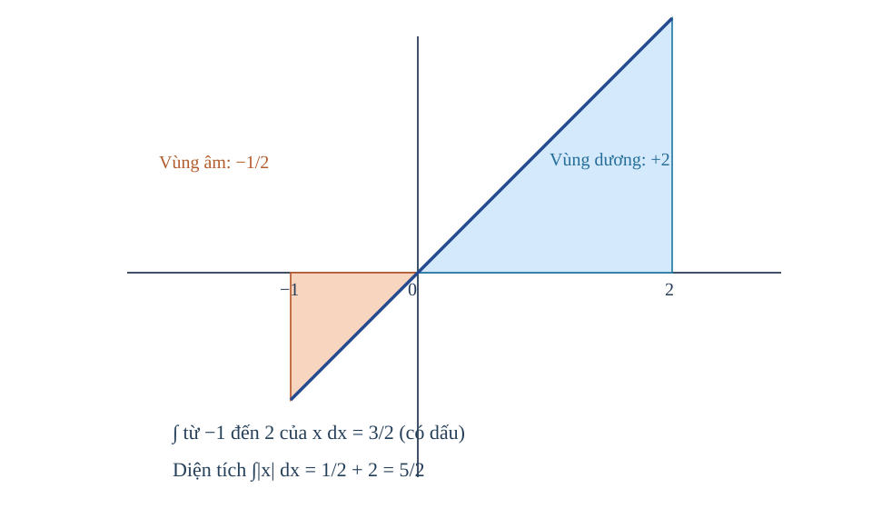
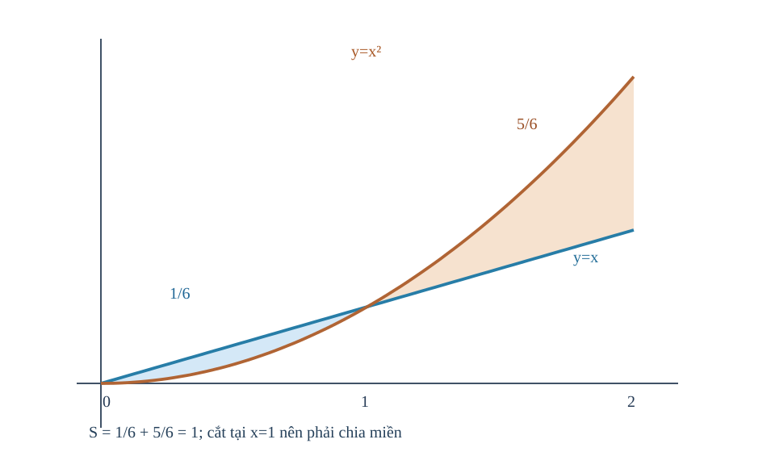
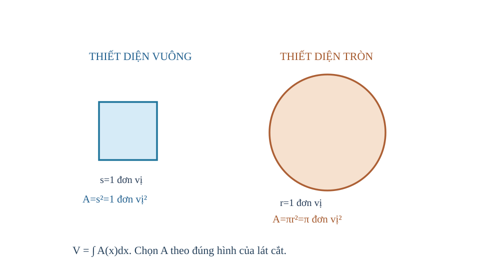
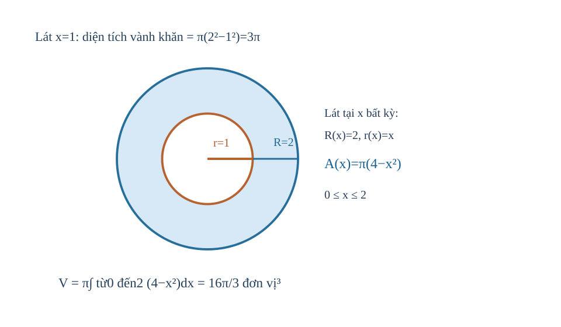

<!-- AUTHORING R03 CANDIDATE: continuous concept arcs, source-bound First Try, no Q18/owner PASS. R01 source unchanged. -->
<!-- AUTHORING CANDIDATE R02 / DELTA_C_ACADEMIC_MATERIAL / NOT CONTENT_READY. R01 immutable; holistic source QA and owner learner UX review required before activation. -->
# CĐ11/22 — Nguyên hàm, Tích phân và Ứng dụng hình học · Biên tập liền mạch R02 (ứng viên)

**LEARNING_PATH: TOPIC** — hành trình độc lập ba trang **Kiến thức / Luyện tập / Tự kiểm tra**. Không tạo Topic Core. Học đủ lý thuyết ở đây (không bắt buộc đi sang bài SGK), diễn giải bản chất trước công thức, ví dụ có lý do chọn phương pháp, học sinh tự thử rồi tự mở đối chiếu và quay lại đúng lỗ hổng D6. Giữ một item_id canonical nguồn cho câu và một rubric Written, placement dùng lại không nhân bản.

## Nguồn S1 và phạm vi khóa

- **SGK Toán 12 Kết nối tri thức Tập Hai, Chương IV**: B11 Nguyên hàm trang in **4–11** /PDF1 **6–13**; B12 Tích phân trang in **12–18** /PDF1 **14–20**; B13 Ứng dụng hình học của tích phân trang in **19–26** /PDF1 **21–28**; bài tập cuối chương **27–28** /PDF1 **29–30**. SGK first-party owner PDF SHA256 `3c642f2e80d86d699ea62bbcabd0c3074fd5118def96e4b3b8ce1f9ead7f97bb`.
- **SBT Toán12 KNTT Tập Hai ChIV**: B11 trang in3–8/PDF1 2–7, B12 9–13/PDF1 8–12, B13 14–18/PDF1 13–17, cuối ChIV 19–21/PDF1 18–20; SBT original SHA256 `823b013adeb487639e55493b4a7c09edb9a21daabc058ea53e6fe92f7a0352f1`. Số trang/offset trích từ source receipts xác minh **trước đây**, không mạo nhận quét PDF mới trong lượt này.
- **Nguồn SGK canonical public 88 ID/22 outcome**, source snapshot `prototypes/thpt/content-drafts/G12_SGK_CHIV_B11_B13_PUBLIC_CANONICAL_R00_SOURCE_LOCK.md`, Git blob `45722cd386a498f3e0e96a09928c85565af56d1b`; independent original reviewer Academic/PED PASS v2.1 tại `prototypes/thpt/review-packets/G12_CHIV_R00_INDEPENDENT_ACADEMIC_PED_SOURCE_RECEIPT_20261103.md`, Git blob `feabeeeef262e7f6b28c898cdf77e6aa4194da24`. **SGK PASS cũ chỉ cho source SGK cũ**, không tự áp sang Topic mới.
- **D5 media source distinction:** sáu hình có mặt trong gói NotebookLM SGK gốc là **PNG**, đã khớp SHA, **không có SVG gốc trong ZIP review**. Nếu vẽ SVG mới cho Topic CĐ11, đó là vật liệu mới được AUTHORING tự QA, không trình bày là nguyên bản SVG đã review. Các item gốc 88 ID tham chiếu-only (không copy stem/key/rubric); 26 protected SGK RD1 không được đưa công khai.

## Vì sao học CĐ11?

Đạo hàm trả lời *đại lượng biến đổi nhanh thế nào?*; nguyên hàm giúp khôi phục đại lượng từ tốc độ biến đổi. Khi biết biến thiên trên cả một khoảng, tích phân cộng dồn những phần nhỏ để cho độ thay đổi ròng, diện tích hay thể tích. Quan trọng nhất: cùng một biểu thức tích phân nhưng **tích phân đại số có dấu** khác **diện tích không âm**, và việc tính **thể tích** còn đòi hỏi biết hình dạng thiết diện hoặc trục quay. Vì vậy ta phát triển ý nghĩa trước công thức, kiểm miền, dấu và đơn vị trước phép tính.

## Từ đạo hàm đến nguyên hàm

Đạo hàm trả lời đại lượng biến đổi nhanh bao nhiêu; nguyên hàm giúp đi ngược lại để khôi phục hàm ban đầu. Việc mất hằng số và điều kiện đầu xuất hiện ngay từ ý nghĩa phép đảo này.

<!-- LESSON_ID: TOP11-M01; OUTCOME_ID: TOP11-O01 -->

Giả sử ta biết một đại lượng thay đổi nhanh thế nào, nhưng lại muốn tìm quy luật của chính đại lượng ấy. Đó là lúc ta đi ngược từ đạo hàm về **nguyên hàm**. Nếu hàm \(F\) có đạo hàm \(F'(x)=f(x)\) trên một khoảng, thì \(F\) là nguyên hàm của \(f\) trên khoảng ấy.

Ví dụ, với \(f(x)=4x^3+2\), ta nhận thấy \((x^4)'=4x^3\) và \((2x)'=2\), nên \(F(x)=x^4+2x\) là một nguyên hàm. Nhưng \(x^4+2x+5\) cũng có đạo hàm ấy, bởi đạo hàm của hằng số bằng 0. Vì thế khi hỏi **họ nguyên hàm**, ta phải viết \(F(x)=x^4+2x+C\). Hãy kiểm bằng cách lấy đạo hàm ngược; phép tích phân bất định không phải một phép nhân với ký hiệu \(dx\).

<!-- LESSON_ID: TOP11-M02; OUTCOME_ID: TOP11-O02 -->

Các nguyên hàm khác nhau bởi hằng số; điều kiện đầu chọn một hàm. Nếu hai hàm có cùng đạo hàm, số liệu ban đầu có chọn ra đúng một hàm không? Trước hết, ta xuất phát từ viết F₀(x)+C, biết a thuộc khoảng và F(a)=b. Nếu f liên tục trên một khoảng, mọi nguyên hàm khác nhau một hằng số trên khoảng ấy. Giá trị đầu F(a)=b cho phương trình F₀(a)+C=b, giải C; không áp dữ kiện ở một thành phần miền để khóa hằng trên thành phần tách rời. Hãy kiểm cả điều kiện và đạo hàm.

Một ví dụ giúp kiểm chứng điều đó. F'=3x²−4, F(1)=5. Họ F=x³−4x+C, thay x=1 cho 1−4+C=5 ⇒ C=8, F=x³−4x+8. Kiểm F'=3x²−4 và F(1)=5.

<!-- LESSON_ID: TOP11-M03; OUTCOME_ID: TOP11-O03 -->

Từ định nghĩa, ta suy ra nguyên hàm lũy thừa và tổng. Vì sao n=−1 là trường hợp đặc biệt, còn các lũy thừa khác chia được cho n+1? Điểm tựa cho suy luận là đạo hàm của x^{n+1} và tính tuyến tính, miền x^n. Từ (x^{n+1})'=(n+1)x^n, khi n≠−1 ta có ∫x^n dx=x^{n+1}/(n+1)+C trên khoảng thích hợp. Với αf+βg, nguyên hàm là αF+βG+C. Không để +C riêng từng hạng rồi tính thành nhiều hằng độc lập trong cùng một tổng.

Hãy theo dõi cách giải này. ∫(6x²−4x+3)dx=2x³−2x²+3x+C. Vì đạo hàm 2x³ là6x², −2x² là−4x và 3x là3. Kiểm từng hạng giúp tránh lỗi hệ số.

<!-- LESSON_ID: TOP11-M04; OUTCOME_ID: TOP11-O04 -->

Nguyên hàm 1/x đặc biệt vì số mũ −1 làm mẫu công thức bằng 0. Tại sao ln|x| xuất hiện, và có thể dùng một C qua x=0 không? Ta có thể bắt đầu bằng logarit thực, (ln|x|)'=1/x khi x khác0, miền liên thông. Đạo hàm ln|x| bằng1/x với x≠0; vì vậy ∫dx/x=ln|x|+C trên từng khoảng (-∞,0) hoặc (0,+∞). Không có nguyên hàm liên tục vượt điểm 0 cho 1/x do hàm gốc không xác định ở đó. Trên miền rời có thể dùng C_- và C_+ khác nhau; một điều kiện tại −1 không xác định hằng ở nhánh dương.

Thử vận dụng vào một tình huống. Trên x<0, ∫(3/x)dx=3ln(−x)+C. Lấy đạo hàm 3·(−1)/(−x)=3/x, đúng. Chọn ln(−x) vì −x>0 trên nhánh âm; ln x không hợp lệ.

<!-- LESSON_ID: TOP11-M05; OUTCOME_ID: TOP11-O05 -->

Hàm mũ đòi hỏi hệ số bù theo đạo hàm của biểu thức trong. Nếu e^{2x} thay đổi nhanh gấp đôi lớp ngoài, phải sửa nguyên hàm bằng cách nào? Những điều đã biết ở đây là dây chuyền (e^{kx})'=k e^{kx}, (a^x)'=a^x ln a. Với k≠0, nguyên hàm e^{kx} là e^{kx}/k+C; với a>0,a≠1, nguyên hàm a^x là a^x/ln a+C. Hệ số bù chính là nghịch của hệ số khi đạo hàm. Không áp công thức lũy thừa x^n cho a^x, vì vị trí biến khác.

Từ lập luận vừa rồi, ta xét: ∫(6e^{3x}+2^x)dx=2e^{3x}+2^x/ln2+C. Đạo hàm ngược cho 6e^{3x}+2^x. Chọn đối chiếu quy tắc mũ và chain trước.

<!-- LESSON_ID: TOP11-M06; OUTCOME_ID: TOP11-O06 -->

Với lượng giác, kiểm dấu và đơn vị radian. Nguyên hàm sin và cos có luôn giữ nguyên dấu không? Để hiểu, ta dựa vào (sin x)'=cos x và (cos x)'=−sin x với x radian. ∫cos(kx)dx=sin(kx)/k+C, ∫sin(kx)dx=−cos(kx)/k+C khi k≠0 và góc radian. Dấu trừ của nguyên hàm sin đến từ đạo hàm cos. Không dùng công thức này nguyên dạng khi biến x là số đo độ; phải quy đổi đơn vị.

Chẳng hạn, ∫(4cos2x+3sin3x)dx=2sin2x−cos3x+C. Chọn đạo hàm ngược: 2·2cos2x=4cos2x; derivative −cos3x là+3sin3x.

<!-- LESSON_ID: TOP11-M07; OUTCOME_ID: TOP11-O07 -->

Khi nguyên hàm là vị trí, điều kiện đầu mang nghĩa vật lý. Một đồ thị v(t) mô tả vận tốc, có xác định duy nhất vị trí s(t) chưa? Trước hết, ta xuất phát từ v=s'(t), nguyên hàm và điều kiện vị trí đầu s(t₀). Vận tốc có hướng v(t)=s'(t) giúp dựng lại vị trí s(t)=F(t)+C, nhưng C cần giá trị đầu. Tích phân v trên [a,b] cho **độ dời**, không phải luôn là tổng quãng đường. Đọc đơn vị: v (m/s), s (m), dv/dt gia tốc (m/s²).

Một ví dụ giúp kiểm chứng điều đó. Cho v(t)=4t−2 (m/s), s(0)=3m: s(t)=2t²−2t+3. Sau2 giây s(2)=8−4+3=7m. Kiểm đạo hàm s'=4t−2, đơn vị m/s. Chọn nguyên hàm rồi mới khóa C.

### Vận dụng và tự đối chiếu

<!-- First Try TOP11-M01; formative only -->
**1.** Tìm họ nguyên hàm của \(f(x)=8x^3-2\). Em kiểm lại được bằng đạo hàm không?

Đối chiếu sau khi tự làm

\(F(x)=2x^4-2x+C\). Đạo hàm của biểu thức này là \(8x^3-2\), đúng bằng \(f\). Nếu em quên \(+C\), hãy thử cộng thêm 5 vào nguyên hàm của mình rồi lấy đạo hàm: kết quả vẫn không đổi.

<!-- First Try TOP11-M02; formative only -->
**2.** F'=2x+1 và F(0)=7: tìm F.

Đối chiếu sau khi tự làm

F=x²+x+7.

Nếu cách làm của em chưa đúng, hãy kiểm tra lại điều kiện và lý do chọn phương pháp. Nếu thay F'(0)=7, bạn đã dùng sai loại dữ kiện; F(0) mới là vị trí ban đầu.

<!-- First Try TOP11-M03; formative only -->
**3.** ∫(5x⁴+2x)dx=?

Đối chiếu sau khi tự làm

x⁵+x²+C.

Nếu cách làm của em chưa đúng, hãy kiểm tra lại điều kiện và lý do chọn phương pháp. Nếu không chia hệ số mũ mới, kiểm đạo hàm ngược sẽ phát hiện hệ số dư.

<!-- First Try TOP11-M04; formative only -->
**4.** F'=1/x trên x<0, F(−1)=2. F là gì?

Đối chiếu sau khi tự làm

F(x)=ln(−x)+2 trên x<0.

Nếu cách làm của em chưa đúng, hãy kiểm tra lại điều kiện và lý do chọn phương pháp. Không viết ln x ở x âm; sau đó kiểm đạo hàm trước khi kết luận.

<!-- First Try TOP11-M05; formative only -->
**5.** Tìm ∫5e^{5x}dx.

Đối chiếu sau khi tự làm

e^{5x}+C.

Nếu cách làm của em chưa đúng, hãy kiểm tra lại điều kiện và lý do chọn phương pháp. Nếu ra 5e^{5x}, đạo hàm ngược sẽ cho 25e^{5x}, phải chia5.

<!-- First Try TOP11-M06; formative only -->
**6.** ∫2sin(2x)dx?

Đối chiếu sau khi tự làm

−cos(2x)+C.

Nếu cách làm của em chưa đúng, hãy kiểm tra lại điều kiện và lý do chọn phương pháp. Nếu thiếu dấu âm, lấy đạo hàm cos(2x) là −2sin(2x) rồi sửa.

<!-- First Try TOP11-M07; formative only -->
**7.** v(t)=6t, s(0)=1, s(1) bằng?

Đối chiếu sau khi tự làm

s(t)=3t²+1 nên s(1)=4m.

Nếu cách làm của em chưa đúng, hãy kiểm tra lại điều kiện và lý do chọn phương pháp. Nếu không có s(0), không thể nói vị trí tuyệt đối cụ thể.

## Tích phân cộng dồn những thay đổi nhỏ

Khi biến thiên diễn ra suốt một khoảng, tích phân cộng dồn các phần rất nhỏ. Nhờ nguyên hàm, ta tính được sự thay đổi ròng bằng hiệu tại hai cận, nhưng dấu của kết quả vẫn phụ thuộc vào chiều lấy tích phân và dấu của hàm.

<!-- LESSON_ID: TOP11-M08; OUTCOME_ID: TOP11-O08 -->

Vì sao cùng nguyên hàm khác nhau C nhưng tích phân có cận vẫn là một số? Điểm tựa cho suy luận là f'=f trên đoạn chứa [a,b], f liên tục/khả tích và Newton–Leibniz. Định lý Newton–Leibniz cho ∫_a^b f(x)dx=F(b)−F(a) nếu F'=f và giả thiết thích hợp. C bị triệt trong hiệu. Khác nguyên hàm bất định, tích phân xác định không thêm +C. Nếu hàm không liên tục/không xác định trên đoạn, không áp máy móc mà kiểm điều kiện.

Hãy theo dõi cách giải này. ∫₁² 4x³dx=[x⁴]₁²=16−1=15. Chọn nguyên hàm x⁴, kiểm đa thức liên tục trên [1,2]; nếu viết +C trong 15 sẽ biến kết quả số thành họ hàm vô nghĩa.

<!-- LESSON_ID: TOP11-M09; OUTCOME_ID: TOP11-O09 -->

Tính tuyến tính cho phép gộp những tích phân có cận phù hợp. Vì sao có thể tách một biểu thức dài thành vài tích phân nhỏ? Ta có thể bắt đầu bằng phép cộng, hằng số và cùng cận [a,b]. ∫_a^b(αf+βg)=α∫_a^b f+β∫_a^b g khi các thành phần khả tích; tất cả dùng cùng cận. Tính tuyến tính không cho quyền thay cận tùy ý. Nếu một thành phần không xác định trên đoạn, phải xử lý vấn đề trước.

Thử vận dụng vào một tình huống. ∫₀¹(3x²+2x+1)dx=[x³+x²+x]₀¹=3. Có thể tách thành1+1+1. Chọn cách tổng từng thành phần vì số hạng là đa thức.

<!-- LESSON_ID: TOP11-M10; OUTCOME_ID: TOP11-O10 -->

Chiều lấy cận quyết định dấu tích phân. Đi ngược chiều tích lũy làm thay đổi dấu nhưng có làm diện tích âm không? Những điều đã biết ở đây là f(b)−F(a), hiệu khi đảo a,b. ∫_b^a f=−∫_a^b f, ∫_a^a f=0; nếu a≤c≤b, ∫_a^b f=∫_a^c f+∫_c^b f. Đây là **tích phân có hướng**, không đồng nhất với diện tích hình học. Quy tắc ghép cũng có thể dùng để chia tại nghiệm đổi dấu.

Từ lập luận vừa rồi, ta xét: ∫₂⁰(3x²+1)dx=−∫₀²(3x²+1)dx=−10. Giá trị âm xuất phát đảo cận, không đại diện diện tích âm. Chọn đổi thứ tự cận trước thay số.

<!-- LESSON_ID: TOP11-M11; OUTCOME_ID: TOP11-O11 -->

Diện tích dưới đồ thị bằng tích phân khi hàm không âm. Tại sao tổng các hình chữ nhật rất mỏng mô phỏng đúng diện tích cong? Để hiểu, ta dựa vào đồ thị liên tục và không âm, dải đứng rộng dx. Nếu f(x)≥0 liên tục trên [a,b], diện tích vùng giữa đồ thị, Ox, hai đường x=a,b bằng ∫_a^b f(x)dx. Ý nghĩa là giới hạn tổng diện tích dải hẹp f(x)dx. Nếu f đổi dấu, tích phân cho phần diện tích đại số chứ không phải tổng vùng.

Chẳng hạn, y=2x trên [0,2] không âm: S=∫₀²2x dx=[x²]₀²=4, đúng diện tích tam giác đáy2 cao4 là4. Hai phương pháp kiểm chéo bản chất.

<!-- LESSON_ID: TOP11-M12; OUTCOME_ID: TOP11-O12 -->

Độ dời khác quãng đường vì tích phân có dấu có thể triệt tiêu. Một vận tốc đổi dấu có thể cho độ dời bằng0 nhưng quãng đường khác0? Trước hết, ta xuất phát từ dấu f, nghiệm f=0, ∫f và ∫|f|. Tích phân ∫f là phần có dấu; ∫|f| là tổng độ lớn không âm. Diện tích hình học giữa Ox và đồ thị dùng ∫|f|; quãng đường khi v là vận tốc có hướng dùng ∫|v|, còn độ dời dùng ∫v. Tìm nghiệm đổi dấu và chia đoạn trước khi lấy trị tuyệt đối từng phần. Không lấy |∫f| thay ∫|f|.

Một ví dụ giúp kiểm chứng điều đó. v(t)=t−1 trên [0,2]: ∫v=0, nhưng ∫|v|=∫₀¹(1−t)+∫₁²(t−1)=1. Tại t=1 vật đổi chiều; diện tích hai tam giác 1/2+1/2=1.

*Quan sát hình:* Vùng bên trái trục tung đóng góp −1/2, bên phải +2: tích phân bằng3/2, tổng diện tích hình học bằng5/2; phải chia tại điểm đổi dấu.

<!-- LESSON_ID: TOP11-M13; OUTCOME_ID: TOP11-O13 -->

Sin, cos và mũ dùng cùng nguyên tắc thế cận sau nguyên hàm. Một biểu thức lượng giác hoặc hàm mũ vẫn tính bằng F(b)−F(a) được không? Điểm tựa cho suy luận là hàm e^x, sin/cos liên tục trên đoạn, góc radian. Nếu f liên tục, quy tắc Newton–Leibniz không phụ thuộc biểu thức có là đa thức hay không. Nguyên hàm cos=sin, sin=−cos (radian), e^x=e^x. Lấy giá trị hai cận đúng, kiểm sinh ra số và dấu. Với e^{kx}, chia k khi tìm nguyên hàm.

Hãy theo dõi cách giải này. ∫₀^{ln3}e^x dx=e^{ln3}−1=2. Chọn F=e^x vì d(e^x)=e^x, cận ln3 cho giá trị hữu hạn. Không viết ln3 thành3 ở cận x.

<!-- LESSON_ID: TOP11-M14; OUTCOME_ID: TOP11-O14 -->

Tích phân từ tốc độ cho lại lượng tích lũy. Biết tốc độ cuối khoảng có suy được lượng tích lũy bằng 'tốc độ cuối×thời gian'? Ta có thể bắt đầu bằng tốc độ biến thiên r(t) và tích phân của r. Nếu Q'(t)=r(t), lượng biến đổi ròng Q(b)−Q(a)=∫_a^b r(t)dt. Khi r không hằng, dùng r(b)(b−a) thường sai; diện tích dưới đồ thị tốc độ phản ánh toàn thời gian. Đơn vị r là lượng/giây, sau tích phân là lượng. Với r đổi dấu, diễn giải ròng.

Thử vận dụng vào một tình huống. Lưu lượng r(t)=2t lít/phút trên [0,2]: Q(2)−Q(0)=∫₀²2t dt=4 lít, không phải r(2)·2=8 lít. Chọn dải tốc độ thay đổi thay vì một mức cuối.

### Vận dụng và tự đối chiếu

<!-- First Try TOP11-M08; formative only -->
**1.** ∫₀²2x dx?

Đối chiếu sau khi tự làm

[x²]₀²=4.

Nếu cách làm của em chưa đúng, hãy kiểm tra lại điều kiện và lý do chọn phương pháp. Nếu chỉ thế cận trên, luôn nhắc hiệu F(b)−F(a).

<!-- First Try TOP11-M09; formative only -->
**2.** ∫₀²(2x+3)dx?

Đối chiếu sau khi tự làm

[x²+3x]₀²=4+6=10.

Nếu cách làm của em chưa đúng, hãy kiểm tra lại điều kiện và lý do chọn phương pháp. Nếu ghép các tích phân khác cận mà không đổi cận, đó không phải quy tắc tuyến tính.

<!-- First Try TOP11-M10; formative only -->
**3.** ∫₁¹(x²+1)dx?

Đối chiếu sau khi tự làm

0.

Nếu cách làm của em chưa đúng, hãy kiểm tra lại điều kiện và lý do chọn phương pháp. Nếu kết luận diện tích hình học từ tích phân đảo cận, phải quay lại miền và |f|.

<!-- First Try TOP11-M11; formative only -->
**4.** Diện tích dưới y=x² trên [0,1]?

Đối chiếu sau khi tự làm

∫₀¹x²dx=1/3 đơn vị².

Nếu cách làm của em chưa đúng, hãy kiểm tra lại điều kiện và lý do chọn phương pháp. Nếu trả diện tích âm, kiểm f có âm trên đoạn hay không.

<!-- First Try TOP11-M12; formative only -->
**5.** f=x trên [−1,1], diện tích và tích phân là gì?

Đối chiếu sau khi tự làm

Diện tích1, tích phân có dấu0.

Nếu cách làm của em chưa đúng, hãy kiểm tra lại điều kiện và lý do chọn phương pháp. Nếu câu hỏi 'quãng đường', hãy chia đoạn tại nghiệm v=0 rồi lấy |v|.

<!-- First Try TOP11-M13; formative only -->
**6.** ∫₀^{π/2} sin x dx?

Đối chiếu sau khi tự làm

[−cos x]₀^{π/2}=−0−(−1)=1.

Nếu cách làm của em chưa đúng, hãy kiểm tra lại điều kiện và lý do chọn phương pháp. Nếu thay cận góc độ mà không quy đổi, xem lại giả thiết radian.

<!-- First Try TOP11-M14; formative only -->
**7.** r(t)=3t² mét/giây trên [0,1], độ dời?

Đối chiếu sau khi tự làm

∫₀¹3t²dt=1 m.

Nếu cách làm của em chưa đúng, hãy kiểm tra lại điều kiện và lý do chọn phương pháp. Nếu kết quả có đơn vị m/s, bạn chưa tích phân theo giây.

## Từ tích phân có dấu đến diện tích thực

Diện tích hình học không thể âm. Vì vậy, khi đồ thị đổi phía so với trục Ox hoặc hai đường cắt nhau, ta cần chia miền và cộng những phần dương, không dùng ngay tích phân đại số của một hiệu xuyên suốt.

<!-- LESSON_ID: TOP11-M15; OUTCOME_ID: TOP11-O15 -->

Diện tích dưới √x tính khác hình chữ nhật vì chiều cao thay đổi thế nào? Những điều đã biết ở đây là hàm căn trên x≥0, f≥0 và nguyên hàm x^{1/2}. Nếu y=√x trên [a,b] với 0≤a<b, f liên tục, không âm, S=∫_a^b√x dx= (2/3)[x^{3/2}]_a^b. Không lấy cận âm để làm phép nguyên hàm trên số thực. Hình phẳng được mô tả bằng hai đường dọc x=a,b, Ox và đồ thị.

Từ lập luận vừa rồi, ta xét: S dưới y=√x trên [0,1]: ∫₀¹x^{1/2}dx=2/3 đơn vị². Kiểm với hình 1×1 có đường √x nằm trong hình nên diện tích <1.

<!-- LESSON_ID: TOP11-M16; OUTCOME_ID: TOP11-O16 -->

Khi đồ thị cắt trục, cần chia miền và cộng diện tích. Khi đường cong chạy qua trục Ox, những mảnh phía dưới có phải trừ khỏi diện tích? Để hiểu, ta dựa vào nghiệm của f(x)=0, dấu f trên mỗi khoảng và ∫|f|. Diện tích vùng giữa đồ thị y=f(x) và Ox trên [a,b] bằng ∫|f|dx. Nếu f đổi dấu, chia tại tất cả nghiệm trong đoạn và đổi dấu tích phân tương ứng; nếu f không âm xuyên đoạn, không cần chia. Diện tích luôn ≥0 và có đơn vị²; không dùng |∫f| trừ khi f giữ dấu.

Chẳng hạn, f(x)=x trên [−2,2]: tích phân có dấu0, nhưng S=∫−₂⁰(−x)dx+∫₀²x dx=2+2=4. Chọn mốc x=0 vì đường cắt Ox ở đó.

<!-- LESSON_ID: TOP11-M17; OUTCOME_ID: TOP11-O17 -->

Giữa hai đường, phải xét đường trên trước. Lấy 'trên−dưới' vì sao cho diện tích dải đứng không âm? Trước hết, ta xuất phát từ đồ thị liên tục f,g trên [a,b] và dấu f−g. Nếu f(x)≥g(x) trên cả đoạn, dải đứng có chiều cao f−g≥0; diện tích S=∫_a^b(f−g)dx. Kiểm bằng một điểm thử trong mỗi khoảng có thể đổi thứ tự; nếu f−g không giữ dấu, chuyển sang bài chia miền. Đơn vị².

Một ví dụ giúp kiểm chứng điều đó. Trên [0,1], f=2, g=x², rõ 2>x², S=∫₀¹(2−x²)dx=2−1/3=5/3. Chọn đường trên y=2 rồi trừ y=x²; kết quả dương.

<!-- LESSON_ID: TOP11-M18; OUTCOME_ID: TOP11-O18 -->

Khi hai đường giao, thứ tự có thể đổi trong đoạn. Một giao điểm nằm trong [a,b] có thể đổi thứ tự hai đường ra sao? Điểm tựa cho suy luận là phương trình f=g, dấu f−g, tích phân trị tuyệt đối. Tính diện tích giữa hai đường trên [a,b] bằng ∫_a^b|f−g|dx; giải điểm giao, chia tại nghiệm trong khoảng, kiểm đường nào trên mỗi mảnh. Các diện tích không âm phải **cộng**, không cộng tích phân có dấu chưa đổi. Không cần chia tại điểm chạm không đổi dấu, nhưng phải kiểm.

Hãy theo dõi cách giải này. f=x,g=x² trên [0,2], giao x=0,1. Trên (0,1) x>x², trên (1,2) x²>x: S=1/6+5/6=1. Trong khi ∫₀²(x−x²)=−2/3, minh họa sai nếu không chia.

*Quan sát hình:* Trên [0,1] lấy x−x², trên [1,2] lấy x²−x. Hai diện tích là 1/6 và 5/6, nên tổng1 không phải trị tuyệt đối của tích phân có dấu.

<!-- LESSON_ID: TOP11-M19; OUTCOME_ID: TOP11-O19 -->

Mô hình diện tích cần đúng giao điểm, cận và đơn vị. Vì sao phải tìm đường biên và giao điểm trước khi bấm nguyên hàm? Ta có thể bắt đầu bằng hình phẳng bị chặn, giải f=g và kiểm miền các nhánh. Lập mô hình: xác định ranh giới và trục, chọn biến theo chiều lát cắt, giải giao điểm thực nằm trong miền, kiểm thứ tự trên/dưới, tính tích phân diện tích, ghi đơn vị². Có khi hai đường không tạo miền kín nếu thiếu cận hoặc không có điểm giao thứ hai; không tự tạo cận 0,1 từ hình tưởng tượng.

Thử vận dụng vào một tình huống. Cho y=2x và y=x²: giao x=0 và2, trên (0,2) 2x≥x² nên S=∫₀²(2x−x²)dx=4/3 đơn vị². Chọn cận 0..2 từ phương trình chứ không từ dáng đồ thị.

### Vận dụng và tự đối chiếu

<!-- First Try TOP11-M15; formative only -->
**1.** S dưới y=√x trên [0,9]?

Đối chiếu sau khi tự làm

(2/3)9^{3/2}=(2/3)27=18 đơn vị².

Nếu cách làm của em chưa đúng, hãy kiểm tra lại điều kiện và lý do chọn phương pháp. Nếu coi √x như x², phải đổi thành x^{1/2} trước tính.

<!-- First Try TOP11-M16; formative only -->
**2.** S giữa y=x và Ox trên [−1,0]?

Đối chiếu sau khi tự làm

1/2 đơn vị².

Nếu cách làm của em chưa đúng, hãy kiểm tra lại điều kiện và lý do chọn phương pháp. Nếu tích phân có dấu0 mà hình có hai miền, bạn đã để triệt tiêu sai.

<!-- First Try TOP11-M17; formative only -->
**3.** S giữa y=3 và y=x trên [0,2]?

Đối chiếu sau khi tự làm

∫₀²(3−x)dx=4.

Nếu cách làm của em chưa đúng, hãy kiểm tra lại điều kiện và lý do chọn phương pháp. Nếu hiệu âm, hãy kiểm đã trừ đúng 'trên−dưới'.

<!-- First Try TOP11-M18; formative only -->
**4.** S giữa y=x và y=0 trên [−2,1]?

Đối chiếu sau khi tự làm

S=∫−₂⁰(−x)+∫₀¹x=2+1/2=5/2.

Nếu cách làm của em chưa đúng, hãy kiểm tra lại điều kiện và lý do chọn phương pháp. Nếu lấy |∫(f−g)|, hãy đối chiếu hai tam giác phía khác nhau.

<!-- First Try TOP11-M19; formative only -->
**5.** Cho y=x+1 và y=1 trên [0,2], S?

Đối chiếu sau khi tự làm

∫₀² x dx=2 đơn vị².

Nếu cách làm của em chưa đúng, hãy kiểm tra lại điều kiện và lý do chọn phương pháp. Nếu thiếu cận trong đề không tự nói đó là hình kín; tìm giao điểm/ranh giới trước.

## Từ diện tích lát cắt đến thể tích

Mỗi lát cắt mỏng của một khối có diện tích riêng; cộng chúng bằng tích phân cho thể tích. Công thức chỉ đúng khi chọn đúng hình tiết diện — hình vuông, hình tròn, hay vành khăn khi quay quanh một trục.

<!-- LESSON_ID: TOP11-M20; OUTCOME_ID: TOP11-O20 -->

Nếu mỗi lát mỏng đã biết diện tích, tổng lát cho thể tích như thế nào? Những điều đã biết ở đây là tiết diện A(x)≥0 có đơn vị diện tích, độ dày dx. Với khối được xác định trên [a,b], diện tích thiết diện vuông góc Ox tại x là A(x), V=∫_a^bA(x)dx (nếu A khả tích). Chọn công thức A theo **hình dạng tiết diện thật**: vuông thì s², tròn thì πr², hình khác có công thức khác. Không thêm π nếu không phải mặt cắt tròn.

Từ lập luận vừa rồi, ta xét: Tiết diện vuông cạnh 2x trên [0,1] (đơn vị cm): A=4x² cm², V=∫₀¹4x²dx=4/3 cm³. Chọn vuông nên không có π.

*Quan sát hình:* Cạnh vuông1 cho diện tích1, bán kính tròn1 cho diện tíchπ. Chỉ có tiết diện tròn mới tạo hệ sốπ trong công thức diện tích lát cắt.

<!-- LESSON_ID: TOP11-M21; OUTCOME_ID: TOP11-O21 -->

Thiết diện tròn dùng diện tích đĩa πr². Nếu lát cắt tròn, công thức phải sửa như thế nào so với tiết diện vuông? Để hiểu, ta dựa vào diện tích đĩa tròn πr², r≥0 theo x. Đối với khối có mặt cắt vuông góc Ox hình tròn bán kính r(x)≥0 trên [a,b], A(x)=πr(x)², V=π∫r²dx. Đây là phương pháp mặt cắt; **không nhất thiết** là miền quay nếu bài toán chỉ nói thiết diện. Chuyển đơn vị: r cm ⇒ A cm², dx cm ⇒ V cm³.

Chẳng hạn, r(x)=2x trên [0,1], V=π∫₀¹4x²dx=4π/3 đơn vị³. Chọn π vì lát tròn và bình phương r, không nhầm bán kính với diện tích.

<!-- LESSON_ID: TOP11-M22; OUTCOME_ID: TOP11-O22 -->

Khối xoay cho tiết diện đĩa hoặc vành khăn tùy vùng. Vì sao thể tích quay một vùng giữa hai đồ thị có thể phải trừ hai đĩa? Trước hết, ta xuất phát từ bán kính là khoảng cách từ đồ thị đến Ox, miền f≥g≥0. Nếu quay vùng 0≤y≤f(x) quanh Ox, lát cắt đĩa bán kính f, thể tích V=π∫f²dx. Nếu quay miền g≤y≤f với 0≤g≤f quanh Ox, lát cắt lành khăn R=f,r=g, V=π∫(R²−r²)dx. Nếu đường cắt Ox/hai vùng chồng khi quay, công thức đơn giản có thể không áp; cần phân tích hình cắt cẩn thận.

Một ví dụ giúp kiểm chứng điều đó. Quay vùng 0≤y≤x, x∈[0,1] quanh Ox, V=π∫₀¹x²dx=π/3. Nếu quay vùng x≤y≤2, x∈[0,2], ngoài R=2 trong r=x: V=π∫₀²(4−x²)dx=16π/3. Chọn hiệu bình phương bán kính chứ không bình phương chiều dày.

*Quan sát hình:* Miền x≤y≤2 trên [0,2] có bán kính ngoài2, trong x; dùng hiệu bình phương 4−x², không lấy bình phương hiệu (2−x)².

### Vận dụng và tự đối chiếu

<!-- First Try TOP11-M20; formative only -->
**1.** Tiết diện vuông cạnh 3 không đổi, đoạn dài2: thể tích?

Đối chiếu sau khi tự làm

9·2=18 đơn vị³.

Nếu cách làm của em chưa đúng, hãy kiểm tra lại điều kiện và lý do chọn phương pháp. Nếu dùng 3 thay cho9, bạn lấy cạnh làm diện tích.

<!-- First Try TOP11-M21; formative only -->
**2.** r(x)=1+x trên [0,1], V?

Đối chiếu sau khi tự làm

π∫₀¹(1+x)²dx=7π/3.

Nếu cách làm của em chưa đúng, hãy kiểm tra lại điều kiện và lý do chọn phương pháp. Nếu ra 2π, bạn đã tích phân r thay r².

<!-- First Try TOP11-M22; formative only -->
**3.** Quay miền 0≤y≤2, x∈[0,3] quanh Ox, V?

Đối chiếu sau khi tự làm

Đĩa r=2 không đổi, V=π·4·3=12π.

Nếu cách làm của em chưa đúng, hãy kiểm tra lại điều kiện và lý do chọn phương pháp. Nếu vùng không chạm Ox, không dùng đĩa đầy; kiểm lỗ r>0.

## D5 — Hướng dẫn đọc hình toán (SVG mới của Topic, không phải ảnh SGK đã review)

- `prototypes/thpt/visuals/THPT_TOPIC11_SIGNED_INTEGRAL_R01.svg`: các phần diện tích có dấu của y=x từ x=−1 đến x=2, vùng trái âm −1/2, vùng phải dương+2. Tổng tích phân 3/2; tổng diện tích |x| là5/2. Đọc trục, điểm đổi dấu và hai loại kết quả.
- `prototypes/thpt/visuals/THPT_TOPIC11_TWO_CURVES_SPLIT_R01.svg`: đồ thị y=x và y=x² trên [0,2], giao tại x=0 và1; vùng 0..1 lấy x−x², vùng1..2 lấy x²−x. Diện tích lần lượt1/6 và5/6, cộng bằng1. Không lấy trị tuyệt đối của một tích phân có dấu.
- `prototypes/thpt/visuals/THPT_TOPIC11_CROSS_SECTION_SQUARE_CIRCLE_R01.svg`: cùng cạnh s hoặc bán kính r bằng1 đơn vị, tiết diện vuông A=s²=1 và tròn A=πr²=π; tích phân A(x) dx tạo thể tích. Chỉ một trong hai loại hình quyết định có hệ số π.
- `prototypes/thpt/visuals/THPT_TOPIC11_WASHER_REVOLUTION_R01.svg`: miền giữa y=2 và y=x, 0≤x≤2 quay quanh Ox; tại mỗi x hình vành khăn có bán kính ngoài2, trong x, diện tích π(4−x²), thể tích16π/3. Phân biệt hiệu bình phương và bình phương hiệu.

## Ba mô hình học tập tương tác — SPEC_ONLY (chưa được triển khai)

1. **Tích phân có dấu:** chỉnh cận trên y=x, tô vùng âm/dương khác nhau, hiển thị ∫f và ∫|f| riêng; phải nhận diện điểm đổi dấu trước khi tính diện tích.
2. **Hai đường cong:** chọn hai biểu thức f,g đã hỗ trợ, hiển thị giao điểm, chọn nghiệm trong đoạn và hoán đổi miền trên/dưới. Nếu thiếu cận hoặc không có miền kín, báo điều kiện chưa đủ thay vì tạo diện tích.
3. **Tiết diện và tròn xoay:** chuyển giữa lát vuông, đĩa và vành khăn với đúng A(x), yêu cầu chọn trục/quy tắc miền trước; cảnh báo không mặc định π trong tiết diện vuông. Đây chỉ là đề xuất mô phỏng, chưa là tính năng sống hoặc QA trên Safari.

# Luyện tập

**Một ngân hàng canonical NEW** ở `prototypes/thpt/shared-items/Temp_TOPIC11_INTEGRALS_NEW28_R02_REPAIR_CANDIDATE_20261113.md`: **22 Practice P01–P22** (mỗi outcome một câu độc lập có key, lời giải, D6) và **6 Written W01–W06 /7 điểm** về nguyên hàm điều kiện đầu, ln|x|, tích phân vận tốc có dấu, hai đồ thị cắt nhau, thiết diện vuông và vành khăn tròn xoay. **88 original SGK canonical** ở `prototypes/thpt/shared-items/Temp_TOPIC11_INTEGRALS_ORIGINAL88_SGK_CANONICAL_INDEX_R01_20261112.md` chỉ là source-locked reference, không nhân bản nội dung và không đổi SGK Core thành Topic Core.

| Outcome | Mạch kiến thức | NEW Practice | NEW Written /7 |
|---|---|---|---|
| TOP11-O01 | Nguyên hàm là phép đảo của đạo hàm | THPT-TOP11-P01 | — |
| TOP11-O02 | Họ nguyên hàm và điều kiện đầu | THPT-TOP11-P02 | THPT-TOP11-W01 |
| TOP11-O03 | Nguyên hàm lũy thừa và tổng nhiều hạng | THPT-TOP11-P03 | — |
| TOP11-O04 | Nguyên hàm 1/x và logarit giá trị tuyệt đối | THPT-TOP11-P04 | THPT-TOP11-W02 |
| TOP11-O05 | Nguyên hàm của hàm mũ | THPT-TOP11-P05 | — |
| TOP11-O06 | Nguyên hàm lượng giác và điều kiện radian | THPT-TOP11-P06 | — |
| TOP11-O07 | Khôi phục chuyển động từ vận tốc | THPT-TOP11-P07 | — |
| TOP11-O08 | Tích phân xác định và hiệu hai giá trị nguyên hàm | THPT-TOP11-P08 | — |
| TOP11-O09 | Tính tuyến tính của tích phân xác định | THPT-TOP11-P09 | — |
| TOP11-O10 | Đảo cận, chia đoạn và cận trùng nhau | THPT-TOP11-P10 | — |
| TOP11-O11 | Diện tích dưới đồ thị f≥0 | THPT-TOP11-P11 | — |
| TOP11-O12 | Tích phân có dấu và quãng đường/diện tích thực | THPT-TOP11-P12 | THPT-TOP11-W03 |
| TOP11-O13 | Tích phân xác định của sin, cos, mũ | THPT-TOP11-P13 | — |
| TOP11-O14 | Tính lượng tích lũy từ tốc độ biến thiên | THPT-TOP11-P14 | — |
| TOP11-O15 | Diện tích dưới đường cong không âm | THPT-TOP11-P15 | — |
| TOP11-O16 | Vùng cắt trục Ox: nguyên tắc trị tuyệt đối | THPT-TOP11-P16 | — |
| TOP11-O17 | Diện tích giữa hai đường không đổi thứ tự | THPT-TOP11-P17 | — |
| TOP11-O18 | Hai đường cắt nhau và chia miền | THPT-TOP11-P18 | THPT-TOP11-W04 |
| TOP11-O19 | Lập mô hình diện tích: giao điểm, cận và đơn vị | THPT-TOP11-P19 | — |
| TOP11-O20 | Thể tích qua diện tích tiết diện | THPT-TOP11-P20 | THPT-TOP11-W05 |
| TOP11-O21 | Thiết diện tròn bán kính thay đổi | THPT-TOP11-P21 | — |
| TOP11-O22 | Khối tròn xoay quanh Ox: đĩa và vành khăn | THPT-TOP11-P22 | THPT-TOP11-W06 |

**Đường học tập:** Tự thử tại mô-đun → thực hành P riêng → mở tự đối chiếu → nếu sai dùng D6 quay lại điều kiện/đồ thị → khi đã vững làm Written và tự đối chiếu từng rubric. Một item_id duy nhất có thể được placement nhiều lần nhưng không đổi câu/đáp án/rubric canonical.

# Tự kiểm tra

**PUBLIC Self Check 22 placements** tham chiếu lại đúng `THPT-TOP11-P01` … `THPT-TOP11-P22` từ bài luyện; không tạo ID thứ hai. Những đề có thể đã xem đáp án nên **chỉ** `CLIENT_SELF_CHECK_NO_MASTERY`, không phải `TOPIC_READINESS` độc lập, không ghi Skill Mastery. Không nhập 26 câu SGK RD1 kín hoặc đặt nội dung đánh giá độc lập vào GitHub.

**Đặc tả thuộc RELEASE:** trước **Final Submit**, không mở hint, AI Tutor, đáp án, giải chi tiết, rubrics làm lộ key hoặc phản hồi đúng/sai. Sau Final Submit mới cho tự đối chiếu và D6. Đây là yêu cầu runtime cần kiểm qua browser; source Markdown AUTHORING chưa chứng minh hệ thống đang làm được.

## Phụ lục AUTHORING — metadata không xuất cho học sinh

PACKET_ID: THPT-TOPIC11-ANTIDERIVATIVE-INTEGRAL-GEOMETRY-FULL-R01
STANDARD_ID: SLM-THPT-QUALITY-ONE
STANDARD_VERSION: 3.1.0
LEARNING_PATH: TOPIC
LESSON_IDS: TOP11-M01..TOP11-M22
OUTCOME_IDS: TOP11-O01..TOP11-O22
ORIGINAL_SGK_PUBLIC_CANONICAL: 88
ORIGINAL_SGK_OUTCOMES: 22
TOPIC_NEW_PRACTICE: 22
TOPIC_NEW_WRITTEN: 6
TOPIC_NEW_CANONICAL: 28
TOTAL_PUBLIC_UNIQUE_CANONICAL: 116
PUBLIC_SELF_CHECK_REUSE_ONLY: 22
PRIVATE_RD1_IMPORTED: 0
ASSESSMENT_MODE: CLIENT_SELF_CHECK_NO_MASTERY
OFFICIAL_TOPIC_READINESS: NOT_CLAIMED
MASTERY_ACTIVATION: NO
RELEASE_AUTHORIZATION: NO
RUNTIME_TOPIC_ID: UNASSIGNED_OWNER_DECISION
ORIGINAL88_INDEX_BLOB: 672fdce0c02ebf4f6ae6b37b331ca59e259d9b5c
NEW28_BANK_BLOB: 1d1de4a1dd2ed07954db7b5dde4b86a9f894ddfe

### Original 88 SGK canonical references (no stem/key copies)
- THPT-G12-B11-C01
- THPT-G12-B11-P01
- THPT-G12-B11-A01
- THPT-G12-B11-W01
- THPT-G12-B11-C02
- THPT-G12-B11-P02
- THPT-G12-B11-A02
- THPT-G12-B11-W02
- THPT-G12-B11-C03
- THPT-G12-B11-P03
- THPT-G12-B11-A03
- THPT-G12-B11-W03
- THPT-G12-B11-C04
- THPT-G12-B11-P04
- THPT-G12-B11-A04
- THPT-G12-B11-W04
- THPT-G12-B11-C05
- THPT-G12-B11-P05
- THPT-G12-B11-A05
- THPT-G12-B11-W05
- THPT-G12-B11-C06
- THPT-G12-B11-P06
- THPT-G12-B11-A06
- THPT-G12-B11-W06
- THPT-G12-B11-C07
- THPT-G12-B11-P07
- THPT-G12-B11-A07
- THPT-G12-B11-W07
- THPT-G12-B12-C01
- THPT-G12-B12-P01
- THPT-G12-B12-A01
- THPT-G12-B12-W01
- THPT-G12-B12-C02
- THPT-G12-B12-P02
- THPT-G12-B12-A02
- THPT-G12-B12-W02
- THPT-G12-B12-C03
- THPT-G12-B12-P03
- THPT-G12-B12-A03
- THPT-G12-B12-W03
- THPT-G12-B12-C04
- THPT-G12-B12-P04
- THPT-G12-B12-A04
- THPT-G12-B12-W04
- THPT-G12-B12-C05
- THPT-G12-B12-P05
- THPT-G12-B12-A05
- THPT-G12-B12-W05
- THPT-G12-B12-C06
- THPT-G12-B12-P06
- THPT-G12-B12-A06
- THPT-G12-B12-W06
- THPT-G12-B12-C07
- THPT-G12-B12-P07
- THPT-G12-B12-A07
- THPT-G12-B12-W07
- THPT-G12-B13-C01
- THPT-G12-B13-P01
- THPT-G12-B13-A01
- THPT-G12-B13-W01
- THPT-G12-B13-C02
- THPT-G12-B13-P02
- THPT-G12-B13-A02
- THPT-G12-B13-W02
- THPT-G12-B13-C03
- THPT-G12-B13-P03
- THPT-G12-B13-A03
- THPT-G12-B13-W03
- THPT-G12-B13-C04
- THPT-G12-B13-P04
- THPT-G12-B13-A04
- THPT-G12-B13-W04
- THPT-G12-B13-C05
- THPT-G12-B13-P05
- THPT-G12-B13-A05
- THPT-G12-B13-W05
- THPT-G12-B13-C06
- THPT-G12-B13-P06
- THPT-G12-B13-A06
- THPT-G12-B13-W06
- THPT-G12-B13-C07
- THPT-G12-B13-P07
- THPT-G12-B13-A07
- THPT-G12-B13-W07
- THPT-G12-B13-C08
- THPT-G12-B13-P08
- THPT-G12-B13-A08
- THPT-G12-B13-W08

### New28 canonical Topic question IDs
- THPT-TOP11-P01
- THPT-TOP11-P02
- THPT-TOP11-P03
- THPT-TOP11-P04
- THPT-TOP11-P05
- THPT-TOP11-P06
- THPT-TOP11-P07
- THPT-TOP11-P08
- THPT-TOP11-P09
- THPT-TOP11-P10
- THPT-TOP11-P11
- THPT-TOP11-P12
- THPT-TOP11-P13
- THPT-TOP11-P14
- THPT-TOP11-P15
- THPT-TOP11-P16
- THPT-TOP11-P17
- THPT-TOP11-P18
- THPT-TOP11-P19
- THPT-TOP11-P20
- THPT-TOP11-P21
- THPT-TOP11-P22
- THPT-TOP11-W01
- THPT-TOP11-W02
- THPT-TOP11-W03
- THPT-TOP11-W04
- THPT-TOP11-W05
- THPT-TOP11-W06

END_AUTHOR_SOURCE: SOURCE_LOCKED_R01

<!-- R02 repaired bank is candidate and not active canonical until Q18/owner UAT; old R01 original lock remains immutable. -->
