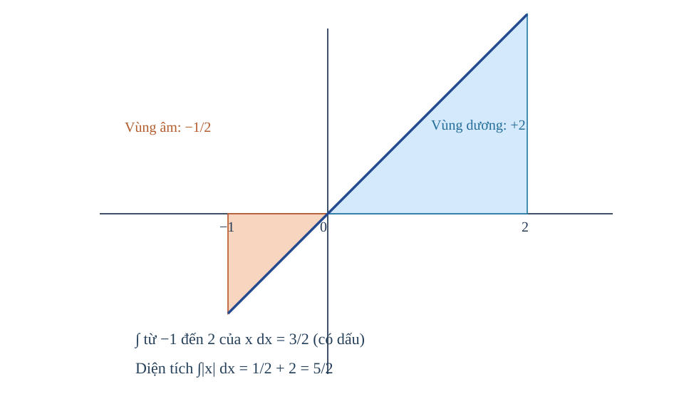
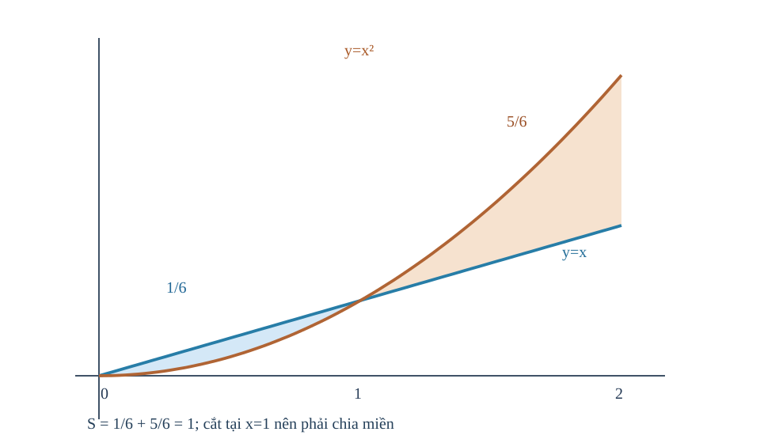
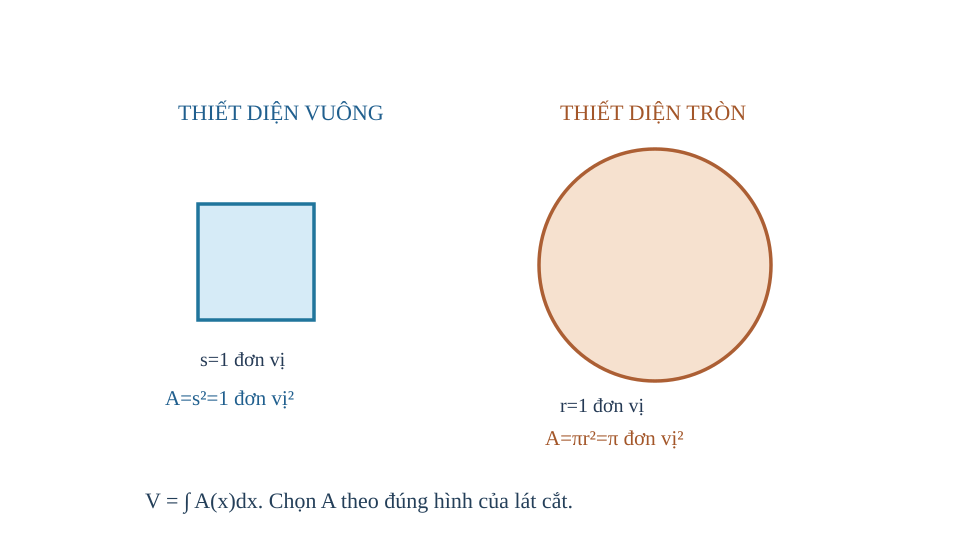
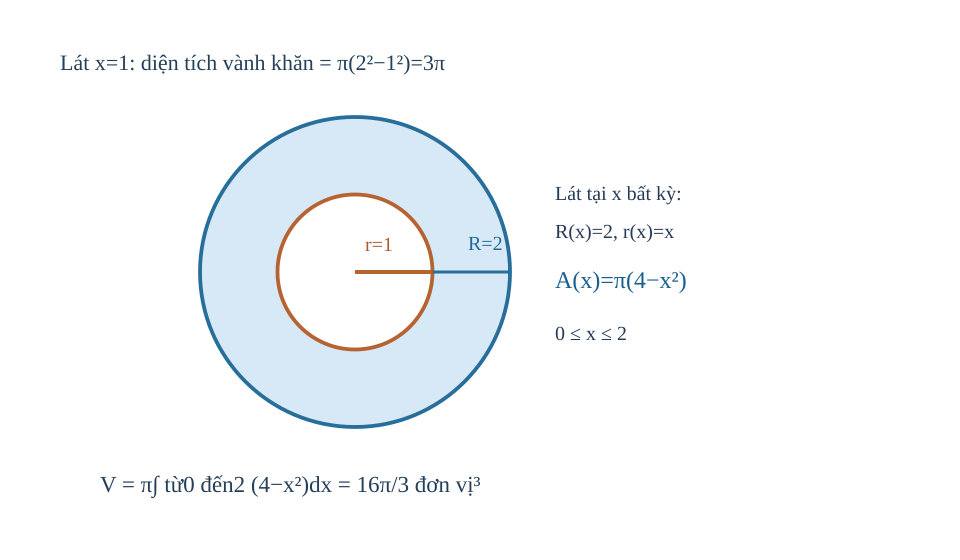

<!-- AUTHORING R04; original R03 immutable 6c78b455f9d95e85c713108292908bf6f922d2f1, new math/PED Q18 self-verification and V2 source-lock. No release. -->
<!-- STANDARD_ID=SLM-THPT-QUALITY-ONE; STANDARD_VERSION=3.1.0; LEARNING_PATH=TOPIC; OUTER_PAGES=Kiến thức|Luyện tập|Tự kiểm tra; SOURCE_VERSION=R04_AUTHORING_READY; AUTHORING_ONLY_METADATA=prototypes/thpt/content-drafts/topic11-integrals/Temp_TOPIC11_R04_AUTHORING_ONLY_CUSTODY_METADATA_20261113.md -->
# CĐ11 — Nguyên hàm, tích phân và ứng dụng hình học

# Kiến thức

## Từ biết tốc độ biến đổi đến khôi phục đại lượng

Nếu một thiết bị đo cho ta vận tốc theo thời gian mà không cho trực tiếp vị trí, ta có thể hỏi: liệu có thể **khôi phục vị trí** từ vận tốc ấy không? Đạo hàm biến một đại lượng thành tốc độ biến đổi, còn nguyên hàm giúp đi ngược lại. Nhưng đi ngược không xác định ngay vị trí ban đầu: các hàm chỉ khác hằng số đều có cùng đạo hàm. Chính vì thế ta cần điều kiện đầu để chọn đúng một đại lượng.

Khi muốn biết đại lượng đã thay đổi bao nhiêu trong cả một quãng thời gian, ta cộng những thay đổi rất nhỏ thành **tích phân xác định**. Từ đây xuất hiện hai câu hỏi phải phân biệt: thay đổi ròng có thể dương hay âm, còn độ dài, diện tích hay thể tích **không thể âm**. Bài học đi từ nguyên hàm qua tích phân có dấu đến hình học lát cắt, không nhảy thẳng vào công thức diện tích và thể tích.

<!-- LESSON_ID: TOP11-M01; OUTCOME_ID: TOP11-O01 -->

Giả sử ta biết một đại lượng thay đổi nhanh thế nào, nhưng lại muốn tìm quy luật của chính đại lượng ấy. Đó là lúc ta đi ngược từ đạo hàm về **nguyên hàm**. Nếu hàm \(F\) có đạo hàm \(F'(x)=f(x)\) trên một khoảng, thì \(F\) là nguyên hàm của \(f\) trên khoảng ấy.

Ví dụ, với \(f(x)=4x^3+2\), ta nhận thấy \((x^4)'=4x^3\) và \((2x)'=2\), nên \(F(x)=x^4+2x\) là một nguyên hàm. Nhưng \(x^4+2x+5\) cũng có đạo hàm ấy, bởi đạo hàm của hằng số bằng 0. Vì thế khi hỏi **họ nguyên hàm**, ta phải viết \(F(x)=x^4+2x+C\). Hãy kiểm bằng cách lấy đạo hàm ngược; phép tích phân bất định không phải một phép nhân với ký hiệu \(dx\).

<!-- LESSON_ID: TOP11-M02; OUTCOME_ID: TOP11-O02 -->

Các nguyên hàm khác nhau bởi hằng số; điều kiện đầu chọn một hàm. Nếu hai hàm có cùng đạo hàm, số liệu ban đầu có chọn ra đúng một hàm không? Ta đã biết viết F₀(x)+C, biết a thuộc khoảng và F(a)=b. Nếu f liên tục trên một khoảng, mọi nguyên hàm khác nhau một hằng số trên khoảng ấy. Giá trị đầu F(a)=b cho phương trình F₀(a)+C=b, giải C; không áp dữ kiện ở một thành phần miền để khóa hằng trên thành phần tách rời. Hãy kiểm cả điều kiện và đạo hàm.

Chẳng hạn, F'=3x²−4, F(1)=5. Họ F=x³−4x+C, thay x=1 cho 1−4+C=5 ⇒ C=8, F=x³−4x+8. Kiểm F'=3x²−4 và F(1)=5.

<!-- LESSON_ID: TOP11-M03; OUTCOME_ID: TOP11-O03 -->

Từ định nghĩa, ta suy ra nguyên hàm lũy thừa và tổng. Vì sao n=−1 là trường hợp đặc biệt, còn các lũy thừa khác chia được cho n+1? Ta sử dụng đạo hàm của x^{n+1} và tính tuyến tính, miền x^n. Từ (x^{n+1})'=(n+1)x^n, khi n≠−1 ta có ∫x^n dx=x^{n+1}/(n+1)+C trên khoảng thích hợp. Với αf+βg, nguyên hàm là αF+βG+C. Không để +C riêng từng hạng rồi tính thành nhiều hằng độc lập trong cùng một tổng.

Xét ví dụ: ∫(6x²−4x+3)dx=2x³−2x²+3x+C. Vì đạo hàm 2x³ là6x², −2x² là−4x và 3x là3. Kiểm từng hạng giúp tránh lỗi hệ số.

<!-- LESSON_ID: TOP11-M04; OUTCOME_ID: TOP11-O04 -->

Nguyên hàm 1/x đặc biệt vì số mũ −1 làm mẫu công thức bằng 0. Tại sao ln|x| xuất hiện, và có thể dùng một C qua x=0 không? Ta bắt đầu từ logarit thực, (ln|x|)'=1/x khi x khác0, miền liên thông. Đạo hàm ln|x| bằng1/x với x≠0; vì vậy ∫dx/x=ln|x|+C trên từng khoảng (-∞,0) hoặc (0,+∞). Không có nguyên hàm liên tục vượt điểm 0 cho 1/x do hàm gốc không xác định ở đó. Trên miền rời có thể dùng C_- và C_+ khác nhau; một điều kiện tại −1 không xác định hằng ở nhánh dương.

Chẳng hạn, Trên x<0, ∫(3/x)dx=3ln(−x)+C. Lấy đạo hàm 3·(−1)/(−x)=3/x, đúng. Chọn ln(−x) vì −x>0 trên nhánh âm; ln x không hợp lệ.

<!-- LESSON_ID: TOP11-M05; OUTCOME_ID: TOP11-O05 -->

Hàm mũ đòi hỏi hệ số bù theo đạo hàm của biểu thức trong. Nếu e^{2x} thay đổi nhanh gấp đôi lớp ngoài, phải sửa nguyên hàm bằng cách nào? Cần nhớ dây chuyền (e^{kx})'=k e^{kx}, (a^x)'=a^x ln a. Với k≠0, nguyên hàm e^{kx} là e^{kx}/k+C; với a>0,a≠1, nguyên hàm a^x là a^x/ln a+C. Hệ số bù chính là nghịch của hệ số khi đạo hàm. Không áp công thức lũy thừa x^n cho a^x, vì vị trí biến khác.

Chẳng hạn, ∫(6e^{3x}+2^x)dx=2e^{3x}+2^x/ln2+C. Đạo hàm ngược cho 6e^{3x}+2^x. Chọn đối chiếu quy tắc mũ và chain trước.

<!-- LESSON_ID: TOP11-M06; OUTCOME_ID: TOP11-O06 -->

Với lượng giác, kiểm dấu và đơn vị radian. Nguyên hàm sin và cos có luôn giữ nguyên dấu không? Để xác định điều đó, cần xét (sin x)'=cos x và (cos x)'=−sin x với x radian. ∫cos(kx)dx=sin(kx)/k+C, ∫sin(kx)dx=−cos(kx)/k+C khi k≠0 và góc radian. Dấu trừ của nguyên hàm sin đến từ đạo hàm cos. Không dùng công thức này nguyên dạng khi biến x là số đo độ; phải quy đổi đơn vị.

Chẳng hạn, ∫(4cos2x+3sin3x)dx=2sin2x−cos3x+C. Chọn đạo hàm ngược: 2·2cos2x=4cos2x; derivative −cos3x là+3sin3x.

<!-- LESSON_ID: TOP11-M07; OUTCOME_ID: TOP11-O07 -->

Khi nguyên hàm là vị trí, điều kiện đầu mang nghĩa vật lý. Một đồ thị v(t) mô tả vận tốc, có xác định duy nhất vị trí s(t) chưa? Ta đã biết v=s'(t), nguyên hàm và điều kiện vị trí đầu s(t₀). Vận tốc có hướng v(t)=s'(t) giúp dựng lại vị trí s(t)=F(t)+C, nhưng C cần giá trị đầu. Tích phân v trên [a,b] cho **độ dời**, không phải luôn là tổng quãng đường. Đọc đơn vị: v (m/s), s (m), dv/dt gia tốc (m/s²).

Chẳng hạn, cho v(t)=4t−2 (m/s), s(0)=3m: s(t)=2t²−2t+3. Sau2 giây s(2)=8−4+3=7m. Kiểm đạo hàm s'=4t−2, đơn vị m/s. Chọn nguyên hàm rồi mới khóa C.

### Vận dụng và tự đối chiếu

<!-- First Try TOP11-M01; formative only -->
**1.** Tìm họ nguyên hàm của \(f(x)=8x^3-2\). Em kiểm lại được bằng đạo hàm không?

Đối chiếu

\(F(x)=2x^4-2x+C\). Đạo hàm của biểu thức này là \(8x^3-2\), đúng bằng \(f\). Nếu em quên \(+C\), hãy thử cộng thêm 5 vào nguyên hàm của mình rồi lấy đạo hàm: kết quả vẫn không đổi.

<!-- First Try TOP11-M02; formative only -->
**2.** F'=2x+1 và F(0)=7: tìm F.

Đối chiếu

F=x²+x+7.

Nếu thay F'(0)=7, bạn đã dùng sai loại dữ kiện; F(0) mới là vị trí ban đầu.

<!-- First Try TOP11-M03; formative only -->
**3.** ∫(5x⁴+2x)dx=?

Đối chiếu

x⁵+x²+C.

Nếu không chia hệ số mũ mới, kiểm đạo hàm ngược sẽ phát hiện hệ số dư.

<!-- First Try TOP11-M04; formative only -->
**4.** F'=1/x trên x<0, F(−1)=2. F là gì?

Đối chiếu

F(x)=ln(−x)+2 trên x<0.

Không viết ln x ở x âm; sau đó kiểm đạo hàm trước khi kết luận.

<!-- First Try TOP11-M05; formative only -->
**5.** Tìm ∫5e^{5x}dx.

Đối chiếu

e^{5x}+C.

Nếu ra 5e^{5x}, đạo hàm ngược sẽ cho 25e^{5x}, phải chia5.

<!-- First Try TOP11-M06; formative only -->
**6.** ∫2sin(2x)dx?

Đối chiếu

−cos(2x)+C.

Nếu thiếu dấu âm, lấy đạo hàm cos(2x) là −2sin(2x) rồi sửa.

<!-- First Try TOP11-M07; formative only -->
**7.** v(t)=6t, s(0)=1, s(1) bằng?

Đối chiếu

s(t)=3t²+1 nên s(1)=4m.

Nếu không có s(0), không thể nói vị trí tuyệt đối cụ thể.

## Từ các bước thay đổi nhỏ đến tích phân trên cả khoảng

Nếu vận tốc đổi theo thời gian, lấy một giá trị vận tốc nhân cả khoảng thời gian chỉ là ước lượng thô. Chia thời gian thành nhiều đoạn rất ngắn, cộng độ dời gần đúng trên từng đoạn rồi cho độ rộng đoạn giảm dần giúp ta hiểu **tích phân** là giới hạn của quá trình cộng dồn. Định lý cơ bản liên hệ tổng ấy với hiệu hai giá trị của một nguyên hàm; từ đó mới dùng các quy tắc đổi cận, tuyến tính và đổi biến có điều kiện.

Khi biến thiên diễn ra suốt một khoảng, tích phân cộng dồn các phần rất nhỏ. Nhờ nguyên hàm, ta tính được sự thay đổi ròng bằng hiệu tại hai cận, nhưng dấu của kết quả vẫn phụ thuộc vào chiều lấy tích phân và dấu của hàm.

<!-- LESSON_ID: TOP11-M08; OUTCOME_ID: TOP11-O08 -->

Vì sao cùng nguyên hàm khác nhau C nhưng tích phân có cận vẫn là một số? Ta sử dụng f'=f trên đoạn chứa [a,b], f liên tục/khả tích và Newton–Leibniz. Định lý Newton–Leibniz cho ∫_a^b f(x)dx=F(b)−F(a) nếu F'=f và giả thiết thích hợp. C bị triệt trong hiệu. Khác nguyên hàm bất định, tích phân xác định không thêm +C. Nếu hàm không liên tục/không xác định trên đoạn, không áp máy móc mà kiểm điều kiện.

Xét ví dụ: ∫₁² 4x³dx=[x⁴]₁²=16−1=15. Chọn nguyên hàm x⁴, kiểm đa thức liên tục trên [1,2]; nếu viết +C trong 15 sẽ biến kết quả số thành họ hàm vô nghĩa.

<!-- LESSON_ID: TOP11-M09; OUTCOME_ID: TOP11-O09 -->

Tính tuyến tính cho phép gộp những tích phân có cận phù hợp. Vì sao có thể tách một biểu thức dài thành vài tích phân nhỏ? Ta bắt đầu từ phép cộng, hằng số và cùng cận [a,b]. ∫_a^b(αf+βg)=α∫_a^b f+β∫_a^b g khi các thành phần khả tích; tất cả dùng cùng cận. Tính tuyến tính không cho quyền thay cận tùy ý. Nếu một thành phần không xác định trên đoạn, phải xử lý vấn đề trước.

Chẳng hạn, ∫₀¹(3x²+2x+1)dx=[x³+x²+x]₀¹=3. Có thể tách thành1+1+1. Chọn cách tổng từng thành phần vì số hạng là đa thức.

<!-- LESSON_ID: TOP11-M10; OUTCOME_ID: TOP11-O10 -->

Chiều lấy cận quyết định dấu tích phân. Đi ngược chiều tích lũy làm thay đổi dấu nhưng có làm diện tích âm không? Cần nhớ f(b)−F(a), hiệu khi đảo a,b. ∫_b^a f=−∫_a^b f, ∫_a^a f=0; nếu a≤c≤b, ∫_a^b f=∫_a^c f+∫_c^b f. Đây là **tích phân có hướng**, không đồng nhất với diện tích hình học. Quy tắc ghép cũng có thể dùng để chia tại nghiệm đổi dấu.

Chẳng hạn, ∫₂⁰(3x²+1)dx=−∫₀²(3x²+1)dx=−10. Giá trị âm xuất phát đảo cận, không đại diện diện tích âm. Chọn đổi thứ tự cận trước thay số.

<!-- LESSON_ID: TOP11-M11; OUTCOME_ID: TOP11-O11 -->

Diện tích dưới đồ thị bằng tích phân khi hàm không âm. Tại sao tổng các hình chữ nhật rất mỏng mô phỏng đúng diện tích cong? Để xác định điều đó, cần xét đồ thị liên tục và không âm, dải đứng rộng dx. Nếu f(x)≥0 liên tục trên [a,b], diện tích vùng giữa đồ thị, Ox, hai đường x=a,b bằng ∫_a^b f(x)dx. Ý nghĩa là giới hạn tổng diện tích dải hẹp f(x)dx. Nếu f đổi dấu, tích phân cho phần diện tích đại số chứ không phải tổng vùng.

Chẳng hạn, y=2x trên [0,2] không âm: S=∫₀²2x dx=[x²]₀²=4, đúng diện tích tam giác đáy2 cao4 là4. Hai phương pháp kiểm chéo bản chất.

<!-- LESSON_ID: TOP11-M12; OUTCOME_ID: TOP11-O12 -->

Độ dời khác quãng đường vì tích phân có dấu có thể triệt tiêu. Một vận tốc đổi dấu có thể cho độ dời bằng0 nhưng quãng đường khác0? Ta đã biết dấu f, nghiệm f=0, ∫f và ∫|f|. Tích phân ∫f là phần có dấu; ∫|f| là tổng độ lớn không âm. Diện tích hình học giữa Ox và đồ thị dùng ∫|f|; quãng đường khi v là vận tốc có hướng dùng ∫|v|, còn độ dời dùng ∫v. Tìm nghiệm đổi dấu và chia đoạn trước khi lấy trị tuyệt đối từng phần. Không lấy |∫f| thay ∫|f|.

Chẳng hạn, v(t)=t−1 trên [0,2]: ∫v=0, nhưng ∫|v|=∫₀¹(1−t)+∫₁²(t−1)=1. Tại t=1 vật đổi chiều; diện tích hai tam giác 1/2+1/2=1.

Một ví dụ **khác đúng với hình** là \(f(x)=x\) trên đoạn \([-1,2]\). Trên \([-1,0]\), đồ thị nằm dưới trục nên tích phân đóng góp \(-1/2\); trên \([0,2]\), vùng tam giác phía trên có diện tích 2 và đóng góp \(+2\). Vì thế \(\int_{-1}^{2}x\,dx=3/2\), nhưng **diện tích hình học** của hai vùng là \(1/2+2=5/2\). Trong bài vận tốc \(v(t)=t-1\) trên \([0,2]\) vừa xét, hai số tương ứng là 0 và 1; không được đọc kết quả của hình này thành kết quả bài đó.

*Đọc hình:* Đây là \(y=x\) trên \([-1,2]\), đổi dấu tại \(x=0\). Hai vùng tam giác có diện tích lần lượt \(1/2\) và 2, nên phần dưới góp số **âm** vào tích phân nhưng vẫn là diện tích **dương** khi cộng diện tích hình học.

<!-- LESSON_ID: TOP11-M13; OUTCOME_ID: TOP11-O13 -->

Sin, cos và mũ dùng cùng nguyên tắc thế cận sau nguyên hàm. Một biểu thức lượng giác hoặc hàm mũ vẫn tính bằng F(b)−F(a) được không? Ta sử dụng hàm e^x, sin/cos liên tục trên đoạn, góc radian. Nếu f liên tục, quy tắc Newton–Leibniz không phụ thuộc biểu thức có là đa thức hay không. Nguyên hàm cos=sin, sin=−cos (radian), e^x=e^x. Lấy giá trị hai cận đúng, kiểm sinh ra số và dấu. Với e^{kx}, chia k khi tìm nguyên hàm.

Xét ví dụ: ∫₀^{ln3}e^x dx=e^{ln3}−1=2. Chọn F=e^x vì d(e^x)=e^x, cận ln3 cho giá trị hữu hạn. Không viết ln3 thành3 ở cận x.

<!-- LESSON_ID: TOP11-M14; OUTCOME_ID: TOP11-O14 -->

Tích phân từ tốc độ cho lại lượng tích lũy. Biết tốc độ cuối khoảng có suy được lượng tích lũy bằng 'tốc độ cuối×thời gian'? Ta bắt đầu từ tốc độ biến thiên r(t) và tích phân của r. Nếu Q'(t)=r(t), lượng biến đổi ròng Q(b)−Q(a)=∫_a^b r(t)dt. Khi r không hằng, dùng r(b)(b−a) thường sai; diện tích dưới đồ thị tốc độ phản ánh toàn thời gian. Đơn vị r là lượng/giây, sau tích phân là lượng. Với r đổi dấu, diễn giải ròng.

Chẳng hạn, Lưu lượng r(t)=2t lít/phút trên [0,2]: Q(2)−Q(0)=∫₀²2t dt=4 lít, không phải r(2)·2=8 lít. Chọn dải tốc độ thay đổi thay vì một mức cuối.

### Vận dụng và tự đối chiếu

<!-- First Try TOP11-M08; formative only -->
**1.** ∫₀²2x dx?

Đối chiếu

[x²]₀²=4.

Nếu chỉ thế cận trên, luôn nhắc hiệu F(b)−F(a).

<!-- First Try TOP11-M09; formative only -->
**2.** ∫₀²(2x+3)dx?

Đối chiếu

[x²+3x]₀²=4+6=10.

Nếu ghép các tích phân khác cận mà không đổi cận, đó không phải quy tắc tuyến tính.

<!-- First Try TOP11-M10; formative only -->
**3.** ∫₁¹(x²+1)dx?

Đối chiếu

0.

Nếu kết luận diện tích hình học từ tích phân đảo cận, phải quay lại miền và |f|.

<!-- First Try TOP11-M11; formative only -->
**4.** Diện tích dưới y=x² trên [0,1]?

Đối chiếu

∫₀¹x²dx=1/3 đơn vị².

Nếu trả diện tích âm, kiểm f có âm trên đoạn hay không.

<!-- First Try TOP11-M12; formative only -->
**5.** f=x trên [−1,1], diện tích và tích phân là gì?

Đối chiếu

Diện tích1, tích phân có dấu0.

Nếu câu hỏi 'quãng đường', hãy chia đoạn tại nghiệm v=0 rồi lấy |v|.

<!-- First Try TOP11-M13; formative only -->
**6.** ∫₀^{π/2} sin x dx?

Đối chiếu

[−cos x]₀^{π/2}=−0−(−1)=1.

Nếu thay cận góc độ mà không quy đổi, xem lại giả thiết radian.

<!-- First Try TOP11-M14; formative only -->
**7.** r(t)=3t² mét/giây trên [0,1], độ dời?

Đối chiếu

∫₀¹3t²dt=1 m.

Nếu kết quả có đơn vị m/s, bạn chưa tích phân theo giây.

## Từ tổng có dấu đến diện tích hình học không âm

Một vật đi về phía phải rồi quay lại có thể có **độ dời ròng bằng 0** dù đã đi một quãng đường dương. Tích phân của vận tốc giữ dấu nên các phần dương/âm có thể triệt tiêu; quãng đường thì phải cộng **độ lớn** của từng phần. Diện tích hình học cũng vậy: ta cần biết đồ thị nằm trên hay dưới trục, hoặc đường nào nằm trên đường nào, trước khi đưa ra công thức tích phân. Khi hai đường cắt nhau, phải chia khoảng tại nơi chúng đổi thứ tự.

Diện tích hình học không thể âm. Vì vậy, khi đồ thị đổi phía so với trục Ox hoặc hai đường cắt nhau, ta cần chia miền và cộng những phần dương, không dùng ngay tích phân đại số của một hiệu xuyên suốt.

<!-- LESSON_ID: TOP11-M15; OUTCOME_ID: TOP11-O15 -->

Diện tích dưới √x tính khác hình chữ nhật vì chiều cao thay đổi thế nào? Cần nhớ hàm căn trên x≥0, f≥0 và nguyên hàm x^{1/2}. Nếu y=√x trên [a,b] với 0≤a<b, f liên tục, không âm, S=∫_a^b√x dx= (2/3)[x^{3/2}]_a^b. Không lấy cận âm để làm phép nguyên hàm trên số thực. Hình phẳng được mô tả bằng hai đường dọc x=a,b, Ox và đồ thị.

Chẳng hạn, S dưới y=√x trên [0,1]: ∫₀¹x^{1/2}dx=2/3 đơn vị². Kiểm với hình 1×1 có đường √x nằm trong hình nên diện tích <1.

<!-- LESSON_ID: TOP11-M16; OUTCOME_ID: TOP11-O16 -->

Khi đồ thị cắt trục, cần chia miền và cộng diện tích. Khi đường cong chạy qua trục Ox, những mảnh phía dưới có phải trừ khỏi diện tích? Để xác định điều đó, cần xét nghiệm của f(x)=0, dấu f trên mỗi khoảng và ∫|f|. Diện tích vùng giữa đồ thị y=f(x) và Ox trên [a,b] bằng ∫|f|dx. Nếu f đổi dấu, chia tại tất cả nghiệm trong đoạn và đổi dấu tích phân tương ứng; nếu f không âm xuyên đoạn, không cần chia. Diện tích luôn ≥0 và có đơn vị²; không dùng |∫f| trừ khi f giữ dấu.

Chẳng hạn, f(x)=x trên [−2,2]: tích phân có dấu0, nhưng S=∫−₂⁰(−x)dx+∫₀²x dx=2+2=4. Chọn mốc x=0 vì đường cắt Ox ở đó.

<!-- LESSON_ID: TOP11-M17; OUTCOME_ID: TOP11-O17 -->

Giữa hai đường, phải xét đường trên trước. Lấy 'trên−dưới' vì sao cho diện tích dải đứng không âm? Ta đã biết đồ thị liên tục f,g trên [a,b] và dấu f−g. Nếu f(x)≥g(x) trên cả đoạn, dải đứng có chiều cao f−g≥0; diện tích S=∫_a^b(f−g)dx. Kiểm bằng một điểm thử trong mỗi khoảng có thể đổi thứ tự; nếu f−g không giữ dấu, chuyển sang bài chia miền. Đơn vị².

Chẳng hạn, Trên [0,1], f=2, g=x², rõ 2>x², S=∫₀¹(2−x²)dx=2−1/3=5/3. Chọn đường trên y=2 rồi trừ y=x²; kết quả dương.

<!-- LESSON_ID: TOP11-M18; OUTCOME_ID: TOP11-O18 -->

Khi hai đường giao, thứ tự có thể đổi trong đoạn. Một giao điểm nằm trong [a,b] có thể đổi thứ tự hai đường ra sao? Ta sử dụng phương trình f=g, dấu f−g, tích phân trị tuyệt đối. Tính diện tích giữa hai đường trên [a,b] bằng ∫_a^b|f−g|dx; giải điểm giao, chia tại nghiệm trong khoảng, kiểm đường nào trên mỗi mảnh. Các diện tích không âm phải **cộng**, không cộng tích phân có dấu chưa đổi. Không cần chia tại điểm chạm không đổi dấu, nhưng phải kiểm.

Xét ví dụ: f=x,g=x² trên [0,2], giao x=0,1. Trên (0,1) x>x², trên (1,2) x²>x: S=1/6+5/6=1. Trong khi ∫₀²(x−x²)=−2/3, minh họa sai nếu không chia.

*Quan sát hình:* Trên [0,1] lấy x−x², trên [1,2] lấy x²−x. Hai diện tích là 1/6 và 5/6, nên tổng1 không phải trị tuyệt đối của tích phân có dấu.

<!-- LESSON_ID: TOP11-M19; OUTCOME_ID: TOP11-O19 -->

Mô hình diện tích cần đúng giao điểm, cận và đơn vị. Vì sao phải tìm đường biên và giao điểm trước khi bấm nguyên hàm? Ta bắt đầu từ hình phẳng bị chặn, giải f=g và kiểm miền các nhánh. Lập mô hình: xác định ranh giới và trục, chọn biến theo chiều lát cắt, giải giao điểm thực nằm trong miền, kiểm thứ tự trên/dưới, tính tích phân diện tích, ghi đơn vị². Có khi hai đường không tạo miền kín nếu thiếu cận hoặc không có điểm giao thứ hai; không tự tạo cận 0,1 từ hình tưởng tượng.

Chẳng hạn, cho y=2x và y=x²: giao x=0 và2, trên (0,2) 2x≥x² nên S=∫₀²(2x−x²)dx=4/3 đơn vị². Chọn cận 0..2 từ phương trình chứ không từ dáng đồ thị.

### Vận dụng và tự đối chiếu

<!-- First Try TOP11-M15; formative only -->
**1.** S dưới y=√x trên [0,9]?

Đối chiếu

(2/3)9^{3/2}=(2/3)27=18 đơn vị².

Nếu coi √x như x², phải đổi thành x^{1/2} trước tính.

<!-- First Try TOP11-M16; formative only -->
**2.** S giữa y=x và Ox trên [−1,0]?

Đối chiếu

1/2 đơn vị².

Nếu tích phân có dấu0 mà hình có hai miền, bạn đã để triệt tiêu sai.

<!-- First Try TOP11-M17; formative only -->
**3.** S giữa y=3 và y=x trên [0,2]?

Đối chiếu

∫₀²(3−x)dx=4.

Nếu hiệu âm, hãy kiểm đã trừ đúng 'trên−dưới'.

<!-- First Try TOP11-M18; formative only -->
**4.** Tính diện tích giữa \(y=2x\) và \(y=x^2\) trên đoạn \([0,3]\). Vì sao phải chia miền tại một giao điểm ở trong đoạn?

Đối chiếu

Giải \(2x=x^2\) được \(x=0\) và \(x=2\). Trên \([0,2]\), \(2x\ge x^2\); trên \([2,3]\), \(x^2\ge2x\). Vì thế \(S=\int_0^2(2x-x^2)dx+\int_2^3(x^2-2x)dx=4/3+4/3=8/3\). Nếu em lấy ngay \(\left|\int_0^3(2x-x^2)dx\right|\), hai phần trái dấu sẽ bị triệt và không cho diện tích thực.

<!-- First Try TOP11-M19; formative only -->
**5.** Cho y=x+1 và y=1 trên [0,2], S?

Đối chiếu

∫₀² x dx=2 đơn vị².

Nếu thiếu cận trong đề không tự nói đó là hình kín; tìm giao điểm/ranh giới trước.

## Khi mỗi lát cắt có diện tích, toàn khối có thể tích

Đối với một khối ba chiều, ta không cộng chiều cao theo từng lát mà cộng **diện tích mặt cắt nhân độ dày**. Hình cắt là hình vuông thì dùng cạnh bình phương; hình tròn thì dùng \(\pi r^2\); nếu quay một miền có lỗ quanh trục, mặt cắt là vành khăn và phải trừ **diện tích hai đĩa**. Việc xác định đúng mặt cắt, trục quay, miền và đơn vị quyết định công thức, không có một hệ số \(\pi\) dùng chung cho mọi bài thể tích.

Mỗi lát cắt mỏng của một khối có diện tích riêng; cộng chúng bằng tích phân cho thể tích. Công thức chỉ đúng khi chọn đúng hình tiết diện — hình vuông, hình tròn, hay vành khăn khi quay quanh một trục.

<!-- LESSON_ID: TOP11-M20; OUTCOME_ID: TOP11-O20 -->

Nếu mỗi lát mỏng đã biết diện tích, tổng lát cho thể tích như thế nào? Cần nhớ tiết diện A(x)≥0 có đơn vị diện tích, độ dày dx. Với khối được xác định trên [a,b], diện tích thiết diện vuông góc Ox tại x là A(x), V=∫_a^bA(x)dx (nếu A khả tích). Chọn công thức A theo **hình dạng tiết diện thật**: vuông thì s², tròn thì πr², hình khác có công thức khác. Không thêm π nếu không phải mặt cắt tròn.

Chẳng hạn, Tiết diện vuông cạnh 2x trên [0,1] (đơn vị cm): A=4x² cm², V=∫₀¹4x²dx=4/3 cm³. Chọn vuông nên không có π.

Hình minh họa **hai lát cắt có cùng độ dài tham chiếu bằng 1**, không phải các thiết diện cạnh \(2x\) của ví dụ tính \(4/3\) vừa giải. Nếu cạnh hình vuông \(s=1\), diện tích là \(s^2=1\); nếu bán kính hình tròn \(r=1\), diện tích là \(\pi r^2=\pi\). Bởi vậy phải xác định hình dạng mặt cắt **trước** khi lập \(V=\int A(x)\,dx\): khác hình, khác diện tích dù dùng cùng một số đo chiều dài.

*Đọc hình:* Lát vuông có cạnh1 nên diện tích1; lát tròn có bán kính1 nên diện tích \(\pi\). Đây là so sánh **đơn vị diện tích lát**, không phải hai khối có thể tích bằng nhau.

<!-- LESSON_ID: TOP11-M21; OUTCOME_ID: TOP11-O21 -->

Thiết diện tròn dùng diện tích đĩa πr². Nếu lát cắt tròn, công thức phải sửa như thế nào so với tiết diện vuông? Để xác định điều đó, cần xét diện tích đĩa tròn πr², r≥0 theo x. Đối với khối có mặt cắt vuông góc Ox hình tròn bán kính r(x)≥0 trên [a,b], A(x)=πr(x)², V=π∫r²dx. Đây là phương pháp mặt cắt; **không nhất thiết** là miền quay nếu bài toán chỉ nói thiết diện. Chuyển đơn vị: r cm ⇒ A cm², dx cm ⇒ V cm³.

Chẳng hạn, r(x)=2x trên [0,1], V=π∫₀¹4x²dx=4π/3 đơn vị³. Chọn π vì lát tròn và bình phương r, không nhầm bán kính với diện tích.

<!-- LESSON_ID: TOP11-M22; OUTCOME_ID: TOP11-O22 -->

Khối xoay cho tiết diện đĩa hoặc vành khăn tùy vùng. Vì sao thể tích quay một vùng giữa hai đồ thị có thể phải trừ hai đĩa? Ta đã biết bán kính là khoảng cách từ đồ thị đến Ox, miền f≥g≥0. Nếu quay vùng 0≤y≤f(x) quanh Ox, lát cắt đĩa bán kính f, thể tích V=π∫f²dx. Nếu quay miền g≤y≤f với 0≤g≤f quanh Ox, lát cắt lành khăn R=f,r=g, V=π∫(R²−r²)dx. Nếu đường cắt Ox/hai vùng chồng khi quay, công thức đơn giản có thể không áp; cần phân tích hình cắt cẩn thận.

Chẳng hạn, Quay vùng 0≤y≤x, x∈[0,1] quanh Ox, V=π∫₀¹x²dx=π/3. Nếu quay vùng x≤y≤2, x∈[0,2], ngoài R=2 trong r=x: V=π∫₀²(4−x²)dx=16π/3. Chọn hiệu bình phương bán kính chứ không bình phương chiều dày.

Ngay trên hình, lấy miền \(0\le x\le2\), \(x\le y\le2\) quay quanh \(Ox\). Tại lát \(x=1\), vành khăn có bán kính ngoài 2, trong 1 nên diện tích \(\pi(2^2-1^2)=3\pi\). Khi cộng các lát, \(V=\pi\int_0^2(4-x^2)\,dx=16\pi/3\). Việc **trừ hai bình phương** xuất phát từ diện tích đĩa lớn trừ đĩa nhỏ, không từ bình phương bề dày.

*Đọc hình:* Ở mỗi \(x\), bán kính ngoài luôn 2 và bán kính trong bằng \(x\). Lát \(x=1\) có diện tích \(3\pi\), còn tổng cả khối \(16\pi/3\); không thay \(R^2-r^2\) bằng \((R-r)^2\).

### Vận dụng và tự đối chiếu

<!-- First Try TOP11-M20; formative only -->
**1.** Tiết diện vuông cạnh 3 không đổi, đoạn dài2: thể tích?

Đối chiếu

9·2=18 đơn vị³.

Nếu dùng 3 thay cho9, bạn lấy cạnh làm diện tích.

<!-- First Try TOP11-M21; formative only -->
**2.** r(x)=1+x trên [0,1], V?

Đối chiếu

π∫₀¹(1+x)²dx=7π/3.

Nếu ra 2π, bạn đã tích phân r thay r².

<!-- First Try TOP11-M22; formative only -->
**3.** Quay miền 0≤y≤2, x∈[0,3] quanh Ox, V?

Đối chiếu

Đĩa r=2 không đổi, V=π·4·3=12π.

Nếu vùng không chạm Ox, không dùng đĩa đầy; kiểm lỗ r>0.

<!-- AUTHORING_ONLY: source-locked figure custody and interaction SPEC_ONLY notes preserved in original R02 blob 1150ecb3681ce180ff7db889a30a61f164b7fa3b. The learner text already places verified SVG inline. -->

# Luyện tập

Em bắt đầu bằng **nguyên hàm**: tìm một họ hàm có đạo hàm cho trước, dùng điều kiện đầu xác định hằng số, kiểm miền của \(\ln|x|\). Sang **tích phân xác định**, hãy nêu rõ khoảng và cận, tính biến thiên ròng có dấu bằng hiệu nguyên hàm. Với **bài diện tích**, tìm điểm đổi dấu hoặc giao điểm hai đường rồi chia miền để cộng những phần hình học không âm.

Cuối cùng, em thử **thể tích qua thiết diện và phép quay**: xác định lát cắt là vuông, tròn hay vành khăn, viết diện tích lát cắt trước khi tích phân. Các câu luyện tập phải được hiển thị từ ngân hàng canonical ngay tại trang này: 88 câu SGK dùng lại và 28 câu mới (22 bài luyện, 6 bài tự luận). Hãy giải trước khi mở đối chiếu, ghi rõ đơn vị và quay lại giải thích khi sai.

# Tự kiểm tra

Em tự giải 22 câu trải đều 22 outcome, từ việc lấy nguyên hàm tới tính diện tích và thể tích. Chỉ sau **Final Submit** mới được xem đúng/sai, lời giải, gợi ý và hướng khắc phục. Vì các câu được dùng lại từ phần Luyện tập, kết quả chỉ giúp em **tự phát hiện lỗ hổng**, không phải bài kiểm tra độc lập hay điểm Mastery. Sau khi nộp, đối chiếu cách lập miền/cận và đơn vị rồi làm bài cùng họ dạng.

<!-- AUTHORING-ONLY canonical ID pointers, not duplicate exercise text nor learner-visible:
- THPT-G12-B11-C01
- THPT-G12-B11-P01
- THPT-G12-B11-A01
- THPT-G12-B11-W01
- THPT-G12-B11-C02
- THPT-G12-B11-P02
- THPT-G12-B11-A02
- THPT-G12-B11-W02
- THPT-G12-B11-C03
- THPT-G12-B11-P03
- THPT-G12-B11-A03
- THPT-G12-B11-W03
- THPT-G12-B11-C04
- THPT-G12-B11-P04
- THPT-G12-B11-A04
- THPT-G12-B11-W04
- THPT-G12-B11-C05
- THPT-G12-B11-P05
- THPT-G12-B11-A05
- THPT-G12-B11-W05
- THPT-G12-B11-C06
- THPT-G12-B11-P06
- THPT-G12-B11-A06
- THPT-G12-B11-W06
- THPT-G12-B11-C07
- THPT-G12-B11-P07
- THPT-G12-B11-A07
- THPT-G12-B11-W07
- THPT-G12-B12-C01
- THPT-G12-B12-P01
- THPT-G12-B12-A01
- THPT-G12-B12-W01
- THPT-G12-B12-C02
- THPT-G12-B12-P02
- THPT-G12-B12-A02
- THPT-G12-B12-W02
- THPT-G12-B12-C03
- THPT-G12-B12-P03
- THPT-G12-B12-A03
- THPT-G12-B12-W03
- THPT-G12-B12-C04
- THPT-G12-B12-P04
- THPT-G12-B12-A04
- THPT-G12-B12-W04
- THPT-G12-B12-C05
- THPT-G12-B12-P05
- THPT-G12-B12-A05
- THPT-G12-B12-W05
- THPT-G12-B12-C06
- THPT-G12-B12-P06
- THPT-G12-B12-A06
- THPT-G12-B12-W06
- THPT-G12-B12-C07
- THPT-G12-B12-P07
- THPT-G12-B12-A07
- THPT-G12-B12-W07
- THPT-G12-B13-C01
- THPT-G12-B13-P01
- THPT-G12-B13-A01
- THPT-G12-B13-W01
- THPT-G12-B13-C02
- THPT-G12-B13-P02
- THPT-G12-B13-A02
- THPT-G12-B13-W02
- THPT-G12-B13-C03
- THPT-G12-B13-P03
- THPT-G12-B13-A03
- THPT-G12-B13-W03
- THPT-G12-B13-C04
- THPT-G12-B13-P04
- THPT-G12-B13-A04
- THPT-G12-B13-W04
- THPT-G12-B13-C05
- THPT-G12-B13-P05
- THPT-G12-B13-A05
- THPT-G12-B13-W05
- THPT-G12-B13-C06
- THPT-G12-B13-P06
- THPT-G12-B13-A06
- THPT-G12-B13-W06
- THPT-G12-B13-C07
- THPT-G12-B13-P07
- THPT-G12-B13-A07
- THPT-G12-B13-W07
- THPT-G12-B13-C08
- THPT-G12-B13-P08
- THPT-G12-B13-A08
- THPT-G12-B13-W08
- THPT-TOP11-P01
- THPT-TOP11-P02
- THPT-TOP11-P03
- THPT-TOP11-P04
- THPT-TOP11-P05
- THPT-TOP11-P06
- THPT-TOP11-P07
- THPT-TOP11-P08
- THPT-TOP11-P09
- THPT-TOP11-P10
- THPT-TOP11-P11
- THPT-TOP11-P12
- THPT-TOP11-P13
- THPT-TOP11-P14
- THPT-TOP11-P15
- THPT-TOP11-P16
- THPT-TOP11-P17
- THPT-TOP11-P18
- THPT-TOP11-P19
- THPT-TOP11-P20
- THPT-TOP11-P21
- THPT-TOP11-P22
- THPT-TOP11-W01
- THPT-TOP11-W02
- THPT-TOP11-W03
- THPT-TOP11-W04
- THPT-TOP11-W05
- THPT-TOP11-W06
-->
