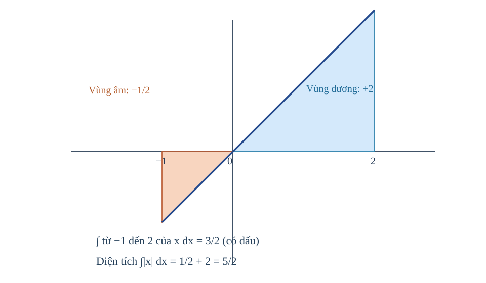
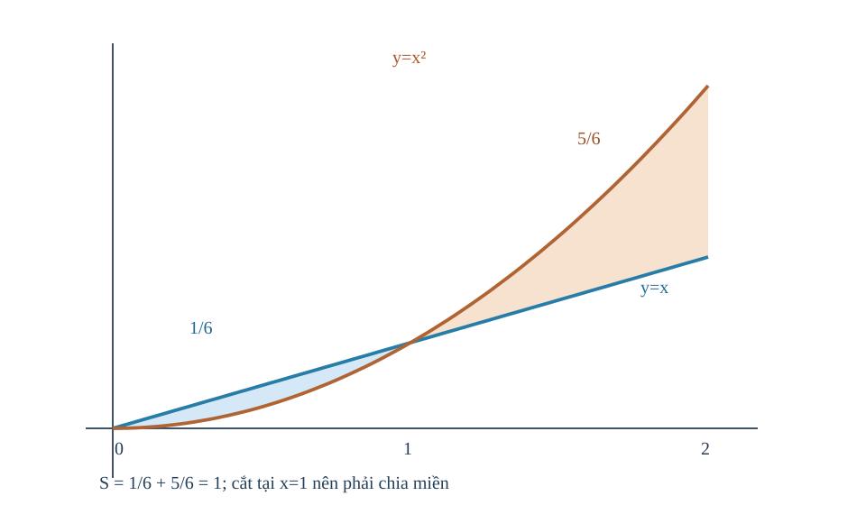
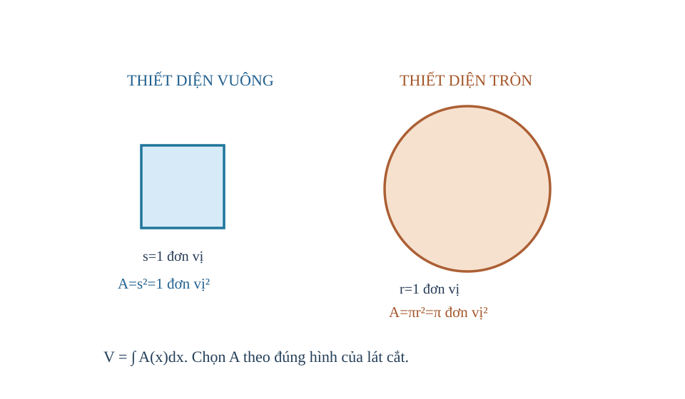
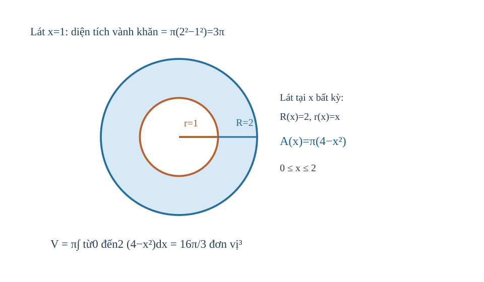

<!-- AUTHORING_ONLY_NOT_FOR_STUDENT_VIEW: CĐ11 current R06 canonical learner; R04/R05 previous revisions immutable in Git; source Q18 is separately signed. -->
<!-- AUTHORING_ONLY_NOT_FOR_STUDENT_VIEW: STANDARD_ID=SLM-THPT-QUALITY-ONE; STANDARD_VERSION=3.2.0; LEARNING_PATH=TOPIC; OUTER_PAGES=Kiến thức|Luyện tập|Tự kiểm tra; SOURCE_REVISION=R06_AUTHOR_SELF_Q18 -->
<!-- ORIGINAL88_SGK_BLOB=45722cd386a498f3e0e96a09928c85565af56d1b; ORIGINAL88_INDEX_BLOB=672fdce0c02ebf4f6ae6b37b331ca59e259d9b5c; NEW28_ACTIVE_R05_BLOB=6cee7cbfc89d503ce3102b5a1d693a15b9cce8c0 -->
# CĐ11 — Nguyên hàm, tích phân và ứng dụng hình học

# Kiến thức

## 1. Từ biết tốc độ biến đổi đến khôi phục đại lượng

Nếu một thiết bị đo cho ta vận tốc theo thời gian mà không cho trực tiếp vị trí, ta có thể hỏi: liệu có thể **khôi phục vị trí** từ vận tốc ấy không? Đạo hàm biến một đại lượng thành tốc độ biến đổi, còn nguyên hàm giúp đi ngược lại. Nhưng đi ngược không xác định ngay vị trí ban đầu: các hàm chỉ khác hằng số đều có cùng đạo hàm. Chính vì thế ta cần điều kiện đầu để chọn đúng một đại lượng.

Khi muốn biết đại lượng đã thay đổi bao nhiêu trong cả một quãng thời gian, ta cộng những thay đổi rất nhỏ thành **tích phân xác định**. Từ đây xuất hiện hai câu hỏi phải phân biệt: thay đổi ròng có thể dương hay âm, còn độ dài, diện tích hay thể tích **không thể âm**. Bài học đi từ nguyên hàm qua tích phân có dấu đến hình học lát cắt, không nhảy thẳng vào công thức diện tích và thể tích.

### 1.1. Nhận ra nguyên hàm từ đạo hàm

<!-- LESSON_ID: TOP11-M01; OUTCOME_ID: TOP11-O01 -->

Giả sử ta biết một đại lượng thay đổi nhanh thế nào, nhưng lại muốn tìm quy luật của chính đại lượng ấy. Đó là lúc ta đi ngược từ đạo hàm về **nguyên hàm**. 

> **ĐỊNH NGHĨA — Nguyên hàm.** Hàm \(F\) là một nguyên hàm của \(f\) trên một khoảng \(I\) nếu \(F'(x)=f(x)\) với mọi \(x\in I\). Trên một khoảng, nếu \(F\) là nguyên hàm thì họ nguyên hàm có dạng \(F(x)+C\), \(C\in\mathbb R\); phải phân biệt các thành phần miền rời.

Không chỉ trên khoảng mở: ta có thể xét nguyên hàm trên một khoảng, một nửa khoảng hoặc một đoạn \(K\). Chẳng hạn với \(K=[a,b]\), tại đầu \(a\) ta hiểu \(F'(a)=f(a)\) theo **đạo hàm bên phải**, còn tại đầu \(b\) theo **đạo hàm bên trái**; không đòi lấy đạo hàm ở phía nằm ngoài đoạn. Nếu \(f\) **liên tục trên một khoảng** thì \(f\) có ít nhất một nguyên hàm trên khoảng ấy; đây là điều kiện đủ bảo đảm tồn tại, không phải yêu cầu bắt buộc trong định nghĩa. Khi \(F'=f\), ký hiệu \(dF(x)=F'(x)\,dx=f(x)\,dx\) gọi là **vi phân** của \(F\); ký hiệu này mô tả quan hệ đạo hàm–nguyên hàm, không cho phép coi \(\int f(x)\,dx\) là phép nhân đại số tùy ý.

Ví dụ, với \(f(x)=4x^3+2\), ta nhận thấy \((x^4)'=4x^3\) và \((2x)'=2\), nên \(F(x)=x^4+2x\) là một nguyên hàm. Nhưng \(x^4+2x+5\) cũng có đạo hàm ấy, bởi đạo hàm của hằng số bằng 0. Vì thế khi hỏi **họ nguyên hàm**, ta phải viết \(F(x)=x^4+2x+C\). Hãy kiểm bằng cách lấy đạo hàm ngược; phép tích phân bất định không phải một phép nhân với ký hiệu \(dx\).

**Ví dụ**

**Đề bài:** Tìm mọi nguyên hàm của \(f(x)=9x^2-4x+1\) trên \(\mathbb R\).

**Lời giải:** Lấy nguyên hàm từng hạng tử: \(F(x)=3x^3-2x^2+x+C\). Kiểm tra \(F'(x)=9x^2-4x+1\) trên \(\mathbb R\). Hằng số \(C\) cần có vì đạo hàm của mọi hằng số bằng 0.

**Vận dụng** Tìm họ nguyên hàm của \(f(x)=8x^3-2\). Em kiểm lại được bằng đạo hàm không?

Đối chiếu

\(F(x)=2x^4-2x+C\). Đạo hàm của biểu thức này là \(8x^3-2\), đúng bằng \(f\). Nếu em quên \(+C\), hãy thử cộng thêm 5 vào nguyên hàm của mình rồi lấy đạo hàm: kết quả vẫn không đổi.

**Kiểm lỗi**

Nếu em chỉ thấy một nguyên hàm mà bỏ \(+C\), hoặc kết luận bằng cách nhìn dạng hàm, đọc **Kiến thức 1.1**, giải **Bài 3** (đạo hàm để kiểm) và **Bài 5** (tìm cả họ). Cứ lấy đạo hàm kết quả để đối chiếu với \(f\).

### 1.2. Một họ nguyên hàm và điều kiện đầu

<!-- LESSON_ID: TOP11-M02; OUTCOME_ID: TOP11-O02 -->

> **TÍNH CHẤT — Một họ nguyên hàm và điều kiện đầu.** Các nguyên hàm khác nhau bởi hằng số; điều kiện đầu chọn một hàm. Nếu hai hàm có cùng đạo hàm, số liệu ban đầu có chọn ra đúng một hàm không? Ta đã biết viết F₀(x)+C, biết a thuộc khoảng và F(a)=b. Nếu f liên tục trên một khoảng, mọi nguyên hàm khác nhau một hằng số trên khoảng ấy. Giá trị đầu F(a)=b cho phương trình F₀(a)+C=b, giải C; không áp dữ kiện ở một thành phần miền để khóa hằng trên thành phần tách rời. Hãy kiểm cả điều kiện và đạo hàm.

Chẳng hạn, \(F'(x)=3x^2-4\), \(F(1)=5\). Họ nguyên hàm là \(F(x)=x^3-4x+C\). Thay \(x=1\), ta được \(1-4+C=5\), suy ra \(C=8\). Vậy \(F(x)=x^3-4x+8\). Kiểm lại \(F'(x)=3x^2-4\) và \(F(1)=5\).

**Ví dụ**

**Đề bài:** Biết \(F'(x)=4x-3\) trên \(\mathbb R\) và \(F(2)=5\). Tìm \(F(x)\).

**Lời giải:** Từ \(F'\) suy ra \(F(x)=2x^2-3x+C\). Điều kiện \(F(2)=8-6+C=5\) cho \(C=3\), vậy \(F(x)=2x^2-3x+3\). Thế lại \(x=2\) và lấy đạo hàm để kiểm cả hai điều kiện.

**Vận dụng** \(F'(x)=2x+1\) và \(F(0)=7\): tìm \(F\).

Đối chiếu

\(F(x)=x^2+x+7\).

Nếu dùng \(F'(0)=7\), em đã dùng sai loại dữ kiện; \(F(0)\) mới là giá trị ban đầu.

**Kiểm lỗi**

Nếu em thay điều kiện \(F(a)\) thành \(F'(a)\) hoặc không tìm hằng \(C\), đọc **Kiến thức 1.2**, giải **Bài 8** rồi **Bài 10**. Phải thỏa đồng thời đạo hàm và giá trị ban đầu.

### 1.3. Nguyên hàm lũy thừa

<!-- LESSON_ID: TOP11-M03; OUTCOME_ID: TOP11-O03 -->

Từ định nghĩa, ta suy ra nguyên hàm lũy thừa và tổng. Vì sao n=−1 là trường hợp đặc biệt, còn các lũy thừa khác chia được cho n+1? Ta sử dụng đạo hàm của x^{n+1} và tính tuyến tính, miền x^n. 

> **CÔNG THỨC — Nguyên hàm lũy thừa.** Với \(n\ne-1\) và trên khoảng mà biểu thức thực \(x^n\) được xác định, \(\displaystyle\int x^n\,dx=\frac{x^{n+1}}{n+1}+C\). Trường hợp \(n=-1\) dùng \(\ln|x|+C\) trên từng khoảng tránh \(0\); không thay trực tiếp vào mẫu \(n+1=0\).

 Với αf+βg, nguyên hàm là αF+βG+C. Không để +C riêng từng hạng rồi tính thành nhiều hằng độc lập trong cùng một tổng.

Xét ví dụ: \(\int (6x^2-4x+3)\,\mathrm dx=2x^3-2x^2+3x+C\). Đạo hàm của \(2x^3\) là \(6x^2\), của \(-2x^2\) là \(-4x\) và của \(3x\) là \(3\). Kiểm từng hạng giúp tránh lỗi hệ số.

**Ví dụ**

**Đề bài:** Tính \(\int (2x^{5}-4x^{3}+6)\,\mathrm dx\).

**Lời giải:** Trên \(\mathbb R\), dùng tính tuyến tính và quy tắc lũy thừa. Một nguyên hàm của \(2x^5\) là \(\frac{x^6}{3}\), của \(-4x^3\) là \(-x^4\), của \(6\) là \(6x\). Kết quả \(F(x)=\frac{x^6}{3}-x^4+6x+C\). Lấy đạo hàm được \(F'(x)=2x^5-4x^3+6\).

**Vận dụng** \(\int (5x^{4}+2x)\,\mathrm dx\)=?

Đối chiếu

\(x^5+x^2+C\).

Nếu không chia hệ số mũ mới, kiểm đạo hàm ngược sẽ phát hiện hệ số dư.

**Kiểm lỗi**

Nếu em quên chia hệ số theo mũ mới khi tính nguyên hàm lũy thừa, đọc **Kiến thức 1.3**, làm **Bài 14** rồi **Bài 16**. Lấy đạo hàm ngược để phát hiện hệ số thiếu.

### 1.4. Nguyên hàm 1/x trên khoảng

<!-- LESSON_ID: TOP11-M04; OUTCOME_ID: TOP11-O04 -->

> **CÔNG THỨC — Nguyên hàm 1/x trên khoảng.** Nguyên hàm 1/x đặc biệt vì số mũ −1 làm mẫu công thức bằng 0. Tại sao ln|x| xuất hiện, và có thể dùng một C qua x=0 không? Ta bắt đầu từ logarit thực, (ln|x|)'=1/x khi x khác0, miền liên thông. Đạo hàm ln|x| bằng1/x với x≠0; vì vậy ∫dx/x=ln|x|+C trên từng khoảng (-∞,0) hoặc (0,+∞). Không có nguyên hàm liên tục vượt điểm 0 cho 1/x do hàm gốc không xác định ở đó. Trên miền rời có thể dùng C_- và C_+ khác nhau; một điều kiện tại −1 không xác định hằng ở nhánh dương.

Chẳng hạn, Trên x<0, ∫(3/x)dx=3ln(−x)+C. Lấy đạo hàm 3·(−1)/(−x)=3/x, đúng. Chọn ln(−x) vì −x>0 trên nhánh âm; ln x không hợp lệ.

**Ví dụ**

**Đề bài:** Tìm \(F(x)\) biết \(F'(x)=\frac{3}{x}\) trên \(x<0\) và \(F(-2)=7\).

**Lời giải:** Trên khoảng \((-\infty;0)\), \(F(x)=3\ln|x|+C=3\ln(-x)+C\). Thay \(x=-2\): \(3\ln 2+C=7\), nên \(C=7-3\ln 2\). Vậy \(F(x)=3\ln(-x)+7-3\ln 2\). Không dùng \(\ln x\) trên khoảng \(x<0\) hoặc nối qua \(x=0\).

**Vận dụng** \(F'(x)=\frac1x\) trên \(x<0\), \(F(-1)=2\). Tìm \(F(x)\).

Đối chiếu

\(F(x)=\ln(-x)+2\) trên \(x<0\).

Không viết \(\ln x\) khi \(x<0\); sau đó kiểm đạo hàm trước khi kết luận.

**Kiểm lỗi**

Nếu em dùng \(\ln x\) cho \(x<0\) hoặc ghép hằng số xuyên qua điểm \(x=0\) bị loại, đọc **Kiến thức 1.4**, làm **Bài 17** và **Bài 21**. Luôn chọn một khoảng xác định không qua 0.

### 1.5. Hàm mũ và hệ số bù

<!-- LESSON_ID: TOP11-M05; OUTCOME_ID: TOP11-O05 -->

> **CÔNG THỨC — Hàm mũ và hệ số bù.** Hàm mũ đòi hỏi hệ số bù theo đạo hàm của biểu thức trong. Nếu e^{2x} thay đổi nhanh gấp đôi lớp ngoài, phải sửa nguyên hàm bằng cách nào? Cần nhớ dây chuyền (e^{kx})'=k e^{kx}, (a^x)'=a^x ln a. Với k≠0, nguyên hàm e^{kx} là e^{kx}/k+C; với a>0,a≠1, nguyên hàm a^x là a^x/ln a+C. Hệ số bù chính là nghịch của hệ số khi đạo hàm. Không áp công thức lũy thừa x^n cho a^x, vì vị trí biến khác.

Chẳng hạn, \(\int (6e^{3x}+2^x)\,\mathrm dx\)=2e^{3x}+2^x/ln2+C. Đạo hàm ngược cho 6e^{3x}+2^x. Chọn đối chiếu quy tắc mũ và chain trước.

**Ví dụ**

**Đề bài:** Tính \(\int (3e^{3x}+2^x)\,\mathrm dx\).

**Lời giải:** Vì (e^{3x})′=3e^{3x} và (2^x/ln2)′=2^x (2>0,2≠1), họ nguyên hàm là e^{3x}+2^x/ln2+C. Kiểm đạo hàm để xác nhận hệ số bù.

**Vận dụng** Tìm \(\int 5e^{5x}\,\mathrm dx\).

Đối chiếu

e^{5x}+C.

Nếu ra 5e^{5x}, đạo hàm ngược sẽ cho 25e^{5x}, phải chia5.

**Kiểm lỗi**

Nếu em đạo hàm ngược \(e^{kx}\) hay \(a^x\) mà thiếu hệ số bù, đọc **Kiến thức 1.5**, làm **Bài 25** và **Bài 27**; phải dùng \(\ln a\) khi cơ số là \(a>0,a\ne1\).

### 1.6. Nguyên hàm lượng giác

<!-- LESSON_ID: TOP11-M06; OUTCOME_ID: TOP11-O06 -->

> **CÔNG THỨC — Nguyên hàm lượng giác.** Với lượng giác, kiểm dấu và đơn vị radian. Nguyên hàm sin và cos có luôn giữ nguyên dấu không? Để xác định điều đó, cần xét (sin x)'=cos x và (cos x)'=−sin x với x radian. \(\int \cos (kx)\,\mathrm dx\)=sin(kx)/k+C, \(\int \sin (kx)\,\mathrm dx\)=−cos(kx)/k+C khi k≠0 và góc radian. Dấu trừ của nguyên hàm sin đến từ đạo hàm cos. Không dùng công thức này nguyên dạng khi biến x là số đo độ; phải quy đổi đơn vị.

Từ hai đạo hàm \((\tan x)'=\dfrac{1}{\cos^2x}\) (khi \(\cos x\ne0\)) và \((\cot x)'=-\dfrac{1}{\sin^2x}\) (khi \(\sin x\ne0\)), ta còn hai nguyên hàm cơ bản mà chỉ học sin và cos sẽ bỏ sót:

\[
\int \frac{1}{\cos^2x}\,dx=\tan x+C\quad(\cos x\ne0),\qquad
\int \frac{1}{\sin^2x}\,dx=-\cot x+C\quad(\sin x\ne0).
\]

Mỗi công thức được áp dụng trên **một khoảng** không chứa điểm làm mẫu bằng 0. Chẳng hạn, trên khoảng \(0<x<\pi/2\), \(\int(2/\cos^2x-3/\sin^2x)\,dx=2\tan x+3\cot x+C\). Lấy đạo hàm của kết quả cho đúng \(2/\cos^2x-3/\sin^2x\); dấu cộng trước \(3\cot x\) đến từ \((\cot x)'=-1/\sin^2x\). Trên những khoảng xác định tách rời, hằng số \(C\) có thể khác nhau.

Chẳng hạn, \(\int (4\cos 2x+3\sin 3x)\,\mathrm dx\)=2sin2x−cos3x+C. Chọn đạo hàm ngược: 2·2cos2x=4cos2x; derivative −cos3x là+3sin3x.

**Ví dụ**

**Đề bài:** Tính \(\int (4\cos (2x)-3\sin (3x))\,\mathrm dx\), góc đo radian.

**Lời giải:** Ta có (2sin2x)′=4cos2x và (cos3x)′=−3sin3x. Vậy F=2sin2x+cos3x+C. Dùng radian và quy tắc dây chuyền khi lấy đạo hàm ngược.

**Vận dụng** \(\int 2\sin (2x)\,\mathrm dx\)?

Đối chiếu

−cos(2x)+C.

Nếu thiếu dấu âm, lấy đạo hàm cos(2x) là −2sin(2x) rồi sửa.

**Kiểm lỗi**

Nếu em mất dấu khi nguyên hàm \(\sin\) hoặc quên nhân hệ số góc theo radian, đọc **Kiến thức 1.6**, làm **Bài 30** rồi **Bài 32**. Lấy đạo hàm kết quả theo quy tắc dây chuyền.

### 1.7. Từ vận tốc khôi phục vị trí

<!-- LESSON_ID: TOP11-M07; OUTCOME_ID: TOP11-O07 -->

> **PHƯƠNG PHÁP — Từ vận tốc khôi phục vị trí.** Khi nguyên hàm là vị trí, điều kiện đầu mang nghĩa vật lý. Một đồ thị v(t) mô tả vận tốc, có xác định duy nhất vị trí s(t) chưa? Ta đã biết v=s'(t), nguyên hàm và điều kiện vị trí đầu s(t₀). Vận tốc có hướng v(t)=s'(t) giúp dựng lại vị trí s(t)=F(t)+C, nhưng C cần giá trị đầu. Tích phân v trên [a,b] cho **độ dời**, không phải luôn là tổng quãng đường. Đọc đơn vị: v (m/s), s (m), dv/dt gia tốc (m/s²).

Chẳng hạn, cho v(t)=4t−2 (m/s), s(0)=3m: s(t)=2t²−2t+3. Sau2 giây s(2)=8−4+3=7m. Kiểm đạo hàm s'=4t−2, đơn vị m/s. Chọn nguyên hàm rồi mới khóa C.

**Ví dụ**

**Đề bài:** Vận tốc có hướng v(t)=4t+1 m/s, t≥0, và s(1)=6 m. Tính s(2).

**Lời giải:** Vì s′=v, s(t)=2t²+t+C (m). s(1)=2+1+C=6 ⇒ C=3. Do đó s(2)=8+2+3=13 m. Cần điều kiện đầu để xác định s; tích phân vận tốc cho độ dời.

**Vận dụng** Vật chuyển động thẳng có vận tốc \(v(t)=6t\) (m/s), thời gian \(t\) tính bằng giây, vị trí ban đầu \(s(0)=1\) m. Tính vị trí \(s(1)\).

Đối chiếu

Vì \(s'(t)=v(t)\), ta có \(s(t)=3t^2+C\). Thế \(s(0)=1\) được \(C=1\); do đó \(s(1)=4\) m.

Nếu không có s(0), không thể nói vị trí tuyệt đối cụ thể.

**Kiểm lỗi**

Nếu em tích phân vận tốc để ra độ dời nhưng ghi ngay vị trí tuyệt đối không có dữ kiện đầu, đọc **Kiến thức 1.7**, làm **Bài 35** và **Bài 37**. Viết \(s'=v\), tìm hằng \(C\) từ vị trí đã biết rồi mới tính.

## 2. Từ các bước thay đổi nhỏ đến tích phân trên cả khoảng

Nếu vận tốc đổi theo thời gian, lấy một giá trị vận tốc nhân cả khoảng thời gian chỉ là ước lượng thô. Chia thời gian thành nhiều đoạn rất ngắn, cộng độ dời gần đúng trên từng đoạn rồi cho độ rộng đoạn giảm dần giúp ta hiểu **tích phân** là giới hạn của quá trình cộng dồn. Định lý cơ bản liên hệ tổng ấy với hiệu hai giá trị của một nguyên hàm; từ đó mới dùng các quy tắc đổi cận, tuyến tính và đổi biến có điều kiện.

Khi biến thiên diễn ra suốt một khoảng, tích phân cộng dồn các phần rất nhỏ. Nhờ nguyên hàm, ta tính được sự thay đổi ròng bằng hiệu tại hai cận, nhưng dấu của kết quả vẫn phụ thuộc vào chiều lấy tích phân và dấu của hàm.

### 2.1. Tích phân xác định và Newton–Leibniz

<!-- LESSON_ID: TOP11-M08; OUTCOME_ID: TOP11-O08 -->

Vì sao cùng nguyên hàm khác nhau C nhưng tích phân có cận vẫn là một số? Ta sử dụng F′=f trên đoạn [a,b] với F là một nguyên hàm, và f liên tục trên đoạn để áp dụng Newton–Leibniz. 

> **ĐỊNH NGHĨA — Tích phân xác định.** Với \(f\) liên tục trên đoạn \([a,b]\), chọn một nguyên hàm \(F\) của \(f\) trên đoạn ấy. **Tích phân của \(f\) từ \(a\) đến \(b\)** là số \(F(b)-F(a)\), ký hiệu \(\displaystyle\int_a^b f(x)\,dx\). Kết quả không phụ thuộc vào việc chọn nguyên hàm nào: nếu chọn \(F+C\) thì hai hằng số ở hai cận triệt tiêu. \(a\) là cận dưới, \(b\) là cận trên, \(f\) là hàm dưới dấu tích phân; khi đảo hai cận thì tích phân đổi dấu.

Như vậy định nghĩa giải thích **vì sao tích phân xác định là một số**, còn công thức Newton–Leibniz dưới đây là cách tính bằng một nguyên hàm. Trong một bài toán thực tế, đơn vị tích phân bằng đơn vị của \(f\) nhân với đơn vị của \(x\).

> **ĐỊNH LÝ — Newton–Leibniz.** Nếu \(f\) liên tục trên đoạn \([a,b]\), \(a<b\), và \(F\) liên tục trên \([a,b]\), khả vi trên \((a,b)\) với \(F'(x)=f(x)\) tại mọi \(x\in(a,b)\), thì \(\displaystyle\int_a^b f(x)\,dx=F(b)-F(a)\). Đây là **một số thực**, không có \(+C\).

 C bị triệt trong hiệu. Khác nguyên hàm bất định, tích phân xác định không thêm +C. Tên biến lấy tích phân là **ký hiệu thay chỗ**, nên nếu giữ đúng cùng hàm và cận thì \(\int_a^b f(x)\,dx=\int_a^b f(t)\,dt\); còn đổi hàm hay đổi cận thì nói chung đổi giá trị. Nếu hàm không liên tục/không xác định trên đoạn, không áp máy móc mà kiểm điều kiện.

Xét ví dụ: \(\int_{1}^{2} 4x^{3}\,\mathrm dx\)=[x⁴]₁²=16−1=15. Chọn nguyên hàm x⁴, kiểm đa thức liên tục trên [1,2]; nếu viết +C trong 15 sẽ biến kết quả số thành họ hàm vô nghĩa.

**Ví dụ**

**Đề bài:** Tính \(\int_{1}^{3} 4x\,\mathrm dx\) bằng nguyên hàm và cận.

**Lời giải:** f(x)=4x liên tục trên [1,3], F(x)=2x². Định lí Newton–Leibniz cho \(\int_{1}^{3} 4x\,\mathrm dx\)=F(3)−F(1)=18−2=16. Tích phân có cận là số, không thêm +C.

**Vận dụng** Tính \(\displaystyle\int_1^3 2x\,dx\). Viết rõ giá trị nguyên hàm ở cả hai cận.

Đối chiếu

\(\left[x^2\right]_1^3=3^2-1^2=8\). Nếu em ra 9, em mới thế cận trên mà quên trừ giá trị tại cận dưới.

Nếu chỉ thế cận trên, luôn nhắc hiệu F(b)−F(a).

**Kiểm lỗi**

Nếu em thêm \(+C\) vào tích phân có cận hoặc chỉ thế cận trên, đọc **Kiến thức 2.1**, làm **Bài 40** và **Bài 42**. Kiểm hàm liên tục trên đoạn và tính đúng \(F(b)-F(a)\).

### 2.2. Tính tuyến tính của tích phân

<!-- LESSON_ID: TOP11-M09; OUTCOME_ID: TOP11-O09 -->

> **TÍNH CHẤT — Tính tuyến tính của tích phân.** Tính tuyến tính cho phép gộp những tích phân có cận phù hợp. Vì sao có thể tách một biểu thức dài thành vài tích phân nhỏ? Ta bắt đầu từ phép cộng, hằng số và cùng cận [a,b]. ∫_a^b(αf+βg)=α∫_a^b f+β∫_a^b g khi các thành phần khả tích; tất cả dùng cùng cận. Tính tuyến tính không cho quyền thay cận tùy ý. Nếu một thành phần không xác định trên đoạn, phải xử lý vấn đề trước.

Chẳng hạn, \(\int_{0}^{1} (3x^{2}+2x+1)\,\mathrm dx\)=[x³+x²+x]₀¹=3. Có thể tách thành1+1+1. Chọn cách tổng từng thành phần vì số hạng là đa thức.

**Ví dụ**

**Đề bài:** Tính \(\int_{0}^{2} (3x^{2}-2x+4)\,\mathrm dx\) và giải thích phép tách.

**Lời giải:** Các đa thức đều khả tích trên [0,2]; dùng tuyến tính, F=x³−x²+4x. Giá trị là F(2)−F(0)=8−4+8=12. Cũng có thể tách thành ba tích phân và tính riêng từng tích phân **với cùng hai cận 0 và 2**:

\[
\int_0^2 3x^2\,dx-\int_0^2 2x\,dx+\int_0^2 4\,dx
=8-4+8=12.
\]

Hai cách hoàn toàn tương đương; không được tự ý thay cận của một số hạng mà không có phép biến đổi hợp lệ.

**Vận dụng** \(\int_{0}^{2} (2x+3)\,\mathrm dx\)?

Đối chiếu

[x²+3x]₀²=4+6=10.

Nếu ghép các tích phân khác cận mà không đổi cận, đó không phải quy tắc tuyến tính.

**Kiểm lỗi**

Nếu em tách biểu thức nhưng đổi nhầm cận hoặc không nhân hệ số, đọc **Kiến thức 2.2**, làm **Bài 45** và **Bài 47**. Quy tắc tuyến tính giữ nguyên cận cho các tích phân thành phần.

### 2.3. Đảo cận và ghép cận

<!-- LESSON_ID: TOP11-M10; OUTCOME_ID: TOP11-O10 -->

> **TÍNH CHẤT — Đảo cận và ghép cận.** Chiều lấy cận quyết định dấu tích phân. Đi ngược chiều tích lũy làm thay đổi dấu nhưng có làm diện tích âm không? Cần nhớ F(b)−F(a) với F′=f, và phép đổi dấu khi đảo hai cận. ∫_b^a f=−∫_a^b f, ∫_a^a f=0; nếu a≤c≤b, ∫_a^b f=∫_a^c f+∫_c^b f. Đây là **tích phân có hướng**, không đồng nhất với diện tích hình học. Quy tắc ghép cũng có thể dùng để chia tại nghiệm đổi dấu.

Chẳng hạn, \(\int_{2}^{0} (3x^{2}+1)\,\mathrm dx\)=−\(\int_{0}^{2} (3x^{2}+1)\,\mathrm dx\)=−10. Giá trị âm xuất phát đảo cận, không đại diện diện tích âm. Chọn đổi thứ tự cận trước thay số.

**Ví dụ**

**Đề bài:** Tính \(\int_{4}^{1} 2x\,\mathrm dx\) và so với \(\int_{1}^{4} 2x\,\mathrm dx\).

**Lời giải:** F=x². Theo chiều cận 4→1, \(\int_{4}^{1} 2x\,\mathrm dx\)=F(1)−F(4)=1−16=−15; cận đảo cho +15. Dấu âm là chiều tích lũy, không phải diện tích hình học âm.

**Vận dụng** Biết \(\int_1^3 f(x)\,dx=5\) và \(\int_3^5 f(x)\,dx=-2\), trong đó \(f\) liên tục trên \([1;5]\). Tính \(\int_1^5 f(x)\,dx\), \(\int_5^1 f(x)\,dx\) và \(\int_3^3 f(x)\,dx\).

Đối chiếu

Ghép tại \(3\): \(\int_1^5 f(x)\,dx=5+(-2)=3\). Đảo cận cho \(\int_5^1 f(x)\,dx=-3\); hai cận bằng nhau cho \(\int_3^3 f(x)\,dx=0\). Nếu em cộng thành 7, em đã thay số hạng âm bằng trị tuyệt đối, trong khi đề hỏi tích phân có dấu.

**Kiểm lỗi**

Nếu em quên dấu khi đảo cận hoặc ghép sai khoảng, đọc **Kiến thức 2.3**, làm **Bài 48** và **Bài 52**. Xác định đúng chiều cận và điểm nối trước khi cộng.

### 2.4. Từ tích lũy tới diện tích không âm

<!-- LESSON_ID: TOP11-M11; OUTCOME_ID: TOP11-O11 -->

> **CÔNG THỨC — Từ tích lũy tới diện tích không âm.** Diện tích dưới đồ thị bằng tích phân khi hàm không âm. Tại sao tổng các hình chữ nhật rất mỏng mô phỏng đúng diện tích cong? Để xác định điều đó, cần xét đồ thị liên tục và không âm, dải đứng rộng dx. Nếu f(x)≥0 liên tục trên [a,b], diện tích vùng giữa đồ thị, Ox, hai đường x=a,b bằng \(\int_{a}^{b} f(x)\,\mathrm dx\). Ý nghĩa là giới hạn tổng diện tích dải hẹp f(x)dx. Nếu f đổi dấu, tích phân cho phần diện tích đại số chứ không phải tổng vùng.

Chẳng hạn, y=2x trên [0,2] không âm: S=\(\int_{0}^{2} 2x\,\mathrm dx\)=[x²]₀²=4, đúng diện tích tam giác đáy2 cao4 là4. Hai phương pháp kiểm chéo bản chất.

**Ví dụ**

**Đề bài:** Tính diện tích hình phẳng dưới y=2x+1 trên [0,2].

**Lời giải:** Vì f=2x+1≥1>0 và liên tục trên đoạn, S=\(\int_{0}^{2} (2x+1)\,\mathrm dx\)=[x²+x]₀²=4+2=6 đơn vị diện tích. Dùng diện tích bằng tích phân vì đồ thị nằm trên Ox.

**Vận dụng** Diện tích dưới y=x² trên [0,1]?

Đối chiếu

\(\int_{0}^{1} x^{2}\,\mathrm dx\)=1/3 đơn vị².

Nếu trả diện tích âm, kiểm f có âm trên đoạn hay không.

**Kiểm lỗi**

Nếu em coi tích phân âm là diện tích âm, hoặc bỏ kiểm dấu \(f\), đọc **Kiến thức 2.4**, làm **Bài 55** và **Bài 57**. Diện tích hình học yêu cầu hàm không âm trên đoạn, hoặc phải tách theo dấu.

### 2.5. Phân biệt độ dời và quãng đường

<!-- LESSON_ID: TOP11-M12; OUTCOME_ID: TOP11-O12 -->

Độ dời khác quãng đường vì tích phân có dấu có thể triệt tiêu. Một vận tốc đổi dấu có thể cho độ dời bằng0 nhưng quãng đường khác0? Ta đã biết dấu f, nghiệm f=0, ∫f và ∫|f|. Tích phân ∫f là phần có dấu; ∫|f| là tổng độ lớn không âm. Diện tích hình học giữa Ox và đồ thị dùng ∫|f|; quãng đường khi v là vận tốc có hướng dùng ∫|v|, còn độ dời dùng ∫v. Tìm nghiệm đổi dấu và chia đoạn trước khi lấy trị tuyệt đối từng phần. Không lấy |∫f| thay ∫|f|.

Chẳng hạn, v(t)=t−1 trên [0,2]: ∫v=0, nhưng ∫|v|=∫₀¹(1−t)+∫₁²(t−1)=1. Tại t=1 vật đổi chiều; diện tích hai tam giác 1/2+1/2=1.

> **PHƯƠNG PHÁP — Phân biệt độ dời và quãng đường.** Một ví dụ **khác đúng với hình** là \(f(x)=x\) trên đoạn \([-1,2]\). Trên \([-1,0]\), đồ thị nằm dưới trục nên tích phân đóng góp \(-1/2\); trên \([0,2]\), vùng tam giác phía trên có diện tích 2 và đóng góp \(+2\). Vì thế \(\int_{-1}^{2}x\,dx=3/2\), nhưng **diện tích hình học** của hai vùng là \(1/2+2=5/2\). Trong bài vận tốc \(v(t)=t-1\) trên \([0,2]\) vừa xét, hai số tương ứng là 0 và 1; không được đọc kết quả của hình này thành kết quả bài đó.

*Đọc hình:* Đây là \(y=x\) trên \([-1,2]\), đổi dấu tại \(x=0\). Hai vùng tam giác có diện tích lần lượt \(1/2\) và 2, nên phần dưới góp số **âm** vào tích phân nhưng vẫn là diện tích **dương** khi cộng diện tích hình học.

**Ví dụ**

**Đề bài:** Với f(x)=x−1 trên [0,4], tính tích phân có dấu và diện tích hình học.

**Lời giải:** f đổi dấu ở x=1. Tích phân có dấu \(\int_{0}^{4} (x-1)\,\mathrm dx\)=[x²/2−x]₀⁴=4. Diện tích phải tách: \(\int_{0}^{1} (1-x)\,\mathrm dx\)=1/2 và \(\int_{1}^{4} (x-1)\,\mathrm dx\)=9/2, tổng S=5. Không lấy |4| thay ∫|f|.

**Vận dụng** Một vật chuyển động thẳng với vận tốc có hướng \(v(t)=2-t\) (m/s), \(0\le t\le5\) giây. Tìm thời điểm đổi chiều, độ dời và tổng quãng đường của vật.

Đối chiếu

Vận tốc bằng 0 tại \(t=2\), dương trước 2 và âm sau 2 nên vật đổi chiều tại đó. Độ dời là

\[
\int_0^5(2-t)\,dt=\left[2t-\frac{t^2}2\right]_0^5=-\frac52\ \text{m}.
\]

Hai phần quãng đường là \(\int_0^2(2-t)\,dt=2\) m và \(\int_2^5(t-2)\,dt=\frac92\) m. Tổng quãng đường \(\frac{13}2\) m. Nếu lấy \(\frac52\) m, em mới lấy trị tuyệt đối của độ dời, chưa cộng quãng đường ở cả hai chiều.

**Kiểm lỗi**

Nếu em lấy trị tuyệt đối của **một** tích phân có dấu làm quãng đường/diện tích khi hàm đổi dấu, đọc **Kiến thức 2.5**, làm **Bài 58** và **Bài 62**. Tách các khoảng tại điểm đổi dấu, tích phân \(|f|\) hoặc \(|v|\).

### 2.6. Tích phân lượng giác

<!-- LESSON_ID: TOP11-M13; OUTCOME_ID: TOP11-O13 -->

> **CÔNG THỨC — Tích phân lượng giác.** Sin, cos và mũ dùng cùng nguyên tắc thế cận sau nguyên hàm. Một biểu thức lượng giác hoặc hàm mũ vẫn tính bằng F(b)−F(a) được không? Ta sử dụng hàm e^x, sin/cos liên tục trên đoạn, góc radian. Nếu f liên tục, quy tắc Newton–Leibniz không phụ thuộc biểu thức có là đa thức hay không. Nguyên hàm cos x là sin x+C, nguyên hàm sin x là −cos x+C (góc radian), và nguyên hàm e^x là e^x+C. Lấy giá trị hai cận đúng, kiểm sinh ra số và dấu. Với e^{kx}, chia k khi tìm nguyên hàm.

Xét ví dụ: \(\int_{0}^{\ln 3} e^x\,\mathrm dx\)=e^{ln3}−1=2. Chọn F=e^x vì d(e^x)=e^x, cận ln3 cho giá trị hữu hạn. Không viết ln3 thành3 ở cận x.

**Ví dụ**

**Đề bài:** Tính \(\int_{0}^{\pi} \sin  x\,\mathrm dx\) khi góc đo radian.

**Lời giải:** Hàm sin liên tục, F=−cos x. \(\int_{0}^{\pi} \sin  x\,\mathrm dx\)=[−cos x]₀^π=1−(−1)=2. Dùng radian; kết quả khác việc coi góc theo độ.

**Vận dụng** \(\int_{0}^{\frac{\pi}{2}} \sin  x\,\mathrm dx\)?

Đối chiếu

[−cos x]₀^{π/2}=−0−(−1)=1.

Nếu thay cận góc độ mà không quy đổi, xem lại giả thiết radian.

**Kiểm lỗi**

Nếu em quên đạo hàm \(-\cos x\) bằng \(\sin x\) hoặc thế cận góc độ vào công thức radian, đọc **Kiến thức 2.6**, giải **Bài 64** và **Bài 68**. Chọn nguyên hàm đúng trước khi tính hiệu giá trị tại cận.

### 2.7. Tích lũy từ tốc độ biến thiên

<!-- LESSON_ID: TOP11-M14; OUTCOME_ID: TOP11-O14 -->

> **PHƯƠNG PHÁP — Tích lũy từ tốc độ biến thiên.** Tích phân từ tốc độ cho lại lượng tích lũy. Biết tốc độ cuối khoảng có suy được lượng tích lũy bằng 'tốc độ cuối×thời gian'? Ta bắt đầu từ tốc độ biến thiên r(t) và tích phân của r. Nếu Q'(t)=r(t), lượng biến đổi ròng Q(b)−Q(a)=\(\int_{a}^{b} r(t)\,\mathrm dt\). Khi r không hằng, dùng r(b)(b−a) thường sai; diện tích dưới đồ thị tốc độ phản ánh toàn thời gian. Đơn vị r là lượng/giây, sau tích phân là lượng. Với r đổi dấu, diễn giải ròng.

Chẳng hạn, Lưu lượng r(t)=2t lít/phút trên [0,2]: Q(2)−Q(0)=\(\int_{0}^{2} 2t\,\mathrm dt\)=4 lít, không phải r(2)·2=8 lít. Chọn dải tốc độ thay đổi thay vì một mức cuối.

**Ví dụ**

**Đề bài:** Một vật chuyển động thẳng với vận tốc có hướng v(t)=5−2t (m/s) trong 0≤t≤2 giây. Tính độ dời của vật.

**Lời giải:** Độ dời s(2)−s(0)=\(\int_{0}^{2} v(t)\,\mathrm dt\)=\(\int_{0}^{2} (5-2t)\,\mathrm dt\)=[5t−t²]₀²=10−4=6 m. Không tính bằng v(2)·2=2 m vì vận tốc không hằng; trên [0,2] có v(t)≥1 m/s nên quãng đường cũng bằng 6 m.

**Vận dụng** Một vật có vận tốc có hướng v(t)=3t² (m/s) trong 0≤t≤1 giây. Độ dời là bao nhiêu?

Đối chiếu

Độ dời bằng \(\int_{0}^{1} 3t^{2}\,\mathrm dt\)=1 m.

Nếu kết quả còn đơn vị m/s, em chưa tích phân theo thời gian (giây).

**Kiểm lỗi**

Nếu em lấy giá trị vận tốc cuối nhân tổng thời gian, hoặc không đổi đơn vị m/s theo giây thành mét, đọc **Kiến thức 2.7**, làm **Bài 71** và **Bài 73**. Độ dời là \(\int v(t)dt\); quãng đường mới cần \(\int|v(t)|dt\).

## 3. Từ tổng có dấu đến diện tích hình học không âm

Một vật đi về phía phải rồi quay lại có thể có **độ dời ròng bằng 0** dù đã đi một quãng đường dương. Tích phân của vận tốc giữ dấu nên các phần dương/âm có thể triệt tiêu; quãng đường thì phải cộng **độ lớn** của từng phần. Diện tích hình học cũng vậy: ta cần biết đồ thị nằm trên hay dưới trục, hoặc đường nào nằm trên đường nào, trước khi đưa ra công thức tích phân. Khi hai đường cắt nhau, phải chia khoảng tại nơi chúng đổi thứ tự.

Diện tích hình học không thể âm. Vì vậy, khi đồ thị đổi phía so với trục Ox hoặc hai đường cắt nhau, ta cần chia miền và cộng những phần dương, không dùng ngay tích phân đại số của một hiệu xuyên suốt.

### 3.1. Diện tích dưới hàm căn

<!-- LESSON_ID: TOP11-M15; OUTCOME_ID: TOP11-O15 -->

> **PHƯƠNG PHÁP — Diện tích dưới hàm căn.** Diện tích dưới √x tính khác hình chữ nhật vì chiều cao thay đổi thế nào? Cần nhớ hàm căn trên x≥0, f≥0 và nguyên hàm x^{1/2}. Nếu y=√x trên [a,b] với 0≤a<b, f liên tục, không âm, S=∫_a^b√x dx= (2/3)[x^{3/2}]_a^b. Không lấy cận âm để làm phép nguyên hàm trên số thực. Hình phẳng được mô tả bằng hai đường dọc x=a,b, Ox và đồ thị.

Chẳng hạn, S dưới y=√x trên [0,1]: ∫₀¹x^{1/2}dx=2/3 đơn vị². Kiểm với hình 1×1 có đường √x nằm trong hình nên diện tích <1.

Không phải mọi hình phẳng có hàm căn đều cần tìm nguyên hàm bằng công thức. Chẳng hạn, đồ thị \(y=\sqrt{4-x^2}\), \(-2\le x\le2\), chính là **nửa đường tròn phía trên** của đường tròn \(x^2+y^2=4\): bình phương hai vế được phương trình đường tròn, còn dấu \(y\ge0\) chọn nửa trên. Do đó, diện tích dưới đồ thị từ \(-2\) tới \(2\) là nửa diện tích hình tròn bán kính \(2\).

> **PHƯƠNG PHÁP — Nhận diện diện tích hình học.** Với \(R>0\), \(\displaystyle\int_{-R}^{R}\sqrt{R^2-x^2}\,dx=\frac{\pi R^2}{2}\), vì đó là nửa hình tròn phía trên trục \(Ox\). Chỉ dùng trực tiếp khi **cận và miền thật sự khớp** nửa đường tròn; nếu cận chỉ lấy một phần, cần xác định hình quạt/hình tương ứng hoặc dùng phương pháp phù hợp.

**Ví dụ minh họa.** Tính \(\displaystyle\int_{-2}^{2}\sqrt{4-x^2}\,dx\). Đường cong là nửa đường tròn tâm \(O\), bán kính \(2\) và nằm trên trục hoành. Vậy tích phân bằng diện tích của nửa hình tròn: \(\frac12\pi\cdot2^2=2\pi\). Không thay nhầm số \(4\) dưới căn thành bán kính \(4\).

**Ví dụ**

**Đề bài:** Tính diện tích dưới y=√x trên [1,4].

**Lời giải:** Hàm √x liên tục, không âm khi x≥0. S=∫₁⁴x^{1/2}dx=(2/3)[x^{3/2}]₁⁴=(2/3)(8−1)=14/3 đơn vị diện tích. Phải kiểm cận không âm.

**Vận dụng** S dưới y=√x trên [0,9]?

Đối chiếu

(2/3)9^{3/2}=(2/3)27=18 đơn vị².

Nếu coi √x như x², phải đổi thành x^{1/2} trước tính.

**Kiểm lỗi**

Nếu em áp dụng công thức nguyên hàm \(x^2\) cho \(\sqrt{x}\) hoặc bỏ miền \(x\ge0\), đọc **Kiến thức 3.1**, làm **Bài 74** và **Bài 78**. Đổi \(\sqrt{x}=x^{1/2}\) rồi kiểm cận và đơn vị diện tích.

### 3.2. Diện tích đổi dấu qua trục

<!-- LESSON_ID: TOP11-M16; OUTCOME_ID: TOP11-O16 -->

Khi đồ thị cắt trục, cần chia miền và cộng diện tích. Khi đường cong chạy qua trục Ox, những mảnh phía dưới có phải trừ khỏi diện tích? Để xác định điều đó, cần xét nghiệm của f(x)=0, dấu f trên mỗi khoảng và ∫|f|. 

> **CÔNG THỨC — Diện tích hình phẳng so với trục Ox.** Nếu \(f\) liên tục trên \([a,b]\) thì diện tích hình phẳng giới hạn bởi đồ thị, trục \(Ox\) và các đường \(x=a,x=b\) là \(\displaystyle S=\int_a^b|f(x)|\,dx\). Nếu \(f\) đổi dấu, chia đoạn ở các nghiệm trước khi tính; không lấy \(\left|\int_a^b f(x)\,dx\right|\) thay thế nói chung.

 Nếu f đổi dấu, chia tại tất cả nghiệm trong đoạn và đổi dấu tích phân tương ứng; nếu f không âm xuyên đoạn, không cần chia. Diện tích luôn ≥0 và có đơn vị²; không dùng |∫f| trừ khi f giữ dấu.

Chẳng hạn, f(x)=x trên [−2,2]: tích phân có dấu0, nhưng S=\(\int_{-2}^{0} (-x)\,\mathrm dx\)+\(\int_{0}^{2} x\,\mathrm dx\)=2+2=4. Chọn mốc x=0 vì đường cắt Ox ở đó.

**Ví dụ**

**Đề bài:** Với y=x²−1 trên [−2,2], tính tích phân có dấu và diện tích giữa đồ thị với Ox.

**Lời giải:** Hàm đổi dấu ở x=−1 và x=1. Tích phân có dấu \(\int_{-2}^{2} (x^{2}-1)\,\mathrm dx\)=[x³/3−x]₋₂²=4/3. Diện tích: hai mảnh ngoài mỗi mảnh \(\int_{1}^{2} (x^{2}-1)\,\mathrm dx\)=4/3 và mảnh giữa \(\int_{-1}^{1} (1-x^{2})\,\mathrm dx\)=4/3, nên S=4. Không lấy |∫f| làm diện tích.

**Vận dụng** Tính diện tích hình phẳng giữa \(y=2x-2\) và trục hoành trên \([0;3]\). Tự tìm mốc chia đoạn.

Đối chiếu

Hàm bằng 0 tại \(x=1\), âm trên \([0;1)\) và dương trên \((1;3]\). Diện tích là \(\int_0^1(2-2x)\,dx+\int_1^3(2x-2)\,dx=1+4=5\) đơn vị diện tích. Tích phân có dấu chỉ bằng \(-1+4=3\); hai mảnh diện tích không triệt tiêu nhau.

**Kiểm lỗi**

Nếu em cho phép hai phần hình nằm trên/dưới Ox triệt tiêu thành diện tích 0, đọc **Kiến thức 3.2**, làm **Bài 79** và **Bài 83**. Tìm mọi nghiệm \(f(x)=0\), tách đoạn và tích phân \(|f|\).

### 3.3. Diện tích giữa hai đường

<!-- LESSON_ID: TOP11-M17; OUTCOME_ID: TOP11-O17 -->

> **CÔNG THỨC — Diện tích giữa hai đường.** Giữa hai đường, phải xét đường trên trước. Lấy 'trên−dưới' vì sao cho diện tích dải đứng không âm? Ta đã biết đồ thị liên tục f,g trên [a,b] và dấu f−g. Nếu f(x)≥g(x) trên cả đoạn, dải đứng có chiều cao f−g≥0; diện tích S=\(\int_{a}^{b} (f-g)\,\mathrm dx\). Kiểm bằng một điểm thử trong mỗi khoảng có thể đổi thứ tự; nếu f−g không giữ dấu, chuyển sang bài chia miền. Đơn vị².

Chẳng hạn, Trên [0,1], f=2, g=x², rõ 2>x², S=\(\int_{0}^{1} (2-x^{2})\,\mathrm dx\)=2−1/3=5/3. Chọn đường trên y=2 rồi trừ y=x²; kết quả dương.

**Ví dụ**

**Đề bài:** Tính diện tích giữa y=2x+1 và y=x+1 trên [0,2].

**Lời giải:** Hiệu (2x+1)−(x+1)=x≥0 trên [0,2], nên đường thứ nhất nằm trên. S=\(\int_{0}^{2} x\,\mathrm dx\)=[x²/2]₀²=2 đơn vị diện tích. Chọn trên−dưới thay vì cộng hai tích phân.

**Vận dụng** S giữa y=3 và y=x trên [0,2]?

Đối chiếu

\(\int_{0}^{2} (3-x)\,\mathrm dx\)=4.

Nếu hiệu âm, hãy kiểm đã trừ đúng 'trên−dưới'.

**Kiểm lỗi**

Nếu em lấy đường dưới trừ đường trên hoặc bỏ kiểm vị trí đường cong, đọc **Kiến thức 3.3**, làm **Bài 84** và **Bài 88**. Kiểm dấu hiệu hai hàm trên từng khoảng để chọn \(\int(\text{trên}-\text{dưới})dx\).

### 3.4. Hai đường đổi thứ tự

<!-- LESSON_ID: TOP11-M18; OUTCOME_ID: TOP11-O18 -->

> **PHƯƠNG PHÁP — Hai đường đổi thứ tự.** Khi hai đường giao, thứ tự có thể đổi trong đoạn. Một giao điểm nằm trong [a,b] có thể đổi thứ tự hai đường ra sao? Ta sử dụng phương trình f=g, dấu f−g, tích phân trị tuyệt đối. Tính diện tích giữa hai đường trên [a,b] bằng \(\int_{a}^{b} |f-g|\,\mathrm dx\); giải điểm giao, chia tại nghiệm trong khoảng, kiểm đường nào trên mỗi mảnh. Các diện tích không âm phải **cộng**, không cộng tích phân có dấu chưa đổi. Không cần chia tại điểm chạm không đổi dấu, nhưng phải kiểm.

Xét ví dụ: f=x,g=x² trên [0,2], giao x=0,1. Trên (0,1) x>x², trên (1,2) x²>x: S=1/6+5/6=1. Trong khi ∫₀²(x−x²)=−2/3, minh họa sai nếu không chia.

*Quan sát hình:* Trên [0,1] lấy x−x², trên [1,2] lấy x²−x. Hai diện tích là 1/6 và 5/6, nên tổng1 không phải trị tuyệt đối của tích phân có dấu.

**Ví dụ**

**Đề bài:** Tính diện tích giữa y=3x và y=x² trên [0,4]; cần chia ở đâu?

**Lời giải:** Hai đường giao khi x²=3x, tức x=0 và x=3. Trên (0,3) 3x>x², trên (3,4) x²>3x. S=\(\int_{0}^{3} (3x-x^{2})\,\mathrm dx\)+\(\int_{3}^{4} (x^{2}-3x)\,\mathrm dx\)=9/2+11/6=19/3. Không lấy trị tuyệt đối của một tích phân duy nhất.

**Vận dụng** Tính diện tích giữa \(y=2x\) và \(y=x^2\) trên đoạn \([0,3]\). Vì sao phải chia miền tại một giao điểm ở trong đoạn?

Đối chiếu

Giải \(2x=x^2\) được \(x=0\) và \(x=2\). Trên \([0,2]\), \(2x\ge x^2\); trên \([2,3]\), \(x^2\ge2x\). Vì thế \(S=\int_0^2(2x-x^2)dx+\int_2^3(x^2-2x)dx=4/3+4/3=8/3\). Nếu em lấy ngay \(\left|\int_0^3(2x-x^2)dx\right|\), hai phần trái dấu sẽ bị triệt và không cho diện tích thực.

**Kiểm lỗi**

Nếu em dùng một hiệu có dấu xuyên qua giao điểm đổi thứ tự của hai đường, đọc **Kiến thức 3.4**, làm **Bài 89** và **Bài 93**; thử thêm **Bài 94** để lập hai tích phân đúng chiều. Diện tích phải cộng trị dương từng mảnh.

### 3.5. Mô hình diện tích từ giao điểm

<!-- LESSON_ID: TOP11-M19; OUTCOME_ID: TOP11-O19 -->

> **PHƯƠNG PHÁP — Mô hình diện tích từ giao điểm.** Mô hình diện tích cần đúng giao điểm, cận và đơn vị. Vì sao phải tìm đường biên và giao điểm trước khi bấm nguyên hàm? Ta bắt đầu từ hình phẳng bị chặn, giải f=g và kiểm miền các nhánh. Lập mô hình: xác định ranh giới và trục, chọn biến theo chiều lát cắt, giải giao điểm thực nằm trong miền, kiểm thứ tự trên/dưới, tính tích phân diện tích, ghi đơn vị². Có khi hai đường không tạo miền kín nếu thiếu cận hoặc không có điểm giao thứ hai; không tự tạo cận 0,1 từ hình tưởng tượng.

Chẳng hạn, cho y=2x và y=x²: giao x=0 và2, trên (0,2) 2x≥x² nên S=\(\int_{0}^{2} (2x-x^{2})\,\mathrm dx\)=4/3 đơn vị². Chọn cận 0..2 từ phương trình chứ không từ dáng đồ thị.

**Ví dụ**

**Đề bài:** Tìm diện tích hình phẳng giới hạn bởi y=2−x² và y=x giữa hai giao điểm.

**Lời giải:** Giải 2−x²=x ⇒ x²+x−2=0 ⇒ x=−2 và x=1. Trên (−2,1) hiệu 2−x²−x>0 (thử x=0). S=\(\int_{-2}^{1} (2-x^{2}-x)\,\mathrm dx\)=[2x−x³/3−x²/2]₋₂¹=9/2 đơn vị diện tích. Các cận do giao điểm quyết định.

**Vận dụng** Hai đồ thị \(y=4-x^2\) và \(y=0\) tạo thành một hình phẳng bị chặn. Tự tìm hai giao điểm, xác định đường nằm trên giữa chúng rồi tính diện tích.

Đối chiếu

Giải \(4-x^2=0\), được \(x=-2\) hoặc \(x=2\). Trên \((-2;2)\), \(4-x^2>0\), nên parabol nằm trên trục hoành. Vậy \(S=\int_{-2}^{2}(4-x^2)\,dx=\left[4x-\dfrac{x^3}{3}\right]_{-2}^{2}=\dfrac{32}{3}\) đơn vị diện tích. Hai cận phải đến từ giao điểm; không lấy lại cận của ví dụ đã học.

**Kiểm lỗi**

Nếu em lấy cận theo cảm tính thay vì giải giao điểm, hoặc quên miền của mô hình, đọc **Kiến thức 3.5**, làm **Bài 95** và **Bài 99**. Giao điểm cùng điều kiện đề mới xác định cận và miền diện tích.

## 4. Khi mỗi lát cắt có diện tích, toàn khối có thể tích

Đối với một khối ba chiều, ta không cộng chiều cao theo từng lát mà cộng **diện tích mặt cắt nhân độ dày**. Hình cắt là hình vuông thì dùng cạnh bình phương; hình tròn thì dùng \(\pi r^2\); nếu quay một miền có lỗ quanh trục, mặt cắt là vành khăn và phải trừ **diện tích hai đĩa**. Việc xác định đúng mặt cắt, trục quay, miền và đơn vị quyết định công thức, không có một hệ số \(\pi\) dùng chung cho mọi bài thể tích.

Mỗi lát cắt mỏng của một khối có diện tích riêng; cộng chúng bằng tích phân cho thể tích. Công thức chỉ đúng khi chọn đúng hình tiết diện — hình vuông, hình tròn, hay vành khăn khi quay quanh một trục.

### 4.1. Thể tích từ thiết diện vuông

<!-- LESSON_ID: TOP11-M20; OUTCOME_ID: TOP11-O20 -->

Nếu mỗi lát mỏng đã biết diện tích, tổng lát cho thể tích như thế nào? Cần nhớ tiết diện A(x)≥0 có đơn vị diện tích, độ dày dx. Với khối được xác định trên [a,b], diện tích thiết diện vuông góc Ox tại x là A(x), V=\(\int_{a}^{b} A(x)\,\mathrm dx\) (khi hàm diện tích thiết diện A liên tục trên [a,b]). Chọn công thức A theo **hình dạng tiết diện thật**: vuông thì s², tròn thì πr², hình khác có công thức khác. Không thêm π nếu không phải mặt cắt tròn.

Chẳng hạn, Tiết diện vuông cạnh 2x trên [0,1] (đơn vị cm): A=4x² cm², V=\(\int_{0}^{1} 4x^{2}\,\mathrm dx\)=4/3 cm³. Chọn vuông nên không có π.

> **CÔNG THỨC — Thể tích từ thiết diện vuông.** Hình minh họa **hai lát cắt có cùng độ dài tham chiếu bằng 1**, không phải các thiết diện cạnh \(2x\) của ví dụ tính \(4/3\) vừa giải. Nếu cạnh hình vuông \(s=1\), diện tích là \(s^2=1\); nếu bán kính hình tròn \(r=1\), diện tích là \(\pi r^2=\pi\). Bởi vậy phải xác định hình dạng mặt cắt **trước** khi lập \(V=\int A(x)\,dx\): khác hình, khác diện tích dù dùng cùng một số đo chiều dài.

*Đọc hình:* Lát vuông có cạnh1 nên diện tích1; lát tròn có bán kính1 nên diện tích \(\pi\). Đây là so sánh **đơn vị diện tích lát**, không phải hai khối có thể tích bằng nhau.

Từ công thức thiết diện, ta còn có thể **tự suy ra thể tích khối chóp cụt**, không phải học thuộc một công thức không có nguồn gốc. Xét khối chóp cụt có hai đáy đồng dạng diện tích \(S_0\) và \(S_1\), chiều cao \(h>0\). Đặt \(x\) là khoảng cách từ đáy thứ nhất (\(0\le x\le h\)). Vì các thiết diện song song với đáy đồng dạng, kích thước dài thay đổi tuyến tính, nên căn bậc hai diện tích thiết diện biến thiên tuyến tính:
\[
\sqrt{A(x)}=\sqrt{S_0}+\frac{x}{h}(\sqrt{S_1}-\sqrt{S_0}).
\]
Bình phương rồi lấy tích phân từ \(0\) đến \(h\) cho thể tích.

> **CÔNG THỨC — Thể tích khối chóp cụt.** Với hai đáy đồng dạng diện tích \(S_0,S_1\ge0\) và chiều cao \(h>0\), thể tích là \(\displaystyle V=\frac h3(S_0+\sqrt{S_0S_1}+S_1)\). Khi một đáy thu về đỉnh (\(S_1=0\)), nhận được công thức khối chóp \(V=\frac h3S_0\). Cần đúng giả thiết các tiết diện đồng dạng và kích thước biến thiên tuyến tính theo chiều cao.

**Ví dụ minh họa.** Một khối chóp cụt đều có hai đáy diện tích \(9\) và \(36\) cm², cao \(6\) cm. Thể tích là \(V=\frac63(9+\sqrt{9\cdot36}+36)=2(9+18+36)=126\) cm³. Cách suy từ diện tích thiết diện giải thích hạng căn \(\sqrt{S_0S_1}\), không phải cộng tùy ý hai diện tích đáy.

**Ví dụ**

**Đề bài:** Một khối có tiết diện vuông cạnh s(x)=2x+1 cm, x∈[0,1] cm. Tính thể tích.

**Lời giải:** Diện tích mặt cắt A(x)=(2x+1)²=4x²+4x+1 cm². V=\(\int_{0}^{1} A(x)\,\mathrm dx\)=4/3+2+1=13/3 cm³. Không nhân π vì tiết diện là hình vuông.

**Vận dụng** Tiết diện vuông cạnh 3 không đổi, đoạn dài2: thể tích?

Đối chiếu

9·2=18 đơn vị³.

Nếu dùng 3 thay cho9, bạn lấy cạnh làm diện tích.

**Kiểm lỗi**

Nếu em lấy chiều dài cạnh hình vuông làm diện tích, hoặc nhân thêm \(\pi\) dù thiết diện là vuông, đọc **Kiến thức 4.1**, làm **Bài 100** và **Bài 104**. Phải lập \(A(x)=s(x)^2\) rồi tích phân theo chiều dài.

### 4.2. Thể tích từ tiết diện tròn

<!-- LESSON_ID: TOP11-M21; OUTCOME_ID: TOP11-O21 -->

> **CÔNG THỨC — Thể tích từ tiết diện tròn.** Thiết diện tròn dùng diện tích đĩa πr². Nếu lát cắt tròn, công thức phải sửa như thế nào so với tiết diện vuông? Để xác định điều đó, cần xét diện tích đĩa tròn πr², r≥0 theo x. Đối với khối có mặt cắt vuông góc Ox hình tròn bán kính r(x)≥0 trên [a,b], A(x)=πr(x)², V=π\(\int r^{2}\,\mathrm dx\). Đây là phương pháp mặt cắt; **không nhất thiết** là miền quay nếu bài toán chỉ nói thiết diện. Chuyển đơn vị: r cm ⇒ A cm², dx cm ⇒ V cm³.

Chẳng hạn, r(x)=2x trên [0,1], V=π\(\int_{0}^{1} 4x^{2}\,\mathrm dx\)=4π/3 đơn vị³. Chọn π vì lát tròn và bình phương r, không nhầm bán kính với diện tích.

**Ví dụ**

**Đề bài:** Khối có thiết diện tròn bán kính r(x)=√(x+1) cm với x∈[0,3] cm. Tính V.

**Lời giải:** Vì r≥0, A(x)=πr²=π(x+1) cm². V=π\(\int_{0}^{3} (x+1)\,\mathrm dx\)=π(9/2+3)=15π/2 cm³. Đơn vị cm³; không lấy diện tích hình vuông.

**Vận dụng** r(x)=1+x trên [0,1], V?

Đối chiếu

π\(\int_{0}^{1} (1+x)^{2}\,\mathrm dx\)=7π/3.

Nếu ra \(\frac{3\pi}2\), em đã tính \(\pi\int_0^1(1+x)\,dx\), tức tích phân bán kính thay vì diện tích tiết diện. Phải bình phương bán kính trước: \(\pi(1+x)^2\).

**Kiểm lỗi**

Nếu em quên bình phương bán kính hoặc nhầm đường kính với bán kính, đọc **Kiến thức 4.2**, làm **Bài 106** và **Bài 110**. Với tiết diện tròn, \(A(x)=\pi r(x)^2\); kiểm đơn vị cm³.

### 4.3. Đĩa và vành khăn khối xoay

<!-- LESSON_ID: TOP11-M22; OUTCOME_ID: TOP11-O22 -->

> **CÔNG THỨC — Đĩa và vành khăn khối xoay.** Khối xoay cho tiết diện đĩa hoặc vành khăn tùy vùng. Vì sao thể tích quay một vùng giữa hai đồ thị có thể phải trừ hai đĩa? Ta đã biết bán kính là khoảng cách từ đồ thị đến Ox, miền f≥g≥0. Nếu \(f\) **liên tục, không âm** trên \([a,b]\) và quay vùng 0≤y≤f(x) quanh Ox, lát cắt đĩa bán kính f, thể tích V=π\(\int f^{2}\,\mathrm dx\). Điều kiện liên tục và không âm giúp áp dụng đúng công thức đĩa; với vùng khác cần phân tích lại thiết diện. Nếu quay miền g≤y≤f với 0≤g≤f quanh Ox, lát cắt là vành khăn với bán kính ngoài R=f, bán kính trong r=g, V=π\(\int (R^{2}-r^{2})\,\mathrm dx\). Nếu đường cắt Ox/hai vùng chồng khi quay, công thức đơn giản có thể không áp; cần phân tích hình cắt cẩn thận.

Chẳng hạn, Quay vùng 0≤y≤x, x∈[0,1] quanh Ox, V=π\(\int_{0}^{1} x^{2}\,\mathrm dx\)=π/3. Nếu quay vùng x≤y≤2, x∈[0,2], ngoài R=2 trong r=x: V=π\(\int_{0}^{2} (4-x^{2})\,\mathrm dx\)=16π/3. Chọn hiệu bình phương bán kính chứ không bình phương chiều dày.

Ngay trên hình, lấy miền \(0\le x\le2\), \(x\le y\le2\) quay quanh \(Ox\). Tại lát \(x=1\), vành khăn có bán kính ngoài 2, trong 1 nên diện tích \(\pi(2^2-1^2)=3\pi\). Khi cộng các lát, \(V=\pi\int_0^2(4-x^2)\,dx=16\pi/3\). Việc **trừ hai bình phương** xuất phát từ diện tích đĩa lớn trừ đĩa nhỏ, không từ bình phương bề dày.

*Đọc hình:* Ở mỗi \(x\), bán kính ngoài luôn 2 và bán kính trong bằng \(x\). Lát \(x=1\) có diện tích \(3\pi\), còn tổng cả khối \(16\pi/3\); không thay \(R^2-r^2\) bằng \((R-r)^2\).

**Ví dụ**

**Đề bài:** Miền 0≤x≤1, x≤y≤x+2 quay quanh Ox. Tính thể tích khối xoay.

**Lời giải:** Bán kính ngoài R=x+2, trong r=x≥0; lát cắt là vành khăn. A=π(R²−r²)=π[(x+2)²−x²]=π(4x+4). V=π\(\int_{0}^{1} (4x+4)\,\mathrm dx\)=π(2+4)=6π đơn vị³. Không tính π(R−r)² và không nhầm với đĩa đặc.

**Vận dụng** Quay miền \(0\le x\le2,\ 1\le y\le3\) quanh trục \(Ox\). Tính thể tích và giải thích vì sao không dùng đĩa đặc.

Đối chiếu

Miền không chạm trục \(Ox\), nên mỗi thiết diện là vành khăn có bán kính ngoài \(R=3\), trong \(r=1\). Diện tích là \(\pi(3^2-1^2)=8\pi\). Thể tích \(V=\int_0^2 8\pi\,dx=16\pi\) đơn vị thể tích. Nếu ra \(18\pi\), em đã tính cả phần lỗ; nếu ra \(8\pi\), em đã dùng \(\pi(R-r)^2\) thay hiệu hai diện tích.

**Kiểm lỗi**

Nếu em dùng công thức đĩa đặc cho một miền quay có lỗ hoặc lấy \((R-r)^2\) thay \(R^2-r^2\), đọc **Kiến thức 4.3**, làm **Bài 111** và **Bài 115**; giải **Bài 116** về vành khăn trước khi kết luận. Chỉ áp dụng công thức sau khi xác định vùng và bán kính thật.

<!-- AUTHORING_ONLY: source-locked figure custody and interaction SPEC_ONLY notes preserved in original R02 blob 1150ecb3681ce180ff7db889a30a61f164b7fa3b. The learner text already places verified SVG inline. -->

> **Kiến thức cần ghi nhớ**
>
> - **Nguyên hàm** \(F'=f\) trên một khoảng có họ \(F+C\); điều kiện đầu mới xác định \(C\). Với \(x^n\), công thức chia cho \(n+1\) chỉ khi \(n\ne-1\); \(1/x\) dùng \(\ln|x|\) trên từng nhánh.
> - **Newton–Leibniz:** với \(f\) liên tục và \(F'=f\) trên đoạn, \(\int_a^b f=F(b)-F(a)\), không viết \(+C\). Đảo cận làm đổi dấu, ghép cận phải theo đúng vị trí.
> - **Phân biệt tích phân và diện tích:** tích phân có dấu có thể âm/triệt tiêu; diện tích dùng \(\int|f|\), quãng đường dùng \(\int|v|\), còn độ dời dùng \(\int v\). Kiểm chỗ đổi dấu.
> - **Thể tích theo thiết diện:** \(V=\int_a^b A(x)\,dx\); đĩa tròn \(A=\pi r^2\), vành khăn \(A=\pi(R^2-r^2)\) khi bán kính ngoài/trong và miền quay đã xác định đúng.

# Luyện tập

Làm từng bài trước khi mở **Lời giải**. Khi tính nguyên hàm, kiểm đạo hàm và miền; với tích phân, kiểm cận, dấu và đơn vị; với hình học, mô tả hình phẳng/tiết diện trước khi lập tích phân. Rubric đi kèm giúp em tự xem lại từng bước lập luận, không phải bảng điểm đánh giá độc lập.

## 1. Nguyên hàm và điều kiện đầu

<!-- DISPLAY_ONLY_CANONICAL: THPT-G12-B11-W01; SOURCE_BLOB: 45722cd386a498f3e0e96a09928c85565af56d1b; OUTCOME: TOP11-O01; SINGLE_ITEM_ID -->

**Bài 1.** Viết lời giải kiểm tra hai hàm F(x)=x^3-2x và G(x)=x^3-2x+6 có cùng là nguyên hàm của f(x)=3x^2-2 không.

Lời giải và rubric

**Đáp án:** Cả hai đúng; G-F=6.

**Lời giải:** F'=G'=3x^2-2; cùng trên R; G-F=hằng số 6.

**Rubric tự luận /5:** 2đ tính đúng hai đạo hàm; 1đ đối chiếu f; 1đ xét chung khoảng R; 1đ kết luận hai hàm chênh hằng số.

**Nếu làm sai:** Muốn chứng minh nguyên hàm, hãy lấy đạo hàm F và so với f trên đúng khoảng.

<!-- DISPLAY_ONLY_CANONICAL: THPT-G12-B11-A01; SOURCE_BLOB: 45722cd386a498f3e0e96a09928c85565af56d1b; OUTCOME: TOP11-O01; SINGLE_ITEM_ID -->

**Bài 2.** Mô hình vị trí s(t)=t^3+2t (m) với t>=0. Viết vận tốc v(t).

Lời giải

**Đáp án:** v(t)=3t^2+2 (m/s).

**Lời giải:** Lấy đạo hàm vị trí theo thời gian; v(t)=s'(t)=3t^2+2, t>=0.

**Nếu làm sai:** Muốn chứng minh nguyên hàm, hãy lấy đạo hàm F và so với f trên đúng khoảng.

<!-- DISPLAY_ONLY_CANONICAL: THPT-G12-B11-P01; SOURCE_BLOB: 45722cd386a498f3e0e96a09928c85565af56d1b; OUTCOME: TOP11-O01; SINGLE_ITEM_ID -->

**Bài 3.** Kiểm tra G(x)=x^3/3+x có phải nguyên hàm của g(x)=x^2+1.

Lời giải

**Đáp án:** Có.

**Lời giải:** G'(x)=x^2+1 trên R. Giải thích chọn cách: Đạo hàm đáp án ứng viên để kiểm đúng f; không kiểm bằng cách thay một giá trị x.

**Nếu làm sai:** Muốn chứng minh nguyên hàm, hãy lấy đạo hàm F và so với f trên đúng khoảng.

<!-- DISPLAY_ONLY_CANONICAL: THPT-G12-B11-C01; SOURCE_BLOB: 45722cd386a498f3e0e96a09928c85565af56d1b; OUTCOME: TOP11-O01; SINGLE_ITEM_ID -->

**Bài 4.** F(x)=2x^3-5x+7 có là nguyên hàm của f(x)=6x^2-5 trên R không?

Lời giải

**Đáp án:** Có.

**Lời giải:** F'(x)=6x^2-5=f(x) trên R. Giải thích chọn cách: Đạo hàm đáp án ứng viên để kiểm đúng f; không kiểm bằng cách thay một giá trị x.

**Nếu làm sai:** Muốn chứng minh nguyên hàm, hãy lấy đạo hàm F và so với f trên đúng khoảng.

<!-- DISPLAY_ONLY_CANONICAL: THPT-TOP11-P01; SOURCE_BLOB: 6cee7cbfc89d503ce3102b5a1d693a15b9cce8c0; OUTCOME: TOP11-O01; SINGLE_ITEM_ID -->

**Bài 5.** Tìm họ nguyên hàm f(x)=6x−4.

Lời giải

**Đáp án:** F(x)=3x²−4x+C trên ℝ.

**Lời giải:** Muốn F'=6x−4, chọn F=3x²−4x+C vì (3x²)'=6x và (−4x)'=−4. Hai nguyên hàm trên khoảng ℝ khác nhau hằng số C; kiểm ngược F'=6x−4.

**Nếu làm sai:** Nếu quên +C, nhớ đạo hàm mọi hằng số đều bằng 0, nên có cả một họ nguyên hàm.

<!-- DISPLAY_ONLY_CANONICAL: THPT-G12-B11-W02; SOURCE_BLOB: 45722cd386a498f3e0e96a09928c85565af56d1b; OUTCOME: TOP11-O02; SINGLE_ITEM_ID -->

**Bài 6.** Tìm F nếu F'(x)=6x và F(-1)=1; kiểm lại đầy đủ.

Lời giải và rubric

**Đáp án:** F(x)=3x^2-2.

**Lời giải:** F=3x^2+C; F(-1)=3+C=1 nên C=-2; đạo hàm 6x và giá trị tại -1 bằng 1.

**Rubric tự luận /5:** 2đ lấy đúng họ nguyên hàm; 1đ lập điều kiện; 1đ giải C; 1đ kiểm lại cả hai điều kiện.

**Nếu làm sai:** Viết F₀+C rồi thay F(a)=b vào F, đừng thay vào đạo hàm F′.

<!-- DISPLAY_ONLY_CANONICAL: THPT-G12-B11-A02; SOURCE_BLOB: 45722cd386a498f3e0e96a09928c85565af56d1b; OUTCOME: TOP11-O02; SINGLE_ITEM_ID -->

**Bài 7.** Một vật có v(t)=4t (m/s), s(0)=6m. Viết vị trí s(t) cho t>=0.

Lời giải

**Đáp án:** s(t)=2t^2+6.

**Lời giải:** Từ s'=4t có s=2t^2+C; điều kiện s(0)=6 cho C=6.

**Nếu làm sai:** Viết F₀+C rồi thay F(a)=b vào F, đừng thay vào đạo hàm F′.

<!-- DISPLAY_ONLY_CANONICAL: THPT-G12-B11-P02; SOURCE_BLOB: 45722cd386a498f3e0e96a09928c85565af56d1b; OUTCOME: TOP11-O02; SINGLE_ITEM_ID -->

**Bài 8.** F'(x)=2x, F(2)=9. Tìm F.

Lời giải

**Đáp án:** F(x)=x^2+5.

**Lời giải:** F=x^2+C; 4+C=9 nên C=5. Giải thích chọn cách: Tích phân được F+C; thay x0 vào F+C; giải C; kiểm lại đạo hàm và điều kiện đầu.

**Nếu làm sai:** Viết F₀+C rồi thay F(a)=b vào F, đừng thay vào đạo hàm F′.

<!-- DISPLAY_ONLY_CANONICAL: THPT-G12-B11-C02; SOURCE_BLOB: 45722cd386a498f3e0e96a09928c85565af56d1b; OUTCOME: TOP11-O02; SINGLE_ITEM_ID -->

**Bài 9.** Viết họ nguyên hàm của 4x trên R.

Lời giải

**Đáp án:** 2x^2+C.

**Lời giải:** Vì (2x^2)'=4x nên họ là 2x^2+C.

**Nếu làm sai:** Viết F₀+C rồi thay F(a)=b vào F, đừng thay vào đạo hàm F′.

<!-- DISPLAY_ONLY_CANONICAL: THPT-TOP11-P02; SOURCE_BLOB: 6cee7cbfc89d503ce3102b5a1d693a15b9cce8c0; OUTCOME: TOP11-O02; SINGLE_ITEM_ID -->

**Bài 10.** F'=3x², F(2)=9; tìm F.

Lời giải

**Đáp án:** F=x³+C, C=9−8=1; F=x³+1.

**Lời giải:** Từ F'=3x² suy F=x³+C. Điều kiện F(2)=9 cho 8+C=9⇒C=1; vậy F=x³+1. Kiểm F'=3x² và F(2)=9.

**Nếu làm sai:** Thay điều kiện giá trị đầu vào F, không vào F'; C chỉ xuất hiện khi nguyên hàm xong.

<!-- DISPLAY_ONLY_CANONICAL: THPT-TOP11-W01; SOURCE_BLOB: 6cee7cbfc89d503ce3102b5a1d693a15b9cce8c0; OUTCOME: TOP11-O02; SINGLE_ITEM_ID -->

**Bài 11.** Cho F'(x)=3x²−4x+1 trên ℝ và F(1)=2. (a) Viết họ nguyên hàm. (b) Tìm C. (c) Tính F(2). (d) Chứng minh nghiệm là duy nhất trên ℝ trong họ nguyên hàm.

Lời giải và rubric

**Đáp án:** F=x³−2x²+x+2; F(2)=8−8+2+2=4; C=2.

**Lời giải:** Nguyên hàm F=x³−2x²+x+C; F(1)=1−2+1+C=C=2. F(2)=8−8+2+2=4. Kiểm F'=3x²−4x+1. Hai nguyên hàm của cùng đạo hàm trên khoảng ℝ chỉ khác nhau hằng; dữ kiện F(1)=2 xác định C duy nhất.

**Rubric /7:**
1. Viết nguyên hàm x³ đúng (1đ)
2. Viết −2x² đúng (1đ)
3. Viết +x và +C đúng (1đ)
4. Thay F(1) chính xác (1đ)
5. Giải C=2 (1đ)
6. Tính F(2)=4 (1đ)
7. Kiểm đạo hàm/giải thích duy nhất trên ℝ (1đ)

**Nếu làm sai:** Đặt F=F₀+C rồi thay điều kiện vào F, không phải vào F'.

<!-- DISPLAY_ONLY_CANONICAL: THPT-G12-B11-W03; SOURCE_BLOB: 45722cd386a498f3e0e96a09928c85565af56d1b; OUTCOME: TOP11-O03; SINGLE_ITEM_ID -->

**Bài 12.** Giải đầy đủ \(\int (2x^3+6x-2)\,\mathrm dx\) và kiểm bằng đạo hàm.

Lời giải và rubric

**Đáp án:** x^4/2+3x^2−2x+C.

**Lời giải:** Từng hạng tử cho x^4/2,3x^2,−2x; lấy đạo hàm khôi phục 2x^3+6x−2.

**Rubric tự luận /5:** 1đ nêu tuyến tính; 2đ tính ba hạng tử; 1đ +C; 1đ kiểm đạo hàm.

**Nếu làm sai:** Nhớ chia cho n+1 khi n≠−1, giữ +C và kiểm đạo hàm ngược.

<!-- DISPLAY_ONLY_CANONICAL: THPT-G12-B11-A03; SOURCE_BLOB: 45722cd386a498f3e0e96a09928c85565af56d1b; OUTCOME: TOP11-O03; SINGLE_ITEM_ID -->

**Bài 13.** Một đại lượng có q'(t)=3t^2+2, q(0)=4. Viết q(t).

Lời giải

**Đáp án:** q(t)=t^3+2t+4.

**Lời giải:** Nguyên hàm t^3+2t+C, từ q(0)=4 được C=4.

**Nếu làm sai:** Nhớ chia cho n+1 khi n≠−1, giữ +C và kiểm đạo hàm ngược.

<!-- DISPLAY_ONLY_CANONICAL: THPT-G12-B11-P03; SOURCE_BLOB: 45722cd386a498f3e0e96a09928c85565af56d1b; OUTCOME: TOP11-O03; SINGLE_ITEM_ID -->

**Bài 14.** Tính \(\int (5x^4-4x+3)\,\mathrm dx\).

Lời giải

**Đáp án:** x^5−2x^2+3x+C.

**Lời giải:** Tách ba hạng tử, áp công thức lũy thừa và tuyến tính.

**Nếu làm sai:** Nhớ chia cho n+1 khi n≠−1, giữ +C và kiểm đạo hàm ngược.

<!-- DISPLAY_ONLY_CANONICAL: THPT-G12-B11-C03; SOURCE_BLOB: 45722cd386a498f3e0e96a09928c85565af56d1b; OUTCOME: TOP11-O03; SINGLE_ITEM_ID -->

**Bài 15.** Tính \(\int 6x^2\,\mathrm dx\).

Lời giải

**Đáp án:** 2x^3+C.

**Lời giải:** Dùng n=2: 6·x^3/3=2x^3. Giải thích chọn cách: Tách đa thức thành các hạng tử, nâng số mũ một đơn vị, chia số mũ mới, rồi lấy đạo hàm kiểm.

**Nếu làm sai:** Nhớ chia cho n+1 khi n≠−1, giữ +C và kiểm đạo hàm ngược.

<!-- DISPLAY_ONLY_CANONICAL: THPT-TOP11-P03; SOURCE_BLOB: 6cee7cbfc89d503ce3102b5a1d693a15b9cce8c0; OUTCOME: TOP11-O03; SINGLE_ITEM_ID -->

**Bài 16.** Tính \(\int (3x^{2}+4x-2)\,\mathrm dx\).

Lời giải

**Đáp án:** x³+2x²−2x+C.

**Lời giải:** Lấy nguyên hàm từng hạng: \(\int 3x^{2}\,\mathrm dx\)=x³, \(\int 4x\,\mathrm dx\)=2x² và \(\int (-2)\,\mathrm dx\)=−2x. Cộng lại được x³+2x²−2x+C; đạo hàm ngược trả đúng3x²+4x−2.

**Nếu làm sai:** Quy tắc lũy thừa tăng số mũ thêm1 rồi chia hệ số mới; kiểm bằng đạo hàm.

<!-- DISPLAY_ONLY_CANONICAL: THPT-G12-B11-W04; SOURCE_BLOB: 45722cd386a498f3e0e96a09928c85565af56d1b; OUTCOME: TOP11-O04; SINGLE_ITEM_ID -->

**Bài 17.** Tính ∫(4/x−x^(−2))dx trên mỗi khoảng không chứa 0; kiểm đạo hàm.

Lời giải và rubric

**Đáp án:** 4ln|x|+1/x+C.

**Lời giải:** \(\int -x^{-2}\,\mathrm dx\)=+1/x; đạo hàm của 1/x là −1/x².

**Rubric tự luận /5:** 1đ điều kiện x≠0; 2đ log và lũy thừa; 1đ +C; 1đ đạo hàm kiểm.

**Nếu làm sai:** Trên x<0 dùng ln(−x), trên x>0 dùng ln x; mỗi khoảng có hằng số riêng.

<!-- DISPLAY_ONLY_CANONICAL: THPT-G12-B11-A04; SOURCE_BLOB: 45722cd386a498f3e0e96a09928c85565af56d1b; OUTCOME: TOP11-O04; SINGLE_ITEM_ID -->

**Bài 18.** Biết F'(x)=3/x trên x>0, F(1)=2. Tính F(x).

Lời giải

**Đáp án:** 3ln x+2.

**Lời giải:** F=3ln x+C; ln1=0 => C=2. Giải thích chọn cách: Nhận diện 1/x, tách tuyến tính các hạng khác, ghi điều kiện x≠0 và lấy đạo hàm kiểm.

**Nếu làm sai:** Trên x<0 dùng ln(−x), trên x>0 dùng ln x; mỗi khoảng có hằng số riêng.

<!-- DISPLAY_ONLY_CANONICAL: THPT-G12-B11-P04; SOURCE_BLOB: 45722cd386a498f3e0e96a09928c85565af56d1b; OUTCOME: TOP11-O04; SINGLE_ITEM_ID -->

**Bài 19.** Tính ∫(1/x+2x)dx trên x>0.

Lời giải

**Đáp án:** ln x+x^2+C.

**Lời giải:** Tính từng phần và ghi x>0. Giải thích chọn cách: Nhận diện 1/x, tách tuyến tính các hạng khác, ghi điều kiện x≠0 và lấy đạo hàm kiểm.

**Nếu làm sai:** Trên x<0 dùng ln(−x), trên x>0 dùng ln x; mỗi khoảng có hằng số riêng.

<!-- DISPLAY_ONLY_CANONICAL: THPT-G12-B11-C04; SOURCE_BLOB: 45722cd386a498f3e0e96a09928c85565af56d1b; OUTCOME: TOP11-O04; SINGLE_ITEM_ID -->

**Bài 20.** Tính ∫2/x dx trên x<0.

Lời giải

**Đáp án:** 2ln|x|+C.

**Lời giải:** Dùng nguyên hàm ln|x| hợp lệ trên (−∞,0).

**Nếu làm sai:** Trên x<0 dùng ln(−x), trên x>0 dùng ln x; mỗi khoảng có hằng số riêng.

<!-- DISPLAY_ONLY_CANONICAL: THPT-TOP11-P04; SOURCE_BLOB: 6cee7cbfc89d503ce3102b5a1d693a15b9cce8c0; OUTCOME: TOP11-O04; SINGLE_ITEM_ID -->

**Bài 21.** Tìm nguyên hàm 2/x trên (−∞,0) biết F(−1)=3.

Lời giải

**Đáp án:** F=2ln(−x)+3 trên x<0.

**Lời giải:** Trên x<0, ln|x|=ln(−x) hợp lệ. Họ nguyên hàm F=2ln(−x)+C, và F(−1)=2ln1+C=C=3. Vậy F=2ln(−x)+3. Kiểm F'=2/x trên nhánh âm.

**Nếu làm sai:** Không dùng ln x cho x âm; phép đổi ln|x| thành ln(−x) chỉ hợp lệ trên x<0.

<!-- DISPLAY_ONLY_CANONICAL: THPT-TOP11-W02; SOURCE_BLOB: 6cee7cbfc89d503ce3102b5a1d693a15b9cce8c0; OUTCOME: TOP11-O04; SINGLE_ITEM_ID -->

**Bài 22.** Trên khoảng (−∞,0), cho F'(x)=2/x+cos x và F(−1)=4. (a) Tìm họ nguyên hàm. (b) Xác định F đúng miền với hằng C. (c) Kiểm đạo hàm và giá trị đầu. (d) Nêu vì sao không dùng ln x trên khoảng âm.

Lời giải và rubric

**Đáp án:** F(x)=2ln(−x)+sin x+4+sin1 (x<0).

**Lời giải:** Vì x<0 nên ∫2/x dx=2ln(−x), và \(\int \cos  x\,\mathrm dx\)=sin x. F=2ln(−x)+sin x+C. F(−1)=0−sin1+C=4⇒C=4+sin1. Đạo hàm ln(−x) là (−1)/(−x)=1/x, nên F'=2/x+cos x; F(−1)=4. ln x không xác định thực nếu x<0.

**Rubric /7:**
1. Giữ miền x<0 (1đ)
2. Nguyên hàm 2/x thành 2ln(−x) (1đ)
3. Nguyên hàm cos x đúng (1đ)
4. Lập F=...+C (1đ)
5. Tính C=4+sin1 (1đ)
6. Kiểm F' và F(−1) (1đ)
7. Giải thích ln x không hợp lệ x<0 (1đ)

**Nếu làm sai:** Ghi ln|x| trên mỗi khoảng không chứa0, sau mới dùng giá trị đầu.

<!-- DISPLAY_ONLY_CANONICAL: THPT-G12-B11-W05; SOURCE_BLOB: 45722cd386a498f3e0e96a09928c85565af56d1b; OUTCOME: TOP11-O05; SINGLE_ITEM_ID -->

**Bài 23.** Giải \(\int (2^x+3e^x)\,\mathrm dx\) và kiểm đạo hàm.

Lời giải và rubric

**Đáp án:** 2^x/ln2+3e^x+C.

**Lời giải:** Tách tuyến tính, phần 2^x phải chia ln2; kiểm bằng đạo hàm.

**Rubric tự luận /5:** 1đ nêu a>0,a≠1; 2đ hai nguyên hàm đúng; 1đ hằng số; 1đ kiểm đạo hàm.

**Nếu làm sai:** Kiểm hệ số của đạo hàm hàm mũ bên trong: \(\int e^{kx}\,\mathrm dx\)=e^{kx}/k+C.

<!-- DISPLAY_ONLY_CANONICAL: THPT-G12-B11-A05; SOURCE_BLOB: 45722cd386a498f3e0e96a09928c85565af56d1b; OUTCOME: TOP11-O05; SINGLE_ITEM_ID -->

**Bài 24.** Lượng chất có q'(t)=3e^t và q(0)=5. Viết q(t).

Lời giải

**Đáp án:** q(t)=3e^t+2.

**Lời giải:** q=3e^t+C; 3+C=5 => C=2. Giải thích chọn cách: Tách hệ số rồi chia ln a nếu cơ số a không phải e.

**Nếu làm sai:** Kiểm hệ số của đạo hàm hàm mũ bên trong: \(\int e^{kx}\,\mathrm dx\)=e^{kx}/k+C.

<!-- DISPLAY_ONLY_CANONICAL: THPT-G12-B11-P05; SOURCE_BLOB: 45722cd386a498f3e0e96a09928c85565af56d1b; OUTCOME: TOP11-O05; SINGLE_ITEM_ID -->

**Bài 25.** Tính \(\int 2^x\,\mathrm dx\).

Lời giải

**Đáp án:** 2^x/ln2+C.

**Lời giải:** (2^x)'=2^x ln2, vì vậy chia ln2.

**Nếu làm sai:** Kiểm hệ số của đạo hàm hàm mũ bên trong: \(\int e^{kx}\,\mathrm dx\)=e^{kx}/k+C.

<!-- DISPLAY_ONLY_CANONICAL: THPT-G12-B11-C05; SOURCE_BLOB: 45722cd386a498f3e0e96a09928c85565af56d1b; OUTCOME: TOP11-O05; SINGLE_ITEM_ID -->

**Bài 26.** Tính \(\int e^x\,\mathrm dx\).

Lời giải

**Đáp án:** e^x+C.

**Lời giải:** Vì đạo hàm e^x là e^x. Giải thích chọn cách: Tách hệ số rồi chia ln a nếu cơ số a không phải e.

**Nếu làm sai:** Kiểm hệ số của đạo hàm hàm mũ bên trong: \(\int e^{kx}\,\mathrm dx\)=e^{kx}/k+C.

<!-- DISPLAY_ONLY_CANONICAL: THPT-TOP11-P05; SOURCE_BLOB: 6cee7cbfc89d503ce3102b5a1d693a15b9cce8c0; OUTCOME: TOP11-O05; SINGLE_ITEM_ID -->

**Bài 27.** Tính \(\int (2e^{2x}+3^x)\,\mathrm dx\).

Lời giải

**Đáp án:** e^{2x}+3^x/ln3+C.

**Lời giải:** \(\int 2e^{2x}\,\mathrm dx\)=e^{2x} vì đạo hàm e^{2x} là2e^{2x}. \(\int 3^x\,\mathrm dx\)=3^x/ln3 vì đạo hàm 3^x=3^x ln3. Cộng được F=e^{2x}+3^x/ln3+C.

**Nếu làm sai:** Không áp quy tắc nguyên hàm x^n cho hàm có x ở số mũ; dùng đạo hàm mũ ngược.

<!-- DISPLAY_ONLY_CANONICAL: THPT-G12-B11-W06; SOURCE_BLOB: 45722cd386a498f3e0e96a09928c85565af56d1b; OUTCOME: TOP11-O06; SINGLE_ITEM_ID -->

**Bài 28.** Tính ∫(1/cos²x+2sin x)dx trên khoảng cosx≠0; kiểm bằng đạo hàm.

Lời giải và rubric

**Đáp án:** tan x−2cos x+C.

**Lời giải:** Dùng (tan x)'=sec²x và d(−2cos x)=2sin x.

**Rubric tự luận /5:** 1đ điều kiện cosx≠0; 2đ hai nguyên hàm; 1đ +C; 1đ kiểm đạo hàm.

**Nếu làm sai:** Nguyên hàm sin có dấu trừ, cos thành sin; góc phải là radian.

<!-- DISPLAY_ONLY_CANONICAL: THPT-G12-B11-A06; SOURCE_BLOB: 45722cd386a498f3e0e96a09928c85565af56d1b; OUTCOME: TOP11-O06; SINGLE_ITEM_ID -->

**Bài 29.** Vận tốc v(t)=2cos t, 0<=t<=π/2, vị trí s(0)=0. Viết s(t).

Lời giải

**Đáp án:** s(t)=2sin t.

**Lời giải:** s=2sin t+C; s(0)=0=>C=0. Giải thích chọn cách: Tách hệ số, ghi dấu âm chính xác ở nguyên hàm sin, kiểm bằng đạo hàm lượng giác.

**Nếu làm sai:** Nguyên hàm sin có dấu trừ, cos thành sin; góc phải là radian.

<!-- DISPLAY_ONLY_CANONICAL: THPT-G12-B11-P06; SOURCE_BLOB: 45722cd386a498f3e0e96a09928c85565af56d1b; OUTCOME: TOP11-O06; SINGLE_ITEM_ID -->

**Bài 30.** Tính \(\int (3\sin  x-2\cos  x)\,\mathrm dx\).

Lời giải

**Đáp án:** −3cos x−2sin x+C.

**Lời giải:** Từng hạng tử; đạo hàm của −3cos x là +3sin x.

**Nếu làm sai:** Nguyên hàm sin có dấu trừ, cos thành sin; góc phải là radian.

<!-- DISPLAY_ONLY_CANONICAL: THPT-G12-B11-C06; SOURCE_BLOB: 45722cd386a498f3e0e96a09928c85565af56d1b; OUTCOME: TOP11-O06; SINGLE_ITEM_ID -->

**Bài 31.** Tính \(\int 2\cos  x\,\mathrm dx\).

Lời giải

**Đáp án:** 2sin x+C.

**Lời giải:** (2sin x)'=2cos x. Giải thích chọn cách: Tách hệ số, ghi dấu âm chính xác ở nguyên hàm sin, kiểm bằng đạo hàm lượng giác.

**Nếu làm sai:** Nguyên hàm sin có dấu trừ, cos thành sin; góc phải là radian.

<!-- DISPLAY_ONLY_CANONICAL: THPT-TOP11-P06; SOURCE_BLOB: 6cee7cbfc89d503ce3102b5a1d693a15b9cce8c0; OUTCOME: TOP11-O06; SINGLE_ITEM_ID -->

**Bài 32.** Tính \(\int (2\cos  x-3\sin  x)\,\mathrm dx\).

Lời giải

**Đáp án:** 2sin x+3cos x+C (x radian).

**Lời giải:** Với x đo radian, \(\int 2\cos  x\,\mathrm dx\)=2sin x; \(\int -3\sin  x\,\mathrm dx\)=+3cos x do (cos x)'=−sin x. Họ nguyên hàm là 2sin x+3cos x+C; kiểm ngược cả hai dấu.

**Nếu làm sai:** Quên dấu âm của đạo hàm cos dễ gây sai nguyên hàm sin; luôn đạo hàm kết quả để kiểm.

<!-- DISPLAY_ONLY_CANONICAL: THPT-G12-B11-W07; SOURCE_BLOB: 45722cd386a498f3e0e96a09928c85565af56d1b; OUTCOME: TOP11-O07; SINGLE_ITEM_ID -->

**Bài 33.** Lợi nhuận biên P'(x)=12x²−4, P(0)=100. Tìm P(x), nêu đơn vị phù hợp nếu P tính bằng nghìn đồng.

Lời giải và rubric

**Đáp án:** P(x)=4x³−4x+100 (nghìn đồng).

**Lời giải:** P=4x³−4x+C; C=100; P' đúng, P(0)=100.

**Rubric tự luận /5:** 1đ đọc P' đúng; 2đ nguyên hàm; 1đ điều kiện đầu; 1đ kiểm đơn vị và đạo hàm.

**Nếu làm sai:** Điều kiện đầu tìm C trong vị trí s; ∫v chỉ cho độ dời trên khoảng.

<!-- DISPLAY_ONLY_CANONICAL: THPT-G12-B11-A07; SOURCE_BLOB: 45722cd386a498f3e0e96a09928c85565af56d1b; OUTCOME: TOP11-O07; SINGLE_ITEM_ID -->

**Bài 34.** Một vật có a(t)=6t, v(0)=2, s(0)=1. Viết v(t), s(t).

Lời giải

**Đáp án:** v(t)=3t²+2; s(t)=t³+2t+1.

**Lời giải:** Hai lần nguyên hàm; mỗi lần dùng điều kiện đầu riêng.

**Nếu làm sai:** Điều kiện đầu tìm C trong vị trí s; ∫v chỉ cho độ dời trên khoảng.

<!-- DISPLAY_ONLY_CANONICAL: THPT-G12-B11-P07; SOURCE_BLOB: 45722cd386a498f3e0e96a09928c85565af56d1b; OUTCOME: TOP11-O07; SINGLE_ITEM_ID -->

**Bài 35.** Cho v(t)=4t³ và s(1)=5. Tìm s(t).

Lời giải

**Đáp án:** s(t)=t⁴+4.

**Lời giải:** s=t⁴+C; 1+C=5 => C=4. Giải thích chọn cách: Đọc đúng đạo hàm, nguyên hàm, chọn C theo trạng thái ban đầu, kiểm thứ nguyên.

**Nếu làm sai:** Điều kiện đầu tìm C trong vị trí s; ∫v chỉ cho độ dời trên khoảng.

<!-- DISPLAY_ONLY_CANONICAL: THPT-G12-B11-C07; SOURCE_BLOB: 45722cd386a498f3e0e96a09928c85565af56d1b; OUTCOME: TOP11-O07; SINGLE_ITEM_ID -->

**Bài 36.** Cho s'(t)=6t và s(0)=3, tìm s(t).

Lời giải

**Đáp án:** s(t)=3t²+3.

**Lời giải:** Nguyên hàm 6t là 3t²+C, C=3. Giải thích chọn cách: Đọc đúng đạo hàm, nguyên hàm, chọn C theo trạng thái ban đầu, kiểm thứ nguyên.

**Nếu làm sai:** Điều kiện đầu tìm C trong vị trí s; ∫v chỉ cho độ dời trên khoảng.

<!-- DISPLAY_ONLY_CANONICAL: THPT-TOP11-P07; SOURCE_BLOB: 6cee7cbfc89d503ce3102b5a1d693a15b9cce8c0; OUTCOME: TOP11-O07; SINGLE_ITEM_ID -->

**Bài 37.** Với v(t)=6t−4, s(0)=3, tìm s(2).

Lời giải

**Đáp án:** s(2)=12−8+3=7m.

**Lời giải:** Vì s'=v=6t−4, tích phân được s=3t²−4t+C. Dùng s(0)=3⇒C=3; thế t=2 cho s(2)=12−8+3=7 m. Đây là vị trí, không phải quãng đường.

**Nếu làm sai:** Nếu chỉ tích phân v trên [0,2], bạn tính độ dời rồi còn phải cộng vị trí đầu để tìm s(2).

## 2. Tích phân xác định và ý nghĩa tích lũy

<!-- DISPLAY_ONLY_CANONICAL: THPT-G12-B12-W01; SOURCE_BLOB: 45722cd386a498f3e0e96a09928c85565af56d1b; OUTCOME: TOP11-O08; SINGLE_ITEM_ID -->

**Bài 38.** Tính \(\int_{-1}^{2} (2x+1)\,\mathrm dx\) và giải thích vì sao kết quả không có +C.

Lời giải và rubric

**Đáp án:** 6.

**Lời giải:** F=x²+x; F(2)=6; F(−1)=0; tích phân xác định là số 6.

**Rubric tự luận /5:** 1đ chọn F đúng; 1đ ghi F(b)−F(a); 2đ thế cận và tính; 1đ nêu không có +C.

**Nếu làm sai:** Kiểm nguyên hàm F và thay đúng b−a, không thêm +C vào tích phân xác định.

<!-- DISPLAY_ONLY_CANONICAL: THPT-G12-B12-A01; SOURCE_BLOB: 45722cd386a498f3e0e96a09928c85565af56d1b; OUTCOME: TOP11-O08; SINGLE_ITEM_ID -->

**Bài 39.** Vận tốc v(t)=3t² m/s, 0<=t<=2. Tính độ dời.

Lời giải

**Đáp án:** 8 m.

**Lời giải:** \(\int_{0}^{2} 3t^{2}\,\mathrm dt\)=[t³]_0²=8 m; vận tốc không âm nên bằng quãng đường.

**Nếu làm sai:** Kiểm nguyên hàm F và thay đúng b−a, không thêm +C vào tích phân xác định.

<!-- DISPLAY_ONLY_CANONICAL: THPT-G12-B12-P01; SOURCE_BLOB: 45722cd386a498f3e0e96a09928c85565af56d1b; OUTCOME: TOP11-O08; SINGLE_ITEM_ID -->

**Bài 40.** Tính \(\int_{1}^{3} x^{2}\,\mathrm dx\).

Lời giải

**Đáp án:** 26/3.

**Lời giải:** F=x³/3; F(3)−F(1)=9−1/3=26/3. Giải thích chọn cách: Tìm nguyên hàm F, thế cận b trước a, rút gọn; kiểm bằng ước lượng dấu.

**Nếu làm sai:** Kiểm nguyên hàm F và thay đúng b−a, không thêm +C vào tích phân xác định.

<!-- DISPLAY_ONLY_CANONICAL: THPT-G12-B12-C01; SOURCE_BLOB: 45722cd386a498f3e0e96a09928c85565af56d1b; OUTCOME: TOP11-O08; SINGLE_ITEM_ID -->

**Bài 41.** Tính \(\int_{0}^{2} 2x\,\mathrm dx\).

Lời giải

**Đáp án:** 4.

**Lời giải:** F=x²; F(2)−F(0)=4. Giải thích chọn cách: Tìm nguyên hàm F, thế cận b trước a, rút gọn; kiểm bằng ước lượng dấu.

**Nếu làm sai:** Kiểm nguyên hàm F và thay đúng b−a, không thêm +C vào tích phân xác định.

<!-- DISPLAY_ONLY_CANONICAL: THPT-TOP11-P08; SOURCE_BLOB: 6cee7cbfc89d503ce3102b5a1d693a15b9cce8c0; OUTCOME: TOP11-O08; SINGLE_ITEM_ID -->

**Bài 42.** Tính \(\int_{0}^{2} (3x^{2}+1)\,\mathrm dx\).

Lời giải

**Đáp án:** [x³+x]₀²=8+2=10.

**Lời giải:** Lấy F=x³+x vì F'=3x²+1. Theo Newton–Leibniz, \(\int_{0}^{2} (3x^{2}+1)\,\mathrm dx\)=F(2)−F(0)=(8+2)−0=10. Tích phân xác định là số, không cộng +C.

**Nếu làm sai:** Ghi hai cận rõ ràng và luôn trừ giá trị tại cận dưới.

<!-- DISPLAY_ONLY_CANONICAL: THPT-G12-B12-W02; SOURCE_BLOB: 45722cd386a498f3e0e96a09928c85565af56d1b; OUTCOME: TOP11-O09; SINGLE_ITEM_ID -->

**Bài 43.** Giải \(\int_{1}^{2} (6x^{2}-4x+1)\,\mathrm dx\) bằng tính tuyến tính; kiểm kết quả.

Lời giải và rubric

**Đáp án:** 9.

**Lời giải:** F=2x³−2x²+x, F(2)=10 và F(1)=1 =>9.

**Rubric tự luận /5:** 1đ nêu tính tuyến tính; 2đ F đúng; 1đ thế hai cận; 1đ kiểm phép tính.

**Nếu làm sai:** Tách các hạng tử phải giữ cùng cận và hệ số, rồi tính hiệu tại hai đầu.

<!-- DISPLAY_ONLY_CANONICAL: THPT-G12-B12-A02; SOURCE_BLOB: 45722cd386a498f3e0e96a09928c85565af56d1b; OUTCOME: TOP11-O09; SINGLE_ITEM_ID -->

**Bài 44.** Nhu cầu r(t)=4+2t đơn vị/giờ, 0<=t<=1. Lượng tích lũy?

Lời giải

**Đáp án:** 5 đơn vị.

**Lời giải:** \(\int_{0}^{1} (4+2t)\,\mathrm dt\)=[4t+t²]_0^1=5. Giải thích chọn cách: Phân phối rồi dùng nguyên hàm từng hạng tử, chỉ thế cận một lần khi đã tổng hợp F.

**Nếu làm sai:** Tách các hạng tử phải giữ cùng cận và hệ số, rồi tính hiệu tại hai đầu.

<!-- DISPLAY_ONLY_CANONICAL: THPT-G12-B12-P02; SOURCE_BLOB: 45722cd386a498f3e0e96a09928c85565af56d1b; OUTCOME: TOP11-O09; SINGLE_ITEM_ID -->

**Bài 45.** Tính \(\int_{0}^{2} (3x^{2}-2)\,\mathrm dx\).

Lời giải

**Đáp án:** 4.

**Lời giải:** F=x³−2x; tại 2 cho 8−4=4. Giải thích chọn cách: Phân phối rồi dùng nguyên hàm từng hạng tử, chỉ thế cận một lần khi đã tổng hợp F.

**Nếu làm sai:** Tách các hạng tử phải giữ cùng cận và hệ số, rồi tính hiệu tại hai đầu.

<!-- DISPLAY_ONLY_CANONICAL: THPT-G12-B12-C02; SOURCE_BLOB: 45722cd386a498f3e0e96a09928c85565af56d1b; OUTCOME: TOP11-O09; SINGLE_ITEM_ID -->

**Bài 46.** Tính \(\int_{0}^{1} (2x+3)\,\mathrm dx\).

Lời giải

**Đáp án:** 4.

**Lời giải:** F=x²+3x; F(1)−F(0)=4. Giải thích chọn cách: Phân phối rồi dùng nguyên hàm từng hạng tử, chỉ thế cận một lần khi đã tổng hợp F.

**Nếu làm sai:** Tách các hạng tử phải giữ cùng cận và hệ số, rồi tính hiệu tại hai đầu.

<!-- DISPLAY_ONLY_CANONICAL: THPT-TOP11-P09; SOURCE_BLOB: 6cee7cbfc89d503ce3102b5a1d693a15b9cce8c0; OUTCOME: TOP11-O09; SINGLE_ITEM_ID -->

**Bài 47.** Tính \(\int_{1}^{3} (2x+1)\,\mathrm dx\)−\(\int_{1}^{3} x\,\mathrm dx\).

Lời giải

**Đáp án:** \(\int_{1}^{3} (x+1)\,\mathrm dx\)=[x²/2+x]₁³=(9/2+3)−(1/2+1)=6.

**Lời giải:** Hai tích phân cùng cận, nên gộp ∫₁³[(2x+1)−x]dx=\(\int_{1}^{3} (x+1)\,\mathrm dx\). Nguyên hàm F=x²/2+x, hiệu F(3)−F(1)=(9/2+3)−(1/2+1)=6.

**Nếu làm sai:** Nếu cận khác nhau, không gộp trực tiếp. Kiểm dấu của dấu trừ trước khi cộng hạng.

<!-- DISPLAY_ONLY_CANONICAL: THPT-G12-B12-W03; SOURCE_BLOB: 45722cd386a498f3e0e96a09928c85565af56d1b; OUTCOME: TOP11-O10; SINGLE_ITEM_ID -->

**Bài 48.** Cho ∫_{−1}^1 f=5 và ∫_1^4 f=−3. Tính ∫_4^{−1} f.

Lời giải và rubric

**Đáp án:** −2.

**Lời giải:** ∫_{−1}^4 f=5−3=2; đảo cận được −2.

**Rubric tự luận /5:** 1đ ghép hai đoạn; 1đ cộng đúng dấu; 1đ dùng đảo cận; 1đ kết quả; 1đ giải thích dấu.

**Nếu làm sai:** Đảo cận đổi dấu; tích phân có cận trùng nhau bằng 0, không là diện tích âm.

<!-- DISPLAY_ONLY_CANONICAL: THPT-G12-B12-A03; SOURCE_BLOB: 45722cd386a498f3e0e96a09928c85565af56d1b; OUTCOME: TOP11-O10; SINGLE_ITEM_ID -->

**Bài 49.** Độ dời 0–2 s là 4 m, 2–4 s là −6 m. Tính độ dời tổng và ý nghĩa dấu.

Lời giải

**Đáp án:** −2 m.

**Lời giải:** Cộng đại số 4−6=−2: vị trí cuối lùi 2m so với đầu.

**Nếu làm sai:** Đảo cận đổi dấu; tích phân có cận trùng nhau bằng 0, không là diện tích âm.

<!-- DISPLAY_ONLY_CANONICAL: THPT-G12-B12-P03; SOURCE_BLOB: 45722cd386a498f3e0e96a09928c85565af56d1b; OUTCOME: TOP11-O10; SINGLE_ITEM_ID -->

**Bài 50.** Biết ∫_0^2 f=7 và ∫_0^5 f=9. Tính ∫_2^5 f.

Lời giải

**Đáp án:** 2.

**Lời giải:** ∫_2^5=∫_0^5−∫_0^2=9−7=2. Giải thích chọn cách: Vẽ trục cận theo thứ tự, ghép hoặc trừ đúng lượng, kiểm chiều dấu.

**Nếu làm sai:** Đảo cận đổi dấu; tích phân có cận trùng nhau bằng 0, không là diện tích âm.

<!-- DISPLAY_ONLY_CANONICAL: THPT-G12-B12-C03; SOURCE_BLOB: 45722cd386a498f3e0e96a09928c85565af56d1b; OUTCOME: TOP11-O10; SINGLE_ITEM_ID -->

**Bài 51.** Biết ∫_1^3 f=5 và ∫_3^5 f=−2. Tính ∫_1^5 f.

Lời giải

**Đáp án:** 3.

**Lời giải:** Ghép đoạn: 5+(−2)=3. Giải thích chọn cách: Vẽ trục cận theo thứ tự, ghép hoặc trừ đúng lượng, kiểm chiều dấu.

**Nếu làm sai:** Đảo cận đổi dấu; tích phân có cận trùng nhau bằng 0, không là diện tích âm.

<!-- DISPLAY_ONLY_CANONICAL: THPT-TOP11-P10; SOURCE_BLOB: 6cee7cbfc89d503ce3102b5a1d693a15b9cce8c0; OUTCOME: TOP11-O10; SINGLE_ITEM_ID -->

**Bài 52.** Tính \(\int_{3}^{1} x^{2}\,\mathrm dx\).

Lời giải

**Đáp án:** −26/3.

**Lời giải:** Dùng đảo cận: \(\int_{3}^{1} x^{2}\,\mathrm dx\)=−\(\int_{1}^{3} x^{2}\,\mathrm dx\)=−[x³/3]₁³=−(27−1)/3=−26/3. Giá trị âm do chiều lấy tích phân, không phải diện tích âm.

**Nếu làm sai:** Khi cận trên nhỏ hơn cận dưới, đổi chỗ và đặt dấu trừ một lần.

<!-- DISPLAY_ONLY_CANONICAL: THPT-G12-B12-W04; SOURCE_BLOB: 45722cd386a498f3e0e96a09928c85565af56d1b; OUTCOME: TOP11-O11; SINGLE_ITEM_ID -->

**Bài 53.** Tính diện tích giữa y=4−x² và Ox từ x=0 đến x=2, kèm kiểm dấu.

Lời giải và rubric

**Đáp án:** 16/3 đơn vị².

**Lời giải:** 4−x²≥0 trên [0,2], S=[4x−x³/3]_0²=8−8/3=16/3.

**Rubric tự luận /5:** 1đ chứng minh không âm; 1đ viết tích phân; 2đ nguyên hàm và cận; 1đ đơn vị/kết luận.

**Nếu làm sai:** Diện tích bằng ∫f chỉ khi f≥0 trên [a,b]; nhớ đơn vị bình phương.

<!-- DISPLAY_ONLY_CANONICAL: THPT-G12-B12-A04; SOURCE_BLOB: 45722cd386a498f3e0e96a09928c85565af56d1b; OUTCOME: TOP11-O11; SINGLE_ITEM_ID -->

**Bài 54.** Độ cao y=1+x (m) và bề rộng biến x∈[0,2] (m). Tính diện tích phần dưới đồ thị.

Lời giải

**Đáp án:** 4 m².

**Lời giải:** S=\(\int_{0}^{2} (1+x)\,\mathrm dx\)=[x+x²/2]_0²=4. Giải thích chọn cách: Kiểm dấu hàm trước khi tích phân; dựng hình/thấy giao điểm với Ox, lấy cận đúng.

**Nếu làm sai:** Diện tích bằng ∫f chỉ khi f≥0 trên [a,b]; nhớ đơn vị bình phương.

<!-- DISPLAY_ONLY_CANONICAL: THPT-G12-B12-P04; SOURCE_BLOB: 45722cd386a498f3e0e96a09928c85565af56d1b; OUTCOME: TOP11-O11; SINGLE_ITEM_ID -->

**Bài 55.** Tính diện tích dưới y=2−x trên [0,2].

Lời giải

**Đáp án:** 2 đơn vị².

**Lời giải:** 2−x≥0, S=[2x−x²/2]_0²=4−2=2. Giải thích chọn cách: Kiểm dấu hàm trước khi tích phân; dựng hình/thấy giao điểm với Ox, lấy cận đúng.

**Nếu làm sai:** Diện tích bằng ∫f chỉ khi f≥0 trên [a,b]; nhớ đơn vị bình phương.

<!-- DISPLAY_ONLY_CANONICAL: THPT-G12-B12-C04; SOURCE_BLOB: 45722cd386a498f3e0e96a09928c85565af56d1b; OUTCOME: TOP11-O11; SINGLE_ITEM_ID -->

**Bài 56.** Diện tích dưới y=x trên [0,2] là bao nhiêu?

Lời giải

**Đáp án:** 2 đơn vị².

**Lời giải:** Hàm không âm; S=\(\int_{0}^{2} x\,\mathrm dx\)=[x²/2]_0²=2.

**Nếu làm sai:** Diện tích bằng ∫f chỉ khi f≥0 trên [a,b]; nhớ đơn vị bình phương.

<!-- DISPLAY_ONLY_CANONICAL: THPT-TOP11-P11; SOURCE_BLOB: 6cee7cbfc89d503ce3102b5a1d693a15b9cce8c0; OUTCOME: TOP11-O11; SINGLE_ITEM_ID -->

**Bài 57.** Tính diện tích dưới y=x² trên [0,2].

Lời giải

**Đáp án:** S=8/3 đơn vị diện tích.

**Lời giải:** Vì x²≥0 liên tục trên [0,2], diện tích đúng bằng tích phân \(\int_{0}^{2} x^{2}\,\mathrm dx\)=[x³/3]₀²=8/3 đơn vị². Nếu f đổi dấu, công thức diện tích phải dùng |f|.

**Nếu làm sai:** Đừng quên xác nhận f≥0 trên đoạn trước khi gọi tích phân là diện tích hình học.

<!-- DISPLAY_ONLY_CANONICAL: THPT-G12-B12-W05; SOURCE_BLOB: 45722cd386a498f3e0e96a09928c85565af56d1b; OUTCOME: TOP11-O12; SINGLE_ITEM_ID -->

**Bài 58.** Diện tích giữa y=x²−1 và Ox trên [−2,2] là bao nhiêu?

Lời giải và rubric

**Đáp án:** 4 đơn vị².

**Lời giải:** Nghiệm ±1; hai vùng ngoài tổng 8/3, vùng giữa 4/3; S=4.

**Rubric tự luận /5:** 1đ nghiệm và bảng dấu; 1đ chia tích phân; 2đ tính từng phần; 1đ cộng và phân biệt tích phân có dấu.

**Nếu làm sai:** Chia tại nghiệm f=0 rồi cộng độ lớn ∫|f|, không lấy |∫f|.

<!-- DISPLAY_ONLY_CANONICAL: THPT-G12-B12-A05; SOURCE_BLOB: 45722cd386a498f3e0e96a09928c85565af56d1b; OUTCOME: TOP11-O12; SINGLE_ITEM_ID -->

**Bài 59.** Vật có v(t)=t−2 m/s, t∈[0,4]. Tính độ dời và quãng đường.

Lời giải

**Đáp án:** Độ dời 0 m; quãng đường 4 m.

**Lời giải:** \(\int_{0}^{4} (t-2)\,\mathrm dt\)=0; chia tại t=2, ∫|t−2|=2+2=4.

**Nếu làm sai:** Chia tại nghiệm f=0 rồi cộng độ lớn ∫|f|, không lấy |∫f|.

<!-- DISPLAY_ONLY_CANONICAL: THPT-G12-B12-P05; SOURCE_BLOB: 45722cd386a498f3e0e96a09928c85565af56d1b; OUTCOME: TOP11-O12; SINGLE_ITEM_ID -->

**Bài 60.** Diện tích giữa y=x−1 và Ox trên [0,2]?

Lời giải

**Đáp án:** 1 đơn vị².

**Lời giải:** Chia tại x=1: hai tam giác mỗi diện tích 1/2, tổng 1.

**Nếu làm sai:** Chia tại nghiệm f=0 rồi cộng độ lớn ∫|f|, không lấy |∫f|.

<!-- DISPLAY_ONLY_CANONICAL: THPT-G12-B12-C05; SOURCE_BLOB: 45722cd386a498f3e0e96a09928c85565af56d1b; OUTCOME: TOP11-O12; SINGLE_ITEM_ID -->

**Bài 61.** Tính diện tích giữa y=x và trục Ox trên [−2,2].

Lời giải

**Đáp án:** 4 đơn vị².

**Lời giải:** Chia tại x=0: \(\int_{-2}^{0} (-x)\,\mathrm dx\)+\(\int_{0}^{2} x\,\mathrm dx\)=2+2=4.

**Nếu làm sai:** Chia tại nghiệm f=0 rồi cộng độ lớn ∫|f|, không lấy |∫f|.

<!-- DISPLAY_ONLY_CANONICAL: THPT-TOP11-P12; SOURCE_BLOB: 6cee7cbfc89d503ce3102b5a1d693a15b9cce8c0; OUTCOME: TOP11-O12; SINGLE_ITEM_ID -->

**Bài 62.** Với f=x trên [−2,1], tính tích phân có dấu và diện tích.

Lời giải

**Đáp án:** \(\int_{-2}^{1} x\,\mathrm dx\)=(1−4)/2=−3/2; diện tích 2+1/2=5/2.

**Lời giải:** Tích phân có dấu I=\(\int_{-2}^{1} x\,\mathrm dx\)=[x²/2]_{−2}^{1}=1/2−2=−3/2. Để tính diện tích, chia tại x=0: S=\(\int_{-2}^{0} (-x)\,\mathrm dx\)+\(\int_{0}^{1} x\,\mathrm dx\)=2+1/2=5/2 đơn vị². |I|=3/2 khác S.

**Nếu làm sai:** Tìm nghiệm làm f đổi dấu rồi lấy trị tuyệt đối từng phần; không lấy |∫f| thay ∫|f|.

<!-- DISPLAY_ONLY_CANONICAL: THPT-TOP11-W03; SOURCE_BLOB: 6cee7cbfc89d503ce3102b5a1d693a15b9cce8c0; OUTCOME: TOP11-O12; SINGLE_ITEM_ID -->

**Bài 63.** Một vật có vận tốc v(t)=t−1 (m/s) trong 0≤t≤2 s. (a) Tính độ dời bằng tích phân. (b) Xác định thời điểm đổi chiều. (c) Tính tổng quãng đường. (d) Giải thích vì sao không dùng trị tuyệt đối độ dời làm quãng đường.

Lời giải và rubric

**Đáp án:** Độ dời=0 m, đổi chiều ở t=1 s, quãng đường=1 m.

**Lời giải:** \(\int_{0}^{2} (t-1)\,\mathrm dt\)=[t²/2−t]₀²=2−2=0. v<0 trên (0,1), v>0 trên (1,2), nên đổi chiều tại1. Quãng đường \(\int_{0}^{1} (1-t)\,\mathrm dt\)+\(\int_{1}^{2} (t-1)\,\mathrm dt\)=1/2+1/2=1 m. |∫v|=0 khác ∫|v|=1 vì hai đoạn đối chiều triệt trong độ dời.

**Rubric /7:**
1. Đặt đúng tích phân v(t) (1đ)
2. Tính độ dời0 (1đ)
3. Giải v(t)=0 tại1 (1đ)
4. Xét dấu v hai bên (1đ)
5. Lập hai tích phân trị tuyệt đối (1đ)
6. Tính quãng đường1m (1đ)
7. Giải thích độ dời và quãng đường khác nhau (1đ)

**Nếu làm sai:** Thấy v đổi dấu phải tách khoảng để tính ∫|v|, không lấy trị tuyệt đối toàn tổng.

<!-- DISPLAY_ONLY_CANONICAL: THPT-G12-B12-W06; SOURCE_BLOB: 45722cd386a498f3e0e96a09928c85565af56d1b; OUTCOME: TOP11-O13; SINGLE_ITEM_ID -->

**Bài 64.** Tính \(\int_{0}^{\frac{\pi}{2}} (2\cos  x+\sin  x)\,\mathrm dx\) bằng nguyên hàm; giải rõ cận.

Lời giải và rubric

**Đáp án:** 3.

**Lời giải:** F=2sin x−cos x; F(π/2)=2, F(0)=−1 =>3.

**Rubric tự luận /5:** 1đ nêu điều kiện liên tục; 2đ nguyên hàm; 1đ thế cận; 1đ kết quả/chính xác.

**Nếu làm sai:** Thử đạo hàm của sin, cos, e^x và so cận trong radian.

<!-- DISPLAY_ONLY_CANONICAL: THPT-G12-B12-A06; SOURCE_BLOB: 45722cd386a498f3e0e96a09928c85565af56d1b; OUTCOME: TOP11-O13; SINGLE_ITEM_ID -->

**Bài 65.** Tốc độ r(t)=2e^t đơn vị/giờ trên [0,ln2]. Lượng tăng?

Lời giải

**Đáp án:** 2 đơn vị.

**Lời giải:** \(\int_{0}^{\ln 2} 2e^t\,\mathrm dt\)=2(2−1)=2. Giải thích chọn cách: Giữ π, e, ln2 dạng chính xác đến kết quả cuối; không tự quy đổi radian thành độ.

**Nếu làm sai:** Thử đạo hàm của sin, cos, e^x và so cận trong radian.

<!-- DISPLAY_ONLY_CANONICAL: THPT-G12-B12-P06; SOURCE_BLOB: 45722cd386a498f3e0e96a09928c85565af56d1b; OUTCOME: TOP11-O13; SINGLE_ITEM_ID -->

**Bài 66.** Tính \(\int_{0}^{\pi} \cos  x\,\mathrm dx\).

Lời giải

**Đáp án:** 0.

**Lời giải:** [sin x]_0^π=0. Giải thích chọn cách: Giữ π, e, ln2 dạng chính xác đến kết quả cuối; không tự quy đổi radian thành độ.

**Nếu làm sai:** Thử đạo hàm của sin, cos, e^x và so cận trong radian.

<!-- DISPLAY_ONLY_CANONICAL: THPT-G12-B12-C06; SOURCE_BLOB: 45722cd386a498f3e0e96a09928c85565af56d1b; OUTCOME: TOP11-O13; SINGLE_ITEM_ID -->

**Bài 67.** Tính \(\int_{0}^{\ln  2} e^x\,\mathrm dx\).

Lời giải

**Đáp án:** 1.

**Lời giải:** [e^x]_0^{ln2}=2−1=1. Giải thích chọn cách: Giữ π, e, ln2 dạng chính xác đến kết quả cuối; không tự quy đổi radian thành độ.

**Nếu làm sai:** Thử đạo hàm của sin, cos, e^x và so cận trong radian.

<!-- DISPLAY_ONLY_CANONICAL: THPT-TOP11-P13; SOURCE_BLOB: 6cee7cbfc89d503ce3102b5a1d693a15b9cce8c0; OUTCOME: TOP11-O13; SINGLE_ITEM_ID -->

**Bài 68.** Tính \(\int_{0}^{\pi} 2\sin  x\,\mathrm dx\).

Lời giải

**Đáp án:** [−2cos x]₀^π=2−(−2)=4.

**Lời giải:** Góc đo radian; F=−2cos x vì F'=2sin x. Thế cận: \(\int_{0}^{\pi} 2\sin  x\,\mathrm dx\)=−2cosπ−(−2cos0)=2−(−2)=4. Vì sin≥0 trên [0,π], giá trị này cũng là diện tích dưới đồ thị.

**Nếu làm sai:** Nếu ra 0, kiểm lại cosπ=−1 và dấu trừ trước F(0).

<!-- DISPLAY_ONLY_CANONICAL: THPT-G12-B12-W07; SOURCE_BLOB: 45722cd386a498f3e0e96a09928c85565af56d1b; OUTCOME: TOP11-O14; SINGLE_ITEM_ID -->

**Bài 69.** a(t)=4m/s², v(0)=−3m/s, s(0)=2m. Tìm độ dời trong [0,2]s, giải thích tại sao không được coi là quãng đường.

Lời giải và rubric

**Đáp án:** Độ dời 2m.

**Lời giải:** v(t)=4t−3; \(\int_{0}^{2} v\,\mathrm dt\)=[2t²−3t]_0²=8−6=2m. Vì v đổi dấu ở t=3/4 nên quãng đường >|2m|.

**Rubric tự luận /5:** 1đ tìm v(t); 1đ tìm thời điểm đổi dấu; 2đ tính tích phân; 1đ nêu phân biệt độ dời và quãng đường.

**Nếu làm sai:** Tốc độ biến thiên không hằng phải tích phân; không dùng giá trị cuối×thời gian.

<!-- DISPLAY_ONLY_CANONICAL: THPT-G12-B12-A07; SOURCE_BLOB: 45722cd386a498f3e0e96a09928c85565af56d1b; OUTCOME: TOP11-O14; SINGLE_ITEM_ID -->

**Bài 70.** Sản lượng tăng với q'(t)=4+3t² (sản phẩm/giờ), t=0..2 giờ. Lượng tăng?

Lời giải

**Đáp án:** 16 sản phẩm.

**Lời giải:** \(\int_{0}^{2} (4+3t^{2})\,\mathrm dt\)=[4t+t³]_0²=8+8=16.

**Nếu làm sai:** Tốc độ biến thiên không hằng phải tích phân; không dùng giá trị cuối×thời gian.

<!-- DISPLAY_ONLY_CANONICAL: THPT-G12-B12-P07; SOURCE_BLOB: 45722cd386a498f3e0e96a09928c85565af56d1b; OUTCOME: TOP11-O14; SINGLE_ITEM_ID -->

**Bài 71.** Vận tốc v=t² trên [1,2] s. Tính quãng đường.

Lời giải

**Đáp án:** 7/3 m (nếu v đo m/s).

**Lời giải:** v≥0 nên \(\int_{1}^{2} t^{2}\,\mathrm dt\)=(8−1)/3=7/3.

**Nếu làm sai:** Tốc độ biến thiên không hằng phải tích phân; không dùng giá trị cuối×thời gian.

<!-- DISPLAY_ONLY_CANONICAL: THPT-G12-B12-C07; SOURCE_BLOB: 45722cd386a498f3e0e96a09928c85565af56d1b; OUTCOME: TOP11-O14; SINGLE_ITEM_ID -->

**Bài 72.** Vận tốc v(t)=2t+1 m/s trong 0≤t≤3. Tính độ dời.

Lời giải

**Đáp án:** 12 m.

**Lời giải:** \(\int_{0}^{3} (2t+1)\,\mathrm dt\)=[t²+t]_0³=9+3=12.

**Nếu làm sai:** Tốc độ biến thiên không hằng phải tích phân; không dùng giá trị cuối×thời gian.

<!-- DISPLAY_ONLY_CANONICAL: THPT-TOP11-P14; SOURCE_BLOB: 6cee7cbfc89d503ce3102b5a1d693a15b9cce8c0; OUTCOME: TOP11-O14; SINGLE_ITEM_ID -->

**Bài 73.** Với v=3t², s(0)=5, tính s(2).

Lời giải

**Đáp án:** s(2)=5+8=13m.

**Lời giải:** Vì v(t)=s'(t)=3t², độ dời từ0 tới2 là \(\int_{0}^{2} 3t^{2}\,\mathrm dt\)=[t³]₀²=8. Vị trí cuối s(2)=s(0)+8=5+8=13 m. Không dùng v(2)×2 vì vận tốc không hằng.

**Nếu làm sai:** Phân biệt độ dời và vị trí cuối: vị trí cuối bằng vị trí đầu cộng độ dời.

## 3. Diện tích hình học và thay đổi dấu

<!-- DISPLAY_ONLY_CANONICAL: THPT-G12-B13-W01; SOURCE_BLOB: 45722cd386a498f3e0e96a09928c85565af56d1b; OUTCOME: TOP11-O15; SINGLE_ITEM_ID -->

**Bài 74.** Tính diện tích hình giới hạn bởi y=9−x², Ox, x=0 và x=3; kiểm dấu.

Lời giải và rubric

**Đáp án:** 18 đơn vị².

**Lời giải:** 9−x²≥0 trên [0,3]; S=[9x−x³/3]_0³=27−9=18.

**Rubric tự luận /5:** 1đ chứng minh dấu; 1đ mô tả hình/cận; 2đ tích phân; 1đ đơn vị/kết luận.

**Nếu làm sai:** Hàm √x có miền x≥0, ∫√x dx=(2/3)x^(3/2)+C.

<!-- DISPLAY_ONLY_CANONICAL: THPT-G12-B13-A01; SOURCE_BLOB: 45722cd386a498f3e0e96a09928c85565af56d1b; OUTCOME: TOP11-O15; SINGLE_ITEM_ID -->

**Bài 75.** Một mép đất có chiều cao y=2+x (m) trên x từ 0 tới 3 (m). Diện tích dưới mép?

Lời giải

**Đáp án:** 21/2 m².

**Lời giải:** \(\int_{0}^{3} (2+x)\,\mathrm dx\)=6+9/2=21/2. Giải thích chọn cách: Kiểm dấu, ghi miền hình, lập cận, tích phân và nêu đơn vị.

**Nếu làm sai:** Hàm √x có miền x≥0, ∫√x dx=(2/3)x^(3/2)+C.

<!-- DISPLAY_ONLY_CANONICAL: THPT-G12-B13-P01; SOURCE_BLOB: 45722cd386a498f3e0e96a09928c85565af56d1b; OUTCOME: TOP11-O15; SINGLE_ITEM_ID -->

**Bài 76.** Diện tích dưới y=3x trên [0,2]?

Lời giải

**Đáp án:** 6 đơn vị².

**Lời giải:** S=[3x²/2]_0²=6. Giải thích chọn cách: Kiểm dấu, ghi miền hình, lập cận, tích phân và nêu đơn vị.

**Nếu làm sai:** Hàm √x có miền x≥0, ∫√x dx=(2/3)x^(3/2)+C.

<!-- DISPLAY_ONLY_CANONICAL: THPT-G12-B13-C01; SOURCE_BLOB: 45722cd386a498f3e0e96a09928c85565af56d1b; OUTCOME: TOP11-O15; SINGLE_ITEM_ID -->

**Bài 77.** Diện tích dưới y=x² trên [0,2]?

Lời giải

**Đáp án:** 8/3 đơn vị².

**Lời giải:** S=\(\int_{0}^{2} x^{2}\,\mathrm dx\)=8/3. Giải thích chọn cách: Kiểm dấu, ghi miền hình, lập cận, tích phân và nêu đơn vị.

**Nếu làm sai:** Hàm √x có miền x≥0, ∫√x dx=(2/3)x^(3/2)+C.

<!-- DISPLAY_ONLY_CANONICAL: THPT-TOP11-P15; SOURCE_BLOB: 6cee7cbfc89d503ce3102b5a1d693a15b9cce8c0; OUTCOME: TOP11-O15; SINGLE_ITEM_ID -->

**Bài 78.** Tính diện tích dưới y=√x trên [0,4].

Lời giải

**Đáp án:** 16/3 đơn vị².

**Lời giải:** √x=x^{1/2} liên tục, không âm trên [0,4]; S=∫₀⁴x^{1/2}dx=[(2/3)x^{3/2}]₀⁴=(2/3)·8=16/3 đơn vị².

**Nếu làm sai:** Nếu tính nhầm ∫√x, hãy tăng số mũ từ1/2 thành3/2 rồi chia3/2.

<!-- DISPLAY_ONLY_CANONICAL: THPT-G12-B13-W02; SOURCE_BLOB: 45722cd386a498f3e0e96a09928c85565af56d1b; OUTCOME: TOP11-O16; SINGLE_ITEM_ID -->

**Bài 79.** Diện tích giữa y=x²−4 và Ox trên [−3,3] là bao nhiêu?

Lời giải và rubric

**Đáp án:** 46/3 đơn vị².

**Lời giải:** Nghiệm ±2; ngoài [−3,−2],[2,3] mỗi phần7/3; giữa [−2,2] là32/3; tổng46/3.

**Rubric tự luận /5:** 1đ nghiệm/đổi dấu; 1đ chia ba đoạn; 2đ tích phân mỗi vùng; 1đ cộng kết quả đúng.

**Nếu làm sai:** Vùng dưới Ox vẫn góp diện tích dương, chia tại nghiệm đổi dấu.

<!-- DISPLAY_ONLY_CANONICAL: THPT-G12-B13-A02; SOURCE_BLOB: 45722cd386a498f3e0e96a09928c85565af56d1b; OUTCOME: TOP11-O16; SINGLE_ITEM_ID -->

**Bài 80.** Diện tích giữa y=2x−2 và Ox trên [0,2]?

Lời giải

**Đáp án:** 2 đơn vị².

**Lời giải:** Chia tại x=1: hai tam giác mỗi1.

**Nếu làm sai:** Vùng dưới Ox vẫn góp diện tích dương, chia tại nghiệm đổi dấu.

<!-- DISPLAY_ONLY_CANONICAL: THPT-G12-B13-P02; SOURCE_BLOB: 45722cd386a498f3e0e96a09928c85565af56d1b; OUTCOME: TOP11-O16; SINGLE_ITEM_ID -->

**Bài 81.** Tính diện tích giữa y=x−2 và Ox trên [0,4].

Lời giải

**Đáp án:** 4 đơn vị².

**Lời giải:** Chia tại x=2, mỗi tam giác có diện tích2.

**Nếu làm sai:** Vùng dưới Ox vẫn góp diện tích dương, chia tại nghiệm đổi dấu.

<!-- DISPLAY_ONLY_CANONICAL: THPT-G12-B13-C02; SOURCE_BLOB: 45722cd386a498f3e0e96a09928c85565af56d1b; OUTCOME: TOP11-O16; SINGLE_ITEM_ID -->

**Bài 82.** Tính diện tích giữa y=x và Ox trên [−2,2].

Lời giải

**Đáp án:** 4 đơn vị².

**Lời giải:** Hai tam giác hai bên mỗi diện tích2; tổng4.

**Nếu làm sai:** Vùng dưới Ox vẫn góp diện tích dương, chia tại nghiệm đổi dấu.

<!-- DISPLAY_ONLY_CANONICAL: THPT-TOP11-P16; SOURCE_BLOB: 6cee7cbfc89d503ce3102b5a1d693a15b9cce8c0; OUTCOME: TOP11-O16; SINGLE_ITEM_ID -->

**Bài 83.** Tính S giữa y=|x| và Ox trên [−1,2].

Lời giải

**Đáp án:** S=1/2+2=5/2.

**Lời giải:** y=|x| không âm. Trên [−1,0], |x|=−x cho S₁=\(\int_{-1}^{0} (-x)\,\mathrm dx\)=1/2; trên [0,2], |x|=x cho S₂=\(\int_{0}^{2} x\,\mathrm dx\)=2. Tổng S=5/2 đơn vị².

**Nếu làm sai:** Trị tuyệt đối đổi công thức tại x=0; chia đoạn để tích phân thành biểu thức đại số đơn giản.

<!-- DISPLAY_ONLY_CANONICAL: THPT-G12-B13-W03; SOURCE_BLOB: 45722cd386a498f3e0e96a09928c85565af56d1b; OUTCOME: TOP11-O17; SINGLE_ITEM_ID -->

**Bài 84.** Diện tích giữa y=x+3 và y=x²+1 trên [0,2]?

Lời giải và rubric

**Đáp án:** 10/3 đơn vị².

**Lời giải:** Hiệu trên−dưới=−x²+x+2≥0 trong [0,2]; tích phân [−x³/3+x²/2+2x]_0²=10/3.

**Rubric tự luận /5:** 1đ nhận diện đường trên; 1đ kiểm hiệu≥0; 2đ tích phân; 1đ đơn vị/kết luận.

**Nếu làm sai:** Giải f−g, kiểm đường nào trên rồi mới lấy tích phân (trên−dưới).

<!-- DISPLAY_ONLY_CANONICAL: THPT-G12-B13-A03; SOURCE_BLOB: 45722cd386a498f3e0e96a09928c85565af56d1b; OUTCOME: TOP11-O17; SINGLE_ITEM_ID -->

**Bài 85.** Hai biên y=3x+1 và y=x+1, x từ0 đến3. Tính diện tích giữa chúng.

Lời giải

**Đáp án:** 9 đơn vị².

**Lời giải:** Hiệu 2x≥0; \(\int_{0}^{3} 2x\,\mathrm dx\)=9. Giải thích chọn cách: Lấy hiệu độ cao (trên−dưới), tích phân theo x, kiểm S≥0.

**Nếu làm sai:** Giải f−g, kiểm đường nào trên rồi mới lấy tích phân (trên−dưới).

<!-- DISPLAY_ONLY_CANONICAL: THPT-G12-B13-P03; SOURCE_BLOB: 45722cd386a498f3e0e96a09928c85565af56d1b; OUTCOME: TOP11-O17; SINGLE_ITEM_ID -->

**Bài 86.** Diện tích giữa y=4 và y=x² trên [−2,2]?

Lời giải

**Đáp án:** 32/3 đơn vị².

**Lời giải:** 4≥x², S=\(\int_{-2}^{2} (4-x^{2})\,\mathrm dx\)=16−16/3=32/3.

**Nếu làm sai:** Giải f−g, kiểm đường nào trên rồi mới lấy tích phân (trên−dưới).

<!-- DISPLAY_ONLY_CANONICAL: THPT-G12-B13-C03; SOURCE_BLOB: 45722cd386a498f3e0e96a09928c85565af56d1b; OUTCOME: TOP11-O17; SINGLE_ITEM_ID -->

**Bài 87.** Diện tích giữa y=2x và y=x trên [0,2]?

Lời giải

**Đáp án:** 2 đơn vị².

**Lời giải:** Lấy trên−dưới=x; \(\int_{0}^{2} x\,\mathrm dx\)=2. Giải thích chọn cách: Lấy hiệu độ cao (trên−dưới), tích phân theo x, kiểm S≥0.

**Nếu làm sai:** Giải f−g, kiểm đường nào trên rồi mới lấy tích phân (trên−dưới).

<!-- DISPLAY_ONLY_CANONICAL: THPT-TOP11-P17; SOURCE_BLOB: 6cee7cbfc89d503ce3102b5a1d693a15b9cce8c0; OUTCOME: TOP11-O17; SINGLE_ITEM_ID -->

**Bài 88.** Tính diện tích giữa y=x+2 và y=x² trên [0,2].

Lời giải

**Đáp án:** Vì x+2−x²=(2−x)(x+1)≥0, S=\(\int_{0}^{2} (x+2-x^{2})\,\mathrm dx\)=10/3.

**Lời giải:** Trên [0,2], f−g=(x+2)−x²=(2−x)(x+1)≥0 nên đường y=x+2 ở trên y=x². Diện tích S=\(\int_{0}^{2} (x+2-x^{2})\,\mathrm dx\)=[x²/2+2x−x³/3]₀²=2+4−8/3=10/3 đơn vị².

**Nếu làm sai:** Trước khi lấy hiệu, kiểm dấu f−g để xác định đường nào ở trên trên toàn khoảng.

<!-- DISPLAY_ONLY_CANONICAL: THPT-G12-B13-W04; SOURCE_BLOB: 45722cd386a498f3e0e96a09928c85565af56d1b; OUTCOME: TOP11-O18; SINGLE_ITEM_ID -->

**Bài 89.** Tính diện tích giữa y=x và y=x³ từ x=−1 đến1; chỉ rõ đoạn đổi thứ tự.

Lời giải và rubric

**Đáp án:** 1/2 đơn vị².

**Lời giải:** Giao tại −1,0,1; trên [-1,0] x³≥x, trên [0,1] x≥x³; mỗi vùng1/4, tổng1/2.

**Rubric tự luận /5:** 1đ giao điểm; 1đ thứ tự theo đoạn; 2đ hai tích phân; 1đ tổng S.

**Nếu làm sai:** Giao điểm ở trong đoạn có thể đảo thứ tự; cần chia đoạn theo dấu f−g.

<!-- DISPLAY_ONLY_CANONICAL: THPT-G12-B13-A04; SOURCE_BLOB: 45722cd386a498f3e0e96a09928c85565af56d1b; OUTCOME: TOP11-O18; SINGLE_ITEM_ID -->

**Bài 90.** Tính diện tích giữa y=x² và y=2−x² trên [−1,1].

Lời giải

**Đáp án:** 8/3 đơn vị².

**Lời giải:** Hai đồ thị giao ở ±1, trên là 2−x²; S=\(\int_{-1}^{1} (2-2x^{2})\,\mathrm dx\)=8/3.

**Nếu làm sai:** Giao điểm ở trong đoạn có thể đảo thứ tự; cần chia đoạn theo dấu f−g.

<!-- DISPLAY_ONLY_CANONICAL: THPT-G12-B13-P04; SOURCE_BLOB: 45722cd386a498f3e0e96a09928c85565af56d1b; OUTCOME: TOP11-O18; SINGLE_ITEM_ID -->

**Bài 91.** Diện tích giữa y=2x và y=x² trên [0,2]?

Lời giải

**Đáp án:** 4/3 đơn vị².

**Lời giải:** 2x≥x²; \(\int_{0}^{2} (2x-x^{2})\,\mathrm dx\)=4−8/3=4/3.

**Nếu làm sai:** Giao điểm ở trong đoạn có thể đảo thứ tự; cần chia đoạn theo dấu f−g.

<!-- DISPLAY_ONLY_CANONICAL: THPT-G12-B13-C04; SOURCE_BLOB: 45722cd386a498f3e0e96a09928c85565af56d1b; OUTCOME: TOP11-O18; SINGLE_ITEM_ID -->

**Bài 92.** Diện tích giữa y=x và y=x² trên [0,1]?

Lời giải

**Đáp án:** 1/6 đơn vị².

**Lời giải:** S=\(\int_{0}^{1} (x-x^{2})\,\mathrm dx\)=1/6. Giải thích chọn cách: Giải giao điểm, sắp xếp cận, thử dấu từng khoảng rồi tích phân phần dương.

**Nếu làm sai:** Giao điểm ở trong đoạn có thể đảo thứ tự; cần chia đoạn theo dấu f−g.

<!-- DISPLAY_ONLY_CANONICAL: THPT-TOP11-P18; SOURCE_BLOB: 6cee7cbfc89d503ce3102b5a1d693a15b9cce8c0; OUTCOME: TOP11-O18; SINGLE_ITEM_ID -->

**Bài 93.** Tính S giữa y=x và y=x² trên [0,2].

Lời giải

**Đáp án:** 1 đơn vị² (giao 0,1 và chia tại1).

**Lời giải:** Hai đường giao khi x=x² ⇔ x=0 hoặc1. Trên (0,1), x−x²>0; trên (1,2), x−x²<0. Diện tích S=\(\int_{0}^{1} (x-x^{2})\,\mathrm dx\)+\(\int_{1}^{2} (x^{2}-x)\,\mathrm dx\)=1/6+5/6=1 đơn vị².

**Nếu làm sai:** Nếu hai đường đổi thứ tự, phải chia tại giao điểm và cộng phần dương, không để diện tích triệt dấu.

<!-- DISPLAY_ONLY_CANONICAL: THPT-TOP11-W04; SOURCE_BLOB: 6cee7cbfc89d503ce3102b5a1d693a15b9cce8c0; OUTCOME: TOP11-O18; SINGLE_ITEM_ID -->

**Bài 94.** Tính diện tích giới hạn bởi hai đường y=x và y=x² trên đoạn [0,2]. (a) Giải giao điểm. (b) Xác định đường trên từng khoảng. (c) Thiết lập hai tích phân. (d) Tính diện tích và so với tích phân đại số \(\int_{0}^{2} (x-x^{2})\,\mathrm dx\).

Lời giải và rubric

**Đáp án:** Giao x=0,1. S=∫₀¹(x−x²)+∫₁²(x²−x)=1. Tích phân đại số ∫₀²(x−x²)=−2/3, không phải diện tích.

**Lời giải:** x=x² ⇒ x=0 hoặc1. Trên (0,1), x>x²; trên (1,2), x²>x. S=[x²/2−x³/3]₀¹+[x³/3−x²/2]₁²=(1/2−1/3)+(8/3−2−(1/3−1/2))=1/6+5/6=1. Trong khi \(\int_{0}^{2} (x-x^{2})\,\mathrm dx\)=[x²/2−x³/3]₀²=2−8/3=−2/3. Âm cho thấy không phải diện tích hình học.

**Rubric /7:**
1. Giải x=0,1 (1đ)
2. Nêu dấu trên (0,1) (1đ)
3. Nêu dấu trên (1,2) (1đ)
4. Viết đủ hai tích phân không âm (1đ)
5. Tính phần đầu1/6 (1đ)
6. Tính phần sau5/6 và S=1 (1đ)
7. So với tích phân đại số −2/3 đúng (1đ)

**Nếu làm sai:** Một dấu trừ duy nhất qua điểm giao làm mất diện tích; dùng tích phân trị tuyệt đối chia đoạn.

<!-- DISPLAY_ONLY_CANONICAL: THPT-G12-B13-W05; SOURCE_BLOB: 45722cd386a498f3e0e96a09928c85565af56d1b; OUTCOME: TOP11-O19; SINGLE_ITEM_ID -->

**Bài 95.** Một đoạn đất có biên y=√x (m) từ x=0 đến4 (m). Tính diện tích, nêu công thức và đơn vị.

Lời giải và rubric

**Đáp án:** 16/3 m².

**Lời giải:** h≥0; S=∫_0⁴√x dx=[(2/3)x^(3/2)]_0⁴=(2/3)·8=16/3 m².

**Rubric tự luận /5:** 1đ nêu biến/cận đơn vị; 1đ h≥0; 2đ nguyên hàm; 1đ kết luận m².

**Nếu làm sai:** Cận vùng kín phải lấy từ giao điểm hợp lệ, so sánh hai đồ thị trên từng mảnh.

<!-- DISPLAY_ONLY_CANONICAL: THPT-G12-B13-A05; SOURCE_BLOB: 45722cd386a498f3e0e96a09928c85565af56d1b; OUTCOME: TOP11-O19; SINGLE_ITEM_ID -->

**Bài 96.** Độ cao bờ đất h(x)=100−10x m, 0≤x≤5 m. Diện tích mặt cắt?

Lời giải

**Đáp án:** 375 m².

**Lời giải:** S=\(\int_{0}^{5} (100-10x)\,\mathrm dx\)=[100x−5x²]_0⁵=500−125=375m².

**Nếu làm sai:** Cận vùng kín phải lấy từ giao điểm hợp lệ, so sánh hai đồ thị trên từng mảnh.

<!-- DISPLAY_ONLY_CANONICAL: THPT-G12-B13-P05; SOURCE_BLOB: 45722cd386a498f3e0e96a09928c85565af56d1b; OUTCOME: TOP11-O19; SINGLE_ITEM_ID -->

**Bài 97.** Một miền có chiều cao y=2x−1 m và x từ0 tới1 m. Tính diện tích hình học (không phải tích phân có dấu).

Lời giải

**Đáp án:** 1/2 m².

**Lời giải:** Cắt trục ở x=1/2; hai tam giác mỗi có diện tích1/4, tổng1/2.

**Nếu làm sai:** Cận vùng kín phải lấy từ giao điểm hợp lệ, so sánh hai đồ thị trên từng mảnh.

<!-- DISPLAY_ONLY_CANONICAL: THPT-G12-B13-C05; SOURCE_BLOB: 45722cd386a498f3e0e96a09928c85565af56d1b; OUTCOME: TOP11-O19; SINGLE_ITEM_ID -->

**Bài 98.** Độ cao y=x+1 cm, 0≤x≤2 cm. Diện tích dưới đồ thị?

Lời giải

**Đáp án:** 4 cm².

**Lời giải:** S=\(\int_{0}^{2} (x+1)\,\mathrm dx\)=4; đơn vị cm². Giải thích chọn cách: Nêu biến x và đơn vị, mô tả hai cận, xét h≥0, rồi tính số và thứ nguyên.

**Nếu làm sai:** Cận vùng kín phải lấy từ giao điểm hợp lệ, so sánh hai đồ thị trên từng mảnh.

<!-- DISPLAY_ONLY_CANONICAL: THPT-TOP11-P19; SOURCE_BLOB: 6cee7cbfc89d503ce3102b5a1d693a15b9cce8c0; OUTCOME: TOP11-O19; SINGLE_ITEM_ID -->

**Bài 99.** Tính S giữa y=2x và y=x² từ hai điểm giao.

Lời giải

**Đáp án:** 4/3 đơn vị².

**Lời giải:** Giao điểm y=2x và y=x² cho 2x=x²⇔x(x−2)=0, x=0 hoặc2. Trên [0,2], 2x−x²=x(2−x)≥0. Vậy diện tích giới hạn S=\(\int_{0}^{2} (2x-x^{2})\,\mathrm dx\)=[x²−x³/3]₀²=4−8/3=4/3 đơn vị².

**Nếu làm sai:** Cận của hình kín xuất phát từ giao điểm, không đoán trên nét vẽ.

## 4. Thiết diện và thể tích khối xoay

<!-- DISPLAY_ONLY_CANONICAL: THPT-G12-B13-W06; SOURCE_BLOB: 45722cd386a498f3e0e96a09928c85565af56d1b; OUTCOME: TOP11-O20; SINGLE_ITEM_ID -->

**Bài 100.** Các lát cắt vuông góc Ox là hình vuông cạnh (x+1) cm với x∈[0,2] cm. Tính V.

Lời giải và rubric

**Đáp án:** 26/3 cm³.

**Lời giải:** S(x)=(x+1)² cm²; V=\(\int_{0}^{2} (x+1)^{2}\,\mathrm dx\)=[(x+1)³/3]_0²=(27−1)/3=26/3.

**Rubric tự luận /5:** 1đ mô tả lát cắt; 1đ biểu thức S đúng; 2đ tích phân; 1đ đơn vị/kết luận.

**Nếu làm sai:** Tiết diện vuông diện tích s², không π; tích phân A(x) theo độ dày dx.

<!-- DISPLAY_ONLY_CANONICAL: THPT-G12-B13-A06; SOURCE_BLOB: 45722cd386a498f3e0e96a09928c85565af56d1b; OUTCOME: TOP11-O20; SINGLE_ITEM_ID -->

**Bài 101.** Vật có mặt cắt S(x)=4−x² cm², 0≤x≤2cm. Tính V.

Lời giải

**Đáp án:** 16/3 cm³.

**Lời giải:** S≥0; V=\(\int_{0}^{2} (4-x^{2})\,\mathrm dx\)=8−8/3=16/3.

**Nếu làm sai:** Tiết diện vuông diện tích s², không π; tích phân A(x) theo độ dày dx.

<!-- DISPLAY_ONLY_CANONICAL: THPT-G12-B13-P06; SOURCE_BLOB: 45722cd386a498f3e0e96a09928c85565af56d1b; OUTCOME: TOP11-O20; SINGLE_ITEM_ID -->

**Bài 102.** Khối có mặt cắt S(x)=2+x m² từ0 tới2m. Thể tích?

Lời giải

**Đáp án:** 6 m³.

**Lời giải:** V=\(\int_{0}^{2} (2+x)\,\mathrm dx\)=4+2=6. Giải thích chọn cách: Xác định hình cắt, tính S(x) đúng hình học, tích phân theo chiều dài.

**Nếu làm sai:** Tiết diện vuông diện tích s², không π; tích phân A(x) theo độ dày dx.

<!-- DISPLAY_ONLY_CANONICAL: THPT-G12-B13-C06; SOURCE_BLOB: 45722cd386a498f3e0e96a09928c85565af56d1b; OUTCOME: TOP11-O20; SINGLE_ITEM_ID -->

**Bài 103.** Khối có S(x)=x² cm², x∈[0,3] cm. Tính V.

Lời giải

**Đáp án:** 9 cm³.

**Lời giải:** V=\(\int_{0}^{3} x^{2}\,\mathrm dx\)=[x³/3]_0³=9. Giải thích chọn cách: Xác định hình cắt, tính S(x) đúng hình học, tích phân theo chiều dài.

**Nếu làm sai:** Tiết diện vuông diện tích s², không π; tích phân A(x) theo độ dày dx.

<!-- DISPLAY_ONLY_CANONICAL: THPT-TOP11-P20; SOURCE_BLOB: 6cee7cbfc89d503ce3102b5a1d693a15b9cce8c0; OUTCOME: TOP11-O20; SINGLE_ITEM_ID -->

**Bài 104.** Cho thiết diện hình vuông cạnh x+1 trên [0,1], tính V.

Lời giải

**Đáp án:** V=7/3 đơn vị³.

**Lời giải:** Tiết diện vuông cạnh x+1 có diện tích A(x)=(x+1)²=x²+2x+1. Thể tích V=\(\int_{0}^{1} A(x)\,\mathrm dx\)=[x³/3+x²+x]₀¹=1/3+1+1=7/3 đơn vị³. Không nhân π vì không có hình tròn.

**Nếu làm sai:** Phân biệt cạnh dài (đơn vị) và diện tích lát cắt (đơn vị²) trước khi tích phân thành thể tích.

<!-- DISPLAY_ONLY_CANONICAL: THPT-TOP11-W05; SOURCE_BLOB: 6cee7cbfc89d503ce3102b5a1d693a15b9cce8c0; OUTCOME: TOP11-O20; SINGLE_ITEM_ID -->

**Bài 105.** Một khối có thiết diện vuông góc Ox là hình vuông cạnh s(x)=x+1 cm với 0≤x≤2 cm. (a) Nêu diện tích mặt cắt. (b) Thiết lập thể tích. (c) Tính V. (d) Giải thích vì sao không nhân π.

Lời giải và rubric

**Đáp án:** A=(x+1)² cm², V=\(\int_{0}^{2} (x+1)^{2}\,\mathrm dx\)=26/3 cm³; không nhân π.

**Lời giải:** Tiết diện vuông cạnh x+1 nên A=(x+1)²=x²+2x+1 cm². V=\(\int_{0}^{2} A\,\mathrm dx\)=[x³/3+x²+x]₀²=8/3+4+2=26/3 cm³. Hình vuông có diện tích s², còn πr² là thiết diện tròn nên nhân π sai.

**Rubric /7:**
1. Miền [0,2] và đơn vị cm (1đ)
2. A=(x+1)² cm² (1đ)
3. Khai triển chính xác (1đ)
4. Lập V=\(\int A\,\mathrm dx\) đúng cận (1đ)
5. Tính nguyên hàm (1đ)
6. Giá trị26/3 cm³ (1đ)
7. Nêu không có π vì mặt cắt vuông (1đ)

**Nếu làm sai:** Phải xác định loại thiết diện trước khi chọn công thức diện tích.

<!-- DISPLAY_ONLY_CANONICAL: THPT-G12-B13-W07; SOURCE_BLOB: 45722cd386a498f3e0e96a09928c85565af56d1b; OUTCOME: TOP11-O21; SINGLE_ITEM_ID -->

**Bài 106.** Lát cắt có đường kính d(x)=2x+2 (cm), x∈[0,1] cm. Tính V, nêu kiểm tra đổi đường kính.

Lời giải và rubric

**Đáp án:** 7π/3 cm³.

**Lời giải:** r=d/2=x+1; V=π\(\int_{0}^{1} (x+1)^{2}\,\mathrm dx\)=7π/3.

**Rubric tự luận /5:** 1đ đổi d thành r; 1đ S=πr²; 2đ tích phân; 1đ đơn vị/kết luận.

**Nếu làm sai:** Tiết diện tròn A=πr²; nhớ bình phương bán kính không phải πr.

<!-- DISPLAY_ONLY_CANONICAL: THPT-G12-B13-A07; SOURCE_BLOB: 45722cd386a498f3e0e96a09928c85565af56d1b; OUTCOME: TOP11-O21; SINGLE_ITEM_ID -->

**Bài 107.** Khối có r(x)=√x cm, x∈[0,4]cm. Tính thể tích.

Lời giải

**Đáp án:** 8π cm³.

**Lời giải:** r²=x; V=π\(\int_{0}^{4} x\,\mathrm dx\)=8π. Giải thích chọn cách: Đổi đường kính→bán kính nếu cần, bình phương r trước khi tích phân; giữ π chính xác.

**Nếu làm sai:** Tiết diện tròn A=πr²; nhớ bình phương bán kính không phải πr.

<!-- DISPLAY_ONLY_CANONICAL: THPT-G12-B13-P07; SOURCE_BLOB: 45722cd386a498f3e0e96a09928c85565af56d1b; OUTCOME: TOP11-O21; SINGLE_ITEM_ID -->

**Bài 108.** Lát cắt tròn có r=2x cm trên[0,2]cm. Tính V.

Lời giải

**Đáp án:** 32π/3 cm³.

**Lời giải:** V=π\(\int_{0}^{2} 4x^{2}\,\mathrm dx\)=4π·8/3=32π/3. Giải thích chọn cách: Đổi đường kính→bán kính nếu cần, bình phương r trước khi tích phân; giữ π chính xác.

**Nếu làm sai:** Tiết diện tròn A=πr²; nhớ bình phương bán kính không phải πr.

<!-- DISPLAY_ONLY_CANONICAL: THPT-G12-B13-C07; SOURCE_BLOB: 45722cd386a498f3e0e96a09928c85565af56d1b; OUTCOME: TOP11-O21; SINGLE_ITEM_ID -->

**Bài 109.** Lát cắt tròn có r(x)=x (cm) với0≤x≤1. Tính V.

Lời giải

**Đáp án:** π/3 cm³.

**Lời giải:** S=πx²; V=π[x³/3]_0¹=π/3. Giải thích chọn cách: Đổi đường kính→bán kính nếu cần, bình phương r trước khi tích phân; giữ π chính xác.

**Nếu làm sai:** Tiết diện tròn A=πr²; nhớ bình phương bán kính không phải πr.

<!-- DISPLAY_ONLY_CANONICAL: THPT-TOP11-P21; SOURCE_BLOB: 6cee7cbfc89d503ce3102b5a1d693a15b9cce8c0; OUTCOME: TOP11-O21; SINGLE_ITEM_ID -->

**Bài 110.** Cho r(x)=x trên [0,2], tính V hình tròn cắt vuông góc Ox.

Lời giải

**Đáp án:** V=8π/3 đơn vị³.

**Lời giải:** Tiết diện hình tròn bán kính r(x)=x, diện tích A(x)=πx². V=\(\int_{0}^{2} \pi x^{2}\,\mathrm dx\)=π[x³/3]₀²=8π/3 đơn vị³. Điều kiện x≥0 trên [0,2] đảm bảo bán kính hợp lệ.

**Nếu làm sai:** Dùng diện tích đĩa πr², không dùng chu vi 2πr hoặc chỉ bán kính r.

<!-- DISPLAY_ONLY_CANONICAL: THPT-G12-B13-W08; SOURCE_BLOB: 45722cd386a498f3e0e96a09928c85565af56d1b; OUTCOME: TOP11-O22; SINGLE_ITEM_ID -->

**Bài 111.** Quay miền dưới y=√(4−x²) từ x=0 tới2 quanh Ox. Tính V và nêu ý nghĩa hình học.

Lời giải và rubric

**Đáp án:** 16π/3 đơn vị³.

**Lời giải:** V=π\(\int_{0}^{2} (4-x^{2})\,\mathrm dx\)=π(8−8/3)=16π/3; là nửa thể tích khối cầu bán kính2.

**Rubric tự luận /5:** 1đ xác định r(x); 1đ công thức π∫r²; 2đ tích phân; 1đ nhận xét hình học và đơn vị.

**Nếu làm sai:** Vành khăn A=π(R²−r²), không π(R−r)²; kiểm 0≤r≤R.

<!-- DISPLAY_ONLY_CANONICAL: THPT-G12-B13-A08; SOURCE_BLOB: 45722cd386a498f3e0e96a09928c85565af56d1b; OUTCOME: TOP11-O22; SINGLE_ITEM_ID -->

**Bài 112.** Miền dưới y=2x trên[0,1] quay quanh Ox. Tính thể tích.

Lời giải

**Đáp án:** 4π/3 đơn vị³.

**Lời giải:** V=π\(\int_{0}^{1} 4x^{2}\,\mathrm dx\)=4π/3. Giải thích chọn cách: Xác định trục quay, bán kính tại x là |f(x)|, tính π∫f², kiểm thể tích không âm.

**Nếu làm sai:** Vành khăn A=π(R²−r²), không π(R−r)²; kiểm 0≤r≤R.

<!-- DISPLAY_ONLY_CANONICAL: THPT-G12-B13-P08; SOURCE_BLOB: 45722cd386a498f3e0e96a09928c85565af56d1b; OUTCOME: TOP11-O22; SINGLE_ITEM_ID -->

**Bài 113.** Quay miền dưới y=√x, x∈[0,4] quanh Ox. Tính V.

Lời giải

**Đáp án:** 8π đơn vị³.

**Lời giải:** V=π\(\int_{0}^{4} x\,\mathrm dx\)=8π. Giải thích chọn cách: Xác định trục quay, bán kính tại x là |f(x)|, tính π∫f², kiểm thể tích không âm.

**Nếu làm sai:** Vành khăn A=π(R²−r²), không π(R−r)²; kiểm 0≤r≤R.

<!-- DISPLAY_ONLY_CANONICAL: THPT-G12-B13-C08; SOURCE_BLOB: 45722cd386a498f3e0e96a09928c85565af56d1b; OUTCOME: TOP11-O22; SINGLE_ITEM_ID -->

**Bài 114.** Quay miền dưới y=x, x∈[0,2] quanh Ox. Tính V.

Lời giải

**Đáp án:** 8π/3 đơn vị³.

**Lời giải:** V=π\(\int_{0}^{2} x^{2}\,\mathrm dx\)=8π/3. Giải thích chọn cách: Xác định trục quay, bán kính tại x là |f(x)|, tính π∫f², kiểm thể tích không âm.

**Nếu làm sai:** Vành khăn A=π(R²−r²), không π(R−r)²; kiểm 0≤r≤R.

<!-- DISPLAY_ONLY_CANONICAL: THPT-TOP11-P22; SOURCE_BLOB: 6cee7cbfc89d503ce3102b5a1d693a15b9cce8c0; OUTCOME: TOP11-O22; SINGLE_ITEM_ID -->

**Bài 115.** Cho miền 0≤x≤2, 0≤y≤√x quay quanh Ox, V?

Lời giải

**Đáp án:** 2π đơn vị³.

**Lời giải:** Quay vùng 0≤y≤√x, 0≤x≤2 quanh Ox: tiết diện là đĩa bán kính √x. Diện tích A(x)=π(√x)²=πx; V=π\(\int_{0}^{2} x\,\mathrm dx\)=π[x²/2]₀²=2π đơn vị³.

**Nếu làm sai:** Nếu được 8π, em hãy kiểm lại cả diện tích lát cắt và bước thế cận: A(x)=π(√x)²=πx, nên V=π[x²/2]₀²=2π. Không dùng cận hay kết quả của ví dụ khác.

<!-- DISPLAY_ONLY_CANONICAL: THPT-TOP11-W06; SOURCE_BLOB: 6cee7cbfc89d503ce3102b5a1d693a15b9cce8c0; OUTCOME: TOP11-O22; SINGLE_ITEM_ID -->

**Bài 116.** Miền 0≤x≤2, x≤y≤2 quay quanh trục Ox. (a) Mô tả bán kính ngoài, trong của tiết diện. (b) Thiết lập công thức vành khăn. (c) Tính thể tích. (d) Nêu vì sao không dùng π\(\int (2-x)^{2}\,\mathrm dx\).

Lời giải và rubric

**Đáp án:** R=2, r=x; V=π\(\int_{0}^{2} (4-x^{2})\,\mathrm dx\)=16π/3 đơn vị³.

**Lời giải:** Với x∈[0,2], y từ x tới2 nên quay quanh Ox cho vành khăn bán kính ngoài R=2, trong r=x. Diện tích A=π(R²−r²)=π(4−x²). V=π[x·4−x³/3]₀²=π(8−8/3)=16π/3. (R−r)²=4−4x+x² khác R²−r², không biểu diễn diện tích vành khăn; chỉ dùng π∫f² khi vùng chạm trục.

**Rubric /7:**
1. Xác định miền và trục Ox (1đ)
2. Bán kính ngoài R=2 (1đ)
3. Bán kính trong r=x (1đ)
4. Thiết lập π∫(4−x²) (1đ)
5. Nguyên hàm đúng (1đ)
6. V=16π/3 và đơn vị³ (1đ)
7. Giải thích sai khác giữa bình phương hiệu và hiệu bình phương (1đ)

**Nếu làm sai:** Nếu vùng không chạm trục, trừ diện tích hai đĩa: π(R²−r²), không bình phương (R−r).

<!-- AUTHORING_METADATA_ONLY_Q15_Q16: 22 P +6 W original canonical bodies. 88 old canonical IDs are separate references, never copied. PUBLIC Self Check 22 placements reuse P01–P22. Public Practice answer visibility makes it `CLIENT_SELF_CHECK_NO_MASTERY`, not held-out `TOPIC_READINESS`. No confidential source, private stem/key/solution/rubric or Skill Mastery. -->

# Tự kiểm tra

Bộ tự kiểm tra công khai này gồm 22 câu **đã xuất hiện trong Luyện tập**. Tự làm trước rồi mới quay lại đối chiếu lời giải ở phần Luyện tập. Các câu này giúp phát hiện lỗ hổng, **không phải bài kiểm tra độc lập**; không có gợi ý hay đáp án trong phần này.

<!-- PUBLIC_REPLAY_ONLY: THPT-TOP11-P01; NO_RD1; NO_MASTERY -->

**Câu 1.** Tìm họ nguyên hàm f(x)=6x−4.

<!-- PUBLIC_REPLAY_ONLY: THPT-TOP11-P02; NO_RD1; NO_MASTERY -->

**Câu 2.** F'=3x², F(2)=9; tìm F.

<!-- PUBLIC_REPLAY_ONLY: THPT-TOP11-P03; NO_RD1; NO_MASTERY -->

**Câu 3.** Tính \(\int (3x^{2}+4x-2)\,\mathrm dx\).

<!-- PUBLIC_REPLAY_ONLY: THPT-TOP11-P04; NO_RD1; NO_MASTERY -->

**Câu 4.** Tìm nguyên hàm 2/x trên (−∞,0) biết F(−1)=3.

<!-- PUBLIC_REPLAY_ONLY: THPT-TOP11-P05; NO_RD1; NO_MASTERY -->

**Câu 5.** Tính \(\int (2e^{2x}+3^x)\,\mathrm dx\).

<!-- PUBLIC_REPLAY_ONLY: THPT-TOP11-P06; NO_RD1; NO_MASTERY -->

**Câu 6.** Tính \(\int (2\cos  x-3\sin  x)\,\mathrm dx\).

<!-- PUBLIC_REPLAY_ONLY: THPT-TOP11-P07; NO_RD1; NO_MASTERY -->

**Câu 7.** Với v(t)=6t−4, s(0)=3, tìm s(2).

<!-- PUBLIC_REPLAY_ONLY: THPT-TOP11-P08; NO_RD1; NO_MASTERY -->

**Câu 8.** Tính \(\int_{0}^{2} (3x^{2}+1)\,\mathrm dx\).

<!-- PUBLIC_REPLAY_ONLY: THPT-TOP11-P09; NO_RD1; NO_MASTERY -->

**Câu 9.** Tính \(\int_{1}^{3} (2x+1)\,\mathrm dx\)−\(\int_{1}^{3} x\,\mathrm dx\).

<!-- PUBLIC_REPLAY_ONLY: THPT-TOP11-P10; NO_RD1; NO_MASTERY -->

**Câu 10.** Tính \(\int_{3}^{1} x^{2}\,\mathrm dx\).

<!-- PUBLIC_REPLAY_ONLY: THPT-TOP11-P11; NO_RD1; NO_MASTERY -->

**Câu 11.** Tính diện tích dưới y=x² trên [0,2].

<!-- PUBLIC_REPLAY_ONLY: THPT-TOP11-P12; NO_RD1; NO_MASTERY -->

**Câu 12.** Với f=x trên [−2,1], tính tích phân có dấu và diện tích.

<!-- PUBLIC_REPLAY_ONLY: THPT-TOP11-P13; NO_RD1; NO_MASTERY -->

**Câu 13.** Tính \(\int_{0}^{\pi} 2\sin  x\,\mathrm dx\).

<!-- PUBLIC_REPLAY_ONLY: THPT-TOP11-P14; NO_RD1; NO_MASTERY -->

**Câu 14.** Với v=3t², s(0)=5, tính s(2).

<!-- PUBLIC_REPLAY_ONLY: THPT-TOP11-P15; NO_RD1; NO_MASTERY -->

**Câu 15.** Tính diện tích dưới y=√x trên [0,4].

<!-- PUBLIC_REPLAY_ONLY: THPT-TOP11-P16; NO_RD1; NO_MASTERY -->

**Câu 16.** Tính S giữa y=|x| và Ox trên [−1,2].

<!-- PUBLIC_REPLAY_ONLY: THPT-TOP11-P17; NO_RD1; NO_MASTERY -->

**Câu 17.** Tính diện tích giữa y=x+2 và y=x² trên [0,2].

<!-- PUBLIC_REPLAY_ONLY: THPT-TOP11-P18; NO_RD1; NO_MASTERY -->

**Câu 18.** Tính S giữa y=x và y=x² trên [0,2].

<!-- PUBLIC_REPLAY_ONLY: THPT-TOP11-P19; NO_RD1; NO_MASTERY -->

**Câu 19.** Tính S giữa y=2x và y=x² từ hai điểm giao.

<!-- PUBLIC_REPLAY_ONLY: THPT-TOP11-P20; NO_RD1; NO_MASTERY -->

**Câu 20.** Cho thiết diện hình vuông cạnh x+1 trên [0,1], tính V.

<!-- PUBLIC_REPLAY_ONLY: THPT-TOP11-P21; NO_RD1; NO_MASTERY -->

**Câu 21.** Cho r(x)=x trên [0,2], tính V hình tròn cắt vuông góc Ox.

<!-- PUBLIC_REPLAY_ONLY: THPT-TOP11-P22; NO_RD1; NO_MASTERY -->

**Câu 22.** Cho miền 0≤x≤2, 0≤y≤√x quay quanh Ox, V?

Đối chiếu

Sau khi tự giải **22 câu**, em có thể mở phần **Lời giải** ở đúng bài trong **Luyện tập** theo bảng dưới. Nếu chưa đúng, quay lại mục Kiến thức cùng dạng và làm thử lại trước khi xem lời giải.

| Câu tự kiểm tra | Bài có lời giải trong Luyện tập |
| --- | --- |
| Câu 1 – 2 – 3 – 4 – 5 – 6 | Bài 5 – 10 – 16 – 21 – 27 – 32 |
| Câu 7 – 8 – 9 – 10 – 11 – 12 | Bài 37 – 42 – 47 – 52 – 57 – 62 |
| Câu 13 – 14 – 15 – 16 – 17 – 18 | Bài 68 – 73 – 78 – 83 – 88 – 93 |
| Câu 19 – 20 – 21 – 22 | Bài 99 – 104 – 110 – 115 |

Nếu bài làm của em khác lời giải, hãy tìm bước sai đầu tiên, xem lại mục Kiến thức tương ứng rồi tự giải một lần nữa.

Nguồn: SGK Toán 12, Tập Hai, Chương IV, bộ Kết nối tri thức với cuộc sống.
