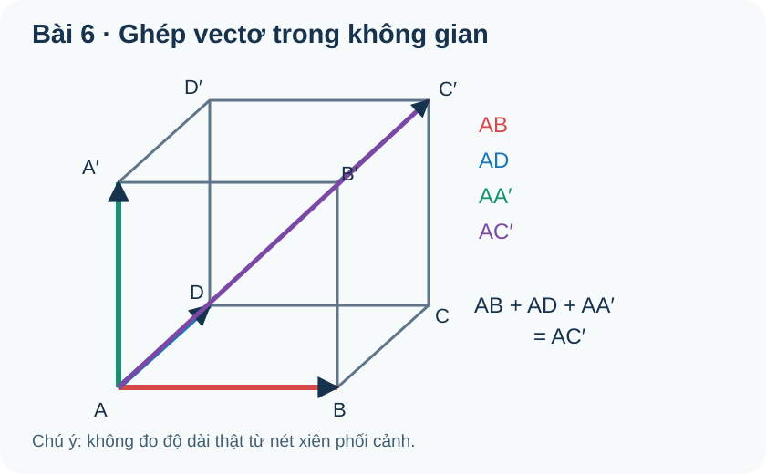
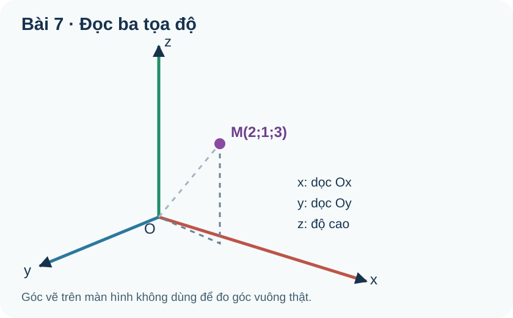
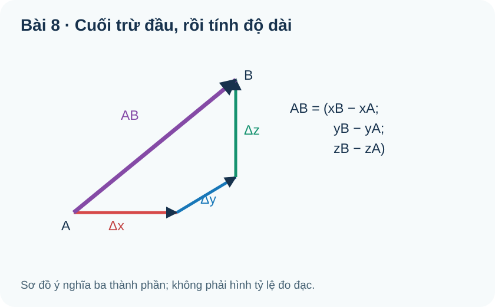

# CĐ13 — Vectơ hình học phẳng và không gian

Hành trình Chuyên đề độc lập với đúng ba trang **Kiến thức / Luyện tập / Tự kiểm tra**. Bắt đầu từ độ dời trên mặt phẳng, em sẽ hiểu từng phép toán vectơ trước khi bước vào không gian. Hãy tự thử trước khi mở Đối chiếu. Tọa độ Oxy/Oxyz ở đây chỉ là công cụ tính **vectơ**; phương trình đường/mặt/các đường conic không thuộc phạm vi CĐ13.

# Kiến thức

## Mạch A · Từ mũi tên đến phép toán vectơ

### 1. Độ dời cần cả độ lớn lẫn hướng

**Vì sao cần học:** Cùng đi 5 m nhưng một người đi đông, một người đi tây: độ dài bằng nhau, độ dời khác nhau.

**Hiểu bản chất, điều kiện trước công thức:** Vectơ AB đi từ A tới B có độ dài AB≥0; BA là vectơ đối khi A khác B. Vectơ AA là vectơ-không, dài 0. **Quy ước KNTT B07:** vectơ-không được coi là cùng phương và cùng hướng với mọi vectơ; không dùng nó để xác định một góc giữa hai hướng.

**Ví dụ có suy luận:** Robot đi 3 m đông rồi 4 m bắc: quãng đường 7 m, nhưng độ dài độ dời là 5 m (Pitago).

**Tự thử trước luyện tập:** Hai mũi tên dài 4 ô theo hai chiều trái/ngược phải có bằng nhau không?

Đối chiếu sau khi tự giải

Không: cùng độ dài nhưng ngược hướng.

**Gặp lỗi ở đâu?** Nếu chỉ so số 4, vẽ đuôi và đầu mũi tên rồi so **chiều**, không so mỗi độ dài.

### 2. Cùng phương, cùng hướng và vectơ bằng nhau

**Vì sao cần học:** Ta trượt một mũi tên sang vị trí khác mà không đổi độ dời; nhưng quay 180° sẽ đổi ý nghĩa.

**Hiểu bản chất, điều kiện trước công thức:** Với hai vectơ khác không, cùng phương nghĩa là có giá song song hoặc trùng nhau; cùng hướng còn đòi chiều thống nhất. Hai vectơ bằng nhau khi cùng hướng **và** cùng độ dài. Trong hình bình hành ABCD theo thứ tự, AB=DC dưới dạng vectơ, còn CD đối của AB. Cùng hướng của AB và AM không đủ để khẳng định M nằm giữa A,B.

**Cách đọc hình:** Đi từ đuôi tới đầu mỗi mũi tên rồi so hướng, không suy cùng hướng chỉ từ hai cạnh dài bằng nhau.

**Ví dụ có suy luận:** Ở hình bình hành ABCD, AB và CD có độ dài bằng nhau nhưng không bằng vectơ vì ngược chiều; DC mới bằng AB.

**Tự thử trước luyện tập:** Vectơ nào bằng AD: BC hay CB?

Đối chiếu sau khi tự giải

BC, vì cùng hướng và độ dài; CB là vectơ đối.

**Gặp lỗi ở đâu?** Nếu nhầm BC/CB, đọc mũi tên từ điểm đầu đến điểm cuối trước khi dùng tính chất hình bình hành.

### 3. Tổng vectơ là đường tắt giữa điểm đầu và điểm cuối

**Vì sao cần học:** Đi A→B→C, điều ta cần thường là vị trí cuối so với A, không phải quãng đường vòng.

**Hiểu bản chất, điều kiện trước công thức:** Quy tắc ba điểm: vectơ AB + BC = AC; mũi tên thứ hai phải bắt đầu từ đầu mũi tên thứ nhất. Độ dài |AB+BC| không nhất thiết bằng |AB|+|BC|. Với hai bước vuông góc, dùng Pitago để tìm độ dời; không cộng hai độ dài như khi tính quãng đường.

**Ví dụ có suy luận:** Đi 4 m đông và 6 m bắc: tổng vectơ có thành phần (4,6), độ dài 2√13 m; tổng quãng đường 10 m.

**Tự thử trước luyện tập:** Đi 6 m đông rồi 8 m bắc, độ dài độ dời bằng mấy mét?

Đối chiếu sau khi tự giải

10 m, còn quãng đường đã đi là 14 m.

**Gặp lỗi ở đâu?** Nếu chọn 14 m, vẽ đường thẳng nối điểm xuất phát với đích: đó mới là độ dời.

### 4. Hình bình hành và phép trừ vectơ

**Vì sao cần học:** Hai lực cùng tác dụng từ một điểm không tạo ra ngay hai mũi tên nối đuôi, nhưng vẫn có một hợp lực.

**Hiểu bản chất, điều kiện trước công thức:** Đặt hai vectơ cùng gốc, đường chéo của hình bình hành biểu diễn tổng. Phép trừ là cộng vectơ đối: u−v=u+(−v). Với ba điểm, AB−AC=CB (theo vectơ). Dấu âm đảo chiều vectơ AC, không phải AB; đây là nguyên nhân nhầm CB thành BC.

**Ví dụ có suy luận:** A(2,1), B(5,3), C(7,−2): AB=(3,2), AC=(5,−3), vậy AB−AC=(−2,5)=CB.

**Tự thử trước luyện tập:** Rút gọn PQ−PR thành vectơ nối R và Q.

Đối chiếu sau khi tự giải

RQ.

**Gặp lỗi ở đâu?** Nếu ra QR, thay tọa độ đơn giản để kiểm chiều của kết quả.

### 5. Nhân vectơ với một số và xét cùng phương

**Vì sao cần học:** Tăng gấp đôi một dịch chuyển vẫn giữ hướng; nhân với số âm làm đảo hướng.

**Hiểu bản chất, điều kiện trước công thức:** Với k thực, độ dài của ku bằng |k|·|u|. k>0 giữ chiều, k<0 đảo chiều, k=0 cho vectơ-không. Quy tắc k(u+v)=ku+kv đúng ở cả mặt phẳng và không gian. Với u,v khác không, v=ku thì chúng cùng phương; dấu k cho biết cùng hay ngược hướng.

**Ví dụ có suy luận:** u=(2,−3), v=−2u=(−4,6); |u|=√13, |v|=2√13 nhưng hướng ngược.

**Tự thử trước luyện tập:** v=−3u, |u|=2: |v| và quan hệ hướng thế nào?

Đối chiếu sau khi tự giải

|v|=6; v ngược hướng u.

**Gặp lỗi ở đâu?** Nếu ghi −6, nhớ độ dài không thể âm; lấy |k| trước.

### 6. Trung điểm và trọng tâm từ sự cân bằng vectơ

**Vì sao cần học:** Điểm cân bằng của hai hoặc ba vị trí có thể tìm từ các vectơ, không cần đo trung bình cạnh.

**Hiểu bản chất, điều kiện trước công thức:** Nếu M là trung điểm AB, MA+MB=0 và OM=(OA+OB)/2 với gốc O bất kỳ. Với trọng tâm G của tam giác ABC, GA+GB+GC=0; OG=(OA+OB+OC)/3. Nếu M là trung điểm BC, AG=(2/3)AM. Đây là trung bình **vị trí**, không phải trung bình độ dài.

**Ví dụ có suy luận:** A(0,0), B(6,0), C(0,3) ⇒ M trung điểm BC=(3,3/2), G=(2,1); AG=(2,1)=(2/3)AM.

**Tự thử trước luyện tập:** Tam giác A(0,0),B(3,0),C(0,6) có trọng tâm ở đâu?

Đối chiếu sau khi tự giải

G=(1,2).

**Gặp lỗi ở đâu?** Nếu lấy trung bình ba độ dài cạnh, hãy nhớ mỗi tọa độ của G là trung bình ba tọa độ tương ứng.

## Mạch B · Vectơ trong Oxy

### 7. Tọa độ Oxy: vì sao phải lấy cuối trừ đầu?

**Vì sao cần học:** Đo sự thay đổi trên bản đồ không phụ thuộc điểm xuất phát đặt ở đâu.

**Hiểu bản chất, điều kiện trước công thức:** Nếu A=(xA,yA), B=(xB,yB) thì vectơ AB=(xB−xA,yB−yA). Tọa độ **điểm** mô tả vị trí, còn tọa độ **vectơ** mô tả hai thay đổi theo trục. Bảo toàn vectơ khi tịnh tiến cả A,B như nhau. Phép cộng, trừ và nhân số trên Oxy tính theo từng thành phần.

**Ví dụ có suy luận:** A=(−2,1),B=(3,5) ⇒ AB=(5,4), BA=(−5,−4). Hai vectơ dài bằng nhau nhưng ngược hướng.

**Tự thử trước luyện tập:** A=(4,−1),B=(−2,3); AB bằng bao nhiêu?

Đối chiếu sau khi tự giải

AB=(−6,4).

**Gặp lỗi ở đâu?** Nếu ra (6,−4), bạn đã tính BA; viết 'cuối trừ đầu' cạnh phép tính.

### 8. Độ dài, khoảng cách và cùng phương trong Oxy

**Vì sao cần học:** Hai điểm lệch theo hai trục tạo nên một tam giác vuông mà cạnh huyền là khoảng cách.

**Hiểu bản chất, điều kiện trước công thức:** Với u=(ux,uy), |u|=√(ux²+uy²). AB là độ dài của vectơ AB. Trung điểm lấy trung bình hoành và tung; trọng tâm tam giác lấy trung bình ba tọa độ từng trục. Hai vectơ **khác không** cùng phương khi ux·vy−uy·vx=0; kết quả này không đồng nghĩa cùng hướng. Không dùng tỉ số có mẫu 0.

**Ví dụ có suy luận:** A(−1,2),B(5,−6): AB=(6,−8), dài 10; trung điểm (2,−2).

**Tự thử trước luyện tập:** u=(2,4),v=(−1,−2): chúng cùng phương, cùng hướng không?

Đối chiếu sau khi tự giải

Cùng phương nhưng ngược hướng vì v=−u/2.

**Gặp lỗi ở đâu?** Nếu dựa vào định thức bằng 0 để chọn cùng hướng, cần kiểm tiếp dấu của hệ số tỉ lệ.

### 9. Tích vô hướng qua góc: lực cùng hướng và ngược hướng

**Vì sao cần học:** Một lực kéo ngang không tạo công nếu vật chỉ chuyển thẳng đứng: độ lớn của lực chưa đủ.

**Hiểu bản chất, điều kiện trước công thức:** Với hai vectơ **khác không**, u·v=|u||v|cosθ, góc θ trong [0°,180°]. Tích dương cho góc nhọn, 0 cho góc vuông, âm cho góc tù. Vectơ-không có tích vô hướng 0 với mọi vectơ nhưng góc của nó với vectơ khác không không được xác định. Công W=F·s khi lực F không đổi và s là độ dời.

**Ví dụ có suy luận:** Hai vectơ dài 3 và 4 tạo góc 120° ⇒ u·v=3×4×(−1/2)=−6; dấu âm biểu diễn mức ngược hướng.

**Tự thử trước luyện tập:** Lực 5 N vuông góc độ dời 2 m: công của lực?

Đối chiếu sau khi tự giải

0 J.

**Gặp lỗi ở đâu?** Nếu nhân thành 10 J, còn thiếu cos của góc giữa hai vectơ.

### 10. Tích vô hướng trong Oxy và cách kiểm vuông góc

**Vì sao cần học:** Trong lưới tọa độ, một phép tính thường kiểm vuông góc chắc hơn nhìn phối cảnh.

**Hiểu bản chất, điều kiện trước công thức:** Với u=(ux,uy), v=(vx,vy), u·v=ux·vx+uy·vy. Với u,v **khác không**, chúng vuông góc khi và chỉ khi tích bằng 0. Khi tìm góc bằng cosθ=(u·v)/(|u||v|), phải kiểm hai độ dài khác 0 và cos trong [−1,1]. Tích vô hướng là **số**, không phải vectơ.

**Ví dụ có suy luận:** u=(2,−1),v=(3,6) ⇒ dot=6−6=0, do đó vuông góc. Lực (3,4) N trên dịch chuyển (5,0) m cho công 15 J.

**Tự thử trước luyện tập:** u=(1,2),v=(4,−2) có vuông góc không?

Đối chiếu sau khi tự giải

Có, tích 1×4+2×(−2)=0.

**Gặp lỗi ở đâu?** Nếu cộng thành phần thay vì nhân từng cặp, xem lại hai trục tọa độ vuông góc.

## Mạch C · Vectơ trong không gian và Oxyz

### 11. Ba hướng không gian: từ hình bình hành đến hình hộp

**Vì sao cần học:** Một drone có thể đi đông, bắc và lên cao; vectơ hai chiều không diễn tả đủ ba thay đổi.

**Hiểu bản chất, điều kiện trước công thức:** Phép cộng vectơ trong không gian giữ nguyên quy tắc nối đuôi. Trong hình hộp ABCD.A'B'C'D', AC'=AB+AD+AA' dưới dạng vectơ: ba cạnh xuất phát từ A đưa ta tới đỉnh C'. Hình phối cảnh có thể làm góc trông bị méo; không lấy góc trên giấy làm góc không gian thật. Chỉ khi ba cạnh vuông góc đôi một mới dùng căn tổng bình phương để tìm đường chéo.

**Cách đọc hình:** Theo đúng cạnh AB, AD, AA' rồi kiểm đỉnh đích C'; phối cảnh không giữ độ dài và góc thật.

**Ví dụ có suy luận:** Ba cạnh vuông góc dài 2,3,4 ⇒ AC' dài √(4+9+16)=√29, không phải 2+3+4.

**Tự thử trước luyện tập:** AB+AD+AA' đi tới C hay C'?

Đối chiếu sau khi tự giải

C' vì còn một bước theo chiều cao AA'.

**Gặp lỗi ở đâu?** Nếu chọn C, nhìn ký hiệu dấu phẩy ở đỉnh và vẽ ba mũi tên theo thứ tự.

### 12. Chasles, trung điểm và trọng tâm vẫn đúng trong không gian

**Vì sao cần học:** Dù ba điểm nằm trên một mặt phẳng nghiêng, độ dời qua B vẫn bằng độ dời trực tiếp từ A đến C.

**Hiểu bản chất, điều kiện trước công thức:** Trong không gian AB+BC=AC không cần A,B,C ở Oxy. Trung điểm M của AB thỏa MA+MB=0; trọng tâm tam giác ABC vẫn thỏa GA+GB+GC=0. Không nhầm giao điểm hai đoạn nhìn thấy trên hình chiếu với giao điểm thật của chúng trong không gian.

**Ví dụ có suy luận:** A=(1,0,2),B=(4,−2,5),C=(5,1,7): AB=(3,−2,3), BC=(1,3,2), tổng AC=(4,1,5).

**Tự thử trước luyện tập:** AB=(2,−1,3),BC=(−4,2,0): AC bằng bao nhiêu?

Đối chiếu sau khi tự giải

AC=(−2,1,3).

**Gặp lỗi ở đâu?** Nếu trừ vì nghĩ chiều BC ngược AB, nhớ quy tắc đường đi là cộng nối tiếp.

### 13. Góc, tích vô hướng và vuông góc trong không gian

**Vì sao cần học:** Hai vectơ vẽ ở các vị trí khác nhau trong hình phối cảnh vẫn so được góc bằng cách tịnh tiến về cùng gốc.

**Hiểu bản chất, điều kiện trước công thức:** Tích vô hướng hình học u·v=|u||v|cosθ đúng cho vectơ không gian. Trong Oxyz cũng có u·v=uxvx+uyvy+uzvz. Với hai vectơ khác không, tích 0 tương đương vuông góc. Hai đường thẳng chéo nhau có thể có vectơ chỉ phương vuông góc dù hai đường không cắt nhau; không gọi hai đoạn vẽ phối cảnh là cắt nhau chỉ vì ảnh chiếu chồng.

**Cách đọc hình:** Ba thành phần theo trục cộng thành vectơ tím A→B; không cộng ba độ dài thành độ dời.

**Ví dụ có suy luận:** u=(1,2,2),v=(2,0,−1) ⇒ dot=2−2=0, |u|=3, |v|=√5 ⇒ góc 90°.

**Tự thử trước luyện tập:** u=(1,1,0),v=(1,−1,5) có vuông góc không?

Đối chiếu sau khi tự giải

Có: dot=1−1+0=0, cả hai khác không.

**Gặp lỗi ở đâu?** Nếu hình xiên đánh lừa thị giác, dùng phép tích vô hướng.

### 14. Oxyz: tọa độ điểm khác tọa độ vectơ

**Vì sao cần học:** Thay đổi nơi đặt gốc bản đồ làm tọa độ vị trí đổi, nhưng độ dời A→B không đổi.

**Hiểu bản chất, điều kiện trước công thức:** Điểm M=(x,y,z) là **vị trí**, vectơ OM=(x,y,z) là một **dịch chuyển** từ gốc. Với A,B, vectơ AB=(xB−xA,yB−yA,zB−zA). Ba trục vuông góc được vẽ xiên trên mặt giấy; độ dài trên bản vẽ không phải dữ kiện thật. Khi giữ hướng trục và đơn vị, tịnh tiến gốc làm tọa độ điểm thay đổi nhưng hiệu B−A không đổi.

**Cách đọc hình:** Ba trục thật vuông góc dù hình vẽ xiên; nét đứt là đường gióng tọa độ, không phải chặng di chuyển.

**Ví dụ có suy luận:** A=(1,−1,2),B=(4,3,−2) ⇒ AB=(3,4,−4) dài √41; BA ngược hướng.

**Tự thử trước luyện tập:** A=(2,0,−1),B=(−1,5,3): AB?

Đối chiếu sau khi tự giải

AB=(−3,5,4).

**Gặp lỗi ở đâu?** Nếu đổi dấu tất cả, bạn đã làm A−B thay vì B−A.

### 15. Cộng, tính độ dài và điểm cân bằng trong Oxyz

**Vì sao cần học:** Một robot có ba thành phần chuyển động; tính theo từng trục rồi tổng hợp thành độ dời chính xác.

**Hiểu bản chất, điều kiện trước công thức:** Với u=(u1,u2,u3), v=(v1,v2,v3): u+v=(u1+v1,u2+v2,u3+v3); ku=(ku1,ku2,ku3); |u|=√(u1²+u2²+u3²); u·v=u1v1+u2v2+u3v3. Trung điểm là trung bình tọa độ hai đỉnh, trọng tâm là trung bình tọa độ ba đỉnh. Không cộng trị tuyệt đối ba thành phần để tính độ dài.

**Cách đọc hình:** Ba thành phần theo trục cộng thành vectơ tím A→B; không cộng ba độ dài thành độ dời.

**Ví dụ có suy luận:** A=(1,0,2),B=(5,2,−2) ⇒ AB=(4,2,−4) có độ dài 6; M=(3,1,0), AM=MB=3.

**Tự thử trước luyện tập:** A=(0,0,0),B=(6,0,0),C=(0,3,9): trọng tâm?

Đối chiếu sau khi tự giải

G=(2,1,3).

**Gặp lỗi ở đâu?** Nếu z=9, bạn đã quên chia z cho 3.

### 16. Độ dời, quãng đường và công trong ứng dụng ba chiều

**Vì sao cần học:** Một drone bay vòng có tổng quãng đường lớn hơn độ dời; lực ngược hướng có thể làm công âm.

**Hiểu bản chất, điều kiện trước công thức:** Với P ban đầu và hai chặng vectơ u,v, vị trí cuối Q=P+u+v. Độ dài độ dời là |u+v|; nếu hai chặng thẳng, quãng đường là |u|+|v|≥|u+v|. Lực F không đổi trên độ dời s tạo công W=F·s; khi F tính bằng N và s bằng m thì W tính bằng J. Luôn ghi trục, đơn vị, giả thiết lực không đổi; không suy quãng đường thật chỉ từ tọa độ P,Q.

**Ví dụ có suy luận:** P=(1,2,3) m; u=(3,−2,1), v=(−1,4,2) m ⇒ Q=(3,4,6) m, độ dời dài √17 m, đường đi hai chặng √14+√21 m; F=(2,−1,3) N sinh công 11 J trên tổng độ dời.

**Tự thử trước luyện tập:** Đi (1,0,0) m rồi (−1,0,0) m: độ dời và quãng đường?

Đối chiếu sau khi tự giải

Độ dài độ dời 0 m, quãng đường 2 m.

**Gặp lỗi ở đâu?** Nếu trả lời cả hai bằng 0, bạn đang triệt tiêu cả quãng đường; chỉ vectơ mới triệt tiêu.

# Luyện tập

Trước tiên, tự giải những bài mới theo từng mạch; lời giải nằm dưới nút tự mở **Đối chiếu**. Đối với câu SGK đã học, hệ thống chỉ dẫn chiếu đúng ngân hàng nguồn. Không tạo lại câu hay mở một trang Core riêng cho Chuyên đề.

## Câu luyện SGK dùng chung

20 câu SGK Toán 10 Chương IV bao phủ khái niệm, phép toán vectơ, Oxy và tích vô hướng; 12 câu SGK Toán 12 Chương II bao phủ vectơ không gian, tọa độ Oxyz và các phép toán. Khi tích hợp, RELEASE hiển thị từ cùng nguồn canonical theo vai trò Luyện tập; không in lại đề hoặc lời giải thành ngân hàng thứ hai.

## Bài mới theo mạch học

<!-- CANONICAL_ITEM_ID: THPT-TOP13-P01; PRIMARY_OUTCOME: TOP13-O02; ROLE: TOPIC_PRACTICE; SOURCE_TYPE: TOPIC_NEW_CANDIDATE -->
### Luyện 1 · Chiều vectơ hình bình hành

**Đề:** Trong hình bình hành ABCD, vectơ nào bằng AB: DC hay CD?

Đối chiếu lời giải

DC cùng hướng và độ dài; CD ngược hướng.

**Sửa lỗi:** Xem lại mục Kiến thức 2 và tự trình bày một lượt không nhìn lời giải.

<!-- CANONICAL_ITEM_ID: THPT-TOP13-P02; PRIMARY_OUTCOME: TOP13-O01; ROLE: TOPIC_PRACTICE; SOURCE_TYPE: TOPIC_NEW_CANDIDATE -->
### Luyện 2 · Vectơ-không theo quy ước KNTT

**Đề:** Khi A=B, độ dài AA và quan hệ cùng phương theo quy ước KNTT đối với vectơ khác không là gì?

Đối chiếu lời giải

AA dài 0; vectơ-không được quy ước cùng phương và cùng hướng với mọi vectơ. Không suy góc xác định với nó.

**Sửa lỗi:** Xem lại mục Kiến thức 1 và tự trình bày một lượt không nhìn lời giải.

<!-- CANONICAL_ITEM_ID: THPT-TOP13-P03; PRIMARY_OUTCOME: TOP13-O03; ROLE: TOPIC_PRACTICE; SOURCE_TYPE: TOPIC_NEW_CANDIDATE -->
### Luyện 3 · Đường đi và độ dời

**Đề:** Robot đi 5 m về đông rồi 12 m về bắc. Tính tổng quãng đường và độ lớn của vectơ độ dời.

Đối chiếu lời giải

Quãng đường là 5+12=17 m; độ dời là √(5²+12²)=13 m. Không lấy tổng hai chặng làm độ dài vectơ.

**Sửa lỗi:** Xem lại mục Kiến thức 3 và tự trình bày một lượt không nhìn lời giải.

<!-- CANONICAL_ITEM_ID: THPT-TOP13-P04; PRIMARY_OUTCOME: TOP13-O04; ROLE: TOPIC_PRACTICE; SOURCE_TYPE: TOPIC_NEW_CANDIDATE -->
### Luyện 4 · Hiệu hai vectơ chung gốc

**Đề:** Cho A=(−1,2), B=(4,3), C=(2,−2). Tính AB−AC và đối chiếu với một vectơ có điểm đầu C.

Đối chiếu lời giải

AB=(5,1), AC=(3,−4); AB−AC=(2,5)=CB vì B−C=(2,5).

**Sửa lỗi:** Xem lại mục Kiến thức 4 và tự trình bày một lượt không nhìn lời giải.

<!-- CANONICAL_ITEM_ID: THPT-TOP13-P05; PRIMARY_OUTCOME: TOP13-O05; ROLE: TOPIC_PRACTICE; SOURCE_TYPE: TOPIC_NEW_CANDIDATE -->
### Luyện 5 · Nhân âm với vectơ

**Đề:** Cho u=(2,−1) và v=−4u. Tìm v, độ dài v và quan hệ hướng với u.

Đối chiếu lời giải

v=(−8,4), |u|=√5 nên |v|=4√5. Hệ số −4 đảo hướng của u.

**Sửa lỗi:** Xem lại mục Kiến thức 5 và tự trình bày một lượt không nhìn lời giải.

<!-- CANONICAL_ITEM_ID: THPT-TOP13-P06; PRIMARY_OUTCOME: TOP13-O06; ROLE: TOPIC_PRACTICE; SOURCE_TYPE: TOPIC_NEW_CANDIDATE -->
### Luyện 6 · Điểm cân bằng

**Đề:** Tam giác A=(−3,0), B=(3,0), C=(0,6). Tìm trung điểm M của BC và trọng tâm G. Kiểm AG=(2/3)AM.

Đối chiếu lời giải

M=(3/2,3), G=(0,2); AG=(3,2) và AM=(9/2,3), nên AG=(2/3)AM.

**Sửa lỗi:** Xem lại mục Kiến thức 6 và tự trình bày một lượt không nhìn lời giải.

<!-- CANONICAL_ITEM_ID: THPT-TOP13-P07; PRIMARY_OUTCOME: TOP13-O07; ROLE: TOPIC_PRACTICE; SOURCE_TYPE: TOPIC_NEW_CANDIDATE -->
### Luyện 7 · Oxy cuối trừ đầu

**Đề:** Cho A=(−3,4), B=(5,−2). Tính vectơ AB và độ dài của nó.

Đối chiếu lời giải

AB=(8,−6), độ dài √(8²+6²)=10. Không thay hiệu tọa độ bằng tổng giá trị tuyệt đối.

**Sửa lỗi:** Xem lại mục Kiến thức 7 và tự trình bày một lượt không nhìn lời giải.

<!-- CANONICAL_ITEM_ID: THPT-TOP13-P08; PRIMARY_OUTCOME: TOP13-O08; ROLE: TOPIC_PRACTICE; SOURCE_TYPE: TOPIC_NEW_CANDIDATE -->
### Luyện 8 · Cùng phương không đồng nghĩa cùng hướng

**Đề:** Cho u=(4,−6), v=(−2,3). Chúng cùng phương không và có cùng hướng không?

Đối chiếu lời giải

v=−(1/2)u, cả hai khác không nên cùng phương nhưng ngược hướng.

**Sửa lỗi:** Xem lại mục Kiến thức 8 và tự trình bày một lượt không nhìn lời giải.

<!-- CANONICAL_ITEM_ID: THPT-TOP13-P09; PRIMARY_OUTCOME: TOP13-O09; ROLE: TOPIC_PRACTICE; SOURCE_TYPE: TOPIC_NEW_CANDIDATE -->
### Luyện 9 · Tích vô hướng từ góc

**Đề:** Hai vectơ có độ dài 8 và 5, góc giữa chúng 120°. Tính tích vô hướng và giải thích dấu.

Đối chiếu lời giải

u·v=8·5·cos120°=−20; góc tù nên tích âm. Nếu ra dương, đã bỏ dấu của cos120°.

**Sửa lỗi:** Xem lại mục Kiến thức 9 và tự trình bày một lượt không nhìn lời giải.

<!-- CANONICAL_ITEM_ID: THPT-TOP13-P10; PRIMARY_OUTCOME: TOP13-O10; ROLE: TOPIC_PRACTICE; SOURCE_TYPE: TOPIC_NEW_CANDIDATE -->
### Luyện 10 · Vuông góc Oxy

**Đề:** u=(3,−2),v=(4,6). Kiểm hai vectơ có vuông góc không.

Đối chiếu lời giải

u·v=12−12=0 và u,v khác không ⇒ vuông góc.

**Sửa lỗi:** Xem lại mục Kiến thức 10 và tự trình bày một lượt không nhìn lời giải.

<!-- CANONICAL_ITEM_ID: THPT-TOP13-P11; PRIMARY_OUTCOME: TOP13-O11; ROLE: TOPIC_PRACTICE; SOURCE_TYPE: TOPIC_NEW_CANDIDATE -->
### Luyện 11 · Đường chéo hình hộp

**Đề:** Trong hình hộp chữ nhật, ba cạnh xuất phát từ A vuông góc đôi một và dài 3, 4, 12. Tìm độ dài vectơ AC'.

Đối chiếu lời giải

Đường chéo không gian dài √(3²+4²+12²)=√169=13. Chỉ dùng tổng bình phương vì ba hướng đôi một vuông góc.

**Sửa lỗi:** Xem lại mục Kiến thức 11 và tự trình bày một lượt không nhìn lời giải.

<!-- CANONICAL_ITEM_ID: THPT-TOP13-P12; PRIMARY_OUTCOME: TOP13-O12; ROLE: TOPIC_PRACTICE; SOURCE_TYPE: TOPIC_NEW_CANDIDATE -->
### Luyện 12 · Chasles trong Oxyz

**Đề:** A=(−1,2,0), B=(2,−1,4), C=(5,3,−2). Hãy tính AB, BC và AC, rồi xác minh quy tắc ba điểm.

Đối chiếu lời giải

AB=(3,−3,4), BC=(3,4,−6); AB+BC=(6,1,−2)=AC. Cần lấy cuối trừ đầu từng cặp.

**Sửa lỗi:** Xem lại mục Kiến thức 12 và tự trình bày một lượt không nhìn lời giải.

<!-- CANONICAL_ITEM_ID: THPT-TOP13-P13; PRIMARY_OUTCOME: TOP13-O13; ROLE: TOPIC_PRACTICE; SOURCE_TYPE: TOPIC_NEW_CANDIDATE -->
### Luyện 13 · Vuông góc trong không gian

**Đề:** Hai vectơ không gian u=(2,−1,2), v=(1,4,1). Tính u·v và góc giữa chúng.

Đối chiếu lời giải

u·v=2−4+2=0; |u|=3 và |v|=3√2 đều khác 0 nên góc bằng 90°.

**Sửa lỗi:** Xem lại mục Kiến thức 13 và tự trình bày một lượt không nhìn lời giải.

<!-- CANONICAL_ITEM_ID: THPT-TOP13-P14; PRIMARY_OUTCOME: TOP13-O14; ROLE: TOPIC_PRACTICE; SOURCE_TYPE: TOPIC_NEW_CANDIDATE -->
### Luyện 14 · Tọa độ độ dời Oxyz

**Đề:** A=(−2,3,1), B=(4,−1,5). Tính tọa độ AB và khoảng cách từ A tới B.

Đối chiếu lời giải

AB=(6,−4,4); AB=√(36+16+16)=√68=2√17.

**Sửa lỗi:** Xem lại mục Kiến thức 14 và tự trình bày một lượt không nhìn lời giải.

<!-- CANONICAL_ITEM_ID: THPT-TOP13-P15; PRIMARY_OUTCOME: TOP13-O15; ROLE: TOPIC_PRACTICE; SOURCE_TYPE: TOPIC_NEW_CANDIDATE -->
### Luyện 15 · Trung điểm Oxyz

**Đề:** Cho A=(−1,2,4), B=(5,−2,−4). Tìm trung điểm M và khoảng cách AB.

Đối chiếu lời giải

M=(2,0,0); AB=(6,−4,−8) dài √(36+16+64)=√116=2√29.

**Sửa lỗi:** Xem lại mục Kiến thức 15 và tự trình bày một lượt không nhìn lời giải.

<!-- CANONICAL_ITEM_ID: THPT-TOP13-P16; PRIMARY_OUTCOME: TOP13-O16; ROLE: TOPIC_PRACTICE; SOURCE_TYPE: TOPIC_NEW_CANDIDATE -->
### Luyện 16 · Hai chặng drone

**Đề:** Drone ở P=(1,−2,0) m, bay u=(4,0,3) m rồi v=(−1,4,0) m. Tìm Q, độ dài độ dời và quãng đường hai chặng.

Đối chiếu lời giải

Q=P+u+v=(4,2,3) m. Tổng độ dời=(3,4,3) dài √34 m; quãng đường theo hai chặng=5+√17 m. Hai độ dài khác nhau.

**Sửa lỗi:** Xem lại mục Kiến thức 16 và tự trình bày một lượt không nhìn lời giải.

<!-- CANONICAL_ITEM_ID: THPT-TOP13-W01; PRIMARY_OUTCOME: TOP13-O06; ROLE: TOPIC_WRITTEN; SOURCE_TYPE: TOPIC_NEW_CANDIDATE -->
### Tự luận 1 · Tổng vectơ và trọng tâm

**Đề:** Với A=(−2,1), B=(4,1), C=(1,7), hãy (a) rút gọn AB+BC; (b) tìm trung điểm M của BC; (c) tìm trọng tâm G và chứng minh AG=(2/3)AM.

Đối chiếu và rubric /7

(a) AB+BC=AC=(3,6) (2đ); (b) M=(5/2,4) (2đ); (c) G=(1,3) (2đ), AG=(3,2)=(2/3)(9/2,3)=(2/3)AM (1đ). Tổng 7 điểm.

**Sửa lỗi:** Xem lại mục Kiến thức 6 và tự trình bày một lượt không nhìn lời giải.

<!-- CANONICAL_ITEM_ID: THPT-TOP13-W02; PRIMARY_OUTCOME: TOP13-O10; ROLE: TOPIC_WRITTEN; SOURCE_TYPE: TOPIC_NEW_CANDIDATE -->
### Tự luận 2 · Tích vô hướng và góc trong Oxy

**Đề:** Cho tam giác A=(0,0),B=(6,0),C=(2,4). Tính (a) AB·AC; (b) cos góc A; (c) trọng tâm G và diện tích tam giác.

Đối chiếu và rubric /7

AB=(6,0), AC=(2,4), tích vô hướng=12 (2đ); |AB|=6, |AC|=2√5, cosA=12/(12√5)=1/√5 (2đ); G=(8/3,4/3) (2đ); S=6·4/2=12 đơn vị vuông (1đ). Tổng 7 điểm.

**Sửa lỗi:** Xem lại mục Kiến thức 10 và tự trình bày một lượt không nhìn lời giải.

<!-- CANONICAL_ITEM_ID: THPT-TOP13-W03; PRIMARY_OUTCOME: TOP13-O11; ROLE: TOPIC_WRITTEN; SOURCE_TYPE: TOPIC_NEW_CANDIDATE -->
### Tự luận 3 · Vectơ đường chéo hình hộp

**Đề:** Một hình hộp chữ nhật có A=(0,0,0), B=(3,0,0), D=(0,4,0), A'=(0,0,12). Tìm C', độ dài AC', tích vô hướng AB·AC' và cos góc giữa chúng.

Đối chiếu và rubric /7

C'=(3,4,12) (2đ); |AC'|=13 và AB·AC'=9 (3đ); cos góc=9/(3·13)=3/13 (2đ). Tổng 7 điểm.

**Sửa lỗi:** Xem lại mục Kiến thức 11 và tự trình bày một lượt không nhìn lời giải.

<!-- CANONICAL_ITEM_ID: THPT-TOP13-W04; PRIMARY_OUTCOME: TOP13-O16; ROLE: TOPIC_WRITTEN; SOURCE_TYPE: TOPIC_NEW_CANDIDATE -->
### Tự luận 4 · Drone và công của lực

**Đề:** Drone ở P=(0,0,1) m bay u=(2,−1,2) m rồi v=(−1,3,0) m, trong khi lực không đổi F=(1,2,−1) N tác dụng. (a) Tìm Q. (b) Phân biệt quãng đường với độ dài độ dời. (c) Tính công trên tổng độ dời.

Đối chiếu và rubric /7

(a) Q=P+u+v=(1,2,3) (2đ); (b) tổng độ dời=(1,2,2) dài 3 m, hai chặng dài 3 và √10 nên quãng đường=3+√10 m (3đ); (c) W=F·(u+v)=1+4−2=3 J, do lực không đổi (2đ). Tổng 7 điểm.

**Sửa lỗi:** Xem lại mục Kiến thức 16 và tự trình bày một lượt không nhìn lời giải.

# Tự kiểm tra

Đây là lượt **tự đối chiếu** từ những câu công khai đã học, không phải bài thi độc lập. Hãy làm các câu về chiều vectơ, tổng–hiệu, tọa độ và khoảng cách Oxy/Oxyz, hình hộp, tích vô hướng, chuyển động drone. Trước khi bấm **Nộp cuối**, không hiển thị gợi ý, đáp án, lời giải, nhận xét đúng/sai hoặc AI Tutor; sau nộp mới mở đối chiếu và tự quay lại mục Kiến thức cần ôn. Lượt này không ghi điểm thành thạo.

<!-- AUTHORING ONLY · ORIGINAL G10 IV R03 SHA 96b5c95f9b74a3ed3b9fd66dc6c60481d8b0dcb9; 20 canonical IDs reused by pointer, never clone bodies
- THPT-G10-B07-C01
- THPT-G10-B07-P01
- THPT-G10-B07-P02
- THPT-G10-B07-P04
- THPT-G10-B08-C01
- THPT-G10-B08-P01
- THPT-G10-B08-P02
- THPT-G10-B08-P05
- THPT-G10-B09-C01
- THPT-G10-B09-P01
- THPT-G10-B09-P03
- THPT-G10-B09-P05
- THPT-G10-B10-C01
- THPT-G10-B10-P01
- THPT-G10-B10-P03
- THPT-G10-B10-P05
- THPT-G10-B11-C01
- THPT-G10-B11-P01
- THPT-G10-B11-P03
- THPT-G10-B11-P05
-->
<!-- AUTHORING ONLY · ORIGINAL G12 II R00 SHA 856a37bd16d2746ffc2e12906de18d1f4338a3b6; 12 canonical IDs reused by pointer
- THPT-G12-B06-C01
- THPT-G12-B06-P01
- THPT-G12-B06-C03
- THPT-G12-B06-P05
- THPT-G12-B07-C01
- THPT-G12-B07-P01
- THPT-G12-B07-C03
- THPT-G12-B07-P05
- THPT-G12-B08-C01
- THPT-G12-B08-P01
- THPT-G12-B08-C03
- THPT-G12-B08-P05
-->
<!-- AUTHORING ONLY · SELF CHECK 16 existing public Practice placements, not new exam IDs
- THPT-TOP13-P01
- THPT-TOP13-P02
- THPT-TOP13-P03
- THPT-TOP13-P04
- THPT-TOP13-P05
- THPT-TOP13-P06
- THPT-TOP13-P07
- THPT-TOP13-P08
- THPT-TOP13-P09
- THPT-TOP13-P10
- THPT-TOP13-P11
- THPT-TOP13-P12
- THPT-TOP13-P13
- THPT-TOP13-P14
- THPT-TOP13-P15
- THPT-TOP13-P16
ASSESSMENT_MODE: CLIENT_SELF_CHECK_NO_MASTERY
OFFICIAL_READINESS: NOT_CLAIMED
PRIVATE_RD1_COUNT: 0
MASTERY_ACTIVATION: NO
-->
