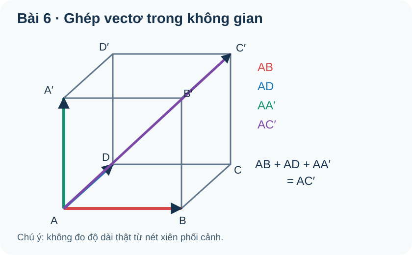
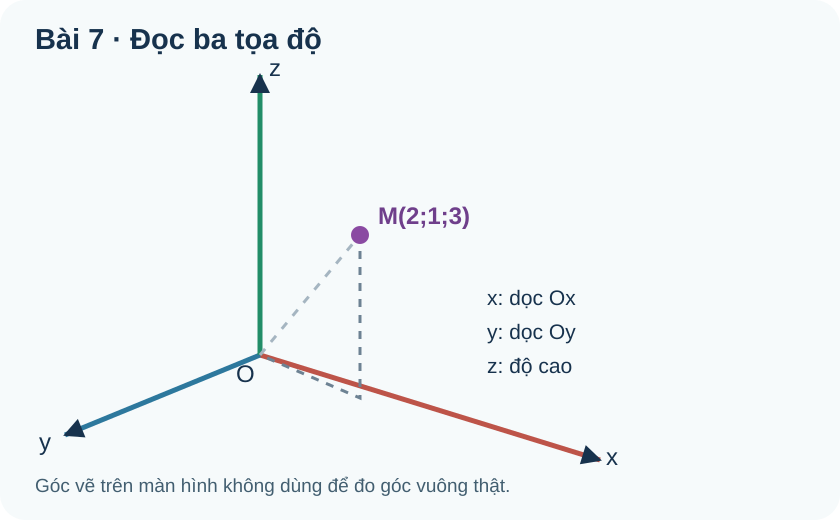
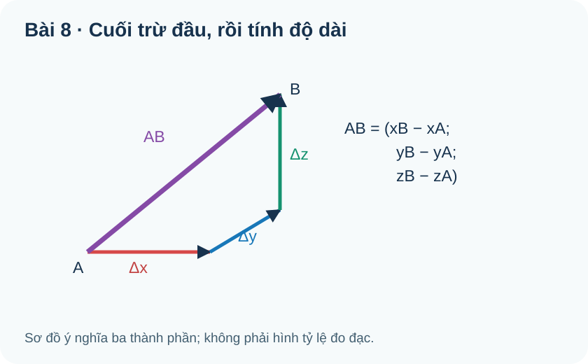

# CĐ13 — Vectơ hình học phẳng và không gian · R03 student-first

Hành trình Chuyên đề độc lập với đúng ba trang **Kiến thức / Luyện tập / Tự kiểm tra**. Bắt đầu từ độ dời trên mặt phẳng, em sẽ hiểu từng phép toán vectơ trước khi bước vào không gian. Hãy tự thử trước khi mở Đối chiếu. Tọa độ Oxy/Oxyz ở đây chỉ là công cụ tính **vectơ**; phương trình đường/mặt/các đường conic không thuộc phạm vi CĐ13.

<!-- CROSS_BRANCH_G10_SGK_SOURCE: PR750; G10_SOURCE_BLOB: 96b5c95f9b74a3ed3b9fd66dc6c60481d8b0dcb9; G12_SOURCE_BLOB: 856a37bd16d2746ffc2e12906de18d1f4338a3b6; NEW20_BANK_BLOB: d2f4b9fbd11b65ddd0a3190cc4cfbb8569951175 -->
<!-- AUTHORING_R03_CANDIDATE; R02_ORIGINAL_BLOB=d351c5aec660d6482f6694becbd3e2567a14edbf; NO_MERGE_DEPLOY -->

# Kiến thức

## Mạch A · Từ mũi tên đến phép toán vectơ

### 1. Độ dời cần cả độ lớn lẫn hướng
<!-- LESSON_ID: TOP13-M01; OUTCOME_ID: TOP13-O01 -->

**Vì sao cần học:** Cùng đi 5 m nhưng một người đi đông, một người đi tây: độ dài bằng nhau, độ dời khác nhau.

**Hiểu bản chất, điều kiện trước công thức:** Vectơ AB đi từ A tới B có độ dài AB≥0; BA là vectơ đối khi A khác B. Vectơ AA là vectơ-không, dài 0. **Quy ước KNTT B07:** vectơ-không được coi là cùng phương và cùng hướng với mọi vectơ; không dùng nó để xác định một góc giữa hai hướng.

**Ví dụ — Đề bài:** Robot đi 3 m về đông rồi 4 m về bắc. Tính quãng đường và độ dài độ dời, giải thích vì sao khác nhau.

**Lời giải:** Quãng đường cộng độ dài hai chặng là 3+4=7 m. Độ dời là vectơ nối thẳng vị trí đầu tới vị trí cuối, có hai thành phần vuông góc (3,4), nên dài √(3²+4²)=5 m. Vì hướng của hai chặng khác nhau nên không thể lấy 7 m làm độ dài độ dời.

**Tự thử trước luyện tập:** Hai mũi tên dài 4 ô theo hai chiều trái/ngược phải có bằng nhau không?

Đối chiếu sau khi tự giải

Không: cùng độ dài nhưng ngược hướng.

**Gặp lỗi ở đâu?** Nếu chỉ so số 4, vẽ đuôi và đầu mũi tên rồi so **chiều**, không so mỗi độ dài.

### 2. Cùng phương, cùng hướng và vectơ bằng nhau
<!-- LESSON_ID: TOP13-M02; OUTCOME_ID: TOP13-O02 -->

**Vì sao cần học:** Ta trượt một mũi tên sang vị trí khác mà không đổi độ dời; nhưng quay 180° sẽ đổi ý nghĩa.

**Hiểu bản chất, điều kiện trước công thức:** Với hai vectơ khác không, cùng phương nghĩa là có giá song song hoặc trùng nhau; cùng hướng còn đòi chiều thống nhất. Hai vectơ bằng nhau khi cùng hướng **và** cùng độ dài. Trong hình bình hành ABCD theo thứ tự, AB=DC dưới dạng vectơ, còn CD đối của AB. Cùng hướng của AB và AM không đủ để khẳng định M nằm giữa A,B.

**Cách đọc hình:** Đi từ đuôi tới đầu mỗi mũi tên rồi so hướng, không suy cùng hướng chỉ từ hai cạnh dài bằng nhau.

**Ví dụ — Đề bài:** Trong hình bình hành ABCD theo đúng thứ tự A–B–C–D, so sánh các vectơ AB, DC và CD.

**Lời giải:** Hai cạnh AB,DC song song, cùng chiều, cùng độ dài nên AB=DC theo nghĩa vectơ. Vectơ CD ngược chiều với AB nên CD=−AB. Chỉ có cùng độ dài thì chưa đủ để hai vectơ bằng nhau.

**Tự thử trước luyện tập:** Vectơ nào bằng AD: BC hay CB?

Đối chiếu sau khi tự giải

BC, vì cùng hướng và độ dài; CB là vectơ đối.

**Gặp lỗi ở đâu?** Nếu nhầm BC/CB, đọc mũi tên từ điểm đầu đến điểm cuối trước khi dùng tính chất hình bình hành.

### 3. Tổng vectơ là đường tắt giữa điểm đầu và điểm cuối
<!-- LESSON_ID: TOP13-M03; OUTCOME_ID: TOP13-O03 -->

**Vì sao cần học:** Đi A→B→C, điều ta cần thường là vị trí cuối so với A, không phải quãng đường vòng.

**Hiểu bản chất, điều kiện trước công thức:** Quy tắc ba điểm: vectơ AB + BC = AC; mũi tên thứ hai phải bắt đầu từ đầu mũi tên thứ nhất. Độ dài |AB+BC| không nhất thiết bằng |AB|+|BC|. Với hai bước vuông góc, dùng Pitago để tìm độ dời; không cộng hai độ dài như khi tính quãng đường.

**Ví dụ — Đề bài:** Từ vị trí đầu, đi 4 m đông và tiếp 6 m bắc. Viết vectơ tổng và tính độ dài đường tắt.

**Lời giải:** Chọn Ox hướng đông, Oy hướng bắc: u=(4,0), v=(0,6) m. Theo quy tắc tam giác, độ dời tổng u+v=(4,6) m, dài √(4²+6²)=2√13 m. Quãng đường đi hai chặng là 10 m; công thức cộng vectơ lưu cả chiều, không chỉ số đo.

**Tự thử trước luyện tập:** Đi 6 m đông rồi 8 m bắc, độ dài độ dời bằng mấy mét?

Đối chiếu sau khi tự giải

10 m, còn quãng đường đã đi là 14 m.

**Gặp lỗi ở đâu?** Nếu chọn 14 m, vẽ đường thẳng nối điểm xuất phát với đích: đó mới là độ dời.

### 4. Hình bình hành và phép trừ vectơ
<!-- LESSON_ID: TOP13-M04; OUTCOME_ID: TOP13-O04 -->

**Vì sao cần học:** Hai lực cùng tác dụng từ một điểm không tạo ra ngay hai mũi tên nối đuôi, nhưng vẫn có một hợp lực.

**Hiểu bản chất, điều kiện trước công thức:** Đặt hai vectơ cùng gốc, đường chéo của hình bình hành biểu diễn tổng. Phép trừ là cộng vectơ đối: u−v=u+(−v). Với ba điểm, AB−AC=CB (theo vectơ). Dấu âm đảo chiều vectơ AC, không phải AB; đây là nguyên nhân nhầm CB thành BC.

**Ví dụ — Đề bài:** Cho A=(2,1), B=(5,3), C=(7,−2). Rút gọn AB−AC và nhận dạng vectơ thu được.

**Lời giải:** AB=B−A=(3,2), AC=C−A=(5,−3), nên AB−AC=(−2,5). Đồng thời CB=B−C=(−2,5), do đó AB−AC=CB. Chỉ phép trừ hai vectơ chung gốc mới triệt A theo cách này.

**Tự thử trước luyện tập:** Rút gọn PQ−PR thành vectơ nối R và Q.

Đối chiếu sau khi tự giải

RQ.

**Gặp lỗi ở đâu?** Nếu ra QR, thay tọa độ đơn giản để kiểm chiều của kết quả.

### 5. Nhân vectơ với một số và xét cùng phương
<!-- LESSON_ID: TOP13-M05; OUTCOME_ID: TOP13-O05 -->

**Vì sao cần học:** Tăng gấp đôi một dịch chuyển vẫn giữ hướng; nhân với số âm làm đảo hướng.

**Hiểu bản chất, điều kiện trước công thức:** Với k thực, độ dài của ku bằng |k|·|u|. k>0 giữ chiều, k<0 đảo chiều, k=0 cho vectơ-không. Quy tắc k(u+v)=ku+kv đúng ở cả mặt phẳng và không gian. Với u,v khác không, v=ku thì chúng cùng phương; dấu k cho biết cùng hay ngược hướng.

**Ví dụ — Đề bài:** Với u=(2,−3), tính v=−2u, độ dài và hướng của v so với u.

**Lời giải:** Nhân từng tọa độ v=(−4,6). |u|=√(2²+(−3)²)=√13, nên |v|=|−2|·|u|=2√13. Vì hệ số âm và u khác vectơ-không, v ngược hướng u; độ dài không thể là số âm.

**Tự thử trước luyện tập:** v=−3u, |u|=2: |v| và quan hệ hướng thế nào?

Đối chiếu sau khi tự giải

|v|=6; v ngược hướng u.

**Gặp lỗi ở đâu?** Nếu ghi −6, nhớ độ dài không thể âm; lấy |k| trước.

### 6. Trung điểm và trọng tâm từ sự cân bằng vectơ
<!-- LESSON_ID: TOP13-M06; OUTCOME_ID: TOP13-O06 -->

**Vì sao cần học:** Điểm cân bằng của hai hoặc ba vị trí có thể tìm từ các vectơ, không cần đo trung bình cạnh.

**Hiểu bản chất, điều kiện trước công thức:** Nếu M là trung điểm AB, MA+MB=0 và OM=(OA+OB)/2 với gốc O bất kỳ. Với trọng tâm G của tam giác ABC, GA+GB+GC=0; OG=(OA+OB+OC)/3. Nếu M là trung điểm BC, AG=(2/3)AM. Đây là trung bình **vị trí**, không phải trung bình độ dài.

**Ví dụ — Đề bài:** Cho tam giác A(0,0), B(6,0), C(0,3). Tìm trung điểm M của BC, trọng tâm G và kiểm tra hệ thức AG=(2/3)AM.

**Lời giải:** Trung điểm M=((6+0)/2,(0+3)/2)=(3,3/2). Trọng tâm G=((0+6+0)/3,(0+0+3)/3)=(2,1). Từ A, AG=(2,1), AM=(3,3/2), nên (2/3)AM=(2,1)=AG. Hệ số 2/3 chỉ áp dụng khi M là trung điểm của BC.

**Tự thử trước luyện tập:** Tam giác A(0,0),B(3,0),C(0,6) có trọng tâm ở đâu?

Đối chiếu sau khi tự giải

G=(1,2).

**Gặp lỗi ở đâu?** Nếu lấy trung bình ba độ dài cạnh, hãy nhớ mỗi tọa độ của G là trung bình ba tọa độ tương ứng.

## Mạch B · Vectơ trong Oxy

### 7. Tọa độ Oxy: vì sao phải lấy cuối trừ đầu?
<!-- LESSON_ID: TOP13-M07; OUTCOME_ID: TOP13-O07 -->

**Vì sao cần học:** Đo sự thay đổi trên bản đồ không phụ thuộc điểm xuất phát đặt ở đâu.

**Hiểu bản chất, điều kiện trước công thức:** Nếu A=(xA,yA), B=(xB,yB) thì vectơ AB=(xB−xA,yB−yA). Tọa độ **điểm** mô tả vị trí, còn tọa độ **vectơ** mô tả hai thay đổi theo trục. Bảo toàn vectơ khi tịnh tiến cả A,B như nhau. Phép cộng, trừ và nhân số trên Oxy tính theo từng thành phần.

**Ví dụ — Đề bài:** Hai điểm A=(−2,1), B=(3,5) trong Oxy. Tính AB, BA và so sánh độ dài, chiều.

**Lời giải:** AB=(3−(−2),5−1)=(5,4), BA=(−2−3,1−5)=(−5,−4). Hai vectơ là đối nhau, cùng độ dài √(5²+4²)=√41 nhưng ngược chiều. Cần lấy tọa độ điểm cuối trừ điểm đầu.

**Tự thử trước luyện tập:** A=(4,−1),B=(−2,3); AB bằng bao nhiêu?

Đối chiếu sau khi tự giải

AB=(−6,4).

**Gặp lỗi ở đâu?** Nếu ra (6,−4), bạn đã tính BA; viết 'cuối trừ đầu' cạnh phép tính.

### 8. Độ dài, khoảng cách và cùng phương trong Oxy
<!-- LESSON_ID: TOP13-M08; OUTCOME_ID: TOP13-O08 -->

**Vì sao cần học:** Hai điểm lệch theo hai trục tạo nên một tam giác vuông mà cạnh huyền là khoảng cách.

**Hiểu bản chất, điều kiện trước công thức:** Với u=(ux,uy), |u|=√(ux²+uy²). AB là độ dài của vectơ AB. Trung điểm lấy trung bình hoành và tung; trọng tâm tam giác lấy trung bình ba tọa độ từng trục. Hai vectơ **khác không** cùng phương khi ux·vy−uy·vx=0; kết quả này không đồng nghĩa cùng hướng. Không dùng tỉ số có mẫu 0.

**Ví dụ — Đề bài:** Trong Oxy, A=(−1,2), B=(5,−6). Tính AB, khoảng cách AB và trung điểm.

**Lời giải:** AB=(6,−8) nên AB=√(6²+(−8)²)=10. Trung điểm M=((−1+5)/2,(2−6)/2)=(2,−2). Độ dài dùng căn tổng bình phương, còn tọa độ trung điểm là trung bình hai tọa độ cùng trục.

**Tự thử trước luyện tập:** u=(2,4),v=(−1,−2): chúng cùng phương, cùng hướng không?

Đối chiếu sau khi tự giải

Cùng phương nhưng ngược hướng vì v=−u/2.

**Gặp lỗi ở đâu?** Nếu dựa vào định thức bằng 0 để chọn cùng hướng, cần kiểm tiếp dấu của hệ số tỉ lệ.

### 9. Tích vô hướng qua góc: lực cùng hướng và ngược hướng
<!-- LESSON_ID: TOP13-M09; OUTCOME_ID: TOP13-O09 -->

**Vì sao cần học:** Một lực kéo ngang không tạo công nếu vật chỉ chuyển thẳng đứng: độ lớn của lực chưa đủ.

**Hiểu bản chất, điều kiện trước công thức:** Với hai vectơ **khác không**, u·v=|u||v|cosθ, góc θ trong [0°,180°]. Tích dương cho góc nhọn, 0 cho góc vuông, âm cho góc tù. Vectơ-không có tích vô hướng 0 với mọi vectơ nhưng góc của nó với vectơ khác không không được xác định. Công W=F·s khi lực F không đổi và s là độ dời.

**Ví dụ — Đề bài:** Hai vectơ không bằng không có độ dài 3 và 4, góc giữa chúng 120°. Tính tích vô hướng và giải thích dấu.

**Lời giải:** Theo định nghĩa u·v=|u||v|cos120°=3·4·(−1/2)=−6. Dấu âm cho thấy góc giữa chúng tù, hai hướng có phần đối nhau; không được thay cos120° bằng cos60° dương.

**Tự thử trước luyện tập:** Lực 5 N vuông góc độ dời 2 m: công của lực?

Đối chiếu sau khi tự giải

0 J.

**Gặp lỗi ở đâu?** Nếu nhân thành 10 J, còn thiếu cos của góc giữa hai vectơ.

### 10. Tích vô hướng trong Oxy và cách kiểm vuông góc
<!-- LESSON_ID: TOP13-M10; OUTCOME_ID: TOP13-O10 -->

**Vì sao cần học:** Trong lưới tọa độ, một phép tính thường kiểm vuông góc chắc hơn nhìn phối cảnh.

**Hiểu bản chất, điều kiện trước công thức:** Với u=(ux,uy), v=(vx,vy), u·v=ux·vx+uy·vy. Với u,v **khác không**, chúng vuông góc khi và chỉ khi tích bằng 0. Khi tìm góc bằng cosθ=(u·v)/(|u||v|), phải kiểm hai độ dài khác 0 và cos trong [−1,1]. Tích vô hướng là **số**, không phải vectơ.

**Ví dụ — Đề bài:** Trong Oxy, u=(2,−1), v=(3,6). Kiểm tra vuông góc; lực F=(3,4) N gây độ dời s=(5,0) m thì sinh công bao nhiêu?

**Lời giải:** Tích vô hướng u·v=2·3+(−1)·6=0; vì hai vectơ đều khác không nên chúng vuông góc. Công của lực F·s=3·5+4·0=15 N·m=15 J. Với lực vuông góc độ dời, công bằng 0, không phải tích độ lớn.

**Tự thử trước luyện tập:** u=(1,2),v=(4,−2) có vuông góc không?

Đối chiếu sau khi tự giải

Có, tích 1×4+2×(−2)=0.

**Gặp lỗi ở đâu?** Nếu cộng thành phần thay vì nhân từng cặp, xem lại hai trục tọa độ vuông góc.

## Mạch C · Vectơ trong không gian và Oxyz

### 11. Ba hướng không gian: từ hình bình hành đến hình hộp
<!-- LESSON_ID: TOP13-M11; OUTCOME_ID: TOP13-O11 -->

**Vì sao cần học:** Một drone có thể đi đông, bắc và lên cao; vectơ hai chiều không diễn tả đủ ba thay đổi.

**Hiểu bản chất, điều kiện trước công thức:** Phép cộng vectơ trong không gian giữ nguyên quy tắc nối đuôi. Trong hình hộp ABCD.A'B'C'D', AC'=AB+AD+AA' dưới dạng vectơ: ba cạnh xuất phát từ A đưa ta tới đỉnh C'. Hình phối cảnh có thể làm góc trông bị méo; không lấy góc trên giấy làm góc không gian thật. Chỉ khi ba cạnh vuông góc đôi một mới dùng căn tổng bình phương để tìm đường chéo.

**Cách đọc hình:** Theo đúng cạnh AB, AD, AA' rồi kiểm đỉnh đích C'; phối cảnh không giữ độ dài và góc thật.

**Ví dụ — Đề bài:** Hình hộp chữ nhật có ba cạnh xuất phát từ A vuông góc đôi một và dài 2,3,4. Tính độ dài đường chéo nối A tới đỉnh đối diện C'.

**Lời giải:** Chọn ba trục theo ba cạnh: AC' có thành phần (2,3,4). Do các trục vuông góc, |AC'|=√(2²+3²+4²)=√29. Đây là đường chéo không gian, không phải tổng ba cạnh 2+3+4.

**Tự thử trước luyện tập:** AB+AD+AA' đi tới C hay C'?

Đối chiếu sau khi tự giải

C' vì còn một bước theo chiều cao AA'.

**Gặp lỗi ở đâu?** Nếu chọn C, nhìn ký hiệu dấu phẩy ở đỉnh và vẽ ba mũi tên theo thứ tự.

### 12. Chasles, trung điểm và trọng tâm vẫn đúng trong không gian
<!-- LESSON_ID: TOP13-M12; OUTCOME_ID: TOP13-O12 -->

**Vì sao cần học:** Dù ba điểm nằm trên một mặt phẳng nghiêng, độ dời qua B vẫn bằng độ dời trực tiếp từ A đến C.

**Hiểu bản chất, điều kiện trước công thức:** Trong không gian AB+BC=AC không cần A,B,C ở Oxy. Trung điểm M của AB thỏa MA+MB=0; trọng tâm tam giác ABC vẫn thỏa GA+GB+GC=0. Không nhầm giao điểm hai đoạn nhìn thấy trên hình chiếu với giao điểm thật của chúng trong không gian.

**Ví dụ — Đề bài:** Trong Oxyz, A=(1,0,2), B=(4,−2,5), C=(5,1,7). Kiểm tra quy tắc Chasles AB+BC=AC.

**Lời giải:** AB=(3,−2,3), BC=(1,3,2), cộng thành (4,1,5). AC=C−A=(4,1,5), khớp. Quy tắc Chasles nối điểm đầu A qua B đến điểm cuối C, đúng trong không gian như trong mặt phẳng.

**Tự thử trước luyện tập:** AB=(2,−1,3),BC=(−4,2,0): AC bằng bao nhiêu?

Đối chiếu sau khi tự giải

AC=(−2,1,3).

**Gặp lỗi ở đâu?** Nếu trừ vì nghĩ chiều BC ngược AB, nhớ quy tắc đường đi là cộng nối tiếp.

### 13. Góc, tích vô hướng và vuông góc trong không gian
<!-- LESSON_ID: TOP13-M13; OUTCOME_ID: TOP13-O13 -->

**Vì sao cần học:** Hai vectơ vẽ ở các vị trí khác nhau trong hình phối cảnh vẫn so được góc bằng cách tịnh tiến về cùng gốc.

**Hiểu bản chất, điều kiện trước công thức:** Tích vô hướng hình học u·v=|u||v|cosθ đúng cho vectơ không gian. Trong Oxyz cũng có u·v=uxvx+uyvy+uzvz. Với hai vectơ khác không, tích 0 tương đương vuông góc. Hai đường thẳng chéo nhau có thể có vectơ chỉ phương vuông góc dù hai đường không cắt nhau; không gọi hai đoạn vẽ phối cảnh là cắt nhau chỉ vì ảnh chiếu chồng.

**Cách đọc hình:** Ba thành phần theo trục cộng thành vectơ tím A→B; không cộng ba độ dài thành độ dời.

**Ví dụ — Đề bài:** Hai vectơ u=(1,2,2), v=(2,0,−1) trong Oxyz có vuông góc không? Kiểm điều kiện.

**Lời giải:** u·v=1·2+2·0+2·(−1)=0. Cả hai đều khác không (|u|=3, |v|=√5), nên cos góc=0/(3√5)=0 và góc bằng 90°. Không suy góc của vectơ-không từ tích vô hướng 0.

**Tự thử trước luyện tập:** u=(1,1,0),v=(1,−1,5) có vuông góc không?

Đối chiếu sau khi tự giải

Có: dot=1−1+0=0, cả hai khác không.

**Gặp lỗi ở đâu?** Nếu hình xiên đánh lừa thị giác, dùng phép tích vô hướng.

### 14. Oxyz: tọa độ điểm khác tọa độ vectơ
<!-- LESSON_ID: TOP13-M14; OUTCOME_ID: TOP13-O14 -->

**Vì sao cần học:** Thay đổi nơi đặt gốc bản đồ làm tọa độ vị trí đổi, nhưng độ dời A→B không đổi.

**Hiểu bản chất, điều kiện trước công thức:** Điểm M=(x,y,z) là **vị trí**, vectơ OM=(x,y,z) là một **dịch chuyển** từ gốc. Với A,B, vectơ AB=(xB−xA,yB−yA,zB−zA). Ba trục vuông góc được vẽ xiên trên mặt giấy; độ dài trên bản vẽ không phải dữ kiện thật. Khi giữ hướng trục và đơn vị, tịnh tiến gốc làm tọa độ điểm thay đổi nhưng hiệu B−A không đổi.

**Cách đọc hình:** Ba trục thật vuông góc dù hình vẽ xiên; nét đứt là đường gióng tọa độ, không phải chặng di chuyển.

**Ví dụ — Đề bài:** Trong Oxyz, A=(1,−1,2), B=(4,3,−2). Tính AB, BA và độ dài AB.

**Lời giải:** AB=(4−1,3−(−1),−2−2)=(3,4,−4), còn BA=(−3,−4,4). Độ dài |AB|=√(3²+4²+(−4)²)=√41. Tọa độ điểm B không tự là tọa độ vectơ AB nếu gốc không phải O.

**Tự thử trước luyện tập:** A=(2,0,−1),B=(−1,5,3): AB?

Đối chiếu sau khi tự giải

AB=(−3,5,4).

**Gặp lỗi ở đâu?** Nếu đổi dấu tất cả, bạn đã làm A−B thay vì B−A.

### 15. Cộng, tính độ dài và điểm cân bằng trong Oxyz
<!-- LESSON_ID: TOP13-M15; OUTCOME_ID: TOP13-O15 -->

**Vì sao cần học:** Một robot có ba thành phần chuyển động; tính theo từng trục rồi tổng hợp thành độ dời chính xác.

**Hiểu bản chất, điều kiện trước công thức:** Với u=(u1,u2,u3), v=(v1,v2,v3): u+v=(u1+v1,u2+v2,u3+v3); ku=(ku1,ku2,ku3); |u|=√(u1²+u2²+u3²); u·v=u1v1+u2v2+u3v3. Trung điểm là trung bình tọa độ hai đỉnh, trọng tâm là trung bình tọa độ ba đỉnh. Không cộng trị tuyệt đối ba thành phần để tính độ dài.

**Cách đọc hình:** Ba thành phần theo trục cộng thành vectơ tím A→B; không cộng ba độ dài thành độ dời.

**Ví dụ — Đề bài:** Cho A=(1,0,2), B=(5,2,−2). Tìm trung điểm M, vectơ AB và kiểm AM=MB.

**Lời giải:** AB=(4,2,−4), dài √(16+4+16)=6. M=((1+5)/2,(0+2)/2,(2−2)/2)=(3,1,0). AM=(2,1,−2) dài 3 và MB=(2,1,−2) dài 3, nên M thực sự nằm giữa A,B.

**Tự thử trước luyện tập:** A=(0,0,0),B=(6,0,0),C=(0,3,9): trọng tâm?

Đối chiếu sau khi tự giải

G=(2,1,3).

**Gặp lỗi ở đâu?** Nếu z=9, bạn đã quên chia z cho 3.

### 16. Độ dời, quãng đường và công trong ứng dụng ba chiều
<!-- LESSON_ID: TOP13-M16; OUTCOME_ID: TOP13-O16 -->

**Vì sao cần học:** Một drone bay vòng có tổng quãng đường lớn hơn độ dời; lực ngược hướng có thể làm công âm.

**Hiểu bản chất, điều kiện trước công thức:** Với P ban đầu và hai chặng vectơ u,v, vị trí cuối Q=P+u+v. Độ dài độ dời là |u+v|; nếu hai chặng thẳng, quãng đường là |u|+|v|≥|u+v|. Lực F không đổi trên độ dời s tạo công W=F·s; khi F tính bằng N và s bằng m thì W tính bằng J. Luôn ghi trục, đơn vị, giả thiết lực không đổi; không suy quãng đường thật chỉ từ tọa độ P,Q.

**Ví dụ — Đề bài:** Drone xuất phát P=(1,2,3) m, đi hai chặng u=(3,−2,1) m và v=(−1,4,2) m; lực không đổi F=(2,−1,3) N. Tính Q, độ dài độ dời, quãng đường hai chặng và công.

**Lời giải:** Tổng u+v=(2,2,3) m nên Q=P+(2,2,3)=(3,4,6) m. Độ dời dài √(4+4+9)=√17 m; đường đi gấp khúc dài |u|+|v|=√14+√21 m (lớn hơn √17). Công của lực không đổi trên độ dời tổng là F·(u+v)=2·2+(−1)·2+3·3=11 J. Không suy quãng đường chỉ từ P,Q.

**Tự thử trước luyện tập:** Đi (1,0,0) m rồi (−1,0,0) m: độ dời và quãng đường?

Đối chiếu sau khi tự giải

Độ dài độ dời 0 m, quãng đường 2 m.

**Gặp lỗi ở đâu?** Nếu trả lời cả hai bằng 0, bạn đang triệt tiêu cả quãng đường; chỉ vectơ mới triệt tiêu.

# Luyện tập

Trước tiên, tự giải những bài mới theo từng mạch; lời giải nằm dưới nút tự mở **Đối chiếu**. Đối với câu SGK đã học, hệ thống chỉ dẫn chiếu đúng ngân hàng nguồn. Không tạo lại câu hay mở một trang Core riêng cho Chuyên đề.

## Câu luyện SGK dùng chung

**32 câu SGK công khai được hiển thị đầy đủ.** Hai nguồn chuẩn: 20 câu Toán10 ChIV trên Draft PR #750 (blob khóa, chưa merge vào nhánh này), 12 câu Toán12 ChII. Mỗi đề/lựa chọn/đáp án/lời giải bên dưới là vị trí hiển thị của chính canonical item gốc, không tạo ID mới; tự giải trước khi mở Đối chiếu.

<!-- DISPLAY_ONLY_CANONICAL: THPT-G10-B07-C01; SOURCE_BLOB: 96b5c95f9b74a3ed3b9fd66dc6c60481d8b0dcb9; OUTCOME: TOP13-O01; SINGLE_ITEM_ID -->

### Bài SGK 1
**Đề:** Theo định nghĩa, vectơ $\overrightarrow{AB}$ có điểm đầu và điểm cuối là gì?

**Lựa chọn:** A. Đầu B, cuối A ; B. Đầu A, cuối B ; C. Cả hai đầu tại A ; D. Chỉ có độ dài mà không có hướng

Đối chiếu lời giải

**Đáp án:** B

**Lời giải:** Vectơ có điểm đầu A và điểm cuối B; đổi thứ tự thành $\overrightarrow{BA}$ sẽ đổi hướng.

**Nếu làm sai:** Đánh dấu đầu và cuối mũi tên; độ dài và hướng là hai yếu tố khác nhau.

<!-- DISPLAY_ONLY_CANONICAL: THPT-G10-B07-P01; SOURCE_BLOB: 96b5c95f9b74a3ed3b9fd66dc6c60481d8b0dcb9; OUTCOME: TOP13-O01; SINGLE_ITEM_ID -->

### Bài SGK 2
**Đề:** Cho $AB=7\,\mathrm{cm}$. Tính độ dài của $\overrightarrow{BA}$.

Đối chiếu lời giải

**Đáp án:** 7 cm

**Lời giải:** $|\overrightarrow{BA}|=BA=AB=7\,\mathrm{cm}$; độ dài không phụ thuộc chiều mũi tên.

**Nếu làm sai:** Đánh dấu đầu và cuối mũi tên; độ dài và hướng là hai yếu tố khác nhau.

<!-- DISPLAY_ONLY_CANONICAL: THPT-G10-B07-P02; SOURCE_BLOB: 96b5c95f9b74a3ed3b9fd66dc6c60481d8b0dcb9; OUTCOME: TOP13-O02; SINGLE_ITEM_ID -->

### Bài SGK 3
**Đề:** Cho hình bình hành $ABCD$ theo thứ tự. Vectơ nào luôn bằng $\overrightarrow{AB}$?

**Lựa chọn:** A. $\overrightarrow{DC}$ ; B. $\overrightarrow{CD}$ ; C. $\overrightarrow{BA}$ ; D. $\overrightarrow{AD}$

Đối chiếu lời giải

**Đáp án:** A

**Lời giải:** Trong hình bình hành $\overrightarrow{AB}=\overrightarrow{DC}$; $\overrightarrow{CD}$ có chiều ngược.

**Nếu làm sai:** So chiều AB–DC–CD trong hình bình hành trước khi kết luận bằng nhau.

<!-- DISPLAY_ONLY_CANONICAL: THPT-G10-B07-P04; SOURCE_BLOB: 96b5c95f9b74a3ed3b9fd66dc6c60481d8b0dcb9; OUTCOME: TOP13-O02; SINGLE_ITEM_ID -->

### Bài SGK 4
**Đề:** Theo quy ước SGK/SBT KNTT, phát biểu nào đúng về vectơ-không $\vec0$?

**Lựa chọn:** A. Có độ dài 1 ; B. Có điểm đầu và cuối khác nhau ; C. Không có bất kỳ quy ước nào về cùng phương ; D. Độ dài 0, được quy ước cùng hướng với mọi vectơ

Đối chiếu lời giải

**Đáp án:** D

**Lời giải:** $\overrightarrow{AA}=\vec0$ với mọi A, có độ dài bằng 0; SGK/SBT quy ước $\vec0$ cùng phương, cùng hướng với mọi vectơ. Đây là quy ước, không suy ra nó có giá hoặc chiều hình học thông thường.

**Nếu làm sai:** So chiều AB–DC–CD trong hình bình hành trước khi kết luận bằng nhau.

<!-- DISPLAY_ONLY_CANONICAL: THPT-G10-B08-C01; SOURCE_BLOB: 96b5c95f9b74a3ed3b9fd66dc6c60481d8b0dcb9; OUTCOME: TOP13-O03; SINGLE_ITEM_ID -->

### Bài SGK 5
**Đề:** Với ba điểm A, B, C bất kì, $\overrightarrow{AB}+\overrightarrow{BC}$ bằng vectơ nào?

**Lựa chọn:** A. $\overrightarrow{AC}$ ; B. $\overrightarrow{CA}$ ; C. $\overrightarrow{CB}$ ; D. $\vec0$ (luôn đúng)

Đối chiếu lời giải

**Đáp án:** A

**Lời giải:** Theo quy tắc ba điểm: $\overrightarrow{AB}+\overrightarrow{BC}=\overrightarrow{AC}$.

**Nếu làm sai:** Quy tắc tam giác cộng vectơ; quãng đường không phải luôn bằng độ dời.

<!-- DISPLAY_ONLY_CANONICAL: THPT-G10-B08-P01; SOURCE_BLOB: 96b5c95f9b74a3ed3b9fd66dc6c60481d8b0dcb9; OUTCOME: TOP13-O03; SINGLE_ITEM_ID -->

### Bài SGK 6
**Đề:** Rút gọn $\overrightarrow{AB}+\overrightarrow{BA}$.

Đối chiếu lời giải

**Đáp án:** $\vec0$

**Lời giải:** $\overrightarrow{BA}=-\overrightarrow{AB}$ nên tổng là vectơ-không.

**Nếu làm sai:** Quy tắc tam giác cộng vectơ; quãng đường không phải luôn bằng độ dời.

<!-- DISPLAY_ONLY_CANONICAL: THPT-G10-B08-P02; SOURCE_BLOB: 96b5c95f9b74a3ed3b9fd66dc6c60481d8b0dcb9; OUTCOME: TOP13-O04; SINGLE_ITEM_ID -->

### Bài SGK 7
**Đề:** Rút gọn $\overrightarrow{AB}-\overrightarrow{AC}$.

Đối chiếu lời giải

**Đáp án:** $\overrightarrow{CB}$

**Lời giải:** $\overrightarrow{AB}-\overrightarrow{AC}=\overrightarrow{AB}+\overrightarrow{CA}=\overrightarrow{CB}$ theo quy tắc ba điểm (CA + AB = CB).

**Nếu làm sai:** Trừ hai vectơ chung gốc bằng quy tắc Chasles, không trừ hai độ dài.

<!-- DISPLAY_ONLY_CANONICAL: THPT-G10-B08-P05; SOURCE_BLOB: 96b5c95f9b74a3ed3b9fd66dc6c60481d8b0dcb9; OUTCOME: TOP13-O06; SINGLE_ITEM_ID -->

### Bài SGK 8
**Đề:** Cho G là trọng tâm tam giác ABC. Rút gọn $\overrightarrow{GA}+\overrightarrow{GB}+\overrightarrow{GC}$.

Đối chiếu lời giải

**Đáp án:** $\vec0$

**Lời giải:** Tính chất trọng tâm: $\overrightarrow{GA}+\overrightarrow{GB}+\overrightarrow{GC}=\vec0$. Cần phân biệt với tổng các vectơ xuất phát từ A.

**Nếu làm sai:** Trung điểm lấy trung bình 2 đỉnh, trọng tâm trung bình 3 đỉnh.

<!-- DISPLAY_ONLY_CANONICAL: THPT-G10-B09-C01; SOURCE_BLOB: 96b5c95f9b74a3ed3b9fd66dc6c60481d8b0dcb9; OUTCOME: TOP13-O05; SINGLE_ITEM_ID -->

### Bài SGK 9
**Đề:** Cho $\vec u\ne\vec0$, $|\vec u|=4$ cm, $\vec v=-2\vec u$. Phát biểu nào đúng?

**Lựa chọn:** A. $|\vec v|=-8$ cm; B. $|\vec v|=8$ cm và ngược hướng $\vec u$; C. $|\vec v|=2$ cm; D. $\vec v$ cùng hướng $\vec u$.

Đối chiếu lời giải

**Đáp án:** B

**Lời giải:** $|\vec v|=|-2|\cdot4=8$ cm. Hệ số âm và $\vec u\ne\vec0$ nên $\vec v$ ngược hướng $\vec u$.

**Nếu làm sai:** Nhân tọa độ với k, lấy |k| cho độ dài và xét dấu k cho hướng.

<!-- DISPLAY_ONLY_CANONICAL: THPT-G10-B09-P01; SOURCE_BLOB: 96b5c95f9b74a3ed3b9fd66dc6c60481d8b0dcb9; OUTCOME: TOP13-O05; SINGLE_ITEM_ID -->

### Bài SGK 10
**Đề:** Nếu $|\vec a|=6$ m, tính $|3\vec a|$.

Đối chiếu lời giải

**Đáp án:** 18 m

**Lời giải:** $|3\vec a|=3\cdot6=18$ m.

**Nếu làm sai:** Nhân tọa độ với k, lấy |k| cho độ dài và xét dấu k cho hướng.

<!-- DISPLAY_ONLY_CANONICAL: THPT-G10-B09-P03; SOURCE_BLOB: 96b5c95f9b74a3ed3b9fd66dc6c60481d8b0dcb9; OUTCOME: TOP13-O05; SINGLE_ITEM_ID -->

### Bài SGK 11
**Đề:** M nằm trên đoạn AB và $AM=\frac35 AB$. Biểu thị $\overrightarrow{MA}$ qua $\overrightarrow{AB}$.

Đối chiếu lời giải

**Đáp án:** $-\frac35\overrightarrow{AB}$

**Lời giải:** $\overrightarrow{AM}=\tfrac35\overrightarrow{AB}$ và $\overrightarrow{MA}=-\overrightarrow{AM}$ nên kết quả $-\tfrac35\overrightarrow{AB}$.

**Nếu làm sai:** Nhân tọa độ với k, lấy |k| cho độ dài và xét dấu k cho hướng.

<!-- DISPLAY_ONLY_CANONICAL: THPT-G10-B09-P05; SOURCE_BLOB: 96b5c95f9b74a3ed3b9fd66dc6c60481d8b0dcb9; OUTCOME: TOP13-O06; SINGLE_ITEM_ID -->

### Bài SGK 12
**Đề:** Hai vectơ khác không thỏa $\vec v=-\frac52\vec u$. So sánh hướng và tỉ số độ dài $|\vec v|/|\vec u|$.

Đối chiếu lời giải

**Đáp án:** Ngược hướng; tỉ số $\frac52$

**Lời giải:** Vì $-\frac52<0$, hai vectơ ngược hướng; $|\vec v|/|\vec u|=|-\frac52|=\frac52$. Chúng cùng phương vì có quan hệ bội vô hướng.

**Nếu làm sai:** Trung điểm lấy trung bình 2 đỉnh, trọng tâm trung bình 3 đỉnh.

<!-- DISPLAY_ONLY_CANONICAL: THPT-G10-B10-C01; SOURCE_BLOB: 96b5c95f9b74a3ed3b9fd66dc6c60481d8b0dcb9; OUTCOME: TOP13-O07; SINGLE_ITEM_ID -->

### Bài SGK 13
**Đề:** Cho $A(-2;3),B(4;1)$. Tọa độ $\overrightarrow{AB}$ là?

**Lựa chọn:** A. $(2;4)$; B. $(6;-2)$; C. $(-6;2)$; D. $(4;1)$.

Đối chiếu lời giải

**Đáp án:** B

**Lời giải:** Tính $(4-(-2);1-3)=(6;-2)$. Không lấy nguyên tọa độ điểm B.

**Nếu làm sai:** Vectơ AB bằng B−A, không phải A+B.

<!-- DISPLAY_ONLY_CANONICAL: THPT-G10-B10-P01; SOURCE_BLOB: 96b5c95f9b74a3ed3b9fd66dc6c60481d8b0dcb9; OUTCOME: TOP13-O07; SINGLE_ITEM_ID -->

### Bài SGK 14
**Đề:** Cho $\vec u=(1;-2),\vec v=(-3;4)$. Tính $2\vec u-\vec v$.

Đối chiếu lời giải

**Đáp án:** $(5;-8)$

**Lời giải:** $2\vec u=(2;-4)$, trừ $(-3;4)$ được $(2+3;-4-4)=(5;-8)$.

**Nếu làm sai:** Vectơ AB bằng B−A, không phải A+B.

<!-- DISPLAY_ONLY_CANONICAL: THPT-G10-B10-P03; SOURCE_BLOB: 96b5c95f9b74a3ed3b9fd66dc6c60481d8b0dcb9; OUTCOME: TOP13-O08; SINGLE_ITEM_ID -->

### Bài SGK 15
**Đề:** Tìm trung điểm M của $A(-2;5)$ và $B(4;-1)$.

Đối chiếu lời giải

**Đáp án:** $M(1;2)$

**Lời giải:** $M=((-2+4)/2;(5-1)/2)=(1;2)$.

**Nếu làm sai:** Độ dài dùng căn tổng bình phương; cùng hướng đòi hệ số dương.

<!-- DISPLAY_ONLY_CANONICAL: THPT-G10-B10-P05; SOURCE_BLOB: 96b5c95f9b74a3ed3b9fd66dc6c60481d8b0dcb9; OUTCOME: TOP13-O08; SINGLE_ITEM_ID -->

### Bài SGK 16
**Đề:** Với $\vec u=(2;-3)$, $\vec v=(-4;6)$, chọn phát biểu đúng.

**Lựa chọn:** A. Không cùng phương; B. Cùng phương và ngược hướng; C. Cùng hướng và bằng nhau; D. Vuông góc.

Đối chiếu lời giải

**Đáp án:** B

**Lời giải:** $\vec v=-2\vec u$ với $\vec u\ne\vec0$, vậy cùng phương và ngược hướng.

**Nếu làm sai:** Độ dài dùng căn tổng bình phương; cùng hướng đòi hệ số dương.

<!-- DISPLAY_ONLY_CANONICAL: THPT-G10-B11-C01; SOURCE_BLOB: 96b5c95f9b74a3ed3b9fd66dc6c60481d8b0dcb9; OUTCOME: TOP13-O09; SINGLE_ITEM_ID -->

### Bài SGK 17
**Đề:** Cho $\vec u=(3;-2),\vec v=(1;4)$. Tính $\vec u\cdot\vec v$.

Đối chiếu lời giải

**Đáp án:** -5

**Lời giải:** $3\cdot1+(-2)\cdot4=3-8=-5$.

**Nếu làm sai:** Tích vô hướng bằng tích độ dài nhân cos góc.

<!-- DISPLAY_ONLY_CANONICAL: THPT-G10-B11-P01; SOURCE_BLOB: 96b5c95f9b74a3ed3b9fd66dc6c60481d8b0dcb9; OUTCOME: TOP13-O09; SINGLE_ITEM_ID -->

### Bài SGK 18
**Đề:** Cho $|\vec u|=5$, $|\vec v|=4$ và góc giữa chúng $60^\circ$. Tính $\vec u\cdot\vec v$.

Đối chiếu lời giải

**Đáp án:** 10

**Lời giải:** $5\cdot4\cos60^\circ=20/2=10$.

**Nếu làm sai:** Tích vô hướng bằng tích độ dài nhân cos góc.

<!-- DISPLAY_ONLY_CANONICAL: THPT-G10-B11-P03; SOURCE_BLOB: 96b5c95f9b74a3ed3b9fd66dc6c60481d8b0dcb9; OUTCOME: TOP13-O10; SINGLE_ITEM_ID -->

### Bài SGK 19
**Đề:** Cho $\vec u=(1;3),\vec v=(-1;1)$. Tính $\cos\theta$ với $\theta$ là góc giữa hai vectơ.

Đối chiếu lời giải

**Đáp án:** $1/\sqrt5$

**Lời giải:** $\vec u\cdot\vec v=-1+3=2$, $|\vec u|=\sqrt{10}$, $|\vec v|=\sqrt2$. Vậy $\cos\theta=2/\sqrt{20}=1/\sqrt5$.

**Nếu làm sai:** Trong Oxy, tích vô hướng 0 nghĩa là vuông góc nếu hai vectơ khác không.

<!-- DISPLAY_ONLY_CANONICAL: THPT-G10-B11-P05; SOURCE_BLOB: 96b5c95f9b74a3ed3b9fd66dc6c60481d8b0dcb9; OUTCOME: TOP13-O10; SINGLE_ITEM_ID -->

### Bài SGK 20
**Đề:** Một lực không đổi $\vec F=(10;0)$ N tác dụng lên vật dịch chuyển $\vec s=(3;4)$ m. Tính công $W=\vec F\cdot\vec s$.

Đối chiếu lời giải

**Đáp án:** 30 J

**Lời giải:** $W=10\cdot3+0\cdot4=30$ J. Không dùng $|F|\,|s|=50$ vì lực không cùng hướng với độ dời.

**Nếu làm sai:** Trong Oxy, tích vô hướng 0 nghĩa là vuông góc nếu hai vectơ khác không.

<!-- DISPLAY_ONLY_CANONICAL: THPT-G12-B06-C01; SOURCE_BLOB: 856a37bd16d2746ffc2e12906de18d1f4338a3b6; OUTCOME: TOP13-O11; SINGLE_ITEM_ID -->

### Bài SGK 21
**Đề:** Trong hình lập phương cạnh 4 cm, độ dài vectơ đi dọc một cạnh bằng bao nhiêu?

Đối chiếu lời giải

**Đáp án:** 4 cm

**Lời giải:** Độ dài vectơ bằng khoảng cách hai đầu cạnh, bằng đúng độ dài cạnh.

**Nếu làm sai:** Trong không gian, đường chéo dùng căn tổng ba bình phương.

<!-- DISPLAY_ONLY_CANONICAL: THPT-G12-B06-P01; SOURCE_BLOB: 856a37bd16d2746ffc2e12906de18d1f4338a3b6; OUTCOME: TOP13-O11; SINGLE_ITEM_ID -->

### Bài SGK 22
**Đề:** Hình hộp chữ nhật có các cạnh theo ba phương vuông góc dài 3, 4, 12 cm. Độ dài vectơ nối hai đỉnh đối diện?

Đối chiếu lời giải

**Đáp án:** 13 cm

**Lời giải:** Đường chéo không gian dài $\sqrt{3^2+4^2+12^2}=13$ cm.

**Nếu làm sai:** Trong không gian, đường chéo dùng căn tổng ba bình phương.

<!-- DISPLAY_ONLY_CANONICAL: THPT-G12-B06-C03; SOURCE_BLOB: 856a37bd16d2746ffc2e12906de18d1f4338a3b6; OUTCOME: TOP13-O12; SINGLE_ITEM_ID -->

### Bài SGK 23
**Đề:** Với A,B,C bất kì, $\overrightarrow{AB}+\overrightarrow{BC}$ bằng gì?

Đối chiếu lời giải

**Đáp án:** $\overrightarrow{AC}$

**Lời giải:** Ghép đường đi đầu–đuôi A→B→C.

**Nếu làm sai:** Vectơ AB+BC=AC bằng Chasles cũng trong Oxyz.

<!-- DISPLAY_ONLY_CANONICAL: THPT-G12-B06-P05; SOURCE_BLOB: 856a37bd16d2746ffc2e12906de18d1f4338a3b6; OUTCOME: TOP13-O13; SINGLE_ITEM_ID -->

### Bài SGK 24
**Đề:** Trong hình bình hành ABCD, $\overrightarrow{AB}+\overrightarrow{AD}$ bằng gì?

Đối chiếu lời giải

**Đáp án:** $\overrightarrow{AC}$

**Lời giải:** Quy tắc đường chéo hình bình hành.

**Nếu làm sai:** Góc giữa hai vectơ chỉ được xác định khi chúng khác không; tính tích vô hướng ba tọa độ.

<!-- DISPLAY_ONLY_CANONICAL: THPT-G12-B07-C01; SOURCE_BLOB: 856a37bd16d2746ffc2e12906de18d1f4338a3b6; OUTCOME: TOP13-O14; SINGLE_ITEM_ID -->

### Bài SGK 25
**Đề:** Trong hệ Oxyz, điểm P(4;2;0) nằm trên mặt phẳng tọa độ nào?

Đối chiếu lời giải

**Đáp án:** (Oxy)

**Lời giải:** Mặt phẳng Oxy đặc trưng bởi z=0.

**Nếu làm sai:** Trong Oxyz vẫn lấy tọa độ cuối trừ đầu.

<!-- DISPLAY_ONLY_CANONICAL: THPT-G12-B07-P01; SOURCE_BLOB: 856a37bd16d2746ffc2e12906de18d1f4338a3b6; OUTCOME: TOP13-O14; SINGLE_ITEM_ID -->

### Bài SGK 26
**Đề:** Một điểm Q thuộc trục Oz. Hai tọa độ nào bắt buộc bằng 0?

Đối chiếu lời giải

**Đáp án:** x=0 và y=0

**Lời giải:** Trên trục Oz chỉ có thành phần z.

**Nếu làm sai:** Trong Oxyz vẫn lấy tọa độ cuối trừ đầu.

<!-- DISPLAY_ONLY_CANONICAL: THPT-G12-B07-C03; SOURCE_BLOB: 856a37bd16d2746ffc2e12906de18d1f4338a3b6; OUTCOME: TOP13-O14; SINGLE_ITEM_ID -->

### Bài SGK 27
**Đề:** Trong phòng lấy O góc sàn và ba trục dọc dài/rộng/cao. Vật cách O lần lượt 2,3,4 m theo ba chiều dương có tọa độ gì?

Đối chiếu lời giải

**Đáp án:** (2;3;4) m

**Lời giải:** Ba chuyển động độc lập theo ba trục từ O.

**Nếu làm sai:** Trong Oxyz vẫn lấy tọa độ cuối trừ đầu.

<!-- DISPLAY_ONLY_CANONICAL: THPT-G12-B07-P05; SOURCE_BLOB: 856a37bd16d2746ffc2e12906de18d1f4338a3b6; OUTCOME: TOP13-O14; SINGLE_ITEM_ID -->

### Bài SGK 28
**Đề:** Một cảm biến ở trần trong phòng cao 3 m, chọn Oz hướng lên từ sàn. Tọa độ z của cảm biến là gì?

Đối chiếu lời giải

**Đáp án:** 3 m

**Lời giải:** Độ cao được đo từ mặt sàn z=0 theo chiều dương.

**Nếu làm sai:** Trong Oxyz vẫn lấy tọa độ cuối trừ đầu.

<!-- DISPLAY_ONLY_CANONICAL: THPT-G12-B08-C01; SOURCE_BLOB: 856a37bd16d2746ffc2e12906de18d1f4338a3b6; OUTCOME: TOP13-O15; SINGLE_ITEM_ID -->

### Bài SGK 29
**Đề:** Với a=(1;2;3), b=(3;-1;2), tính a+b.

Đối chiếu lời giải

**Đáp án:** (4;1;5)

**Lời giải:** Cộng ba tọa độ tương ứng.

**Nếu làm sai:** Trung điểm/trọng tâm xét riêng từng trục, không cộng độ dài.

<!-- DISPLAY_ONLY_CANONICAL: THPT-G12-B08-P01; SOURCE_BLOB: 856a37bd16d2746ffc2e12906de18d1f4338a3b6; OUTCOME: TOP13-O15; SINGLE_ITEM_ID -->

### Bài SGK 30
**Đề:** Với a=(2;-3;1), b=(-1;4;0), tính a-b.

Đối chiếu lời giải

**Đáp án:** (3;-7;1)

**Lời giải:** Trừ ba tọa độ tương ứng; -3-4=-7.

**Nếu làm sai:** Trung điểm/trọng tâm xét riêng từng trục, không cộng độ dài.

<!-- DISPLAY_ONLY_CANONICAL: THPT-G12-B08-C03; SOURCE_BLOB: 856a37bd16d2746ffc2e12906de18d1f4338a3b6; OUTCOME: TOP13-O16; SINGLE_ITEM_ID -->

### Bài SGK 31
**Đề:** Trung điểm A(1;3;5), B(3;1;7) có tọa độ?

Đối chiếu lời giải

**Đáp án:** (2;2;6)

**Lời giải:** Trung bình từng thành phần.

**Nếu làm sai:** Quãng đường hai chặng là |u|+|v|, độ dời |u+v|; công tính theo F·(u+v) khi F không đổi.

<!-- DISPLAY_ONLY_CANONICAL: THPT-G12-B08-P05; SOURCE_BLOB: 856a37bd16d2746ffc2e12906de18d1f4338a3b6; OUTCOME: TOP13-O16; SINGLE_ITEM_ID -->

### Bài SGK 32
**Đề:** Trọng tâm tam giác A(0;0;0), B(3;0;0), C(0;6;0) là?

Đối chiếu lời giải

**Đáp án:** (1;2;0)

**Lời giải:** Lấy tổng ba tọa độ rồi chia 3.

**Nếu làm sai:** Quãng đường hai chặng là |u|+|v|, độ dời |u+v|; công tính theo F·(u+v) khi F không đổi.

## Bài mới theo mạch học

<!-- DISPLAY_ONLY_CANONICAL: THPT-TOP13-P01; SOURCE_BLOB: d2f4b9fbd11b65ddd0a3190cc4cfbb8569951175; OUTCOME: TOP13-O02; SINGLE_ITEM_ID -->
### Luyện 1 · Chiều vectơ hình bình hành

**Đề:** Trong hình bình hành ABCD, vectơ nào bằng AB: DC hay CD?

Đối chiếu lời giải

DC cùng hướng và độ dài; CD ngược hướng.

**Sửa lỗi:** Xem lại mục Kiến thức 2 và tự trình bày một lượt không nhìn lời giải.

<!-- DISPLAY_ONLY_CANONICAL: THPT-TOP13-P02; SOURCE_BLOB: d2f4b9fbd11b65ddd0a3190cc4cfbb8569951175; OUTCOME: TOP13-O01; SINGLE_ITEM_ID -->
### Luyện 2 · Vectơ-không theo quy ước KNTT

**Đề:** Khi A=B, độ dài AA và quan hệ cùng phương theo quy ước KNTT đối với vectơ khác không là gì?

Đối chiếu lời giải

AA dài 0; vectơ-không được quy ước cùng phương và cùng hướng với mọi vectơ. Không suy góc xác định với nó.

**Sửa lỗi:** Xem lại mục Kiến thức 1 và tự trình bày một lượt không nhìn lời giải.

<!-- DISPLAY_ONLY_CANONICAL: THPT-TOP13-P03; SOURCE_BLOB: d2f4b9fbd11b65ddd0a3190cc4cfbb8569951175; OUTCOME: TOP13-O03; SINGLE_ITEM_ID -->
### Luyện 3 · Đường đi và độ dời

**Đề:** Robot đi 5 m về đông rồi 12 m về bắc. Tính tổng quãng đường và độ lớn của vectơ độ dời.

Đối chiếu lời giải

Quãng đường là 5+12=17 m; độ dời là √(5²+12²)=13 m. Không lấy tổng hai chặng làm độ dài vectơ.

**Sửa lỗi:** Xem lại mục Kiến thức 3 và tự trình bày một lượt không nhìn lời giải.

<!-- DISPLAY_ONLY_CANONICAL: THPT-TOP13-P04; SOURCE_BLOB: d2f4b9fbd11b65ddd0a3190cc4cfbb8569951175; OUTCOME: TOP13-O04; SINGLE_ITEM_ID -->
### Luyện 4 · Hiệu hai vectơ chung gốc

**Đề:** Cho A=(−1,2), B=(4,3), C=(2,−2). Tính AB−AC và đối chiếu với một vectơ có điểm đầu C.

Đối chiếu lời giải

AB=(5,1), AC=(3,−4); AB−AC=(2,5)=CB vì B−C=(2,5).

**Sửa lỗi:** Xem lại mục Kiến thức 4 và tự trình bày một lượt không nhìn lời giải.

<!-- DISPLAY_ONLY_CANONICAL: THPT-TOP13-P05; SOURCE_BLOB: d2f4b9fbd11b65ddd0a3190cc4cfbb8569951175; OUTCOME: TOP13-O05; SINGLE_ITEM_ID -->
### Luyện 5 · Nhân âm với vectơ

**Đề:** Cho u=(2,−1) và v=−4u. Tìm v, độ dài v và quan hệ hướng với u.

Đối chiếu lời giải

v=(−8,4), |u|=√5 nên |v|=4√5. Hệ số −4 đảo hướng của u.

**Sửa lỗi:** Xem lại mục Kiến thức 5 và tự trình bày một lượt không nhìn lời giải.

<!-- DISPLAY_ONLY_CANONICAL: THPT-TOP13-P06; SOURCE_BLOB: d2f4b9fbd11b65ddd0a3190cc4cfbb8569951175; OUTCOME: TOP13-O06; SINGLE_ITEM_ID -->
### Luyện 6 · Điểm cân bằng

**Đề:** Tam giác A=(−3,0), B=(3,0), C=(0,6). Tìm trung điểm M của BC và trọng tâm G. Kiểm AG=(2/3)AM.

Đối chiếu lời giải

M=(3/2,3), G=(0,2); AG=(3,2) và AM=(9/2,3), nên AG=(2/3)AM.

**Sửa lỗi:** Xem lại mục Kiến thức 6 và tự trình bày một lượt không nhìn lời giải.

<!-- DISPLAY_ONLY_CANONICAL: THPT-TOP13-P07; SOURCE_BLOB: d2f4b9fbd11b65ddd0a3190cc4cfbb8569951175; OUTCOME: TOP13-O07; SINGLE_ITEM_ID -->
### Luyện 7 · Oxy cuối trừ đầu

**Đề:** Cho A=(−3,4), B=(5,−2). Tính vectơ AB và độ dài của nó.

Đối chiếu lời giải

AB=(8,−6), độ dài √(8²+6²)=10. Không thay hiệu tọa độ bằng tổng giá trị tuyệt đối.

**Sửa lỗi:** Xem lại mục Kiến thức 7 và tự trình bày một lượt không nhìn lời giải.

<!-- DISPLAY_ONLY_CANONICAL: THPT-TOP13-P08; SOURCE_BLOB: d2f4b9fbd11b65ddd0a3190cc4cfbb8569951175; OUTCOME: TOP13-O08; SINGLE_ITEM_ID -->
### Luyện 8 · Cùng phương không đồng nghĩa cùng hướng

**Đề:** Cho u=(4,−6), v=(−2,3). Chúng cùng phương không và có cùng hướng không?

Đối chiếu lời giải

v=−(1/2)u, cả hai khác không nên cùng phương nhưng ngược hướng.

**Sửa lỗi:** Xem lại mục Kiến thức 8 và tự trình bày một lượt không nhìn lời giải.

<!-- DISPLAY_ONLY_CANONICAL: THPT-TOP13-P09; SOURCE_BLOB: d2f4b9fbd11b65ddd0a3190cc4cfbb8569951175; OUTCOME: TOP13-O09; SINGLE_ITEM_ID -->
### Luyện 9 · Tích vô hướng từ góc

**Đề:** Hai vectơ có độ dài 8 và 5, góc giữa chúng 120°. Tính tích vô hướng và giải thích dấu.

Đối chiếu lời giải

u·v=8·5·cos120°=−20; góc tù nên tích âm. Nếu ra dương, đã bỏ dấu của cos120°.

**Sửa lỗi:** Xem lại mục Kiến thức 9 và tự trình bày một lượt không nhìn lời giải.

<!-- DISPLAY_ONLY_CANONICAL: THPT-TOP13-P10; SOURCE_BLOB: d2f4b9fbd11b65ddd0a3190cc4cfbb8569951175; OUTCOME: TOP13-O10; SINGLE_ITEM_ID -->
### Luyện 10 · Vuông góc Oxy

**Đề:** u=(3,−2),v=(4,6). Kiểm hai vectơ có vuông góc không.

Đối chiếu lời giải

u·v=12−12=0 và u,v khác không ⇒ vuông góc.

**Sửa lỗi:** Xem lại mục Kiến thức 10 và tự trình bày một lượt không nhìn lời giải.

<!-- DISPLAY_ONLY_CANONICAL: THPT-TOP13-P11; SOURCE_BLOB: d2f4b9fbd11b65ddd0a3190cc4cfbb8569951175; OUTCOME: TOP13-O11; SINGLE_ITEM_ID -->
### Luyện 11 · Đường chéo hình hộp

**Đề:** Trong hình hộp chữ nhật, ba cạnh xuất phát từ A vuông góc đôi một và dài 3, 4, 12. Tìm độ dài vectơ AC'.

Đối chiếu lời giải

Đường chéo không gian dài √(3²+4²+12²)=√169=13. Chỉ dùng tổng bình phương vì ba hướng đôi một vuông góc.

**Sửa lỗi:** Xem lại mục Kiến thức 11 và tự trình bày một lượt không nhìn lời giải.

<!-- DISPLAY_ONLY_CANONICAL: THPT-TOP13-P12; SOURCE_BLOB: d2f4b9fbd11b65ddd0a3190cc4cfbb8569951175; OUTCOME: TOP13-O12; SINGLE_ITEM_ID -->
### Luyện 12 · Chasles trong Oxyz

**Đề:** A=(−1,2,0), B=(2,−1,4), C=(5,3,−2). Hãy tính AB, BC và AC, rồi xác minh quy tắc ba điểm.

Đối chiếu lời giải

AB=(3,−3,4), BC=(3,4,−6); AB+BC=(6,1,−2)=AC. Cần lấy cuối trừ đầu từng cặp.

**Sửa lỗi:** Xem lại mục Kiến thức 12 và tự trình bày một lượt không nhìn lời giải.

<!-- DISPLAY_ONLY_CANONICAL: THPT-TOP13-P13; SOURCE_BLOB: d2f4b9fbd11b65ddd0a3190cc4cfbb8569951175; OUTCOME: TOP13-O13; SINGLE_ITEM_ID -->
### Luyện 13 · Vuông góc trong không gian

**Đề:** Hai vectơ không gian u=(2,−1,2), v=(1,4,1). Tính u·v và góc giữa chúng.

Đối chiếu lời giải

u·v=2−4+2=0; |u|=3 và |v|=3√2 đều khác 0 nên góc bằng 90°.

**Sửa lỗi:** Xem lại mục Kiến thức 13 và tự trình bày một lượt không nhìn lời giải.

<!-- DISPLAY_ONLY_CANONICAL: THPT-TOP13-P14; SOURCE_BLOB: d2f4b9fbd11b65ddd0a3190cc4cfbb8569951175; OUTCOME: TOP13-O14; SINGLE_ITEM_ID -->
### Luyện 14 · Tọa độ độ dời Oxyz

**Đề:** A=(−2,3,1), B=(4,−1,5). Tính tọa độ AB và khoảng cách từ A tới B.

Đối chiếu lời giải

AB=(6,−4,4); AB=√(36+16+16)=√68=2√17.

**Sửa lỗi:** Xem lại mục Kiến thức 14 và tự trình bày một lượt không nhìn lời giải.

<!-- DISPLAY_ONLY_CANONICAL: THPT-TOP13-P15; SOURCE_BLOB: d2f4b9fbd11b65ddd0a3190cc4cfbb8569951175; OUTCOME: TOP13-O15; SINGLE_ITEM_ID -->
### Luyện 15 · Trung điểm Oxyz

**Đề:** Cho A=(−1,2,4), B=(5,−2,−4). Tìm trung điểm M và khoảng cách AB.

Đối chiếu lời giải

M=(2,0,0); AB=(6,−4,−8) dài √(36+16+64)=√116=2√29.

**Sửa lỗi:** Xem lại mục Kiến thức 15 và tự trình bày một lượt không nhìn lời giải.

<!-- DISPLAY_ONLY_CANONICAL: THPT-TOP13-P16; SOURCE_BLOB: d2f4b9fbd11b65ddd0a3190cc4cfbb8569951175; OUTCOME: TOP13-O16; SINGLE_ITEM_ID -->
### Luyện 16 · Hai chặng drone

**Đề:** Drone ở P=(1,−2,0) m, bay u=(4,0,3) m rồi v=(−1,4,0) m. Tìm Q, độ dài độ dời và quãng đường hai chặng.

Đối chiếu lời giải

Q=P+u+v=(4,2,3) m. Tổng độ dời=(3,4,3) dài √34 m; quãng đường theo hai chặng=5+√17 m. Hai độ dài khác nhau.

**Sửa lỗi:** Xem lại mục Kiến thức 16 và tự trình bày một lượt không nhìn lời giải.

<!-- DISPLAY_ONLY_CANONICAL: THPT-TOP13-W01; SOURCE_BLOB: d2f4b9fbd11b65ddd0a3190cc4cfbb8569951175; OUTCOME: TOP13-O06; SINGLE_ITEM_ID -->
### Tự luận 1 · Tổng vectơ và trọng tâm

**Đề:** Với A=(−2,1), B=(4,1), C=(1,7), hãy (a) rút gọn AB+BC; (b) tìm trung điểm M của BC; (c) tìm trọng tâm G và chứng minh AG=(2/3)AM.

Đối chiếu và rubric /7

(a) AB+BC=AC=(3,6) (2đ); (b) M=(5/2,4) (2đ); (c) G=(1,3) (2đ), AG=(3,2)=(2/3)(9/2,3)=(2/3)AM (1đ). Tổng 7 điểm.

**Sửa lỗi:** Xem lại mục Kiến thức 6 và tự trình bày một lượt không nhìn lời giải.

<!-- DISPLAY_ONLY_CANONICAL: THPT-TOP13-W02; SOURCE_BLOB: d2f4b9fbd11b65ddd0a3190cc4cfbb8569951175; OUTCOME: TOP13-O10; SINGLE_ITEM_ID -->
### Tự luận 2 · Tích vô hướng và góc trong Oxy

**Đề:** Cho tam giác A=(0,0),B=(6,0),C=(2,4). Tính (a) AB·AC; (b) cos góc A; (c) trọng tâm G và diện tích tam giác.

Đối chiếu và rubric /7

AB=(6,0), AC=(2,4), tích vô hướng=12 (2đ); |AB|=6, |AC|=2√5, cosA=12/(12√5)=1/√5 (2đ); G=(8/3,4/3) (2đ); S=6·4/2=12 đơn vị vuông (1đ). Tổng 7 điểm.

**Sửa lỗi:** Xem lại mục Kiến thức 10 và tự trình bày một lượt không nhìn lời giải.

<!-- DISPLAY_ONLY_CANONICAL: THPT-TOP13-W03; SOURCE_BLOB: d2f4b9fbd11b65ddd0a3190cc4cfbb8569951175; OUTCOME: TOP13-O11; SINGLE_ITEM_ID -->
### Tự luận 3 · Vectơ đường chéo hình hộp

**Đề:** Một hình hộp chữ nhật có A=(0,0,0), B=(3,0,0), D=(0,4,0), A'=(0,0,12). Tìm C', độ dài AC', tích vô hướng AB·AC' và cos góc giữa chúng.

Đối chiếu và rubric /7

C'=(3,4,12) (2đ); |AC'|=13 và AB·AC'=9 (3đ); cos góc=9/(3·13)=3/13 (2đ). Tổng 7 điểm.

**Sửa lỗi:** Xem lại mục Kiến thức 11 và tự trình bày một lượt không nhìn lời giải.

<!-- DISPLAY_ONLY_CANONICAL: THPT-TOP13-W04; SOURCE_BLOB: d2f4b9fbd11b65ddd0a3190cc4cfbb8569951175; OUTCOME: TOP13-O16; SINGLE_ITEM_ID -->
### Tự luận 4 · Drone và công của lực

**Đề:** Drone ở P=(0,0,1) m bay u=(2,−1,2) m rồi v=(−1,3,0) m, trong khi lực không đổi F=(1,2,−1) N tác dụng. (a) Tìm Q. (b) Phân biệt quãng đường với độ dài độ dời. (c) Tính công trên tổng độ dời.

Đối chiếu và rubric /7

(a) Q=P+u+v=(1,2,3) (2đ); (b) tổng độ dời=(1,2,2) dài 3 m, hai chặng dài 3 và √10 nên quãng đường=3+√10 m (3đ); (c) W=F·(u+v)=1+4−2=3 J, do lực không đổi (2đ). Tổng 7 điểm.

**Sửa lỗi:** Xem lại mục Kiến thức 16 và tự trình bày một lượt không nhìn lời giải.

# Tự kiểm tra

**16 câu tự kiểm tra công khai (tự đối chiếu).** Em hãy làm từng câu trên giấy trước, rồi quay lại Luyện tập để mở Đối chiếu và xác định bài cần ôn. Các câu này đã xuất hiện trong Luyện tập nên **không phải đề đánh giá độc lập**, không có chấm điểm hay ghi Skill Mastery. Học liệu Markdown này không tạo nút Nộp cuối hoặc Final Submit chính thức.

<!-- PUBLIC_REPLAY_ONLY: THPT-TOP13-P01; OUTCOME: TOP13-O02; NO_RD1; NO_MASTERY -->

**Câu 1.** Trong hình bình hành ABCD, vectơ nào bằng AB: DC hay CD?

<!-- PUBLIC_REPLAY_ONLY: THPT-TOP13-P02; OUTCOME: TOP13-O01; NO_RD1; NO_MASTERY -->

**Câu 2.** Khi A=B, độ dài AA và quan hệ cùng phương theo quy ước KNTT đối với vectơ khác không là gì?

<!-- PUBLIC_REPLAY_ONLY: THPT-TOP13-P03; OUTCOME: TOP13-O03; NO_RD1; NO_MASTERY -->

**Câu 3.** Robot đi 5 m về đông rồi 12 m về bắc. Tính tổng quãng đường và độ lớn của vectơ độ dời.

<!-- PUBLIC_REPLAY_ONLY: THPT-TOP13-P04; OUTCOME: TOP13-O04; NO_RD1; NO_MASTERY -->

**Câu 4.** Cho A=(−1,2), B=(4,3), C=(2,−2). Tính AB−AC và đối chiếu với một vectơ có điểm đầu C.

<!-- PUBLIC_REPLAY_ONLY: THPT-TOP13-P05; OUTCOME: TOP13-O05; NO_RD1; NO_MASTERY -->

**Câu 5.** Cho u=(2,−1) và v=−4u. Tìm v, độ dài v và quan hệ hướng với u.

<!-- PUBLIC_REPLAY_ONLY: THPT-TOP13-P06; OUTCOME: TOP13-O06; NO_RD1; NO_MASTERY -->

**Câu 6.** Tam giác A=(−3,0), B=(3,0), C=(0,6). Tìm trung điểm M của BC và trọng tâm G. Kiểm AG=(2/3)AM.

<!-- PUBLIC_REPLAY_ONLY: THPT-TOP13-P07; OUTCOME: TOP13-O07; NO_RD1; NO_MASTERY -->

**Câu 7.** Cho A=(−3,4), B=(5,−2). Tính vectơ AB và độ dài của nó.

<!-- PUBLIC_REPLAY_ONLY: THPT-TOP13-P08; OUTCOME: TOP13-O08; NO_RD1; NO_MASTERY -->

**Câu 8.** Cho u=(4,−6), v=(−2,3). Chúng cùng phương không và có cùng hướng không?

<!-- PUBLIC_REPLAY_ONLY: THPT-TOP13-P09; OUTCOME: TOP13-O09; NO_RD1; NO_MASTERY -->

**Câu 9.** Hai vectơ có độ dài 8 và 5, góc giữa chúng 120°. Tính tích vô hướng và giải thích dấu.

<!-- PUBLIC_REPLAY_ONLY: THPT-TOP13-P10; OUTCOME: TOP13-O10; NO_RD1; NO_MASTERY -->

**Câu 10.** u=(3,−2),v=(4,6). Kiểm hai vectơ có vuông góc không.

<!-- PUBLIC_REPLAY_ONLY: THPT-TOP13-P11; OUTCOME: TOP13-O11; NO_RD1; NO_MASTERY -->

**Câu 11.** Trong hình hộp chữ nhật, ba cạnh xuất phát từ A vuông góc đôi một và dài 3, 4, 12. Tìm độ dài vectơ AC'.

<!-- PUBLIC_REPLAY_ONLY: THPT-TOP13-P12; OUTCOME: TOP13-O12; NO_RD1; NO_MASTERY -->

**Câu 12.** A=(−1,2,0), B=(2,−1,4), C=(5,3,−2). Hãy tính AB, BC và AC, rồi xác minh quy tắc ba điểm.

<!-- PUBLIC_REPLAY_ONLY: THPT-TOP13-P13; OUTCOME: TOP13-O13; NO_RD1; NO_MASTERY -->

**Câu 13.** Hai vectơ không gian u=(2,−1,2), v=(1,4,1). Tính u·v và góc giữa chúng.

<!-- PUBLIC_REPLAY_ONLY: THPT-TOP13-P14; OUTCOME: TOP13-O14; NO_RD1; NO_MASTERY -->

**Câu 14.** A=(−2,3,1), B=(4,−1,5). Tính tọa độ AB và khoảng cách từ A tới B.

<!-- PUBLIC_REPLAY_ONLY: THPT-TOP13-P15; OUTCOME: TOP13-O15; NO_RD1; NO_MASTERY -->

**Câu 15.** Cho A=(−1,2,4), B=(5,−2,−4). Tìm trung điểm M và khoảng cách AB.

<!-- PUBLIC_REPLAY_ONLY: THPT-TOP13-P16; OUTCOME: TOP13-O16; NO_RD1; NO_MASTERY -->

**Câu 16.** Drone ở P=(1,−2,0) m, bay u=(4,0,3) m rồi v=(−1,4,0) m. Tìm Q, độ dài độ dời và quãng đường hai chặng.

<!-- AUTHORING_ONLY: PUBLIC_REPLAY_FROM_PRACTICE; 16 item_id existing; question-only; no private RD1 or official readiness. -->
