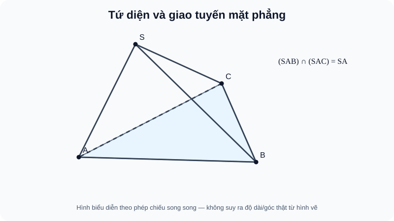
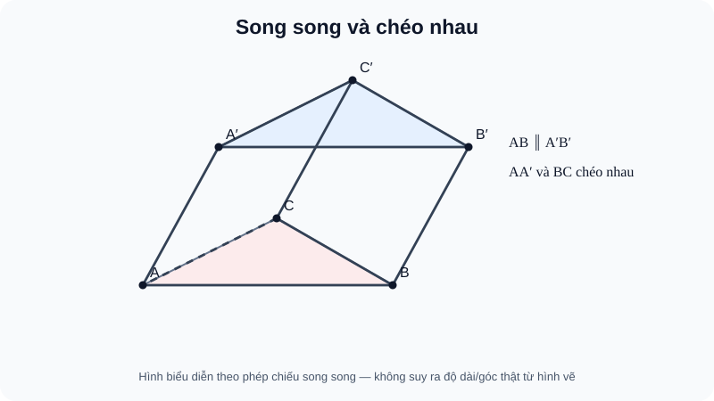
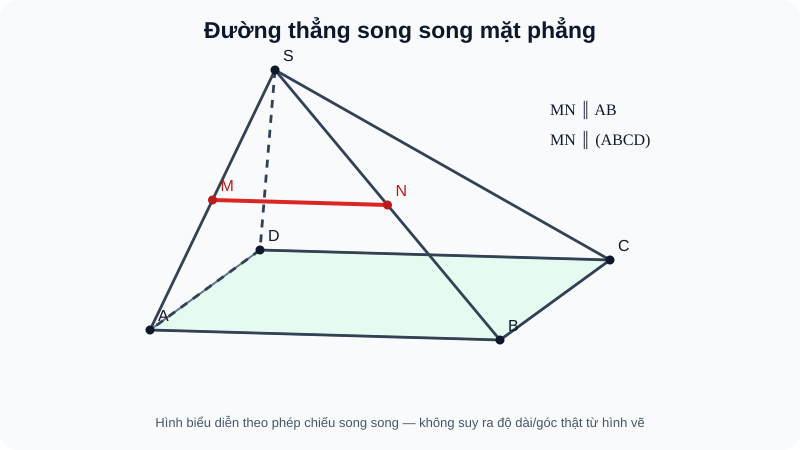
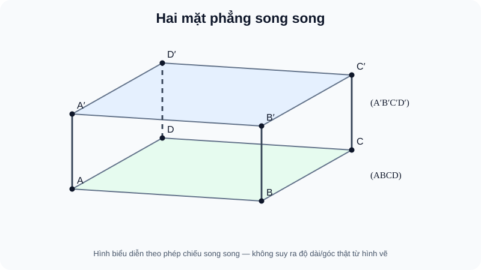
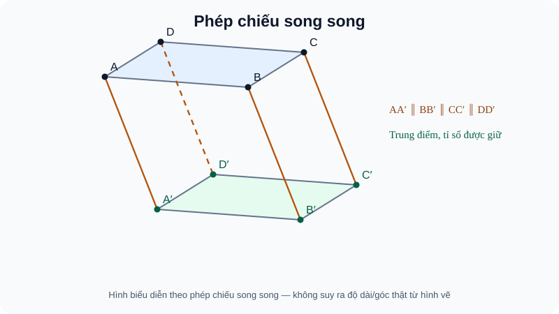

# CĐ15 (mã làm việc) — Quan hệ song song trong không gian · học liệu tự học R02 · bổ sung tiền đề & hình nguồn

> **AUTHORING R01 — CANDIDATE, không phải CONTENT_READY.** `STANDARD_ID=SLM-THPT-QUALITY-ONE` · `STANDARD_VERSION=3.1.0` · `Q18_VERIFICATION_MODE=AUTHOR_SELF_VERIFIED` (đang kiểm, chưa ký kết).  
> Phạm vi dự kiến theo nhánh 22 Chuyên đề chưa được đối chiếu một danh mục phân mã cuối cùng: giữ nhãn `PLAN22-15_PROVISIONAL`; không tạo route website hay suy thành tên/ID chủ dự án đã khóa.  
> Học sinh chỉ nhìn **Kiến thức / Luyện tập / Tự kiểm tra**. Mã outcome, model và item bên dưới là metadata tác giả (không hiển thị trên trang học sinh).

**Nguồn S1 dùng để đối chiếu:** SGK Kết nối tri thức Toán 11 Tập Một Chương IV B10–B14 (trang in lần lượt 70–77, 78–83, 84–87, 88–94, 95–101; cuối chương 102–103), SBT tr.53–74. Đây là **receipt S1 lịch sử** từ nguồn SGK ChIV R03 Git blob `e945ccdd434689a5c6d8d7bfd44ba26d287a7b9b` / Draft PR #705, *không nhận là đã mở đọc PDF SGK/SBT mới tại lượt này*. Phạm vi kiến thức tuân theo đúng 22 outcome trong nguồn đó; các ví dụ tọa độ là cách minh họa bổ trợ, không quảng bá thành một chuẩn Core SGK mới.

## Kiến thức

**Đường đi của chuyên đề.** Ta bắt đầu từ cách xác định mặt phẳng để hiểu vì sao hình vẽ 2D có thể đánh lừa; từ đó phân biệt đường thẳng song song và chéo nhau, nhận biết quan hệ đường–mặt và hai mặt, cuối cùng nhìn lại toàn bộ hình bằng phép chiếu song song. Mỗi kết luận dựa trên điều kiện toán, không dựa vào cảm giác hình vẽ. Hãy tự làm câu Vận dụng trước khi mở Đối chiếu.

**Những điều cần biết trước khi bắt đầu.** Học sinh chỉ cần quen với tam giác, định lý Thales/đường trung bình, hình bình hành và ý nghĩa điểm–đường thẳng–mặt phẳng. Khi hai đường cắt nhau, chúng xác định một mặt phẳng; khi hai đường không cắt, phải kiểm xem chúng có cùng mặt phẳng hay không. Tên ``(ABC)`` chỉ có nghĩa xác định duy nhất khi ba điểm không thẳng hàng. Nếu mới học hình không gian, hãy đọc kỹ phần hình học bằng lời trước; các ví dụ tọa độ dưới đây là **một cách kiểm chứng bổ sung**, không phải điều kiện để hiểu định lý.

Tùy chọn: cách đọc minh họa tọa độ khi em cần

**Cách đọc ví dụ tọa độ (không cần học trước hình giải tích không gian lớp 12).** Ba số ``(x,y,z)`` lần lượt là vị trí theo ba trục vuông góc; ``z=0`` biểu diễn một mặt phẳng nằm ngang, ``z=c`` một mặt phẳng nằm ngang khác. Một đường viết ``(x,y,z)=(a,b,c)+t(u,v,w)`` nghĩa là chọn **cùng một số thực t** để có một điểm trên đường: ``x=a+tu, y=b+tv, z=c+tw``. Muốn tìm giao với ``z=0``, giải ``c+tw=0`` và thay lại vào cả ba tọa độ. Nếu ``w=0`` và ``c=0`` đường **nằm trong** mặt; nếu ``w=0`` nhưng ``c≠0`` đường **song song phân biệt**; nếu ``w≠0`` đường **cắt** mặt đúng một điểm. Phép biến đổi ``T(x,y,z)`` ở mạch cuối chỉ là chiếu một điểm theo một phương cố định, không phải một công thức học thuộc bắt buộc. Khi không quen tọa độ, có thể kiểm cùng một kết luận bằng quan hệ giao tuyến và định lý song song đã giải thích.

**Cách học với hình.** Mỗi hình mô tả một cấu hình có thật; các nét đứt chỉ cạnh khuất. Hãy xác định điểm, cạnh, mặt liên quan trước khi đọc quan hệ song song. Tên hình/nguồn nằm trong chú thích dành cho tác giả, không phải điều kiện để chứng minh.

### Mạch 1. Từ điểm và đường đến thiết diện của tứ diện

Trong bản vẽ phối cảnh, nét vẽ chưa chứng minh được quan hệ thuộc. Hãy bắt đầu từ hai điểm chung và hai mặt chung.

<!-- VISUAL_ID: FIG-G11-B10-01; REUSE_ORIGINAL_SGK_SOURCE_BLOB: e945ccdd434689a5c6d8d7bfd44ba26d287a7b9b -->

**Đọc hình trước khi suy luận.** Hai mặt chứa đỉnh S và cạnh SA cùng có hai điểm S,A, nên giao tuyến là SA. Đường nét đứt biểu diễn cạnh bị che, **không chứng minh** hai đường chéo nhau. Nếu ảnh không mở được, hãy hình dung tứ diện có ba điểm A,B,C ở đáy và S ngoài mặt đáy.

#### 1. Điểm và đường thuộc mặt phẳng
<!-- LESSON_ID: TOP15-M01; OUTCOME_ID: TOP15-O01; ORIGINAL_SGK_OUTCOME: G11-B10-INCIDENCE; ORIGINAL_S1_BLOB: e945ccdd434689a5c6d8d7bfd44ba26d287a7b9b -->

Một điểm thuộc một mặt phẳng không buộc mọi điểm gần nó cũng thuộc mặt. Nhưng nếu **hai điểm phân biệt** thuộc mặt, đường thẳng qua hai điểm đó nằm trọn trong mặt. Đây là cách chuyển từ dữ kiện về điểm thành một đường nằm trong mặt — bước thường cần trước khi tìm giao tuyến.

**Ví dụ có lý do chọn cách.** Trong hình chóp S.ABC, A và B cùng thuộc mặt đáy (ABC) nên AB⊂(ABC). Nếu M nằm trên AB thì M∈(ABC) dù M không được đánh dấu rõ trên hình.

<!-- ITEM_ID: THPT-TOP15-T01; ROLE: TOPIC_FIRST_TRY; OUTCOME: TOP15-O01; PUBLIC_FORMATIVE_NO_MASTERY -->
**Vận dụng trước khi xem lời giải.** A,B∈(P), A≠B; M chia AB theo tỉ số AM:MB=2:1. M có thuộc (P) không?

Đối chiếu

Có. M thuộc đường AB, mà AB⊂(P); không cần biết tỉ số để suy quan hệ thuộc.

**Nếu còn vướng.** Em chỉ nhìn M ở gần mặt: quay lại nguyên tắc “hai điểm xác định đường nằm trong mặt”, rồi tìm hai điểm thuộc (P) trên một đường đã cho.

#### 2. Xác định một mặt phẳng
<!-- LESSON_ID: TOP15-M02; OUTCOME_ID: TOP15-O02; ORIGINAL_SGK_OUTCOME: G11-B10-PLANE; ORIGINAL_S1_BLOB: e945ccdd434689a5c6d8d7bfd44ba26d287a7b9b -->

Ba điểm bất kỳ chưa chắc xác định duy nhất mặt phẳng: **ba điểm không thẳng hàng** mới đủ. Các cách tương đương là một đường với điểm ngoài nó, hai đường cắt nhau, hoặc hai đường phân biệt song song. Luôn kiểm điều kiện “ngoài”, “cắt”, “phân biệt” trước khi gọi tên mặt.

**Ví dụ có lý do chọn cách.** A,B,C không thẳng hàng xác định (ABC). Nếu D∈AB thì (ABD) không dùng để chỉ một mặt phẳng duy nhất, vì A,B,D cùng nằm một đường.

<!-- ITEM_ID: THPT-TOP15-T02; ROLE: TOPIC_FIRST_TRY; OUTCOME: TOP15-O02; PUBLIC_FORMATIVE_NO_MASTERY -->
**Vận dụng trước khi xem lời giải.** Một đường a và điểm M∉a xác định bao nhiêu mặt phẳng?

Đối chiếu

Đúng một mặt phẳng. Nếu M∈a sẽ có vô số mặt phẳng chứa a.

**Nếu còn vướng.** Nếu em chỉ dựa ba ký tự trong (ABC), thử kiểm ba điểm có thẳng hàng hay không.

#### 3. Giao tuyến của hai mặt phẳng
<!-- LESSON_ID: TOP15-M03; OUTCOME_ID: TOP15-O03; ORIGINAL_SGK_OUTCOME: G11-B10-PLANE_INTERSECTION; ORIGINAL_S1_BLOB: e945ccdd434689a5c6d8d7bfd44ba26d287a7b9b -->

Giao tuyến là **đường thẳng chung** của hai mặt phẳng phân biệt có giao. Cách chắc chắn nhất là chỉ ra hai điểm chung phân biệt, rồi kiểm chúng nằm trong cả hai mặt. Không suy giao tuyến từ nét vẽ và không gọi giao tuyến khi hai mặt phẳng song song hoặc trùng nhau.

**Ví dụ có lý do chọn cách.** Trong tứ diện S.ABC, (SAB) và (SAC) cùng chứa S,A; hai mặt phân biệt nên giao tuyến là SA.

<!-- ITEM_ID: THPT-TOP15-T03; ROLE: TOPIC_FIRST_TRY; OUTCOME: TOP15-O03; PUBLIC_FORMATIVE_NO_MASTERY -->
**Vận dụng trước khi xem lời giải.** Trong tứ diện S.ABC, giao tuyến của (SAB) và (SBC) là gì?

Đối chiếu

SB vì S,B là hai điểm chung phân biệt của hai mặt.

**Nếu còn vướng.** Nếu thiếu một điểm chung, hãy liệt kê các cạnh nằm trong từng mặt trước khi kết luận.

#### 4. Giao điểm của đường và mặt
<!-- LESSON_ID: TOP15-M04; OUTCOME_ID: TOP15-O04; ORIGINAL_SGK_OUTCOME: G11-B10-LINE_PLANE; ORIGINAL_S1_BLOB: e945ccdd434689a5c6d8d7bfd44ba26d287a7b9b -->

Khi không nhìn thấy trực tiếp giao điểm M=d∩(P), hãy dựng mặt phụ (Q) chứa d, tìm g=(P)∩(Q), rồi giải d∩g. Bước kiểm tra sau cùng là M thật sự tồn tại; đường d có thể song song hoặc nằm trọn trong (P).

**Ví dụ có lý do chọn cách.** Trong tứ diện S.ABC, M∈SB, M khác S,B. Vì M∈(SAB) và C∉(SAB), đường CM gặp mặt (SAB) đúng tại M.

<!-- ITEM_ID: THPT-TOP15-T04; ROLE: TOPIC_FIRST_TRY; OUTCOME: TOP15-O04; PUBLIC_FORMATIVE_NO_MASTERY -->
**Vận dụng trước khi xem lời giải.** Với d:(x,y,z)=(1+t,2,3+t), d cắt (P):z=0 ở đâu?

Đối chiếu

t=−3, nên d∩(P)={(-2,2,0)}.

**Nếu còn vướng.** Nếu giải ra t mà không xác định đúng điểm, thay t ngược vào cả ba tọa độ.

#### 5. Thiết diện phải nằm trong khối
<!-- LESSON_ID: TOP15-M05; OUTCOME_ID: TOP15-O05; ORIGINAL_SGK_OUTCOME: G11-B10-SECTION; ORIGINAL_S1_BLOB: e945ccdd434689a5c6d8d7bfd44ba26d287a7b9b -->

Thiết diện là phần chung của **mặt cắt** với khối, không phải mọi đường kéo dài trên hình. Muốn dựng đúng, tìm giao của mặt cắt với từng mặt của khối và chỉ giữ các đoạn bên trong cạnh/mặt. Điểm trên cạnh kéo dài khác điểm nằm trong đoạn cạnh.

**Ví dụ có lý do chọn cách.** M,N,K nằm trong SA,SB,SC của tứ diện S.ABC. Các đoạn MN,NK,KM lần lượt nằm trong ba mặt bên; thiết diện là tam giác MNK.

<!-- ITEM_ID: THPT-TOP15-T05; ROLE: TOPIC_FIRST_TRY; OUTCOME: TOP15-O05; PUBLIC_FORMATIVE_NO_MASTERY -->
**Vận dụng trước khi xem lời giải.** Trong tứ diện S.ABC, P nằm trong AB. Mặt (SCP) cắt đáy và mặt (SAB) theo các đoạn nào?

Đối chiếu

Theo CP và SP; cạnh còn lại của thiết diện là SC. Thiết diện là tam giác SCP.

**Nếu còn vướng.** Nếu em nối nhầm đỉnh, chỉ chọn hai điểm chung trên **cùng** một mặt của tứ diện.

### Mạch 2. Song song hay chéo nhau?

Bài toán không gian có thêm quan hệ chéo nhau. Điều kiện đồng phẳng quyết định ranh giới.

<!-- VISUAL_ID: FIG-G11-B11-01; REUSE_ORIGINAL_SGK_SOURCE_BLOB: e945ccdd434689a5c6d8d7bfd44ba26d287a7b9b -->

**Đọc hình trước khi suy luận.** Cạnh AB và A′B′ cùng hướng trong các mặt đáy của lăng trụ, nhưng AA′ và BC là hai đường chéo nhau. Việc hai nét chạm nhau trong hình chiếu không đồng nghĩa chúng có cùng một điểm không gian.

#### 6. Bốn quan hệ giữa hai đường trong không gian
<!-- LESSON_ID: TOP15-M06; OUTCOME_ID: TOP15-O06; ORIGINAL_SGK_OUTCOME: G11-B11-RELATIVE; ORIGINAL_S1_BLOB: e945ccdd434689a5c6d8d7bfd44ba26d287a7b9b -->

Hai đường có thể trùng, cắt, song song phân biệt hoặc chéo nhau. **Không giao không đủ để kết luận song song**: cần kiểm thêm đồng phẳng. Trong tứ diện, hai cạnh đối SA và BC không đồng phẳng nên chéo nhau. Hai đường trùng nhau không gọi song song khi định nghĩa yêu cầu phân biệt.

**Ví dụ có lý do chọn cách.** Trong hình hộp, AB và A′B′ song song; AB và AA′ cắt ở A; AB và C′D′ có thể song song; AB và B′C′ chéo nhau (với hình hộp không suy biến).

<!-- ITEM_ID: THPT-TOP15-T06; ROLE: TOPIC_FIRST_TRY; OUTCOME: TOP15-O06; PUBLIC_FORMATIVE_NO_MASTERY -->
**Vận dụng trước khi xem lời giải.** Trong tứ diện S.ABC, SA và BC có phải song song vì không gặp nhau?

Đối chiếu

Không; SA và BC chéo nhau do không đồng phẳng.

**Nếu còn vướng.** Trước khi nói “song song”, hỏi: có một mặt phẳng chứa **cả hai** đường không?

#### 7. Nhận biết đồng phẳng và chéo nhau
<!-- LESSON_ID: TOP15-M07; OUTCOME_ID: TOP15-O07; ORIGINAL_SGK_OUTCOME: G11-B11-COPLANAR; ORIGINAL_S1_BLOB: e945ccdd434689a5c6d8d7bfd44ba26d287a7b9b -->

Hai đường **cắt nhau** hoặc **song song** luôn đồng phẳng; hai đường chéo không đồng phẳng. Ta có thể chứng minh chéo nhau bằng phản chứng: giả sử có mặt chứa hai cạnh đối của tứ diện, mặt ấy phải chứa cả bốn đỉnh của tứ diện — điều không thể.

**Ví dụ có lý do chọn cách.** SA và BC trong tứ diện S.ABC nếu đồng phẳng thì mặt phẳng đó chứa S,A,B,C, trái với S∉(ABC), nên hai đường chéo.

<!-- ITEM_ID: THPT-TOP15-T07; ROLE: TOPIC_FIRST_TRY; OUTCOME: TOP15-O07; PUBLIC_FORMATIVE_NO_MASTERY -->
**Vận dụng trước khi xem lời giải.** Hai đường cắt nhau tại M có thể chéo nhau không?

Đối chiếu

Không. Hai đường cắt nhau xác định duy nhất một mặt phẳng, nên đồng phẳng.

**Nếu còn vướng.** Nếu lập luận “không cắt nên chéo”, hãy thử tìm một mặt phẳng chứa cả hai đường.

#### 8. Chứng minh song song qua tam giác
<!-- LESSON_ID: TOP15-M08; OUTCOME_ID: TOP15-O08; ORIGINAL_SGK_OUTCOME: G11-B11-PARALLEL_PROOF; ORIGINAL_S1_BLOB: e945ccdd434689a5c6d8d7bfd44ba26d287a7b9b -->

Đường trung bình và Thales đảo cung cấp chứng minh **trong một tam giác xác định**. Nếu M∈SA, N∈SB và SM/SA=SN/SB với M,N khác S, ta có MN∥AB. Không cần hai đoạn bằng nhau về độ dài, mà cần **hai tỉ số** tương ứng bằng nhau.

**Ví dụ có lý do chọn cách.** Trong tam giác SAB, M,N là trung điểm SA,SB. Vì SM/SA=SN/SB=1/2, suy MN∥AB.

<!-- ITEM_ID: THPT-TOP15-T08; ROLE: TOPIC_FIRST_TRY; OUTCOME: TOP15-O08; PUBLIC_FORMATIVE_NO_MASTERY -->
**Vận dụng trước khi xem lời giải.** Nếu SM/SA=SN/SB=3/5, M,N nằm trên hai cạnh SA,SB, kết luận về MN và AB?

Đối chiếu

MN∥AB nhờ Thales đảo trong tam giác SAB.

**Nếu còn vướng.** Nếu chỉ biết SM=SN, hãy kiểm hai cạnh SA,SB có bằng nhau hay không trước khi dùng Thales.

#### 9. Giao tuyến của hai mặt chứa đường cùng hướng
<!-- LESSON_ID: TOP15-M09; OUTCOME_ID: TOP15-O09; ORIGINAL_SGK_OUTCOME: G11-B11-INTERSECT_PLANES; ORIGINAL_S1_BLOB: e945ccdd434689a5c6d8d7bfd44ba26d287a7b9b -->

Khi hai mặt phẳng cắt nhau và trong mỗi mặt có đường thẳng cùng phương, có thể xác định **phương của giao tuyến**. Cần đồng thời chứng minh hai mặt thật sự cắt nhau; nếu chúng song song thì không tồn tại giao tuyến để nói đến. Dữ kiện một đường song song một mặt khác phải xét vị trí của nó.

**Ví dụ có lý do chọn cách.** Hình chóp S.ABCD có đáy ABCD là hình bình hành. Hai mặt (SAB) và (SCD) phân biệt cùng chứa S và lần lượt chứa AB,CD với AB∥CD, nên giao tuyến là đường qua S song song AB.

<!-- ITEM_ID: THPT-TOP15-T09; ROLE: TOPIC_FIRST_TRY; OUTCOME: TOP15-O09; PUBLIC_FORMATIVE_NO_MASTERY -->
**Vận dụng trước khi xem lời giải.** Trong chóp S.ABCD đáy hình bình hành, giao tuyến (SAD)∩(SBC) có phương của cạnh nào?

Đối chiếu

Là đường qua S song song AD và BC vì AD∥BC.

**Nếu còn vướng.** Nếu chưa tìm được giao tuyến, xác định một điểm chung trước, rồi chứng minh phương giao tuyến.

### Mạch 3. Đường thẳng so với mặt phẳng

Đặt cây bút gần mặt bàn: nó có thể ở hẳn trên, nằm trong hoặc xuyên qua mặt. Cần phân biệt bằng số điểm chung.

<!-- VISUAL_ID: FIG-G11-B12-01; REUSE_ORIGINAL_SGK_SOURCE_BLOB: e945ccdd434689a5c6d8d7bfd44ba26d287a7b9b -->

**Đọc hình trước khi suy luận.** M,N là trung điểm trên hai cạnh SA,SB, nên MN cùng phương AB nhưng không nằm trong mặt đáy (ABC). Không bỏ qua điều kiện đoạn MN **không thuộc mặt đáy** khi kết luận đường song song mặt.

#### 10. Ba quan hệ giữa đường và mặt
<!-- LESSON_ID: TOP15-M10; OUTCOME_ID: TOP15-O10; ORIGINAL_SGK_OUTCOME: G11-B12-POSITIONS; ORIGINAL_S1_BLOB: e945ccdd434689a5c6d8d7bfd44ba26d287a7b9b -->

Một đường thẳng với một mặt phẳng có đúng ba khả năng: nằm trong mặt (vô số điểm chung), cắt tại một điểm, hoặc song song (không điểm chung). Với mặt z=0, xem thành phần z của đường theo tham số giúp phân loại chính xác thay vì đoán từ hình.

**Ví dụ có lý do chọn cách.** d:(t,0,1+t) cắt z=0 tại t=−1; e:(t,0,1) song song mặt; f:(t,0,0) nằm trọn trong mặt.

<!-- ITEM_ID: THPT-TOP15-T10; ROLE: TOPIC_FIRST_TRY; OUTCOME: TOP15-O10; PUBLIC_FORMATIVE_NO_MASTERY -->
**Vận dụng trước khi xem lời giải.** Đường d:(1+t,2,3) có quan hệ gì với z=0?

Đối chiếu

Song song vì z luôn bằng 3≠0.

**Nếu còn vướng.** Hãy xét phương trình z=0 với **mọi** t trước khi gọi một đường là nằm trong mặt.

#### 11. Điều kiện không được bỏ trong dấu hiệu
<!-- LESSON_ID: TOP15-M11; OUTCOME_ID: TOP15-O11; ORIGINAL_SGK_OUTCOME: G11-B12-PARALLEL_TEST; ORIGINAL_S1_BLOB: e945ccdd434689a5c6d8d7bfd44ba26d287a7b9b -->

Nếu d song song một đường a nằm trong (P), có **hai** khả năng: d nằm trong (P), hoặc d song song (P). Muốn kết luận d∥(P) còn phải kiểm d không nằm trong (P), ví dụ chỉ ra một điểm của d ở ngoài mặt. Hai đường chỉ “cùng hướng” chưa đủ.

**Ví dụ có lý do chọn cách.** Trong tứ diện S.ABC, M,N là trung điểm SA,SB, nên MN∥AB⊂(ABC) và MN∉(ABC). Vậy MN∥(ABC).

<!-- ITEM_ID: THPT-TOP15-T11; ROLE: TOPIC_FIRST_TRY; OUTCOME: TOP15-O11; PUBLIC_FORMATIVE_NO_MASTERY -->
**Vận dụng trước khi xem lời giải.** d và a là hai đường phân biệt cùng nằm trong (P), d∥a. Có thể kết luận d∥(P) không?

Đối chiếu

Không; d nằm trong (P) nên có vô số điểm chung với (P).

**Nếu còn vướng.** Nếu em chứng minh d∥a rồi dừng, cần kiểm thêm d⊄(P).

<!-- MODEL_ID: SLM-TOP15-LINE-PLANE-R00; MODEL_VERSION: R01; PLACEMENT: TOP15-O11; PUBLIC_DISCOVERY_NO_MASTERY -->

**Mô hình quan sát:** [Mở thí nghiệm đường–mặt](./Temp_THPT_TOPIC15_LINE_PLANE_RELATION_R01_20261113.html) — chỉ dùng khi chạy được HTML. Thử h=0/khác 0 và α=0/khác 0 để thấy ba trạng thái; nếu mô hình không chạy, dùng công thức mặt z=0 và đường d=(t,0,h+t·tanα) rồi giải z=0. Mô hình không làm thay chứng minh và không ghi điểm. Hình là **mặt cắt xOz**, không phải một mô hình 3D thật; giao có thể ở ngoài cửa sổ nhìn.

#### 12. Giao tuyến khi có đường song song mặt khác
<!-- LESSON_ID: TOP15-M12; OUTCOME_ID: TOP15-O12; ORIGINAL_SGK_OUTCOME: G11-B12-PLANE_INTERSECTION; ORIGINAL_S1_BLOB: e945ccdd434689a5c6d8d7bfd44ba26d287a7b9b -->

Nếu d⊂(Q), d∥(P), và hai mặt (P),(Q) cắt nhau theo g thì d,g cùng nằm trong (Q), phân biệt và không cắt nhau; vì d không có điểm chung với (P) còn g⊂(P). Suy d∥g. Đây là cách tìm phương giao tuyến, không được dùng khi (P),(Q) không cắt.

**Ví dụ có lý do chọn cách.** Trong mặt bên (SAB) của một tứ diện, MN∥AB với M,N thuộc SA,SB và khác đáy. Vì (SAB)∩(ABC)=AB, nên MN song song giao tuyến AB.

<!-- ITEM_ID: THPT-TOP15-T12; ROLE: TOPIC_FIRST_TRY; OUTCOME: TOP15-O12; PUBLIC_FORMATIVE_NO_MASTERY -->
**Vận dụng trước khi xem lời giải.** Trong (Q), d∥(P) và g=(Q)∩(P). d và g có thể cắt nhau không?

Đối chiếu

Không, vì giao điểm nếu có thuộc (P), trái d∥(P); do đó d∥g.

**Nếu còn vướng.** Nếu chưa biết g có tồn tại, hãy xác minh hai mặt cắt nhau trước khi áp dụng.

#### 13. Dựng mặt phẳng cắt song song đáy
<!-- LESSON_ID: TOP15-M13; OUTCOME_ID: TOP15-O13; ORIGINAL_SGK_OUTCOME: G11-B12-CONSTRUCTION; ORIGINAL_S1_BLOB: e945ccdd434689a5c6d8d7bfd44ba26d287a7b9b -->

Để dựng mặt cắt qua M nằm trên SA và song song đáy (ABC), tìm trên SB,SC các điểm N,K có SN/SB=SK/SC=SM/SA=t. Khi 0<t<1, MN∥AB và MK∥AC, suy mặt (MNK)∥(ABC). Không dựng tùy ý N,K theo mắt.

**Ví dụ có lý do chọn cách.** Nếu M là trung điểm SA trong tứ diện, mặt qua M song song đáy gặp SB,SC tại trung điểm N,K. Thiết diện MNK là tam giác.

<!-- ITEM_ID: THPT-TOP15-T13; ROLE: TOPIC_FIRST_TRY; OUTCOME: TOP15-O13; PUBLIC_FORMATIVE_NO_MASTERY -->
**Vận dụng trước khi xem lời giải.** Cho SM/SA=2/3, chọn SN/SB và SK/SC bằng bao nhiêu để mặt cắt song song đáy?

Đối chiếu

Cả hai tỉ số bằng 2/3.

**Nếu còn vướng.** Khi dựng không đúng thiết diện, quay lại hai tam giác SAB, SAC và dùng Thales đảo.

### Mạch 4. Hai mặt phẳng song song và mặt cắt

Một mặt sàn và trần có thể song song, nhưng một vết cắt tạo ra hai đường song song; tỉ số đồng dạng cho phép tính kích thước.

<!-- VISUAL_ID: FIG-G11-B13-01; REUSE_ORIGINAL_SGK_SOURCE_BLOB: e945ccdd434689a5c6d8d7bfd44ba26d287a7b9b -->

**Đọc hình trước khi suy luận.** Hai mặt đáy hình hộp phân biệt, không giao nhau. Mặt thứ ba cắt cả hai mặt theo hai đường nằm trên chính mặt cắt ấy; vì không thể có điểm chung, hai giao tuyến song song. Hình biểu diễn không cho phép đo trực tiếp độ dài/góc thật.

#### 14. Ba quan hệ giữa hai mặt phẳng
<!-- LESSON_ID: TOP15-M14; OUTCOME_ID: TOP15-O14; ORIGINAL_SGK_OUTCOME: G11-B13-PLANE_POSITIONS; ORIGINAL_S1_BLOB: e945ccdd434689a5c6d8d7bfd44ba26d287a7b9b -->

Hai mặt phẳng có thể trùng, cắt theo một đường, hoặc phân biệt và song song. Điều kiện “phân biệt” rất quan trọng: hai phương trình khác cách viết vẫn có thể chỉ cùng một mặt. Mặt z=0 và z=2 song song; mặt z=0 và x=0 cắt theo đường x=z=0.

**Ví dụ có lý do chọn cách.** (P):z=0; (Q):z=2 có cùng pháp tuyến và khác vị trí nên song song. (R):x=0 cắt (P) theo đường (0,t,0).

<!-- ITEM_ID: THPT-TOP15-T14; ROLE: TOPIC_FIRST_TRY; OUTCOME: TOP15-O14; PUBLIC_FORMATIVE_NO_MASTERY -->
**Vận dụng trước khi xem lời giải.** Hai mặt z=0 và 2z=0 trùng hay song song phân biệt?

Đối chiếu

Trùng nhau, vì chúng cùng tập điểm z=0.

**Nếu còn vướng.** Nếu chỉ thấy hai pháp tuyến cùng phương, kiểm hai phương trình có cùng tập nghiệm không.

#### 15. Dấu hiệu hai mặt song song
<!-- LESSON_ID: TOP15-M15; OUTCOME_ID: TOP15-O15; ORIGINAL_SGK_OUTCOME: G11-B13-PLANE_TEST; ORIGINAL_S1_BLOB: e945ccdd434689a5c6d8d7bfd44ba26d287a7b9b -->

Nếu trong (P) có hai đường **cắt nhau** a,b và **cả hai** đều song song (Q), thì (P)∥(Q). Một đường a riêng lẻ không đủ: mặt (P) có thể cắt (Q) theo đường g và chứa đường a song song g nhưng không nằm trong (Q).

**Ví dụ có lý do chọn cách.** Trong tứ diện S.ABC, M,N,K là trung điểm SA,SB,SC. MN và MK cắt nhau tại M, cả hai song song (ABC), nên (MNK)∥(ABC).

<!-- ITEM_ID: THPT-TOP15-T15; ROLE: TOPIC_FIRST_TRY; OUTCOME: TOP15-O15; PUBLIC_FORMATIVE_NO_MASTERY -->
**Vận dụng trước khi xem lời giải.** Cho a,b⊂(P) nhưng a∥b và a∥(Q),b∥(Q). Có đủ kết luận (P)∥(Q) không?

Đối chiếu

Chưa đủ. Cần a và b cắt nhau trong (P), không song song với nhau.

**Nếu còn vướng.** Nếu chỉ có một cặp đường, hãy tìm thêm một đường trong mặt thứ nhất cắt đường đã có.

#### 16. Mặt thứ ba cắt hai mặt song song
<!-- LESSON_ID: TOP15-M16; OUTCOME_ID: TOP15-O16; ORIGINAL_SGK_OUTCOME: G11-B13-TRANSVERSAL; ORIGINAL_S1_BLOB: e945ccdd434689a5c6d8d7bfd44ba26d287a7b9b -->

Nếu (P)∥(Q) và (R) cắt cả hai theo các đường g,h, thì g∥h. Lý do: g,h cùng nằm trong (R); nếu cắt nhau thì điểm giao thuộc cả (P) lẫn (Q), vô lý. Từ giả thiết không giao ta thu được cặp đường song song trong mặt (R).

**Ví dụ có lý do chọn cách.** Các mặt z=0 và z=2 song song. Mặt x=0 cắt chúng theo g:(0,t,0) và h:(0,t,2), hai đường song song.

<!-- ITEM_ID: THPT-TOP15-T16; ROLE: TOPIC_FIRST_TRY; OUTCOME: TOP15-O16; PUBLIC_FORMATIVE_NO_MASTERY -->
**Vận dụng trước khi xem lời giải.** Nếu (R) chỉ cắt (P) nhưng song song (Q), có được phát biểu hai giao tuyến song song không?

Đối chiếu

Không; chưa có giao tuyến thứ hai. Hơn nữa nếu (P)∥(Q), một mặt (R) cắt (P) thì cũng cắt (Q); giả thiết vừa nêu mâu thuẫn.

**Nếu còn vướng.** Phải xác định đủ hai giao tuyến trên (R) trước khi so sánh chúng.

#### 17. Mặt cắt song song và tỉ số đồng dạng
<!-- LESSON_ID: TOP15-M17; OUTCOME_ID: TOP15-O17; ORIGINAL_SGK_OUTCOME: G11-B13-PRISM_RATIO; ORIGINAL_S1_BLOB: e945ccdd434689a5c6d8d7bfd44ba26d287a7b9b -->

Mặt cắt song song đáy hình chóp tạo ra đa giác đồng dạng với đáy: tỉ số mọi độ dài là t, tỉ số chu vi là t, còn tỉ số **diện tích là t²**. Điều này đúng khi mặt cắt thật sự song song đáy và tỉ số trên các cạnh xuất phát từ đỉnh S là như nhau.

**Ví dụ có lý do chọn cách.** Trong tứ diện S.ABC, SM/SA=SN/SB=SK/SC=3/5, diện tích đáy ABC bằng 75 cm². Diện tích MNK=(3/5)²·75=27 cm².

<!-- ITEM_ID: THPT-TOP15-T17; ROLE: TOPIC_FIRST_TRY; OUTCOME: TOP15-O17; PUBLIC_FORMATIVE_NO_MASTERY -->
**Vận dụng trước khi xem lời giải.** Khi t=2/5, diện tích đáy 100 cm², diện tích thiết diện bao nhiêu?

Đối chiếu

(2/5)²·100=16 cm².

**Nếu còn vướng.** Nếu em nhân diện tích với t, hãy thử so sánh một hình có cả chiều ngang và chiều dọc đều nhân t.

### Mạch 5. Phép chiếu song song và hình biểu diễn

Phép chiếu **song song** theo một phương cố định giúp biểu diễn hình không gian trên mặt phẳng. Đây không phải phép chiếu phối cảnh với các tia hội tụ; hình biểu diễn cũng có giới hạn về góc và độ dài.

<!-- VISUAL_ID: FIG-G11-B14-01; REUSE_ORIGINAL_SGK_SOURCE_BLOB: e945ccdd434689a5c6d8d7bfd44ba26d287a7b9b -->

**Đọc hình trước khi suy luận.** Các đường nối mỗi đỉnh với ảnh có cùng phương; hai cạnh song song vẫn có ảnh song song khi hình không suy biến. Tuy nhiên góc vuông và độ dài không được bảo toàn nói chung. Hãy kiểm bằng điều kiện, không ước lượng góc từ hình vẽ.

#### 18. Phép chiếu theo một phương cố định
<!-- LESSON_ID: TOP15-M18; OUTCOME_ID: TOP15-O18; ORIGINAL_SGK_OUTCOME: G11-B14-PROJECTION_DEF; ORIGINAL_S1_BLOB: e945ccdd434689a5c6d8d7bfd44ba26d287a7b9b -->

Chọn mặt chiếu (P) và phương v **không song song (P)**. Qua mỗi điểm M có duy nhất đường theo phương v cắt (P) tại ảnh M′; vì vậy phép chiếu được xác định trên mọi điểm. Với (P):z=0 và v=(1,0,1), ảnh của (x,y,z) là T(x,y,z)=(x−z,y,0).

**Ví dụ có lý do chọn cách.** M(1,2,3) có ảnh T(M)=(-2,2,0), vì M−3(1,0,1)=(-2,2,0).

<!-- ITEM_ID: THPT-TOP15-T18; ROLE: TOPIC_FIRST_TRY; OUTCOME: TOP15-O18; PUBLIC_FORMATIVE_NO_MASTERY -->
**Vận dụng trước khi xem lời giải.** Tìm ảnh N(3,−1,2) dưới phép chiếu T(x,y,z)=(x−z,y,0).

Đối chiếu

N′=(1,−1,0). Kiểm z′=0 và N−N′=2(1,0,1).

**Nếu còn vướng.** Nếu phương chiếu v có tọa độ z bằng 0, đường qua điểm ngoài z=0 sẽ không gặp mặt; cần đổi phương.

#### 19. Vì sao một đoạn có thể co thành điểm
<!-- LESSON_ID: TOP15-M19; OUTCOME_ID: TOP15-O19; ORIGINAL_SGK_OUTCOME: G11-B14-DEGENERACY; ORIGINAL_S1_BLOB: e945ccdd434689a5c6d8d7bfd44ba26d287a7b9b -->

Một đường thẳng **song song phương chiếu** có tất cả điểm trên cùng một đường chiếu; ảnh của cả đường chỉ là một điểm. Đây là suy biến có nghĩa hình học, không phải lỗi đồ họa. Nếu đường không song song phương chiếu, ảnh của nó là một đường.

**Ví dụ có lý do chọn cách.** Với T(x,y,z)=(x−z,y,0), U(1,2,3), V(3,2,5) có cùng ảnh (-2,2,0), bởi UV=(2,0,2) cùng phương (1,0,1).

<!-- ITEM_ID: THPT-TOP15-T19; ROLE: TOPIC_FIRST_TRY; OUTCOME: TOP15-O19; PUBLIC_FORMATIVE_NO_MASTERY -->
**Vận dụng trước khi xem lời giải.** Đường d:(x,y,z)=(1+t,2,3+t) có ảnh qua T là đường hay điểm?

Đối chiếu

Một điểm: T(1+t,2,3+t)=(-2,2,0) với mọi t.

**Nếu còn vướng.** Nếu hai điểm khác nhau cùng ảnh, kiểm hiệu hai tọa độ của chúng có song song phương chiếu không.

#### 20. Tỉ số và trung điểm dưới phép chiếu
<!-- LESSON_ID: TOP15-M20; OUTCOME_ID: TOP15-O20; ORIGINAL_SGK_OUTCOME: G11-B14-AFFINE_INVARIANTS; ORIGINAL_S1_BLOB: e945ccdd434689a5c6d8d7bfd44ba26d287a7b9b -->

Phép chiếu song song là phép biến đổi affine: nếu A,B có ảnh phân biệt và M nằm trên AB với AM:MB=p:q, thì ảnh M′ nằm trên A′B′ với cùng tỉ số. Trường hợp đường AB co thành một điểm cần xét riêng vì không thể chia tỉ số độ dài của đoạn ảnh bằng 0.

**Ví dụ có lý do chọn cách.** A(0,0,1), B(4,2,1) có ảnh A′=(-1,0,0), B′=(3,2,0). Trung điểm M=(2,1,1) có ảnh M′=(1,1,0), đúng trung điểm A′B′.

<!-- ITEM_ID: THPT-TOP15-T20; ROLE: TOPIC_FIRST_TRY; OUTCOME: TOP15-O20; PUBLIC_FORMATIVE_NO_MASTERY -->
**Vận dụng trước khi xem lời giải.** Nếu M là trung điểm AB và A′≠B′, M′ nằm ở đâu?

Đối chiếu

Là trung điểm A′B′; điều kiện A′≠B′ loại trường hợp đường ảnh co thành điểm.

**Nếu còn vướng.** Nếu định dùng tỉ số trên đoạn ảnh, trước tiên kiểm đoạn ảnh có độ dài dương.

#### 21. Hình bình hành còn, góc vuông có thể mất
<!-- LESSON_ID: TOP15-M21; OUTCOME_ID: TOP15-O21; ORIGINAL_SGK_OUTCOME: G11-B14-PARALLEL_AND_SHAPES; ORIGINAL_S1_BLOB: e945ccdd434689a5c6d8d7bfd44ba26d287a7b9b -->

Khi hình không suy biến, phép chiếu song song đưa các cặp cạnh song song của hình bình hành thành các cặp cạnh song song, nên ảnh vẫn là hình bình hành. Tuy nhiên góc và độ dài thường thay đổi. Vì vậy nhìn hình vẽ như hình bình hành không chứng minh hình gốc không phải hình chữ nhật.

**Ví dụ có lý do chọn cách.** A(0,0,0),B(2,0,0),C(2,1,1),D(0,1,1) là hình chữ nhật (AB·AD=0). Qua T, ảnh A′(0,0),B′(2,0),C′(1,1),D′(-1,1) là hình bình hành với A′B′·A′D′=-2≠0.

<!-- ITEM_ID: THPT-TOP15-T21; ROLE: TOPIC_FIRST_TRY; OUTCOME: TOP15-O21; PUBLIC_FORMATIVE_NO_MASTERY -->
**Vận dụng trước khi xem lời giải.** Hình chiếu song song của hình bình hành không suy biến có thể là hình thang chỉ có một cặp cạnh song song không?

Đối chiếu

Không. Hai cặp cạnh đối vẫn song song, nên nếu ảnh không suy biến, nó vẫn là hình bình hành.

**Nếu còn vướng.** Khi kết luận giữ góc, hãy thử tính tích vô hướng của hai cạnh trước và sau chiếu; góc thường không được bảo toàn.

#### 22. Kết nối thiết diện, song song và phép chiếu
<!-- LESSON_ID: TOP15-M22; OUTCOME_ID: TOP15-O22; ORIGINAL_SGK_OUTCOME: G11-CHIV-INTEGRATED; ORIGINAL_S1_BLOB: e945ccdd434689a5c6d8d7bfd44ba26d287a7b9b -->

Ta kết nối ba ý đã học: thiết diện bằng mặt song song đáy, các tỉ số đồng dạng trong mặt cắt, và hình ảnh do phép chiếu. Đừng gộp “mặt cắt có diện tích bằng hình chiếu” thành định lý chung: phép chiếu xiên có thể đổi diện tích. Ở ví dụ chiếu **vuông góc theo phương z** dưới đây, mặt cắt và đáy đều nằm ngang nên diện tích được giữ.

**Ví dụ có lý do chọn cách.** Cho S(0,0,2), A(0,0,0), B(2,0,0), C(0,2,0). M,N,K là trung điểm SA,SB,SC, nên M(0,0,1), N(1,0,1), K(0,1,1). Mặt MNK song song đáy z=0. Chiếu dọc trục z, ba điểm thành (0,0),(1,0),(0,1), tam giác diện tích 1/2 trong khi ABC có diện tích 2 — đúng t²=1/4.

<!-- ITEM_ID: THPT-TOP15-T22; ROLE: TOPIC_FIRST_TRY; OUTCOME: TOP15-O22; PUBLIC_FORMATIVE_NO_MASTERY -->
**Vận dụng trước khi xem lời giải.** Nếu thay các trung điểm bằng các điểm có t=3/5, mặt cắt có tỉ số diện tích so với đáy là bao nhiêu?

Đối chiếu

Là 9/25; không nhầm với t=3/5 áp dụng cho chu vi.

**Nếu còn vướng.** Nếu diện tích hình chiếu khác dự đoán, xác định hướng chiếu và điều kiện hai mặt có song song nhau hay không.

## Luyện tập

Hãy giải bằng hình học và lập luận trước; ví dụ tọa độ chỉ giúp kiểm tra chéo nếu em muốn. Làm trên giấy, viết giả thiết và điều kiện, rồi tự mở Đối chiếu. Các câu dưới đây là bài mới; em không cần biết mã lưu trữ hay các tài liệu nguồn.

<!-- ITEM_ID: THPT-TOP15-P01; OUTCOME: TOP15-O17; ROLE: TOPIC_PRACTICE -->
**Bài 1 — Thiết diện có điều kiện.** Trong tứ diện S.ABC, M∈SA, N∈SB, K∈SC, biết SM/SA=SN/SB=2/5 nhưng SK/SC=3/5. Có (MNK)∥(ABC) không? Nếu thay SK/SC thành 2/5 và diện tích ABC là 100 cm², tính diện tích MNK.

Đối chiếu
Ban đầu không song song vì ba tỉ số không cùng bằng 2/5. Khi cùng t=2/5 thì (MNK)∥(ABC), diện tích MNK=(2/5)²·100=16 cm². Lỗi thường gặp là nhân diện tích với t thay vì t².

<!-- ITEM_ID: THPT-TOP15-P02; OUTCOME: TOP15-O06; ROLE: TOPIC_PRACTICE -->
**Bài 2 — Không giao hay chéo?** a=(t,0,0), b=(0,2,1)+u(1,0,0), c=(0,2,1)+u(0,1,0), t,u∈ℝ. Phân loại từng cặp a,b; a,c; b,c.

Đối chiếu
a∥b; a,c chéo vì hai hướng khác nhau và z=0 so với z=1; b,c cắt nhau tại (0,2,1). Đặt từng phương trình tham số thay vì tin nét vẽ.

<!-- ITEM_ID: THPT-TOP15-P03; OUTCOME: TOP15-O10; ROLE: TOPIC_PRACTICE -->
**Bài 3 — Đường và mặt.** d=(1+t,2,3+2t); (P): z=0. Xác định d∩(P). Đường e=(1+t,2,3) và f=(1+t,2,0) thuộc loại nào so với (P)?

Đối chiếu
d cắt (P) khi t=−3/2, tại (−1/2,2,0). e∥(P) vì z=3 không đổi; f⊂(P) vì z=0 với mọi t. Ba trường hợp phải phân biệt.

<!-- ITEM_ID: THPT-TOP15-P04; OUTCOME: TOP15-O17; ROLE: TOPIC_PRACTICE -->
**Bài 4 — Mặt cắt và tỉ số.** Tứ diện S.ABC, (MNK)∥(ABC); tỉ số SM/SA=3/5. Nếu chu vi ABC là 30 cm và diện tích ABC là 75 cm², hãy tính chu vi và diện tích MNK. Giải thích vì sao hai phép tính dùng lũy thừa khác nhau.

Đối chiếu
Chu vi tỉ lệ t, bằng 18 cm; diện tích tỉ lệ t², bằng 27 cm². Đồng dạng biến mỗi cạnh nhân t, còn diện tích là tích hai chiều nên nhân t².

<!-- ITEM_ID: THPT-TOP15-P05; OUTCOME: TOP15-O19; ROLE: TOPIC_PRACTICE -->
**Bài 5 — Ảnh suy biến.** Cho T(x,y,z)=(x−z,y,0). Tìm ảnh của U(1,2,3) và V(3,2,5); xác định ảnh của cả đoạn UV; nêu điều kiện phương làm đoạn co thành điểm.

Đối chiếu
T(U)=T(V)=(-2,2,0); mọi điểm U+λ(V−U) có ảnh giống U. Đoạn co thành điểm vì UV∥(1,0,1), đúng phương chiếu.

### Bài tự luận có rubric để tự đối chiếu

<!-- ITEM_ID: THPT-TOP15-W01; OUTCOME: TOP15-O16; ROLE: WRITTEN -->
**Tự luận 1.** Cho hình hộp ABCD.A′B′C′D′. Gọi (R) là mặt phẳng đi qua ba điểm A,C,A′. Chứng minh C′ cũng thuộc (R), xác định giao tuyến của (R) với hai mặt đáy và giải thích vì sao hai giao tuyến song song.

Đối chiếu và rubric /4
Do A,A′∈(R) nên AA′⊂(R) (1đ). Trong hình hộp, CC′∥AA′; vì C∈(R), đường qua C song song AA′ nằm trong (R), suy C′∈(R) (1đ). Giao tuyến (R) với (ABCD) là AC, với (A′B′C′D′) là A′C′ (1đ). Hai mặt đáy song song, cắt bởi mặt (R) nên AC∥A′C′ (1đ). Đừng nhận định A′C′ thuộc (R) chỉ vì nhìn giống AC trên hình biểu diễn.

<!-- ITEM_ID: THPT-TOP15-W02; OUTCOME: TOP15-O22; ROLE: WRITTEN -->
**Tự luận 2.** Chứng minh phép chiếu T(x,y,z)=(x−z,y,0) biến hình chữ nhật ABCD với A(0,0,0), B(2,0,0), C(2,1,1), D(0,1,1) thành hình bình hành không có góc vuông tại A′.

Đối chiếu và rubric /4
AB·AD=0 và các cạnh đối tương ứng song song, xác lập ABCD là hình chữ nhật (1đ); tính A′(0,0),B′(2,0),C′(1,1),D′(−1,1) (1đ); A′B′∥C′D′ và A′D′∥B′C′ (1đ); A′B′·A′D′=−2≠0, nên góc A′ không vuông (1đ). Không suy vuông góc từ hình biểu diễn.

### Thêm bài để luyện cách chứng minh

<!-- ITEM_ID: THPT-TOP15-P06; OUTCOME: TOP15-O01; ROLE: TOPIC_PRACTICE; PUBLIC_FORMATIVE_NO_MASTERY -->
**Bài 6.** Cho A,B phân biệt thuộc (P), M∈AB, C nằm ngoài (P). Hỏi M∈(P) không và AC⊂(P) có đúng không?

Đối chiếu

M∈(P) vì AB⊂(P). AC không nằm trọn (P), do C nằm ngoài (P).

<!-- ITEM_ID: THPT-TOP15-P07; OUTCOME: TOP15-O02; ROLE: TOPIC_PRACTICE; PUBLIC_FORMATIVE_NO_MASTERY -->
**Bài 7.** Xét ba điểm A(0,0,0),B(1,0,0),C(2,0,0). Chúng có xác định duy nhất một mặt phẳng không? Thêm D(0,1,0) thì (ABD) có duy nhất không?

Đối chiếu

A,B,C thẳng hàng theo Ox nên không xác định một mặt duy nhất. A,B,D không thẳng hàng nên (ABD) duy nhất, là z=0.

<!-- ITEM_ID: THPT-TOP15-P08; OUTCOME: TOP15-O03; ROLE: TOPIC_PRACTICE; PUBLIC_FORMATIVE_NO_MASTERY -->
**Bài 8.** Trong tứ diện S.ABC, tìm (SAC)∩(SBC). Chỉ ra hai điểm chung hợp lệ.

Đối chiếu

Hai mặt có S,C chung và phân biệt; giao tuyến là SC.

<!-- ITEM_ID: THPT-TOP15-P09; OUTCOME: TOP15-O04; ROLE: TOPIC_PRACTICE; PUBLIC_FORMATIVE_NO_MASTERY -->
**Bài 9.** Cho d:(x,y,z)=(2+t,1,4−2t), (P):z=0. Tìm d∩(P); đường e:(t,1,4) có cắt (P) không?

Đối chiếu

Với d: 4−2t=0 ⇒ t=2, giao tại (4,1,0). e có z=4 với mọi t nên song song (P), không cắt.

<!-- ITEM_ID: THPT-TOP15-P10; OUTCOME: TOP15-O05; ROLE: TOPIC_PRACTICE; PUBLIC_FORMATIVE_NO_MASTERY -->
**Bài 10.** Trong tứ diện S.ABC, P∈AB và Q∈AC là các điểm trong cạnh. Mặt (SPQ) có thiết diện gì? Nêu các đoạn giao.

Đối chiếu

Thiết diện tam giác SPQ: các đoạn SP trên (SAB), SQ trên (SAC), PQ trên (ABC). Giả thiết P,Q ở bên trong cạnh bảo đảm ba đoạn nằm trong khối.

<!-- ITEM_ID: THPT-TOP15-P11; OUTCOME: TOP15-O07; ROLE: TOPIC_PRACTICE; PUBLIC_FORMATIVE_NO_MASTERY -->
**Bài 11.** Trong tứ diện S.ABC, giải thích vì sao SA và BC chéo nhau; nhưng SA và SB không chéo nhau.

Đối chiếu

Nếu SA và BC đồng phẳng thì S,A,B,C đồng phẳng, vô lý. SA và SB có S chung nên cắt nhau, đồng phẳng trong (SAB).

<!-- ITEM_ID: THPT-TOP15-P12; OUTCOME: TOP15-O08; ROLE: TOPIC_PRACTICE; PUBLIC_FORMATIVE_NO_MASTERY -->
**Bài 12.** Trong tam giác SAB, M∈SA, N∈SB với SM:MA=2:3 và SN:NB=2:3. Chứng minh MN∥AB.

Đối chiếu

SM/SA=2/5 và SN/SB=2/5; hai điểm trên hai cạnh có cùng tỉ số tính từ S, nên MN∥AB theo Thales đảo.

<!-- ITEM_ID: THPT-TOP15-P13; OUTCOME: TOP15-O09; ROLE: TOPIC_PRACTICE; PUBLIC_FORMATIVE_NO_MASTERY -->
**Bài 13.** Hình chóp S.ABCD có đáy hình bình hành. Xác định giao tuyến (SAB)∩(SCD) bằng điểm và phương. Có được kết luận giao tuyến là AB không?

Đối chiếu

Giao tuyến đi qua S và song song AB∥CD. Không thể là AB vì S ngoài mặt đáy và S∉AB.

<!-- ITEM_ID: THPT-TOP15-P14; OUTCOME: TOP15-O11; ROLE: TOPIC_PRACTICE; PUBLIC_FORMATIVE_NO_MASTERY -->
**Bài 14.** Trong tứ diện S.ABC, M,N là trung điểm SA,SB. Chứng minh MN∥(ABC) và nêu vì sao không thể bỏ điều kiện MN nằm ngoài mặt đáy.

Đối chiếu

MN∥AB⊂(ABC) theo đường trung bình; M,N nằm ngoài đáy, MN⊄(ABC), nên MN∥(ABC). Nếu MN nằm trong đáy thì không gọi song song mặt vì nó có vô số điểm chung.

<!-- ITEM_ID: THPT-TOP15-P15; OUTCOME: TOP15-O12; ROLE: TOPIC_PRACTICE; PUBLIC_FORMATIVE_NO_MASTERY -->
**Bài 15.** Trong tứ diện S.ABC, với M,N∈SA,SB, M,N khác S và đáy, MN∥AB. Biết (SAB)∩(ABC)=AB. Hãy giải thích vì sao MN∥g với g là giao tuyến hai mặt.

Đối chiếu

Giao tuyến g=AB; MN và AB cùng nằm trong (SAB), phân biệt và không gặp, suy MN∥g. Không nhầm g với một đường bất kỳ trong đáy.

<!-- ITEM_ID: THPT-TOP15-P16; OUTCOME: TOP15-O13; ROLE: TOPIC_PRACTICE; PUBLIC_FORMATIVE_NO_MASTERY -->
**Bài 16.** Trong tứ diện S.ABC, chọn M∈SA sao cho SM/SA=1/4. Dựng N∈SB, K∈SC để mặt MNK song song đáy; xác định ba tỉ số và dạng thiết diện.

Đối chiếu

Chọn SN/SB=SK/SC=1/4; khi đó MN∥AB, MK∥AC nên (MNK)∥(ABC), thiết diện tam giác MNK.

<!-- ITEM_ID: THPT-TOP15-P17; OUTCOME: TOP15-O14; ROLE: TOPIC_PRACTICE; PUBLIC_FORMATIVE_NO_MASTERY -->
**Bài 17.** Phân loại: (P):z=0, (Q):z=−3, (R):x=0, (T):3z=0; xét (P) với từng mặt còn lại.

Đối chiếu

(P) song song phân biệt (Q); cắt (R) theo đường x=z=0; trùng (T). Khác biểu thức chưa chắc khác mặt.

<!-- ITEM_ID: THPT-TOP15-P18; OUTCOME: TOP15-O15; ROLE: TOPIC_PRACTICE; PUBLIC_FORMATIVE_NO_MASTERY -->
**Bài 18.** Trong (P), a và b cắt nhau tại M; cả a,b song song (Q). Kết luận quan hệ (P),(Q). Nếu thay b song song a, kết luận còn chắc chắn không?

Đối chiếu

Vì hai đường cắt nhau trong (P) đều song song (Q), suy (P)∥(Q). Nếu a∥b, một mặt chứa chúng vẫn có thể cắt (Q), nên chưa đủ.

<!-- ITEM_ID: THPT-TOP15-P19; OUTCOME: TOP15-O16; ROLE: TOPIC_PRACTICE; PUBLIC_FORMATIVE_NO_MASTERY -->
**Bài 19.** Cho (P):z=0, (Q):z=4, (R):y=1. Viết phương trình tham số hai giao tuyến và chứng minh chúng song song.

Đối chiếu

g=(t,1,0), h=(t,1,4), cùng vectơ (1,0,0), phân biệt, cùng thuộc (R); g∥h.

<!-- ITEM_ID: THPT-TOP15-P20; OUTCOME: TOP15-O18; ROLE: TOPIC_PRACTICE; PUBLIC_FORMATIVE_NO_MASTERY -->
**Bài 20.** Chiếu song song theo (1,0,2) lên (P):z=0. Tìm ảnh M(3,1,4) và giải thích vì sao không dùng T(x,y,z)=(x−z,y,0).

Đối chiếu

Chuyển điểm theo λ(1,0,2), λ=−z/2=−2: M′=(1,1,0). Công thức T cũ dành cho phương (1,0,1), không được dùng sai phương.

<!-- ITEM_ID: THPT-TOP15-P21; OUTCOME: TOP15-O19; ROLE: TOPIC_PRACTICE; PUBLIC_FORMATIVE_NO_MASTERY -->
**Bài 21.** Qua phép chiếu T(x,y,z)=(x−z,y,0), ảnh đường d:(x,y,z)=(2+t,5,−1+t) là đường hay điểm?

Đối chiếu

T(d(t))=(2+t−(−1+t),5,0)=(3,5,0), là một điểm vì vectơ chỉ phương d=(1,0,1) trùng hướng chiếu.

<!-- ITEM_ID: THPT-TOP15-P22; OUTCOME: TOP15-O20; ROLE: TOPIC_PRACTICE; PUBLIC_FORMATIVE_NO_MASTERY -->
**Bài 22.** Cho A(1,0,1),B(5,2,1),M=(A+B)/2. Dưới T(x,y,z)=(x−z,y,0), tính A′, B′, M′ và kiểm tính trung điểm.

Đối chiếu

A′=(0,0,0), B′=(4,2,0), M=(3,1,1) nên M′=(2,1,0), đúng trung điểm A′B′.

### Tự luận kết hợp các phương pháp (rubric /4)

<!-- ITEM_ID: THPT-TOP15-W03; OUTCOME: TOP15-O05; ROLE: WRITTEN; ANCHOR_IS_LABEL_ONLY -->
**Tự luận 3.** Trong tứ diện S.ABC, P là trung điểm AB, Q là trung điểm AC. Xét mặt (SPQ). a) Xác định thiết diện. b) Chứng minh PQ∥BC. c) Nếu BC=10 cm, tính PQ.

Đối chiếu lời giải và rubric /4

a) Thiết diện là tam giác SPQ vì P,Q trong đáy, S thuộc hai mặt bên. b) Trong tam giác ABC, P,Q là trung điểm AB,AC nên PQ∥BC. c) PQ=BC/2=5 cm.

**Rubric:** (1) Xác định ba đoạn thiết diện SP,SQ,PQ — 1 điểm; (2) Nêu P,Q là trung điểm của hai cạnh trong tam giác ABC — 1 điểm; (3) Dùng định lý đường trung bình để chứng minh PQ∥BC — 1 điểm; (4) Tính PQ=5 cm, đúng đơn vị — 1 điểm.

<!-- ITEM_ID: THPT-TOP15-W04; OUTCOME: TOP15-O09; ROLE: WRITTEN; ANCHOR_IS_LABEL_ONLY -->
**Tự luận 4.** Trong hình chóp S.ABCD, ABCD là hình bình hành. a) Xác định d=(SAB)∩(SCD). b) Xác định e=(SAD)∩(SBC). c) Giải thích vì sao d và e cắt nhau tại S mà không trùng nhau.

Đối chiếu lời giải và rubric /4

d qua S song song AB∥CD; e qua S song song AD∥BC. Hai hướng AB và AD không cùng phương vì đáy là hình bình hành không suy biến. Do đó d và e là hai đường phân biệt cắt tại S.

**Rubric:** (1) Xác định d đi qua S — 1 điểm; (2) Nêu đúng phương d là AB/CD — 1 điểm; (3) Xác định e qua S theo AD/BC — 1 điểm; (4) Giải thích d≠e do hai phương đáy không trùng — 1 điểm.

<!-- ITEM_ID: THPT-TOP15-W05; OUTCOME: TOP15-O22; ROLE: WRITTEN; ANCHOR_IS_LABEL_ONLY -->
**Tự luận 5.** Cho S(0,0,5), A(0,0,0), B(5,0,0), C(0,5,0). Lấy M∈SA, N∈SB, K∈SC sao cho SM/SA=SN/SB=SK/SC=3/5. a) Tìm tọa độ M,N,K. b) Chứng minh (MNK)∥(ABC). c) Tính diện tích hai tam giác. d) Chiếu vuông góc theo Oz lên đáy, tìm ảnh M′N′K′ và giải thích tỉ số diện tích.

Đối chiếu lời giải và rubric /4

M=(0,0,2), N=(3,0,2), K=(0,3,2). M,N,K ở mặt z=2 song song đáy z=0. Tam giác ABC vuông tại A có diện tích 25/2=12,5; MNK vuông tại M với MN=MK=3 có diện tích 9/2=4,5. Chiếu dọc Oz được M′=(0,0,0), N′=(3,0,0), K′=(0,3,0); diện tích ảnh 9/2 do hai mặt song song và chiếu vuông góc. Tỉ số (9/2)/(25/2)=9/25=(3/5)².

**Rubric:** (1) Tính chính xác ba tọa độ M,N,K — 1 điểm; (2) Chứng minh cả ba điểm cùng z=2, mặt cắt song song đáy — 1 điểm; (3) Tính diện tích 9/2 và 25/2 đúng đơn vị bình phương — 1 điểm; (4) Xác định hình chiếu đúng và giải thích tỉ số 9/25 — 1 điểm.

## Tự kiểm tra

Đây là phiên **tự kiểm tra công khai để ôn luyện**, chưa phải kỳ kiểm tra độc lập được chấm chính thức. Khi được đưa vào website, học sinh sẽ làm 8 câu đã học ở phần Luyện tập; đề tự kiểm tra không được hiện đáp án, gợi ý, đúng/sai hoặc AI Tutor **trước khi bấm Final Submit**. Sau đó học sinh có thể tự mở đối chiếu, không cộng điểm Mastery. Tám câu sẽ được tham chiếu theo ID trong metadata; không cần tạo nội dung trùng lặp. Vì các câu cũng có trong Luyện tập, kết quả không được coi là bằng chứng đánh giá độc lập.

<!-- ASSESSMENT_MODE: CLIENT_SELF_CHECK_NO_MASTERY; OFFICIAL_TOPIC_READINESS: NOT_CLAIMED; PRIVATE_RD1_IMPORT: NO; MASTERy: NO; NO_STUDENT_WRITES -->

## Metadata AUTHORING (không hiển thị ở trang học sinh)

- `RELEASE_SCOPE=FULL_TOPIC_LEARNING_PATH` **chỉ là scope dự kiến**; chưa cấp V2, ready manifest, REGISTER cho đến khi audit đầy đủ.
- Căn cứ 22 outcome SGK gồm B10 5, B11 4, B12 4, B13 4, B14 4, liên thông 1; mỗi outcome có một mạch kiến thức, ví dụ, Tự thử, D6, ít nhất một placement luyện tập. Tập `TOP15-O01..O22` là **mapping Topic mới**; không biến đổi mã kỹ năng SGK nguồn.
- Canonical bank SGK công khai: 40 `THPT-G11-CHIV-B10..B14-(C/P/W)` **referenced only** tại exact Git blob `e945ccdd434689a5c6d8d7bfd44ba26d287a7b9b`. Không tái đóng dấu 40 câu SGK là câu mới hoặc nhân bản lời giải/rubric.
- Canonical candidate mới: 22 Tự thử `T01..T22`, 22 Practice `P01..P22`, 5 Written `W01..W05` = **49 item**. **Bảo toàn tuyệt đối** 7 IDs R00 gồm P01–P05 và W01–W02. Ngân hàng tổng ứng viên 40+49=**89 unique IDs**; 8 placements self-check là tham chiếu lại, không làm thành 97.
- Original SVG: nằm trong nguồn SGK ChIV R03; cần thiết lập reference asset/alt/hướng đọc tại trang kiến thức lúc đóng gói V2, không tự nhận có 5 file SVG riêng trong Topic. HTML Canvas khám phá kèm theo có canonical `MODEL_ID` riêng; không phải `ITEM_ID` hoặc động cơ chấm điểm.
- `Q18` được kiểm toán theo bản R02 và chỉ công nhận sau khi receipt/source SHA được khóa. Xem receipt riêng; không suy quyền phát hành từ trạng thái AUTHORING.
- `RELEASE_BOUNDARY`: CĐ15 là mã gói AUTHORING theo chuỗi sản xuất, chưa ấn định runtime Topic ID; mô hình chạy trong trang thật, Safari thực, kiểm soát Final Submit và Readiness chính thức thuộc RELEASE. Không merge/deploy hay ghi Mastery.