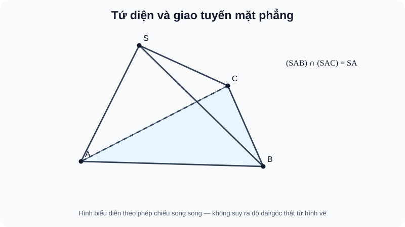
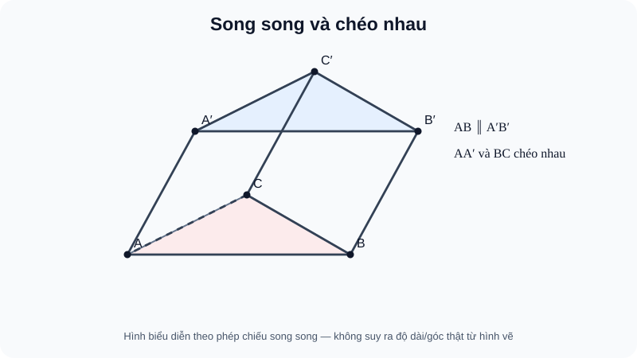
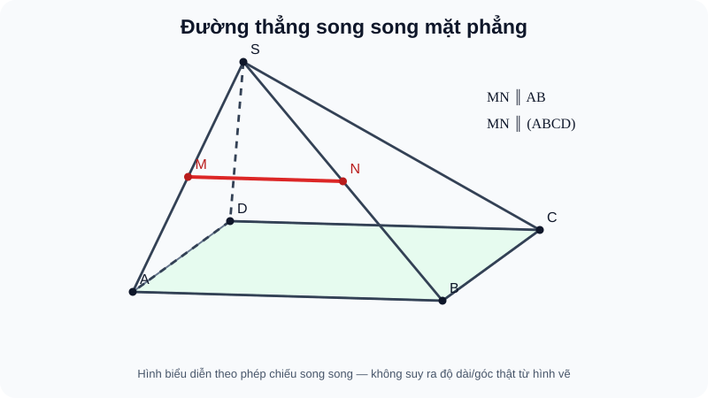
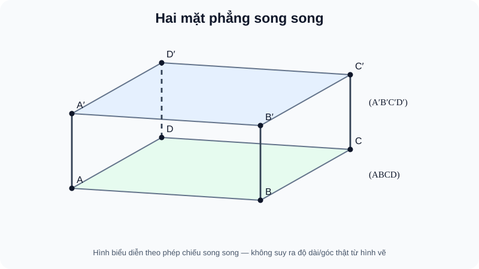
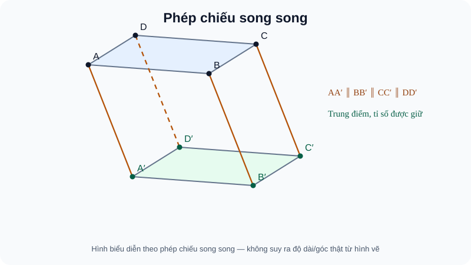

# Chuyên đề 15 — Quan hệ song song trong không gian

Một bản vẽ không gian chỉ là hình biểu diễn trên mặt phẳng. Muốn biết hai đường có thật sự song song hay không, em cần chỉ ra các điểm, đường và mặt phẳng liên quan bằng lập luận toán học — rồi tự kiểm chứng với hình và bài làm.

<!-- AUTHORING_ONLY_NOT_FOR_STUDENT_VIEW: one effective R04 learner source, prior R02/R03 historical, original G11 B10-B14 canonical owner PR705 e945ccdd434689a5c6d8d7bfd44ba26d287a7b9b; 8 public selfchecks reuse original item IDs without official assessment. -->

# Kiến thức

**Đường đi của chuyên đề.** Ta bắt đầu từ cách xác định mặt phẳng để hiểu vì sao hình vẽ 2D có thể đánh lừa; từ đó phân biệt đường thẳng song song và chéo nhau, nhận biết quan hệ đường–mặt và hai mặt, cuối cùng nhìn lại toàn bộ hình bằng phép chiếu song song. Mỗi kết luận dựa trên điều kiện toán, không dựa vào cảm giác hình vẽ. Hãy tự làm câu Vận dụng trước khi mở Đối chiếu.

**Những điều cần biết trước khi bắt đầu.** Em chỉ cần quen với tam giác, định lý Thales/đường trung bình, hình bình hành và ý nghĩa điểm–đường thẳng–mặt phẳng. Khi hai đường cắt nhau, chúng xác định một mặt phẳng; khi hai đường không cắt, phải kiểm xem chúng có cùng mặt phẳng hay không. Tên \((ABC)\) chỉ có nghĩa xác định duy nhất khi ba điểm không thẳng hàng. Nếu mới học hình không gian, hãy đọc kỹ phần hình học bằng lời trước; các ví dụ tọa độ dưới đây là **một cách kiểm chứng bổ sung**, không phải điều kiện để hiểu định lý.

Tùy chọn: cách đọc minh họa tọa độ khi em cần

**Cách đọc ví dụ tọa độ (không cần học trước hình giải tích không gian lớp 12).** Ba số \((x,y,z)\) lần lượt là vị trí theo ba trục vuông góc; \(z=0\) biểu diễn một mặt phẳng nằm ngang, \(z=c\) một mặt phẳng nằm ngang khác. Một đường viết \((x,y,z)=(a,b,c)+t(u,v,w)\) nghĩa là chọn **cùng một số thực t** để có một điểm trên đường: \(x=a+tu,\ y=b+tv,\ z=c+tw\). Muốn tìm giao với \(z=0\), giải \(c+tw=0\) và thay lại vào cả ba tọa độ. Nếu \(w=0\) và \(c=0\) đường **nằm trong** mặt; nếu \(w=0\) nhưng \(c\ne 0\) đường **song song phân biệt**; nếu \(w\ne 0\) đường **cắt** mặt đúng một điểm. Phép biến đổi \(T(x,y,z)\) ở mạch cuối chỉ là chiếu một điểm theo một phương cố định, không phải một công thức học thuộc bắt buộc. Khi không quen tọa độ, có thể kiểm cùng một kết luận bằng quan hệ giao tuyến và định lý song song đã giải thích.

**Cách học với hình.** Mỗi hình mô tả một cấu hình có thật; các nét đứt chỉ cạnh khuất. Hãy xác định điểm, cạnh, mặt liên quan trước khi đọc quan hệ song song. Điều quan trọng là chỉ ra được vì sao quan hệ trên hình là đúng.

## 1. Từ điểm, đường đến thiết diện

Trong bản vẽ phối cảnh, nét vẽ chưa chứng minh được quan hệ thuộc. Hãy bắt đầu từ hai điểm chung và hai mặt chung.

<!-- VISUAL_ID: FIG-G11-B10-01; REUSE_ORIGINAL_SGK_SOURCE_BLOB: e945ccdd434689a5c6d8d7bfd44ba26d287a7b9b -->

**Đọc hình trước khi suy luận.** Hai mặt chứa đỉnh S và cạnh SA cùng có hai điểm S,A, nên giao tuyến là SA. Đường nét đứt biểu diễn cạnh bị che, **không chứng minh** hai đường chéo nhau. Nếu ảnh không mở được, hãy hình dung tứ diện có ba điểm A,B,C ở đáy và S ngoài mặt đáy.

### 1.1. Điểm và đường thuộc mặt phẳng
<!-- LESSON_ID: TOP15-M01; OUTCOME_ID: TOP15-O01; ORIGINAL_SGK_OUTCOME: G11-B10-INCIDENCE; ORIGINAL_S1_BLOB: e945ccdd434689a5c6d8d7bfd44ba26d287a7b9b -->

Hãy tưởng tượng một tấm bìa phẳng: một chấm nằm trên bìa không giúp biết đường thẳng nào thuộc bìa; hai điểm phân biệt trên cùng tấm bìa xác định cả đường thẳng ở đó. Nếu chỉ biết một điểm nằm trên tấm bìa, em có chắc mọi đường qua điểm đó cũng nằm trên bìa? Không: cần thêm một điểm phân biệt cũng thuộc bìa để giữ cả đường trong mặt.

> **ĐỊNH NGHĨA — Điểm và đường thuộc mặt phẳng**
>
> Một điểm thuộc một mặt phẳng không buộc mọi điểm gần nó cũng thuộc mặt. Nhưng nếu **hai điểm phân biệt** thuộc mặt, đường thẳng qua hai điểm đó nằm trọn trong mặt. Đây là cách chuyển từ dữ kiện về điểm thành một đường nằm trong mặt — bước thường cần trước khi tìm giao tuyến.

**Ví dụ**

**Đề bài:** Cho mặt phẳng (P) chứa hai điểm phân biệt A,B. C là điểm bất kỳ của đoạn AB. Chứng minh C thuộc (P).

**Lời giải:** Theo tính chất cơ bản về quan hệ thuộc, vì A,B phân biệt cùng thuộc (P), cả đường thẳng AB nằm trong (P). Điểm C thuộc đoạn AB nên C thuộc AB, suy ra C∈(P). Việc C chia AB theo tỉ số nào không làm đổi kết luận.

<!-- ITEM_ID: THPT-TOP15-T01; ROLE: TOPIC_FIRST_TRY; OUTCOME: TOP15-O01; PUBLIC_FORMATIVE_NO_MASTERY -->
**Vận dụng**

A,B∈(P), A≠B; M chia AB theo tỉ số AM:MB=2:1. M có thuộc (P) không?

Đối chiếu

Có. M thuộc đường AB, mà AB⊂(P); không cần biết tỉ số để suy quan hệ thuộc.

**Kiểm lỗi**

Nếu chỉ vì M chia AB theo một tỉ số mà em không chắc M thuộc (P), trở lại **Kiến thức 1.1**: cả đường AB thuộc (P) khi A,B phân biệt cùng thuộc (P). Thử **Bài luyện 1** và **Bài luyện 9**.

**Nếu làm sai:** Em chỉ nhìn M ở gần mặt: quay lại nguyên tắc “hai điểm xác định đường nằm trong mặt”, rồi tìm hai điểm thuộc (P) trên một đường đã cho.

### 1.2. Xác định một mặt phẳng
<!-- LESSON_ID: TOP15-M02; OUTCOME_ID: TOP15-O02; ORIGINAL_SGK_OUTCOME: G11-B10-PLANE; ORIGINAL_S1_BLOB: e945ccdd434689a5c6d8d7bfd44ba26d287a7b9b -->

Một đường thẳng có thể xoay trong nhiều mặt phẳng như bản lề. Để khóa vị trí một mặt phẳng, cần thêm thông tin không nằm ngay trên đường ấy. Một đường như bản lề có thể nằm trong nhiều mặt phẳng. Điều gì khóa được một mặt duy nhất? Một điểm ở ngoài đường hoặc ba điểm không thẳng hàng.

> **ĐỊNH NGHĨA — Xác định một mặt phẳng**
>
> Ba điểm bất kỳ chưa chắc xác định duy nhất mặt phẳng: **ba điểm không thẳng hàng** mới đủ. Các cách tương đương là một đường với điểm ngoài nó, hai đường cắt nhau, hoặc hai đường phân biệt song song. Luôn kiểm điều kiện “ngoài”, “cắt”, “phân biệt” trước khi gọi tên mặt.

**Ví dụ**

**Đề bài:** Cho ba điểm A,B,C không thẳng hàng; lấy D trên đường AB. Hỏi (ABC) và ký hiệu (ABD) có xác định duy nhất một mặt phẳng không?

**Lời giải:** Ba điểm A,B,C không thẳng hàng nên xác định duy nhất (ABC). Vì A,B,D thẳng hàng, vô số mặt phẳng đi qua đường AB, nên (ABD) không xác định duy nhất. Điều kiện không thẳng hàng là điều cần kiểm trước khi đặt tên mặt.

<!-- ITEM_ID: THPT-TOP15-T02; ROLE: TOPIC_FIRST_TRY; OUTCOME: TOP15-O02; PUBLIC_FORMATIVE_NO_MASTERY -->
**Vận dụng**

Một đường a và điểm M∉a xác định bao nhiêu mặt phẳng?

Đối chiếu

Đúng một mặt phẳng. Nếu M∈a sẽ có vô số mặt phẳng chứa a.

**Kiểm lỗi**

Nếu ba điểm thẳng hàng mà em kết luận duy nhất một mặt phẳng, đọc **Kiến thức 1.2**: cần ba điểm không thẳng hàng hoặc đường và điểm ngoài đường. Thử **Bài luyện 2** và **Bài luyện 10**.

**Nếu làm sai:** Nếu em chỉ dựa ba ký tự trong (ABC), thử kiểm ba điểm có thẳng hàng hay không.

### 1.3. Giao tuyến của hai mặt phẳng
<!-- LESSON_ID: TOP15-M03; OUTCOME_ID: TOP15-O03; ORIGINAL_SGK_OUTCOME: G11-B10-PLANE_INTERSECTION; ORIGINAL_S1_BLOB: e945ccdd434689a5c6d8d7bfd44ba26d287a7b9b -->

Khi hai tấm phẳng phân biệt cùng chứa hai điểm, chúng bắt buộc có một đường thẳng chung. Tìm đúng hai điểm chung thường đáng tin hơn việc đoán theo nét hình. Nếu hai mặt phân biệt cùng chứa S và A, ta nên tìm thêm một 'giao điểm thứ ba' hay dùng ngay SA? Hai điểm chung phân biệt đã đủ xác định giao tuyến.

> **ĐỊNH NGHĨA — Giao tuyến của hai mặt phẳng**
>
> Giao tuyến là **đường thẳng chung** của hai mặt phẳng phân biệt có giao. Cách chắc chắn nhất là chỉ ra hai điểm chung phân biệt, rồi kiểm chúng nằm trong cả hai mặt. Không suy giao tuyến từ nét vẽ và không gọi giao tuyến khi hai mặt phẳng song song hoặc trùng nhau.

**Ví dụ**

**Đề bài:** Trong tứ diện S.ABC, tìm giao tuyến của hai mặt phẳng (SAB) và (SAC). Nêu vì sao tồn tại duy nhất một giao tuyến.

**Lời giải:** Cả hai mặt đều chứa S và A, với S≠A. Hai mặt phân biệt vì B,C không cùng mặt chứa S,A trong một tứ diện không suy biến. Do đó giao tuyến là đường SA; không thể chỉ là một đoạn trên cạnh.

<!-- ITEM_ID: THPT-TOP15-T03; ROLE: TOPIC_FIRST_TRY; OUTCOME: TOP15-O03; PUBLIC_FORMATIVE_NO_MASTERY -->
**Vận dụng**

Trong tứ diện S.ABC, giao tuyến của (SAB) và (SBC) là gì?

Đối chiếu

SB vì S,B là hai điểm chung phân biệt của hai mặt.

**Kiểm lỗi**

Nếu nhầm giao tuyến của hai mặt tứ diện, đọc **Kiến thức 1.3**: tìm hai điểm chung phân biệt. Làm **Bài luyện 3** và **Bài luyện 11**, chỉ rõ điểm nào thuộc cả hai mặt.

**Nếu làm sai:** Nếu thiếu một điểm chung, hãy liệt kê các cạnh nằm trong từng mặt trước khi kết luận.

### 1.4. Giao điểm của đường và mặt
<!-- LESSON_ID: TOP15-M04; OUTCOME_ID: TOP15-O04; ORIGINAL_SGK_OUTCOME: G11-B10-LINE_PLANE; ORIGINAL_S1_BLOB: e945ccdd434689a5c6d8d7bfd44ba26d287a7b9b -->

Một đường có thể xuyên qua, nằm trọn trong hoặc đi song song với mặt phẳng. Chỉ khi biết chắc có một điểm chung duy nhất, ta mới gọi đó là giao điểm. Một điểm M nằm trên cả đường d và mặt (P) đã đủ kết luận d chỉ cắt (P) tại M chưa? Chưa: cần loại khả năng cả d nằm trong mặt.

> **PHƯƠNG PHÁP — Giao điểm của đường và mặt**
>
> Khi không nhìn thấy trực tiếp giao điểm M=d∩(P), hãy dựng mặt phụ (Q) chứa d, tìm g=(P)∩(Q), rồi giải d∩g. Bước kiểm tra sau cùng là M thật sự tồn tại; đường d có thể song song hoặc nằm trọn trong (P).

**Ví dụ**

**Đề bài:** Trong tứ diện S.ABC, lấy M là điểm bên trong cạnh SB. Tìm giao điểm của CM với mặt phẳng (SAB).

**Lời giải:** Vì SB⊂(SAB), ta có M∈(SAB). Đường CM đi qua M. Đỉnh C nằm ngoài (SAB), nên CM không thể nằm trọn trong mặt đó; nó cắt (SAB) tại duy nhất M.

**Ví dụ**

**Đề bài:** Trong tứ diện \(S.ABC\), lấy \(M\) trên \(SA\), \(N\) trên \(SB\) sao cho \(\frac{SM}{SA}=\frac12\), \(\frac{SN}{SB}=\frac13\). Tìm giao điểm của đường thẳng \(MN\) với \((ABC)\).

**Lời giải:** Chọn mặt phụ \((SAB)\), vì nó chứa cả \(M,N\), do đó chứa \(MN\). Hai mặt \((SAB)\) và \((ABC)\) có hai điểm chung \(A,B\), nên giao tuyến là \(AB\). Trong tam giác \(SAB\), hai tỉ số đã cho khác nhau nên \(MN\) không song song \(AB\) (theo định lí Thalès đảo chiều suy luận). Hai đường này cùng nằm trong \((SAB)\), vì vậy cắt nhau tại một điểm \(I\). Kéo dài \(MN\) và \(AB\) trên hình đến khi gặp nhau. Vì \(I\) thuộc \(MN\) và \(AB\subset(ABC)\), \(I\) là giao điểm cần tìm; \(MN\) không nằm trong \((ABC)\) vì \(M\) nằm trong cạnh \(SA\) và ngoài \((ABC)\).

<!-- ITEM_ID: THPT-TOP15-T04; ROLE: TOPIC_FIRST_TRY; OUTCOME: TOP15-O04; PUBLIC_FORMATIVE_NO_MASTERY -->
**Vận dụng**

Với d:(x,y,z)=(1+t,2,3+t), d cắt (P):z=0 ở đâu?

Đối chiếu

t=−3, nên d∩(P)={(-2,2,0)}.

**Kiểm lỗi**

Nếu chỉ ghi tham số hoặc coi cả d là giao tuyến, đọc **Kiến thức 1.4**. Làm **Bài luyện 4** và **Bài luyện 12**; điểm giao phải thỏa phương trình đường và mặt.

**Nếu làm sai:** Nếu giải ra t mà không xác định đúng điểm, thay t ngược vào cả ba tọa độ.

### 1.5. Thiết diện phải nằm trong khối
<!-- LESSON_ID: TOP15-M05; OUTCOME_ID: TOP15-O05; ORIGINAL_SGK_OUTCOME: G11-B10-SECTION; ORIGINAL_S1_BLOB: e945ccdd434689a5c6d8d7bfd44ba26d287a7b9b -->

Thiết diện không phải cả đường thẳng kéo dài trên giấy: chỉ phần mặt phẳng cắt thực sự nằm trong khối mới tạo ra cạnh của thiết diện. Trên mặt giấy, hai đường kéo dài có thể chạm ngoài tứ diện. Vì sao điểm chạm đó không phải đỉnh của thiết diện? Vì thiết diện chỉ gồm phần nằm trong khối.

> **PHƯƠNG PHÁP — Thiết diện phải nằm trong khối**
>
> Thiết diện là phần chung của **mặt cắt** với khối, không phải mọi đường kéo dài trên hình. Muốn dựng đúng, tìm giao của mặt cắt với từng mặt của khối và chỉ giữ các đoạn bên trong cạnh/mặt. Điểm trên cạnh kéo dài khác điểm nằm trong đoạn cạnh.

**Ví dụ**

**Đề bài:** Trong tứ diện S.ABC, M,N,K lần lượt là các điểm trong của SA,SB,SC. Xác định thiết diện của khối tứ diện bởi mặt phẳng (MNK).

**Lời giải:** M,N thuộc mặt (SAB) nên mặt cắt gặp mặt bên ấy theo đoạn MN; tương tự, giao với (SBC) là NK và (SAC) là KM. Các điểm đều ở bên trong ba cạnh từ S nên cả ba đoạn thuộc khối. Thiết diện là tam giác MNK.

<!-- ITEM_ID: THPT-TOP15-T05; ROLE: TOPIC_FIRST_TRY; OUTCOME: TOP15-O05; PUBLIC_FORMATIVE_NO_MASTERY -->
**Vận dụng**

Trong tứ diện S.ABC, P nằm trong AB. Mặt (SCP) cắt đáy và mặt (SAB) theo các đoạn nào?

Đối chiếu

Theo CP và SP; cạnh còn lại của thiết diện là SC. Thiết diện là tam giác SCP.

**Kiểm lỗi**

Nếu vẽ thiết diện kéo dài ra ngoài khối, đọc **Kiến thức 1.5**. Làm **Bài luyện 6** và **Bài luyện 13**; mỗi cạnh thiết diện là đoạn thực sự nằm trên một mặt tứ diện.

**Nếu làm sai:** Nếu em nối nhầm đỉnh, chỉ chọn hai điểm chung trên **cùng** một mặt của tứ diện.

## 2. Hai đường thẳng: song song hay chéo nhau

Bài toán không gian có thêm quan hệ chéo nhau. Điều kiện đồng phẳng quyết định ranh giới.

<!-- VISUAL_ID: FIG-G11-B11-01; REUSE_ORIGINAL_SGK_SOURCE_BLOB: e945ccdd434689a5c6d8d7bfd44ba26d287a7b9b -->

**Đọc hình trước khi suy luận.** Cạnh AB và A′B′ cùng hướng trong các mặt đáy của lăng trụ, nhưng AA′ và BC là hai đường chéo nhau. Việc hai nét chạm nhau trong hình chiếu không đồng nghĩa chúng có cùng một điểm không gian.

### 2.1. Bốn quan hệ giữa hai đường trong không gian
<!-- LESSON_ID: TOP15-M06; OUTCOME_ID: TOP15-O06; ORIGINAL_SGK_OUTCOME: G11-B11-RELATIVE; ORIGINAL_S1_BLOB: e945ccdd434689a5c6d8d7bfd44ba26d287a7b9b -->

Trong bản vẽ, hai nét không gặp nhau có thể do bị che hoặc do không cùng một mặt phẳng. Hãy hỏi 'có đồng phẳng không?' trước khi kết luận song song. Hai đoạn thẳng vẽ cách nhau trên hình có thể cùng mặt hoặc không. Điều phải kiểm thêm trước khi nói 'song song' chính là tính đồng phẳng.

> **ĐỊNH NGHĨA — Bốn quan hệ giữa hai đường trong không gian**
>
> Hai đường có thể trùng, cắt, song song phân biệt hoặc chéo nhau. **Không giao không đủ để kết luận song song**: cần kiểm thêm đồng phẳng. Trong tứ diện, hai cạnh đối SA và BC không đồng phẳng nên chéo nhau. Hai đường trùng nhau không gọi song song khi định nghĩa yêu cầu phân biệt.

**Ví dụ**

**Đề bài:** Trong một hình hộp không suy biến ABCD.A′B′C′D′, hãy phân loại AB với A′B′, AA′ và B′C′.

**Lời giải:** AB∥A′B′ vì là hai cạnh tương ứng của các mặt song song. AB và AA′ cắt tại A. AB và B′C′ không đồng phẳng, không giao nên chéo nhau. Ba quan hệ khác nhau dù cùng xuất hiện trên một hình.

<!-- ITEM_ID: THPT-TOP15-T06; ROLE: TOPIC_FIRST_TRY; OUTCOME: TOP15-O06; PUBLIC_FORMATIVE_NO_MASTERY -->
**Vận dụng**

Trong tứ diện S.ABC, SA và BC có phải song song vì không gặp nhau?

Đối chiếu

Không; SA và BC chéo nhau do không đồng phẳng.

**Kiểm lỗi**

Nếu nói hai đường không gặp nhau chắc chắn song song, đọc **Kiến thức 2.1**. Làm **Bài luyện 15** và **Bài luyện 24**; phải chứng minh đồng phẳng rồi mới kết luận.

**Nếu làm sai:** Trước khi nói “song song”, hỏi: có một mặt phẳng chứa **cả hai** đường không?

### 2.2. Nhận biết đồng phẳng và chéo nhau
<!-- LESSON_ID: TOP15-M07; OUTCOME_ID: TOP15-O07; ORIGINAL_SGK_OUTCOME: G11-B11-COPLANAR; ORIGINAL_S1_BLOB: e945ccdd434689a5c6d8d7bfd44ba26d287a7b9b -->

Hai đường chéo nhau không thể đặt trọn lên cùng một tấm bìa. Điều này giải thích vì sao hai cạnh đối của tứ diện dù không cắt cũng không thể gọi là song song. Nếu cố đặt hai cạnh đối của tứ diện lên một tấm phẳng, chuyện gì xảy ra? Tấm ấy sẽ phải chứa cả bốn đỉnh, trái định nghĩa tứ diện.

> **TÍNH CHẤT — Nhận biết đồng phẳng và chéo nhau**
>
> Hai đường **cắt nhau** hoặc **song song** luôn đồng phẳng; hai đường chéo không đồng phẳng. Ta có thể chứng minh chéo nhau bằng phản chứng: giả sử có mặt chứa hai cạnh đối của tứ diện, mặt ấy phải chứa cả bốn đỉnh của tứ diện — điều không thể.

**Ví dụ**

**Đề bài:** Trong tứ diện S.ABC, chứng minh SA và BC chéo nhau bằng phản chứng.

**Lời giải:** Giả sử SA và BC đồng phẳng. Mặt phẳng đó chứa hai điểm S,A của đường SA và hai điểm B,C của BC, nên chứa S,A,B,C. Điều này trái giả thiết bốn đỉnh của tứ diện không đồng phẳng. Vậy SA và BC chéo nhau.

<!-- ITEM_ID: THPT-TOP15-T07; ROLE: TOPIC_FIRST_TRY; OUTCOME: TOP15-O07; PUBLIC_FORMATIVE_NO_MASTERY -->
**Vận dụng**

Hai đường cắt nhau tại M có thể chéo nhau không?

Đối chiếu

Không. Hai đường cắt nhau xác định duy nhất một mặt phẳng, nên đồng phẳng.

**Kiểm lỗi**

Nếu nhầm đường cắt nhau thành chéo nhau vì hình phối cảnh, đọc **Kiến thức 2.2**. Làm **Bài luyện 16** và **Bài luyện 23**, kiểm mặt phẳng chung.

**Nếu làm sai:** Nếu lập luận “không cắt nên chéo”, hãy thử tìm một mặt phẳng chứa cả hai đường.

### 2.3. Chứng minh song song qua tam giác
<!-- LESSON_ID: TOP15-M08; OUTCOME_ID: TOP15-O08; ORIGINAL_SGK_OUTCOME: G11-B11-PARALLEL_PROOF; ORIGINAL_S1_BLOB: e945ccdd434689a5c6d8d7bfd44ba26d287a7b9b -->

Khi hai điểm di chuyển trên hai cạnh của cùng một tam giác với cùng tỉ lệ tính từ đỉnh, đoạn nối chúng giữ hướng cạnh đáy. Trong tam giác, nếu M và N cùng chia hai cạnh theo một tỉ số tính từ cùng đỉnh, ta có thể so sánh hướng MN và cạnh thứ ba mà không cần đo góc.

> **ĐỊNH LÝ — Chứng minh song song qua tam giác**
>
> Đường trung bình và Thales đảo cung cấp chứng minh **trong một tam giác xác định**. Nếu M∈SA, N∈SB và SM/SA=SN/SB với M,N khác S, ta có MN∥AB. Không cần hai đoạn bằng nhau về độ dài, mà cần **hai tỉ số** tương ứng bằng nhau.

**Ví dụ**

**Đề bài:** Trong tam giác SAB, M,N là trung điểm của SA,SB. Chứng minh MN∥AB và cho biết tỉ số MN/AB.

**Lời giải:** Vì M,N là trung điểm, SM/SA=SN/SB=1/2. Theo định lý Thales đảo hoặc đường trung bình, MN∥AB và MN/AB=1/2. Hai điểm phải nằm trên hai cạnh xuất phát từ cùng đỉnh S.

<!-- ITEM_ID: THPT-TOP15-T08; ROLE: TOPIC_FIRST_TRY; OUTCOME: TOP15-O08; PUBLIC_FORMATIVE_NO_MASTERY -->
**Vận dụng**

Nếu SM/SA=SN/SB=3/5, M,N nằm trên hai cạnh SA,SB, kết luận về MN và AB?

Đối chiếu

MN∥AB nhờ Thales đảo trong tam giác SAB.

**Kiểm lỗi**

Nếu áp dụng Thalès đảo cho hai tỉ số không cùng đỉnh, đọc **Kiến thức 2.3**. Làm **Bài luyện 18** và **Bài luyện 25**; so hai tỉ lệ từ đỉnh S trong cùng tam giác.

**Nếu làm sai:** Nếu chỉ biết SM=SN, hãy kiểm hai cạnh SA,SB có bằng nhau hay không trước khi dùng Thales.

### 2.4. Giao tuyến của hai mặt chứa đường cùng hướng
<!-- LESSON_ID: TOP15-M09; OUTCOME_ID: TOP15-O09; ORIGINAL_SGK_OUTCOME: G11-B11-INTERSECT_PLANES; ORIGINAL_S1_BLOB: e945ccdd434689a5c6d8d7bfd44ba26d287a7b9b -->

Một giao tuyến có thể khó nhìn, nhưng biết hai mặt cùng chứa những đường song song nhau sẽ cho được phương của đường chung. Biết một đường thuộc mỗi mặt và hai đường ấy cùng hướng, giao tuyến của hai mặt đi theo hướng nào? Hãy xác minh hai mặt cắt nhau và cùng có một điểm S trước.

> **TÍNH CHẤT — Giao tuyến của hai mặt chứa đường cùng hướng**
>
> Khi hai mặt phẳng cắt nhau và trong mỗi mặt có đường thẳng cùng phương, có thể xác định **phương của giao tuyến**. Cần đồng thời chứng minh hai mặt thật sự cắt nhau; nếu chúng song song thì không tồn tại giao tuyến để nói đến. Dữ kiện một đường song song một mặt khác phải xét vị trí của nó.

**Ví dụ**

**Đề bài:** Cho hình chóp S.ABCD có đáy ABCD là hình bình hành. Tìm giao tuyến d=(SAB)∩(SCD).

**Lời giải:** AB⊂(SAB), CD⊂(SCD) và AB∥CD. Hai mặt phân biệt cùng chứa S, nên giao tuyến d đi qua S. Trong mỗi mặt đều có đường qua S song song AB (hoặc CD); vì tính duy nhất của đường qua S theo một phương, d là đường qua S song song AB. Không kết luận d trùng cạnh AB.

<!-- ITEM_ID: THPT-TOP15-T09; ROLE: TOPIC_FIRST_TRY; OUTCOME: TOP15-O09; PUBLIC_FORMATIVE_NO_MASTERY -->
**Vận dụng**

Trong chóp S.ABCD đáy hình bình hành, giao tuyến (SAD)∩(SBC) có phương của cạnh nào?

Đối chiếu

Là đường qua S song song AD và BC vì AD∥BC.

**Kiểm lỗi**

Nếu coi giao tuyến qua S trùng cạnh AB, đọc **Kiến thức 2.4**: giao tuyến chỉ cùng phương với AB. Làm **Bài luyện 26** và **Bài luyện 27**, nêu điểm chung S trước khi xác định phương.

**Nếu làm sai:** Nếu chưa tìm được giao tuyến, xác định một điểm chung trước, rồi chứng minh phương giao tuyến.

## 3. Đường thẳng và mặt phẳng

Đặt cây bút gần mặt bàn: nó có thể ở hẳn trên, nằm trong hoặc xuyên qua mặt. Cần phân biệt bằng số điểm chung.

<!-- VISUAL_ID: FIG-G11-B12-01; REUSE_ORIGINAL_SGK_SOURCE_BLOB: e945ccdd434689a5c6d8d7bfd44ba26d287a7b9b -->

**Đọc hình trước khi suy luận.** M,N là trung điểm trên hai cạnh SA,SB, nên MN cùng phương AB nhưng không nằm trong mặt đáy (ABC). Không bỏ qua điều kiện đoạn MN **không thuộc mặt đáy** khi kết luận đường song song mặt.

### 3.1. Ba quan hệ giữa đường và mặt
<!-- LESSON_ID: TOP15-M10; OUTCOME_ID: TOP15-O10; ORIGINAL_SGK_OUTCOME: G11-B12-POSITIONS; ORIGINAL_S1_BLOB: e945ccdd434689a5c6d8d7bfd44ba26d287a7b9b -->

Đặt một sợi dây với cùng độ cao so với mặt bàn, sợi dây có thể nằm ngay trên bàn hoặc lơ lửng trên nó; nhưng nếu nghiêng xuống, nó sẽ cắt bàn. Với một đường dọc một độ cao không đổi, khi nào nó ở trên mặt bàn và khi nào nó nằm hẳn trên bàn? Số điểm chung giúp phân biệt.

> **ĐỊNH NGHĨA — Ba quan hệ giữa đường và mặt**
>
> Một đường thẳng với một mặt phẳng có đúng ba khả năng: nằm trong mặt (vô số điểm chung), cắt tại một điểm, hoặc song song (không điểm chung). Với mặt z=0, xem thành phần z của đường theo tham số giúp phân loại chính xác thay vì đoán từ hình.

**Ví dụ**

**Đề bài:** Xét (P):z=0 và các đường d:(x,y,z)=(t,0,1+t), e=(t,0,1), f=(t,0,0), t∈ℝ. Phân loại từng đường với (P).

**Lời giải:** Với d, giải 1+t=0 được t=−1, giao tại (−1,0,0). Với e, z luôn bằng 1 nên không có điểm chung với (P): e∥(P). Với f, z=0 với mọi t nên f⊂(P). Ba trường hợp khác nhau về số điểm chung.

<!-- ITEM_ID: THPT-TOP15-T10; ROLE: TOPIC_FIRST_TRY; OUTCOME: TOP15-O10; PUBLIC_FORMATIVE_NO_MASTERY -->
**Vận dụng**

Đường d:(1+t,2,3) có quan hệ gì với z=0?

Đối chiếu

Song song vì z luôn bằng 3≠0.

**Kiểm lỗi**

Nếu nhầm đường trên cao z=3 với đường nằm trong z=0, đọc **Kiến thức 3.1**. Làm **Bài luyện 28** và **Bài luyện 36**, dùng số điểm chung để phân biệt ba quan hệ.

**Nếu làm sai:** Hãy xét phương trình z=0 với **mọi** t trước khi gọi một đường là nằm trong mặt.

### 3.2. Điều kiện không được bỏ trong dấu hiệu
<!-- LESSON_ID: TOP15-M11; OUTCOME_ID: TOP15-O11; ORIGINAL_SGK_OUTCOME: G11-B12-PARALLEL_TEST; ORIGINAL_S1_BLOB: e945ccdd434689a5c6d8d7bfd44ba26d287a7b9b -->

Một đường dọc theo cạnh đáy luôn song song với một cạnh đáy khác, nhưng không thể vì thế mà nói nó 'song song mặt đáy': chính nó đang nằm trong mặt. Đường MN cùng phương AB chưa đủ cho MN song song mặt đáy. Nếu chính MN nằm trên đáy thì phải gọi quan hệ gì? 'Nằm trong', không phải 'song song phân biệt'.

> **ĐỊNH LÝ — Điều kiện không được bỏ trong dấu hiệu**
>
> Nếu d song song một đường a nằm trong (P), có **hai** khả năng: d nằm trong (P), hoặc d song song (P). Muốn kết luận d∥(P) còn phải kiểm d không nằm trong (P), ví dụ chỉ ra một điểm của d ở ngoài mặt. Hai đường chỉ “cùng hướng” chưa đủ.

**Ví dụ**

**Đề bài:** Trong tứ diện S.ABC, M,N là trung điểm SA,SB. Chứng minh MN∥(ABC).

**Lời giải:** Trong tam giác SAB, MN∥AB. Vì M nằm bên trong SA và S∉(ABC), M∉(ABC), nên MN không nằm trong đáy. Mặt khác AB⊂(ABC). Theo dấu hiệu đường song song mặt phẳng, MN∥(ABC). Điều kiện MN không thuộc mặt đáy là thiết yếu.

<!-- ITEM_ID: THPT-TOP15-T11; ROLE: TOPIC_FIRST_TRY; OUTCOME: TOP15-O11; PUBLIC_FORMATIVE_NO_MASTERY -->
**Vận dụng**

d và a là hai đường phân biệt cùng nằm trong (P), d∥a. Có thể kết luận d∥(P) không?

Đối chiếu

Không; d nằm trong (P) nên có vô số điểm chung với (P).

**Kiểm lỗi**

Nếu thấy d song song a⊂(P) mà quên d có nằm trong (P) hay không, đọc **Kiến thức 3.2**. Làm **Bài luyện 29** và **Bài luyện 37**, kiểm một điểm ngoài mặt.

**Nếu làm sai:** Nếu em chứng minh d∥a rồi dừng, cần kiểm thêm d⊄(P).

<!-- MODEL_ID: SLM-TOP15-LINE-PLANE-R00; MODEL_VERSION: R01; PLACEMENT: TOP15-O11; PUBLIC_DISCOVERY_NO_MASTERY -->

**Mô hình quan sát:** [Mở thí nghiệm đường–mặt](./Temp_THPT_TOPIC15_LINE_PLANE_RELATION_R01_20261113.html) — chỉ dùng khi chạy được HTML. Thử h=0/khác 0 và α=0/khác 0 để thấy ba trạng thái; nếu mô hình không chạy, dùng công thức mặt z=0 và đường d=(t,0,h+t·tanα) rồi giải z=0. Mô hình không làm thay chứng minh và không ghi điểm. Hình là **mặt cắt xOz**, không phải một mô hình 3D thật; giao có thể ở ngoài cửa sổ nhìn.

### 3.3. Giao tuyến khi có đường song song mặt khác
<!-- LESSON_ID: TOP15-M12; OUTCOME_ID: TOP15-O12; ORIGINAL_SGK_OUTCOME: G11-B12-PLANE_INTERSECTION; ORIGINAL_S1_BLOB: e945ccdd434689a5c6d8d7bfd44ba26d287a7b9b -->

Muốn tìm hướng giao tuyến của hai mặt, đôi khi chỉ cần một đường nằm trên mặt thứ nhất và không gặp mặt thứ hai. Vì sao có thể suy MN song song giao tuyến AB mà chưa nhìn hình? Cả MN và AB ở cùng mặt bên, nhưng MN không có điểm nào thuộc mặt đáy.

> **TÍNH CHẤT — Giao tuyến khi có đường song song mặt khác**
>
> Nếu d⊂(Q), d∥(P), và hai mặt (P),(Q) cắt nhau theo g thì d,g cùng nằm trong (Q), phân biệt và không cắt nhau; vì d không có điểm chung với (P) còn g⊂(P). Suy d∥g. Đây là cách tìm phương giao tuyến, không được dùng khi (P),(Q) không cắt.

**Ví dụ**

**Đề bài:** Trong tứ diện S.ABC, M,N là trung điểm SA,SB. Đặt (Q)=(SAB), (P)=(ABC). Hãy xác định quan hệ MN với giao tuyến g=(Q)∩(P).

**Lời giải:** Ta có g=AB. Đường MN⊂(Q) và MN∥(P) vì là đường trung bình nằm ngoài đáy. MN và g cùng nằm trong (Q), phân biệt, không giao; suy MN∥g=AB. Không áp dụng khi hai mặt phẳng không có giao tuyến.

<!-- ITEM_ID: THPT-TOP15-T12; ROLE: TOPIC_FIRST_TRY; OUTCOME: TOP15-O12; PUBLIC_FORMATIVE_NO_MASTERY -->
**Vận dụng**

Trong (Q), d∥(P) và g=(Q)∩(P). d và g có thể cắt nhau không?

Đối chiếu

Không, vì giao điểm nếu có thuộc (P), trái d∥(P); do đó d∥g.

**Kiểm lỗi**

Nếu phát biểu d song song g khi hai mặt không cắt, đọc **Kiến thức 3.3**. Làm **Bài luyện 32** và **Bài luyện 38**; phải có giao tuyến g thật và d không gặp mặt kia.

**Nếu làm sai:** Nếu chưa biết g có tồn tại, hãy xác minh hai mặt cắt nhau trước khi áp dụng.

### 3.4. Dựng mặt phẳng cắt song song đáy
<!-- LESSON_ID: TOP15-M13; OUTCOME_ID: TOP15-O13; ORIGINAL_SGK_OUTCOME: G11-B12-CONSTRUCTION; ORIGINAL_S1_BLOB: e945ccdd434689a5c6d8d7bfd44ba26d287a7b9b -->

Một mặt cắt song song đáy cắt các cạnh bên của tứ diện tại các vị trí có cùng tỉ lệ tính từ đỉnh; đây là cách dựng hình có lý do. Nếu mặt cắt qua M ở nửa chiều dài SA, nó gặp hai cạnh SB,SC ở vị trí nào? Tính chất tỉ lệ trong các mặt bên dẫn tới hai trung điểm tương ứng.

> **PHƯƠNG PHÁP — Dựng mặt phẳng cắt song song đáy**
>
> Để dựng mặt cắt qua M nằm trên SA và song song đáy (ABC), tìm trên SB,SC các điểm N,K có SN/SB=SK/SC=SM/SA=t. Khi 0<t<1, MN∥AB và MK∥AC, suy mặt (MNK)∥(ABC). Không dựng tùy ý N,K theo mắt.

**Ví dụ**

**Đề bài:** Trong tứ diện S.ABC, M là trung điểm SA. Dựng mặt phẳng qua M song song đáy (ABC). Nó gặp SB,SC tại đâu và tạo thiết diện gì?

**Lời giải:** Mặt qua M song song (ABC) gặp SB,SC lần lượt tại trung điểm N,K theo định lý Thales trong các mặt bên. Khi đó SM/SA=SN/SB=SK/SC=1/2, nên MN∥AB, MK∥AC; (MNK)∥(ABC). Thiết diện là tam giác MNK.

<!-- ITEM_ID: THPT-TOP15-T13; ROLE: TOPIC_FIRST_TRY; OUTCOME: TOP15-O13; PUBLIC_FORMATIVE_NO_MASTERY -->
**Vận dụng**

Cho SM/SA=2/3, chọn SN/SB và SK/SC bằng bao nhiêu để mặt cắt song song đáy?

Đối chiếu

Cả hai tỉ số bằng 2/3.

**Kiểm lỗi**

Nếu tự chọn N,K mà ba tỉ số không đều, đọc **Kiến thức 3.4**. Làm **Bài luyện 39** và **Bài luyện 44**, kiểm cùng tỉ số SM/SA, SN/SB, SK/SC.

**Nếu làm sai:** Khi dựng không đúng thiết diện, quay lại hai tam giác SAB, SAC và dùng Thales đảo.

## 4. Hai mặt phẳng song song

Một mặt sàn và trần có thể song song, nhưng một vết cắt tạo ra hai đường song song; tỉ số đồng dạng cho phép tính kích thước.

<!-- VISUAL_ID: FIG-G11-B13-01; REUSE_ORIGINAL_SGK_SOURCE_BLOB: e945ccdd434689a5c6d8d7bfd44ba26d287a7b9b -->

**Đọc hình trước khi suy luận.** Hai mặt đáy hình hộp phân biệt, không giao nhau. Mặt thứ ba cắt cả hai mặt theo hai đường nằm trên chính mặt cắt ấy; vì không thể có điểm chung, hai giao tuyến song song. Hình biểu diễn không cho phép đo trực tiếp độ dài/góc thật.

### 4.1. Ba quan hệ giữa hai mặt phẳng
<!-- LESSON_ID: TOP15-M14; OUTCOME_ID: TOP15-O14; ORIGINAL_SGK_OUTCOME: G11-B13-PLANE_POSITIONS; ORIGINAL_S1_BLOB: e945ccdd434689a5c6d8d7bfd44ba26d287a7b9b -->

Hai bản vẽ phương trình khác nhau có thể chỉ cùng một mặt; vì vậy trước hết cần xem chúng trùng, cắt hay thực sự ở hai tầng khác nhau. Hai phương trình z=0 và 2z=0 trông khác nhau nhưng có thực sự là hai mặt khác? Chúng có đúng cùng tập điểm nên phải kiểm tập nghiệm trước.

> **ĐỊNH NGHĨA — Ba quan hệ giữa hai mặt phẳng**
>
> Hai mặt phẳng có thể trùng, cắt theo một đường, hoặc phân biệt và song song. Điều kiện “phân biệt” rất quan trọng: hai phương trình khác cách viết vẫn có thể chỉ cùng một mặt. Mặt z=0 và z=2 song song; mặt z=0 và x=0 cắt theo đường x=z=0.

**Ví dụ**

**Đề bài:** Phân loại (P):z=0 với (Q):z=2 và (R):x=0. Hãy nêu giao tuyến nếu có.

**Lời giải:** (P) và (Q) không có điểm chung vì không điểm nào vừa có z=0 vừa z=2, nên song song phân biệt. (P) và (R) cùng chứa mọi điểm (0,t,0) với t thực nên cắt nhau theo đường x=z=0.

<!-- ITEM_ID: THPT-TOP15-T14; ROLE: TOPIC_FIRST_TRY; OUTCOME: TOP15-O14; PUBLIC_FORMATIVE_NO_MASTERY -->
**Vận dụng**

Hai mặt z=0 và 2z=0 trùng hay song song phân biệt?

Đối chiếu

Trùng nhau, vì chúng cùng tập điểm z=0.

**Kiểm lỗi**

Nếu coi z=0 và 2z=0 song song phân biệt, đọc **Kiến thức 4.1**. Làm **Bài luyện 40** và **Bài luyện 50**; trước hết kiểm hai tập điểm có trùng nhau không.

**Nếu làm sai:** Nếu chỉ thấy hai pháp tuyến cùng phương, kiểm hai phương trình có cùng tập nghiệm không.

### 4.2. Dấu hiệu hai mặt song song
<!-- LESSON_ID: TOP15-M15; OUTCOME_ID: TOP15-O15; ORIGINAL_SGK_OUTCOME: G11-B13-PLANE_TEST; ORIGINAL_S1_BLOB: e945ccdd434689a5c6d8d7bfd44ba26d287a7b9b -->

Muốn chứng minh cả mặt phẳng song song với mặt khác, một đường đi song song chưa đủ: ta phải khóa cả hai hướng không cùng phương trong mặt ấy. Vì sao một đường song song (Q) chưa buộc mặt (P) song song (Q)? Mặt (P) vẫn có thể quay quanh đường ấy; hai hướng cắt nhau mới khóa mặt.

> **ĐỊNH LÝ — Dấu hiệu hai mặt song song**
>
> Nếu trong (P) có hai đường **cắt nhau** a,b và **cả hai** đều song song (Q), thì (P)∥(Q). Một đường a riêng lẻ không đủ: mặt (P) có thể cắt (Q) theo đường g và chứa đường a song song g nhưng không nằm trong (Q).

**Ví dụ**

**Đề bài:** Trong tứ diện S.ABC, M,N,K là trung điểm SA,SB,SC. Chứng minh mặt phẳng (MNK) song song (ABC).

**Lời giải:** MN∥AB và MK∥AC bởi định lý đường trung bình trong các tam giác SAB,SAC. Hai đường MN,MK cắt nhau tại M trong (MNK); chúng lần lượt song song với các đường AB,AC nằm trong (ABC) và không thuộc đáy. Theo dấu hiệu hai mặt phẳng song song, (MNK)∥(ABC).

<!-- ITEM_ID: THPT-TOP15-T15; ROLE: TOPIC_FIRST_TRY; OUTCOME: TOP15-O15; PUBLIC_FORMATIVE_NO_MASTERY -->
**Vận dụng**

Cho a,b⊂(P) nhưng a∥b và a∥(Q),b∥(Q). Có đủ kết luận (P)∥(Q) không?

Đối chiếu

Chưa đủ. Cần a và b cắt nhau trong (P), không song song với nhau.

**Kiểm lỗi**

Nếu chỉ có một đường a trong (P) song song (Q) mà kết luận (P)∥(Q), đọc **Kiến thức 4.2**. Làm **Bài luyện 41** và **Bài luyện 51**, cần hai đường cắt nhau trong (P).

**Nếu làm sai:** Nếu chỉ có một cặp đường, hãy tìm thêm một đường trong mặt thứ nhất cắt đường đã có.

### 4.3. Mặt thứ ba cắt hai mặt song song
<!-- LESSON_ID: TOP15-M16; OUTCOME_ID: TOP15-O16; ORIGINAL_SGK_OUTCOME: G11-B13-TRANSVERSAL; ORIGINAL_S1_BLOB: e945ccdd434689a5c6d8d7bfd44ba26d287a7b9b -->

Nếu hai tầng sàn song song và ta dựng một mặt tường cắt cả hai, hai vết cắt phải song song; nếu mặt tường không cắt cả hai thì không có đủ hai đường để so. Muốn so hai giao tuyến của (R) với hai mặt song song, điều đầu tiên cần hỏi là (R) có **thực sự cắt cả hai mặt** không?

> **TÍNH CHẤT — Mặt thứ ba cắt hai mặt song song**
>
> Nếu (P)∥(Q) và (R) cắt cả hai theo các đường g,h, thì g∥h. Lý do: g,h cùng nằm trong (R); nếu cắt nhau thì điểm giao thuộc cả (P) lẫn (Q), vô lý. Từ giả thiết không giao ta thu được cặp đường song song trong mặt (R).

Ta còn có thể phát biểu mạnh hơn phần “giao tuyến song song”. Nếu một mặt phẳng \((R)\) **cắt một trong hai mặt phẳng song song phân biệt** \((P)\) và \((Q)\), thì \((R)\) cũng **phải cắt mặt còn lại**. Nếu giả sử \((R)\) song song \((Q)\), trong khi \((P)\parallel(Q)\) và \((R)\) cắt \((P)\), ta sẽ mâu thuẫn với tính duy nhất của mặt phẳng song song qua một điểm ngoài \((Q)\). Khi ấy hai giao tuyến của \((R)\) với \((P),(Q)\) song song với nhau.

> **TÍNH CHẤT — Hai mặt phẳng song song bị mặt thứ ba cắt.** Nếu \((P)\parallel(Q)\), và \((R)\) cắt \((P)\) theo đường \(g\), thì \((R)\) cũng cắt \((Q)\) theo đường \(h\), đồng thời \(g\parallel h\). Hai mặt \((P),(Q)\) phải **phân biệt**; không suy ra kết luận nếu \((R)\) chỉ song song cả hai.

**Ví dụ**

**Đề bài:** Cho \((P):z=0\), \((Q):z=4\), \((R):x+y=1\). Xác định giao tuyến của \((R)\) với từng mặt \((P),(Q)\), và chứng minh quan hệ giữa hai giao tuyến.

**Lời giải:** Mặt \((R)\) cắt \((P)\) theo \(g:\{x+y=1,z=0\}\). Nó cũng cắt \((Q)\) theo \(h:\{x+y=1,z=4\}\). Cả hai giao tuyến có vectơ chỉ phương \((1,-1,0)\), ở hai độ cao khác nhau nên song song phân biệt. Ở đây có thể viện dẫn ngay định lí vừa học: vì \((P)\parallel(Q)\) và \((R)\) cắt \((P)\), \((R)\) cũng cắt \((Q)\); không cần chứng minh lại điều đó. Việc tìm hai giao tuyến bằng phương trình là cách kiểm trực tiếp, không suy từ hình vẽ.

**Ví dụ**

**Đề bài:** Cho (P):z=0, (Q):z=2 và (R):x=0. Tìm giao tuyến của (R) với từng mặt và phân loại chúng.

**Lời giải:** Giao tuyến g=(P)∩(R) gồm các điểm (0,t,0). Giao tuyến h=(Q)∩(R) gồm các điểm (0,t,2). Hai đường cùng hướng (0,1,0), cùng nằm trong (R), không gặp nhau nên song song. Nếu đã biết \((P)\parallel(Q)\) và \((R)\) cắt \((P)\), định lí bảo đảm giao tuyến thứ hai tồn tại. Trong ví dụ này ta viết rõ cả hai giao tuyến để kiểm.

<!-- ITEM_ID: THPT-TOP15-T16; ROLE: TOPIC_FIRST_TRY; OUTCOME: TOP15-O16; PUBLIC_FORMATIVE_NO_MASTERY -->
**Vận dụng**

Nếu (R) chỉ cắt (P) nhưng song song (Q), có được phát biểu hai giao tuyến song song không?

Đối chiếu

Không; chưa có giao tuyến thứ hai. Hơn nữa nếu (P)∥(Q), một mặt (R) cắt (P) thì cũng cắt (Q); giả thiết vừa nêu mâu thuẫn.

**Kiểm lỗi**

Nếu quên điều kiện mặt thứ ba cắt cả hai mặt song song, đọc **Kiến thức 4.3**. Làm **Bài luyện 42** và **Bài luyện 52**; xác định hai giao tuyến trước khi suy chúng song song.

**Nếu làm sai:** Phải xác định đủ hai giao tuyến trên (R) trước khi so sánh chúng.

### 4.4. Mặt cắt song song và tỉ số đồng dạng
<!-- LESSON_ID: TOP15-M17; OUTCOME_ID: TOP15-O17; ORIGINAL_SGK_OUTCOME: G11-B13-PRISM_RATIO; ORIGINAL_S1_BLOB: e945ccdd434689a5c6d8d7bfd44ba26d287a7b9b -->

Khi mặt cắt đồng dạng với đáy, độ dài thay theo một hệ số nhưng diện tích phụ thuộc đồng thời hai chiều nên thay theo bình phương hệ số. Nếu cạnh hình thu nhỏ một nửa, diện tích giảm một nửa hay còn một phần tư? Vì cả chiều dài lẫn chiều rộng thay đổi theo tỉ số.

> **TÍNH CHẤT — Mặt cắt song song và tỉ số đồng dạng**
>
> Mặt cắt song song đáy hình chóp tạo ra đa giác đồng dạng với đáy: tỉ số mọi độ dài là t, tỉ số chu vi là t, còn tỉ số **diện tích là t²**. Điều này đúng khi mặt cắt thật sự song song đáy và tỉ số trên các cạnh xuất phát từ đỉnh S là như nhau.

### Định lí Thalès trong không gian

Ở tam giác phẳng, các đường song song chia hai cạnh theo cùng tỉ số. Trong không gian, **ba mặt phẳng đôi một song song phân biệt** đóng vai trò ba đường song song ấy: nếu chúng cắt hai đường thẳng tại các điểm tương ứng thì các đoạn tương ứng cũng tỉ lệ. Định lí này là nền tảng để tính độ cao, vị trí mặt cắt và phân chia các thanh trong những mô hình ba chiều.

> **ĐỊNH LÍ — Thalès trong không gian.** Ba mặt phẳng \((P),(Q),(R)\) đôi một song song phân biệt cắt một đường thẳng tại \(A,B,C\) và một đường thẳng khác tại \(A',B',C'\) theo **cùng thứ tự mặt phẳng**. Khi đó \(\displaystyle\frac{AB}{BC}=\frac{A'B'}{B'C'}\) (các mẫu phải khác \(0\)); nếu xét đoạn có hướng, dùng các tỉ số đại số tương ứng. Không dùng định lí nếu các mặt phẳng không đôi một song song hoặc một cát tuyến không cắt đủ ba mặt.

**Ví dụ**

**Đề bài:** Ba mặt song song \(z=0,z=2,z=5\) cắt hai đường \(d:(0,0,t)\), \(e:(t,2,2t)\) ở \(t=0,2,5\) trên \(d\) và \(t=0,1,5/2\) trên \(e\). Tính các độ dài đoạn liên tiếp trên từng cát tuyến, rồi so tỉ số của chúng.

**Lời giải:** Trên \(d\), hai đoạn liên tiếp dài \(2\) và \(3\); trên \(e\), vectơ chỉ phương \((1,0,2)\) có độ dài \(\sqrt5\), nên hai đoạn dài \(\sqrt5\) và \(\frac32\sqrt5\). Tỉ số hai đoạn là \(2/3\) trên cả hai cát tuyến. Chọn tỉ số thay vì đo trực tiếp từ hình chiếu.

### Hình lăng trụ và hình hộp

Không phải khối nào có hai mặt song song cũng là hình chóp cụt. Trong **hình lăng trụ**, hai đáy là hai đa giác **bằng nhau** thuộc hai mặt phẳng song song; các đỉnh tương ứng được nối bằng những cạnh bên **song song và bằng nhau**, nên mỗi mặt bên là một **hình bình hành**. Khối có hai đáy là tam giác gọi là lăng trụ tam giác, có hai đáy là tứ giác gọi là lăng trụ tứ giác; khi đáy là hình bình hành, lăng trụ tứ giác tạo thành **hình hộp**. Không mặc định lăng trụ là *đứng*: các cạnh bên có thể xiên so với mặt đáy.

> **TÍNH CHẤT — Cạnh và mặt bên của hình lăng trụ.** Với lăng trụ \(ABC.A'B'C'\), ta có \(\overrightarrow{AA'}=\overrightarrow{BB'}=\overrightarrow{CC'}\), \(AB\parallel A'B'\), \(BC\parallel B'C'\), \(CA\parallel C'A'\); các mặt \(ABB'A'\), \(BCC'B'\), \(CAA'C'\) là hình bình hành, còn \((ABC)\parallel(A'B'C')\). Hình hộp là trường hợp lăng trụ có đáy là hình bình hành. Tính chất này phân biệt lăng trụ với mặt cắt đồng dạng **thu nhỏ** trong hình chóp.

**Ví dụ**

**Đề bài:** Cho lăng trụ tam giác có \(A(0,0,0),B(2,0,0),C(0,3,0)\) và ba đỉnh trên lần lượt là \(A'(1,0,4),B'(3,0,4),C'(1,3,4)\). Kiểm tra hai đáy là các hình bằng nhau và mặt \(ABB'A'\) là hình bình hành; so diện tích hai đáy.

**Lời giải:** Khi đó ba vectơ cạnh bên đều là \((1,0,4)\), đáy trên là bản tịnh tiến của đáy dưới. Ta có \(\overrightarrow{AB}=(2,0,0)=\overrightarrow{A'B'}\); vì hai cặp cạnh đối song song và bằng nhau, mặt \(ABB'A'\) là hình bình hành. Hai đáy đều có diện tích \(3\), **không giảm theo bình phương tỉ số** như các mặt cắt thu nhỏ của hình chóp.

**Ví dụ**

**Đề bài:** Trong tứ diện S.ABC, mặt (MNK) song song đáy và SM/SA=3/5. Nếu diện tích ABC bằng 75 cm², tính diện tích MNK.

**Lời giải:** Do các tam giác MNK và ABC đồng dạng với tỉ số độ dài t=3/5, diện tích tỉ lệ t². Vậy S_MNK=(3/5)²×75=27 cm². Không dùng 3/5 trực tiếp cho diện tích.

<!-- ITEM_ID: THPT-TOP15-T17; ROLE: TOPIC_FIRST_TRY; OUTCOME: TOP15-O17; PUBLIC_FORMATIVE_NO_MASTERY -->
**Vận dụng**

Khi t=2/5, diện tích đáy 100 cm², diện tích thiết diện bao nhiêu?

Đối chiếu

(2/5)²·100=16 cm².

**Kiểm lỗi**

Nếu lấy t thay cho t² làm tỉ số diện tích, đọc **Kiến thức 4.4** và Thalès trong không gian. Làm **Bài luyện 45** và **Bài luyện 49**, phân biệt tỉ số cạnh/chu vi và diện tích.

**Nếu làm sai:** Nếu em nhân diện tích với t, hãy thử so sánh một hình có cả chiều ngang và chiều dọc đều nhân t.

## 5. Phép chiếu song song và hình biểu diễn

Phép chiếu **song song** theo một phương cố định giúp biểu diễn hình không gian trên mặt phẳng. Đây không phải phép chiếu phối cảnh với các tia hội tụ; hình biểu diễn cũng có giới hạn về góc và độ dài.

<!-- VISUAL_ID: FIG-G11-B14-01; REUSE_ORIGINAL_SGK_SOURCE_BLOB: e945ccdd434689a5c6d8d7bfd44ba26d287a7b9b -->

**Đọc hình trước khi suy luận.** Các đường nối mỗi đỉnh với ảnh có cùng phương; hai cạnh song song vẫn có ảnh song song khi hình không suy biến. Tuy nhiên góc vuông và độ dài không được bảo toàn nói chung. Hãy kiểm bằng điều kiện, không ước lượng góc từ hình vẽ.

### 5.1. Phép chiếu theo một phương cố định
<!-- LESSON_ID: TOP15-M18; OUTCOME_ID: TOP15-O18; ORIGINAL_SGK_OUTCOME: G11-B14-PROJECTION_DEF; ORIGINAL_S1_BLOB: e945ccdd434689a5c6d8d7bfd44ba26d287a7b9b -->

Thay vì đổ bóng thẳng đứng, ta có thể chiếu theo một phương nghiêng đã chọn. Muốn mỗi điểm có đúng một ảnh, phương chiếu phải xuyên qua mặt nhận ảnh. Nếu đường chiếu đi song song với mặt nhận ảnh, đường qua một điểm có bảo đảm cắt mặt đó không? Không; phải chọn phương chiếu không song song mặt nhận ảnh.

> **ĐỊNH NGHĨA — Phép chiếu theo một phương cố định**
>
> Chọn mặt chiếu (P) và phương v **không song song (P)**. Qua mỗi điểm M có duy nhất đường theo phương v cắt (P) tại ảnh M′; vì vậy phép chiếu được xác định trên mọi điểm. Với (P):z=0 và v=(1,0,1), ảnh của (x,y,z) là T(x,y,z)=(x−z,y,0).

**Ví dụ**

**Đề bài:** Chiếu song song lên mặt (P):z=0 theo vectơ v=(1,0,1). Tìm ảnh của điểm M(1,2,3).

**Lời giải:** Đường chiếu qua M có dạng M+λv=(1+λ,2,3+λ). Đặt z=0 được λ=−3; khi đó M′=(−2,2,0). Vậy T(x,y,z)=(x−z,y,0). Phương v không song song (P) vì có thành phần z≠0.

<!-- ITEM_ID: THPT-TOP15-T18; ROLE: TOPIC_FIRST_TRY; OUTCOME: TOP15-O18; PUBLIC_FORMATIVE_NO_MASTERY -->
**Vận dụng**

Tìm ảnh N(3,−1,2) dưới phép chiếu T(x,y,z)=(x−z,y,0).

Đối chiếu

N′=(1,−1,0). Kiểm z′=0 và N−N′=2(1,0,1).

**Kiểm lỗi**

Nếu chiếu theo phương song song z=0 mà tưởng mọi điểm đều có ảnh, đọc **Kiến thức 5.1**. Làm **Bài luyện 54** và **Bài luyện 63**; giải tham số tại z=0.

**Nếu làm sai:** Nếu phương chiếu v có tọa độ z bằng 0, đường qua điểm ngoài z=0 sẽ không gặp mặt; cần đổi phương.

### 5.2. Vì sao một đoạn có thể co thành điểm
<!-- LESSON_ID: TOP15-M19; OUTCOME_ID: TOP15-O19; ORIGINAL_SGK_OUTCOME: G11-B14-DEGENERACY; ORIGINAL_S1_BLOB: e945ccdd434689a5c6d8d7bfd44ba26d287a7b9b -->

Tùy hướng chiếu, một đoạn có thể thu ngắn đến đúng một điểm. Điều đó là tính chất của phép chiếu, không phải mất dữ liệu hình. Nếu hai đầu đoạn có cùng ảnh, hãy thử chiếu một điểm bất kỳ bên trong. Khi đoạn cùng hướng chiếu, mọi điểm đều rơi lên một ảnh chung.

> **TÍNH CHẤT — Vì sao một đoạn có thể co thành điểm**
>
> Một đường thẳng **song song phương chiếu** có tất cả điểm trên cùng một đường chiếu; ảnh của cả đường chỉ là một điểm. Đây là suy biến có nghĩa hình học, không phải lỗi đồ họa. Nếu đường không song song phương chiếu, ảnh của nó là một đường.

**Ví dụ**

**Đề bài:** Với phép chiếu T(x,y,z)=(x−z,y,0), xét U(1,2,3), V(3,2,5). Chứng minh cả đoạn UV có một ảnh duy nhất.

**Lời giải:** T(U)=(-2,2,0) và T(V)=(-2,2,0). Với X=U+t(V-U)=(1+2t,2,3+2t), ta có T(X)=(-2,2,0) với mọi t∈[0,1]. Đoạn UV song song phương (1,0,1), nên toàn bộ ảnh co thành một điểm.

<!-- ITEM_ID: THPT-TOP15-T19; ROLE: TOPIC_FIRST_TRY; OUTCOME: TOP15-O19; PUBLIC_FORMATIVE_NO_MASTERY -->
**Vận dụng**

Đường d:(x,y,z)=(1+t,2,3+t) có ảnh qua T là đường hay điểm?

Đối chiếu

Một điểm: T(1+t,2,3+t)=(-2,2,0) với mọi t.

**Kiểm lỗi**

Nếu tưởng đường nào cũng có ảnh là đường, đọc **Kiến thức 5.2**. Làm **Bài luyện 58** và **Bài luyện 62**, so ảnh hai điểm khi đường cùng phương chiếu.

**Nếu làm sai:** Nếu hai điểm khác nhau cùng ảnh, kiểm hiệu hai tọa độ của chúng có song song phương chiếu không.

### 5.3. Tỉ số và trung điểm dưới phép chiếu
<!-- LESSON_ID: TOP15-M20; OUTCOME_ID: TOP15-O20; ORIGINAL_SGK_OUTCOME: G11-B14-AFFINE_INVARIANTS; ORIGINAL_S1_BLOB: e945ccdd434689a5c6d8d7bfd44ba26d287a7b9b -->

Phép chiếu song song thay đổi vị trí nhưng giữ cách chia đoạn thẳng theo tỉ số, miễn là đoạn ảnh không suy biến. Vì sao phải yêu cầu hai ảnh A′,B′ phân biệt trước khi nói 'bảo toàn tỉ số'? Nếu đoạn ảnh co thành một điểm, các độ dài dùng để lập tỉ số đều bằng 0.

> **TÍNH CHẤT — Tỉ số và trung điểm dưới phép chiếu**
>
> Phép chiếu song song là phép biến đổi affine: nếu A,B có ảnh phân biệt và M nằm trên AB với AM:MB=p:q, thì ảnh M′ nằm trên A′B′ với cùng tỉ số. Trường hợp đường AB co thành một điểm cần xét riêng vì không thể chia tỉ số độ dài của đoạn ảnh bằng 0.

Tỉ số được bảo toàn không chỉ khi hai đoạn nằm **trên một đường thẳng**, mà còn khi hai đoạn nằm trên **hai đường thẳng song song** và ảnh các đoạn không co thành điểm. Lý do là hai đoạn đã cùng phương, nên khi cùng chịu một phép chiếu affine, độ dài của mỗi đoạn đều nhân với **cùng một hệ số** theo phương ấy.

> **TÍNH CHẤT — Bảo toàn tỉ số trên các đường song song.** Nếu \(AB\parallel CD\) và dưới phép chiếu song song các đoạn \(A'B',C'D'\) đều không suy biến, thì \(\displaystyle\frac{A'B'}{C'D'}=\frac{AB}{CD}\). Cần phân biệt **bảo toàn tỉ số cùng phương** với **bảo toàn độ dài**, điều mà phép chiếu xiên không đảm bảo.

**Ví dụ**

**Đề bài:** Dưới \(T(x,y,z)=(x-z,y,0)\), lấy \(A(0,0,0)\), \(B(2,0,1)\), \(C(0,1,3)\), \(D(4,1,5)\). Hai đoạn \(AB,CD\) song song. Tính độ dài và tỉ số trước và sau chiếu.

**Lời giải:** \(\overrightarrow{AB}=(2,0,1)\), \(\overrightarrow{CD}=(4,0,2)=2\overrightarrow{AB}\). Do đó \(AB=\sqrt5\), \(CD=2\sqrt5\). Ảnh các đầu mút là \(A'(0,0,0)\), \(B'(1,0,0)\), \(C'(-3,1,0)\), \(D'(-1,1,0)\); suy ra \(A'B'=1\), \(C'D'=2\). Cả hai độ dài đều thay đổi, nhưng \(\frac{AB}{CD}=\frac12=\frac{A'B'}{C'D'}\). Phép chiếu giữ tỉ số của hai đoạn cùng phương không suy biến, không nhất thiết giữ độ dài riêng.

**Ví dụ**

**Đề bài:** Cho A(0,0,1), B(4,2,1), M là trung điểm AB. Dưới T(x,y,z)=(x−z,y,0), hãy tính ảnh của ba điểm và kiểm tính trung điểm.

**Lời giải:** A′=(-1,0,0), B′=(3,2,0). Trung điểm M=(2,1,1) nên M′=(1,1,0), đúng bằng (A′+B′)/2. Vì A′≠B′, khái niệm tỉ số đoạn ảnh có nghĩa; nếu A′=B′ thì không được chia tỉ số độ dài.

<!-- ITEM_ID: THPT-TOP15-T20; ROLE: TOPIC_FIRST_TRY; OUTCOME: TOP15-O20; PUBLIC_FORMATIVE_NO_MASTERY -->
**Vận dụng**

Nếu M là trung điểm AB và A′≠B′, M′ nằm ở đâu?

Đối chiếu

Là trung điểm A′B′; điều kiện A′≠B′ loại trường hợp đường ảnh co thành điểm.

**Kiểm lỗi**

Nếu chia tỉ số độ dài ảnh khi A′=B′, đọc **Kiến thức 5.3**. Làm **Bài luyện 57** và **Bài luyện 65**, kiểm ảnh đoạn không suy biến trước.

**Nếu làm sai:** Nếu định dùng tỉ số trên đoạn ảnh, trước tiên kiểm đoạn ảnh có độ dài dương.

### 5.4. Hình bình hành còn, góc vuông có thể mất
<!-- LESSON_ID: TOP15-M21; OUTCOME_ID: TOP15-O21; ORIGINAL_SGK_OUTCOME: G11-B14-PARALLEL_AND_SHAPES; ORIGINAL_S1_BLOB: e945ccdd434689a5c6d8d7bfd44ba26d287a7b9b -->

Một hình chữ nhật thật có thể hiện thành hình bình hành xiên khi chiếu theo hướng nghiêng: song song được giữ, vuông góc thì không nhất thiết. Trong hình chiếu, cặp cạnh đối vẫn song song nhưng góc A có thể không còn vuông. Vì thế hình vẽ không đủ để kết luận hình thật là hình chữ nhật.

> **TÍNH CHẤT — Hình bình hành còn, góc vuông có thể mất**
>
> Khi hình không suy biến, phép chiếu song song đưa các cặp cạnh song song của hình bình hành thành các cặp cạnh song song, nên ảnh vẫn là hình bình hành. Tuy nhiên góc và độ dài thường thay đổi. Vì vậy nhìn hình vẽ như hình bình hành không chứng minh hình gốc không phải hình chữ nhật.

Đối với **hình tròn nằm trong một mặt phẳng không song song phương chiếu**, hình chiếu song song nói chung là **một elip** (có thể là đường tròn trong trường hợp đặc biệt); nếu mặt chứa hình tròn song song phương chiếu, ảnh có thể bị co thành **một đoạn thẳng**. Bởi vậy, khi vẽ một mặt tròn xiên trong không gian, đường biên thường được biểu diễn bằng elip, nhưng không được coi elip vẽ trên giấy là một hình tròn thật hay suy độ dài bán kính từ hai bán trục.

> **TÍNH CHẤT — Hình biểu diễn đường tròn.** Phép chiếu song song **không suy biến trên mặt phẳng chứa đường tròn** biến đường tròn thành elip, với đường tròn là trường hợp đặc biệt. Không đánh đồng phép chiếu song song với **phép chiếu xuyên tâm phối cảnh**: hai đường thẳng song song trong không gian có ảnh song song hoặc trùng dưới phép chiếu song song, còn trong phối cảnh xuyên tâm chúng có thể gặp nhau tại điểm tụ.

**Ví dụ**

**Đề bài:** Xét đường tròn \(y^2+z^2=4\) trong mặt \(x=0\) và phép chiếu lên \(z=0\) theo vectơ \((1,0,2)\). Tìm phương trình hình chiếu trên mặt nhận ảnh, hai bán trục và giải thích vì sao không đọc bán kính thật từ trục ngắn.

**Lời giải:** Điểm \((0,y,z)\) có ảnh \((-z/2,y,0)\), nên \(z=-2x'\), \(y=y'\). Phương trình ảnh là \(4x'^2+y'^2=4\), tức \(\frac{x'^2}{1}+\frac{y'^2}{4}=1\), một elip. Hai bán trục của hình chiếu dài \(1\) và \(2\), còn bán kính của đường tròn gốc bằng \(2\); không suy bán kính thật bằng trục ngắn trên hình chiếu.

**Ví dụ**

**Đề bài:** Cho A(0,0,0), B(2,0,0), C(2,1,1), D(0,1,1). Dưới T(x,y,z)=(x−z,y,0), chứng minh ảnh là hình bình hành không có góc vuông tại A′.

**Lời giải:** Trong hình gốc \(\overrightarrow{AB}=(2,0,0)\), \(\overrightarrow{AD}=(0,1,1)\) có tích vô hướng \(\overrightarrow{AB}\cdot\overrightarrow{AD}=0\), nên ABCD là hình chữ nhật (các cạnh đối song song). Ảnh: A′=(0,0,0), B′=(2,0,0), C′=(1,1,0), D′=(-1,1,0). Ta có \(\overrightarrow{A′B′}=(2,0,0)=\overrightarrow{D′C′}\), \(\overrightarrow{A′D′}=(-1,1,0)=\overrightarrow{B′C′}\), nên ảnh là hình bình hành. Nhưng \(\overrightarrow{A′B′}\cdot\overrightarrow{A′D′}=-2\ne0\), do đó góc A′ không vuông.

<!-- ITEM_ID: THPT-TOP15-T21; ROLE: TOPIC_FIRST_TRY; OUTCOME: TOP15-O21; PUBLIC_FORMATIVE_NO_MASTERY -->
**Vận dụng**

Hình chiếu song song của hình bình hành không suy biến có thể là hình thang chỉ có một cặp cạnh song song không?

Đối chiếu

Không. Hai cặp cạnh đối vẫn song song, nên nếu ảnh không suy biến, nó vẫn là hình bình hành.

**Kiểm lỗi**

Nếu suy giữ nguyên góc vuông vì hình chiếu còn hai cặp cạnh đối song song, đọc **Kiến thức 5.4**. Làm **Bài luyện 59** và **Bài luyện 66**, kiểm góc ảnh riêng.

**Nếu làm sai:** Khi kết luận giữ góc, hãy thử tính tích vô hướng của hai cạnh trước và sau chiếu; góc thường không được bảo toàn.

### 5.5. Kết nối thiết diện, song song và phép chiếu
<!-- LESSON_ID: TOP15-M22; OUTCOME_ID: TOP15-O22; ORIGINAL_SGK_OUTCOME: G11-CHIV-INTEGRATED; ORIGINAL_S1_BLOB: e945ccdd434689a5c6d8d7bfd44ba26d287a7b9b -->

Thiết diện, tỉ số đồng dạng và hình chiếu là ba phép nhìn khác nhau. Hãy tính riêng diện tích mặt cắt trước khi so với bóng chiếu, không đồng nhất chúng vô điều kiện. Ta có thể dùng cùng một tỉ số độ dài t cho cạnh đáy và diện tích mặt cắt không? Không: diện tích dùng t², còn diện tích ảnh chiếu cần xét riêng phương chiếu.

> **PHƯƠNG PHÁP — Kết nối thiết diện, song song và phép chiếu**
>
> Ta kết nối ba ý đã học: thiết diện bằng mặt song song đáy, các tỉ số đồng dạng trong mặt cắt, và hình ảnh do phép chiếu. Đừng gộp “mặt cắt có diện tích bằng hình chiếu” thành định lý chung: phép chiếu xiên có thể đổi diện tích. Ở ví dụ chiếu **vuông góc theo phương z** dưới đây, mặt cắt và đáy đều nằm ngang nên diện tích được giữ.

**Ví dụ**

**Đề bài:** Cho S(0,0,2), A(0,0,0), B(2,0,0), C(0,2,0). Lấy M,N,K là trung điểm SA,SB,SC. Tính diện tích MNK và ABC, rồi chiếu MNK vuông góc xuống z=0.

**Lời giải:** M(0,0,1), N(1,0,1), K(0,1,1) nên MNK vuông tại M, diện tích 1/2. ABC vuông tại A, diện tích 2. Tỉ số 1/4=(1/2)² đúng hệ số đồng dạng. Chiếu theo trục z được M′(0,0,0),N′(1,0,0),K′(0,1,0), tam giác ảnh có diện tích 1/2 vì hai mặt đều ngang và phép chiếu là vuông góc; không suy quy tắc này cho chiếu xiên.

<!-- ITEM_ID: THPT-TOP15-T22; ROLE: TOPIC_FIRST_TRY; OUTCOME: TOP15-O22; PUBLIC_FORMATIVE_NO_MASTERY -->
**Vận dụng**

Nếu thay các trung điểm bằng các điểm có t=3/5, mặt cắt có tỉ số diện tích so với đáy là bao nhiêu?

Đối chiếu

Là 9/25; không nhầm với t=3/5 áp dụng cho chu vi.

**Kiểm lỗi**

Nếu đánh đồng diện tích thiết diện với ảnh chiếu xiên, đọc **Kiến thức 5.5**. Làm **Bài luyện 49** và **Bài luyện 67**, tính t² cho mặt cắt và xét hướng chiếu độc lập.

**Nếu làm sai:** Nếu diện tích hình chiếu khác dự đoán, xác định hướng chiếu và điều kiện hai mặt có song song nhau hay không.

> **Kiến thức cần ghi nhớ**
>
> - **Xác định mặt phẳng:** ba điểm không thẳng hàng xác định duy nhất một mặt phẳng; khi tìm giao tuyến của hai mặt, cần chỉ ra **hai điểm chung phân biệt**, không suy từ hình phối cảnh.
> - **Hai đường thẳng trong không gian:** song song phải **đồng phẳng** và không có điểm chung; chéo nhau là **không đồng phẳng**, không thể gọi song song chỉ vì hình vẽ trông cùng hướng.
> - **Đường và mặt phẳng:** muốn kết luận đường thẳng song song **phân biệt** với mặt, ngoài hướng song song một đường nằm trong mặt còn phải loại trường hợp đường nằm hẳn trong mặt. Dùng điều kiện đủ của định lý đúng bối cảnh.
> - **Hai mặt phẳng và phép chiếu:** luôn kiểm điều kiện song song phân biệt; phép chiếu song song bảo toàn tính thẳng hàng và một số tỉ số theo đường thẳng nhưng không bảo toàn mọi góc, độ dài, vuông góc; đoạn có thể suy biến thành điểm.

# Luyện tập

Hãy tự giải mỗi bài vào vở trước khi mở **Lời giải**. Trước khi tính, xác định rõ hai đường có đồng phẳng không, đường có nằm trong mặt không và các tỉ số có thỏa điều kiện định lí không. Nếu làm sai, ghi bước sai đầu tiên rồi luyện lại bài cùng dạng.

## 1. Điểm, đường, mặt phẳng và thiết diện

**Xác định mặt phẳng, giao tuyến và thiết diện**

<!-- DISPLAY_ONLY_CANONICAL: THPT-G11-CHIV-B10-C01; SOURCE_BLOB: e945ccdd434689a5c6d8d7bfd44ba26d287a7b9b; ORIGINAL_ROLE: SGK_CORE; NO_NEW_CANONICAL -->
**Bài luyện 1.** Hai điểm phân biệt A,B thuộc (P). Có chắc AB nằm trong (P) không?

Lời giải

**Đáp án:** Có, AB⊂(P).

**Lời giải:** Theo tiên đề: nếu hai điểm phân biệt của một đường thuộc mặt phẳng thì đường đó nằm trong mặt phẳng.

<!-- DISPLAY_ONLY_CANONICAL: THPT-G11-CHIV-B10-C02; SOURCE_BLOB: e945ccdd434689a5c6d8d7bfd44ba26d287a7b9b; ORIGINAL_ROLE: SGK_CORE; NO_NEW_CANONICAL -->
**Bài luyện 2.** Ba điểm A,B,C thẳng hàng có xác định duy nhất một mặt phẳng không?

Lời giải

**Đáp án:** Không.

**Lời giải:** Vô số mặt phẳng chứa đường AB; cần ba điểm không thẳng hàng.

<!-- DISPLAY_ONLY_CANONICAL: THPT-G11-CHIV-B10-P01; SOURCE_BLOB: e945ccdd434689a5c6d8d7bfd44ba26d287a7b9b; ORIGINAL_ROLE: SGK_PRACTICE; NO_NEW_CANONICAL -->
**Bài luyện 3.** Trong tứ diện S.ABC, giao tuyến (SAB) và (SAC) là đường nào?

Lời giải

**Đáp án:** SA.

**Lời giải:** Hai mặt phẳng phân biệt cùng có S,A; giao tuyến là SA.

<!-- DISPLAY_ONLY_CANONICAL: THPT-G11-CHIV-B10-P02; SOURCE_BLOB: e945ccdd434689a5c6d8d7bfd44ba26d287a7b9b; ORIGINAL_ROLE: SGK_PRACTICE; NO_NEW_CANONICAL -->
**Bài luyện 4.** Trong tứ diện S.ABC, M nằm trong cạnh SB. Giao của CM với (SAB) là gì?

Lời giải

**Đáp án:** M.

**Lời giải:** Vì M∈SB⊂(SAB) và C không nằm trong (SAB), đường CM gặp mặt tại M.

<!-- DISPLAY_ONLY_CANONICAL: THPT-G11-CHIV-B10-P03; SOURCE_BLOB: e945ccdd434689a5c6d8d7bfd44ba26d287a7b9b; ORIGINAL_ROLE: SGK_PRACTICE; NO_NEW_CANONICAL -->
**Bài luyện 5.** Cho đường a và A∉a. Có bao nhiêu mặt phẳng chứa a và A?

Lời giải

**Đáp án:** Đúng một.

**Lời giải:** Đường thẳng và một điểm ngoài nó xác định duy nhất một mặt phẳng.

<!-- DISPLAY_ONLY_CANONICAL: THPT-G11-CHIV-B10-P04; SOURCE_BLOB: e945ccdd434689a5c6d8d7bfd44ba26d287a7b9b; ORIGINAL_ROLE: SGK_PRACTICE; NO_NEW_CANONICAL -->
**Bài luyện 6.** Trong tứ diện S.ABC, M,N,K là điểm bên trong SA,SB,SC. Thiết diện bởi (MNK) là đa giác nào?

Lời giải

**Đáp án:** Tam giác MNK.

**Lời giải:** (MNK) cắt từng mặt bên theo MN,NK,KM; các điểm thuộc các cạnh tam giác đầu trên.

<!-- DISPLAY_ONLY_CANONICAL: THPT-G11-CHIV-B10-W01; SOURCE_BLOB: e945ccdd434689a5c6d8d7bfd44ba26d287a7b9b; ORIGINAL_ROLE: WRITTEN; NO_NEW_CANONICAL -->
**Bài luyện 7.** Trong tứ diện S.ABC, M∈SA, N∈SB, K∈SC là ba điểm trong cạnh. Tìm giao tuyến của (SMN) và (SBC); rồi cho biết thiết diện (MNK) của tứ diện.

Lời giải và rubric

**Đáp án và lời giải:** Do M∈SA,N∈SB nên (SMN)=(SAB); giao (SAB)∩(SBC)=SB. Thiết diện (MNK) là tam giác MNK; giao với (SAB),(SBC),(SAC) lần lượt MN,NK,KM.

**Rubric 4 điểm:**
1. Xác định (SMN)=(SAB) — 1 điểm.
2. Tìm hai điểm chung S,B và giao tuyến SB — 1 điểm.
3. Liệt kê đúng ba đoạn giao trên các mặt — 1 điểm.
4. Kết luận tam giác và điều kiện điểm trong cạnh — 1 điểm.

<!-- DISPLAY_ONLY_CANONICAL: THPT-G11-CHIV-B10-W02-ANCHOR; SOURCE_BLOB: e945ccdd434689a5c6d8d7bfd44ba26d287a7b9b; ORIGINAL_ROLE: WRITTEN; NO_NEW_CANONICAL -->
**Bài luyện 8.** Cho tứ diện S.ABC và P∈AB (khác A,B). Mặt phẳng (SCP) cắt tứ diện theo thiết diện nào? Giải thích từng cạnh của thiết diện.

Lời giải và rubric

**Đáp án và lời giải:** Mặt (SCP) qua S,C,P; nó cắt mặt đáy (ABC) theo CP, cắt (SAB) theo SP và chứa SC; do P trong AB, thiết diện tam giác SCP.

**Rubric 4 điểm:**
1. Xác định C,P cùng đáy nên giao đáy CP — 1 điểm.
2. Xác định S,P thuộc (SAB) nên giao SP — 1 điểm.
3. Xác định S,C thuộc mặt bên nên giao SC — 1 điểm.
4. Kết luận đúng tam giác SCP — 1 điểm.

**Bài luyện và tự luận của chuyên đề**

<!-- CANONICAL_ITEM_ID: THPT-TOP15-P06; OUTCOME_ID: TOP15-O01; ROLE: TOPIC_PRACTICE; ORIGINAL_R02_ITEM_BODY_PRESERVED -->
**Bài luyện 9.** Cho A,B phân biệt thuộc (P), M∈AB, C nằm ngoài (P). Hỏi M∈(P) không và AC⊂(P) có đúng không?

Lời giải

M∈(P) vì AB⊂(P). AC không nằm trọn (P), do C nằm ngoài (P).

<!-- CANONICAL_ITEM_ID: THPT-TOP15-P07; OUTCOME_ID: TOP15-O02; ROLE: TOPIC_PRACTICE; ORIGINAL_R02_ITEM_BODY_PRESERVED -->
**Bài luyện 10.** Xét ba điểm A(0,0,0),B(1,0,0),C(2,0,0). Chúng có xác định duy nhất một mặt phẳng không? Thêm D(0,1,0) thì (ABD) có duy nhất không?

Lời giải

A,B,C thẳng hàng theo Ox nên không xác định một mặt duy nhất. A,B,D không thẳng hàng nên (ABD) duy nhất, là z=0.

<!-- CANONICAL_ITEM_ID: THPT-TOP15-P08; OUTCOME_ID: TOP15-O03; ROLE: TOPIC_PRACTICE; ORIGINAL_R02_ITEM_BODY_PRESERVED -->
**Bài luyện 11.** Trong tứ diện S.ABC, tìm (SAC)∩(SBC). Chỉ ra hai điểm chung hợp lệ.

Lời giải

Hai mặt có S,C chung và phân biệt; giao tuyến là SC.

<!-- CANONICAL_ITEM_ID: THPT-TOP15-P09; OUTCOME_ID: TOP15-O04; ROLE: TOPIC_PRACTICE; ORIGINAL_R02_ITEM_BODY_PRESERVED -->
**Bài luyện 12.** Cho d:(x,y,z)=(2+t,1,4−2t), (P):z=0. Tìm d∩(P); đường e:(t,1,4) có cắt (P) không?

Lời giải

Với d: 4−2t=0 ⇒ t=2, giao tại (4,1,0). e có z=4 với mọi t nên song song (P), không cắt.

<!-- CANONICAL_ITEM_ID: THPT-TOP15-P10; OUTCOME_ID: TOP15-O05; ROLE: TOPIC_PRACTICE; ORIGINAL_R02_ITEM_BODY_PRESERVED -->
**Bài luyện 13.** Trong tứ diện S.ABC, P∈AB và Q∈AC là các điểm trong cạnh. Mặt (SPQ) có thiết diện gì? Nêu các đoạn giao.

Lời giải

Thiết diện tam giác SPQ: các đoạn SP trên (SAB), SQ trên (SAC), PQ trên (ABC). Giả thiết P,Q ở bên trong cạnh bảo đảm ba đoạn nằm trong khối.

<!-- CANONICAL_ITEM_ID: THPT-TOP15-W03; OUTCOME_ID: TOP15-O05; ROLE: TOPIC_WRITTEN; ORIGINAL_R02_ITEM_BODY_PRESERVED -->
**Bài luyện 14.** Trong tứ diện S.ABC, P là trung điểm AB, Q là trung điểm AC. Xét mặt (SPQ). a) Xác định thiết diện. b) Chứng minh PQ∥BC. c) Nếu BC=10 cm, tính PQ.

Lời giải và rubric

a) Thiết diện là tam giác SPQ vì P,Q trong đáy, S thuộc hai mặt bên. b) Trong tam giác ABC, P,Q là trung điểm AB,AC nên PQ∥BC. c) PQ=BC/2=5 cm.

**Rubric:** (1) Xác định ba đoạn thiết diện SP,SQ,PQ — 1 điểm; (2) Nêu P,Q là trung điểm của hai cạnh trong tam giác ABC — 1 điểm; (3) Dùng định lý đường trung bình để chứng minh PQ∥BC — 1 điểm; (4) Tính PQ=5 cm, đúng đơn vị — 1 điểm.

## 2. Quan hệ giữa hai đường thẳng

**Phân loại đường cắt nhau, song song, chéo nhau**

<!-- DISPLAY_ONLY_CANONICAL: THPT-G11-CHIV-B11-C01; SOURCE_BLOB: e945ccdd434689a5c6d8d7bfd44ba26d287a7b9b; ORIGINAL_ROLE: SGK_CORE; NO_NEW_CANONICAL -->
**Bài luyện 15.** Hai đường thẳng khác nhau không cắt nhau trong không gian chắc chắn song song?

Lời giải

**Đáp án:** Không.

**Lời giải:** Chúng có thể chéo nhau nếu không cùng nằm trong một mặt phẳng.

<!-- DISPLAY_ONLY_CANONICAL: THPT-G11-CHIV-B11-C02; SOURCE_BLOB: e945ccdd434689a5c6d8d7bfd44ba26d287a7b9b; ORIGINAL_ROLE: SGK_CORE; NO_NEW_CANONICAL -->
**Bài luyện 16.** Trong hình bình hành ABCD, AB và CD có quan hệ nào?

Lời giải

**Đáp án:** Song song.

**Lời giải:** Hai cạnh đối phân biệt, đồng phẳng, không giao nhau.

<!-- DISPLAY_ONLY_CANONICAL: THPT-G11-CHIV-B11-P01; SOURCE_BLOB: e945ccdd434689a5c6d8d7bfd44ba26d287a7b9b; ORIGINAL_ROLE: SGK_PRACTICE; NO_NEW_CANONICAL -->
**Bài luyện 17.** Trong tứ diện S.ABC, SA và BC có quan hệ nào?

Lời giải

**Đáp án:** Chéo nhau.

**Lời giải:** Nếu cùng mặt phẳng thì bốn đỉnh đồng phẳng, trái tứ diện; chúng không cắt nhau.

<!-- DISPLAY_ONLY_CANONICAL: THPT-G11-CHIV-B11-P02; SOURCE_BLOB: e945ccdd434689a5c6d8d7bfd44ba26d287a7b9b; ORIGINAL_ROLE: SGK_PRACTICE; NO_NEW_CANONICAL -->
**Bài luyện 18.** Trong tam giác SAB, M,N lần lượt trung điểm SA,SB. Chứng minh MN và AB có quan hệ nào.

Lời giải

**Đáp án:** MN∥AB.

**Lời giải:** Định lý đường trung bình trong tam giác SAB; M,N,AB thuộc cùng (SAB).

<!-- DISPLAY_ONLY_CANONICAL: THPT-G11-CHIV-B11-P03; SOURCE_BLOB: e945ccdd434689a5c6d8d7bfd44ba26d287a7b9b; ORIGINAL_ROLE: SGK_PRACTICE; NO_NEW_CANONICAL -->
**Bài luyện 19.** Trong hình chóp S.ABCD đáy ABCD hình bình hành, SA và CD song song hay chéo nhau?

Lời giải

**Đáp án:** Chéo nhau.

**Lời giải:** SA không thuộc mặt đáy, CD nằm đáy; chúng không cắt và không đồng phẳng vì mặt qua SA và CD sẽ chứa S,A,C,D khiến S nằm đáy.

<!-- DISPLAY_ONLY_CANONICAL: THPT-G11-CHIV-B11-P04; SOURCE_BLOB: e945ccdd434689a5c6d8d7bfd44ba26d287a7b9b; ORIGINAL_ROLE: SGK_PRACTICE; NO_NEW_CANONICAL -->
**Bài luyện 20.** Nếu a∥b và b∥c, có thể kết luận a∥c ngay khi chưa biết a≠c không?

Lời giải

**Đáp án:** Chưa.

**Lời giải:** a và c cùng phương; nếu trùng nhau thì không gọi hai đường phân biệt song song. Nêu thêm a≠c.

<!-- DISPLAY_ONLY_CANONICAL: THPT-G11-CHIV-B11-W01; SOURCE_BLOB: e945ccdd434689a5c6d8d7bfd44ba26d287a7b9b; ORIGINAL_ROLE: WRITTEN; NO_NEW_CANONICAL -->
**Bài luyện 21.** Trong tứ diện S.ABC, M,N lần lượt là trung điểm SA và SB. (a) Chứng minh MN∥AB. (b) SA và BC song song hay chéo nhau?

Lời giải và rubric

**Đáp án và lời giải:** (a) M,N ở tam giác SAB nên MN là đường trung bình, MN∥AB. (b) SA và BC là hai cạnh đối tứ diện, không đồng phẳng, do đó chéo nhau.

**Rubric 4 điểm:**
1. Xác định tam giác SAB chứa M,N — 1 điểm.
2. Áp dụng đường trung bình và kết luận song song — 1 điểm.
3. Nêu SA,BC không giao trong tứ diện — 1 điểm.
4. Chứng minh không đồng phẳng để kết luận chéo — 1 điểm.

<!-- DISPLAY_ONLY_CANONICAL: THPT-G11-CHIV-B11-W02-ANCHOR; SOURCE_BLOB: e945ccdd434689a5c6d8d7bfd44ba26d287a7b9b; ORIGINAL_ROLE: WRITTEN; NO_NEW_CANONICAL -->
**Bài luyện 22.** Hình chóp S.ABCD có đáy là hình bình hành. Lấy M,N là trung điểm SA,SD. (a) Chứng minh MN∥AD. (b) Suy ra MN∥BC.

Lời giải và rubric

**Đáp án và lời giải:** Trong ΔSAD, MN là trung bình nên MN∥AD; trong hình bình hành đáy, AD∥BC; vì MN và BC là hai đường phân biệt cùng phương nên MN∥BC.

**Rubric 4 điểm:**
1. Xác định trung điểm M,N trong ΔSAD — 1 điểm.
2. Chứng minh MN∥AD — 1 điểm.
3. Nêu AD∥BC từ hình bình hành — 1 điểm.
4. Lập luận MN≠BC để kết luận — 1 điểm.

**Bài luyện và tự luận của chuyên đề**

<!-- CANONICAL_ITEM_ID: THPT-TOP15-P02; OUTCOME_ID: TOP15-O06; ROLE: TOPIC_PRACTICE; ORIGINAL_R02_ITEM_BODY_PRESERVED -->
**Bài luyện 23.** Không giao hay chéo?. a=(t,0,0), b=(0,2,1)+u(1,0,0), c=(0,2,1)+u(0,1,0), t,u∈ℝ. Phân loại từng cặp a,b; a,c; b,c.

Lời giải

a∥b; a,c chéo vì hai hướng khác nhau và z=0 so với z=1; b,c cắt nhau tại (0,2,1). Đặt từng phương trình tham số thay vì tin nét vẽ.

<!-- CANONICAL_ITEM_ID: THPT-TOP15-P11; OUTCOME_ID: TOP15-O07; ROLE: TOPIC_PRACTICE; ORIGINAL_R02_ITEM_BODY_PRESERVED -->
**Bài luyện 24.** Trong tứ diện S.ABC, giải thích vì sao SA và BC chéo nhau; nhưng SA và SB không chéo nhau.

Lời giải

Nếu SA và BC đồng phẳng thì S,A,B,C đồng phẳng, vô lý. SA và SB có S chung nên cắt nhau, đồng phẳng trong (SAB).

<!-- CANONICAL_ITEM_ID: THPT-TOP15-P12; OUTCOME_ID: TOP15-O08; ROLE: TOPIC_PRACTICE; ORIGINAL_R02_ITEM_BODY_PRESERVED -->
**Bài luyện 25.** Trong tam giác SAB, M∈SA, N∈SB với SM:MA=2:3 và SN:NB=2:3. Chứng minh MN∥AB.

Lời giải

SM/SA=2/5 và SN/SB=2/5; hai điểm trên hai cạnh có cùng tỉ số tính từ S, nên MN∥AB theo Thales đảo.

<!-- CANONICAL_ITEM_ID: THPT-TOP15-P13; OUTCOME_ID: TOP15-O09; ROLE: TOPIC_PRACTICE; ORIGINAL_R02_ITEM_BODY_PRESERVED -->
**Bài luyện 26.** Hình chóp S.ABCD có đáy hình bình hành. Xác định giao tuyến (SAB)∩(SCD) bằng điểm và phương. Có được kết luận giao tuyến là AB không?

Lời giải

Giao tuyến đi qua S và song song AB∥CD. Không thể là AB vì S ngoài mặt đáy và S∉AB.

<!-- CANONICAL_ITEM_ID: THPT-TOP15-W04; OUTCOME_ID: TOP15-O09; ROLE: TOPIC_WRITTEN; ORIGINAL_R02_ITEM_BODY_PRESERVED -->
**Bài luyện 27.** Trong hình chóp S.ABCD, ABCD là hình bình hành. a) Xác định d=(SAB)∩(SCD). b) Xác định e=(SAD)∩(SBC). c) Giải thích vì sao d và e cắt nhau tại S mà không trùng nhau.

Lời giải và rubric

d qua S song song AB∥CD; e qua S song song AD∥BC. Hai hướng AB và AD không cùng phương vì đáy là hình bình hành không suy biến. Do đó d và e là hai đường phân biệt cắt tại S.

**Rubric:** (1) Xác định d đi qua S — 1 điểm; (2) Nêu đúng phương d là AB/CD — 1 điểm; (3) Xác định e qua S theo AD/BC — 1 điểm; (4) Giải thích d≠e do hai phương đáy không trùng — 1 điểm.

## 3. Đường thẳng song song mặt phẳng

**Kiểm điều kiện đường song song mặt phẳng**

<!-- DISPLAY_ONLY_CANONICAL: THPT-G11-CHIV-B12-C01; SOURCE_BLOB: e945ccdd434689a5c6d8d7bfd44ba26d287a7b9b; ORIGINAL_ROLE: SGK_CORE; NO_NEW_CANONICAL -->
**Bài luyện 28.** Một đường a nằm trong (P) có được gọi là a∥(P) theo định nghĩa không?

Lời giải

**Đáp án:** Không.

**Lời giải:** a có vô số điểm chung với (P); a∥(P) yêu cầu không có điểm chung.

<!-- DISPLAY_ONLY_CANONICAL: THPT-G11-CHIV-B12-C02; SOURCE_BLOB: e945ccdd434689a5c6d8d7bfd44ba26d287a7b9b; ORIGINAL_ROLE: SGK_CORE; NO_NEW_CANONICAL -->
**Bài luyện 29.** Điều kiện còn thiếu: a∥b, b⊂(P) suy ra a∥(P) khi ...?

Lời giải

**Đáp án:** a không nằm trong (P).

**Lời giải:** Nếu a⊂(P), kết luận sai; cần a⊄(P).

<!-- DISPLAY_ONLY_CANONICAL: THPT-G11-CHIV-B12-P01; SOURCE_BLOB: e945ccdd434689a5c6d8d7bfd44ba26d287a7b9b; ORIGINAL_ROLE: SGK_PRACTICE; NO_NEW_CANONICAL -->
**Bài luyện 30.** Trong hình chóp S.ABC, M,N là trung điểm SA,SB. Chứng minh MN∥(ABC).

Lời giải

**Đáp án:** MN∥(ABC).

**Lời giải:** MN∥AB theo đường trung bình, AB⊂(ABC), MN không thuộc đáy.

<!-- DISPLAY_ONLY_CANONICAL: THPT-G11-CHIV-B12-P02; SOURCE_BLOB: e945ccdd434689a5c6d8d7bfd44ba26d287a7b9b; ORIGINAL_ROLE: SGK_PRACTICE; NO_NEW_CANONICAL -->
**Bài luyện 31.** Trong tứ diện S.ABC, đường SA và mặt (ABC) có vị trí tương đối nào?

Lời giải

**Đáp án:** Cắt nhau tại A.

**Lời giải:** S không thuộc đáy, A thuộc đáy, nên giao duy nhất A.

<!-- DISPLAY_ONLY_CANONICAL: THPT-G11-CHIV-B12-P03; SOURCE_BLOB: e945ccdd434689a5c6d8d7bfd44ba26d287a7b9b; ORIGINAL_ROLE: SGK_PRACTICE; NO_NEW_CANONICAL -->
**Bài luyện 32.** Cho d∥(P), d⊂(Q), (Q)∩(P)=e. Quan hệ d,e?

Lời giải

**Đáp án:** d∥e.

**Lời giải:** Cùng thuộc (Q) và không giao: nếu d giao e thì d gặp (P), mâu thuẫn.

<!-- DISPLAY_ONLY_CANONICAL: THPT-G11-CHIV-B12-P04; SOURCE_BLOB: e945ccdd434689a5c6d8d7bfd44ba26d287a7b9b; ORIGINAL_ROLE: SGK_PRACTICE; NO_NEW_CANONICAL -->
**Bài luyện 33.** Hình chóp S.ABCD đáy hình bình hành. M,N trung điểm SA,SB. MN∥(ABCD) nhưng MN có nằm trong (ABCD) không?

Lời giải

**Đáp án:** Không.

**Lời giải:** M,N thuộc các cạnh bên phía trên đáy; MN∥AB⊂đáy và không nằm đáy.

<!-- DISPLAY_ONLY_CANONICAL: THPT-G11-CHIV-B12-W01; SOURCE_BLOB: e945ccdd434689a5c6d8d7bfd44ba26d287a7b9b; ORIGINAL_ROLE: WRITTEN; NO_NEW_CANONICAL -->
**Bài luyện 34.** Cho hình chóp S.ABC; M,N trung điểm SA,SB. (a) Chứng minh MN∥(ABC). (b) Giao tuyến của (SAB) và (ABC)?

Lời giải và rubric

**Đáp án và lời giải:** (a) MN∥AB trong tam giác SAB, AB⊂(ABC); MN nằm trên mặt bên và không thuộc đáy, nên MN∥(ABC). (b) Giao tuyến AB (các điểm A,B thuộc cả hai).

**Rubric 4 điểm:**
1. Chứng minh MN∥AB — 1 điểm.
2. Kiểm tra AB nằm trong mặt đáy — 1 điểm.
3. Kiểm tra MN không nằm trong mặt đáy để suy song song — 1 điểm.
4. Tìm giao tuyến AB bằng hai điểm chung — 1 điểm.

<!-- DISPLAY_ONLY_CANONICAL: THPT-G11-CHIV-B12-W02-ANCHOR; SOURCE_BLOB: e945ccdd434689a5c6d8d7bfd44ba26d287a7b9b; ORIGINAL_ROLE: WRITTEN; NO_NEW_CANONICAL -->
**Bài luyện 35.** Hình chóp S.ABCD đáy hình bình hành, M,N trung điểm SA,SB. Một học sinh nói “MN∥AB và AB nằm trong đáy, nên MN nằm trong đáy”. Phản biện và kết luận chính xác.

Lời giải và rubric

**Đáp án và lời giải:** MN∥AB vì đường trung bình ΔSAB. M,N khác A,B và nằm trên cạnh bên nên MN không thuộc mặt đáy; theo dấu hiệu đúng MN∥(ABCD), không phải MN⊂(ABCD).

**Rubric 4 điểm:**
1. Chứng minh MN∥AB — 1 điểm.
2. Nêu MN không nằm trong đáy — 1 điểm.
3. Viết điều kiện dấu hiệu đường song song mặt — 1 điểm.
4. Kết luận MN∥đáy và bác bỏ phát biểu — 1 điểm.

**Bài luyện và tự luận của chuyên đề**

<!-- CANONICAL_ITEM_ID: THPT-TOP15-P03; OUTCOME_ID: TOP15-O10; ROLE: TOPIC_PRACTICE; ORIGINAL_R02_ITEM_BODY_PRESERVED -->
**Bài luyện 36.** Đường và mặt. d=(1+t,2,3+2t); (P): z=0. Xác định d∩(P). Đường e=(1+t,2,3) và f=(1+t,2,0) thuộc loại nào so với (P)?

Lời giải

d cắt (P) khi t=−3/2, tại (−1/2,2,0). e∥(P) vì z=3 không đổi; f⊂(P) vì z=0 với mọi t. Ba trường hợp phải phân biệt.

<!-- CANONICAL_ITEM_ID: THPT-TOP15-P14; OUTCOME_ID: TOP15-O11; ROLE: TOPIC_PRACTICE; ORIGINAL_R02_ITEM_BODY_PRESERVED -->
**Bài luyện 37.** Trong tứ diện S.ABC, M,N là trung điểm SA,SB. Chứng minh MN∥(ABC) và nêu vì sao không thể bỏ điều kiện MN nằm ngoài mặt đáy.

Lời giải

MN∥AB⊂(ABC) theo đường trung bình; M,N nằm ngoài đáy, MN⊄(ABC), nên MN∥(ABC). Nếu MN nằm trong đáy thì không gọi song song mặt vì nó có vô số điểm chung.

<!-- CANONICAL_ITEM_ID: THPT-TOP15-P15; OUTCOME_ID: TOP15-O12; ROLE: TOPIC_PRACTICE; ORIGINAL_R02_ITEM_BODY_PRESERVED -->
**Bài luyện 38.** Trong tứ diện S.ABC, với M,N∈SA,SB, M,N khác S và đáy, MN∥AB. Biết (SAB)∩(ABC)=AB. Hãy giải thích vì sao MN∥g với g là giao tuyến hai mặt.

Lời giải

Giao tuyến g=AB; MN và AB cùng nằm trong (SAB), phân biệt và không gặp, suy MN∥g. Không nhầm g với một đường bất kỳ trong đáy.

<!-- CANONICAL_ITEM_ID: THPT-TOP15-P16; OUTCOME_ID: TOP15-O13; ROLE: TOPIC_PRACTICE; ORIGINAL_R02_ITEM_BODY_PRESERVED -->
**Bài luyện 39.** Trong tứ diện S.ABC, chọn M∈SA sao cho SM/SA=1/4. Dựng N∈SB, K∈SC để mặt MNK song song đáy; xác định ba tỉ số và dạng thiết diện.

Lời giải

Chọn SN/SB=SK/SC=1/4; khi đó MN∥AB, MK∥AC nên (MNK)∥(ABC), thiết diện tam giác MNK.

## 4. Hai mặt phẳng song song và tỉ số thiết diện

**Chứng minh mặt phẳng song song, dựng thiết diện đúng tỉ số**

<!-- DISPLAY_ONLY_CANONICAL: THPT-G11-CHIV-B13-C01; SOURCE_BLOB: e945ccdd434689a5c6d8d7bfd44ba26d287a7b9b; ORIGINAL_ROLE: SGK_CORE; NO_NEW_CANONICAL -->
**Bài luyện 40.** Hai mặt phẳng phân biệt không có điểm chung gọi là gì?

Lời giải

**Đáp án:** Hai mặt phẳng song song.

**Lời giải:** Định nghĩa song song giữa hai mặt phẳng phân biệt.

<!-- DISPLAY_ONLY_CANONICAL: THPT-G11-CHIV-B13-C02; SOURCE_BLOB: e945ccdd434689a5c6d8d7bfd44ba26d287a7b9b; ORIGINAL_ROLE: SGK_CORE; NO_NEW_CANONICAL -->
**Bài luyện 41.** Trong (P), a và b cắt nhau, cả a,b song song (Q). Có thể suy ra gì?

Lời giải

**Đáp án:** (P)∥(Q).

**Lời giải:** Dấu hiệu hai mặt phẳng song song qua hai đường cắt nhau trong cùng (P).

<!-- DISPLAY_ONLY_CANONICAL: THPT-G11-CHIV-B13-P01; SOURCE_BLOB: e945ccdd434689a5c6d8d7bfd44ba26d287a7b9b; ORIGINAL_ROLE: SGK_PRACTICE; NO_NEW_CANONICAL -->
**Bài luyện 42.** (P)∥(Q), (R) cắt cả hai theo d,e. Quan hệ d,e?

Lời giải

**Đáp án:** d∥e.

**Lời giải:** Hai giao tuyến cùng nằm trong (R), phân biệt, không giao nhau do (P),(Q) không giao.

<!-- DISPLAY_ONLY_CANONICAL: THPT-G11-CHIV-B13-P02; SOURCE_BLOB: e945ccdd434689a5c6d8d7bfd44ba26d287a7b9b; ORIGINAL_ROLE: SGK_PRACTICE; NO_NEW_CANONICAL -->
**Bài luyện 43.** Trong (P) chỉ có một đường a∥(Q). Có đủ khẳng định (P)∥(Q) không?

Lời giải

**Đáp án:** Không.

**Lời giải:** Hai mặt phẳng cắt nhau vẫn có thể chứa đường a song song giao tuyến và không gặp (Q). Cần hai đường cắt nhau.

<!-- DISPLAY_ONLY_CANONICAL: THPT-G11-CHIV-B13-P03; SOURCE_BLOB: e945ccdd434689a5c6d8d7bfd44ba26d287a7b9b; ORIGINAL_ROLE: SGK_PRACTICE; NO_NEW_CANONICAL -->
**Bài luyện 44.** Trong chóp S.ABC, M,N,K cùng tỉ số SM/SA=SN/SB=SK/SC=1/3. Có (MNK)∥(ABC) không?

Lời giải

**Đáp án:** Có.

**Lời giải:** Theo các đường trung bình tổng quát MN∥AB, MK∥AC; cả hai cắt nhau trong (MNK), suy hai mặt song song.

<!-- DISPLAY_ONLY_CANONICAL: THPT-G11-CHIV-B13-P04; SOURCE_BLOB: e945ccdd434689a5c6d8d7bfd44ba26d287a7b9b; ORIGINAL_ROLE: SGK_PRACTICE; NO_NEW_CANONICAL -->
**Bài luyện 45.** Trong cùng chóp, mặt cắt song song đáy có tỉ số cạnh 2/3. Tỉ số diện tích thiết diện/đáy?

Lời giải

**Đáp án:** 4/9.

**Lời giải:** Hai tam giác đồng dạng nên tỉ số diện tích bằng bình phương 2/3.

<!-- DISPLAY_ONLY_CANONICAL: THPT-G11-CHIV-B13-W01; SOURCE_BLOB: e945ccdd434689a5c6d8d7bfd44ba26d287a7b9b; ORIGINAL_ROLE: WRITTEN; NO_NEW_CANONICAL -->
**Bài luyện 46.** Trong tứ diện S.ABC, M,N,K lần lượt nằm trên SA,SB,SC và SM/SA=SN/SB=SK/SC=t với 0<t<1. Chứng minh (MNK)∥(ABC).

Lời giải và rubric

**Đáp án và lời giải:** Thales trong ΔSAB cho MN∥AB, trong ΔSAC cho MK∥AC. MN,MK cắt tại M; AB,AC cắt tại A; dấu hiệu hai đường cắt nhau song song mặt đối diện suy (MNK)∥(ABC).

**Rubric 4 điểm:**
1. Dùng tỉ số dựng MN∥AB — 1 điểm.
2. Dùng tỉ số dựng MK∥AC — 1 điểm.
3. Nêu MN,MK cắt nhau trong (MNK) — 1 điểm.
4. Áp dụng đúng dấu hiệu hai mặt phẳng song song — 1 điểm.

<!-- DISPLAY_ONLY_CANONICAL: THPT-G11-CHIV-B13-W02-ANCHOR; SOURCE_BLOB: e945ccdd434689a5c6d8d7bfd44ba26d287a7b9b; ORIGINAL_ROLE: WRITTEN; NO_NEW_CANONICAL -->
**Bài luyện 47.** Trong tứ diện S.ABC có mặt (MNK)∥(ABC) cắt các cạnh SA,SB,SC; biết SM/SA=2/5 và diện tích ABC là 50 cm². Tính diện tích MNK, giải thích công thức.

Lời giải và rubric

**Đáp án và lời giải:** Do hai mặt song song, các tam giác MNK và ABC đồng dạng theo tỉ số SM/SA=2/5. Diện tích bằng (2/5)²·50=8 cm².

**Rubric 4 điểm:**
1. Nêu hai tam giác đồng dạng — 1 điểm.
2. Tìm đúng tỉ số cạnh 2/5 — 1 điểm.
3. Bình phương tỉ số để tính diện tích — 1 điểm.
4. Kết luận 8 cm² cùng đơn vị — 1 điểm.

**Bài luyện và tự luận của chuyên đề**

<!-- CANONICAL_ITEM_ID: THPT-TOP15-P01; OUTCOME_ID: TOP15-O17; ROLE: TOPIC_PRACTICE; ORIGINAL_R02_ITEM_BODY_PRESERVED -->
**Bài luyện 48.** Thiết diện có điều kiện. Trong tứ diện S.ABC, M∈SA, N∈SB, K∈SC, biết SM/SA=SN/SB=2/5 nhưng SK/SC=3/5. Có (MNK)∥(ABC) không? Nếu thay SK/SC thành 2/5 và diện tích ABC là 100 cm², tính diện tích MNK.

Lời giải

Ban đầu không song song vì ba tỉ số không cùng bằng 2/5. Khi cùng t=2/5 thì (MNK)∥(ABC), diện tích MNK=(2/5)²·100=16 cm². Lỗi thường gặp là nhân diện tích với t thay vì t².

<!-- CANONICAL_ITEM_ID: THPT-TOP15-P04; OUTCOME_ID: TOP15-O17; ROLE: TOPIC_PRACTICE; ORIGINAL_R02_ITEM_BODY_PRESERVED -->
**Bài luyện 49.** Mặt cắt và tỉ số. Tứ diện S.ABC, (MNK)∥(ABC); tỉ số SM/SA=3/5. Nếu chu vi ABC là 30 cm và diện tích ABC là 75 cm², hãy tính chu vi và diện tích MNK. Giải thích vì sao hai phép tính dùng lũy thừa khác nhau.

Lời giải

Chu vi tỉ lệ t, bằng 18 cm; diện tích tỉ lệ t², bằng 27 cm². Đồng dạng biến mỗi cạnh nhân t, còn diện tích là tích hai chiều nên nhân t².

<!-- CANONICAL_ITEM_ID: THPT-TOP15-P17; OUTCOME_ID: TOP15-O14; ROLE: TOPIC_PRACTICE; ORIGINAL_R02_ITEM_BODY_PRESERVED -->
**Bài luyện 50.** Phân loại: (P):z=0, (Q):z=−3, (R):x=0, (T):3z=0; xét (P) với từng mặt còn lại.

Lời giải

(P) song song phân biệt (Q); cắt (R) theo đường x=z=0; trùng (T). Khác biểu thức chưa chắc khác mặt.

<!-- CANONICAL_ITEM_ID: THPT-TOP15-P18; OUTCOME_ID: TOP15-O15; ROLE: TOPIC_PRACTICE; ORIGINAL_R02_ITEM_BODY_PRESERVED -->
**Bài luyện 51.** Trong (P), a và b cắt nhau tại M; cả a,b song song (Q). Kết luận quan hệ (P),(Q). Nếu thay b song song a, kết luận còn chắc chắn không?

Lời giải

Vì hai đường cắt nhau trong (P) đều song song (Q), suy (P)∥(Q). Nếu a∥b, một mặt chứa chúng vẫn có thể cắt (Q), nên chưa đủ.

<!-- CANONICAL_ITEM_ID: THPT-TOP15-P19; OUTCOME_ID: TOP15-O16; ROLE: TOPIC_PRACTICE; ORIGINAL_R02_ITEM_BODY_PRESERVED -->
**Bài luyện 52.** Cho (P):z=0, (Q):z=4, (R):y=1. Viết phương trình tham số hai giao tuyến và chứng minh chúng song song.

Lời giải

g=(t,1,0), h=(t,1,4), cùng vectơ (1,0,0), phân biệt, cùng thuộc (R); g∥h.

<!-- CANONICAL_ITEM_ID: THPT-TOP15-W01; OUTCOME_ID: TOP15-O16; ROLE: TOPIC_WRITTEN; ORIGINAL_R02_ITEM_BODY_PRESERVED -->
**Bài luyện 53.** Cho hình hộp ABCD.A′B′C′D′. Gọi (R) là mặt phẳng đi qua ba điểm A,C,A′. Chứng minh C′ cũng thuộc (R), xác định giao tuyến của (R) với hai mặt đáy và giải thích vì sao hai giao tuyến song song.

Lời giải và rubric

Do A,A′∈(R) nên AA′⊂(R) (1đ). Trong hình hộp, CC′∥AA′; vì C∈(R), đường qua C song song AA′ nằm trong (R), suy C′∈(R) (1đ). Giao tuyến (R) với (ABCD) là AC, với (A′B′C′D′) là A′C′ (1đ). Hai mặt đáy song song, cắt bởi mặt (R) nên AC∥A′C′ (1đ). Đừng nhận định A′C′ thuộc (R) chỉ vì nhìn giống AC trên hình biểu diễn.

## 5. Phép chiếu song song

**Xác định ảnh chiếu, suy biến và tính chất giữ lại**

<!-- DISPLAY_ONLY_CANONICAL: THPT-G11-CHIV-B14-C01; SOURCE_BLOB: e945ccdd434689a5c6d8d7bfd44ba26d287a7b9b; ORIGINAL_ROLE: SGK_CORE; NO_NEW_CANONICAL -->
**Bài luyện 54.** Phương chiếu Δ có thể song song mặt phẳng chiếu (P) không?

Lời giải

**Đáp án:** Không.

**Lời giải:** Nếu song song, đường qua M cùng hướng có thể không gặp (P), ảnh M không xác định với mọi M.

<!-- DISPLAY_ONLY_CANONICAL: THPT-G11-CHIV-B14-C02; SOURCE_BLOB: e945ccdd434689a5c6d8d7bfd44ba26d287a7b9b; ORIGINAL_ROLE: SGK_CORE; NO_NEW_CANONICAL -->
**Bài luyện 55.** Phép chiếu song song có giữ mọi số đo góc không?

Lời giải

**Đáp án:** Không.

**Lời giải:** Phép chiếu affine tổng quát bảo toàn tỉ số trên đường và quan hệ song song đủ điều kiện, không bảo toàn góc.

<!-- DISPLAY_ONLY_CANONICAL: THPT-G11-CHIV-B14-P01; SOURCE_BLOB: e945ccdd434689a5c6d8d7bfd44ba26d287a7b9b; ORIGINAL_ROLE: SGK_PRACTICE; NO_NEW_CANONICAL -->
**Bài luyện 56.** Trong lăng trụ ABC.A′B′C′, chiếu lên (ABC) theo phương AA′. Ảnh của B′ là điểm nào?

Lời giải

**Đáp án:** B.

**Lời giải:** BB′∥AA′ và B∈(ABC), nên đường chiếu qua B′ gặp (ABC) đúng tại B.

<!-- DISPLAY_ONLY_CANONICAL: THPT-G11-CHIV-B14-P02; SOURCE_BLOB: e945ccdd434689a5c6d8d7bfd44ba26d287a7b9b; ORIGINAL_ROLE: SGK_PRACTICE; NO_NEW_CANONICAL -->
**Bài luyện 57.** M′ là trung điểm B′C′ của lăng trụ tam giác ABC.A′B′C′. Chiếu theo AA′ lên (ABC). Ảnh M′ là điểm nào?

Lời giải

**Đáp án:** Trung điểm M của BC.

**Lời giải:** Ảnh B′C′ là BC không suy biến; phép chiếu giữ tỉ số 1 nên ảnh trung điểm là trung điểm.

<!-- DISPLAY_ONLY_CANONICAL: THPT-G11-CHIV-B14-P03; SOURCE_BLOB: e945ccdd434689a5c6d8d7bfd44ba26d287a7b9b; ORIGINAL_ROLE: SGK_PRACTICE; NO_NEW_CANONICAL -->
**Bài luyện 58.** Một đường a song song phương chiếu Δ có ảnh là đường hay điểm?

Lời giải

**Đáp án:** Một điểm.

**Lời giải:** Mọi đường qua các điểm a theo Δ chính là a, nên cùng giao với (P) tại một điểm.

<!-- DISPLAY_ONLY_CANONICAL: THPT-G11-CHIV-B14-P04; SOURCE_BLOB: e945ccdd434689a5c6d8d7bfd44ba26d287a7b9b; ORIGINAL_ROLE: SGK_PRACTICE; NO_NEW_CANONICAL -->
**Bài luyện 59.** Một hình bình hành không suy biến chiếu song song thành hình gì?

Lời giải

**Đáp án:** Hình bình hành.

**Lời giải:** Hai cặp cạnh đối của ảnh vẫn song song hoặc trùng; giả thiết ảnh không suy biến loại trường hợp cùng đường.

<!-- DISPLAY_ONLY_CANONICAL: THPT-G11-CHIV-B14-W01; SOURCE_BLOB: e945ccdd434689a5c6d8d7bfd44ba26d287a7b9b; ORIGINAL_ROLE: WRITTEN; NO_NEW_CANONICAL -->
**Bài luyện 60.** Trong lăng trụ ABC.A′B′C′, M′∈A′B′ có A′M′:M′B′=2:3. Chiếu theo phương AA′ xuống mặt (ABC), M là ảnh M′. Biết AB=25 cm. Tính AM, MB và chứng minh tỉ số được bảo toàn.

Lời giải và rubric

**Đáp án và lời giải:** Chiếu A′↦A, B′↦B, đường A′B′ có ảnh AB không suy biến. Tỉ số AM:MB=2:3. Tổng AB gồm 5 phần, mỗi phần 5 cm, nên AM=10 cm, MB=15 cm.

**Rubric 4 điểm:**
1. Xác định ảnh A′=A, B′=B — 1 điểm.
2. Nêu ảnh A′B′=AB không suy biến — 1 điểm.
3. Dùng tỉ số bảo toàn AM:MB=2:3 — 1 điểm.
4. Tính AM=10 cm, MB=15 cm — 1 điểm.

<!-- DISPLAY_ONLY_CANONICAL: THPT-G11-CHIV-B14-W02-ANCHOR; SOURCE_BLOB: e945ccdd434689a5c6d8d7bfd44ba26d287a7b9b; ORIGINAL_ROLE: WRITTEN; NO_NEW_CANONICAL -->
**Bài luyện 61.** Cho ΔABC, D là trung điểm BC. Một phép chiếu song song không làm tam giác suy biến biến A,B,C,D thành A′,B′,C′,D′. Chứng minh A′D′ là trung tuyến, và nêu một đại lượng của tam giác không nhất thiết bảo toàn.

Lời giải và rubric

**Đáp án và lời giải:** D thuộc BC, BD/DC=1 nên B′,D′,C′ thẳng hàng và B′D′/D′C′=1; D′ trung điểm B′C′. A′D′ là trung tuyến. Góc, ví dụ ∠ABC, không nhất thiết bằng ∠A′B′C′.

**Rubric 4 điểm:**
1. Chứng minh ba ảnh B′,D′,C′ thẳng hàng — 1 điểm.
2. Bảo toàn tỉ số BD/DC=1 — 1 điểm.
3. Kết luận D′ trung điểm và A′D′ trung tuyến — 1 điểm.
4. Nêu góc/độ dài không bảo toàn nói chung — 1 điểm.

**Bài luyện và tự luận của chuyên đề**

<!-- CANONICAL_ITEM_ID: THPT-TOP15-P05; OUTCOME_ID: TOP15-O19; ROLE: TOPIC_PRACTICE; ORIGINAL_R02_ITEM_BODY_PRESERVED -->
**Bài luyện 62.** Ảnh suy biến. Cho T(x,y,z)=(x−z,y,0). Tìm ảnh của U(1,2,3) và V(3,2,5); xác định ảnh của cả đoạn UV; nêu điều kiện phương làm đoạn co thành điểm.

Lời giải

T(U)=T(V)=(-2,2,0); mọi điểm U+λ(V−U) có ảnh giống U. Đoạn co thành điểm vì UV∥(1,0,1), đúng phương chiếu.

<!-- CANONICAL_ITEM_ID: THPT-TOP15-P20; OUTCOME_ID: TOP15-O18; ROLE: TOPIC_PRACTICE; ORIGINAL_R02_ITEM_BODY_PRESERVED -->
**Bài luyện 63.** Chiếu song song theo (1,0,2) lên (P):z=0. Tìm ảnh M(3,1,4) và giải thích vì sao không dùng T(x,y,z)=(x−z,y,0).

Lời giải

Chuyển điểm theo λ(1,0,2), λ=−z/2=−2: M′=(1,1,0). Công thức T cũ dành cho phương (1,0,1), không được dùng sai phương.

<!-- CANONICAL_ITEM_ID: THPT-TOP15-P21; OUTCOME_ID: TOP15-O19; ROLE: TOPIC_PRACTICE; ORIGINAL_R02_ITEM_BODY_PRESERVED -->
**Bài luyện 64.** Qua phép chiếu T(x,y,z)=(x−z,y,0), ảnh đường d:(x,y,z)=(2+t,5,−1+t) là đường hay điểm?

Lời giải

T(d(t))=(2+t−(−1+t),5,0)=(3,5,0), là một điểm vì vectơ chỉ phương d=(1,0,1) trùng hướng chiếu.

<!-- CANONICAL_ITEM_ID: THPT-TOP15-P22; OUTCOME_ID: TOP15-O20; ROLE: TOPIC_PRACTICE; ORIGINAL_R02_ITEM_BODY_PRESERVED -->
**Bài luyện 65.** Cho A(1,0,1),B(5,2,1),M=(A+B)/2. Dưới T(x,y,z)=(x−z,y,0), tính A′, B′, M′ và kiểm tính trung điểm.

Lời giải

A′=(0,0,0), B′=(4,2,0), M=(3,1,1) nên M′=(2,1,0), đúng trung điểm A′B′.

<!-- CANONICAL_ITEM_ID: THPT-TOP15-W02; OUTCOME_ID: TOP15-O22; ROLE: TOPIC_WRITTEN; CONTENT_VERSION: 2; DELTA_C_VECTOR_DOT_PRODUCT_NOTATION_20261118; CANONICAL_ID_UNCHANGED -->
**Bài luyện 66.** Chứng minh phép chiếu T(x,y,z)=(x−z,y,0) biến hình chữ nhật ABCD với A(0,0,0), B(2,0,0), C(2,1,1), D(0,1,1) thành hình bình hành không có góc vuông tại A′.

Lời giải và rubric

\(\overrightarrow{AB}\cdot\overrightarrow{AD}=0\) và các cạnh đối tương ứng song song, xác lập ABCD là hình chữ nhật (1đ); tính A′(0,0), B′(2,0), C′(1,1), D′(−1,1) (1đ); \(A′B′\parallel C′D′\) và \(A′D′\parallel B′C′\) (1đ); \(\overrightarrow{A′B′}\cdot\overrightarrow{A′D′}=-2\ne0\), nên góc A′ không vuông (1đ). Không suy vuông góc từ hình biểu diễn.

<!-- CANONICAL_ITEM_ID: THPT-TOP15-W05; OUTCOME_ID: TOP15-O22; ROLE: TOPIC_WRITTEN; ORIGINAL_R02_ITEM_BODY_PRESERVED -->
**Bài luyện 67.** Cho S(0,0,5), A(0,0,0), B(5,0,0), C(0,5,0). Lấy M∈SA, N∈SB, K∈SC sao cho SM/SA=SN/SB=SK/SC=3/5. a) Tìm tọa độ M,N,K. b) Chứng minh (MNK)∥(ABC). c) Tính diện tích hai tam giác. d) Chiếu vuông góc theo Oz lên đáy, tìm ảnh M′N′K′ và giải thích tỉ số diện tích.

Lời giải và rubric

M=(0,0,2), N=(3,0,2), K=(0,3,2). M,N,K ở mặt z=2 song song đáy z=0. Tam giác ABC vuông tại A có diện tích 25/2=12,5; MNK vuông tại M với MN=MK=3 có diện tích 9/2=4,5. Chiếu dọc Oz được M′=(0,0,0), N′=(3,0,0), K′=(0,3,0); diện tích ảnh 9/2 do hai mặt song song và chiếu vuông góc. Tỉ số (9/2)/(25/2)=9/25=(3/5)².

**Rubric:** (1) Tính chính xác ba tọa độ M,N,K — 1 điểm; (2) Chứng minh cả ba điểm cùng z=2, mặt cắt song song đáy — 1 điểm; (3) Tính diện tích 9/2 và 25/2 đúng đơn vị bình phương — 1 điểm; (4) Xác định hình chiếu đúng và giải thích tỉ số 9/25 — 1 điểm.

# Tự kiểm tra

Hãy tự giải đủ **8 câu** ra giấy, vẽ hoặc mô tả các mặt và đường cần dùng, chỉ rõ giả thiết song song/đồng phẳng và kiểm kết luận. Sau khi làm xong cả lượt, em có thể mở phần **Đối chiếu** cuối chuyên đề để tìm lời giải.

## 1. Câu hỏi tự ôn

<!-- DISPLAY_ONLY_CANONICAL: THPT-TOP15-P03; ROLE: PUBLIC_SELF_CHECK_QUESTION_ONLY; ASSESSMENT_MODE: CLIENT_SELF_CHECK_NO_MASTERY; NO_KEY_HINT_RUBRIC_AI_PRE_SUBMIT -->
**Câu 1.** d=(1+t,2,3+2t); (P): z=0. Xác định d∩(P). Đường e=(1+t,2,3) và f=(1+t,2,0) thuộc loại nào so với (P)?

<!-- DISPLAY_ONLY_CANONICAL: THPT-TOP15-P06; ROLE: PUBLIC_SELF_CHECK_QUESTION_ONLY; ASSESSMENT_MODE: CLIENT_SELF_CHECK_NO_MASTERY; NO_KEY_HINT_RUBRIC_AI_PRE_SUBMIT -->
**Câu 2.** Cho A,B phân biệt thuộc (P), M∈AB, C nằm ngoài (P). Hỏi M∈(P) không và AC⊂(P) có đúng không?

<!-- DISPLAY_ONLY_CANONICAL: THPT-TOP15-P09; ROLE: PUBLIC_SELF_CHECK_QUESTION_ONLY; ASSESSMENT_MODE: CLIENT_SELF_CHECK_NO_MASTERY; NO_KEY_HINT_RUBRIC_AI_PRE_SUBMIT -->
**Câu 3.** Cho d:(x,y,z)=(2+t,1,4−2t), (P):z=0. Tìm d∩(P); đường e:(t,1,4) có cắt (P) không?

<!-- DISPLAY_ONLY_CANONICAL: THPT-TOP15-P12; ROLE: PUBLIC_SELF_CHECK_QUESTION_ONLY; ASSESSMENT_MODE: CLIENT_SELF_CHECK_NO_MASTERY; NO_KEY_HINT_RUBRIC_AI_PRE_SUBMIT -->
**Câu 4.** Trong tam giác SAB, M∈SA, N∈SB với SM:MA=2:3 và SN:NB=2:3. Chứng minh MN∥AB.

<!-- DISPLAY_ONLY_CANONICAL: THPT-TOP15-P14; ROLE: PUBLIC_SELF_CHECK_QUESTION_ONLY; ASSESSMENT_MODE: CLIENT_SELF_CHECK_NO_MASTERY; NO_KEY_HINT_RUBRIC_AI_PRE_SUBMIT -->
**Câu 5.** Trong tứ diện S.ABC, M,N là trung điểm SA,SB. Chứng minh MN∥(ABC) và nêu vì sao không thể bỏ điều kiện MN nằm ngoài mặt đáy.

<!-- DISPLAY_ONLY_CANONICAL: THPT-TOP15-P17; ROLE: PUBLIC_SELF_CHECK_QUESTION_ONLY; ASSESSMENT_MODE: CLIENT_SELF_CHECK_NO_MASTERY; NO_KEY_HINT_RUBRIC_AI_PRE_SUBMIT -->
**Câu 6.** Phân loại: (P):z=0, (Q):z=−3, (R):x=0, (T):3z=0; xét (P) với từng mặt còn lại.

<!-- DISPLAY_ONLY_CANONICAL: THPT-TOP15-P20; ROLE: PUBLIC_SELF_CHECK_QUESTION_ONLY; ASSESSMENT_MODE: CLIENT_SELF_CHECK_NO_MASTERY; NO_KEY_HINT_RUBRIC_AI_PRE_SUBMIT -->
**Câu 7.** Chiếu song song theo (1,0,2) lên (P):z=0. Tìm ảnh M(3,1,4) và giải thích vì sao không dùng T(x,y,z)=(x−z,y,0).

<!-- DISPLAY_ONLY_CANONICAL: THPT-TOP15-P21; ROLE: PUBLIC_SELF_CHECK_QUESTION_ONLY; ASSESSMENT_MODE: CLIENT_SELF_CHECK_NO_MASTERY; NO_KEY_HINT_RUBRIC_AI_PRE_SUBMIT -->
**Câu 8.** Qua phép chiếu T(x,y,z)=(x−z,y,0), ảnh đường d:(x,y,z)=(2+t,5,−1+t) là đường hay điểm?

Đối chiếu

Sau khi làm hết tám câu, em hãy tìm đúng bài dưới đây tại **Luyện tập**, tự mở **Lời giải** rồi nhận ra bước sai đầu tiên. Nếu còn lúng túng, quay lại mục Kiến thức tương ứng và làm thêm một bài cùng dạng.

| Câu Tự kiểm tra | Bài luyện có lời giải |
| --- | --- |
| Câu 1 – 2 – 3 – 4 | Bài luyện 36 – 9 – 12 – 25 |
| Câu 5 – 6 – 7 – 8 | Bài luyện 37 – 50 – 63 – 64 |

Nguồn: SGK Toán 11, Tập Một, Chương IV (Bài 10–14), bộ Kết nối tri thức với cuộc sống.
