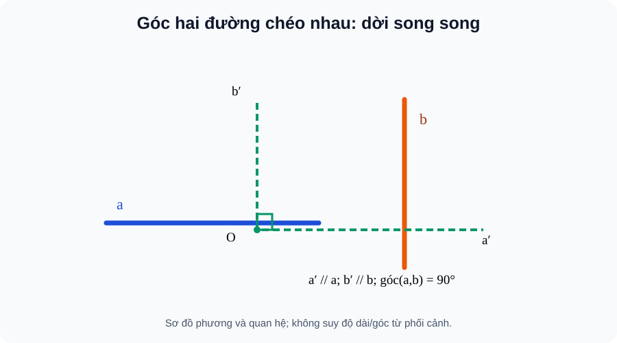
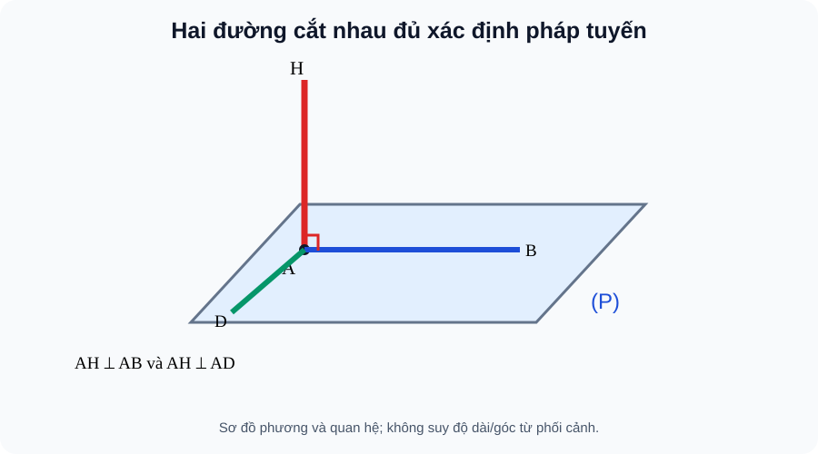
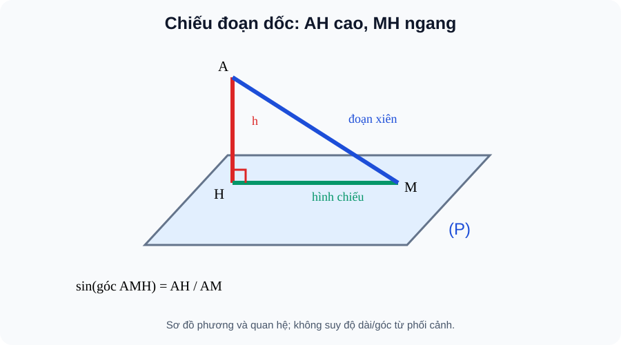
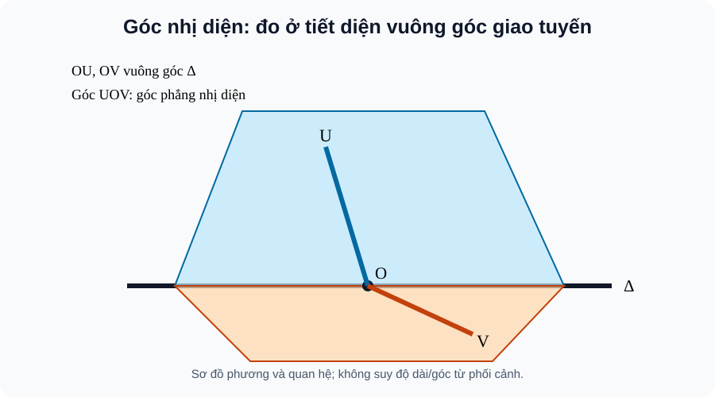

# CĐ16 — Hình học không gian: Quan hệ vuông góc & Góc · AUTHORING R01 · PLAN22 scope-corrected

> **AUTHORING_REVIEW_CANDIDATE / KHÔNG CONTENT_READY.** `SLM-THPT-QUALITY-ONE v3.1.0` Q01–Q18. Mã CD16 chỉ là *thứ tự nghiên cứu* từ đề xuất lịch sử 22 chuyên đề, **không** tự phê duyệt TOPIC_ID/runtime route. Nguồn học liệu R00 trước đó gộp B26/B27 (Khoảng cách & Thể tích); từ R01, phần ấy thuộc hướng nghiên cứu CĐ17 riêng và không được coi là đã hoàn tất hay review cho CĐ17.

<!-- AUTHOR_ONLY_PROVENANCE_START
S1: SGK Toán 11 KNTT Tập 2 ChVII B22–B25, printed pp27–53; SBT B22–B25 pp24–34 from original G11 SGK receipt, public blob afc8ec039213b87b4930f2d34d48c28d1fc6277f; not newly scanned. Forty-one SGK canonical ID pointers, no duplicated bodies. Historical SGK Academic/PED does not confer Topic PASS.
NOTEBOOKLM_EDITORIAL_REFERENCE: Temp_TOPIC_10_QUAN_HE_VUONG_GOC_VA_KHOANG_CACH_TRONG_HINH_HO.md, Drive draft (DRAFT_NOT_REVIEWED). Old source incorrectly labeled ChVIII and mixed B26/B27; reject source scope, pages and grading from it. Only select mathematically independently validated explanation bridges (two intersecting directions, roof projection, cross-section of dihedral angle). The R01 language is editorially adapted, not a verbatim independent-review-approved source.
AUTHOR_ONLY_PROVENANCE_END -->

**Cách học:** Hành trình độc lập gồm đúng **Kiến thức / Luyện tập / Tự kiểm tra**, không Core tab. Học đến ví dụ, tự thử chưa xem lời giải, sau đó tự mở Đối chiếu và D6. Mọi câu đã xem trong luyện tập chỉ là tự kiểm tra ôn tập công khai, không có tính độc lập của đề Readiness; không ghi Mastery.

## 1. Kiến thức

**Mạch mở đầu — Từ quan sát đến lập luận.** Hãy tưởng tượng một căn phòng: các cạnh tường giao nhau ở những chỗ nhìn thấy được, nhưng nhiều thanh ngang và thanh đứng ở hai phía phòng không hề chạm nhau. Chúng ta vẫn muốn trả lời chúng có vuông góc hay không. Điểm khởi đầu không phải là đo góc trên bức hình phối cảnh: hãy tìm hai **phương** và đưa chúng về cùng một điểm. Khi đã làm được việc đó, quan hệ hai đường vuông góc trở thành một cách nhìn xuyên suốt các bài toán cột, sàn, mái và góc.

**Lời dẫn học sinh:** Ở mỗi bước, đừng học một định lí rời rạc. Hãy tự hỏi: *Mình cần kiểm tra điều gì? Kiểm tra ít hơn có đủ không? Giả thiết nào làm cho kết luận đúng?* Bốn chặng dưới đây dẫn từ góc giữa hai đường, sang pháp tuyến mặt, rồi hình chiếu và góc giữa hai mặt. Các câu về khoảng cách và thể tích có chuyên đề nghiên cứu PLAN22-17 riêng; chúng không được lẫn vào phần luyện tập của CĐ16.

### 1. B22 · Hai đường thẳng vuông góc

**Đọc hình — B22:**

Quan sát đường **a** và **b** ở hai vị trí không cắt nhau; đừng cố nối đầu mút để lấy góc. Theo các dấu **a′∥a**, **b′∥b**, đưa hai phương về điểm **O** và đọc góc tại O. Nếu thay O bằng điểm khác thì hai phương không đổi, nên góc không đổi.

*Nếu không hiển thị hình, hãy đọc lại mô tả bằng lời ở trên và tự dựng quan hệ theo giả thiết; không suy góc hay độ dài từ nét phối cảnh.*

<!-- AUTHOR_ONLY_SVG_SOURCE: docs/assets/images/thpt/FIG-G11-CHVII-B22-01_R00.svg; BLOB: 5f2d23adb6f947064312d04d67ce5a5bb2d1ff48 -->

#### 1.1. Góc giữa hai đường trong không gian là góc nhỏ giữa hai đường cùng đi qua một điểm và lần lượt song song với hai đường đã cho; vì thế góc luôn trong [0°,90°]

<!-- LESSON_ID: TOP16-M01; OUTCOME_ID: TOP16-O01; S1_ORIGINAL_OUTCOME: G11-B22-ANGLE_LINES -->

**Hình thành kiến thức:** Góc giữa hai đường trong không gian là góc nhỏ giữa hai đường cùng đi qua một điểm và lần lượt song song với hai đường đã cho; vì thế góc luôn trong [0°,90°]. Việc dời phương là để đo được ngay cả khi hai đường chéo nhau.

**Ví dụ có giải thích cách chọn phương pháp:** Trong hình hộp chữ nhật ABCD.A′B′C′D′, AB vuông góc AA′, còn AA′ song song CC′. Vì vậy góc giữa AB và CC′ là 90° dù chúng không cắt nhau; dùng hai phương thay cho hình phối cảnh.

**Tự thử trước khi xem lời giải:** Trong hình hộp chữ nhật, góc giữa AB và A′B′ bằng bao nhiêu?

<!-- ITEM_ID: THPT-TOP16-T01; ROLE: TOPIC_FIRST_TRY; PRIMARY_OUTCOME: TOP16-O01 -->

Tự mở Đối chiếu và sửa lỗi

0° vì AB và A′B′ song song.

**D6 — Nếu chưa đúng:** Đừng dùng góc tù hoặc kết luận không có góc chỉ vì hai đường không gặp nhau. Tự dựng lại quan hệ trên hình hoặc viết một phản ví dụ kiểm tra đúng điều kiện, rồi thử câu tương tự.

#### 1.2. Vuông góc giữa hai đường là quan hệ **phương**: hai đường chéo nhau vẫn vuông góc nếu hai phương tạo góc 90°

<!-- LESSON_ID: TOP16-M02; OUTCOME_ID: TOP16-O02; S1_ORIGINAL_OUTCOME: G11-B22-PERP_SKEW -->

**Hình thành kiến thức:** Vuông góc giữa hai đường là quan hệ **phương**: hai đường chéo nhau vẫn vuông góc nếu hai phương tạo góc 90°. Điều kiện cắt nhau không phải thành phần của định nghĩa này.

**Ví dụ có giải thích cách chọn phương pháp:** Cạnh AB và cạnh DD′ của hộp chữ nhật không chung điểm, không đồng phẳng; thay DD′ bằng AA′ song song qua A, suy AB⊥DD′.

**Tự thử trước khi xem lời giải:** AB và DD′ ở hộp chữ nhật có phải là hai đường vuông góc không?

<!-- ITEM_ID: THPT-TOP16-T02; ROLE: TOPIC_FIRST_TRY; PRIMARY_OUTCOME: TOP16-O02 -->

Tự mở Đối chiếu và sửa lỗi

Có. Chúng chéo nhau nhưng cùng phương với hai cạnh vuông góc AB, AA′.

**D6 — Nếu chưa đúng:** Phân biệt “vuông góc theo phương” với “hai đường cắt nhau tại góc vuông”. Tự dựng lại quan hệ trên hình hoặc viết một phản ví dụ kiểm tra đúng điều kiện, rồi thử câu tương tự.

#### 1.3. Thay một đường bằng đường song song bảo toàn góc giữa các phương

<!-- LESSON_ID: TOP16-M03; OUTCOME_ID: TOP16-O03; S1_ORIGINAL_OUTCOME: G11-B22-PARALLEL_DIRECTION -->

**Hình thành kiến thức:** Thay một đường bằng đường song song bảo toàn góc giữa các phương. Nếu a⊥b và b∥c thì a⊥c, dù a,c có thể chéo nhau.

**Ví dụ có giải thích cách chọn phương pháp:** Trong hình hộp, từ AB⊥AA′ và AA′∥DD′ suy AB⊥DD′ mà không cần kéo dài hai cạnh cho gặp nhau.

**Tự thử trước khi xem lời giải:** Nếu a⊥b và c∥b thì kết luận gì về a,c?

<!-- ITEM_ID: THPT-TOP16-T03; ROLE: TOPIC_FIRST_TRY; PRIMARY_OUTCOME: TOP16-O03 -->

Tự mở Đối chiếu và sửa lỗi

a⊥c theo tính bất biến của góc khi thay đường bằng đường song song.

**D6 — Nếu chưa đúng:** Không suy hai đường cùng vuông góc một đường thứ ba thì chúng song song trong không gian. Tự dựng lại quan hệ trên hình hoặc viết một phản ví dụ kiểm tra đúng điều kiện, rồi thử câu tương tự.

#### 1.4. Hình chiếu trên giấy có thể làm hai cạnh dường như cắt hoặc vuông góc

<!-- LESSON_ID: TOP16-M04; OUTCOME_ID: TOP16-O04; S1_ORIGINAL_OUTCOME: G11-B22-PROOF_CONTEXT -->

**Hình thành kiến thức:** Hình chiếu trên giấy có thể làm hai cạnh dường như cắt hoặc vuông góc. Bằng chứng thật phải là một góc trong mặt phẳng xác định hoặc phép chuyển phương hợp lệ.

**Ví dụ có giải thích cách chọn phương pháp:** Muốn biết thanh ngang AB có vuông góc thanh đứng CC′, chứng minh AB⊥AA′ và CC′∥AA′, rồi mới kết luận.

**Tự thử trước khi xem lời giải:** Nét vẽ có hai đoạn tạo góc 90° trên giấy, đủ kết luận hai thanh trong không gian vuông góc chưa?

<!-- ITEM_ID: THPT-TOP16-T04; ROLE: TOPIC_FIRST_TRY; PRIMARY_OUTCOME: TOP16-O04 -->

Tự mở Đối chiếu và sửa lỗi

Chưa; cần chứng cứ hình học về phương hoặc góc thật.

**D6 — Nếu chưa đúng:** Khi lời giải viết “nhìn hình thấy”, hãy thay bằng quan hệ song song/vuông góc có giả thiết. Tự dựng lại quan hệ trên hình hoặc viết một phản ví dụ kiểm tra đúng điều kiện, rồi thử câu tương tự.

**Từ hai đường đến cả mặt phẳng.** Một chiếc cột nhìn có vẻ đứng thẳng vẫn có thể bị nghiêng về một phía mà ảnh chụp không nhận ra. Nếu chỉ kiểm tra cột vuông góc với **một** đường trên sàn, ta chưa loại trừ được hướng nghiêng khác. Chọn **hai đường cắt nhau** trên cùng mặt sàn thì hai phương độc lập mới đủ kiểm tra cột có vuông góc với toàn bộ sàn hay không. Đây là ý nghĩa của định lí, không phải mẹo ghi nhớ.

**Ví dụ kết nối (đã kiểm toán độc lập với nguồn SGK):** Cho chóp S.ABC, tam giác ABC vuông tại B và SA⊥(ABC). Vì SA⊥BC và AB⊥BC; hai đường SA,AB cắt nhau ở A cùng thuộc (SAB), nên BC⊥(SAB), do đó BC⊥SB. Một kết luận từ “vô số phương” được đưa về hai điều kiện có thể chứng minh.

### 2. B23 · Đường thẳng vuông góc mặt phẳng

**Đọc hình — B23:**

Chỉ hai cạnh **AB** và **AD** trong mặt **(P)**, chúng cắt nhau tại **A**. Cột **AH** vuông góc với cả hai: không phải “hai góc vuông là đủ” một cách máy móc, mà vì AB,AD tạo hai hướng không song song cùng nằm trong một mặt. Nếu hai cạnh kiểm tra song song thì không được suy AH⊥(P).

*Nếu không hiển thị hình, hãy đọc lại mô tả bằng lời ở trên và tự dựng quan hệ theo giả thiết; không suy góc hay độ dài từ nét phối cảnh.*

<!-- AUTHOR_ONLY_SVG_SOURCE: docs/assets/images/thpt/FIG-G11-CHVII-B23-01_R00.svg; BLOB: b53b65704f9830e1c97b533bac0e79a0b56761b6 -->

#### 2.1. Đường d vuông góc mặt phẳng (P) nghĩa là d vuông góc **mọi đường thẳng** nằm trong (P)

<!-- LESSON_ID: TOP16-M05; OUTCOME_ID: TOP16-O05; S1_ORIGINAL_OUTCOME: G11-B23-PERP_PLANE_DEF -->

**Hình thành kiến thức:** Đường d vuông góc mặt phẳng (P) nghĩa là d vuông góc **mọi đường thẳng** nằm trong (P). Chứng minh vuông góc một đường là chưa đủ.

**Ví dụ có giải thích cách chọn phương pháp:** Cột thẳng đứng qua chân H vuông góc mặt sàn: vì mọi hướng trong sàn đều nằm ngang nên cột vuông góc mọi đường trong sàn.

**Tự thử trước khi xem lời giải:** d vuông góc chỉ một đường a thuộc (P). Đủ kết luận d⊥(P) không?

<!-- ITEM_ID: THPT-TOP16-T05; ROLE: TOPIC_FIRST_TRY; PRIMARY_OUTCOME: TOP16-O05 -->

Tự mở Đối chiếu và sửa lỗi

Không; cần thêm dữ kiện, thường là d vuông góc hai đường cắt nhau trong (P).

**D6 — Nếu chưa đúng:** Một đường không đại diện cho tất cả các phương trong một mặt phẳng. Tự dựng lại quan hệ trên hình hoặc viết một phản ví dụ kiểm tra đúng điều kiện, rồi thử câu tương tự.

#### 2.2. Hai đường a,b **cắt nhau** trong (P) tạo hai hướng độc lập

<!-- LESSON_ID: TOP16-M06; OUTCOME_ID: TOP16-O06; S1_ORIGINAL_OUTCOME: G11-B23-TWO_INTERSECT -->

**Hình thành kiến thức:** Hai đường a,b **cắt nhau** trong (P) tạo hai hướng độc lập. Nếu d⊥a và d⊥b thì d vuông góc cả mặt phẳng; điều kiện cắt nhau không thể bỏ.

**Ví dụ có giải thích cách chọn phương pháp:** Ở đáy hình chữ nhật ABCD, AB và AD cắt tại A; cột AA′ vuông góc hai cạnh này nên AA′⊥(ABCD).

**Tự thử trước khi xem lời giải:** Nếu a∥b trong (P), d⊥a và d⊥b đã đủ d⊥(P) chưa?

<!-- ITEM_ID: THPT-TOP16-T06; ROLE: TOPIC_FIRST_TRY; PRIMARY_OUTCOME: TOP16-O06 -->

Tự mở Đối chiếu và sửa lỗi

Chưa, vì hai phương song song chỉ kiểm tra một hướng.

**D6 — Nếu chưa đúng:** Dừng lại khi hai đường kiểm tra song song, trùng nhau hoặc không cùng mặt phẳng. Tự dựng lại quan hệ trên hình hoặc viết một phản ví dụ kiểm tra đúng điều kiện, rồi thử câu tương tự.

#### 2.3. Vuông góc mặt phẳng được bảo toàn khi thay đường bởi đường song song hoặc thay mặt phẳng bởi mặt phẳng song song phân biệt

<!-- LESSON_ID: TOP16-M07; OUTCOME_ID: TOP16-O07; S1_ORIGINAL_OUTCOME: G11-B23-PARALLEL_TRANSFER -->

**Hình thành kiến thức:** Vuông góc mặt phẳng được bảo toàn khi thay đường bởi đường song song hoặc thay mặt phẳng bởi mặt phẳng song song phân biệt. Cần xác nhận đúng các quan hệ song song.

**Ví dụ có giải thích cách chọn phương pháp:** AA′⊥(ABCD) trong hộp chữ nhật; vì CC′∥AA′ nên CC′⊥(ABCD).

**Tự thử trước khi xem lời giải:** Nếu a⊥(P) và b∥a thì b có vuông góc (P) không?

<!-- ITEM_ID: THPT-TOP16-T07; ROLE: TOPIC_FIRST_TRY; PRIMARY_OUTCOME: TOP16-O07 -->

Tự mở Đối chiếu và sửa lỗi

Có; mọi đường của (P) vẫn vuông góc phương b.

**D6 — Nếu chưa đúng:** Không lấy việc hai mặt phẳng nhìn cùng hướng trên giấy làm chứng cứ song song. Tự dựng lại quan hệ trên hình hoặc viết một phản ví dụ kiểm tra đúng điều kiện, rồi thử câu tương tự.

#### 2.4. Qua mỗi điểm có một đường duy nhất vuông góc mặt phẳng cho trước

<!-- LESSON_ID: TOP16-M08; OUTCOME_ID: TOP16-O08; S1_ORIGINAL_OUTCOME: G11-B23-PLANE_PROPERTY -->

**Hình thành kiến thức:** Qua mỗi điểm có một đường duy nhất vuông góc mặt phẳng cho trước. Hai đường cùng vuông góc một mặt phẳng thì song song hoặc trùng nhau.

**Ví dụ có giải thích cách chọn phương pháp:** Hai cột AA′ và BB′ của lăng trụ đứng cùng vuông góc nền nên chúng song song, dù chân ở hai điểm khác nhau.

**Tự thử trước khi xem lời giải:** Qua điểm M có thể có hai đường phân biệt cùng vuông góc (P) không?

<!-- ITEM_ID: THPT-TOP16-T08; ROLE: TOPIC_FIRST_TRY; PRIMARY_OUTCOME: TOP16-O08 -->

Tự mở Đối chiếu và sửa lỗi

Không; pháp tuyến qua M xác định duy nhất.

**D6 — Nếu chưa đúng:** Không lẫn tính duy nhất theo phương pháp tuyến với tính duy nhất mọi đường qua M. Tự dựng lại quan hệ trên hình hoặc viết một phản ví dụ kiểm tra đúng điều kiện, rồi thử câu tương tự.

#### 2.5. Kiểm tra cột vuông góc nền cần hai hướng không song song trên nền, tương ứng kiểm tra hai mặt đứng giao nhau; đo theo một cạnh nền chỉ xác định một điều kiện

<!-- LESSON_ID: TOP16-M09; OUTCOME_ID: TOP16-O09; S1_ORIGINAL_OUTCOME: G11-B23-PRACTICAL_POST -->

**Hình thành kiến thức:** Kiểm tra cột vuông góc nền cần hai hướng không song song trên nền, tương ứng kiểm tra hai mặt đứng giao nhau; đo theo một cạnh nền chỉ xác định một điều kiện.

**Ví dụ có giải thích cách chọn phương pháp:** Lấy hai thước vuông đặt theo hai đường sàn cắt nhau. Cột vuông góc cả hai thì vuông góc mặt sàn.

**Tự thử trước khi xem lời giải:** Đo cột vuông góc cạnh AB của nền có đủ khẳng định cột thẳng đứng?

<!-- ITEM_ID: THPT-TOP16-T09; ROLE: TOPIC_FIRST_TRY; PRIMARY_OUTCOME: TOP16-O09 -->

Tự mở Đối chiếu và sửa lỗi

Chưa; cần thêm một đường cắt AB trong nền (ví dụ AD).

**D6 — Nếu chưa đúng:** Không bỏ điều kiện hai phương kiểm tra phải độc lập. Tự dựng lại quan hệ trên hình hoặc viết một phản ví dụ kiểm tra đúng điều kiện, rồi thử câu tương tự.

**Từ cột thẳng sang mái dốc.** Với một mái nghiêng, ta không thể lấy ngay góc giữa mái và cột đứng rồi gọi đó là “góc nghiêng so với sàn”. Hãy hạ chân vuông góc từ một điểm trên mái xuống sàn. Khi ấy cạnh xiên, chiều cao và hình chiếu tạo thành một tam giác vuông: góc với sàn nằm **giữa cạnh xiên và hình chiếu**, còn góc với cột đứng là góc phụ. Mục tiêu của hình chiếu là biến một câu hỏi ba chiều thành một tam giác có thể chứng minh và tính được.

### 3. B24 · Phép chiếu vuông góc và góc đường–mặt

**Đọc hình — B24:**

Tìm **A** ở cao, **H** là chân AH⊥(P), **M** ở nền. Đường xiên **AM** chiếu thành **HM**, do đó góc cần đo là **AMH tại M**, không phải góc ở A. Tam giác AHM vuông tại H nên khi biết AH,AM có thể dùng sin(góc AMH)=AH/AM; không lấy nét vẽ phối cảnh làm phép đo.

*Nếu không hiển thị hình, hãy đọc lại mô tả bằng lời ở trên và tự dựng quan hệ theo giả thiết; không suy góc hay độ dài từ nét phối cảnh.*

<!-- AUTHOR_ONLY_SVG_SOURCE: docs/assets/images/thpt/FIG-G11-CHVII-B24-01_R00.svg; BLOB: c98d7df30b87c339336636e00322816a4099681b -->

**Khám phá tương tác:** Mô hình **Đường dốc, hình chiếu và góc** điều khiển độ cao và khoảng ngang của tam giác vuông. Dự đoán góc/độ dài trước khi kéo, quan sát hình thay đổi rồi kiểm bằng Pitago và sin/tan. Mô hình không thay chứng minh định lí ba đường vuông góc.

<!-- AUTHOR_ONLY_MODEL_REFERENCE: SLM-TOP16-RAMP-ANGLE-R00; FILE: Temp_THPT_TOPIC16_RAMP_ANGLE_R01_SCOPE_CORRECTED_20261113.html; PUBLIC_DISCOVERY_NO_MASTERY -->

#### 3.1. Hình chiếu vuông góc H của A trên (P) là chân duy nhất của AH⊥(P)

<!-- LESSON_ID: TOP16-M10; OUTCOME_ID: TOP16-O10; S1_ORIGINAL_OUTCOME: G11-B24-POINT_PROJECTION -->

**Hình thành kiến thức:** Hình chiếu vuông góc H của A trên (P) là chân duy nhất của AH⊥(P). Độ dài AH là khoảng cách ngắn nhất từ A đến (P).

**Ví dụ có giải thích cách chọn phương pháp:** Nếu A nằm trên cột cao 4 m và H là chân cột trên nền, hình chiếu A xuống nền là H, khoảng cách bằng 4 m.

**Tự thử trước khi xem lời giải:** Nếu A thuộc (P), hình chiếu vuông góc của A trên (P) ở đâu?

<!-- ITEM_ID: THPT-TOP16-T10; ROLE: TOPIC_FIRST_TRY; PRIMARY_OUTCOME: TOP16-O10 -->

Tự mở Đối chiếu và sửa lỗi

Chính là A; khoảng cách A đến (P) bằng 0.

**D6 — Nếu chưa đúng:** Không lấy điểm gần nhất theo hình phối cảnh thay cho chân vuông góc. Tự dựng lại quan hệ trên hình hoặc viết một phản ví dụ kiểm tra đúng điều kiện, rồi thử câu tương tự.

#### 3.2. Muốn chiếu một đường, chiếu hai điểm phân biệt của nó rồi nối ảnh; nếu đường theo phương vuông góc mặt phẳng thì toàn bộ ảnh chỉ là **một điểm**

<!-- LESSON_ID: TOP16-M11; OUTCOME_ID: TOP16-O11; S1_ORIGINAL_OUTCOME: G11-B24-LINE_PROJECTION -->

**Hình thành kiến thức:** Muốn chiếu một đường, chiếu hai điểm phân biệt của nó rồi nối ảnh; nếu đường theo phương vuông góc mặt phẳng thì toàn bộ ảnh chỉ là **một điểm**.

**Ví dụ có giải thích cách chọn phương pháp:** Trong lăng trụ đứng, cạnh AA′ vuông góc đáy nên hình chiếu của cạnh trên nền là điểm A; cạnh A′B′ có ảnh là AB.

**Tự thử trước khi xem lời giải:** Đường d⊥(P). Ảnh vuông góc của d lên (P) là gì?

<!-- ITEM_ID: THPT-TOP16-T11; ROLE: TOPIC_FIRST_TRY; PRIMARY_OUTCOME: TOP16-O11 -->

Tự mở Đối chiếu và sửa lỗi

Một điểm: chân giao d∩(P).

**D6 — Nếu chưa đúng:** Luôn xét xem hai đầu mút có chiếu trùng nhau không trước khi nối ảnh. Tự dựng lại quan hệ trên hình hoặc viết một phản ví dụ kiểm tra đúng điều kiện, rồi thử câu tương tự.

#### 3.3. Định lí ba đường vuông góc liên hệ đường xiên, hình chiếu vuông góc của nó và đường nằm trong mặt phẳng: đường của mặt phẳng vuông góc hình chiếu thì cũng vuông góc đường xiên

<!-- LESSON_ID: TOP16-M12; OUTCOME_ID: TOP16-O12; S1_ORIGINAL_OUTCOME: G11-B24-THREE_PERP -->

**Hình thành kiến thức:** Định lí ba đường vuông góc liên hệ đường xiên, hình chiếu vuông góc của nó và đường nằm trong mặt phẳng: đường của mặt phẳng vuông góc hình chiếu thì cũng vuông góc đường xiên.

**Ví dụ có giải thích cách chọn phương pháp:** AH⊥(P), B,H∈(P) và c⊂(P) đi qua H với c⊥BH. Vì vectơ AB gồm thành phần AH thẳng đứng và HB trong (P), c vuông góc cả hai nên c⊥AB.

**Tự thử trước khi xem lời giải:** AH⊥(P), B∈(P) và B≠H nên BH là một đường thẳng trên (P). Nếu c⊂(P), c⊥BH, có thể kết luận c⊥AB không?

<!-- ITEM_ID: THPT-TOP16-T12; ROLE: TOPIC_FIRST_TRY; PRIMARY_OUTCOME: TOP16-O12 -->

Tự mở Đối chiếu và sửa lỗi

Có: BH là hình chiếu của AB lên (P); dùng định lí ba đường vuông góc.

**D6 — Nếu chưa đúng:** Trước khi dùng định lí, xác định chân H và đảm bảo BH thật sự là hình chiếu AB. Tự dựng lại quan hệ trên hình hoặc viết một phản ví dụ kiểm tra đúng điều kiện, rồi thử câu tương tự.

#### 3.4. Góc giữa đường xiên AB và (P) là góc giữa AB và hình chiếu BH của nó, trong [0°,90°]

<!-- LESSON_ID: TOP16-M13; OUTCOME_ID: TOP16-O13; S1_ORIGINAL_OUTCOME: G11-B24-LINE_PLANE_ANGLE -->

**Hình thành kiến thức:** Góc giữa đường xiên AB và (P) là góc giữa AB và hình chiếu BH của nó, trong [0°,90°]. Nếu AB⊥(P) thì góc 90° dù hình chiếu thu thành điểm.

**Ví dụ có giải thích cách chọn phương pháp:** Tam giác ABH vuông H có AH=3, BH=4, AB=5 nên sin(góc giữa AB và nền)=3/5; góc nhọn là arcsin(3/5).

**Tự thử trước khi xem lời giải:** Đường nằm trong (P) tạo góc bao nhiêu với (P)?

<!-- ITEM_ID: THPT-TOP16-T13; ROLE: TOPIC_FIRST_TRY; PRIMARY_OUTCOME: TOP16-O13 -->

Tự mở Đối chiếu và sửa lỗi

0°. Khi đường vuông góc (P), góc 90°.

**D6 — Nếu chưa đúng:** Không lấy góc giữa đường xiên và pháp tuyến làm góc đường–mặt; đó là góc phụ. Tự dựng lại quan hệ trên hình hoặc viết một phản ví dụ kiểm tra đúng điều kiện, rồi thử câu tương tự.

#### 3.5. Một đường dốc tạo tam giác vuông với mặt nền: chiều cao là cạnh đối góc dốc, khoảng ngang là cạnh kề, và độ dài đường dốc là cạnh huyền

<!-- LESSON_ID: TOP16-M14; OUTCOME_ID: TOP16-O14; S1_ORIGINAL_OUTCOME: G11-B24-ANGLE_APPLICATION -->

**Hình thành kiến thức:** Một đường dốc tạo tam giác vuông với mặt nền: chiều cao là cạnh đối góc dốc, khoảng ngang là cạnh kề, và độ dài đường dốc là cạnh huyền.

**Ví dụ có giải thích cách chọn phương pháp:** Dốc lên 3 m trên đoạn ngang 4 m có chiều dài 5 m, tanθ=3/4. Nếu đo dốc 5 m mà coi đó là khoảng ngang thì tính góc sai.

**Tự thử trước khi xem lời giải:** Dốc cao 3 m, ngang 4 m: độ dài đoạn dốc?

<!-- ITEM_ID: THPT-TOP16-T14; ROLE: TOPIC_FIRST_TRY; PRIMARY_OUTCOME: TOP16-O14 -->

Tự mở Đối chiếu và sửa lỗi

5 m theo định lí Pitago, không phải 7 m.

**D6 — Nếu chưa đúng:** Chỉ áp dụng tỉ số lượng giác cho tam giác vuông sau khi dựng hình chiếu đúng. Tự dựng lại quan hệ trên hình hoặc viết một phản ví dụ kiểm tra đúng điều kiện, rồi thử câu tương tự.

**Từ góc của một đường đến góc của cả mặt.** Hai bề mặt của mái và trần có thể gặp nhau theo một đường dài; nếu lấy bất kỳ đường xiên nào trong từng mặt để đo, đáp án sẽ thay đổi theo vị trí thước. Muốn đo góc ổn định, tại một điểm trên **giao tuyến** hãy dựng trong mỗi mặt một đường vuông góc giao tuyến. Chính góc trong thiết diện vuông góc ấy là thông tin cần dùng. Lưu ý: góc phẳng của một **góc nhị diện** có thể là góc tù, còn góc giữa hai **mặt phẳng không định hướng** luôn được lấy là góc nhỏ.

**Một ví dụ nối ba ý tưởng:** Cho SA⊥(ABC) và H là chân vuông góc từ A đến BC. Khi ấy BC⊥SA và BC⊥AH; suy BC⊥(SAH), nên BC⊥SH. Hai đường AH⊂(ABC) và SH⊂(SBC) cùng vuông góc BC tại H, vì vậy góc SHA trong tiết diện SAH diễn tả góc phẳng của nhị diện có bờ BC (với hai nửa mặt tương ứng), còn góc giữa hai mặt phẳng là góc nhỏ giữa AH và SH. Đừng nhầm góc tại S với góc tại H.

### 4. B25 · Hai mặt phẳng vuông góc và hình khối đặc biệt

**Đọc hình — B25:**

Trước hết chỉ **giao tuyến Δ**, sau đó xem hai tia **OU, OV** cùng vuông góc Δ tại **O** nhưng nằm trên hai mặt khác nhau. **UOV** là góc phẳng của nhị diện đã chọn, có thể tù. Khi câu hỏi nói góc **giữa hai mặt phẳng**, lấy góc không tù giữa hai đường thẳng chứa OU và OV, không tùy tiện giữ góc nhị diện lớn hơn 90°.

*Nếu không hiển thị hình, hãy đọc lại mô tả bằng lời ở trên và tự dựng quan hệ theo giả thiết; không suy góc hay độ dài từ nét phối cảnh.*

<!-- AUTHOR_ONLY_SVG_SOURCE: docs/assets/images/thpt/FIG-G11-CHVII-B25-01_R00.svg; BLOB: 3f6112a7b12f1829ee2249b979d45f1f5370fc66 -->

#### 4.1. Góc giữa hai **mặt phẳng** được đo bằng góc nhỏ của hai đường lần lượt nằm trong hai mặt và cùng vuông góc giao tuyến; kết quả thuộc [0°,90°] khi xét mặt phẳng không định hướng

<!-- LESSON_ID: TOP16-M15; OUTCOME_ID: TOP16-O15; S1_ORIGINAL_OUTCOME: G11-B25-PLANE_ANGLE -->

**Hình thành kiến thức:** Góc giữa hai **mặt phẳng** được đo bằng góc nhỏ của hai đường lần lượt nằm trong hai mặt và cùng vuông góc giao tuyến; kết quả thuộc [0°,90°] khi xét mặt phẳng không định hướng.

**Ví dụ có giải thích cách chọn phương pháp:** Tường thẳng đứng và nền ngang tạo góc 90°. Chọn một đường trong tường vuông góc chân tường và một đường trong nền vuông góc chân tường, rồi đo góc của chúng.

**Tự thử trước khi xem lời giải:** Hai mặt phẳng song song tạo góc giữa hai mặt bằng bao nhiêu?

<!-- ITEM_ID: THPT-TOP16-T15; ROLE: TOPIC_FIRST_TRY; PRIMARY_OUTCOME: TOP16-O15 -->

Tự mở Đối chiếu và sửa lỗi

0° theo quy ước góc giữa các mặt phẳng.

**D6 — Nếu chưa đúng:** Không đồng nhất góc giữa hai mặt với bất kì góc của hai đường tùy chọn ở hai mặt. Tự dựng lại quan hệ trên hình hoặc viết một phản ví dụ kiểm tra đúng điều kiện, rồi thử câu tương tự.

#### 4.2. Góc nhị diện gắn với **hai nửa mặt phẳng** có chung bờ: góc phẳng của nhị diện có thể lớn hơn 90°

<!-- LESSON_ID: TOP16-M16; OUTCOME_ID: TOP16-O16; S1_ORIGINAL_OUTCOME: G11-B25-DIHEDRAL -->

**Hình thành kiến thức:** Góc nhị diện gắn với **hai nửa mặt phẳng** có chung bờ: góc phẳng của nhị diện có thể lớn hơn 90°. Góc giữa hai mặt phẳng không định hướng lấy góc nhỏ.

**Ví dụ có giải thích cách chọn phương pháp:** Hai nửa mặt phẳng tạo nhị diện 120°; hai mặt phẳng chứa chúng chỉ tạo góc nhỏ 60°. Không được dùng thay nhau.

**Tự thử trước khi xem lời giải:** Nhị diện 120° cho góc nhỏ giữa hai mặt phẳng chứa nó bằng bao nhiêu?

<!-- ITEM_ID: THPT-TOP16-T16; ROLE: TOPIC_FIRST_TRY; PRIMARY_OUTCOME: TOP16-O16 -->

Tự mở Đối chiếu và sửa lỗi

60° = 180°−120°.

**D6 — Nếu chưa đúng:** Phải nêu đang nói nhị diện hay góc giữa hai mặt phẳng; khác nhau ở định hướng. Tự dựng lại quan hệ trên hình hoặc viết một phản ví dụ kiểm tra đúng điều kiện, rồi thử câu tương tự.

#### 4.3. Muốn chứng minh (P)⊥(Q), tìm **một đường** nằm trong (P) và vuông góc với (Q)

<!-- LESSON_ID: TOP16-M17; OUTCOME_ID: TOP16-O17; S1_ORIGINAL_OUTCOME: G11-B25-PERP_PLANES -->

**Hình thành kiến thức:** Muốn chứng minh (P)⊥(Q), tìm **một đường** nằm trong (P) và vuông góc với (Q). Không chỉ chứng minh hai đường thuộc hai mặt vuông góc.

**Ví dụ có giải thích cách chọn phương pháp:** Mặt tường chứa cột d vuông góc nền; do d nằm trong mặt tường và d⊥mặt nền nên mặt tường vuông góc nền.

**Tự thử trước khi xem lời giải:** d⊂(P), d⊥(Q). Quan hệ hai mặt (P),(Q)?

<!-- ITEM_ID: THPT-TOP16-T17; ROLE: TOPIC_FIRST_TRY; PRIMARY_OUTCOME: TOP16-O17 -->

Tự mở Đối chiếu và sửa lỗi

(P)⊥(Q), theo dấu hiệu một đường trong mặt vuông góc mặt kia.

**D6 — Nếu chưa đúng:** Chỉ “có hai đường vuông góc” chưa đủ nếu không có đường vuông góc toàn bộ mặt. Tự dựng lại quan hệ trên hình hoặc viết một phản ví dụ kiểm tra đúng điều kiện, rồi thử câu tương tự.

#### 4.4. Khi hai mặt (P)⊥(Q) cắt theo d, đường a **trong (P)** và **vuông góc d** sẽ vuông góc (Q), theo định lí về hai mặt vuông góc

<!-- LESSON_ID: TOP16-M18; OUTCOME_ID: TOP16-O18; S1_ORIGINAL_OUTCOME: G11-B25-PERP_PLANE_RULE -->

**Hình thành kiến thức:** Khi hai mặt (P)⊥(Q) cắt theo d, đường a **trong (P)** và **vuông góc d** sẽ vuông góc (Q), theo định lí về hai mặt vuông góc.

**Ví dụ có giải thích cách chọn phương pháp:** Mặt tường (P) vuông góc nền (Q) theo chân tường d. Đường đứng a trong tường đi qua chân và vuông góc d sẽ vuông góc nền.

**Tự thử trước khi xem lời giải:** (P)⊥(Q) theo d. a⊂(P), a⊥d. Có a⊥(Q) không?

<!-- ITEM_ID: THPT-TOP16-T18; ROLE: TOPIC_FIRST_TRY; PRIMARY_OUTCOME: TOP16-O18 -->

Tự mở Đối chiếu và sửa lỗi

Có, theo định lí hai mặt phẳng vuông góc. a phải nằm trong (P) và vuông góc giao tuyến d.

**D6 — Nếu chưa đúng:** Nhớ cả điều kiện a nằm trong mặt và a vuông góc giao tuyến. Tự dựng lại quan hệ trên hình hoặc viết một phản ví dụ kiểm tra đúng điều kiện, rồi thử câu tương tự.

#### 4.5. Lăng trụ đứng có cạnh bên vuông góc hai đáy; chiều cao chính là cạnh bên

<!-- LESSON_ID: TOP16-M19; OUTCOME_ID: TOP16-O19; S1_ORIGINAL_OUTCOME: G11-B25-RIGHT_PRISM -->

**Hình thành kiến thức:** Lăng trụ đứng có cạnh bên vuông góc hai đáy; chiều cao chính là cạnh bên. Lăng trụ đều có đáy đa giác đều và là lăng trụ đứng. Hộp chữ nhật/lập phương là các trường hợp đặc biệt.

**Ví dụ có giải thích cách chọn phương pháp:** Một lăng trụ đứng có cạnh bên dài 5 cm thì cạnh bên là đoạn vuông góc nối hai mặt đáy song song, nên chiều cao đúng bằng 5 cm. Lăng trụ xiên vẫn có hai đáy song song nhưng cạnh bên nghiêng, vì vậy không được tự lấy cạnh bên làm chiều cao. Ở đây ta chỉ xác định quan hệ vuông góc; phép tính thể tích được học trong mạch Khoảng cách & Thể tích riêng.

**Tự thử trước khi xem lời giải:** Lăng trụ đứng có cạnh bên 7 cm, chiều cao bao nhiêu?

<!-- ITEM_ID: THPT-TOP16-T19; ROLE: TOPIC_FIRST_TRY; PRIMARY_OUTCOME: TOP16-O19 -->

Tự mở Đối chiếu và sửa lỗi

7 cm, vì cạnh bên vuông góc mặt đáy.

**D6 — Nếu chưa đúng:** Không dùng chiều dài cạnh bên của lăng trụ xiên làm chiều cao. Tự dựng lại quan hệ trên hình hoặc viết một phản ví dụ kiểm tra đúng điều kiện, rồi thử câu tương tự.

#### 4.6. Chóp đều có đáy là đa giác đều và chân đường cao là tâm của đáy, nên các cạnh bên bằng nhau

<!-- LESSON_ID: TOP16-M20; OUTCOME_ID: TOP16-O20; S1_ORIGINAL_OUTCOME: G11-B25-REGULAR_PYRAMID -->

**Hình thành kiến thức:** Chóp đều có đáy là đa giác đều và chân đường cao là tâm của đáy, nên các cạnh bên bằng nhau. Độ dài cạnh bên, chiều cao và đường cao mặt bên là ba khái niệm khác.

**Ví dụ có giải thích cách chọn phương pháp:** Chóp tứ giác đều đáy cạnh 6, chiều cao 4; từ đỉnh đến trung điểm một cạnh đáy có độ dài √(4²+3²)=5, khác chiều cao.

**Tự thử trước khi xem lời giải:** Chóp đều đáy vuông cạnh 6, h=4. Đường cao của mặt bên qua trung điểm cạnh đáy dài bao nhiêu?

<!-- ITEM_ID: THPT-TOP16-T20; ROLE: TOPIC_FIRST_TRY; PRIMARY_OUTCOME: TOP16-O20 -->

Tự mở Đối chiếu và sửa lỗi

5, do tam giác vuông có hai cạnh 4 và 3.

**D6 — Nếu chưa đúng:** Không lấy cạnh bên hay đường cao mặt bên làm chiều cao vuông góc của chóp. Tự dựng lại quan hệ trên hình hoặc viết một phản ví dụ kiểm tra đúng điều kiện, rồi thử câu tương tự.

#### 4.7. Chóp cụt đều thu được khi cắt chóp đều bởi mặt phẳng song song đáy; hai đáy là đa giác đều đồng dạng, các mặt bên là hình thang cân

<!-- LESSON_ID: TOP16-M21; OUTCOME_ID: TOP16-O21; S1_ORIGINAL_OUTCOME: G11-B25-REGULAR_FRUSTUM -->

**Hình thành kiến thức:** Chóp cụt đều thu được khi cắt chóp đều bởi mặt phẳng song song đáy; hai đáy là đa giác đều đồng dạng, các mặt bên là hình thang cân. Tỉ số diện tích bằng bình phương tỉ số cạnh.

**Ví dụ có giải thích cách chọn phương pháp:** Hai đáy vuông có cạnh 6 và 3 nên diện tích lần lượt 36 và 9, tỉ số diện tích 4:1 chứ không phải 2:1.

**Tự thử trước khi xem lời giải:** Hai đáy hình vuông cạnh 6 và 3 có tỉ số diện tích đáy lớn : đáy nhỏ?

<!-- ITEM_ID: THPT-TOP16-T21; ROLE: TOPIC_FIRST_TRY; PRIMARY_OUTCOME: TOP16-O21 -->

Tự mở Đối chiếu và sửa lỗi

36:9 = 4:1.

**D6 — Nếu chưa đúng:** Không nhân tỉ số cạnh trực tiếp để suy tỉ số diện tích. Tự dựng lại quan hệ trên hình hoặc viết một phản ví dụ kiểm tra đúng điều kiện, rồi thử câu tương tự.

## 2. Luyện tập

Các bài luyện tập mới theo từng năng lực; học sinh cần nêu giả thiết và giải thích tại sao chọn bước đó trước khi tự mở đáp án. Bài SGK dùng chung chỉ tham chiếu canonical qua metadata; không chép câu/đáp án bản nguồn.

### Bài vận dụng 01

<!-- ITEM_ID: THPT-TOP16-P01; ROLE: TOPIC_PRACTICE; PRIMARY_OUTCOME: TOP16-O01 -->

Trong hình hộp chữ nhật, góc giữa AD và B′C′ bằng bao nhiêu?

Tự mở đáp án và lí giải

0°: AD và B′C′ song song, nên cùng phương. Không lấy khoảng cách giữa hai cạnh để xác định góc.

**D6 nếu sai:** Đừng dùng góc tù hoặc kết luận không có góc chỉ vì hai đường không gặp nhau. Quay lại định nghĩa và giả thiết, tự chỉ rõ lý do chọn phép suy luận này trước khi làm biến thể.

### Bài vận dụng 02

<!-- ITEM_ID: THPT-TOP16-P02; ROLE: TOPIC_PRACTICE; PRIMARY_OUTCOME: TOP16-O02 -->

Trong hình hộp chữ nhật, chứng minh BC vuông góc AA′.

Tự mở đáp án và lí giải

Vì AA′⊥(ABCD) nên AA′ vuông góc mọi đường của đáy, trong đó có BC; hoặc BB′∥AA′ và BC⊥BB′.

**D6 nếu sai:** Phân biệt “vuông góc theo phương” với “hai đường cắt nhau tại góc vuông”. Quay lại định nghĩa và giả thiết, tự chỉ rõ lý do chọn phép suy luận này trước khi làm biến thể.

### Bài vận dụng 03

<!-- ITEM_ID: THPT-TOP16-P03; ROLE: TOPIC_PRACTICE; PRIMARY_OUTCOME: TOP16-O03 -->

Trong hình hộp, từ BC⊥BB′ và DD′∥BB′ chứng minh BC⊥DD′.

Tự mở đáp án và lí giải

Thay DD′ bằng BB′ cùng phương. Vì BC⊥BB′ nên BC⊥DD′; không yêu cầu BC gặp DD′.

**D6 nếu sai:** Không suy hai đường cùng vuông góc một đường thứ ba thì chúng song song trong không gian. Quay lại định nghĩa và giả thiết, tự chỉ rõ lý do chọn phép suy luận này trước khi làm biến thể.

### Bài vận dụng 04

<!-- ITEM_ID: THPT-TOP16-P04; ROLE: TOPIC_PRACTICE; PRIMARY_OUTCOME: TOP16-O04 -->

Nêu một chứng cứ chắc chắn để kết luận AB⊥CC′ trong hộp chữ nhật.

Tự mở đáp án và lí giải

Từ AB thuộc đáy và CC′ vuông góc mặt đáy, CC′⊥AB; kết luận không dựa nét vẽ.

**D6 nếu sai:** Khi lời giải viết “nhìn hình thấy”, hãy thay bằng quan hệ song song/vuông góc có giả thiết. Quay lại định nghĩa và giả thiết, tự chỉ rõ lý do chọn phép suy luận này trước khi làm biến thể.

### Bài vận dụng 05

<!-- ITEM_ID: THPT-TOP16-P05; ROLE: TOPIC_PRACTICE; PRIMARY_OUTCOME: TOP16-O05 -->

Một đường d vuông góc hai đường cắt nhau a,b của (P); kết luận và lí do?

Tự mở đáp án và lí giải

d⊥(P) theo dấu hiệu hai phương cắt nhau trong cùng mặt phẳng; a,b cho đủ hai hướng độc lập.

**D6 nếu sai:** Một đường không đại diện cho tất cả các phương trong một mặt phẳng. Quay lại định nghĩa và giả thiết, tự chỉ rõ lý do chọn phép suy luận này trước khi làm biến thể.

### Bài vận dụng 06

<!-- ITEM_ID: THPT-TOP16-P06; ROLE: TOPIC_PRACTICE; PRIMARY_OUTCOME: TOP16-O06 -->

Trong mặt phẳng (P), a,b cắt tại O. Biết d⊥a và d⊥b. Chứng minh d⊥(P).

Tự mở đáp án và lí giải

Áp dụng định lí đường thẳng vuông góc hai đường cắt nhau của một mặt phẳng, suy d⊥(P).

**D6 nếu sai:** Dừng lại khi hai đường kiểm tra song song, trùng nhau hoặc không cùng mặt phẳng. Quay lại định nghĩa và giả thiết, tự chỉ rõ lý do chọn phép suy luận này trước khi làm biến thể.

### Bài vận dụng 07

<!-- ITEM_ID: THPT-TOP16-P07; ROLE: TOPIC_PRACTICE; PRIMARY_OUTCOME: TOP16-O07 -->

Đường a⊥(P), hai mặt phẳng (P)∥(Q). Quan hệ a và (Q)?

Tự mở đáp án và lí giải

a⊥(Q) vì hai mặt phẳng song song có cùng phương pháp tuyến; kiểm tra (P),(Q) thực sự song song.

**D6 nếu sai:** Không lấy việc hai mặt phẳng nhìn cùng hướng trên giấy làm chứng cứ song song. Quay lại định nghĩa và giả thiết, tự chỉ rõ lý do chọn phép suy luận này trước khi làm biến thể.

### Bài vận dụng 08

<!-- ITEM_ID: THPT-TOP16-P08; ROLE: TOPIC_PRACTICE; PRIMARY_OUTCOME: TOP16-O08 -->

d⊥(P), e⊥(P) và d≠e. Chứng minh d∥e.

Tự mở đáp án và lí giải

Cả d và e cùng hướng pháp tuyến của (P); hai đường phân biệt cùng phương nên song song.

**D6 nếu sai:** Không lẫn tính duy nhất theo phương pháp tuyến với tính duy nhất mọi đường qua M. Quay lại định nghĩa và giả thiết, tự chỉ rõ lý do chọn phép suy luận này trước khi làm biến thể.

### Bài vận dụng 09

<!-- ITEM_ID: THPT-TOP16-P09; ROLE: TOPIC_PRACTICE; PRIMARY_OUTCOME: TOP16-O09 -->

Trong nền chữ nhật, kiểm tra cột d⊥AB và d⊥AD với AB cắt AD. Kết luận?

Tự mở đáp án và lí giải

d⊥(ABCD) theo dấu hiệu vuông góc hai đường cắt nhau; mô tả rõ các đường thuộc nền.

**D6 nếu sai:** Không bỏ điều kiện hai phương kiểm tra phải độc lập. Quay lại định nghĩa và giả thiết, tự chỉ rõ lý do chọn phép suy luận này trước khi làm biến thể.

### Bài vận dụng 10

<!-- ITEM_ID: THPT-TOP16-P10; ROLE: TOPIC_PRACTICE; PRIMARY_OUTCOME: TOP16-O10 -->

Cho AH⊥(P), AH=7 cm; tìm hình chiếu của A và khoảng cách từ A đến (P).

Tự mở đáp án và lí giải

H là hình chiếu; d(A,(P))=AH=7 cm. Không dùng độ dài một đoạn xiên khác.

**D6 nếu sai:** Không lấy điểm gần nhất theo hình phối cảnh thay cho chân vuông góc. Quay lại định nghĩa và giả thiết, tự chỉ rõ lý do chọn phép suy luận này trước khi làm biến thể.

### Bài vận dụng 11

<!-- ITEM_ID: THPT-TOP16-P11; ROLE: TOPIC_PRACTICE; PRIMARY_OUTCOME: TOP16-O11 -->

Trong lăng trụ đứng ABC.A′B′C′, ảnh của đoạn B′C′ lên (ABC)?

Tự mở đáp án và lí giải

Đoạn BC vì B′ và C′ lần lượt chiếu thành B,C, khác nhau; ảnh không suy biến.

**D6 nếu sai:** Luôn xét xem hai đầu mút có chiếu trùng nhau không trước khi nối ảnh. Quay lại định nghĩa và giả thiết, tự chỉ rõ lý do chọn phép suy luận này trước khi làm biến thể.

### Bài vận dụng 12

<!-- ITEM_ID: THPT-TOP16-P12; ROLE: TOPIC_PRACTICE; PRIMARY_OUTCOME: TOP16-O12 -->

AH⊥(P), B,H∈(P), B≠H, c⊂(P) và c⊥AB. Hỏi c⊥BH không?

Tự mở đáp án và lí giải

Có. Vì AH⊥(P) nên c⊥AH. Mặt khác, theo giả thiết c⊥AB. Hình chiếu của đường xiên AB lên (P) là đường BH **không suy biến vì B≠H**; theo định lí ba đường vuông góc suy c⊥BH. Nếu bỏ điều kiện B≠H, BH chỉ là một điểm nên không thể viết c⊥BH.

**D6 nếu sai:** Trước khi dùng định lí, xác định chân H và đảm bảo BH thật sự là hình chiếu AB. Quay lại định nghĩa và giả thiết, tự chỉ rõ lý do chọn phép suy luận này trước khi làm biến thể.

### Bài vận dụng 13

<!-- ITEM_ID: THPT-TOP16-P13; ROLE: TOPIC_PRACTICE; PRIMARY_OUTCOME: TOP16-O13 -->

AH⊥(P), AH=5 m, BH=12 m. Tính sin góc của AB với (P).

Tự mở đáp án và lí giải

AB=√(5²+12²)=13 m; sinθ=AH/AB=5/13. Góc là giữa đường AB và hình chiếu BH.

**D6 nếu sai:** Không lấy góc giữa đường xiên và pháp tuyến làm góc đường–mặt; đó là góc phụ. Quay lại định nghĩa và giả thiết, tự chỉ rõ lý do chọn phép suy luận này trước khi làm biến thể.

### Bài vận dụng 14

<!-- ITEM_ID: THPT-TOP16-P14; ROLE: TOPIC_PRACTICE; PRIMARY_OUTCOME: TOP16-O14 -->

Đoạn đường dốc cao 5 m và chạy ngang 12 m. Tính độ dài và tan góc dốc.

Tự mở đáp án và lí giải

Độ dài 13 m; tanθ=5/12. Kiểm tra các số đều là độ dài cùng đơn vị.

**D6 nếu sai:** Chỉ áp dụng tỉ số lượng giác cho tam giác vuông sau khi dựng hình chiếu đúng. Quay lại định nghĩa và giả thiết, tự chỉ rõ lý do chọn phép suy luận này trước khi làm biến thể.

### Bài vận dụng 15

<!-- ITEM_ID: THPT-TOP16-P15; ROLE: TOPIC_PRACTICE; PRIMARY_OUTCOME: TOP16-O15 -->

Hai mặt phẳng cắt nhau theo d; trong mỗi mặt chọn một đường vuông góc d và góc giữa chúng là 70°. Góc hai mặt?

Tự mở đáp án và lí giải

70°. Nếu có góc bù 110° trên thiết diện, góc giữa hai mặt không định hướng vẫn là 70°.

**D6 nếu sai:** Không đồng nhất góc giữa hai mặt với bất kì góc của hai đường tùy chọn ở hai mặt. Quay lại định nghĩa và giả thiết, tự chỉ rõ lý do chọn phép suy luận này trước khi làm biến thể.

### Bài vận dụng 16

<!-- ITEM_ID: THPT-TOP16-P16; ROLE: TOPIC_PRACTICE; PRIMARY_OUTCOME: TOP16-O16 -->

Góc phẳng của nhị diện 135°. Tìm góc giữa hai mặt phẳng chứa hai nửa mặt phẳng.

Tự mở đáp án và lí giải

45° = min(135°, 180°−135°). Góc nhị diện vẫn 135° theo hai nửa mặt được chọn.

**D6 nếu sai:** Phải nêu đang nói nhị diện hay góc giữa hai mặt phẳng; khác nhau ở định hướng. Quay lại định nghĩa và giả thiết, tự chỉ rõ lý do chọn phép suy luận này trước khi làm biến thể.

### Bài vận dụng 17

<!-- ITEM_ID: THPT-TOP16-P17; ROLE: TOPIC_PRACTICE; PRIMARY_OUTCOME: TOP16-O17 -->

Một mặt đứng (P) chứa cột d vuông góc sàn (Q). Chứng minh (P)⊥(Q).

Tự mở đáp án và lí giải

Vì d⊂(P) và d⊥(Q), áp dụng dấu hiệu hai mặt phẳng vuông góc.

**D6 nếu sai:** Chỉ “có hai đường vuông góc” chưa đủ nếu không có đường vuông góc toàn bộ mặt. Quay lại định nghĩa và giả thiết, tự chỉ rõ lý do chọn phép suy luận này trước khi làm biến thể.

### Bài vận dụng 18

<!-- ITEM_ID: THPT-TOP16-P18; ROLE: TOPIC_PRACTICE; PRIMARY_OUTCOME: TOP16-O18 -->

Trong tường vuông góc nền, đường xiên a trong tường không vuông góc chân tường d. Có kết luận a⊥nền được không?

Tự mở đáp án và lí giải

Không; thiếu điều kiện a⊥d. Đổi thành đường trong tường vuông góc d mới suy được.

**D6 nếu sai:** Nhớ cả điều kiện a nằm trong mặt và a vuông góc giao tuyến. Quay lại định nghĩa và giả thiết, tự chỉ rõ lý do chọn phép suy luận này trước khi làm biến thể.

### Bài vận dụng 19

<!-- ITEM_ID: THPT-TOP16-P19; ROLE: TOPIC_PRACTICE; PRIMARY_OUTCOME: TOP16-O19 -->

Một lăng trụ đứng có đáy là hình thang không cân. Nó có phải lăng trụ đều không? Hãy giải thích vì sao cạnh bên của nó vẫn vuông góc với đáy.

Tự mở đáp án và lí giải

Không phải lăng trụ đều vì đáy không phải đa giác đều. Tuy nhiên, lăng trụ đứng luôn có cạnh bên vuông góc hai đáy; đó là dấu hiệu hình học xác định đường cao, không cần tính thể tích.

**D6 nếu sai:** Không dùng chiều dài cạnh bên của lăng trụ xiên làm chiều cao. Quay lại định nghĩa và giả thiết, tự chỉ rõ lý do chọn phép suy luận này trước khi làm biến thể.

### Bài vận dụng 20

<!-- ITEM_ID: THPT-TOP16-P20; ROLE: TOPIC_PRACTICE; PRIMARY_OUTCOME: TOP16-O20 -->

Chóp đều đáy vuông cạnh 8, chiều cao 3. Tính đường cao của mặt bên.

Tự mở đáp án và lí giải

√(3²+4²)=5, vì khoảng cách từ tâm đáy tới trung điểm cạnh là 4.

**D6 nếu sai:** Không lấy cạnh bên hay đường cao mặt bên làm chiều cao vuông góc của chóp. Quay lại định nghĩa và giả thiết, tự chỉ rõ lý do chọn phép suy luận này trước khi làm biến thể.

### Bài vận dụng 21

<!-- ITEM_ID: THPT-TOP16-P21; ROLE: TOPIC_PRACTICE; PRIMARY_OUTCOME: TOP16-O21 -->

Chóp cụt đều có hai đáy là tam giác đều cạnh 8 và 4. Tỉ số diện tích hai đáy?

Tự mở đáp án và lí giải

16:4=4:1 vì diện tích các hình đồng dạng tỉ lệ bình phương độ dài tương ứng.

**D6 nếu sai:** Không nhân tỉ số cạnh trực tiếp để suy tỉ số diện tích. Quay lại định nghĩa và giả thiết, tự chỉ rõ lý do chọn phép suy luận này trước khi làm biến thể.

### Tự luận 1

<!-- ITEM_ID: THPT-TOP16-W01; ROLE: TOPIC_WRITTEN; PRIMARY_OUTCOME: TOP16-O02; RUBRIC_MAX: 4 -->

Trong lập phương ABCD.A′B′C′D′, chứng minh AB và DD′ là hai đường chéo nhau vuông góc; sau đó qua A dựng một đường song song DD′ và xác định góc của hai đường từ đường vừa dựng.

Tự mở lời giải và rubric /4

Trong lập phương, AB và D cùng nằm ở mặt đáy (ABCD) nhưng D không thuộc AB. Nếu có mặt phẳng nào chứa cả AB và DD′ thì nó phải chứa A, B, D, tức chính là mặt đáy (ABCD); điều này không thể xảy ra vì D′ không nằm ở đáy. Vậy AB và DD′ không đồng phẳng (và không song song), nên chéo nhau. Qua A, đường AA′ song song DD′; vì AB⊥AA′, góc giữa AB và DD′ bằng góc BAA′ = 90°. Đó là cách dời *phương* về cùng điểm để đo góc, không dựa trên hình phối cảnh.

**Rubric 4 điểm:**
- Nêu đúng hai phương vuông góc — **1 điểm**.
- Chứng minh hai đường chéo nhau, không cắt — **1 điểm**.
- Dựng được AA′ qua A song song DD′ — **1 điểm**.
- Xác định góc BAA′ = 90° và lý do bất biến phương — **1 điểm**.

### Tự luận 2

<!-- ITEM_ID: THPT-TOP16-W02; ROLE: TOPIC_WRITTEN; PRIMARY_OUTCOME: TOP16-O12; RUBRIC_MAX: 4 -->

Trong tứ diện S.ABC biết SA⊥(ABC), H thuộc BC, AH⊥BC. Chứng minh SH⊥BC.

Tự mở lời giải và rubric /4

SA⊥(ABC) nên SA⊥BC; AH⊥BC đã cho. Hai đường SA, AH cắt tại A, thuộc (SAH), suy BC⊥(SAH), do đó BC⊥SH. Đây cũng là định lí ba đường vuông góc với AH là hình chiếu của SH.

**Rubric 4 điểm:**
- Xác định chân chiếu A của S lên (ABC) — **1 điểm**.
- Nêu SA⊥BC từ SA⊥(ABC) — **1 điểm**.
- Dùng SA,AH cắt tại A để suy BC⊥(SAH) — **1 điểm**.
- Kết luận SH⊥BC — **1 điểm**.

### Tự luận 3

<!-- ITEM_ID: THPT-TOP16-W03; ROLE: TOPIC_WRITTEN; PRIMARY_OUTCOME: TOP16-O18; RUBRIC_MAX: 4 -->

Hai mặt phẳng (P),(Q) vuông góc, cắt theo d. a⊂(P) và a⊥d. Chứng minh a⊥(Q) và giải thích vì sao phải có điều kiện a⊥d.

Tự mở lời giải và rubric /4

Theo định lí hai mặt phẳng vuông góc, một đường của (P) vuông góc giao tuyến d sẽ vuông góc (Q). Nếu a là một đường xiên trong (P) không vuông góc d, không suy được a⊥(Q).

**Rubric 4 điểm:**
- Ghi đúng giả thiết hai mặt vuông góc — **1 điểm**.
- Xác định d là giao tuyến — **1 điểm**.
- Áp dụng dấu hiệu a⊂(P),a⊥d — **1 điểm**.
- Giải thích giới hạn khi bỏ a⊥d — **1 điểm**.

## 3. Tự kiểm tra

Đây là **Tự kiểm tra công khai để tự đối chiếu**, không phải bài đánh giá độc lập. Dùng đúng tám câu Practice đã học dưới đây làm replay, không sinh item_id mới. Nếu sau này thể hiện bằng giao diện có Final Submit, trước khi nộp tuyệt đối không cho xem đáp án, hint, đúng/sai, rubric hoặc AI Tutor; sau nộp chỉ đối chiếu tự nguyện. Bản Markdown tĩnh này **không** có engine chấm điểm hoặc cập nhật Mastery.

- Câu 1: tham chiếu `THPT-TOP16-P02` — `TOPIC_SELF_CHECK_REPLAY`, `CLIENT_SELF_CHECK_NO_MASTERY`, không tạo ID mới.
- Câu 2: tham chiếu `THPT-TOP16-P06` — `TOPIC_SELF_CHECK_REPLAY`, `CLIENT_SELF_CHECK_NO_MASTERY`, không tạo ID mới.
- Câu 3: tham chiếu `THPT-TOP16-P09` — `TOPIC_SELF_CHECK_REPLAY`, `CLIENT_SELF_CHECK_NO_MASTERY`, không tạo ID mới.
- Câu 4: tham chiếu `THPT-TOP16-P12` — `TOPIC_SELF_CHECK_REPLAY`, `CLIENT_SELF_CHECK_NO_MASTERY`, không tạo ID mới.
- Câu 5: tham chiếu `THPT-TOP16-P14` — `TOPIC_SELF_CHECK_REPLAY`, `CLIENT_SELF_CHECK_NO_MASTERY`, không tạo ID mới.
- Câu 6: tham chiếu `THPT-TOP16-P16` — `TOPIC_SELF_CHECK_REPLAY`, `CLIENT_SELF_CHECK_NO_MASTERY`, không tạo ID mới.
- Câu 7: tham chiếu `THPT-TOP16-P18` — `TOPIC_SELF_CHECK_REPLAY`, `CLIENT_SELF_CHECK_NO_MASTERY`, không tạo ID mới.
- Câu 8: tham chiếu `THPT-TOP16-P21` — `TOPIC_SELF_CHECK_REPLAY`, `CLIENT_SELF_CHECK_NO_MASTERY`, không tạo ID mới.

**Đường khắc phục:** Sau tự đối chiếu, chọn outcome chưa vững, giải thích lại điều kiện và làm biến thể mới. Điểm công khai không chứng minh `TOPIC_READINESS`.

<!-- AUTHOR_ONLY_ORIGINAL_SGK_41_CANONICAL_POINTERS_R01: THPT-G11-CHVII-B22-C01, THPT-G11-CHVII-B22-C02, THPT-G11-CHVII-B22-C03, THPT-G11-CHVII-B22-C04, THPT-G11-CHVII-B22-P01, THPT-G11-CHVII-B22-P02, THPT-G11-CHVII-B22-P03, THPT-G11-CHVII-B23-C01, THPT-G11-CHVII-B23-C02, THPT-G11-CHVII-B23-C03, THPT-G11-CHVII-B23-C04, THPT-G11-CHVII-B23-C05, THPT-G11-CHVII-B23-P01, THPT-G11-CHVII-B23-P02, THPT-G11-CHVII-B23-P03, THPT-G11-CHVII-B24-C01, THPT-G11-CHVII-B24-C02, THPT-G11-CHVII-B24-C03, THPT-G11-CHVII-B24-C04, THPT-G11-CHVII-B24-C05, THPT-G11-CHVII-B24-P01, THPT-G11-CHVII-B24-P02, THPT-G11-CHVII-B24-P03, THPT-G11-CHVII-B25-C01, THPT-G11-CHVII-B25-C02, THPT-G11-CHVII-B25-C03, THPT-G11-CHVII-B25-C04, THPT-G11-CHVII-B25-C05, THPT-G11-CHVII-B25-C06, THPT-G11-CHVII-B25-C07, THPT-G11-CHVII-B25-P01, THPT-G11-CHVII-B25-P02, THPT-G11-CHVII-B25-P03, THPT-G11-CHVII-B22-W01, THPT-G11-CHVII-B22-W02-ANCHOR, THPT-G11-CHVII-B23-W01, THPT-G11-CHVII-B23-W02-ANCHOR, THPT-G11-CHVII-B24-W01, THPT-G11-CHVII-B24-W02-ANCHOR, THPT-G11-CHVII-B25-W01, THPT-G11-CHVII-B25-W02-ANCHOR -->
<!-- AUTHOR_ONLY_DELTA_C_R01: B26/B27 12 outcomes, 22 SGK refs, 24 TOP16 T/P and 3 TOP16 Written retired from active learner source; candidate history preserved; NotebookLM pedagogical inspiration independently source-checked, no actual reviewer PASS claimed. -->
