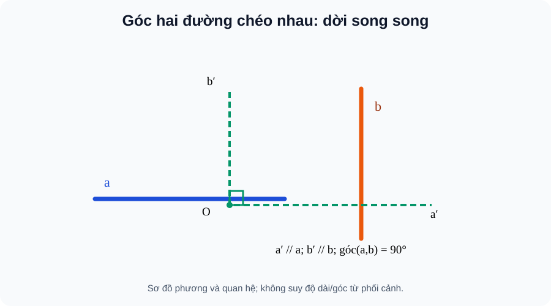
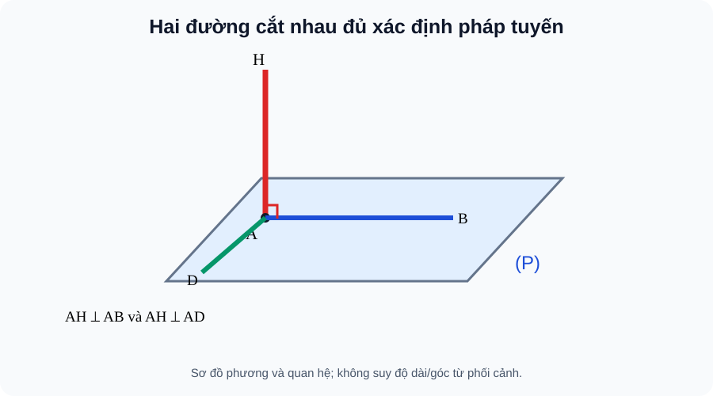
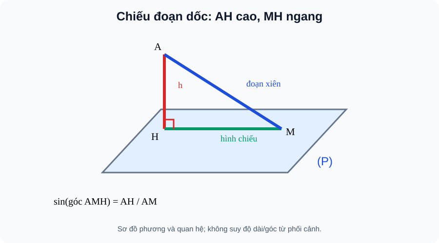
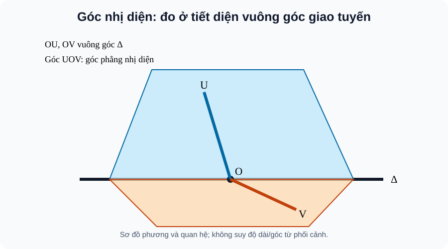

# Chuyên đề 16 — Quan hệ vuông góc và góc trong không gian

Quan sát các cạnh của căn phòng, cột và mái dốc, em sẽ học cách chứng minh quan hệ vuông góc bằng phương và mặt phẳng thay vì đo theo nét phối cảnh.

<!-- AUTHORING_R03_CANDIDATE; PRIOR_R02_BLOB: 60f69d43bfa3f4508e8c7a787bad517141f9b2b2; FROZEN_R01_BLOB: 0e934389ebfe239ace19cc23c5dedf9c23d8ebdc; ORIGINAL_SGK_BLOB: 5646241f4bb72f12419aaf585ee1fbea6f4185d0; NO_PRIVATE_RD1; AUTHOR_ONLY -->

# Kiến thức

**Mạch mở đầu — Từ quan sát đến lập luận.** Hãy tưởng tượng một căn phòng: các cạnh tường giao nhau ở những chỗ nhìn thấy được, nhưng nhiều thanh ngang và thanh đứng ở hai phía phòng không hề chạm nhau. Chúng ta vẫn muốn trả lời chúng có vuông góc hay không. Điểm khởi đầu không phải là đo góc trên bức hình phối cảnh: hãy tìm hai **phương** và đưa chúng về cùng một điểm. Khi đã làm được việc đó, quan hệ hai đường vuông góc trở thành một cách nhìn xuyên suốt các bài toán cột, sàn, mái và góc.

**Cách tự học:** Ở mỗi bước, đừng học một định lí rời rạc. Hãy tự hỏi: *Mình cần kiểm tra điều gì? Kiểm tra ít hơn có đủ không? Giả thiết nào làm cho kết luận đúng?* Bốn chặng dưới đây dẫn từ góc giữa hai đường, sang pháp tuyến mặt, rồi hình chiếu và góc giữa hai mặt.

## 1. Hai đường thẳng vuông góc

**Đọc hình:**

Quan sát đường a và b ở hai vị trí không cắt nhau; đừng cố nối đầu mút để lấy góc. Theo các dấu \(a'\parallel a\), \(b'\parallel b\), đưa hai phương về điểm O và đọc góc tại O. Nếu thay O bằng điểm khác thì hai phương không đổi, nên góc không đổi.

*Nếu không hiển thị hình, hãy đọc lại mô tả bằng lời ở trên và tự dựng quan hệ theo giả thiết; không suy góc hay độ dài từ nét phối cảnh.*

### 1.1. Góc giữa hai đường

<!-- LESSON_ID: TOP16-M01; OUTCOME_ID: TOP16-O01; S1_ORIGINAL_OUTCOME: G11-B22-ANGLE_LINES -->

Muốn đo góc hai thanh ở xa nhau, hãy dời hai phương đến cùng một điểm. Góc nhỏ giữa các hướng mới phản ánh hình thật, không phải góc do phối cảnh tạo ra.

> **ĐỊNH NGHĨA**
>
> Góc giữa hai đường trong không gian là góc nhỏ giữa hai đường cùng đi qua một điểm và lần lượt song song với hai đường đã cho; vì thế góc luôn trong \([0^\circ;90^\circ]\). Việc dời phương là để đo được ngay cả khi hai đường chéo nhau.

**Vì sao góc không phụ thuộc vị trí đặt hai đường?** Qua một điểm \(O\) tùy ý, dựng \(a'\parallel a\), \(b'\parallel b\). Hai phương không thay đổi khi dịch song song, nên trong bốn góc tại \(O\) luôn có một góc nhỏ \(\varphi\in[0^\circ;90^\circ]\); đây chính là góc giữa hai đường \(a,b\), bất kể chúng cắt nhau, chéo nhau hay song song. Nếu hai đường song song thì \(\varphi=0^\circ\), còn **vuông góc** khi và chỉ khi \(\varphi=90^\circ\).

> **PHƯƠNG PHÁP — Đưa hai phương về chung gốc.** Chọn điểm dễ dựng (thường là một đỉnh hình hộp), thay mỗi đường bằng đường qua điểm đó song song với nó, rồi dùng góc thật của tam giác hoặc hình chữ nhật; không đọc góc trực tiếp từ hình phối cảnh. Không bắt buộc biết tọa độ Oxyz lớp 12.

**Ví dụ minh họa.** Trong hình lập phương \(ABCD.A'B'C'D'\), \(AB\parallel A'B'\). Do \(A'B'\) và \(B'C'\) là hai cạnh kề của mặt vuông \(A'B'C'D'\), chúng tạo \(90^\circ\); vì vậy góc giữa \(AB\) và \(B'C'\) cũng bằng \(90^\circ\), mặc dù hai đường không cắt nhau. Lý do chọn cạnh trên để thay \(AB\) là vì chúng song song và nằm cùng một mặt vuông với \(B'C'\).

**Ví dụ**

**Đề bài:** Trong hộp chữ nhật ABCD.A′B′C′D′, xác định góc giữa AB và CC′, biết cạnh bên vuông góc đáy.

**Lời giải:** \(CC'\parallel AA'\), trong khi \(AA'\perp (ABCD)\) nên \(AA'\perp AB\). Dời phương CC′ về AA′ qua A; góc giữa AB và CC′ bằng góc \(BAA'=90^\circ\), dù AB không cắt CC′.

**Vận dụng**

Trong hình hộp chữ nhật, góc giữa AB và A′B′ bằng bao nhiêu?

<!-- ITEM_ID: THPT-TOP16-T01; ROLE: TOPIC_FIRST_TRY; PRIMARY_OUTCOME: TOP16-O01 -->

Đối chiếu

\(0^\circ\) vì AB và A′B′ song song.

**Kiểm lỗi**

Nếu lấy góc tù \(145^\circ\) làm góc giữa hai đường, đọc lại **Kiến thức 1.1**: phải đưa hai phương về chung gốc và chọn góc không tù. Thử **Bài luyện 1** (góc bù) và **Bài luyện 10** (hai cạnh song song).

### 1.2. Hai đường chéo nhau có thể vuông góc

<!-- LESSON_ID: TOP16-M02; OUTCOME_ID: TOP16-O02; S1_ORIGINAL_OUTCOME: G11-B22-PERP_SKEW -->

Hai thanh ở hai góc hộp có thể không cắt và cũng không đồng phẳng, nhưng vẫn vuông góc về phương. Vì vậy, hãy tách phép thử 'chéo nhau' khỏi phép thử 'góc \(90^\circ'\).

> **ĐỊNH NGHĨA**
>
> Vuông góc giữa hai đường là quan hệ **phương**: hai đường chéo nhau vẫn vuông góc nếu hai phương tạo góc \(90^\circ\). Điều kiện cắt nhau không phải thành phần của định nghĩa này.

**Ví dụ**

**Đề bài:** Trong hình lập phương ABCD.A′B′C′D′, chứng minh AD và BB′ chéo nhau nhưng vuông góc.

**Lời giải:** Nếu AD và BB′ đồng phẳng thì mặt ấy chứa A,D,B, do đó là đáy, nhưng B′ nằm ngoài đáy; suy hai đường chéo nhau. \(BB'\parallel AA'\) và \(AA'\perp AD\) nên góc hai phương là \(90^\circ\).

**Vận dụng**

AB và DD′ ở hộp chữ nhật có phải là hai đường vuông góc không?

<!-- ITEM_ID: THPT-TOP16-T02; ROLE: TOPIC_FIRST_TRY; PRIMARY_OUTCOME: TOP16-O02 -->

Đối chiếu

Có. Chúng chéo nhau nhưng cùng phương với hai cạnh vuông góc AB, AA′.

**Kiểm lỗi**

Nếu nghĩ hai đường không cắt thì không thể vuông góc, đọc **Kiến thức 1.2**: vuông góc là quan hệ giữa hai phương, còn chéo nhau là quan hệ vị trí. Thử **Bài luyện 7** (phản ví dụ) và **Bài luyện 11** (hình hộp).

### 1.3. Chuyển phương bằng đường song song

<!-- LESSON_ID: TOP16-M03; OUTCOME_ID: TOP16-O03; S1_ORIGINAL_OUTCOME: G11-B22-PARALLEL_DIRECTION -->

Một cạnh khuất có thể thay bằng cạnh nhìn thấy song song với nó. Do hai đường song song cùng phương, kết luận về góc vuông được giữ nguyên.

> **ĐỊNH LÝ**
>
> Thay một đường bằng đường song song bảo toàn góc giữa các phương. Nếu \(a\perp b\) và \(b\parallel c\) thì \(a\perp c\), dù a,c có thể chéo nhau.

**Ví dụ**

**Đề bài:** Trong hình hộp chữ nhật, \(AD\perp AA'\) và \(CC'\parallel AA'\). Chứng minh \(AD\perp CC'\).

**Lời giải:** Do \(CC'\parallel AA'\) trong hình hộp nên chúng có cùng phương; \(AD\perp AA'\) là góc vuông đã biết ở một đỉnh. Khi dời đường CC′ về đường AA′ qua A, ta đo đúng cùng một góc giữa các phương. Vì vậy \(AD\perp CC'\), dù hai đường ban đầu không gặp nhau.

**Vận dụng**

Nếu \(a\perp b\) và \(c\parallel b\) thì kết luận gì về a,c?

<!-- ITEM_ID: THPT-TOP16-T03; ROLE: TOPIC_FIRST_TRY; PRIMARY_OUTCOME: TOP16-O03 -->

Đối chiếu

\(a\perp c\) theo tính bất biến của góc khi thay đường bằng đường song song.

**Kiểm lỗi**

Nếu suy 'cùng vuông góc một đường' thì phải song song, xem lại **Kiến thức 1.3**: phép chuyển phương đúng là thay **một** đường bằng đường song song với nó. Thử **Bài luyện 3** và **Bài luyện 12**, xác định cặp đường nào thật sự song song.

### 1.4. Không đo góc từ hình phối cảnh

<!-- LESSON_ID: TOP16-M04; OUTCOME_ID: TOP16-O04; S1_ORIGINAL_OUTCOME: G11-B22-PROOF_CONTEXT -->

Nếu trên giấy hai nét vuông góc, ta vẫn chưa chứng minh hai thanh thật vuông góc. Phải tìm hình chữ nhật hoặc đường song song đã được bảo đảm bởi giả thiết.

> **PHƯƠNG PHÁP**
>
> Hình chiếu trên giấy có thể làm hai cạnh dường như cắt hoặc vuông góc. Bằng chứng thật phải là một góc trong mặt phẳng xác định hoặc phép chuyển phương hợp lệ.

**Ví dụ**

**Đề bài:** Trong hộp chữ nhật, chứng minh \(AB\perp B'C'\) bằng tính chất hình, không dùng thước đo nét vẽ.

**Lời giải:** Trong đáy hình chữ nhật, \(AB\perp BC\). Vì \(B'C'\parallel BC\), hai hướng của B′C′ và BC trùng nhau, do đó \(AB\perp B'C'\).

**Vận dụng**

Nét vẽ có hai đoạn tạo góc \(90^\circ\) trên giấy, đủ kết luận hai thanh trong không gian vuông góc chưa?

<!-- ITEM_ID: THPT-TOP16-T04; ROLE: TOPIC_FIRST_TRY; PRIMARY_OUTCOME: TOP16-O04 -->

Đối chiếu

Chưa; cần chứng cứ hình học về phương hoặc góc thật.

**Kiểm lỗi**

Nếu kết luận chỉ vì hình vẽ trông có góc vuông, trở lại **Kiến thức 1.4** và thay nét vẽ bằng dữ kiện về phương, cạnh đáy và cạnh bên. Thử **Bài luyện 4** và **Bài luyện 13**.

**Từ hai đường đến cả mặt phẳng.** Một chiếc cột nhìn có vẻ đứng thẳng vẫn có thể bị nghiêng về một phía mà ảnh chụp không nhận ra. Nếu chỉ kiểm tra cột vuông góc với **một** đường trên sàn, ta chưa loại trừ được hướng nghiêng khác. Chọn **hai đường cắt nhau** trên cùng mặt sàn thì hai phương độc lập mới đủ kiểm tra cột có vuông góc với toàn bộ sàn hay không. Đây là ý nghĩa của định lí, không phải mẹo ghi nhớ.

Chẳng hạn, Cho chóp S.ABC, tam giác ABC vuông tại B và \(SA\perp (ABC)\). Vì \(SA\perp BC\) và \(AB\perp BC\); hai đường SA,AB cắt nhau ở A cùng thuộc (SAB), nên \(BC\perp (SAB)\), do đó \(BC\perp SB\). Một kết luận từ “vô số phương” được đưa về hai điều kiện có thể chứng minh.

## 2. Đường thẳng vuông góc mặt phẳng

**Đọc hình:**

Chỉ hai cạnh AB và AD trong mặt \((P)\), chúng cắt nhau tại A. Cột AH vuông góc với cả hai: không phải “hai góc vuông là đủ” một cách máy móc, mà vì AB, AD tạo hai hướng không song song cùng nằm trong một mặt. Nếu hai cạnh kiểm tra song song thì không được suy \(AH\perp(P)\).

*Nếu không hiển thị hình, hãy đọc lại mô tả bằng lời ở trên và tự dựng quan hệ theo giả thiết; không suy góc hay độ dài từ nét phối cảnh.*

### 2.1. Đường vuông góc mặt phẳng

<!-- LESSON_ID: TOP16-M05; OUTCOME_ID: TOP16-O05; S1_ORIGINAL_OUTCOME: G11-B23-PERP_PLANE_DEF -->

Mặt sàn có vô số hướng. Một cột chỉ vuông góc một vạch sàn chưa chắc đứng thẳng; điều cần chứng minh là vuông góc cả mặt phẳng.

> **ĐỊNH NGHĨA**
>
> Đường d vuông góc mặt phẳng (P) nghĩa là d vuông góc **mọi đường thẳng** nằm trong (P). Chứng minh vuông góc một đường là chưa đủ.

**Ví dụ**

**Đề bài:** Xét mặt \((P):z=0\) và đường \(d:(0;0;t)\) với t thực. Chứng minh \(d\perp (P)\) theo định nghĩa.

**Lời giải:** Mọi đường của \(z=0\) có hướng \((u;v;0)\) khác vectơ không. Hướng d là \((0;0;1)\), tích vô hướng bằng 0 với \((u;v;0)\). Do đó d vuông góc mọi đường của (P), tức \(d\perp (P)\).

**Vận dụng**

d vuông góc chỉ một đường a thuộc (P). Đủ kết luận \(d\perp (P)\) không?

<!-- ITEM_ID: THPT-TOP16-T05; ROLE: TOPIC_FIRST_TRY; PRIMARY_OUTCOME: TOP16-O05 -->

Đối chiếu

Không; cần thêm dữ kiện, thường là d vuông góc hai đường cắt nhau trong (P).

**Kiểm lỗi**

Nếu thấy d vuông góc một đường trên sân rồi kết luận d vuông góc cả mặt, đọc **Kiến thức 2.1**: một hướng không đủ đại diện cho mọi hướng trong mặt phẳng. Thử **Bài luyện 15** và **Bài luyện 25**; đối chiếu dữ kiện cần bổ sung.

### 2.2. Dấu hiệu hai đường cắt nhau

<!-- LESSON_ID: TOP16-M06; OUTCOME_ID: TOP16-O06; S1_ORIGINAL_OUTCOME: G11-B23-TWO_INTERSECT -->

Không ai có thể kiểm vô số đường nằm trong một mặt. Hai đường cắt nhau đã xác định hai hướng độc lập, đủ kiểm phương vuông góc mặt ấy.

> **ĐỊNH LÝ**
>
> Hai đường a,b **cắt nhau** trong (P) tạo hai hướng độc lập. Nếu \(d\perp a\) và \(d\perp b\) thì d vuông góc cả mặt phẳng; điều kiện cắt nhau không thể bỏ.

Dấu hiệu hai đường cắt nhau là **điều kiện đủ**, không phải lời khuyên kiểm hai đường bất kỳ: hai đường được chọn phải cùng thuộc một mặt phẳng và **cắt nhau** để xác định hai hướng độc lập. Nếu chọn hai đường song song trong mặt, có thể tồn tại đường vuông góc cả hai nhưng vẫn **nằm trong** mặt, nên không vuông góc mặt.

**Ví dụ phản chứng điều kiện.** Trong \((P):z=0\), xét hai đường \(a:y=0,z=0\) và \(b:y=1,z=0\) cùng hướng \(Ox\), song song phân biệt. Đường \(d:x=0,z=0\) có hướng \(Oy\), nên \(d\perp a\) và \(d\perp b\) theo **góc giữa hai phương**. Tuy nhiên \(d\subset(P)\), rõ ràng \(d\not\perp(P)\). Vì thế không được bỏ chữ **cắt nhau** trong định lí hai đường.

**Ví dụ**

**Đề bài:** Trong đáy hình bình hành ABCD, d qua A và \(d\perp AB, d\perp AD\). Chứng minh \(d\perp (ABCD)\).

**Lời giải:** AB,AD thuộc (ABCD), cắt nhau tại A và không song song. Vì d vuông góc cả AB và AD, theo dấu hiệu hai đường cắt trong mặt, \(d\perp (ABCD)\).

**Vận dụng**

Nếu \(a\parallel b\) trong \((P), d\perp a\) và \(d\perp b\) đã đủ \(d\perp (P)\) chưa?

<!-- ITEM_ID: THPT-TOP16-T06; ROLE: TOPIC_FIRST_TRY; PRIMARY_OUTCOME: TOP16-O06 -->

Đối chiếu

Chưa, vì hai phương song song chỉ kiểm tra một hướng.

**Kiểm lỗi**

Nếu hai đường dùng để kiểm tra lại song song, điều kiện của dấu hiệu chưa đủ; đọc **Kiến thức 2.2**: phải có hai đường **cắt nhau** thuộc cùng mặt. Thử **Bài luyện 21** và **Bài luyện 26**.

### 2.3. Chuyển vuông góc qua đường/mặt song song

<!-- LESSON_ID: TOP16-M07; OUTCOME_ID: TOP16-O07; S1_ORIGINAL_OUTCOME: G11-B23-PARALLEL_TRANSFER -->

Nhiều cạnh bên của hình hộp ở vị trí khác nhau nhưng cùng hướng. Nếu một cạnh vuông góc đáy thì cạnh song song với nó cũng vuông góc đáy.

> **ĐỊNH LÝ**
>
> Vuông góc mặt phẳng được bảo toàn khi thay đường bởi đường song song hoặc thay mặt phẳng bởi mặt phẳng song song phân biệt. Cần xác nhận đúng các quan hệ song song.

**Ví dụ**

**Đề bài:** Trong hình hộp chữ nhật, \(AA'\perp (ABCD)\). Chứng minh \(DD'\perp (ABCD)\).

**Lời giải:** \(DD'\parallel AA'\) trong hình hộp. Một đường song song với đường vuông góc mặt phẳng cũng vuông góc mặt ấy, nên \(DD'\perp (ABCD)\).

**Vận dụng**

Nếu \(a\perp (P)\) và \(b\parallel a\) thì b có vuông góc (P) không?

<!-- ITEM_ID: THPT-TOP16-T07; ROLE: TOPIC_FIRST_TRY; PRIMARY_OUTCOME: TOP16-O07 -->

Đối chiếu

Có; mọi đường của (P) vẫn vuông góc phương b.

**Kiểm lỗi**

Nếu thay đường/mặt mà không kiểm tra song song thực sự, đọc **Kiến thức 2.3**: đường cùng phương pháp tuyến vẫn vuông góc với mặt song song. Thử **Bài luyện 17** và **Bài luyện 27**, ghi rõ giả thiết song song.

### 2.4. Pháp tuyến duy nhất qua một điểm

<!-- LESSON_ID: TOP16-M08; OUTCOME_ID: TOP16-O08; S1_ORIGINAL_OUTCOME: G11-B23-PLANE_PROPERTY -->

Qua mỗi điểm chỉ có một phương pháp tuyến đối với một mặt phẳng. Dựng hai đường khác nhau cùng qua một điểm và cùng vuông góc mặt ấy là điều không thể.

> **ĐỊNH LÝ**
>
> Qua mỗi điểm có một đường duy nhất vuông góc mặt phẳng cho trước. Hai đường cùng vuông góc một mặt phẳng thì song song hoặc trùng nhau.

**Ví dụ**

**Đề bài:** Với \((P):z=0\) và \(M(2;-1;3)\), tìm đường qua M vuông góc (P) và giải thích duy nhất.

**Lời giải:** Pháp tuyến mặt \(z=0\) có hướng \((0;0;1)\), nên đường \(d=(2;-1;3)+t(0;0;1)\) đi qua M và vuông góc mặt. Mọi đường khác qua M vuông góc mặt phải cùng hướng này, do đó trùng d.

**Vận dụng**

Qua điểm M có thể có hai đường phân biệt cùng vuông góc (P) không?

<!-- ITEM_ID: THPT-TOP16-T08; ROLE: TOPIC_FIRST_TRY; PRIMARY_OUTCOME: TOP16-O08 -->

Đối chiếu

Không; pháp tuyến qua M xác định duy nhất.

**Kiểm lỗi**

Nếu cho rằng qua M có hai pháp tuyến phân biệt, đọc **Kiến thức 2.4**: một điểm và một phương pháp tuyến xác định một đường duy nhất. Thử **Bài luyện 18** và **Bài luyện 28**, phân biệt đường trùng với đường song song khác.

### 2.5. Kiểm cột đứng bằng hai hướng sàn

<!-- LESSON_ID: TOP16-M09; OUTCOME_ID: TOP16-O09; S1_ORIGINAL_OUTCOME: G11-B23-PRACTICAL_POST -->

Chỉ dùng một thước vuông với một vạch trên nền vẫn cho phép cột nghiêng theo hướng ngang còn lại. Thêm vạch cắt vạch đầu giúp khóa phương cột.

> **PHƯƠNG PHÁP**
>
> Kiểm tra cột vuông góc nền cần hai hướng không song song trên nền, tương ứng kiểm tra hai mặt đứng giao nhau; đo theo một cạnh nền chỉ xác định một điều kiện.

**Ví dụ**

**Đề bài:** Nền \(z=0\) có hai hướng Ox và Oy. Cột qua O có hướng \((0;0;1)\). Vì sao cột vuông góc nền? Một hướng sàn có đủ không?

**Lời giải:** Hướng cột \((0;0;1)\) vuông góc với Ox\((1;0;0)\) và Oy\((0;1;0)\) là hai đường cắt nhau trong nền, nên cột vuông góc nền. Nếu chỉ vuông góc Ox, hướng \((0;1;1)\) vẫn thỏa nhưng không vuông góc Oy.

**Vận dụng**

Đo cột vuông góc cạnh AB của nền có đủ khẳng định cột thẳng đứng?

<!-- ITEM_ID: THPT-TOP16-T09; ROLE: TOPIC_FIRST_TRY; PRIMARY_OUTCOME: TOP16-O09 -->

Đối chiếu

Chưa; cần thêm một đường cắt AB trong nền (ví dụ AD).

**Kiểm lỗi**

Nếu chỉ kiểm cột với một cạnh sàn, quay lại **Kiến thức 2.5**: cần hai hướng sàn cắt nhau. Thử **Bài luyện 19** và **Bài luyện 29**, nêu hai đường trong nền trước khi kết luận.

**Từ cột thẳng sang mái dốc.** Với một mái nghiêng, ta không thể lấy ngay góc giữa mái và cột đứng rồi gọi đó là “góc nghiêng so với sàn”. Hãy hạ chân vuông góc từ một điểm trên mái xuống sàn. Khi ấy cạnh xiên, chiều cao và hình chiếu tạo thành một tam giác vuông: góc với sàn nằm **giữa cạnh xiên và hình chiếu**, còn góc với cột đứng là góc phụ. Mục tiêu của hình chiếu là biến một câu hỏi ba chiều thành một tam giác có thể chứng minh và tính được.

## 3. Phép chiếu vuông góc và góc đường–mặt

**Đọc hình:**

Tìm A ở cao, H là chân của \(AH\perp(P)\), M ở nền. Đường xiên AM chiếu thành HM, do đó góc cần đo là \(\widehat{AMH}\) tại M, không phải góc ở A. Tam giác AHM vuông tại H nên khi \(M\ne H\), \(\sin\widehat{AMH}=\frac{AH}{AM}\); không lấy nét vẽ phối cảnh làm phép đo.

*Nếu không hiển thị hình, hãy đọc lại mô tả bằng lời ở trên và tự dựng quan hệ theo giả thiết; không suy góc hay độ dài từ nét phối cảnh.*

**Khám phá tương tác — Đường dốc, hình chiếu và góc:** [Mở mô hình thao tác tại nguồn học liệu](Temp_THPT_TOPIC16_RAMP_ANGLE_R01_SCOPE_CORRECTED_20261113.html). Hãy dự đoán góc và độ dài trước khi điều chỉnh độ cao/khoảng ngang, rồi kiểm bằng Pitago và sin/tan. Mô hình minh họa không thay chứng minh định lí ba đường vuông góc.

<!-- AUTHOR_ONLY_MODEL_REFERENCE: SLM-TOP16-RAMP-ANGLE-R00; FILE: Temp_THPT_TOPIC16_RAMP_ANGLE_R01_SCOPE_CORRECTED_20261113.html; PUBLIC_DISCOVERY_NO_MASTERY -->

### 3.1. Chân hình chiếu vuông góc của một điểm

<!-- LESSON_ID: TOP16-M10; OUTCOME_ID: TOP16-O10; S1_ORIGINAL_OUTCOME: G11-B24-POINT_PROJECTION -->

Chiếu điểm xuống nền theo phương vuông góc là đi theo đường pháp tuyến cho đến khi gặp nền. Nếu điểm đã ở trên nền, ảnh chính là điểm ấy.

> **ĐỊNH NGHĨA**
>
> Nếu A nằm ngoài mặt \((P)\), hình chiếu vuông góc H của A là chân duy nhất của đường qua A vuông góc \((P)\). Độ dài AH là khoảng cách ngắn nhất từ A đến \((P)\). Nếu A thuộc mặt, ảnh chính là A và khoảng cách bằng 0.

**Ví dụ**

**Đề bài:** Tìm hình chiếu vuông góc của \(A(1;2;4)\) trên mặt \((P):z=0\).

**Lời giải:** Đường pháp tuyến qua A có dạng \((1;2;4+t)\); cho \(z=0\) được \(t=-4\), nên \(H(1;2;0)\). AH có hướng thẳng đứng, vuông góc (P), H thuộc (P).

**Vận dụng**

Nếu A thuộc (P), hình chiếu vuông góc của A trên (P) ở đâu?

<!-- ITEM_ID: THPT-TOP16-T10; ROLE: TOPIC_FIRST_TRY; PRIMARY_OUTCOME: TOP16-O10 -->

Đối chiếu

Chính là A; khoảng cách A đến (P) bằng 0.

**Kiểm lỗi**

Nếu chọn hình chiếu theo cảm giác gần nhất trên hình vẽ, đọc **Kiến thức 3.1**: chân H phải thỏa AH vuông góc mặt. Thử **Bài luyện 30** và **Bài luyện 40**, phân biệt chân hình chiếu với đoạn xiên.

### 3.2. Hình chiếu của đoạn và ảnh suy biến

<!-- LESSON_ID: TOP16-M11; OUTCOME_ID: TOP16-O11; S1_ORIGINAL_OUTCOME: G11-B24-LINE_PROJECTION -->

Hai đầu đoạn có hai ảnh khác nhau thì hình chiếu là một đoạn. Nếu cả hai đi trên cùng một đường pháp tuyến, hình chiếu co về một điểm.

> **ĐỊNH NGHĨA**
>
> Muốn chiếu một đường, chiếu hai điểm phân biệt của nó rồi nối ảnh; nếu đường theo phương vuông góc mặt phẳng thì toàn bộ ảnh chỉ là **một điểm**.

**Ví dụ**

**Đề bài:** Trong lăng trụ đứng ABC.A′B′C′, xác định hình chiếu A′C′ và AA′ lên đáy (ABC).

**Lời giải:** Do lăng trụ đứng, A′ chiếu thành A, C′ chiếu thành C; ảnh A′C′ là AC (hai ảnh phân biệt). A′ và A có cùng ảnh A nên ảnh đoạn AA′ chỉ là điểm A.

**Vận dụng**

Đường \(d\perp (P)\). Ảnh vuông góc của d lên (P) là gì?

<!-- ITEM_ID: THPT-TOP16-T11; ROLE: TOPIC_FIRST_TRY; PRIMARY_OUTCOME: TOP16-O11 -->

Đối chiếu

Một điểm: chân giao \(d\cap (P)\).

**Kiểm lỗi**

Nếu nối hai ảnh trùng nhau rồi gọi đó là một đường, đọc **Kiến thức 3.2**: ảnh đường pháp tuyến có thể suy biến thành một điểm. Thử **Bài luyện 31** và **Bài luyện 41**, kiểm ảnh từng đầu mút.

### 3.3. Định lí ba đường vuông góc

<!-- LESSON_ID: TOP16-M12; OUTCOME_ID: TOP16-O12; S1_ORIGINAL_OUTCOME: G11-B24-THREE_PERP -->

Một đường xiên có thành phần nằm ngang và thành phần thẳng đứng. Một hướng trong nền vuông góc hình chiếu ngang cũng vuông góc đường xiên, vì hướng đó đã vuông góc thành phần đứng.

> **ĐỊNH LÝ**
>
> Định lí ba đường vuông góc liên hệ đường xiên, hình chiếu vuông góc của nó và đường nằm trong mặt phẳng: đường của mặt phẳng vuông góc hình chiếu thì cũng vuông góc đường xiên.

Định lí có **cả hai chiều**. Lấy \(A\notin(P)\), H là chân đường vuông góc từ A xuống \((P)\), \(B\in(P)\) với \(B\ne H\). Hình chiếu vuông góc của đường thẳng AB là đường thẳng BH; hình chiếu của đoạn AB là đoạn BH. Với **bất kỳ đường \(c\subset(P)\)**, dù c không đi qua H, quan hệ vuông góc giữa các đường được hiểu theo **phương** nên:

\[
c\perp AB\quad\Longleftrightarrow\quad c\perp BH.
\]

**Vì sao?** Vectơ \(\overrightarrow{AB}=\overrightarrow{AH}+\overrightarrow{HB}\), trong đó \(AH\perp(P)\) nên phương của \(AH\) vuông góc \(c\). Phần có thể đóng góp thành phần theo phương \(c\) chỉ là \(HB\). Vì vậy \(c\perp AB\) đúng khi và chỉ khi \(c\perp HB\). Nếu \(B=H\), hình chiếu \(AB\) co thành **một điểm**, không có đường \(BH\) để áp định lí theo dạng trên; xử lý riêng \(AB\perp(P)\).

**Ví dụ minh họa.** Trong mặt \(z=0\), cho \(A(0;0;3)\), \(H(0;0;0)\), \(B(4;2;0)\). Đường \(c\) ở trong mặt có phương \((1;-2;0)\). Ta có \(\overrightarrow{HB}=(4;2;0)\), tích với phương \(c\) bằng \(4-4=0\). Với \(\overrightarrow{AB}=(4;2;-3)\), tích với \(c\) vẫn bằng \(4-4+0=0\). Đây là cách kiểm **hai chiều**, không kết luận từ việc đường thẳng nhìn cắt nhau trên hình.

**Ví dụ**

**Đề bài:** Với mặt phẳng \((P): z=0\), lấy \(A(0;0;2)\) nằm ngoài \((P), H(0;0;0)\) và \(B(3;0;0)\) thuộc (P). Chứng minh đường c qua H có hướng \((0;1;0)\) vuông góc với đường AB.

**Lời giải:** \(AH\perp (P)\) vì A và H có cùng hai tọa độ ngang, \(H\in (P); BH\) nằm trong (P) và \(B\ne H\). Đường c qua H có hướng \((0;1;0)\) nằm trong (P), vuông góc BH theo \((1;0;0)\). Định lí ba đường vuông góc cho \(c\perp AB\); kiểm bằng tọa độ vectơ \(\overrightarrow{AB}=(3;0;-2)\) có tích vô hướng với hướng \((0;1;0)\) của c bằng 0.

**Vận dụng**

\(AH\perp (P), B\in (P)\) và \(B\ne H\) nên BH là một đường thẳng trên (P). Nếu \(c\subset (P), c\perp BH\), có thể kết luận \(c\perp AB\) không?

<!-- ITEM_ID: THPT-TOP16-T12; ROLE: TOPIC_FIRST_TRY; PRIMARY_OUTCOME: TOP16-O12 -->

Đối chiếu

Có: BH là hình chiếu của AB lên (P); dùng định lí ba đường vuông góc.

**Kiểm lỗi**

Nếu dùng định lí ba đường vuông góc mà chưa xác định đúng hình chiếu của đường xiên, đọc **Kiến thức 3.3**: H là chân từ A và \(B\ne H\) để BH không suy biến. Thử **Bài luyện 32** (chiều thuận) và **Bài luyện 42** (chiều đảo), chỉ rõ ba đường liên quan.

### 3.4. Góc đường thẳng với mặt phẳng

<!-- LESSON_ID: TOP16-M13; OUTCOME_ID: TOP16-O13; S1_ORIGINAL_OUTCOME: G11-B24-LINE_PLANE_ANGLE -->

Góc một đường với mặt nền cần lấy qua chính hình chiếu của đường trên nền. Nếu đường vuông góc nền thì ảnh co thành điểm và góc \(90^\circ\) được xét riêng.

> **ĐỊNH NGHĨA**
>
> Góc giữa đường thẳng và mặt phẳng là góc không tù, thuộc \([0^\circ;90^\circ]\). Khi đường xiên AB cắt mặt tại B và có hình chiếu không suy biến BH, góc đường–mặt là \(\widehat{ABH}\). Nếu đường vuông góc mặt thì góc bằng \(90^\circ\), dù hình chiếu co thành điểm.

Cần xét đủ **ba vị trí** trước khi dùng hình chiếu để tính góc:
- Nếu \(d\subset(P)\) hoặc \(d\parallel(P)\), góc bằng \(0^\circ\) vì phương của \(d\) song song một đường trong \((P)\).
- Nếu \(d\perp(P)\), góc bằng \(90^\circ\); hình chiếu của \(d\) suy biến thành một điểm nên **không** dựng góc với một “đường ảnh” không tồn tại.
- Nếu \(d\) cắt \((P)\) nhưng không vuông góc, lấy \(B=d\cap(P)\), chọn \(A\in d\setminus(P)\) và \(H\) là chân chiếu của \(A\). Góc cần tính là \(\theta=\widehat{ABH}\) của tam giác vuông \(ABH\), với \(0^\circ<\theta<90^\circ\), nên:

\[
\sin\theta=\frac{AH}{AB},\quad
\cos\theta=\frac{BH}{AB},\quad
\tan\theta=\frac{AH}{BH}.
\]

Trong đó \(AH\) là **độ cao vuông góc**, \(BH\) là **độ dài hình chiếu trong mặt**, \(AB\) là đoạn xiên. Những tỉ số này đòi \(B\ne H\), \(AB>0\), \(BH>0\).

**Ví dụ minh họa.** Một thanh dài \(10\) m nối \(A\) cao \(6\) m với chân \(B\) trên nền. Trong tam giác vuông \(ABH\), ta có \(BH=\sqrt{10^2-6^2}=8\) m; góc thanh–nền thỏa \(\sin\theta=\frac6{10}=\frac35\), hay \(\theta\approx36{,}87^\circ\). Nếu tính \(\tan\theta=\frac6{10}\) là sai vì mẫu của tang phải là **hình chiếu ngang \(8\) m**, không phải chiều dài thanh.

**Ví dụ**

**Đề bài:** Cho A cao 3 m so với nền, H là chân hình chiếu, B trên nền, \(BH=4\,\mathrm{m}\). Tính góc giữa AB và nền.

**Lời giải:** Tam giác ABH vuông tại H, \(AB=\sqrt{3^2+4^2}=5\,\mathrm m\). Góc giữa AB và nền là \(\theta=\widehat{ABH}\), với \(\sin\theta=\frac35\), nên \(\theta\approx36{,}87^\circ\). Điều kiện \(B\ne H\) bảo đảm hình chiếu BH không suy biến.

**Vận dụng**

Đường nằm trong (P) tạo góc bao nhiêu với (P)?

<!-- ITEM_ID: THPT-TOP16-T13; ROLE: TOPIC_FIRST_TRY; PRIMARY_OUTCOME: TOP16-O13 -->

Đối chiếu

\(0^\circ\). Khi đường vuông góc (P), góc \(90^\circ\).

**Kiểm lỗi**

Nếu đo góc với đường pháp tuyến thay cho góc đường–mặt, đọc **Kiến thức 3.4**: dùng góc giữa đường xiên và hình chiếu không suy biến. Thử **Bài luyện 33** và **Bài luyện 43**, kiểm xem tỉ số sin lấy đúng cạnh.

### 3.5. Tam giác vuông và góc dốc

<!-- LESSON_ID: TOP16-M14; OUTCOME_ID: TOP16-O14; S1_ORIGINAL_OUTCOME: G11-B24-ANGLE_APPLICATION -->

Đường dốc cao và đoạn ngang tạo thành hai cạnh góc vuông. Muốn tính góc đúng, phải phân biệt cạnh đối là độ cao, kề là khoảng ngang, huyền là chiều dài dốc.

> **PHƯƠNG PHÁP**
>
> Một đường dốc tạo tam giác vuông với mặt nền: chiều cao là cạnh đối góc dốc, khoảng ngang là cạnh kề, và độ dài đường dốc là cạnh huyền.

**Ví dụ**

**Đề bài:** Đoạn dốc cao 5 m và có khoảng ngang 12 m. Tính chiều dài dốc và tang góc dốc.

**Lời giải:** Tam giác vuông có hai cạnh góc vuông 5 và 12, nên chiều dài dốc \(\sqrt{25+144}=13\,\mathrm m\). Với góc dốc \(\theta\), \(\tan\theta=\frac5{12}\); không lấy 13 làm khoảng ngang.

**Vận dụng**

Dốc cao 3 m, khoảng ngang 4 m: tính độ dài đoạn dốc. Tiếp theo, gọi \(\theta\) là góc giữa đoạn dốc và mặt nền ngang; hãy xác định cạnh đối, cạnh kề và tính \(\tan\theta\).

<!-- ITEM_ID: THPT-TOP16-T14; ROLE: TOPIC_FIRST_TRY; PRIMARY_OUTCOME: TOP16-O14 -->

Đối chiếu

Độ dài dốc là \(\sqrt{3^2+4^2}=5\) m, không phải 7 m. Góc dốc \(\theta\) nằm giữa cạnh huyền và đoạn ngang; cạnh đối dài 3 m, cạnh kề dài 4 m. Vì vậy \(\tan\theta=\frac34\). Nếu dùng \(\frac35\), em đã tính sin thay cho tang.

**Kiểm lỗi**

Nếu cộng 5 và 12 để tính chiều dài dốc hoặc dùng nhầm tan với sin, đọc **Kiến thức 3.5**: dựng tam giác vuông giữa chiều cao, chiều ngang và đoạn xiên. Thử **Bài luyện 36** và **Bài luyện 44**.

**Từ góc của một đường đến góc của cả mặt.** Hai bề mặt của mái và trần có thể gặp nhau theo một đường dài; nếu lấy bất kỳ đường xiên nào trong từng mặt để đo, đáp án sẽ thay đổi theo vị trí thước. Muốn đo góc ổn định, tại một điểm trên **giao tuyến** hãy dựng trong mỗi mặt một đường vuông góc giao tuyến. Chính góc trong thiết diện vuông góc ấy là thông tin cần dùng. Lưu ý: góc phẳng của một **góc nhị diện** có thể là góc tù, còn góc giữa hai **mặt phẳng không định hướng** luôn được lấy là góc nhỏ.

**Một ví dụ nối ba ý tưởng:** Cho hình chóp S.ABC, \(SA\perp(ABC)\), H là chân vuông góc từ A đến BC. Khi ấy \(BC\perp SA\) và \(BC\perp AH\); suy \(BC\perp(SAH)\), nên \(BC\perp SH\). Hai đường \(AH\subset(ABC)\) và \(SH\subset(SBC)\) cùng vuông góc BC tại H, vì vậy góc SHA trong tiết diện SAH diễn tả góc phẳng của nhị diện có bờ BC (với hai nửa mặt tương ứng), còn góc giữa hai mặt phẳng là góc nhỏ giữa AH và SH. Đừng nhầm góc tại S với góc tại H.

## 4. Hai mặt phẳng vuông góc và hình khối đặc biệt

**Đọc hình:**

Trước hết chỉ **giao tuyến Δ**, sau đó xem hai tia **OU, OV** cùng vuông góc Δ tại **O** nhưng nằm trên hai mặt khác nhau. **UOV** là góc phẳng của nhị diện đã chọn, có thể tù. Khi câu hỏi nói góc **giữa hai mặt phẳng**, lấy góc không tù giữa hai đường thẳng chứa OU và OV, không tùy tiện giữ góc nhị diện lớn hơn \(90^\circ\).

*Nếu không hiển thị hình, hãy đọc lại mô tả bằng lời ở trên và tự dựng quan hệ theo giả thiết; không suy góc hay độ dài từ nét phối cảnh.*

### 4.1. Góc giữa hai mặt phẳng

<!-- LESSON_ID: TOP16-M15; OUTCOME_ID: TOP16-O15; S1_ORIGINAL_OUTCOME: G11-B25-PLANE_ANGLE -->

Hai mặt phẳng có giao tuyến không nhất thiết vuông góc. Hãy dựng một mặt cắt vuông góc giao tuyến để đọc góc nhỏ giữa hai vết cắt.

> **ĐỊNH NGHĨA**
>
> Góc giữa hai **mặt phẳng** được đo bằng góc nhỏ của hai đường lần lượt nằm trong hai mặt và cùng vuông góc giao tuyến; kết quả thuộc \([0^\circ;90^\circ]\) khi xét mặt phẳng không định hướng.

**Ví dụ**

**Đề bài:** Cho hai mặt \((P):z=0\) và \((Q):x=0\). Tìm góc giữa hai mặt bằng một tiết diện vuông góc giao tuyến.

**Lời giải:** Giao tuyến hai mặt là trục Oy. Trong \(z=0\) chọn Ox, trong \(x=0\) chọn Oz, hai đường cùng qua O và vuông góc Oy. Vì Ox\(\perp \)Oz nên góc giữa hai mặt là \(90^\circ\).

**Vận dụng**

Hai mặt phẳng song song tạo góc giữa hai mặt bằng bao nhiêu?

<!-- ITEM_ID: THPT-TOP16-T15; ROLE: TOPIC_FIRST_TRY; PRIMARY_OUTCOME: TOP16-O15 -->

Đối chiếu

\(0^\circ\) theo quy ước góc giữa các mặt phẳng.

**Kiểm lỗi**

Nếu lấy hai đường tùy ý trên hai mặt để đo góc, trở lại **Kiến thức 4.1**: cần đường vuông góc giao tuyến trong tiết diện phù hợp (hoặc hai pháp tuyến). Thử **Bài luyện 46** và **Bài luyện 58**, ghi rõ cách chọn góc không tù.

### 4.2. Góc nhị diện và góc hai mặt

<!-- LESSON_ID: TOP16-M16; OUTCOME_ID: TOP16-O16; S1_ORIGINAL_OUTCOME: G11-B25-DIHEDRAL -->

Nhị diện dùng hai nửa mặt phẳng có chọn phía nên góc phẳng có thể tù; góc giữa hai mặt không định hướng chỉ lấy góc nhỏ.

> **ĐỊNH NGHĨA**
>
> Góc nhị diện gắn với **hai nửa mặt phẳng** có chung bờ: góc phẳng của nhị diện có thể lớn hơn \(90^\circ\). Góc giữa hai mặt phẳng không định hướng lấy góc nhỏ.

**Cách dựng góc phẳng nhị diện theo đúng hai nửa mặt:** Hai nửa mặt phẳng \((\alpha)\), \((\beta)\) có chung bờ \(d\) xác định góc nhị diện. Chọn \(O\in d\); trong mỗi nửa mặt, kẻ tia \(Om\), \(On\) **vuông góc \(d\) tại \(O\)** và đi về phía trong từng nửa mặt. Khi đó \(\widehat{mOn}\in[0^\circ;180^\circ]\) là **góc phẳng của góc nhị diện**. Nếu đổi phía một nửa mặt, góc phẳng trở thành góc bù \(180^\circ-\widehat{mOn}\), trong khi **góc nhỏ giữa hai mặt phẳng** vẫn không đổi.

> **PHƯƠNG PHÁP — Đo nhị diện đúng phía.** Xác định bờ \(d\) trước; chọn mặt cắt vuông góc \(d\), rồi chọn đúng **hai tia** đi trong hai nửa mặt đã cho. Không lấy bừa một góc của tứ giác trong hình chiếu. Góc nhị diện có thể tù, nhưng góc giữa hai **mặt phẳng không định hướng** luôn là góc nhỏ thuộc \([0^\circ;90^\circ]\).

**Ví dụ minh họa.** Một nhị diện có góc phẳng \(120^\circ\). Nếu thay nửa mặt \((\beta)\) bằng nửa mặt đối trên cùng mặt phẳng, góc phẳng mới \(60^\circ\); song góc giữa hai **mặt chứa** chúng luôn là \(60^\circ\). Ta so góc nhị diện theo hai tia, còn góc hai mặt theo **góc nhỏ**. Kết luận không phụ thuộc hình vẽ nhìn từ phía nào.

**Ví dụ**

**Đề bài:** Một nhị diện có góc phẳng \(135^\circ\). Tính góc nhỏ giữa hai mặt phẳng chứa nó.

**Lời giải:** Góc nhị diện \(135^\circ\) là góc của hai nửa mặt phẳng đã chọn. Góc nhỏ giữa hai mặt không định hướng bằng \(180^\circ-135^\circ=45^\circ\).

**Vận dụng**

Nhị diện \(120^\circ\) cho góc nhỏ giữa hai mặt phẳng chứa nó bằng bao nhiêu?

<!-- ITEM_ID: THPT-TOP16-T16; ROLE: TOPIC_FIRST_TRY; PRIMARY_OUTCOME: TOP16-O16 -->

Đối chiếu

\(60^\circ = 180^\circ-120^\circ\).

**Kiểm lỗi**

Nếu kết luận góc hai mặt bằng trực tiếp góc nhị diện tù, đọc **Kiến thức 4.2**: nhị diện gắn hai nửa mặt có hướng, còn góc giữa hai mặt lấy góc không tù. Thử **Bài luyện 47** và **Bài luyện 59**.

### 4.3. Dấu hiệu hai mặt vuông góc

<!-- LESSON_ID: TOP16-M17; OUTCOME_ID: TOP16-O17; S1_ORIGINAL_OUTCOME: G11-B25-PERP_PLANES -->

Mặt tường chứa một đường vuông góc sàn thì cả mặt tường vuông góc sàn. Đó là một dấu hiệu mạnh hơn việc thấy hai đường tùy ý có góc vuông.

> **ĐỊNH LÝ**
>
> Muốn chứng minh \((P)\perp (Q)\), tìm **một đường** nằm trong (P) và vuông góc với (Q). Không chỉ chứng minh hai đường thuộc hai mặt vuông góc.

**Ví dụ**

**Đề bài:** Cho \((P):x=0, (Q):z=0\). Dùng một đường trong (P) để chứng minh hai mặt vuông góc.

**Lời giải:** Trục Oz nằm trong \(x=0\), có hướng \((0;0;1)\), vuông góc mọi đường của \(z=0\). Vì (P) chứa đường Oz\(\perp (Q)\), suy \((P)\perp (Q)\).

**Vận dụng**

\(d\subset (P), d\perp (Q)\). Quan hệ hai mặt (P),(Q)?

<!-- ITEM_ID: THPT-TOP16-T17; ROLE: TOPIC_FIRST_TRY; PRIMARY_OUTCOME: TOP16-O17 -->

Đối chiếu

\((P)\perp (Q)\), theo dấu hiệu một đường trong mặt vuông góc mặt kia.

**Kiểm lỗi**

Nếu chỉ tìm được một cặp đường vuông góc mà kết luận hai mặt vuông góc, đọc **Kiến thức 4.3**: cần một **đường nằm trong mặt này** vuông góc **toàn bộ mặt kia**. Thử **Bài luyện 48** và **Bài luyện 60**.

### 4.4. Đường vuông góc giao tuyến

<!-- LESSON_ID: TOP16-M18; OUTCOME_ID: TOP16-O18; S1_ORIGINAL_OUTCOME: G11-B25-PERP_PLANE_RULE -->

Hai mặt vuông góc có giao tuyến d. Muốn một đường trong mặt thứ nhất vuông góc cả mặt thứ hai, ta còn cần nó vuông góc d.

> **ĐỊNH LÝ**
>
> Khi hai mặt \((P)\perp (Q)\) cắt theo d, đường a **trong (P)** và **vuông góc d** sẽ vuông góc (Q), theo định lí về hai mặt vuông góc.

**Ví dụ**

**Đề bài:** Hai mặt \((P):x=0\) và \((Q):z=0\) giao theo Oy. Lấy a là trục Oz. Dùng tính chất hai mặt vuông góc chứng minh \(a\perp (Q)\).

**Lời giải:** Oz thuộc mặt \(x=0\) và vuông góc Oy là giao tuyến d. Vì hai mặt vuông góc, đường trong mặt thứ nhất vuông góc d cũng vuông góc mặt thứ hai, nên Oz\(\perp (Q)\).

**Vận dụng**

\((P)\perp (Q)\) theo d. \(a\subset (P), a\perp d\). Có \(a\perp (Q)\) không?

<!-- ITEM_ID: THPT-TOP16-T18; ROLE: TOPIC_FIRST_TRY; PRIMARY_OUTCOME: TOP16-O18 -->

Đối chiếu

Có, theo định lí hai mặt phẳng vuông góc. a phải nằm trong (P) và vuông góc giao tuyến d.

**Kiểm lỗi**

Nếu quên điều kiện đường a vuông góc với giao tuyến, đọc **Kiến thức 4.4**: với hai mặt vuông góc, a phải thuộc một mặt và vuông góc giao tuyến mới suy ra a vuông góc mặt kia. Thử **Bài luyện 49** và **Bài luyện 61**.

### 4.5. Lăng trụ đứng và chiều cao

<!-- LESSON_ID: TOP16-M19; OUTCOME_ID: TOP16-O19; S1_ORIGINAL_OUTCOME: G11-B25-RIGHT_PRISM -->

Lăng trụ đứng và lăng trụ xiên đều có hai đáy song song. Chỉ lăng trụ đứng có cạnh bên vuông góc đáy và bằng chiều cao.

> **TÍNH CHẤT**
>
> Lăng trụ đứng có cạnh bên vuông góc hai đáy; chiều cao chính là cạnh bên. Lăng trụ đều có đáy đa giác đều và là lăng trụ đứng. Hộp chữ nhật/lập phương là các trường hợp đặc biệt.

**Ví dụ**

**Đề bài:** Lăng trụ đứng có cạnh bên dài 6 cm. Tính chiều cao và giải thích dựa vào hình học.

**Lời giải:** Cạnh bên của lăng trụ đứng vuông góc cả hai đáy song song. Chiều cao là độ dài đoạn vuông góc giữa hai đáy, nên bằng cạnh bên: 6 cm.

**Vận dụng**

Lăng trụ đứng có cạnh bên 7 cm, chiều cao bao nhiêu?

<!-- ITEM_ID: THPT-TOP16-T19; ROLE: TOPIC_FIRST_TRY; PRIMARY_OUTCOME: TOP16-O19 -->

Đối chiếu

7 cm, vì cạnh bên vuông góc mặt đáy.

**Kiểm lỗi**

Nếu cho rằng lăng trụ đứng có đáy bất kì cũng là lăng trụ đều, đọc **Kiến thức 4.5**: lăng trụ đều phải có đáy là đa giác đều, còn chiều cao lăng trụ đứng bằng cạnh bên. Thử **Bài luyện 50** và **Bài luyện 62**.

### 4.6. Chóp đều: chiều cao và đường cao mặt bên

<!-- LESSON_ID: TOP16-M20; OUTCOME_ID: TOP16-O20; S1_ORIGINAL_OUTCOME: G11-B25-REGULAR_PYRAMID -->

Chóp đều có đường cao qua tâm đáy. Đường nối đỉnh với trung điểm cạnh đáy là đường cao mặt bên: hai đoạn này khác nhau, phải dùng tam giác vuông để tính.

> **TÍNH CHẤT**
>
> Chóp đều có đáy là đa giác đều và chân đường cao là tâm của đáy, nên các cạnh bên bằng nhau. Độ dài cạnh bên, chiều cao và đường cao mặt bên là ba khái niệm khác.

Tính chất cạnh bên bằng nhau **không** cho phép đồng nhất cạnh bên với chiều cao hay trung đoạn của mặt bên. Trong chóp đều \(S.ABCD\) có đáy vuông tâm \(O\), lấy \(M\) là trung điểm \(AB\). Vì \(SO\perp(ABCD)\), tam giác \(SOM\) vuông tại \(O\), nên đường cao mặt bên \(SM\) là:

\[
SM^2=SO^2+OM^2.
\]

Mặt khác đường cạnh bên \(SA\) thỏa \(SA^2=SO^2+OA^2\). Do \(OA>OM\), thường \(SA>SM>SO\). **Không** nhầm \(OM\) với \(OA\): \(OM\) là bán kính nội tiếp hình vuông đáy, còn \(OA\) là nửa đường chéo đáy.

**Ví dụ minh họa.** Đáy vuông cạnh \(6\) cm và đường cao \(SO=4\) cm. Khi đó \(OM=3\) cm, \(OA=3\sqrt2\) cm. Suy \(SM=\sqrt{4^2+3^2}=5\) cm, còn \(SA=\sqrt{4^2+(3\sqrt2)^2}=\sqrt{34}\) cm. Chọn tam giác \(SOM\) khi hỏi **đường cao mặt bên**, chọn \(SOA\) khi hỏi **cạnh bên**.

**Ví dụ**

**Đề bài:** Chóp tứ giác đều có đáy vuông cạnh 10 cm, chiều cao 12 cm. Tính đường cao mặt bên qua trung điểm một cạnh đáy.

**Lời giải:** Tâm O của đáy vuông cách trung điểm M cạnh đáy \(OM=5\,\mathrm{cm}\). Vì \(SO=12\,\mathrm{cm}\) và \(SO\perp(ABCD)\), tam giác SOM vuông tại O; đường cao mặt bên \(SM=\sqrt{12^2+5^2}=13\,\mathrm{cm}\), không phải 12 cm.

**Vận dụng**

Chóp đều đáy vuông cạnh \(6, h=4\). Đường cao của mặt bên qua trung điểm cạnh đáy dài bao nhiêu?

<!-- ITEM_ID: THPT-TOP16-T20; ROLE: TOPIC_FIRST_TRY; PRIMARY_OUTCOME: TOP16-O20 -->

Đối chiếu

5, do tam giác vuông có hai cạnh 4 và 3.

**Kiểm lỗi**

Nếu nhầm cạnh bên SA hay đường cao mặt bên với chiều cao SO, đọc **Kiến thức 4.6**: chóp đều có SO vuông góc đáy, còn đường cao mặt bên tới trung điểm một cạnh đáy. Thử **Bài luyện 57** và **Bài luyện 63**, vẽ hai tam giác vuông khác nhau.

### 4.7. Chóp cụt đều: tỉ số đồng dạng

<!-- LESSON_ID: TOP16-M21; OUTCOME_ID: TOP16-O21; S1_ORIGINAL_OUTCOME: G11-B25-REGULAR_FRUSTUM -->

Cắt chóp đều bằng mặt song song đáy tạo chóp cụt đều với hai đáy đồng dạng. Diện tích thay theo bình phương tỉ số cạnh, không theo tỉ số cạnh.

> **TÍNH CHẤT**
>
> Chóp cụt đều thu được khi cắt chóp đều bởi mặt phẳng song song đáy; hai đáy là đa giác đều đồng dạng, các mặt bên là hình thang cân. Tỉ số diện tích bằng bình phương tỉ số cạnh.

**Ví dụ**

**Đề bài:** Chóp cụt đều có hai đáy hình vuông cạnh 10 cm và 4 cm. Tính tỉ số diện tích hai đáy.

**Lời giải:** Diện tích đáy lớn \(10^2=100\,\mathrm{cm}^2\), đáy nhỏ \(4^2=16\,\mathrm{cm}^2\). Tỉ số \(100:16=25:4\), bằng bình phương tỉ số cạnh \((\frac{10}4)^2\).

**Vận dụng**

Hai đáy hình vuông cạnh 6 và 3 có tỉ số diện tích đáy lớn : đáy nhỏ?

<!-- ITEM_ID: THPT-TOP16-T21; ROLE: TOPIC_FIRST_TRY; PRIMARY_OUTCOME: TOP16-O21 -->

Đối chiếu

\(36:9 = 4:1\).

**Kiểm lỗi**

Nếu lấy tỉ số cạnh \(6:3=2:1\) làm ngay tỉ số diện tích, đọc **Kiến thức 4.7**: hai đáy chóp cụt đều đồng dạng nên tỉ số diện tích là bình phương tỉ số cạnh tương ứng. Thử **Bài luyện 52** và **Bài luyện 64**.

> **Kiến thức cần ghi nhớ**
>
> - **Góc giữa hai đường:** để so hai đường chéo nhau, chuyển hai phương về cùng điểm bằng đường song song rồi đo góc nhỏ; không lấy số đo góc vẽ phối cảnh.
> - **Vuông góc đường–mặt:** đường thẳng vuông góc mặt phẳng nếu vuông góc với mọi đường nằm trong mặt; khi chứng minh, đủ chỉ ra vuông góc với **hai đường cắt nhau** nằm trong mặt ấy, không thay bằng hai đường song song.
> - **Hình chiếu và góc đường–mặt:** dựng chân vuông góc trước khi chọn tam giác tính góc; nếu đường vuông góc mặt phẳng thì góc bằng \(90^\circ\), đường song song thì góc bằng \(0^\circ\). Phân biệt góc đường–mặt với góc hai mặt.
> - **Góc nhị diện, hình khối:** đo góc hai mặt bằng hai đường cùng vuông góc giao tuyến tại cùng một điểm trong các mặt; chiều cao lăng trụ/chóp phải vuông góc với mặt đáy, không lấy độ dài cạnh xiên thay thế.

# Luyện tập

Em hãy giải bằng hình học và suy luận, ghi rõ điều kiện của từng dấu hiệu rồi mới tự mở **Lời giải**. Mỗi bài đều có đề thực để làm tại đây.

## 1. Góc và quan hệ vuông góc giữa hai đường

**Chọn phương thích hợp để xác định góc và vuông góc**

<!-- DISPLAY_ONLY_CANONICAL: THPT-G11-CHVII-B22-C01; ORIGINAL_SOURCE_BLOB: 5646241f4bb72f12419aaf585ee1fbea6f4185d0; SOURCE_ROLE: SGK_PRACTICE; ORIGINAL_CANONICAL_UNCHANGED -->
**Bài luyện 1.** Hai đường có góc giữa hai tia cùng phương được chọn là \(145^\circ\). Góc giữa hai đường thẳng là bao nhiêu?

Lời giải

**Đáp án:** \(35^\circ\)

**Lời giải và vì sao:** Góc giữa hai đường thẳng là góc không tù: \(180^\circ-145^\circ=35^\circ\).

<!-- DISPLAY_ONLY_CANONICAL: THPT-G11-CHVII-B22-C02; ORIGINAL_SOURCE_BLOB: 5646241f4bb72f12419aaf585ee1fbea6f4185d0; SOURCE_ROLE: SGK_PRACTICE; ORIGINAL_CANONICAL_UNCHANGED -->
**Bài luyện 2.** Có thể có \(a\perp b\) nhưng a và b không có điểm chung không?

Lời giải

**Đáp án:** Có

**Lời giải và vì sao:** Góc vuông là quan hệ giữa phương; đường chéo nhau vẫn có thể có hai phương vuông góc.

<!-- DISPLAY_ONLY_CANONICAL: THPT-G11-CHVII-B22-C03; ORIGINAL_SOURCE_BLOB: 5646241f4bb72f12419aaf585ee1fbea6f4185d0; SOURCE_ROLE: SGK_PRACTICE; ORIGINAL_CANONICAL_UNCHANGED -->
**Bài luyện 3.** Nếu \(a\parallel a'\) và \(a\perp b\) thì góc giữa a′ và b bằng bao nhiêu?

Lời giải

**Đáp án:** \(90^\circ\)

**Lời giải và vì sao:** Đường song song giữ phương nên giữ góc với b.

<!-- DISPLAY_ONLY_CANONICAL: THPT-G11-CHVII-B22-C04; ORIGINAL_SOURCE_BLOB: 5646241f4bb72f12419aaf585ee1fbea6f4185d0; SOURCE_ROLE: SGK_PRACTICE; ORIGINAL_CANONICAL_UNCHANGED -->
**Bài luyện 4.** Hai thanh thép cách nhau, một theo phương Đông–Tây, một thẳng đứng. Chúng có vuông góc theo định nghĩa không?

Lời giải

**Đáp án:** Có, góc giữa hai phương bằng \(90^\circ\)

**Lời giải và vì sao:** Chuyển một thanh bằng đường song song đến cùng điểm; không cần chúng cắt nhau.

<!-- DISPLAY_ONLY_CANONICAL: THPT-G11-CHVII-B22-P01; ORIGINAL_SOURCE_BLOB: 5646241f4bb72f12419aaf585ee1fbea6f4185d0; SOURCE_ROLE: SGK_PRACTICE; ORIGINAL_CANONICAL_UNCHANGED -->
**Bài luyện 5.** Nêu cách xác định góc của hai đường chéo nhau mà không phải kéo chúng tới chỗ gặp nhau.

Lời giải

**Đáp án:** Qua một điểm chung dựng hai đường lần lượt song song hai đường ban đầu, đo góc không tù giữa chúng.

**Lời giải và vì sao:** Hình thức tịnh tiến hướng, không biến hai đường thật thành đồng phẳng.

<!-- DISPLAY_ONLY_CANONICAL: THPT-G11-CHVII-B22-P02; ORIGINAL_SOURCE_BLOB: 5646241f4bb72f12419aaf585ee1fbea6f4185d0; SOURCE_ROLE: SGK_PRACTICE; ORIGINAL_CANONICAL_UNCHANGED -->
**Bài luyện 6.** Trong hộp chữ nhật, AB và D′C′ có góc giữa là bao nhiêu?

Lời giải

**Đáp án:** \(0^\circ\)

**Lời giải và vì sao:** \(AB\parallel D'C'\), hai đường song song trong không gian.

<!-- DISPLAY_ONLY_CANONICAL: THPT-G11-CHVII-B22-P03; ORIGINAL_SOURCE_BLOB: 5646241f4bb72f12419aaf585ee1fbea6f4185d0; SOURCE_ROLE: SGK_PRACTICE; ORIGINAL_CANONICAL_UNCHANGED -->
**Bài luyện 7.** Một bạn nói hai đường vuông góc phải gặp nhau. Nêu một phản ví dụ chính xác.

Lời giải

**Đáp án:** Trong hộp chữ nhật \(AB\perp CC'\) dù không cắt nhau.

**Lời giải và vì sao:** Vì \(CC'\parallel AA'\) và \(AA'\perp AB\).

<!-- DISPLAY_ONLY_CANONICAL: THPT-G11-CHVII-B22-W01; ORIGINAL_SOURCE_BLOB: 5646241f4bb72f12419aaf585ee1fbea6f4185d0; SOURCE_ROLE: SGK_WRITTEN; ORIGINAL_CANONICAL_UNCHANGED -->
**Bài luyện 8.** Hình hộp chữ nhật ABCD.A′B′C′D′: chứng minh \(AB\perp DD'\) và nêu tại sao không cần giao điểm.

Lời giải và rubric

**Bài giải tự đối chiếu sau khi tự làm:** \(DD'\parallel AA', AA'\perp (ABCD)\) nên \(AA'\perp AB\); thay phương song song suy góc \((AB;DD')=90^\circ\).

**Rubric 4 điểm:**
1. Nêu đúng \(AA'\perp (ABCD)\) (1) — **1 điểm**.
2. Suy \(AA'\perp AB\) (1) — **1 điểm**.
3. Dùng \(DD'\parallel AA'\) (1) — **1 điểm**.
4. Kết luận góc theo phương dù không cắt (1) — **1 điểm**.

<!-- DISPLAY_ONLY_CANONICAL: THPT-G11-CHVII-B22-W02-ANCHOR; ORIGINAL_SOURCE_BLOB: 5646241f4bb72f12419aaf585ee1fbea6f4185d0; SOURCE_ROLE: SGK_WRITTEN; ORIGINAL_CANONICAL_UNCHANGED -->
**Bài luyện 9.** Hai đường a,b chéo nhau; qua O dựng \(a'\parallel a,b'\parallel b\) và biết góc giữa hai tia đã chọn là \(135^\circ\). Tính góc giữa a,b, nêu vì sao độc lập O.

Lời giải và rubric

**Bài giải tự đối chiếu sau khi tự làm:** Góc giữa hai đường là \(45^\circ\). Phép chọn O khác chỉ tịnh tiến phương của hai đường nên góc không đổi.

**Rubric 4 điểm:**
1. Dựng/nhận đúng a′,b′ và phương (1) — **1 điểm**.
2. Hiểu góc đường lấy góc không tù (1) — **1 điểm**.
3. Tính \(45^\circ\) từ \(180^\circ-135^\circ\) (1) — **1 điểm**.
4. Giải thích độc lập O (1) — **1 điểm**.

**Chuyển phương và phản biện ngộ nhận từ hình không gian**

<!-- CANONICAL_ITEM_ID: THPT-TOP16-P01; OUTCOME_ID: TOP16-O01; ROLE: TOPIC_PRACTICE; ORIGINAL_R01_KEY_UNCHANGED -->
**Bài luyện 10.** Trong hình hộp chữ nhật, góc giữa AD và B′C′ bằng bao nhiêu?

Lời giải

\(0^\circ: AD\) và B′C′ song song, nên cùng phương. Không lấy khoảng cách giữa hai cạnh để xác định góc.

**D6 nếu sai:** Đừng dùng góc tù hoặc kết luận không có góc chỉ vì hai đường không gặp nhau. Quay lại định nghĩa và giả thiết, tự chỉ rõ lý do chọn phép suy luận này trước khi làm biến thể.

<!-- CANONICAL_ITEM_ID: THPT-TOP16-P02; OUTCOME_ID: TOP16-O02; ROLE: TOPIC_PRACTICE; ORIGINAL_R01_KEY_UNCHANGED -->
**Bài luyện 11.** Trong hình hộp chữ nhật, chứng minh BC vuông góc AA′.

Lời giải

Vì \(AA'\perp (ABCD)\) nên AA′ vuông góc mọi đường của đáy, trong đó có BC; hoặc \(BB'\parallel AA'\) và \(BC\perp BB'\).

**D6 nếu sai:** Phân biệt “vuông góc theo phương” với “hai đường cắt nhau tại góc vuông”. Quay lại định nghĩa và giả thiết, tự chỉ rõ lý do chọn phép suy luận này trước khi làm biến thể.

<!-- CANONICAL_ITEM_ID: THPT-TOP16-P03; OUTCOME_ID: TOP16-O03; ROLE: TOPIC_PRACTICE; ORIGINAL_R01_KEY_UNCHANGED -->
**Bài luyện 12.** Trong hình hộp, từ \(BC\perp BB'\) và \(DD'\parallel BB'\) chứng minh \(BC\perp DD'\).

Lời giải

Thay DD′ bằng BB′ cùng phương. Vì \(BC\perp BB'\) nên \(BC\perp DD'\); không yêu cầu BC gặp DD′.

**D6 nếu sai:** Không suy hai đường cùng vuông góc một đường thứ ba thì chúng song song trong không gian. Quay lại định nghĩa và giả thiết, tự chỉ rõ lý do chọn phép suy luận này trước khi làm biến thể.

<!-- CANONICAL_ITEM_ID: THPT-TOP16-P04; OUTCOME_ID: TOP16-O04; ROLE: TOPIC_PRACTICE; ORIGINAL_R01_KEY_UNCHANGED -->
**Bài luyện 13.** Nêu một chứng cứ chắc chắn để kết luận \(AB\perp CC'\) trong hộp chữ nhật.

Lời giải

Từ AB thuộc đáy và CC′ vuông góc mặt đáy, \(CC'\perp AB\); kết luận không dựa nét vẽ.

**D6 nếu sai:** Khi lời giải viết “nhìn hình thấy”, hãy thay bằng quan hệ song song/vuông góc có giả thiết. Quay lại định nghĩa và giả thiết, tự chỉ rõ lý do chọn phép suy luận này trước khi làm biến thể.

<!-- CANONICAL_ITEM_ID: THPT-TOP16-W01; OUTCOME_ID: TOP16-O02; ROLE: TOPIC_WRITTEN; ORIGINAL_R01_RUBRIC_UNCHANGED -->
**Bài luyện 14.** Trong lập phương ABCD.A′B′C′D′, chứng minh AB và DD′ là hai đường chéo nhau vuông góc; sau đó qua A dựng một đường song song DD′ và xác định góc của hai đường từ đường vừa dựng.

Lời giải và rubric

Trong lập phương, AB và D cùng nằm ở mặt đáy (ABCD) nhưng D không thuộc AB. Nếu có mặt phẳng nào chứa cả AB và DD′ thì nó phải chứa A, B, D, tức chính là mặt đáy (ABCD); điều này không thể xảy ra vì D′ không nằm ở đáy. Vậy AB và DD′ không đồng phẳng (và không song song), nên chéo nhau. Qua A, đường AA′ song song DD′; vì \(AB\perp AA'\), góc giữa AB và DD′ bằng góc \(BAA' = 90^\circ\). Đó là cách dời *phương* về cùng điểm để đo góc, không dựa trên hình phối cảnh.

**Rubric 4 điểm:**
- Nêu đúng hai phương vuông góc — **1 điểm**.
- Chứng minh hai đường chéo nhau, không cắt — **1 điểm**.
- Dựng được AA′ qua A song song DD′ — **1 điểm**.
- Xác định góc \(BAA' = 90^\circ\) và lý do bất biến phương — **1 điểm**.

## 2. Đường vuông góc với mặt phẳng

**Kiểm đủ hai hướng cắt nhau trên mặt phẳng**

<!-- DISPLAY_ONLY_CANONICAL: THPT-G11-CHVII-B23-C01; ORIGINAL_SOURCE_BLOB: 5646241f4bb72f12419aaf585ee1fbea6f4185d0; SOURCE_ROLE: SGK_PRACTICE; ORIGINAL_CANONICAL_UNCHANGED -->
**Bài luyện 15.** Một cột chỉ vuông góc một đường trong mặt sân, có đủ kết luận cột vuông góc sân?

Lời giải

**Đáp án:** Chưa đủ

**Lời giải và vì sao:** Định nghĩa đòi vuông góc mọi phương nằm trong mặt; một phương chưa đủ.

<!-- DISPLAY_ONLY_CANONICAL: THPT-G11-CHVII-B23-C02; ORIGINAL_SOURCE_BLOB: 5646241f4bb72f12419aaf585ee1fbea6f4185d0; SOURCE_ROLE: SGK_PRACTICE; ORIGINAL_CANONICAL_UNCHANGED -->
**Bài luyện 16.** Trong mặt (P), a,b cắt nhau. \(d\perp a\) và \(d\perp b\) thì d quan hệ gì với (P)?

Lời giải

**Đáp án:** \(d\perp (P)\)

**Lời giải và vì sao:** Hai phương cắt nhau đủ theo điều kiện xác định đường vuông góc mặt phẳng.

<!-- DISPLAY_ONLY_CANONICAL: THPT-G11-CHVII-B23-C03; ORIGINAL_SOURCE_BLOB: 5646241f4bb72f12419aaf585ee1fbea6f4185d0; SOURCE_ROLE: SGK_PRACTICE; ORIGINAL_CANONICAL_UNCHANGED -->
**Bài luyện 17.** \(d\perp (P)\) và \(e\parallel d\). e có vuông góc (P)?

Lời giải

**Đáp án:** Có

**Lời giải và vì sao:** Đường e giữ phương vuông góc (P) của d.

<!-- DISPLAY_ONLY_CANONICAL: THPT-G11-CHVII-B23-C04; ORIGINAL_SOURCE_BLOB: 5646241f4bb72f12419aaf585ee1fbea6f4185d0; SOURCE_ROLE: SGK_PRACTICE; ORIGINAL_CANONICAL_UNCHANGED -->
**Bài luyện 18.** Hai đường d,e cùng vuông góc một mặt phẳng, chúng có thể cắt nhau mà không trùng nhau không?

Lời giải

**Đáp án:** Không; \(d\parallel e\) hoặc \(d=e\)

**Lời giải và vì sao:** Hai đường cùng phương pháp tuyến. Nếu cùng đi qua một điểm thì chúng trùng, nếu khác đường thì song song.

<!-- DISPLAY_ONLY_CANONICAL: THPT-G11-CHVII-B23-C05; ORIGINAL_SOURCE_BLOB: 5646241f4bb72f12419aaf585ee1fbea6f4185d0; SOURCE_ROLE: SGK_PRACTICE; ORIGINAL_CANONICAL_UNCHANGED -->
**Bài luyện 19.** Chân giá treo đỡ cột theo hai thanh nằm trên nền mà hai thanh cắt nhau. Cột vuông góc cả hai thanh. Kết luận?

Lời giải

**Đáp án:** Cột vuông góc nền

**Lời giải và vì sao:** Vì hai thanh thuộc nền cắt nhau và cột vuông góc cả hai.

<!-- DISPLAY_ONLY_CANONICAL: THPT-G11-CHVII-B23-P01; ORIGINAL_SOURCE_BLOB: 5646241f4bb72f12419aaf585ee1fbea6f4185d0; SOURCE_ROLE: SGK_PRACTICE; ORIGINAL_CANONICAL_UNCHANGED -->
**Bài luyện 20.** \(d\perp (P)\) và \((P)\parallel (Q)\). d có vuông góc (Q)?

Lời giải

**Đáp án:** Có.

**Lời giải và vì sao:** Mặt song song có các phương trong mặt giống nhau; pháp tuyến chung.

<!-- DISPLAY_ONLY_CANONICAL: THPT-G11-CHVII-B23-P02; ORIGINAL_SOURCE_BLOB: 5646241f4bb72f12419aaf585ee1fbea6f4185d0; SOURCE_ROLE: SGK_PRACTICE; ORIGINAL_CANONICAL_UNCHANGED -->
**Bài luyện 21.** Nếu một đường d vuông góc hai đường song song trong (P), kết luận \(d\perp (P)\) có chắc đúng?

Lời giải

**Đáp án:** Không chắc.

**Lời giải và vì sao:** Thiếu hai phương cắt nhau/độc lập trong mặt phẳng.

<!-- DISPLAY_ONLY_CANONICAL: THPT-G11-CHVII-B23-P03; ORIGINAL_SOURCE_BLOB: 5646241f4bb72f12419aaf585ee1fbea6f4185d0; SOURCE_ROLE: SGK_PRACTICE; ORIGINAL_CANONICAL_UNCHANGED -->
**Bài luyện 22.** Có thể có hai đường phân biệt, cắt nhau và đều vuông góc (P)?

Lời giải

**Đáp án:** Không.

**Lời giải và vì sao:** Hai đường cùng vuông góc một mặt chỉ có thể song song hoặc trùng nhau.

<!-- DISPLAY_ONLY_CANONICAL: THPT-G11-CHVII-B23-W01; ORIGINAL_SOURCE_BLOB: 5646241f4bb72f12419aaf585ee1fbea6f4185d0; SOURCE_ROLE: SGK_WRITTEN; ORIGINAL_CANONICAL_UNCHANGED -->
**Bài luyện 23.** Trong tam giác ABC, đường d qua A vuông góc AB và AC. Hãy chứng minh d vuông góc BC và mọi đường thuộc (ABC).

Lời giải và rubric

**Bài giải tự đối chiếu sau khi tự làm:** AB,AC cắt nhau tại A nên \(d\perp (ABC)\); suy \(d\perp BC\) và mọi đường trong đáy.

**Rubric 4 điểm:**
1. Nêu AB,AC cùng nằm đáy (1) — **1 điểm**.
2. Nêu AB,AC cắt nhau tại A (1) — **1 điểm**.
3. Áp dụng tiêu chí đủ \(d\perp (ABC)\) (1) — **1 điểm**.
4. Suy đúng \(d\perp BC\) và mọi đường trong mặt (1) — **1 điểm**.

<!-- DISPLAY_ONLY_CANONICAL: THPT-G11-CHVII-B23-W02-ANCHOR; ORIGINAL_SOURCE_BLOB: 5646241f4bb72f12419aaf585ee1fbea6f4185d0; SOURCE_ROLE: SGK_WRITTEN; ORIGINAL_CANONICAL_UNCHANGED -->
**Bài luyện 24.** Hai cột k,m khác nhau đều vuông góc nền phẳng (P); một bạn nói chúng có thể cắt nhau tạo góc nhọn. Hãy phản biện và mô tả phương của chúng.

Lời giải và rubric

**Bài giải tự đối chiếu sau khi tự làm:** k và m cùng phương pháp tuyến (P), nên song song nếu khác nhau; không thể cắt tạo góc nhọn.

**Rubric 4 điểm:**
1. Giải thích hai cột là phương pháp tuyến (1) — **1 điểm**.
2. Suy \(k\parallel m\) hoặc trùng (1) — **1 điểm**.
3. Loại tình huống góc nhọn (1) — **1 điểm**.
4. Nêu phân biệt với hai đường chỉ vuông góc một vạch sàn (1) — **1 điểm**.

**Chứng minh điều kiện vuông góc với mặt phẳng**

<!-- CANONICAL_ITEM_ID: THPT-TOP16-P05; OUTCOME_ID: TOP16-O05; ROLE: TOPIC_PRACTICE; ORIGINAL_R01_KEY_UNCHANGED -->
**Bài luyện 25.** Một đường d vuông góc hai đường cắt nhau a,b của (P); kết luận và lí do?

Lời giải

\(d\perp (P)\) theo dấu hiệu hai phương cắt nhau trong cùng mặt phẳng; a,b cho đủ hai hướng độc lập.

**D6 nếu sai:** Một đường không đại diện cho tất cả các phương trong một mặt phẳng. Quay lại định nghĩa và giả thiết, tự chỉ rõ lý do chọn phép suy luận này trước khi làm biến thể.

<!-- CANONICAL_ITEM_ID: THPT-TOP16-P06; OUTCOME_ID: TOP16-O06; ROLE: TOPIC_PRACTICE; ORIGINAL_R01_KEY_UNCHANGED -->
**Bài luyện 26.** Trong mặt phẳng (P), a,b cắt tại O. Biết \(d\perp a\) và \(d\perp b\). Chứng minh \(d\perp (P)\).

Lời giải

Áp dụng định lí đường thẳng vuông góc hai đường cắt nhau của một mặt phẳng, suy \(d\perp (P)\).

**D6 nếu sai:** Dừng lại khi hai đường kiểm tra song song, trùng nhau hoặc không cùng mặt phẳng. Quay lại định nghĩa và giả thiết, tự chỉ rõ lý do chọn phép suy luận này trước khi làm biến thể.

<!-- CANONICAL_ITEM_ID: THPT-TOP16-P07; OUTCOME_ID: TOP16-O07; ROLE: TOPIC_PRACTICE; ORIGINAL_R01_KEY_UNCHANGED -->
**Bài luyện 27.** Đường \(a\perp (P)\), hai mặt phẳng \((P)\parallel (Q)\). Quan hệ a và (Q)?

Lời giải

\(a\perp (Q)\) vì hai mặt phẳng song song có cùng phương pháp tuyến; kiểm tra (P),(Q) thực sự song song.

**D6 nếu sai:** Không lấy việc hai mặt phẳng nhìn cùng hướng trên giấy làm chứng cứ song song. Quay lại định nghĩa và giả thiết, tự chỉ rõ lý do chọn phép suy luận này trước khi làm biến thể.

<!-- CANONICAL_ITEM_ID: THPT-TOP16-P08; OUTCOME_ID: TOP16-O08; ROLE: TOPIC_PRACTICE; ORIGINAL_R01_KEY_UNCHANGED -->
**Bài luyện 28.** \(d\perp (P), e\perp (P)\) và \(d\ne e\). Chứng minh \(d\parallel e\).

Lời giải

Cả d và e cùng hướng pháp tuyến của (P); hai đường phân biệt cùng phương nên song song.

**D6 nếu sai:** Không lẫn tính duy nhất theo phương pháp tuyến với tính duy nhất mọi đường qua M. Quay lại định nghĩa và giả thiết, tự chỉ rõ lý do chọn phép suy luận này trước khi làm biến thể.

<!-- CANONICAL_ITEM_ID: THPT-TOP16-P09; OUTCOME_ID: TOP16-O09; ROLE: TOPIC_PRACTICE; ORIGINAL_R01_KEY_UNCHANGED -->
**Bài luyện 29.** Trong nền chữ nhật, kiểm tra cột \(d\perp AB\) và \(d\perp AD\) với AB cắt AD. Kết luận?

Lời giải

\(d\perp (ABCD)\) theo dấu hiệu vuông góc hai đường cắt nhau; mô tả rõ các đường thuộc nền.

**D6 nếu sai:** Không bỏ điều kiện hai phương kiểm tra phải độc lập. Quay lại định nghĩa và giả thiết, tự chỉ rõ lý do chọn phép suy luận này trước khi làm biến thể.

## 3. Hình chiếu và góc đường–mặt

**Xác định chân chiếu, đoạn chiếu và góc dốc**

<!-- DISPLAY_ONLY_CANONICAL: THPT-G11-CHVII-B24-C01; ORIGINAL_SOURCE_BLOB: 5646241f4bb72f12419aaf585ee1fbea6f4185d0; SOURCE_ROLE: SGK_PRACTICE; ORIGINAL_CANONICAL_UNCHANGED -->
**Bài luyện 30.** M nằm cách (P) 7cm qua đường \(MH\perp (P)\). H là gì?

Lời giải

**Đáp án:** H là hình chiếu vuông góc của M lên (P)

**Lời giải và vì sao:** Vị trí chân đường vuông góc xác định hình chiếu.

<!-- DISPLAY_ONLY_CANONICAL: THPT-G11-CHVII-B24-C02; ORIGINAL_SOURCE_BLOB: 5646241f4bb72f12419aaf585ee1fbea6f4185d0; SOURCE_ROLE: SGK_PRACTICE; ORIGINAL_CANONICAL_UNCHANGED -->
**Bài luyện 31.** Đường l vuông góc (P). Hình chiếu của l trên (P) là đường hay điểm?

Lời giải

**Đáp án:** Một điểm

**Lời giải và vì sao:** Mọi điểm trên l chiếu đến cùng chân \(l\cap (P)\).

<!-- DISPLAY_ONLY_CANONICAL: THPT-G11-CHVII-B24-C03; ORIGINAL_SOURCE_BLOB: 5646241f4bb72f12419aaf585ee1fbea6f4185d0; SOURCE_ROLE: SGK_PRACTICE; ORIGINAL_CANONICAL_UNCHANGED -->
**Bài luyện 32.** a nằm trong (P), b là đường xiên có hình chiếu b′ trên (P). Biết \(a\perp b'\); suy gì?

Lời giải

**Đáp án:** \(a\perp b\)

**Lời giải và vì sao:** Định lí ba đường vuông góc cho phép chuyển góc với hình chiếu sang góc với đường xiên.

<!-- DISPLAY_ONLY_CANONICAL: THPT-G11-CHVII-B24-C04; ORIGINAL_SOURCE_BLOB: 5646241f4bb72f12419aaf585ee1fbea6f4185d0; SOURCE_ROLE: SGK_PRACTICE; ORIGINAL_CANONICAL_UNCHANGED -->
**Bài luyện 33.** Đường AB xiên xuống (P), AC là hình chiếu của AB. Góc AB và (P) được xác định ở đâu?

Lời giải

**Đáp án:** Góc giữa AB và AC (góc nhỏ)

**Lời giải và vì sao:** Hình chiếu đưa bài toán 3D về góc trong tam giác phẳng chứa đường xiên.

<!-- DISPLAY_ONLY_CANONICAL: THPT-G11-CHVII-B24-C05; ORIGINAL_SOURCE_BLOB: 5646241f4bb72f12419aaf585ee1fbea6f4185d0; SOURCE_ROLE: SGK_PRACTICE; ORIGINAL_CANONICAL_UNCHANGED -->
**Bài luyện 34.** Đoạn xiên dài 13m, chiều cao 5m. Tính sin góc với mặt đất.

Lời giải

**Đáp án:** \(\frac{5}{13}\)

**Lời giải và vì sao:** \(\sin\theta=\frac5{13}\), lấy chiều cao chia độ dài đoạn xiên, không chia độ dài hình chiếu.

<!-- DISPLAY_ONLY_CANONICAL: THPT-G11-CHVII-B24-P01; ORIGINAL_SOURCE_BLOB: 5646241f4bb72f12419aaf585ee1fbea6f4185d0; SOURCE_ROLE: SGK_PRACTICE; ORIGINAL_CANONICAL_UNCHANGED -->
**Bài luyện 35.** Một tia tạo góc \(35^\circ\) với mặt nền. Góc tia đó với phương thẳng đứng bằng bao nhiêu (cùng mặt phẳng đứng chứa tia)?

Lời giải

**Đáp án:** \(55^\circ\).

**Lời giải và vì sao:** Hai góc phụ nhau do phương thẳng đứng vuông góc mặt nền.

<!-- DISPLAY_ONLY_CANONICAL: THPT-G11-CHVII-B24-P02; ORIGINAL_SOURCE_BLOB: 5646241f4bb72f12419aaf585ee1fbea6f4185d0; SOURCE_ROLE: SGK_PRACTICE; ORIGINAL_CANONICAL_UNCHANGED -->
**Bài luyện 36.** Cầu trượt có độ cao 3m, độ dài trượt 5m. Tính độ dài hình chiếu lên nền.

Lời giải

**Đáp án:** 4m.

**Lời giải và vì sao:** Tam giác vuông, cạnh hình chiếu dài \(\sqrt{25-9}=4\,\mathrm m\).

<!-- DISPLAY_ONLY_CANONICAL: THPT-G11-CHVII-B24-P03; ORIGINAL_SOURCE_BLOB: 5646241f4bb72f12419aaf585ee1fbea6f4185d0; SOURCE_ROLE: SGK_PRACTICE; ORIGINAL_CANONICAL_UNCHANGED -->
**Bài luyện 37.** Có thể dùng đoạn hình chiếu nằm trên mặt nền để biểu diễn độ cao AH?

Lời giải

**Đáp án:** Không.

**Lời giải và vì sao:** Hình chiếu là thành phần nằm trong mặt; AH là thành phần vuông góc.

<!-- DISPLAY_ONLY_CANONICAL: THPT-G11-CHVII-B24-W01; ORIGINAL_SOURCE_BLOB: 5646241f4bb72f12419aaf585ee1fbea6f4185d0; SOURCE_ROLE: SGK_WRITTEN; ORIGINAL_CANONICAL_UNCHANGED -->
**Bài luyện 38.** Trong tam giác vuông AHB tại \(H, AH=9\,\mathrm{m}\) vuông góc nền và \(HB=12\,\mathrm{m}\). Chứng minh HB là hình chiếu AB, tính góc AB–nền.

Lời giải và rubric

**Bài giải tự đối chiếu sau khi tự làm:** \(AB=15\,\mathrm m\), HB là hình chiếu vì H là chân A và B nằm nền; \(\sin\theta=\frac9{15}=\frac35\), \(\theta\approx36{,}87^\circ\).

**Rubric 4 điểm:**
1. Xác định H là hình chiếu của A (1) — **1 điểm**.
2. Nêu HB là hình chiếu đoạn AB (1) — **1 điểm**.
3. Tính \(AB=15\,\mathrm{m}\) (1) — **1 điểm**.
4. Tính \(\sin\theta=\frac35\) và \(\theta\approx36{,}87^\circ\) (1) — **1 điểm**.

<!-- DISPLAY_ONLY_CANONICAL: THPT-G11-CHVII-B24-W02-ANCHOR; ORIGINAL_SOURCE_BLOB: 5646241f4bb72f12419aaf585ee1fbea6f4185d0; SOURCE_ROLE: SGK_WRITTEN; ORIGINAL_CANONICAL_UNCHANGED -->
**Bài luyện 39.** b là đường xiên với hình chiếu b′ trên (P); a thuộc \((P), a\perp b'\). Một bạn cho rằng kết luận \(a\perp b\) chỉ đúng nếu a,b cắt nhau. Hãy phân tích theo định nghĩa góc hai đường trong không gian.

Lời giải và rubric

**Bài giải tự đối chiếu sau khi tự làm:** Định lí ba đường vuông góc dùng quan hệ giữa phương: \(a\perp b\) khi \(a\perp b'\), miễn b′ là hình chiếu đúng. Hai đường trong không gian có thể chéo nhau; hình chiếu về cùng phương.

**Rubric 4 điểm:**
1. Xác định đúng b′ là hình chiếu b (1) — **1 điểm**.
2. Nêu \(a\perp b'\) là giả thiết (1) — **1 điểm**.
3. Áp dụng ba đường vuông góc (1) — **1 điểm**.
4. Giải thích quan hệ góc theo phương, không cần giao thực (1) — **1 điểm**.

**Tìm hình chiếu và dùng định lí ba đường vuông góc**

<!-- CANONICAL_ITEM_ID: THPT-TOP16-P10; OUTCOME_ID: TOP16-O10; ROLE: TOPIC_PRACTICE; ORIGINAL_R01_KEY_UNCHANGED -->
**Bài luyện 40.** Cho \(AH\perp (P), AH=7\,\mathrm{cm}\); tìm hình chiếu của A và khoảng cách từ A đến (P).

Lời giải

H là hình chiếu; \(d(A,(P))=AH=7\,\mathrm{cm}\). Không dùng độ dài một đoạn xiên khác.

**D6 nếu sai:** Không lấy điểm gần nhất theo hình phối cảnh thay cho chân vuông góc. Quay lại định nghĩa và giả thiết, tự chỉ rõ lý do chọn phép suy luận này trước khi làm biến thể.

<!-- CANONICAL_ITEM_ID: THPT-TOP16-P11; OUTCOME_ID: TOP16-O11; ROLE: TOPIC_PRACTICE; ORIGINAL_R01_KEY_UNCHANGED -->
**Bài luyện 41.** Trong lăng trụ đứng ABC.A′B′C′, ảnh của đoạn B′C′ lên (ABC)?

Lời giải

Đoạn BC vì B′ và C′ lần lượt chiếu thành B,C, khác nhau; ảnh không suy biến.

**D6 nếu sai:** Luôn xét xem hai đầu mút có chiếu trùng nhau không trước khi nối ảnh. Quay lại định nghĩa và giả thiết, tự chỉ rõ lý do chọn phép suy luận này trước khi làm biến thể.

<!-- CANONICAL_ITEM_ID: THPT-TOP16-P12; OUTCOME_ID: TOP16-O12; ROLE: TOPIC_PRACTICE; ORIGINAL_R01_KEY_UNCHANGED -->
**Bài luyện 42.** \(AH\perp (P), B,H\in (P), B\ne H, c\subset (P)\) và \(c\perp AB\). Hỏi \(c\perp BH\) không?

Lời giải

Có. Vì \(AH\perp (P)\) nên \(c\perp AH\). Mặt khác, theo giả thiết \(c\perp AB\). Hình chiếu của đường xiên AB lên (P) là đường BH **không suy biến vì B≠H**; theo định lí ba đường vuông góc suy \(c\perp BH\). Nếu bỏ điều kiện \(B\ne H, BH\) chỉ là một điểm nên không thể viết \(c\perp BH\).

**D6 nếu sai:** Trước khi dùng định lí, xác định chân H và đảm bảo BH thật sự là hình chiếu AB. Quay lại định nghĩa và giả thiết, tự chỉ rõ lý do chọn phép suy luận này trước khi làm biến thể.

<!-- CANONICAL_ITEM_ID: THPT-TOP16-P13; OUTCOME_ID: TOP16-O13; ROLE: TOPIC_PRACTICE; ORIGINAL_R01_KEY_UNCHANGED -->
**Bài luyện 43.** \(AH\perp (P), AH=5\,\mathrm{m}, BH=12\,\mathrm{m}\). Tính sin góc của AB với (P).

Lời giải

\(AB=\sqrt{5^2+12^2}=13\,\mathrm m\); \(\sin\theta=\frac{AH}{AB}=\frac5{13}\). Góc là giữa đường AB và hình chiếu BH.

**D6 nếu sai:** Không lấy góc giữa đường xiên và pháp tuyến làm góc đường–mặt; đó là góc phụ. Quay lại định nghĩa và giả thiết, tự chỉ rõ lý do chọn phép suy luận này trước khi làm biến thể.

<!-- CANONICAL_ITEM_ID: THPT-TOP16-P14; OUTCOME_ID: TOP16-O14; ROLE: TOPIC_PRACTICE; ORIGINAL_R01_KEY_UNCHANGED -->
**Bài luyện 44.** Đoạn đường dốc cao 5 m và chạy ngang 12 m. Tính độ dài và tan góc dốc.

Lời giải

Độ dài \(13\,\mathrm{m}; \tan \theta =\frac{5}{12}\). Kiểm tra các số đều là độ dài cùng đơn vị.

**D6 nếu sai:** Chỉ áp dụng tỉ số lượng giác cho tam giác vuông sau khi dựng hình chiếu đúng. Quay lại định nghĩa và giả thiết, tự chỉ rõ lý do chọn phép suy luận này trước khi làm biến thể.

<!-- CANONICAL_ITEM_ID: THPT-TOP16-W02; OUTCOME_ID: TOP16-O12; ROLE: TOPIC_WRITTEN; ORIGINAL_R01_RUBRIC_UNCHANGED -->
**Bài luyện 45.** Trong tứ diện S.ABC biết \(SA\perp (ABC), H\) thuộc \(BC, AH\perp BC\). Chứng minh \(SH\perp BC\).

Lời giải và rubric

\(SA\perp (ABC)\) nên \(SA\perp BC; AH\perp BC\) đã cho. Hai đường SA, AH cắt tại A, thuộc (SAH), suy \(BC\perp (SAH)\), do đó \(BC\perp SH\). Đây cũng là định lí ba đường vuông góc với AH là hình chiếu của SH.

**Rubric 4 điểm:**
- Xác định chân chiếu A của S lên (ABC) — **1 điểm**.
- Nêu \(SA\perp BC\) từ \(SA\perp (ABC)\) — **1 điểm**.
- Dùng SA,AH cắt tại A để suy \(BC\perp (SAH)\) — **1 điểm**.
- Kết luận \(SH\perp BC\) — **1 điểm**.

## 4. Góc giữa hai mặt, lăng trụ và chóp đều

**Đo góc hai mặt, xét nhị diện và hình khối**

<!-- DISPLAY_ONLY_CANONICAL: THPT-G11-CHVII-B25-C01; ORIGINAL_SOURCE_BLOB: 5646241f4bb72f12419aaf585ee1fbea6f4185d0; SOURCE_ROLE: SGK_PRACTICE; ORIGINAL_CANONICAL_UNCHANGED -->
**Bài luyện 46.** Góc giữa hai đường pháp tuyến của hai mặt phẳng là \(75^\circ\). Góc hai mặt là bao nhiêu?

Lời giải

**Đáp án:** \(75^\circ\)

**Lời giải và vì sao:** Góc hai mặt là góc không tù giữa các pháp tuyến.

<!-- DISPLAY_ONLY_CANONICAL: THPT-G11-CHVII-B25-C02; ORIGINAL_SOURCE_BLOB: 5646241f4bb72f12419aaf585ee1fbea6f4185d0; SOURCE_ROLE: SGK_PRACTICE; ORIGINAL_CANONICAL_UNCHANGED -->
**Bài luyện 47.** Góc phẳng của một góc nhị diện bằng \(125^\circ\). Góc giữa hai mặt phẳng chứa nó?

Lời giải

**Đáp án:** \(55^\circ\)

**Lời giải và vì sao:** Hai mặt chứa hai nửa mặt tạo góc không tù bằng \(180^\circ-125^\circ\).

<!-- DISPLAY_ONLY_CANONICAL: THPT-G11-CHVII-B25-C03; ORIGINAL_SOURCE_BLOB: 5646241f4bb72f12419aaf585ee1fbea6f4185d0; SOURCE_ROLE: SGK_PRACTICE; ORIGINAL_CANONICAL_UNCHANGED -->
**Bài luyện 48.** \(a\subset (P), a\perp (Q)\) thì (P) và (Q) có vuông góc?

Lời giải

**Đáp án:** Có

**Lời giải và vì sao:** Tiêu chí đủ: một mặt chứa đường vuông góc với mặt kia.

<!-- DISPLAY_ONLY_CANONICAL: THPT-G11-CHVII-B25-C04; ORIGINAL_SOURCE_BLOB: 5646241f4bb72f12419aaf585ee1fbea6f4185d0; SOURCE_ROLE: SGK_PRACTICE; ORIGINAL_CANONICAL_UNCHANGED -->
**Bài luyện 49.** \((P)\perp (Q)\) theo giao tuyến \(\Delta ; a\subset (P), a\perp \Delta \). Có suy \(a\perp (Q)\)?

Lời giải

**Đáp án:** Có

**Lời giải và vì sao:** Định lí quan hệ vuông góc giữa hai mặt đã vuông góc; kiểm a nằm trong (P).

<!-- DISPLAY_ONLY_CANONICAL: THPT-G11-CHVII-B25-C05; ORIGINAL_SOURCE_BLOB: 5646241f4bb72f12419aaf585ee1fbea6f4185d0; SOURCE_ROLE: SGK_PRACTICE; ORIGINAL_CANONICAL_UNCHANGED -->
**Bài luyện 50.** Lăng trụ đứng đáy ngũ giác đều có phải lăng trụ đều?

Lời giải

**Đáp án:** Có

**Lời giải và vì sao:** Định nghĩa lăng trụ đều: lăng trụ đứng có đáy đa giác đều.

<!-- DISPLAY_ONLY_CANONICAL: THPT-G11-CHVII-B25-C06; ORIGINAL_SOURCE_BLOB: 5646241f4bb72f12419aaf585ee1fbea6f4185d0; SOURCE_ROLE: SGK_PRACTICE; ORIGINAL_CANONICAL_UNCHANGED -->
**Bài luyện 51.** Trong chóp đều có đáy hình vuông tâm O, chân đường cao kẻ từ S nằm ở đâu?

Lời giải

**Đáp án:** Tại O

**Lời giải và vì sao:** Đường cao chóp đều đi qua tâm đa giác đáy.

<!-- DISPLAY_ONLY_CANONICAL: THPT-G11-CHVII-B25-C07; ORIGINAL_SOURCE_BLOB: 5646241f4bb72f12419aaf585ee1fbea6f4185d0; SOURCE_ROLE: SGK_PRACTICE; ORIGINAL_CANONICAL_UNCHANGED -->
**Bài luyện 52.** Hai đáy của chóp cụt đều có quan hệ nào?

Lời giải

**Đáp án:** Song song, đồng dạng, đều

**Lời giải và vì sao:** Các mặt cắt song song đáy của một chóp đều tạo các đa giác đều đồng dạng.

<!-- DISPLAY_ONLY_CANONICAL: THPT-G11-CHVII-B25-P01; ORIGINAL_SOURCE_BLOB: 5646241f4bb72f12419aaf585ee1fbea6f4185d0; SOURCE_ROLE: SGK_PRACTICE; ORIGINAL_CANONICAL_UNCHANGED -->
**Bài luyện 53.** Có thể khẳng định góc giữa hai mặt phẳng là \(130^\circ\)?

Lời giải

**Đáp án:** Không.

**Lời giải và vì sao:** Góc hai mặt phẳng theo định nghĩa nằm trong \([0^\circ;90^\circ]; 130^\circ\) có thể là góc phẳng của góc nhị diện.

<!-- DISPLAY_ONLY_CANONICAL: THPT-G11-CHVII-B25-P02; ORIGINAL_SOURCE_BLOB: 5646241f4bb72f12419aaf585ee1fbea6f4185d0; SOURCE_ROLE: SGK_PRACTICE; ORIGINAL_CANONICAL_UNCHANGED -->
**Bài luyện 54.** Hình chóp đều có cạnh bên luôn vuông góc đáy?

Lời giải

**Đáp án:** Không.

**Lời giải và vì sao:** Đường cao qua đỉnh S tới tâm O đáy mới vuông góc đáy; cạnh SA thường xiên.

<!-- DISPLAY_ONLY_CANONICAL: THPT-G11-CHVII-B25-P03; ORIGINAL_SOURCE_BLOB: 5646241f4bb72f12419aaf585ee1fbea6f4185d0; SOURCE_ROLE: SGK_PRACTICE; ORIGINAL_CANONICAL_UNCHANGED -->
**Bài luyện 55.** Hình lăng trụ đứng có đáy hình thang bất kỳ có là lăng trụ đều không?

Lời giải

**Đáp án:** Không.

**Lời giải và vì sao:** Lăng trụ đều còn đòi đáy là đa giác đều.

<!-- DISPLAY_ONLY_CANONICAL: THPT-G11-CHVII-B25-W01; ORIGINAL_SOURCE_BLOB: 5646241f4bb72f12419aaf585ee1fbea6f4185d0; SOURCE_ROLE: SGK_WRITTEN; ORIGINAL_CANONICAL_UNCHANGED -->
**Bài luyện 56.** Góc phẳng một góc nhị diện là \(112^\circ\). Tính góc giữa hai mặt phẳng chứa hai nửa mặt và giải thích vì sao khác \(112^\circ\).

Lời giải và rubric

**Bài giải tự đối chiếu sau khi tự làm:** Góc hai mặt \(=68^\circ\), vì lấy góc không tù giữa hai mặt, trong khi góc nhị diện \(112^\circ\) đo hai nửa mặt có hướng.

**Rubric 4 điểm:**
1. Phân biệt nhị diện với góc hai mặt (1) — **1 điểm**.
2. Nêu góc giữa hai mặt \(\le 90^\circ\) (1) — **1 điểm**.
3. Tính \(180^\circ-112^\circ=68^\circ\) (1) — **1 điểm**.
4. Giải thích cơ sở chọn góc nhọn (1) — **1 điểm**.

<!-- DISPLAY_ONLY_CANONICAL: THPT-G11-CHVII-B25-W02-ANCHOR; ORIGINAL_SOURCE_BLOB: 5646241f4bb72f12419aaf585ee1fbea6f4185d0; SOURCE_ROLE: SGK_WRITTEN; ORIGINAL_CANONICAL_UNCHANGED -->
**Bài luyện 57.** Chóp đều S.ABCD đáy vuông cạnh 8, chân đường cao O tâm đáy, \(SO=6\). Tính AO, SA và giải thích tại sao SA không phải chiều cao.

Lời giải và rubric

**Bài giải tự đối chiếu sau khi tự làm:** \(AO=4\sqrt2\), \(SA=\sqrt{36+32}=2\sqrt{17}\); \(SO=6\) là đường cao vì SO vuông góc đáy, SA xiên.

**Rubric 4 điểm:**
1. Nêu O là tâm và chân đường cao (1) — **1 điểm**.
2. Tính \(AO=4\sqrt{2}\) (1) — **1 điểm**.
3. Tính \(SA=2\sqrt{17}\) (1) — **1 điểm**.
4. Phân biệt SO với SA theo phương vuông góc (1) — **1 điểm**.

**Vận dụng dấu hiệu hai mặt vuông góc và tỉ số hình khối**

<!-- CANONICAL_ITEM_ID: THPT-TOP16-P15; OUTCOME_ID: TOP16-O15; ROLE: TOPIC_PRACTICE; ORIGINAL_R01_KEY_UNCHANGED -->
**Bài luyện 58.** Hai mặt phẳng cắt nhau theo d; trong mỗi mặt chọn một đường vuông góc d và góc giữa chúng là \(70^\circ\). Góc hai mặt?

Lời giải

\(70^\circ\). Nếu có góc bù \(110^\circ\) trên thiết diện, góc giữa hai mặt không định hướng vẫn là \(70^\circ\).

**D6 nếu sai:** Không đồng nhất góc giữa hai mặt với bất kì góc của hai đường tùy chọn ở hai mặt. Quay lại định nghĩa và giả thiết, tự chỉ rõ lý do chọn phép suy luận này trước khi làm biến thể.

<!-- CANONICAL_ITEM_ID: THPT-TOP16-P16; OUTCOME_ID: TOP16-O16; ROLE: TOPIC_PRACTICE; ORIGINAL_R01_KEY_UNCHANGED -->
**Bài luyện 59.** Góc phẳng của nhị diện \(135^\circ\). Tìm góc giữa hai mặt phẳng chứa hai nửa mặt phẳng.

Lời giải

\(180^\circ-135^\circ=45^\circ\), là góc không tù. Góc nhị diện vẫn \(135^\circ\) theo hai nửa mặt được chọn.

**D6 nếu sai:** Phải nêu đang nói nhị diện hay góc giữa hai mặt phẳng; khác nhau ở định hướng. Quay lại định nghĩa và giả thiết, tự chỉ rõ lý do chọn phép suy luận này trước khi làm biến thể.

<!-- CANONICAL_ITEM_ID: THPT-TOP16-P17; OUTCOME_ID: TOP16-O17; ROLE: TOPIC_PRACTICE; ORIGINAL_R01_KEY_UNCHANGED -->
**Bài luyện 60.** Một mặt đứng (P) chứa cột d vuông góc sàn (Q). Chứng minh \((P)\perp (Q)\).

Lời giải

Vì \(d\subset (P)\) và \(d\perp (Q)\), áp dụng dấu hiệu hai mặt phẳng vuông góc.

**D6 nếu sai:** Chỉ “có hai đường vuông góc” chưa đủ nếu không có đường vuông góc toàn bộ mặt. Quay lại định nghĩa và giả thiết, tự chỉ rõ lý do chọn phép suy luận này trước khi làm biến thể.

<!-- CANONICAL_ITEM_ID: THPT-TOP16-P18; OUTCOME_ID: TOP16-O18; ROLE: TOPIC_PRACTICE; ORIGINAL_R01_KEY_UNCHANGED -->
**Bài luyện 61.** Trong tường vuông góc nền, đường xiên a trong tường không vuông góc chân tường d. Có kết luận a vuông góc với nền được không?

Lời giải

Không; thiếu điều kiện \(a\perp d\). Đổi thành đường trong tường vuông góc d mới suy được.

**D6 nếu sai:** Nhớ cả điều kiện a nằm trong mặt và a vuông góc giao tuyến. Quay lại định nghĩa và giả thiết, tự chỉ rõ lý do chọn phép suy luận này trước khi làm biến thể.

<!-- CANONICAL_ITEM_ID: THPT-TOP16-P19; OUTCOME_ID: TOP16-O19; ROLE: TOPIC_PRACTICE; ORIGINAL_R01_KEY_UNCHANGED -->
**Bài luyện 62.** Một lăng trụ đứng có đáy là hình thang không cân. Nó có phải lăng trụ đều không? Hãy giải thích vì sao cạnh bên của nó vẫn vuông góc với đáy.

Lời giải

Không phải lăng trụ đều vì đáy không phải đa giác đều. Tuy nhiên, lăng trụ đứng luôn có cạnh bên vuông góc hai đáy; đó là dấu hiệu hình học xác định đường cao, không cần tính thể tích.

**D6 nếu sai:** Không dùng chiều dài cạnh bên của lăng trụ xiên làm chiều cao. Quay lại định nghĩa và giả thiết, tự chỉ rõ lý do chọn phép suy luận này trước khi làm biến thể.

<!-- CANONICAL_ITEM_ID: THPT-TOP16-P20; OUTCOME_ID: TOP16-O20; ROLE: TOPIC_PRACTICE; ORIGINAL_R01_KEY_UNCHANGED -->
**Bài luyện 63.** Chóp đều đáy vuông cạnh 8, chiều cao 3. Tính đường cao của mặt bên.

Lời giải

\(\sqrt{3^2+4^2}=5\), vì khoảng cách từ tâm đáy tới trung điểm cạnh là 4.

**D6 nếu sai:** Không lấy cạnh bên hay đường cao mặt bên làm chiều cao vuông góc của chóp. Quay lại định nghĩa và giả thiết, tự chỉ rõ lý do chọn phép suy luận này trước khi làm biến thể.

<!-- CANONICAL_ITEM_ID: THPT-TOP16-P21; OUTCOME_ID: TOP16-O21; ROLE: TOPIC_PRACTICE; ORIGINAL_R01_KEY_UNCHANGED -->
**Bài luyện 64.** Chóp cụt đều có hai đáy là tam giác đều cạnh 8 và 4. Tỉ số diện tích hai đáy?

Lời giải

\(16:4=4:1\) vì diện tích các hình đồng dạng tỉ lệ bình phương độ dài tương ứng.

**D6 nếu sai:** Không nhân tỉ số cạnh trực tiếp để suy tỉ số diện tích. Quay lại định nghĩa và giả thiết, tự chỉ rõ lý do chọn phép suy luận này trước khi làm biến thể.

<!-- CANONICAL_ITEM_ID: THPT-TOP16-W03; OUTCOME_ID: TOP16-O18; ROLE: TOPIC_WRITTEN; ORIGINAL_R01_RUBRIC_UNCHANGED -->
**Bài luyện 65.** Hai mặt phẳng (P),(Q) vuông góc, cắt theo d. \(a\subset (P)\) và \(a\perp d\). Chứng minh \(a\perp (Q)\) và giải thích vì sao phải có điều kiện \(a\perp d\).

Lời giải và rubric

Theo định lí hai mặt phẳng vuông góc, một đường của (P) vuông góc giao tuyến d sẽ vuông góc (Q). Nếu a là một đường xiên trong (P) không vuông góc d, không suy được \(a\perp (Q)\).

**Rubric 4 điểm:**
- Ghi đúng giả thiết hai mặt vuông góc — **1 điểm**.
- Xác định d là giao tuyến — **1 điểm**.
- Áp dụng dấu hiệu \(a\subset (P),a\perp d\) — **1 điểm**.
- Giải thích giới hạn khi bỏ \(a\perp d\) — **1 điểm**.

# Tự kiểm tra

Tám câu dưới đây là những câu tự ôn công khai từ Luyện tập. Hãy tự trả lời trên giấy trước khi quay lại lời giải. Kết quả không phải đánh giá năng lực độc lập.

## 1. Câu hỏi tự ôn

<!-- DISPLAY_ONLY_CANONICAL: THPT-TOP16-P02; PLACEMENT: PUBLIC_SELF_CHECK_QUESTION_ONLY; ASSESSMENT_MODE: CLIENT_SELF_CHECK_NO_MASTERY; NO_PRE_SUBMIT_KEYS_HINTS -->
**Câu 1.** Trong hình hộp chữ nhật, chứng minh BC vuông góc AA′.

<!-- DISPLAY_ONLY_CANONICAL: THPT-TOP16-P06; PLACEMENT: PUBLIC_SELF_CHECK_QUESTION_ONLY; ASSESSMENT_MODE: CLIENT_SELF_CHECK_NO_MASTERY; NO_PRE_SUBMIT_KEYS_HINTS -->
**Câu 2.** Trong mặt phẳng (P), a,b cắt tại O. Biết \(d\perp a\) và \(d\perp b\). Chứng minh \(d\perp (P)\).

<!-- DISPLAY_ONLY_CANONICAL: THPT-TOP16-P09; PLACEMENT: PUBLIC_SELF_CHECK_QUESTION_ONLY; ASSESSMENT_MODE: CLIENT_SELF_CHECK_NO_MASTERY; NO_PRE_SUBMIT_KEYS_HINTS -->
**Câu 3.** Trong nền chữ nhật, kiểm tra cột \(d\perp AB\) và \(d\perp AD\) với AB cắt AD. Kết luận?

<!-- DISPLAY_ONLY_CANONICAL: THPT-TOP16-P12; PLACEMENT: PUBLIC_SELF_CHECK_QUESTION_ONLY; ASSESSMENT_MODE: CLIENT_SELF_CHECK_NO_MASTERY; NO_PRE_SUBMIT_KEYS_HINTS -->
**Câu 4.** \(AH\perp (P), B,H\in (P), B\ne H, c\subset (P)\) và \(c\perp AB\). Hỏi \(c\perp BH\) không?

<!-- DISPLAY_ONLY_CANONICAL: THPT-TOP16-P14; PLACEMENT: PUBLIC_SELF_CHECK_QUESTION_ONLY; ASSESSMENT_MODE: CLIENT_SELF_CHECK_NO_MASTERY; NO_PRE_SUBMIT_KEYS_HINTS -->
**Câu 5.** Đoạn đường dốc cao 5 m và chạy ngang 12 m. Tính độ dài và tan góc dốc.

<!-- DISPLAY_ONLY_CANONICAL: THPT-TOP16-P16; PLACEMENT: PUBLIC_SELF_CHECK_QUESTION_ONLY; ASSESSMENT_MODE: CLIENT_SELF_CHECK_NO_MASTERY; NO_PRE_SUBMIT_KEYS_HINTS -->
**Câu 6.** Góc phẳng của nhị diện \(135^\circ\). Tìm góc giữa hai mặt phẳng chứa hai nửa mặt phẳng.

<!-- DISPLAY_ONLY_CANONICAL: THPT-TOP16-P18; PLACEMENT: PUBLIC_SELF_CHECK_QUESTION_ONLY; ASSESSMENT_MODE: CLIENT_SELF_CHECK_NO_MASTERY; NO_PRE_SUBMIT_KEYS_HINTS -->
**Câu 7.** Trong tường vuông góc nền, đường xiên a trong tường không vuông góc chân tường d. Có kết luận a vuông góc với nền được không?

<!-- DISPLAY_ONLY_CANONICAL: THPT-TOP16-P21; PLACEMENT: PUBLIC_SELF_CHECK_QUESTION_ONLY; ASSESSMENT_MODE: CLIENT_SELF_CHECK_NO_MASTERY; NO_PRE_SUBMIT_KEYS_HINTS -->
**Câu 8.** Chóp cụt đều có hai đáy là tam giác đều cạnh 8 và 4. Tỉ số diện tích hai đáy?

Đối chiếu

Sau khi làm đủ tám câu, em hãy tìm đúng bài ở **Luyện tập**, tự mở **Lời giải** và đánh dấu bước sai đầu tiên. Mỗi Câu dùng lại đúng một bài canonical đã có, không tính điểm năng lực độc lập.

| Câu tự kiểm tra | Bài luyện có lời giải |
| --- | --- |
| Câu 1 – 2 – 3 – 4 | Bài luyện 11 – 26 – 29 – 42 |
| Câu 5 – 6 – 7 – 8 | Bài luyện 44 – 59 – 61 – 64 |

Nguồn: SGK Toán 11, Tập Hai, Chương VII (Bài 22–25), bộ Kết nối tri thức với cuộc sống.
