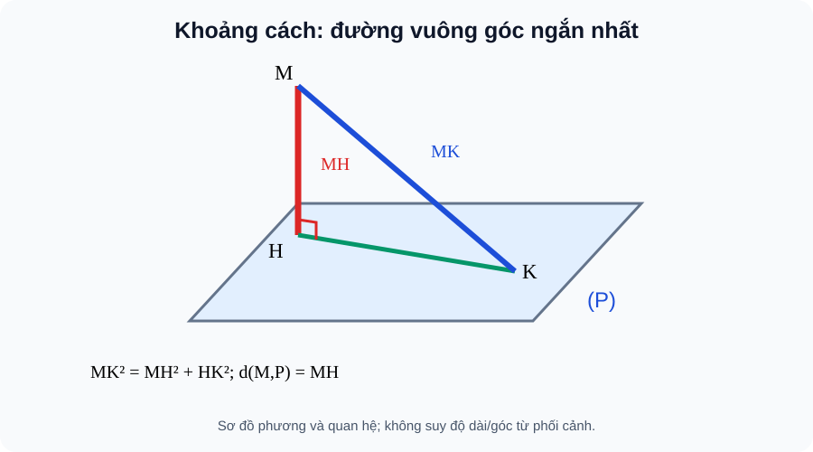
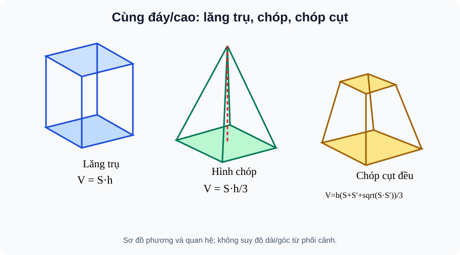

# CĐ17 — Khoảng cách & Thể tích khối đa diện · AUTHORING R00 · PLAN22 study only

> **AUTHORING REVIEW CANDIDATE / CHƯA CONTENT_READY.** Theo nghiên cứu danh mục 22 chuyên đề NotebookLM lịch sử, PLAN22-17 là “Khoảng cách & Thể tích khối đa diện” và đứng riêng với CĐ16 “Quan hệ vuông góc & Góc”. Tên này là nhãn tác giả, không phải TOPIC_ID website được chủ dự án khóa. Một chuẩn `SLM-THPT-QUALITY-ONE v3.1.0` Q01–Q18, không chuẩn song song.

<!-- AUTHOR_ONLY_S1_AND_NOTEBOOK_CUSTODY: SGK Toán11 KNTT Tập2 ChVII B26 SGK54–60/SBT35–37; B27 SGK61–63/SBT38–40, cuối chương SGK64–65/SBT41–43; original G11 canonical public source blob afc8ec039213b87b4930f2d34d48c28d1fc6277f, previous source receipt no new PDF scan. Candidate NotebookLM old Temp_TOPIC_10_QUAN_HE_VUONG_GOC_VA_KHOANG_CACH_TRONG_HINH_HO.md DRAFT_NOT_REVIEWED, erroneous ChVIII label and scope; use only independently checked intuitive themes, no independent Topic PASS transfer. -->

**Một câu hỏi xuyên suốt:** “Muốn đo khoảng cách giữa hai đối tượng, đoạn nào thực sự ngắn nhất? Khi chuyển sang thể tích, tại sao phải biết chiều cao *vuông góc*, và vì sao hai khối nhìn giống nhau lại khác công thức?” Từ câu hỏi này, ta học bằng hình vẽ và suy luận hình học trước rồi mới áp dụng phép tính. Không yêu cầu học trước CĐ16 hay phương pháp Oxyz: những kiến thức cần dùng như chân vuông góc, hình chiếu, Pitago và diện tích đáy đều được giải thích ngay khi xuất hiện.

**Cách học:** Trong Kiến thức, hãy đọc giải thích, nghĩ thử và tự giải **Tự thử** trước khi mở Đối chiếu. Sai ở đâu thì quay về điều kiện tương ứng; sau đó qua Luyện tập và Tự kiểm tra công khai. Ba trang ngoài duy nhất **Kiến thức / Luyện tập / Tự kiểm tra**; không tạo Core riêng.

## 1. Kiến thức

### Chặng 1 — Khoảng cách: vì sao không đo theo đường xiên?

**Đọc hình B26 — vì sao đoạn vuông góc ngắn nhất?** 

Trong hình, hãy chỉ rõ **M** ở ngoài (P), **H** là chân MH⊥(P) và **K** là điểm khác ở mặt phẳng. Đọc đẳng thức **MK²=MH²+HK²** để thấy MK dài hơn MH nếu K≠H. Hình này **minh họa khoảng cách điểm–mặt**, không phải một hình dựng hai đường chéo nhau. Với hai đường chéo nhau ở mục 1.5, tự vẽ hình mới và kiểm tra hai đầu của đoạn vuông góc chung đều thuộc hai đường, đồng thời đoạn ấy vuông góc với cả hai phương.

<!-- AUTHOR_ONLY_SVG_SOURCE: docs/assets/images/thpt/FIG-G11-CHVII-B26-01_R00.svg; BLOB: 26fb51f3af65ba7d86a2907f0eaff808d2d87532 -->

#### 1.1. Khoảng cách từ điểm A đến đường d là độ dài AH với H là chân vuông góc trên d; mọi đoạn AX đến X∈d đều dài không nhỏ hơn AH

**Ý nghĩa trước công thức.** Hãy tưởng tượng tìm con đường ngắn nhất từ một điểm A đến một thanh thẳng d. Nếu chọn một điểm X bất kì trên d thì AX là một đường xiên. Chỉ khi hạ AH vuông góc d mới có tam giác AHX vuông ở H, từ đó \(AX^2=AH^2+HX^2\). Vì \(HX^2\ge0\), đoạn thẳng ngắn nhất là **AH** và chỉ bằng AX khi X=H. Đây là lí do định nghĩa khoảng cách gắn với phép chiếu vuông góc, không phải một quy ước tùy ý.

<!-- LESSON_ID: TOP17-M01; OUTCOME_ID: TOP17-O01; S1_ORIGINAL_OUTCOME: G11-B26-POINT_LINE -->

**Hình thành kiến thức:** Khoảng cách từ điểm A đến đường d là độ dài AH với H là chân vuông góc trên d; mọi đoạn AX đến X∈d đều dài không nhỏ hơn AH.

**Ví dụ có giải thích cách chọn phương pháp:** Điểm A nằm cách đường d 3 cm theo phương vuông góc; lấy X khác H thì tam giác AHX vuông H cho AX²=AH²+HX²>AH².

**Tự thử trước khi xem lời giải:** H∈d, AH⊥d, AH=3 cm. d(A,d) bằng bao nhiêu?

<!-- ITEM_ID: THPT-TOP17-T01; ROLE: TOPIC_FIRST_TRY; PRIMARY_OUTCOME: TOP17-O01 -->

Tự mở Đối chiếu và sửa lỗi

3 cm. Đoạn xiên AX không ngắn hơn AH.

**D6 — Nếu chưa đúng:** Muốn chứng minh ngắn nhất phải xác định chân vuông góc. Hãy tự dựng lại đoạn vuông góc hoặc vẽ sơ đồ các lớp cắt và giải thích điều kiện trước khi làm biến thể.

#### 1.2. Khoảng cách từ A đến (P) là độ dài AH của đường vuông góc mặt (P) tại H, và bằng 0 nếu A thuộc (P)

**Từ thanh thẳng đến cả mặt sàn.** Với một chiếc đèn treo trên sàn, người ta muốn biết nó cao bao nhiêu. Dây xiên nối bóng đèn tới một góc phòng thường dài hơn độ cao; chân vuông góc xuống sàn mới cho độ dài ngắn nhất. Hình dung một mặt phẳng như chứa rất nhiều đường qua chân H; với mọi X khác H trên mặt sàn, tam giác AHX vuông H. Nếu A đã ở trên sàn thì khoảng cách bằng 0.

<!-- LESSON_ID: TOP17-M02; OUTCOME_ID: TOP17-O02; S1_ORIGINAL_OUTCOME: G11-B26-POINT_PLANE -->

**Hình thành kiến thức:** Khoảng cách từ A đến (P) là độ dài AH của đường vuông góc mặt (P) tại H, và bằng 0 nếu A thuộc (P).

**Ví dụ có giải thích cách chọn phương pháp:** Một điểm cao 4 m trên nền phẳng, hình chiếu tại H; mọi đường xiên đến điểm khác của nền dài hơn 4 m.

**Tự thử trước khi xem lời giải:** A∈(P). d(A,(P)) bằng bao nhiêu?

<!-- ITEM_ID: THPT-TOP17-T02; ROLE: TOPIC_FIRST_TRY; PRIMARY_OUTCOME: TOP17-O02 -->

Tự mở Đối chiếu và sửa lỗi

0, không cần dựng đoạn khác.

**D6 — Nếu chưa đúng:** Không coi cạnh chéo là khoảng cách vuông góc. Hãy tự dựng lại đoạn vuông góc hoặc vẽ sơ đồ các lớp cắt và giải thích điều kiện trước khi làm biến thể.

#### 1.3. Với d∥(P), mọi điểm A của d có cùng khoảng cách đến (P), vì hình chiếu của hai điểm trên d nằm trên một đường song song với d trong (P)

**Một đường ở cùng độ cao.** Thanh xà ngang song song sàn: khi ta đi dọc thanh, độ cao không đổi. Không phải vì mọi đoạn nối đến sàn bằng nhau; chỉ **các đoạn vuông góc** mới bằng nhau. Điều kiện d∥(P) rất quan trọng: nếu d nghiêng và cắt sàn, điểm ở gần chân giao có thể có độ cao khác. Kiểm tra điều kiện trước rồi mới lấy một điểm bất kì trên d.

<!-- LESSON_ID: TOP17-M03; OUTCOME_ID: TOP17-O03; S1_ORIGINAL_OUTCOME: G11-B26-PARALLEL_LINE_PLANE -->

**Hình thành kiến thức:** Với d∥(P), mọi điểm A của d có cùng khoảng cách đến (P), vì hình chiếu của hai điểm trên d nằm trên một đường song song với d trong (P).

**Ví dụ có giải thích cách chọn phương pháp:** Thanh ngang song song nền và cao 3 m: mọi điểm của thanh có khoảng cách đến nền là 3 m.

**Tự thử trước khi xem lời giải:** Đường d∥(P); hai điểm A,B thuộc d. Có d(A,(P))=d(B,(P)) không?

<!-- ITEM_ID: THPT-TOP17-T03; ROLE: TOPIC_FIRST_TRY; PRIMARY_OUTCOME: TOP17-O03 -->

Tự mở Đối chiếu và sửa lỗi

Có, vì khoảng cách đường song song mặt phẳng không đổi theo điểm.

**D6 — Nếu chưa đúng:** Điều kiện d song song mặt phẳng phải được kiểm tra trước khi lấy một điểm đại diện. Hãy tự dựng lại đoạn vuông góc hoặc vẽ sơ đồ các lớp cắt và giải thích điều kiện trước khi làm biến thể.

#### 1.4. Hai mặt phẳng song song có khoảng cách không đổi, đo theo một đoạn vuông góc chung, không phải đoạn nối xiên bất kì

**Hai tầng sàn song song.** Muốn đo độ chênh cao giữa hai tầng, đừng đo cầu thang xiên. Dựng AH vuông góc hai mặt: vì hai mặt song song, độ dài của các đường vuông góc chung bằng nhau. Bài toán một cặp mặt được quy về khoảng cách từ **một** điểm A ở mặt trên đến mặt dưới. Nếu hai mặt cắt nhau, “khoảng cách giữa hai mặt song song” không còn là bài toán này.

<!-- LESSON_ID: TOP17-M04; OUTCOME_ID: TOP17-O04; S1_ORIGINAL_OUTCOME: G11-B26-PARALLEL_PLANES -->

**Hình thành kiến thức:** Hai mặt phẳng song song có khoảng cách không đổi, đo theo một đoạn vuông góc chung, không phải đoạn nối xiên bất kì.

**Ví dụ có giải thích cách chọn phương pháp:** Hai tầng sàn song song, điểm A trên tầng trên chiếu vuông góc tới H ở tầng dưới, AH=4 m; khoảng cách hai sàn là 4 m.

**Tự thử trước khi xem lời giải:** Hai mặt song song cách nhau theo pháp tuyến 4 m. Khoảng cách hai mặt?

<!-- ITEM_ID: THPT-TOP17-T04; ROLE: TOPIC_FIRST_TRY; PRIMARY_OUTCOME: TOP17-O04 -->

Tự mở Đối chiếu và sửa lỗi

4 m, là độ dài đoạn vuông góc chung.

**D6 — Nếu chưa đúng:** Không lấy đoạn nối hai điểm bất kì giữa các mặt làm khoảng cách. Hãy tự dựng lại đoạn vuông góc hoặc vẽ sơ đồ các lớp cắt và giải thích điều kiện trước khi làm biến thể.

#### 1.5. Với hai đường chéo nhau, khoảng cách là độ dài đoạn vuông góc chung có hai đầu mút trên từng đường, không phải khoảng cách của hai điểm tùy ý

**Khi hai đường chéo nhau, khoảng cách đo ở đâu?** Một cặp đường thẳng trong không gian không song song nhưng không giao nhau: không thể đo khoảng cách bằng cách chọn đại hai đầu mút rồi nối chúng. Phải tìm đoạn MN với M trên đường thứ nhất, N trên đường thứ hai, sao cho MN vuông góc **cả hai**. Trong lập phương, đoạn AD nối A∈AB và D∈DD′ vừa vuông góc AB vừa vuông góc DD′. Dùng phương pháp hình học dựng hai chân, không cần hệ tọa độ Oxyz của lớp 12.

<!-- LESSON_ID: TOP17-M05; OUTCOME_ID: TOP17-O05; S1_ORIGINAL_OUTCOME: G11-B26-SKEW_COMMON_PERP -->

**Hình thành kiến thức:** Với hai đường chéo nhau, khoảng cách là độ dài đoạn vuông góc chung có hai đầu mút trên từng đường, không phải khoảng cách của hai điểm tùy ý.

**Ví dụ có giải thích cách chọn phương pháp:** Trong lập phương cạnh a, AB nằm ở đáy theo một phương, DD′ là cạnh đứng; AD có A∈AB, D∈DD′ và AD⊥AB, AD⊥DD′, nên AD là đoạn vuông góc chung, khoảng cách bằng a.

**Tự thử trước khi xem lời giải:** Trong lập phương cạnh 5, khoảng cách giữa AB và DD′ là bao nhiêu?

<!-- ITEM_ID: THPT-TOP17-T05; ROLE: TOPIC_FIRST_TRY; PRIMARY_OUTCOME: TOP17-O05 -->

Tự mở Đối chiếu và sửa lỗi

5, bằng AD là đoạn vuông góc chung; AB và DD′ chéo nhau.

**D6 — Nếu chưa đúng:** Kiểm tra cả hai đầu mút thuộc hai đường và vuông góc cả hai phương. Hãy tự dựng lại đoạn vuông góc hoặc vẽ sơ đồ các lớp cắt và giải thích điều kiện trước khi làm biến thể.

#### 1.6. Chiều cao khối đa diện là khoảng cách vuông góc giữa đỉnh hoặc mặt đáy, không nhất thiết là cạnh bên hay đường sinh mặt bên

**Chiều cao không phải cạnh nghiêng.** Trong một khối chóp, cạnh bên đi từ đỉnh đến một đỉnh đáy thường xiên, còn chiều cao là khoảng cách ngắn nhất từ đỉnh tới **mặt** đáy. Ngay cả đường cao của *mặt bên* cũng nằm trong một tam giác khác và thường dài hơn chiều cao của khối. Với chóp đều đáy vuông cạnh 6, đường cao mặt bên 5, ta tìm đoạn từ tâm đáy đến trung điểm cạnh dài 3, rồi dùng Pitago suy chiều cao khối 4. Đây là bước bắt buộc trước khi dùng công thức thể tích.

<!-- LESSON_ID: TOP17-M06; OUTCOME_ID: TOP17-O06; S1_ORIGINAL_OUTCOME: G11-B26-HEIGHT_APPLICATION -->

**Hình thành kiến thức:** Chiều cao khối đa diện là khoảng cách vuông góc giữa đỉnh hoặc mặt đáy, không nhất thiết là cạnh bên hay đường sinh mặt bên.

**Ví dụ có giải thích cách chọn phương pháp:** Chóp vuông có chân cao ở tâm O, SO=4 và đoạn từ đỉnh đến trung điểm cạnh đáy là 5: thể tích dùng h=4, không dùng 5.

**Tự thử trước khi xem lời giải:** Chóp có chiều cao 4 và cạnh bên 5. Giá trị h trong V=(1/3)Sđáy h?

<!-- ITEM_ID: THPT-TOP17-T06; ROLE: TOPIC_FIRST_TRY; PRIMARY_OUTCOME: TOP17-O06 -->

Tự mở Đối chiếu và sửa lỗi

4, vì chiều cao là đoạn vuông góc.

**D6 — Nếu chưa đúng:** Đừng dùng đường cao mặt bên thay cho đường cao vuông góc với đáy. Hãy tự dựng lại đoạn vuông góc hoặc vẽ sơ đồ các lớp cắt và giải thích điều kiện trước khi làm biến thể.

### Chặng 2 — Thể tích: từ lớp cắt bằng nhau đến khối thu nhỏ

**Đọc hình B27 — so sánh công thức qua cùng chiều cao.**

Hãy tìm cùng một **diện tích đáy S** và **chiều cao vuông góc h** trước khi so sánh: lăng trụ giữ nguyên diện tích lát cắt nên V=Sh; chóp có lát cắt nhỏ dần nên V=Sh/3; chóp cụt có hai đáy song song với diện tích S và S′ và cần thêm căn \(\sqrt{SS'}\). Nét vẽ phối cảnh không chứng minh tỉ lệ 1/3; câu chuyện về các lát cắt giải thích vì sao công thức khác nhau.

<!-- AUTHOR_ONLY_SVG_SOURCE: docs/assets/images/thpt/FIG-G11-CHVII-B27-01_R00.svg; BLOB: a7bec7a20295d09ca6f32aae0e8910cef7bed9dc -->

#### 2.1. Thể tích lăng trụ bằng diện tích đáy nhân chiều cao vuông góc V=Sđáy·h

**Vì sao lăng trụ nhân diện tích đáy với chiều cao?** Hãy tưởng tượng chồng nhiều tờ bìa có cùng hình và diện tích S lên nhau. Mỗi lớp dày thêm một chút làm thể tích tăng tương ứng; tổng chiều dày h cho V=Sh. Nếu chồng các tờ bìa lệch nhau để tạo lăng trụ xiên, diện tích mỗi lát cắt song song đáy vẫn S và chiều cao vuông góc vẫn h: thể tích không thay đổi chỉ vì cạnh bên nghiêng. Vì vậy, **h** không thể thay bằng độ dài cạnh bên nếu không biết nó vuông góc đáy.

<!-- LESSON_ID: TOP17-M07; OUTCOME_ID: TOP17-O07; S1_ORIGINAL_OUTCOME: G11-B27-PRISM_VOLUME -->

**Hình thành kiến thức:** Thể tích lăng trụ bằng diện tích đáy nhân chiều cao vuông góc V=Sđáy·h. Hộp có các lát cắt bằng nhau theo chiều cao nên thể tích tỉ lệ tuyến tính với h.

**Ví dụ có giải thích cách chọn phương pháp:** Lăng trụ đáy có diện tích 12 cm², chiều cao 5 cm: V=12×5=60 cm³, không phân biệt đứng hay xiên nếu đã cho đúng chiều cao vuông góc.

**Tự thử trước khi xem lời giải:** Lăng trụ Sđáy=12 cm², h=5 cm; thể tích?

<!-- ITEM_ID: THPT-TOP17-T07; ROLE: TOPIC_FIRST_TRY; PRIMARY_OUTCOME: TOP17-O07 -->

Tự mở Đối chiếu và sửa lỗi

60 cm³, vì V=Sđáyh.

**D6 — Nếu chưa đúng:** Đơn vị thể tích phải là đơn vị khối, và h phải vuông góc đáy. Hãy tự dựng lại đoạn vuông góc hoặc vẽ sơ đồ các lớp cắt và giải thích điều kiện trước khi làm biến thể.

#### 2.2. Chóp cùng đáy và chiều cao với lăng trụ tương ứng chỉ có thể tích bằng một phần ba lăng trụ: V=(1/3)Sđáy·h

**Vì sao khối chóp có hệ số 1/3?** Khác lăng trụ, các lát cắt song song đáy của chóp càng lên gần đỉnh càng nhỏ. Có thể tưởng tượng chia một lăng trụ thành ba khối chóp bằng thể tích (trong trường hợp ghép thích hợp), hoặc suy bằng nguyên lí thể tích từ những thiết diện tương ứng. Kết luận cho khối chóp là \(V=\frac13Sh\). Nếu thay bằng Sh, ta đã tính như lăng trụ và kết quả gấp ba thể tích thực. Không cần học tích phân mới hiểu được sự khác biệt về các lát cắt.

<!-- LESSON_ID: TOP17-M08; OUTCOME_ID: TOP17-O08; S1_ORIGINAL_OUTCOME: G11-B27-PYRAMID_VOLUME -->

**Hình thành kiến thức:** Chóp cùng đáy và chiều cao với lăng trụ tương ứng chỉ có thể tích bằng một phần ba lăng trụ: V=(1/3)Sđáy·h. Hệ số 1/3 không xuất hiện với lăng trụ.

**Ví dụ có giải thích cách chọn phương pháp:** Chóp có đáy 12 cm² và cao 5 cm: V=(1/3)×12×5=20 cm³, bằng một phần ba lăng trụ cùng đáy/cao.

**Tự thử trước khi xem lời giải:** Chóp Sđáy=12 cm², h=5 cm; thể tích?

<!-- ITEM_ID: THPT-TOP17-T08; ROLE: TOPIC_FIRST_TRY; PRIMARY_OUTCOME: TOP17-O08 -->

Tự mở Đối chiếu và sửa lỗi

20 cm³; phải có hệ số 1/3.

**D6 — Nếu chưa đúng:** Phân biệt dạng chóp với lăng trụ trước khi chọn công thức. Hãy tự dựng lại đoạn vuông góc hoặc vẽ sơ đồ các lớp cắt và giải thích điều kiện trước khi làm biến thể.

#### 2.3. Hộp chữ nhật là lăng trụ đứng có đáy chữ nhật, nên V=abc; lập phương cạnh a có V=a³

**Hình hộp chỉ là một lăng trụ dễ nhìn.** Ba kích thước a,b,c của hộp chữ nhật lần lượt tạo diện tích đáy ab và chiều cao c; do đó V=abc. Khi cả ba cạnh bằng nhau, V=a³. Lúc tính một bể chứa, luôn thống nhất đơn vị độ dài; nhân m² với m mới thu được m³, không phải m².

<!-- LESSON_ID: TOP17-M09; OUTCOME_ID: TOP17-O09; S1_ORIGINAL_OUTCOME: G11-B27-BOX_VOLUME -->

**Hình thành kiến thức:** Hộp chữ nhật là lăng trụ đứng có đáy chữ nhật, nên V=abc; lập phương cạnh a có V=a³. Đơn vị diện tích đáy nhân độ dài thành đơn vị khối.

**Ví dụ có giải thích cách chọn phương pháp:** Hộp 2 cm×3 cm×4 cm có thể tích 24 cm³, không phải 24 cm².

**Tự thử trước khi xem lời giải:** Hộp có kích thước 2,3,4 cm, thể tích?

<!-- ITEM_ID: THPT-TOP17-T09; ROLE: TOPIC_FIRST_TRY; PRIMARY_OUTCOME: TOP17-O09 -->

Tự mở Đối chiếu và sửa lỗi

24 cm³.

**D6 — Nếu chưa đúng:** Không nhầm diện tích toàn phần với thể tích và không bỏ đơn vị khối. Hãy tự dựng lại đoạn vuông góc hoặc vẽ sơ đồ các lớp cắt và giải thích điều kiện trước khi làm biến thể.

#### 2.4. Với chóp cụt có hai đáy song song diện tích S,S′ và chiều cao h, V=(h/3)(S+S′+√(SS′))

**Chóp cụt: vì sao có căn \(\sqrt{SS'}\)?** *Ở đây “chóp cụt” là phần còn lại khi cắt một hình chóp bằng mặt phẳng **song song đáy**; hai đáy vì thế đồng dạng. Không áp dụng công thức này cho một khối bất kỳ chỉ vì nó có hai mặt song song.* Chóp cụt đều được tạo khi cắt một chóp bởi mặt phẳng song song đáy; hai đáy đồng dạng chứ không bằng nhau. Nếu tỉ số độ dài là k, tỉ số diện tích là k², nên một đại lượng kích thước “trung gian” tự nhiên phải gắn với \(\sqrt{SS'}\). Công thức \(V=\frac h3(S+\sqrt{SS'}+S')\) có thể tự kiểm bằng hai giới hạn: S′ tiến về S cho V→Sh (lăng trụ); S′ tiến về 0 cho V→Sh/3 (chóp). Đó là **kiểm tra hợp lí**, không thay cho giả thiết hai đáy đồng dạng/song song của chóp cụt.

<!-- LESSON_ID: TOP17-M10; OUTCOME_ID: TOP17-O10; S1_ORIGINAL_OUTCOME: G11-B27-FRUSTUM_VOLUME -->

**Hình thành kiến thức:** Với chóp cụt có hai đáy song song diện tích S,S′ và chiều cao h, V=(h/3)(S+S′+√(SS′)). Công thức có cả h và trung bình nhân diện tích, không phải S·h đơn giản.

**Ví dụ có giải thích cách chọn phương pháp:** S=16,S′=4,h=6 thì √(SS′)=8, suy V=(6/3)(16+4+8)=56 đơn vị thể tích.

**Tự thử trước khi xem lời giải:** Chóp cụt S=16,S′=4,h=6. Giá trị √(SS′)?

<!-- ITEM_ID: THPT-TOP17-T10; ROLE: TOPIC_FIRST_TRY; PRIMARY_OUTCOME: TOP17-O10 -->

Tự mở Đối chiếu và sửa lỗi

8, vì √(16×4)=8.

**D6 — Nếu chưa đúng:** Nếu hai đáy bằng nhau thì công thức trở về lăng trụ V=Sh; nếu đáy nhỏ thu về 0 thì về chóp V=Sh/3. Hãy tự dựng lại đoạn vuông góc hoặc vẽ sơ đồ các lớp cắt và giải thích điều kiện trước khi làm biến thể.

**Tự khám phá trên mô hình:** Giữ cạnh đáy lớn \`a=6\` cm và chiều cao vuông góc \`h=4\` cm, thay đổi tỉ lệ cạnh đáy nhỏ \(k\) từ \(0\) đến \(1\). Hãy tự dự đoán \(V\) trước khi thay thanh trượt: khi \(k=0\), khối giới hạn là chóp; khi \(k=1\), giới hạn là lăng trụ. Với \(k=1/2\), \(S=36\), \(S'=9\), căn \(\sqrt{SS'}=18\), nên \(V=84\,\mathrm{cm}^3\). Từ ba trường hợp, em có thể phát hiện lỗi gõ công thức nào?

<!-- AUTHOR_ONLY_MODEL_REFERENCE: SLM-TOP17-FRUSTUM-VOLUME-R00; FILE: Temp_THPT_TOPIC17_FRUSTUM_VOLUME_MODEL_R00_20261113.html; PUBLIC_DISCOVERY_NO_MASTERY -->
#### 2.5. Trong bài toán ứng dụng, phải phân loại khối, đổi đơn vị, xác định chiều cao **vuông góc**, rồi mới thay số; kết quả thể tích không thể là mét vuông

**Bài toán thực tế bắt đầu từ phân loại khối.** Một thùng hàng hình hộp, một mái chóp hay một phễu chóp cụt không cùng công thức. Hãy làm theo thứ tự: nhận dạng hình, xác định đáy, vẽ chiều cao vuông góc, đổi đơn vị, rồi thay số. Một đáp án “60 m²” cho thể tích là dấu hiệu sai ngay cả khi phép nhân đúng; và lấy cạnh xiên làm h có thể khiến đáp án quá lớn.

<!-- LESSON_ID: TOP17-M11; OUTCOME_ID: TOP17-O11; S1_ORIGINAL_OUTCOME: G11-B27-VOLUME_APPLICATION -->

**Hình thành kiến thức:** Trong bài toán ứng dụng, phải phân loại khối, đổi đơn vị, xác định chiều cao **vuông góc**, rồi mới thay số; kết quả thể tích không thể là mét vuông.

**Ví dụ có giải thích cách chọn phương pháp:** Lăng trụ có thiết diện tam giác vuông hai cạnh góc vuông 3 m,4 m, chiều dài vuông góc thiết diện 10 m: diện tích đáy=6 m², thể tích=60 m³.

**Tự thử trước khi xem lời giải:** Khối lăng trụ có diện tích đáy 6 m², cao 10 m. Thể tích?

<!-- ITEM_ID: THPT-TOP17-T11; ROLE: TOPIC_FIRST_TRY; PRIMARY_OUTCOME: TOP17-O11 -->

Tự mở Đối chiếu và sửa lỗi

60 m³, không phải 60 m².

**D6 — Nếu chưa đúng:** Không dùng cạnh xiên hoặc quên nhân hệ số 1/2 cho diện tích tam giác vuông. Hãy tự dựng lại đoạn vuông góc hoặc vẽ sơ đồ các lớp cắt và giải thích điều kiện trước khi làm biến thể.

#### 2.6. Bài tổng hợp đi ngược từ thể tích: cần xác định đáy và chiều cao, muốn tìm chiều cao phải dựng hình chiếu vuông góc, muốn chứng minh vuông góc mặt cần hai đường cắt nhau trong mặt

**Đi từ đáp số ngược về hình.** Với chóp đều đáy vuông cạnh 8 và đường cao mặt bên 5, nếu vội lấy h=5 thì thể tích sai. Hãy tìm trung điểm M của cạnh đáy và tâm O; OM=4, SM=5 nên chiều cao SO=3, rồi mới tính \(V=\frac13\cdot64\cdot3=64\). Tư duy kiểm tra theo chuỗi “hình → đoạn vuông góc → chiều cao → thể tích → đơn vị” giúp phát hiện sai ngay từ bước chọn dữ kiện.

<!-- LESSON_ID: TOP17-M12; OUTCOME_ID: TOP17-O12; S1_ORIGINAL_OUTCOME: G11-CHVII-INTEGRATED -->

**Hình thành kiến thức:** Bài tổng hợp đi ngược từ thể tích: cần xác định đáy và chiều cao, muốn tìm chiều cao phải dựng hình chiếu vuông góc, muốn chứng minh vuông góc mặt cần hai đường cắt nhau trong mặt. Mỗi mũi suy luận có điều kiện riêng.

**Ví dụ có giải thích cách chọn phương pháp:** Chóp tứ giác đều đáy vuông cạnh 6, cao 4: SO⊥(ABCD), OA và OB cắt trong đáy; V=(1/3)·36·4=48. Nếu biết đường cao mặt bên 5, dùng Pitago để suy SO=4 trước.

**Tự thử trước khi xem lời giải:** Chóp đều đáy vuông cạnh 6 và đường cao mặt bên 5. Chiều cao khối?

<!-- ITEM_ID: THPT-TOP17-T12; ROLE: TOPIC_FIRST_TRY; PRIMARY_OUTCOME: TOP17-O12 -->

Tự mở Đối chiếu và sửa lỗi

4, từ tam giác vuông nối đỉnh, tâm đáy, trung điểm cạnh: 5²−3²=4².

**D6 — Nếu chưa đúng:** Khi kết quả sai, dò ngược: loại khối → đáy → đường vuông góc → h → công thức → đơn vị. Hãy tự dựng lại đoạn vuông góc hoặc vẽ sơ đồ các lớp cắt và giải thích điều kiện trước khi làm biến thể.

## 2. Luyện tập

Chỉ sau khi đã hiểu đoạn vuông góc, hình chiếu và chiều cao, hãy luyện theo các tình huống sau. Trước khi tính, **viết một câu** giải thích vì sao chọn đoạn thẳng làm khoảng cách hoặc vì sao chọn công thức thể tích của đúng khối. Phần Đối chiếu chỉ mở sau khi tự giải.

### Bài vận dụng 1

<!-- ITEM_ID: THPT-TOP17-P01; ROLE: TOPIC_PRACTICE; PRIMARY_OUTCOME: TOP17-O01 -->

H,X∈d, AH⊥d tại H, AH=5, HX=12. Tính AX và d(A,d).

Tự mở đáp án và lí giải

AX=13 theo Pitago, còn d(A,d)=AH=5. Không nhầm đoạn xiên AX với khoảng cách.

**D6 nếu sai:** Muốn chứng minh ngắn nhất phải xác định chân vuông góc. Quay lại hình và chỉ rõ vì sao đoạn đo là vuông góc; kiểm tra dạng khối/đơn vị trước khi làm biến thể.

### Bài vận dụng 2

<!-- ITEM_ID: THPT-TOP17-P02; ROLE: TOPIC_PRACTICE; PRIMARY_OUTCOME: TOP17-O02 -->

H∈(P) là chân vuông góc, AH⊥(P), AH=8 cm. Một đoạn xiên AM=10 cm (M∈(P)). Tính khoảng cách từ A đến (P).

Tự mở đáp án và lí giải

8 cm, vì AH là đoạn vuông góc ngắn nhất. Độ dài AM=10 cm không phải khoảng cách.

**D6 nếu sai:** Không coi cạnh chéo là khoảng cách vuông góc. Quay lại hình và chỉ rõ vì sao đoạn đo là vuông góc; kiểm tra dạng khối/đơn vị trước khi làm biến thể.

### Bài vận dụng 3

<!-- ITEM_ID: THPT-TOP17-P03; ROLE: TOPIC_PRACTICE; PRIMARY_OUTCOME: TOP17-O03 -->

Đường d∥nền (P), A∈d có hình chiếu AH=7 cm. Tìm d(d,(P)).

Tự mở đáp án và lí giải

7 cm = d(A,(P)). Nếu d cắt hoặc nằm trong mặt, phải xét trường hợp riêng, không áp dụng máy móc.

**D6 nếu sai:** Điều kiện d song song mặt phẳng phải được kiểm tra trước khi lấy một điểm đại diện. Quay lại hình và chỉ rõ vì sao đoạn đo là vuông góc; kiểm tra dạng khối/đơn vị trước khi làm biến thể.

### Bài vận dụng 4

<!-- ITEM_ID: THPT-TOP17-P04; ROLE: TOPIC_PRACTICE; PRIMARY_OUTCOME: TOP17-O04 -->

(P)∥(Q), A∈(P), H∈(Q), AH⊥(Q) tại H, AH=6 cm. Tính d((P),(Q)).

Tự mở đáp án và lí giải

6 cm; nhờ hai mặt song song, mọi điểm của (P) có cùng khoảng cách đến (Q).

**D6 nếu sai:** Không lấy đoạn nối hai điểm bất kì giữa các mặt làm khoảng cách. Quay lại hình và chỉ rõ vì sao đoạn đo là vuông góc; kiểm tra dạng khối/đơn vị trước khi làm biến thể.

### Bài vận dụng 5

<!-- ITEM_ID: THPT-TOP17-P05; ROLE: TOPIC_PRACTICE; PRIMARY_OUTCOME: TOP17-O05 -->

Lập phương cạnh 7, hai đường AB và CC′ chéo nhau. Chọn đoạn vuông góc chung và tính khoảng cách.

Tự mở đáp án và lí giải

BC nối B∈AB tới C∈CC′, vuông góc AB và CC′; độ dài BC=7. Không dùng AC là đường xiên.

**D6 nếu sai:** Kiểm tra cả hai đầu mút thuộc hai đường và vuông góc cả hai phương. Quay lại hình và chỉ rõ vì sao đoạn đo là vuông góc; kiểm tra dạng khối/đơn vị trước khi làm biến thể.

### Bài vận dụng 6

<!-- ITEM_ID: THPT-TOP17-P06; ROLE: TOPIC_PRACTICE; PRIMARY_OUTCOME: TOP17-O06 -->

Chóp đều đáy vuông cạnh 6 có đường cao mặt bên 5. Tìm chiều cao chóp.

Tự mở đáp án và lí giải

Từ tâm O đến trung điểm cạnh đáy dài 3; h=√(5²−3²)=4. Điều kiện đường cao mặt bên đi qua trung điểm cạnh trong chóp đều.

**D6 nếu sai:** Đừng dùng đường cao mặt bên thay cho đường cao vuông góc với đáy. Quay lại hình và chỉ rõ vì sao đoạn đo là vuông góc; kiểm tra dạng khối/đơn vị trước khi làm biến thể.

### Bài vận dụng 7

<!-- ITEM_ID: THPT-TOP17-P07; ROLE: TOPIC_PRACTICE; PRIMARY_OUTCOME: TOP17-O07 -->

Lăng trụ có đáy hình tam giác diện tích 18 m², khoảng cách hai mặt đáy 4 m. Tính V.

Tự mở đáp án và lí giải

72 m³ =18×4. Khoảng cách vuông góc hai đáy là chiều cao, không nhất thiết cạnh bên.

**D6 nếu sai:** Đơn vị thể tích phải là đơn vị khối, và h phải vuông góc đáy. Quay lại hình và chỉ rõ vì sao đoạn đo là vuông góc; kiểm tra dạng khối/đơn vị trước khi làm biến thể.

### Bài vận dụng 8

<!-- ITEM_ID: THPT-TOP17-P08; ROLE: TOPIC_PRACTICE; PRIMARY_OUTCOME: TOP17-O08 -->

Chóp tứ giác đáy vuông cạnh 6 cm và cao 4 cm. Tính thể tích.

Tự mở đáp án và lí giải

Sđáy=36 cm², V=36×4/3=48 cm³. Không dùng độ dài đường cao mặt bên.

**D6 nếu sai:** Phân biệt dạng chóp với lăng trụ trước khi chọn công thức. Quay lại hình và chỉ rõ vì sao đoạn đo là vuông góc; kiểm tra dạng khối/đơn vị trước khi làm biến thể.

### Bài vận dụng 9

<!-- ITEM_ID: THPT-TOP17-P09; ROLE: TOPIC_PRACTICE; PRIMARY_OUTCOME: TOP17-O09 -->

Lập phương cạnh 5 cm. Tính thể tích và đơn vị.

Tự mở đáp án và lí giải

5³=125 cm³; thể tích dùng ba chiều.

**D6 nếu sai:** Không nhầm diện tích toàn phần với thể tích và không bỏ đơn vị khối. Quay lại hình và chỉ rõ vì sao đoạn đo là vuông góc; kiểm tra dạng khối/đơn vị trước khi làm biến thể.

### Bài vận dụng 10

<!-- ITEM_ID: THPT-TOP17-P10; ROLE: TOPIC_PRACTICE; PRIMARY_OUTCOME: TOP17-O10 -->

Chóp cụt đều hai đáy vuông cạnh 6 và 3, chiều cao 4. Tính V.

Tự mở đáp án và lí giải

S=36,S′=9, √(SS′)=18, V=(4/3)(36+9+18)=84 đơn vị khối.

**D6 nếu sai:** Nếu hai đáy bằng nhau thì công thức trở về lăng trụ V=Sh; nếu đáy nhỏ thu về 0 thì về chóp V=Sh/3. Quay lại hình và chỉ rõ vì sao đoạn đo là vuông góc; kiểm tra dạng khối/đơn vị trước khi làm biến thể.

### Bài vận dụng 11

<!-- ITEM_ID: THPT-TOP17-P11; ROLE: TOPIC_PRACTICE; PRIMARY_OUTCOME: TOP17-O11 -->

Một khối lăng trụ tam giác vuông có cạnh góc vuông đáy 6 cm và 8 cm, chiều cao khối 7 cm. Tính V.

Tự mở đáp án và lí giải

Sđáy=(1/2)×6×8=24 cm², V=24×7=168 cm³.

**D6 nếu sai:** Không dùng cạnh xiên hoặc quên nhân hệ số 1/2 cho diện tích tam giác vuông. Quay lại hình và chỉ rõ vì sao đoạn đo là vuông góc; kiểm tra dạng khối/đơn vị trước khi làm biến thể.

### Bài vận dụng 12

<!-- ITEM_ID: THPT-TOP17-P12; ROLE: TOPIC_PRACTICE; PRIMARY_OUTCOME: TOP17-O12 -->

Chóp đều đáy vuông cạnh 8 và đường cao mặt bên 5. Tính thể tích.

Tự mở đáp án và lí giải

Hình chiếu đỉnh là tâm đáy, nửa cạnh=4; h=√(25−16)=3; Sđáy=64; V=64×3/3=64 đơn vị khối.

**D6 nếu sai:** Khi kết quả sai, dò ngược: loại khối → đáy → đường vuông góc → h → công thức → đơn vị. Quay lại hình và chỉ rõ vì sao đoạn đo là vuông góc; kiểm tra dạng khối/đơn vị trước khi làm biến thể.

### Tự luận 1

<!-- ITEM_ID: THPT-TOP17-W01; ROLE: TOPIC_WRITTEN; PRIMARY_OUTCOME: TOP17-O06; RUBRIC_MAX: 4 -->

Một chóp tứ giác đều đáy vuông cạnh 6 cm, đường cao mặt bên dài 5 cm. Hãy tìm chiều cao và thể tích, phân biệt với đường cao mặt bên.

Tự mở lời giải và rubric /4

Chân cao O là tâm đáy. Với M là trung điểm cạnh đáy, OM=3 cm và SM=5 cm. Tam giác SOM vuông tại O nên SO=√(5²−3²)=4 cm. Diện tích đáy 36 cm²; V=(1/3)·36·4=48 cm³.

**Rubric 4 điểm:**
- Xác định O tâm đáy và M trung điểm cạnh — **1 điểm**.
- Tính OM=3 và dùng Pitago SO=4 — **1 điểm**.
- Tính đúng diện tích đáy 36 cm² — **1 điểm**.
- Tính thể tích 48 cm³ và phân biệt h — **1 điểm**.

### Tự luận 2

<!-- ITEM_ID: THPT-TOP17-W02; ROLE: TOPIC_WRITTEN; PRIMARY_OUTCOME: TOP17-O11; RUBRIC_MAX: 4 -->

Lăng trụ tam giác đứng có đáy tam giác vuông với hai cạnh góc vuông 6 cm và 8 cm, cạnh bên 7 cm. Tính diện tích đáy, chiều cao, thể tích.

Tự mở lời giải và rubric /4

Sđáy=(1/2)·6·8=24 cm². Lăng trụ đứng nên chiều cao bằng cạnh bên 7 cm. V=24·7=168 cm³; kết quả là đơn vị khối.

**Rubric 4 điểm:**
- Tính diện tích tam giác vuông 24 cm² — **1 điểm**.
- Giải thích h=7 vì lăng trụ đứng — **1 điểm**.
- Áp dụng V=Sđáy·h — **1 điểm**.
- Kết luận 168 cm³ đúng đơn vị — **1 điểm**.

### Tự luận 3

<!-- ITEM_ID: THPT-TOP17-W03; ROLE: TOPIC_WRITTEN; PRIMARY_OUTCOME: TOP17-O10; RUBRIC_MAX: 4 -->

Một chóp cụt đều có hai đáy hình vuông cạnh 6 cm và 3 cm; chiều cao 4 cm. Tính thể tích, sau đó xét giới hạn khi đáy nhỏ co về 0.

Tự mở lời giải và rubric /4

Hai diện tích S=36,S′=9, √(SS′)=18. V=(4/3)·(36+9+18)=84 cm³. Nếu S′ tiến về 0 thì V→(4/3)·36=48 cm³, phù hợp công thức của chóp cùng đáy và chiều cao.

**Rubric 4 điểm:**
- Tính đúng S=36, S′=9 — **1 điểm**.
- Tính trung bình nhân diện tích bằng 18 — **1 điểm**.
- V=(4/3)×63=84 cm³ — **1 điểm**.
- Nêu giới hạn S′→0 cho thể tích chóp — **1 điểm**.

## 3. Tự kiểm tra

**Tự kiểm tra công khai (Practice replay)** — không phải đề Readiness độc lập và không ghi Mastery. Tám vị trí dưới đây dùng lại chính canonical Practice IDs đã học, không tạo câu mới hay sao chép đáp án. Nếu website thể hiện bằng lượt nộp chính thức, RELEASE phải ẩn đáp án, gợi ý, đúng/sai, rubric và AI Tutor **trước Final Submit**; sau đó mới tự đối chiếu. Tệp Markdown này chỉ là nguồn học liệu, không có cơ chế đánh giá chính thức.

- Câu 1: đặt lại `THPT-TOP17-P01` dưới role `TOPIC_SELF_CHECK_REPLAY`, không nhân đôi item_id.
- Câu 2: đặt lại `THPT-TOP17-P02` dưới role `TOPIC_SELF_CHECK_REPLAY`, không nhân đôi item_id.
- Câu 3: đặt lại `THPT-TOP17-P04` dưới role `TOPIC_SELF_CHECK_REPLAY`, không nhân đôi item_id.
- Câu 4: đặt lại `THPT-TOP17-P05` dưới role `TOPIC_SELF_CHECK_REPLAY`, không nhân đôi item_id.
- Câu 5: đặt lại `THPT-TOP17-P06` dưới role `TOPIC_SELF_CHECK_REPLAY`, không nhân đôi item_id.
- Câu 6: đặt lại `THPT-TOP17-P08` dưới role `TOPIC_SELF_CHECK_REPLAY`, không nhân đôi item_id.
- Câu 7: đặt lại `THPT-TOP17-P10` dưới role `TOPIC_SELF_CHECK_REPLAY`, không nhân đôi item_id.
- Câu 8: đặt lại `THPT-TOP17-P12` dưới role `TOPIC_SELF_CHECK_REPLAY`, không nhân đôi item_id.

**Khi cần khắc phục:** chưa chắc về khoảng cách thì quay lại chứng minh ngắn nhất bằng Pitago; chưa chắc về thể tích thì xác định đúng đáy–h, phân biệt chóp/lăng trụ/chóp cụt và kiểm đơn vị.

<!-- AUTHOR_ONLY_22_SGK_CANONICAL_POINTERS: THPT-G11-CHVII-B26-C01, THPT-G11-CHVII-B26-C02, THPT-G11-CHVII-B26-C03, THPT-G11-CHVII-B26-C04, THPT-G11-CHVII-B26-C05, THPT-G11-CHVII-B26-C06, THPT-G11-CHVII-B26-P01, THPT-G11-CHVII-B26-P02, THPT-G11-CHVII-B26-P03, THPT-G11-CHVII-B27-C01, THPT-G11-CHVII-B27-C02, THPT-G11-CHVII-B27-C03, THPT-G11-CHVII-B27-C04, THPT-G11-CHVII-B27-C05, THPT-G11-CHVII-B27-P01, THPT-G11-CHVII-B27-P02, THPT-G11-CHVII-B27-P03, THPT-G11-CHVII-CHVII-C01, THPT-G11-CHVII-B26-W01, THPT-G11-CHVII-B26-W02-ANCHOR, THPT-G11-CHVII-B27-W01, THPT-G11-CHVII-B27-W02-ANCHOR -->
