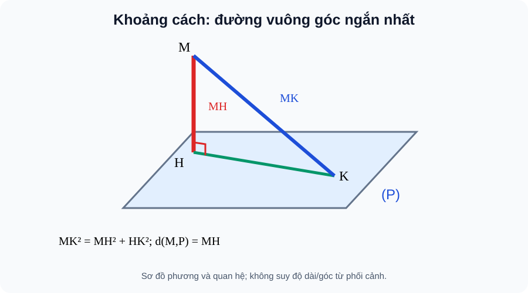
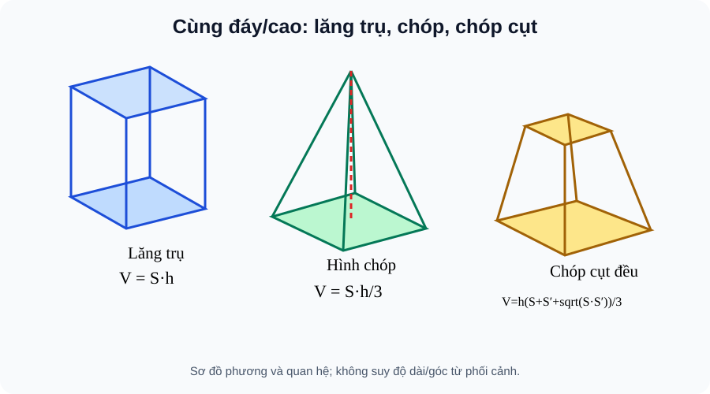

# Chuyên đề 17 — Khoảng cách và thể tích khối đa diện

Đoạn ngắn nhất giữa các đối tượng hình học đi theo đường vuông góc; muốn tính thể tích, hãy xác định đáy và chiều cao vuông góc trước khi thay số.

<!-- AUTHORING_R02_CANDIDATE; ORIGINAL_R00_SOURCE: baa6c6c575a4cf79187b2aebd2047b1cf872b983; EDITORIAL_R01_SOURCE: af08791b4d7104679a3ea3481068266a07c72dce; S1_G11_SOURCE: 5646241f4bb72f12419aaf585ee1fbea6f4185d0; NO_RD1; NO_RELEASE -->

# Kiến thức

## 1. Khoảng cách: vì sao không đo theo đường xiên?

**Đọc hình B26 — vì sao đoạn vuông góc ngắn nhất?**

Trong hình, hãy chỉ rõ **M** ở ngoài (P), **H** là chân MH⊥(P) và **K** là điểm khác ở mặt phẳng. Đọc đẳng thức **MK²=MH²+HK²** để thấy MK dài hơn MH nếu K≠H. Hình này **minh họa khoảng cách điểm–mặt**, không phải một hình dựng hai đường chéo nhau. Với hai đường chéo nhau ở mục 1.5, tự vẽ hình mới và kiểm tra hai đầu của đoạn vuông góc chung đều thuộc hai đường, đồng thời đoạn ấy vuông góc với cả hai phương.

### 1.1. Khoảng cách từ điểm đến đường thẳng

**Ý nghĩa trước công thức.** Hãy tưởng tượng tìm con đường ngắn nhất từ một điểm A đến một thanh thẳng d. Nếu chọn một điểm X bất kì trên d thì AX là một đường xiên. Chỉ khi hạ AH vuông góc d mới có tam giác AHX vuông ở H, từ đó \(AX^2=AH^2+HX^2\). Vì \(HX^2\ge0\), đoạn thẳng ngắn nhất là **AH** và chỉ bằng AX khi X=H. Đây là lí do định nghĩa khoảng cách gắn với phép chiếu vuông góc, không phải một quy ước tùy ý.

<!-- LESSON_ID: TOP17-M01; OUTCOME_ID: TOP17-O01; S1_ORIGINAL_OUTCOME: G11-B26-POINT_LINE -->

> **ĐỊNH NGHĨA**
>
> Khoảng cách từ điểm A đến đường d là độ dài AH với H là chân vuông góc trên d; mọi đoạn AX đến X∈d đều dài không nhỏ hơn AH.

**Ví dụ**

**Đề bài:** Cho điểm A nằm ngoài đường thẳng d và H là chân đường vuông góc kẻ từ A đến d. Biết AH=3 cm, X∈d với HX=4 cm. Hãy tính AX và khoảng cách từ A đến d, giải thích tại sao hai độ dài khác nhau.

**Lời giải:** Vì H,X∈d nên tam giác AHX vuông ở H, AX=√(3²+4²)=5 cm. Với mọi X∈d, AX²=AH²+HX²≥AH², dấu bằng khi X=H; vì vậy d(A,d)=AH=3 cm, không lấy đường xiên AX làm khoảng cách.

**Vận dụng**

H∈d, AH⊥d, AH=3 cm. d(A,d) bằng bao nhiêu?

<!-- ITEM_ID: THPT-TOP17-T01; ROLE: TOPIC_FIRST_TRY; PRIMARY_OUTCOME: TOP17-O01 -->

Đối chiếu

3 cm. Đoạn xiên AX không ngắn hơn AH.

**Kiểm lỗi**

Nếu lấy đoạn xiên AX làm khoảng cách từ A đến d, trở lại **Kiến thức 1.1**: AH⊥d mới ngắn nhất, với X khác H thì AX²=AH²+HX². Tự thử **Bài luyện 1** và **Bài luyện 12**, tìm chân H trước khi tính.

### 1.2. Khoảng cách từ điểm đến mặt phẳng

**Từ thanh thẳng đến cả mặt sàn.** Với một chiếc đèn treo trên sàn, người ta muốn biết nó cao bao nhiêu. Dây xiên nối bóng đèn tới một góc phòng thường dài hơn độ cao; chân vuông góc xuống sàn mới cho độ dài ngắn nhất. Hình dung một mặt phẳng như chứa rất nhiều đường qua chân H; với mọi X khác H trên mặt sàn, tam giác AHX vuông H. Nếu A đã ở trên sàn thì khoảng cách bằng 0.

<!-- LESSON_ID: TOP17-M02; OUTCOME_ID: TOP17-O02; S1_ORIGINAL_OUTCOME: G11-B26-POINT_PLANE -->

> **ĐỊNH NGHĨA**
>
> Khoảng cách từ A đến (P) là độ dài AH của đường vuông góc mặt (P) tại H, và bằng 0 nếu A thuộc (P).

**Ví dụ**

**Đề bài:** Cho điểm A(2,−1,4) và (P):z=0. Tìm chân vuông góc H, rồi chứng minh khoảng cách ngắn nhất.

**Lời giải:** H=(2,−1,0) vì AH theo phương (0,0,1) vuông góc (P). Với mọi X(x,y,0) trên mặt, AX²=(x−2)²+(y+1)²+16≥16, dấu bằng khi X=H. Do đó d(A,(P))=4, nhỏ hơn mọi đoạn xiên khác.

**Vận dụng**

A∈(P). d(A,(P)) bằng bao nhiêu?

<!-- ITEM_ID: THPT-TOP17-T02; ROLE: TOPIC_FIRST_TRY; PRIMARY_OUTCOME: TOP17-O02 -->

Đối chiếu

0, không cần dựng đoạn khác.

**Kiểm lỗi**

Nếu điểm A đã thuộc (P) mà em vẫn cho khoảng cách dương, đọc **Kiến thức 1.2**: chân vuông góc trùng chính A, khoảng cách bằng 0. Thử **Bài luyện 2** và **Bài luyện 13**, phân biệt đoạn vuông góc với đoạn xiên.

### 1.3. Khoảng cách đường thẳng song song mặt phẳng

**Một đường ở cùng độ cao.** Thanh xà ngang song song sàn: khi ta đi dọc thanh, độ cao không đổi. Không phải vì mọi đoạn nối đến sàn bằng nhau; chỉ **các đoạn vuông góc** mới bằng nhau. Điều kiện d∥(P) rất quan trọng: nếu d nghiêng và cắt sàn, điểm ở gần chân giao có thể có độ cao khác. Kiểm tra điều kiện trước rồi mới lấy một điểm bất kì trên d.

<!-- LESSON_ID: TOP17-M03; OUTCOME_ID: TOP17-O03; S1_ORIGINAL_OUTCOME: G11-B26-PARALLEL_LINE_PLANE -->

> **PHƯƠNG PHÁP**
>
> Với d∥(P), mọi điểm A của d có cùng khoảng cách đến (P), vì hình chiếu của hai điểm trên d nằm trên một đường song song với d trong (P).

Hai đường thẳng **song song** cũng có khoảng cách không đổi. Giữ nguyên đường \(b\), di chuyển một điểm \(A\) dọc theo đường song song \(a\): các đoạn vuông góc từ \(A\) xuống \(b\) có cùng độ dài. Vì thế ta không cần tìm mọi cặp điểm trên hai đường; chỉ cần chọn một điểm thuận tiện ở \(a\) và hạ vuông góc xuống \(b\).

> **ĐỊNH NGHĨA — Khoảng cách giữa hai đường thẳng song song.** Với \(a\parallel b\), khoảng cách \(d(a,b)\) bằng \(d(A,b)\) với **bất cứ** điểm \(A\in a\). Chân vuông góc từ \(A\) xuống \(b\) cho đoạn ngắn nhất nối hai đường. Nếu hai đường trùng nhau thì khoảng cách bằng \(0\).

Chẳng hạn, trong mặt phẳng Oxy, \(a:y=0\) và \(b:y=3\) song song. Chọn \(A(2;0)\in a\), chân vuông góc \(H(2;3)\in b\) nên \(d(a,b)=AH=3\), không phải lấy một đoạn nối xiên bất kì.

**Ví dụ**

**Đề bài:** Cho d={(t,1,3):t∈ℝ} và (P):z=0. Chứng minh d∥(P) rồi tính khoảng cách.

**Lời giải:** Mọi điểm của d có z=3 nên không gặp (P), và phương (1,0,0) song song mặt z=0. Lấy A=(0,1,3)∈d, chân H=(0,1,0)∈(P), AH=3. Mọi điểm khác trên d vẫn có độ cao vuông góc 3 nên d(d,(P))=3.

**Vận dụng**

Đường d∥(P); hai điểm A,B thuộc d. Có d(A,(P))=d(B,(P)) không?

<!-- ITEM_ID: THPT-TOP17-T03; ROLE: TOPIC_FIRST_TRY; PRIMARY_OUTCOME: TOP17-O03 -->

Đối chiếu

Có, vì khoảng cách đường song song mặt phẳng không đổi theo điểm.

**Kiểm lỗi**

Nếu dùng bất kì điểm trên d mà chưa chứng minh d∥(P), đọc **Kiến thức 1.3**: khi đường song song phân biệt mặt, độ cao từ mọi điểm trên đường không đổi. Thử **Bài luyện 3** và **Bài luyện 14**.

### 1.4. Khoảng cách hai mặt phẳng song song

**Hai tầng sàn song song.** Muốn đo độ chênh cao giữa hai tầng, đừng đo cầu thang xiên. Dựng AH vuông góc hai mặt: vì hai mặt song song, độ dài của các đường vuông góc chung bằng nhau. Bài toán một cặp mặt được quy về khoảng cách từ **một** điểm A ở mặt trên đến mặt dưới. Nếu hai mặt cắt nhau, “khoảng cách giữa hai mặt song song” không còn là bài toán này.

<!-- LESSON_ID: TOP17-M04; OUTCOME_ID: TOP17-O04; S1_ORIGINAL_OUTCOME: G11-B26-PARALLEL_PLANES -->

> **PHƯƠNG PHÁP**
>
> Hai mặt phẳng song song có khoảng cách không đổi, đo theo một đoạn vuông góc chung, không phải đoạn nối xiên bất kì.

**Ví dụ**

**Đề bài:** Cho hai mặt (P):z=0 và (Q):z=5. Tính khoảng cách giữa hai mặt và chứng minh ngắn nhất.

**Lời giải:** Hai mặt phân biệt có cùng phương pháp tuyến (0,0,1), do đó song song. Với A=(1,2,5)∈Q, H=(1,2,0)∈P, AH=5. Với mọi B=(x,y,0)∈P, AB²=(x−1)²+(y−2)²+25≥25, nên đoạn AH vuông góc chung cho khoảng cách 5.

**Vận dụng**

Hai mặt song song cách nhau theo pháp tuyến 4 m. Khoảng cách hai mặt?

<!-- ITEM_ID: THPT-TOP17-T04; ROLE: TOPIC_FIRST_TRY; PRIMARY_OUTCOME: TOP17-O04 -->

Đối chiếu

4 m, là độ dài đoạn vuông góc chung.

**Kiểm lỗi**

Nếu dùng đoạn xiên nối hai điểm bất kì làm khoảng cách hai mặt, đọc **Kiến thức 1.4**: phải có hai mặt song song và đo bằng đoạn vuông góc chung. Thử **Bài luyện 4** và **Bài luyện 15**, tìm chân vuông góc.

### 1.5. Khoảng cách giữa hai đường chéo nhau

**Khi hai đường chéo nhau, khoảng cách đo ở đâu?** Một cặp đường thẳng trong không gian không song song nhưng không giao nhau: không thể đo khoảng cách bằng cách chọn đại hai đầu mút rồi nối chúng. Phải tìm đoạn MN với M trên đường thứ nhất, N trên đường thứ hai, sao cho MN vuông góc **cả hai**. Trong lập phương, đoạn AD nối A∈AB và D∈DD′ vừa vuông góc AB vừa vuông góc DD′. Dùng phương pháp hình học dựng hai chân, không cần hệ tọa độ Oxyz của lớp 12.

<!-- LESSON_ID: TOP17-M05; OUTCOME_ID: TOP17-O05; S1_ORIGINAL_OUTCOME: G11-B26-SKEW_COMMON_PERP -->

> **PHƯƠNG PHÁP**
>
> Với hai đường chéo nhau, khoảng cách là độ dài đoạn vuông góc chung có hai đầu mút trên từng đường, không phải khoảng cách của hai điểm tùy ý.

Có hai cách khác để tính **cùng một khoảng cách** khi dựng trực tiếp đoạn vuông góc chung khó. Ta có thể dựng một mặt phẳng \((Q)\) **chứa \(b\) và song song với \(a\)**; khi ấy \(d(a,b)=d(a,(Q))\). Hoặc dựng hai mặt phẳng \((P)\parallel(Q)\) lần lượt chứa \(a\) và \(b\); khi ấy \(d(a,b)=d((P),(Q))\). Các mặt phẳng phải thỏa **cả điều kiện chứa đường và song song**; không lấy bất kỳ mặt nào gần hai đường rồi áp dụng.

Vì sao hai cách đó hợp lý? Hãy tưởng tượng tịnh tiến đường \(a\) theo phương vuông góc cho đến khi nằm trong mặt \((Q)\). Độ dời ngắn nhất chính là độ dài đoạn vuông góc chung. Trong Ví dụ dưới đây, có thể chọn \((P):z=0\) chứa \(a\) và \((Q):z=4\) chứa \(b\): hai mặt cách nhau \(4\) nên hai đường cũng cách nhau \(4\).

**Vì sao đoạn vuông góc chung là ngắn nhất?** Lấy hai đường chéo nhau \(a,b\). Một đoạn \(MN\) với \(M\in a,N\in b\) chỉ dùng để đo khoảng cách khi \(MN\perp a\) **và** \(MN\perp b\). Nếu nó chỉ vuông góc một trong hai đường, ta còn có thể dịch đầu kia dọc đường thứ hai và rút ngắn đoạn. Khi không dễ dựng trực tiếp \(MN\), chọn mặt phẳng \((Q)\) chứa \(b\) và song song \(a\); đường vuông góc từ \(a\) tới \((Q)\) cho đúng khoảng cách tối thiểu. Điều kiện **\(a\parallel(Q)\), \(b\subset(Q)\)** là bắt buộc.

> **TÍNH CHẤT — Hai đường chéo nhau.** Nếu \(a,b\) chéo nhau thì tồn tại đoạn vuông góc chung duy nhất, và \(d(a,b)=MN=d(a,(Q))\), trong đó \(M\in a,N\in b\), \(MN\perp a,MN\perp b\), còn \((Q)\) chứa \(b\) và song song \(a\). Để dựng trực tiếp, phải kiểm đủ **hai chân nằm đúng hai đường** và đủ **hai vuông góc**.

**Ví dụ minh họa.** Trong Oxyz (dùng tọa độ chỉ để tự kiểm), xét \(a:\{(t,0,0):t\in\mathbb R\}\) và \(b:\{(0,s,3+s):s\in\mathbb R\}\). Hai đường chéo nhau vì hướng \((1,0,0)\) và \((0,1,1)\) không song song và không có điểm chung. Chọn \(M(0,0,0)\in a\), \(N(0,-3/2,3/2)\in b\), khi đó \(\overrightarrow{MN}=(0,-3/2,3/2)\) vuông góc cả hai vectơ chỉ phương (tích vô hướng lần lượt là \(0\) và \(-3/2+3/2=0\)). Do đó \(d(a,b)=MN=\frac{3}{\sqrt2}\), **không phải** \(3\) chỉ vì ở \(s=0\) điểm trên đường \(b\) cao \(3\). Không bắt buộc dùng công thức tọa độ khi giải hình không gian lớp 11; ví dụ cho thấy phải chọn đúng đoạn ngắn nhất.

**Ví dụ**

**Đề bài:** Hai đường a={(t,0,0)}, b={(0,s,4)}, t,s thực. Chứng minh chéo nhau và tìm khoảng cách.

**Lời giải:** Phương a=(1,0,0), b=(0,1,0) không song song, trong khi z trên a luôn 0, trên b luôn 4, nên không cắt; vậy chúng chéo nhau. A=(0,0,0)∈a, B=(0,0,4)∈b; AB theo Oz vuông góc cả Ox,Oy, là đoạn vuông góc chung dài 4. Hai đầu phải nằm trên từng đường.

**Vận dụng**

Trong lập phương cạnh 5, khoảng cách giữa AB và DD′ là bao nhiêu?

<!-- ITEM_ID: THPT-TOP17-T05; ROLE: TOPIC_FIRST_TRY; PRIMARY_OUTCOME: TOP17-O05 -->

Đối chiếu

5, bằng AD là đoạn vuông góc chung; AB và DD′ chéo nhau.

**Kiểm lỗi**

Nếu chỉ kiểm đoạn nối vuông góc một đường, đọc **Kiến thức 1.5**: hai chân phải nằm trên hai đường chéo nhau và đoạn nối vuông góc **cả hai phương**. Thử **Bài luyện 11** và **Bài luyện 16**, chỉ rõ hai đầu mút.

### 1.6. Đường cao vuông góc của khối

**Chiều cao không phải cạnh nghiêng.** Trong một khối chóp, cạnh bên đi từ đỉnh đến một đỉnh đáy thường xiên, còn chiều cao là khoảng cách ngắn nhất từ đỉnh tới **mặt** đáy. Ngay cả đường cao của *mặt bên* cũng nằm trong một tam giác khác và thường dài hơn chiều cao của khối. Với chóp đều đáy vuông cạnh 6, đường cao mặt bên 5, ta tìm đoạn từ tâm đáy đến trung điểm cạnh dài 3, rồi dùng Pitago suy chiều cao khối 4. Đây là bước bắt buộc trước khi dùng công thức thể tích.

<!-- LESSON_ID: TOP17-M06; OUTCOME_ID: TOP17-O06; S1_ORIGINAL_OUTCOME: G11-B26-HEIGHT_APPLICATION -->

> **ĐỊNH NGHĨA**
>
> Với **khối chóp**, chiều cao là khoảng cách vuông góc từ đỉnh tới mặt phẳng chứa đáy. Với **khối lăng trụ** hoặc **khối chóp cụt** có hai đáy song song, chiều cao là khoảng cách giữa hai mặt phẳng đáy. Không lấy cạnh bên nghiêng hoặc đường cao mặt bên làm chiều cao của khối.

**Đường cao phụ thuộc loại khối.** Với **hình chóp** \(S.ABCD\), chân \(H\) của \(SH\perp(ABCD)\) có thể nằm trong đáy, trên cạnh hoặc ngoài đa giác đáy; chiều cao vẫn là \(h=SH=d(S,(ABCD))\), không phụ thuộc vị trí chân chiếu. Với **lăng trụ** \(ABC.A'B'C'\), \(h\) là khoảng cách giữa **hai mặt phẳng đáy song song**, không phải mặc nhiên cạnh bên; chỉ ở lăng trụ đứng mới \(h=AA'=BB'=CC'\). Với **chóp cụt** có hai đáy song song, \(h\) là khoảng cách giữa chính hai mặt phẳng chứa đáy.

> **CHÚ Ý — Không có một “chiều cao của khối đa diện” cho mọi cách đặt khối.** Phải xác định rõ đối tượng, chọn mặt đáy phù hợp và đo theo đường vuông góc. Hình chóp xiên vẫn có thể tích \(\frac13S_{\text{đáy}}h\) nếu chọn đúng \(h\).

**Ví dụ minh họa.** Chóp \(S.ABC\) có đáy nằm trong \(z=0\), đỉnh \(S(5,1,4)\); dù chân \(H(5,1,0)\) có thể ở ngoài tam giác \(ABC\), khoảng cách từ \(S\) đến mặt đáy vẫn là \(4\). Nếu diện tích đáy bằng \(18\) đơn vị vuông thì thể tích là \(\frac13\cdot18\cdot4=24\) đơn vị khối. Không dùng đoạn xiên \(SA\) làm chiều cao chỉ vì nó nối đỉnh với đáy.

**Ví dụ**

**Đề bài:** Chóp tứ giác đều đáy vuông cạnh 6 cm, đường cao mặt bên 5 cm. Tính chiều cao khối.

**Lời giải:** Gọi O là tâm đáy, M trung điểm cạnh. Vì chóp đều, SO⊥đáy và OM=3 cm; tam giác SOM vuông tại O. SO=√(SM²−OM²)=√(25−9)=4 cm. Chỉ SO là chiều cao khối, SM=5 cm là đường cao mặt bên.

**Vận dụng**

Chóp có chiều cao 4 và cạnh bên 5. Giá trị h trong V=(1/3)Sđáy h?

<!-- ITEM_ID: THPT-TOP17-T06; ROLE: TOPIC_FIRST_TRY; PRIMARY_OUTCOME: TOP17-O06 -->

Đối chiếu

4, vì chiều cao là đoạn vuông góc.

**Kiểm lỗi**

Nếu nhầm cạnh bên hoặc đường cao mặt bên với chiều cao chóp, đọc **Kiến thức 1.6**: h là khoảng cách vuông góc từ đỉnh đến mặt đáy. Thử **Bài luyện 6** và **Bài luyện 17**, dựng tâm đáy và tam giác vuông.

## 2. Thể tích: từ lớp cắt bằng nhau đến khối thu nhỏ

**Đọc hình B27 — so sánh công thức qua cùng chiều cao.**

Hãy tìm cùng một **diện tích đáy S** và **chiều cao vuông góc h** trước khi so sánh: lăng trụ giữ nguyên diện tích lát cắt nên V=Sh; chóp có lát cắt nhỏ dần nên V=Sh/3; chóp cụt có hai đáy song song với diện tích S và S′ và cần thêm căn \(\sqrt{SS'}\). Nét vẽ phối cảnh không chứng minh tỉ lệ 1/3; câu chuyện về các lát cắt giải thích vì sao công thức khác nhau.

### 2.1. Thể tích lăng trụ

**Vì sao lăng trụ nhân diện tích đáy với chiều cao?** Hãy tưởng tượng chồng nhiều tờ bìa có cùng hình và diện tích S lên nhau. Mỗi lớp dày thêm một chút làm thể tích tăng tương ứng; tổng chiều dày h cho V=Sh. Nếu chồng các tờ bìa lệch nhau để tạo lăng trụ xiên, diện tích mỗi lát cắt song song đáy vẫn S và chiều cao vuông góc vẫn h: thể tích không thay đổi chỉ vì cạnh bên nghiêng. Vì vậy, **h** không thể thay bằng độ dài cạnh bên nếu không biết nó vuông góc đáy.

<!-- LESSON_ID: TOP17-M07; OUTCOME_ID: TOP17-O07; S1_ORIGINAL_OUTCOME: G11-B27-PRISM_VOLUME -->

> **CÔNG THỨC — Thể tích lăng trụ**
>
> Thể tích lăng trụ bằng diện tích đáy nhân chiều cao vuông góc V=Sđáy·h. Hộp có các lát cắt bằng nhau theo chiều cao nên thể tích tỉ lệ tuyến tính với h.

**Từ định nghĩa hình lăng trụ đến đơn vị thể tích.** Khi cắt lăng trụ bởi các mặt phẳng **song song đáy**, thiết diện của mỗi lát có đúng diện tích đáy \(S\), kể cả lăng trụ xiên. Độ cao \(h\) là độ dời **vuông góc giữa hai đáy**, không phải độ dài cạnh nối hai đỉnh. Vì vậy, hình trụ lăng trụ trong phạm vi bài này dùng \(V=Sh\); \(S\) có đơn vị diện tích và \(h\) có đơn vị độ dài.

**Ví dụ minh họa.** Hai lăng trụ có cùng đáy diện tích \(12\text{ cm}^2\), cùng khoảng cách giữa hai mặt phẳng đáy \(5\text{ cm}\), nhưng một lăng trụ đứng và một lăng trụ xiên có cạnh bên \(13\text{ cm}\). Cả hai có thể tích \(60\text{ cm}^3\). Nếu lấy \(12\cdot13\) cho lăng trụ xiên, ta đã đo chiều cao theo **đường xiên** và làm sai công thức. Diện tích thiết diện song song đáy giải thích vì sao độ nghiêng không tự làm tăng thể tích.

**Ví dụ**

**Đề bài:** Lăng trụ xiên có diện tích đáy 18 cm², chiều cao vuông góc 7 cm và cạnh bên 10 cm. Tính thể tích.

**Lời giải:** Lăng trụ xiên vẫn có tiết diện song song đáy bằng nhau, nên V=Sh với h vuông góc hai đáy. Ta được V=18×7=126 cm³; cạnh bên 10 cm nghiêng và không được thay vào h.

**Vận dụng**

Lăng trụ Sđáy=12 cm², h=5 cm; thể tích?

<!-- ITEM_ID: THPT-TOP17-T07; ROLE: TOPIC_FIRST_TRY; PRIMARY_OUTCOME: TOP17-O07 -->

Đối chiếu

60 cm³, vì V=Sđáyh.

**Kiểm lỗi**

Nếu lấy cạnh bên của lăng trụ xiên làm h, đọc **Kiến thức 2.1**: V=Sđáy·h với h là khoảng cách vuông góc giữa hai đáy. Thử **Bài luyện 19** và **Bài luyện 29**, kiểm đơn vị khối.

### 2.2. Thể tích khối chóp

**Vì sao khối chóp có hệ số 1/3?** Khác lăng trụ, các lát cắt song song đáy của chóp càng lên gần đỉnh càng nhỏ. Có thể tưởng tượng chia một lăng trụ thành ba khối chóp bằng thể tích (trong trường hợp ghép thích hợp), hoặc suy bằng nguyên lí thể tích từ những thiết diện tương ứng. Kết luận cho khối chóp là \(V=\frac13Sh\). Nếu thay bằng Sh, ta đã tính như lăng trụ và kết quả gấp ba thể tích thực. Không cần học tích phân mới hiểu được sự khác biệt về các lát cắt.

<!-- LESSON_ID: TOP17-M08; OUTCOME_ID: TOP17-O08; S1_ORIGINAL_OUTCOME: G11-B27-PYRAMID_VOLUME -->

> **CÔNG THỨC — Thể tích khối chóp**
>
> Chóp cùng đáy và chiều cao với lăng trụ tương ứng chỉ có thể tích bằng một phần ba lăng trụ: V=(1/3)Sđáy·h. Hệ số 1/3 không xuất hiện với lăng trụ.

**Ví dụ**

**Đề bài:** Khối chóp có diện tích đáy 18 cm² và chiều cao vuông góc 7 cm. Tính thể tích, so với lăng trụ cùng đáy/cao.

**Lời giải:** Lăng trụ có V=18×7=126 cm³. Khối chóp có lát cắt thu nhỏ tới đỉnh, áp dụng hệ số 1/3: V=(1/3)×18×7=42 cm³, bằng đúng một phần ba lăng trụ. Không dùng Sh cho chóp.

**Vận dụng**

Chóp Sđáy=12 cm², h=5 cm; thể tích?

<!-- ITEM_ID: THPT-TOP17-T08; ROLE: TOPIC_FIRST_TRY; PRIMARY_OUTCOME: TOP17-O08 -->

Đối chiếu

20 cm³; phải có hệ số 1/3.

**Kiểm lỗi**

Nếu tính thể tích chóp bằng công thức lăng trụ, đọc **Kiến thức 2.2**: chóp có cùng đáy và chiều cao chỉ bằng **một phần ba** thể tích lăng trụ. Thử **Bài luyện 20** và **Bài luyện 30**, ghi rõ 1/3.

### 2.3. Thể tích hình hộp và lập phương

**Hình hộp chỉ là một lăng trụ dễ nhìn.** Ba kích thước a,b,c của hộp chữ nhật lần lượt tạo diện tích đáy ab và chiều cao c; do đó V=abc. Khi cả ba cạnh bằng nhau, V=a³. Lúc tính một bể chứa, luôn thống nhất đơn vị độ dài; nhân m² với m mới thu được m³, không phải m².

<!-- LESSON_ID: TOP17-M09; OUTCOME_ID: TOP17-O09; S1_ORIGINAL_OUTCOME: G11-B27-BOX_VOLUME -->

> **CÔNG THỨC — Thể tích hình hộp và lập phương**
>
> Hộp chữ nhật là lăng trụ đứng có đáy chữ nhật, nên V=abc; lập phương cạnh a có V=a³. Đơn vị diện tích đáy nhân độ dài thành đơn vị khối.

**Ví dụ**

**Đề bài:** Hộp chữ nhật kích thước 2,3,4 cm và lập phương cạnh 3 cm. Tính thể tích từng khối.

**Lời giải:** Hộp chọn đáy 2×3=6 cm², cao 4 cm nên V=6×4=24 cm³. Lập phương có Sđáy=9 cm², cao 3 cm nên V=3³=27 cm³. Kết quả phải là đơn vị khối cm³.

**Vận dụng**

Hộp có kích thước 2,3,4 cm, thể tích?

<!-- ITEM_ID: THPT-TOP17-T09; ROLE: TOPIC_FIRST_TRY; PRIMARY_OUTCOME: TOP17-O09 -->

Đối chiếu

24 cm³.

**Kiểm lỗi**

Nếu lẫn diện tích bề mặt với thể tích hình hộp, đọc **Kiến thức 2.3**: thể tích bằng tích ba kích thước vuông góc. Thử **Bài luyện 21** và **Bài luyện 31**, ghi cm³ hoặc m³.

### 2.4. Thể tích chóp cụt

**Chóp cụt: vì sao có căn \(\sqrt{SS'}\)?** *Ở đây “chóp cụt” là phần còn lại khi cắt một hình chóp bằng mặt phẳng **song song đáy**; hai đáy vì thế đồng dạng. Không áp dụng công thức này cho một khối bất kỳ chỉ vì nó có hai mặt song song.* Chóp cụt đều được tạo khi cắt một chóp bởi mặt phẳng song song đáy; hai đáy đồng dạng chứ không bằng nhau. Nếu tỉ số độ dài là k, tỉ số diện tích là k², nên một đại lượng kích thước “trung gian” tự nhiên phải gắn với \(\sqrt{SS'}\). Công thức \(V=\frac h3(S+\sqrt{SS'}+S')\) có thể tự kiểm bằng hai giới hạn: S′ tiến về S cho V→Sh (lăng trụ); S′ tiến về 0 cho V→Sh/3 (chóp). Đó là **kiểm tra hợp lí**, không thay cho giả thiết hai đáy đồng dạng/song song của chóp cụt.

<!-- LESSON_ID: TOP17-M10; OUTCOME_ID: TOP17-O10; S1_ORIGINAL_OUTCOME: G11-B27-FRUSTUM_VOLUME -->

> **CÔNG THỨC — Thể tích chóp cụt**
>
> Với chóp cụt có hai đáy song song diện tích S,S′ và chiều cao h, V=(h/3)(S+S′+√(SS′)). Công thức có cả h và trung bình nhân diện tích, không phải S·h đơn giản.

**Tự suy công thức bằng hai hình chóp đồng dạng.** Xét chóp cụt có đáy lớn diện tích \(S>0\), đáy nhỏ diện tích \(S'>0\), chiều cao vuông góc \(h>0\), và giả thiết mặt cắt **song song đáy** nên hai đáy đồng dạng. Gọi \(H\) là chiều cao chóp lớn trước khi cắt, \(H'\) là chiều cao chóp nhỏ bị cắt. Nếu tỉ số chiều dài hai đáy là \(k=\sqrt{S'/S}\) với \(0<k<1\), thì \(H'=kH\) và \(h=H-H'=(1-k)H\).

Thể tích phần còn lại bằng **thể tích chóp lớn trừ chóp nhỏ**, chứ không phải lấy trung bình cộng diện tích hai đáy rồi nhân chiều cao:
\[
V=\frac{SH}{3}-\frac{S'H'}{3}
 =\frac{SH}{3}(1-k^3)
 =\frac{Sh}{3}\frac{1-k^3}{1-k}
 =\frac{Sh}{3}(1+k+k^2)
 =\frac h3\bigl(S+\sqrt{SS'}+S'\bigr).
\]
Ở bước cuối, dùng \(Sk=\sqrt{SS'}\), \(Sk^2=S'\). **Giới hạn áp dụng:** đây là khối chóp cụt tạo bằng **một mặt phẳng song song đáy**, không phải mọi khối có hai mặt đáy song song. Nếu hai diện tích bằng nhau thì công thức cho \(Sh\) của lăng trụ như trường hợp giới hạn; nếu một đáy co về 0 thì cho \(\frac13Sh\) của khối chóp.

**Ví dụ minh họa.** Chóp cụt đều có hai đáy vuông cạnh \(8\) cm và \(4\) cm, chiều cao \(6\) cm. Tỉ số chiều dài \(k=1/2\), diện tích \(S=64\), \(S'=16\) cm², \(\sqrt{SS'}=32\) cm². Suy \(V=\frac63(64+32+16)=224\text{ cm}^3\). Kiểm ngược bằng phép trừ chóp: chóp lớn cao \(H=6/(1-1/2)=12\), chóp nhỏ cao \(6\); hiệu \(\frac13(64\cdot12-16\cdot6)=224\) cm³. Hai cách phải bằng nhau nếu đặt đúng \(k\).

**Ví dụ**

**Đề bài:** Chóp cụt đều hai đáy vuông cạnh 6 cm,3 cm, chiều cao vuông góc 4 cm. Tính thể tích.

**Lời giải:** Do cắt chóp đều song song đáy, hai đáy đồng dạng: S=36,S′=9 cm², √(SS′)=18 cm². V=h(S+S′+√(SS′))/3=(4/3)(36+9+18)=84 cm³. Không được dùng Sh của lăng trụ vì diện tích hai đáy khác nhau.

**Vận dụng**

Chóp cụt S=16,S′=4,h=6. Giá trị √(SS′)?

<!-- ITEM_ID: THPT-TOP17-T10; ROLE: TOPIC_FIRST_TRY; PRIMARY_OUTCOME: TOP17-O10 -->

Đối chiếu

8, vì √(16×4)=8.

**Kiểm lỗi**

Nếu thiếu √(SS′), nhầm diện tích đáy với tỉ số cạnh hoặc dùng cạnh xiên làm h, đọc **Kiến thức 2.4**: chóp cụt là mặt cắt song song tạo hai đáy đồng dạng, V=h(S+S′+√SS′)/3. Thử **Bài luyện 22** và **Bài luyện 32**, kiểm giới hạn chóp/lăng trụ.

Để tự quan sát thể tích chóp cụt thay đổi thế nào, em giữ cạnh đáy lớn \(a=6\) cm và chiều cao vuông góc \(h=4\) cm. Cạnh đáy nhỏ bằng \(6k\) với \(0\le k\le1\), do đó \(S=36\), \(S'=36k^2\) và \(\sqrt{SS'}=36k\) (cm²). Công thức thể tích cho \(V=\frac43(36+36k+36k^2)=48(1+k+k^2)\) cm³.

**Vận dụng** Em hãy tự tính \(V\) khi \(k=0\), \(k=\frac12\) và \(k=1\). Kết quả thay đổi theo chiều nào khi \(k\) tăng? Thử làm trước rồi tự mở Đối chiếu.

Đối chiếu

Khi \(k=0\), \(V=48\) cm³ (giới hạn hình chóp); khi \(k=\frac12\), \(V=84\) cm³ (chóp cụt); khi \(k=1\), \(V=144\) cm³ (giới hạn lăng trụ). Kết quả tăng khi cạnh đáy nhỏ tăng trong điều kiện đáy lớn và chiều cao cố định.

**Nếu làm sai:** Kiểm lại diện tích đáy nhỏ \(36k^2\) và căn tích hai diện tích \(36k\); đừng lấy \(S'=36k\).

<!-- AUTHOR_ONLY_MODEL_REFERENCE: SLM-TOP17-FRUSTUM-VOLUME-R00; FILE: Temp_THPT_TOPIC17_FRUSTUM_VOLUME_MODEL_R00_20261113.html; PUBLIC_DISCOVERY_NO_MASTERY -->

### 2.5. Thể tích trong tình huống thực tế

**Bài toán thực tế bắt đầu từ phân loại khối.** Một thùng hàng hình hộp, một mái chóp hay một phễu chóp cụt không cùng công thức. Hãy làm theo thứ tự: nhận dạng hình, xác định đáy, vẽ chiều cao vuông góc, đổi đơn vị, rồi thay số. Một đáp án “60 m²” cho thể tích là dấu hiệu sai ngay cả khi phép nhân đúng; và lấy cạnh xiên làm h có thể khiến đáp án quá lớn.

<!-- LESSON_ID: TOP17-M11; OUTCOME_ID: TOP17-O11; S1_ORIGINAL_OUTCOME: G11-B27-VOLUME_APPLICATION -->

> **PHƯƠNG PHÁP — Cách lập mô hình thể tích**
>
> Trong bài toán ứng dụng, phải phân loại khối, đổi đơn vị, xác định chiều cao **vuông góc**, rồi mới thay số; kết quả thể tích không thể là mét vuông.

**Ví dụ**

**Đề bài:** Lăng trụ đứng có đáy là tam giác vuông với hai cạnh góc vuông dài 6 cm và 8 cm; chiều cao lăng trụ là 7 cm. Tính thể tích và đổi sang lít.

**Lời giải:** Sđáy=(1/2)×6×8=24 cm²; lăng trụ đứng nên cạnh bên 7 cm là chiều cao vuông góc. V=24×7=168 cm³=0,168 lít vì 1000 cm³=1 lít. Kiểm tra cả công thức và đơn vị.

**Vận dụng**

Khối lăng trụ có diện tích đáy 6 m², cao 10 m. Thể tích?

<!-- ITEM_ID: THPT-TOP17-T11; ROLE: TOPIC_FIRST_TRY; PRIMARY_OUTCOME: TOP17-O11 -->

Đối chiếu

60 m³, không phải 60 m².

**Kiểm lỗi**

Nếu quên hệ số 1/2 cho đáy tam giác vuông hoặc đổi cm³ sang lít sai, đọc **Kiến thức 2.5**: tính diện tích đáy trước, nhân chiều cao vuông góc rồi mới đổi đơn vị. Thử **Bài luyện 23** và **Bài luyện 33**.

### 2.6. Tổng hợp hình học và thể tích

**Đi từ đáp số ngược về hình.** Với chóp đều đáy vuông cạnh 8 và đường cao mặt bên 5, nếu vội lấy h=5 thì thể tích sai. Hãy tìm trung điểm M của cạnh đáy và tâm O; OM=4, SM=5 nên chiều cao SO=3, rồi mới tính \(V=\frac13\cdot64\cdot3=64\). Tư duy kiểm tra theo chuỗi “hình → đoạn vuông góc → chiều cao → thể tích → đơn vị” giúp phát hiện sai ngay từ bước chọn dữ kiện.

<!-- LESSON_ID: TOP17-M12; OUTCOME_ID: TOP17-O12; S1_ORIGINAL_OUTCOME: G11-CHVII-INTEGRATED -->

> **PHƯƠNG PHÁP — Các bước tổng hợp hình học và thể tích**
>
> Bài tổng hợp đi ngược từ thể tích: cần xác định đáy và chiều cao, muốn tìm chiều cao phải dựng hình chiếu vuông góc, muốn chứng minh vuông góc mặt cần hai đường cắt nhau trong mặt. Mỗi mũi suy luận có điều kiện riêng.

**Khối đồng dạng: vì sao thể tích đổi theo lũy thừa ba?** Nếu mọi độ dài tương ứng của hai khối đồng dạng biến đổi theo hệ số \(k>0\), diện tích đáy biến đổi \(k^2\), chiều cao vuông góc biến đổi \(k\). Do đó thể tích khối lăng trụ hoặc hình chóp cùng kiểu biến đổi **\(k^3\)**. Không nhầm với quy tắc \(k^2\) dành cho diện tích thiết diện. Đây là công cụ kiểm đáp số trong bài về khối thu nhỏ, phóng lớn; nó không cho phép dùng \(k^3\) khi hai khối **không đồng dạng**.

**Ví dụ minh họa.** Hai chóp tứ giác đều đồng dạng có tỉ số cạnh tương ứng \(2/3\), chóp lớn thể tích \(81\text{ cm}^3\). Chóp nhỏ có thể tích \(81\cdot(2/3)^3=24\text{ cm}^3\). Nếu tính \(81\cdot(2/3)^2=36\text{ cm}^3\) là mới đổi **diện tích**, còn thiếu tỉ số chiều cao \(2/3\). Luôn viết “độ dài \(k\) → diện tích \(k^2\) → thể tích \(k^3\)” và kiểm khối thật sự đồng dạng.

**Ví dụ**

**Đề bài:** Chóp tứ giác đều đáy vuông cạnh 8 cm, đường cao mặt bên 5 cm. Tính thể tích mà không biết sẵn chiều cao khối.

**Lời giải:** Gọi O là tâm đáy, M trung điểm cạnh; OM=4 cm. Vì SO⊥đáy, tam giác SOM vuông O, SO=√(SM²−OM²)=√(25−16)=3 cm. Sđáy=8²=64 cm², nên V=(1/3)×64×3=64 cm³. Không thay SM=5 vào h.

**Vận dụng**

Chóp đều đáy vuông cạnh 6 và đường cao mặt bên 5. Chiều cao khối?

<!-- ITEM_ID: THPT-TOP17-T12; ROLE: TOPIC_FIRST_TRY; PRIMARY_OUTCOME: TOP17-O12 -->

Đối chiếu

4, từ tam giác vuông nối đỉnh, tâm đáy, trung điểm cạnh: 5²−3²=4².

**Kiểm lỗi**

Nếu thế đường cao mặt bên vào h của công thức thể tích, đọc **Kiến thức 2.6**: dựng tâm đáy, trung điểm cạnh, dùng Pitago tìm chiều cao vuông góc. Thử **Bài luyện 7** và **Bài luyện 34**, kiểm hình và đơn vị.

# Luyện tập

Hãy tự giải từng bài, xác định đoạn vuông góc và chiều cao thật, kiểm đơn vị trước khi mở **Lời giải**. Tất cả bài đều có đủ đề ở đây.

## 1. Khoảng cách vuông góc và chiều cao

**Bài tập từ nguồn SGK**

<!-- DISPLAY_ONLY_CANONICAL: THPT-G11-CHVII-B26-C01; ORIGINAL_SOURCE_BLOB: 5646241f4bb72f12419aaf585ee1fbea6f4185d0; CANONICAL_KEY_UNCHANGED -->
**Bài luyện 1.** Nếu H là hình chiếu M trên a, với K∈a khác H thì MH và MK so sánh thế nào?

Lời giải

**Đáp án:** MH<MK

**Lời giải và vì sao:** Tam giác MHK vuông tại H cho MK²=MH²+HK².

<!-- DISPLAY_ONLY_CANONICAL: THPT-G11-CHVII-B26-C02; ORIGINAL_SOURCE_BLOB: 5646241f4bb72f12419aaf585ee1fbea6f4185d0; CANONICAL_KEY_UNCHANGED -->
**Bài luyện 2.** Nếu M thuộc (P), d(M,(P)) là bao nhiêu?

Lời giải

**Đáp án:** 0

**Lời giải và vì sao:** M là hình chiếu chính nó; không có khoảng cách dương.

<!-- DISPLAY_ONLY_CANONICAL: THPT-G11-CHVII-B26-C03; ORIGINAL_SOURCE_BLOB: 5646241f4bb72f12419aaf585ee1fbea6f4185d0; CANONICAL_KEY_UNCHANGED -->
**Bài luyện 3.** a//(P). Khoảng cách từ hai điểm M,N∈a tới (P) có bằng nhau?

Lời giải

**Đáp án:** Bằng nhau

**Lời giải và vì sao:** Cả đường có cùng phương song song nên độ cao vuông góc tới mặt không đổi.

<!-- DISPLAY_ONLY_CANONICAL: THPT-G11-CHVII-B26-C04; ORIGINAL_SOURCE_BLOB: 5646241f4bb72f12419aaf585ee1fbea6f4185d0; CANONICAL_KEY_UNCHANGED -->
**Bài luyện 4.** Hai mặt phẳng song song cách nhau h=4,5m. M trên mặt thứ nhất, d(M,mặt thứ hai)?

Lời giải

**Đáp án:** 4,5m

**Lời giải và vì sao:** Khoảng cách hai mặt song song đo theo pháp tuyến không đổi.

<!-- DISPLAY_ONLY_CANONICAL: THPT-G11-CHVII-B26-C05; ORIGINAL_SOURCE_BLOB: 5646241f4bb72f12419aaf585ee1fbea6f4185d0; CANONICAL_KEY_UNCHANGED -->
**Bài luyện 5.** Đoạn nối hai đường chéo nhau chỉ vuông góc đường đầu, không vuông góc đường hai. Có là đoạn vuông góc chung?

Lời giải

**Đáp án:** Không

**Lời giải và vì sao:** Phải nối hai điểm thuộc hai đường và vuông góc **cả hai** phương.

<!-- DISPLAY_ONLY_CANONICAL: THPT-G11-CHVII-B26-C06; ORIGINAL_SOURCE_BLOB: 5646241f4bb72f12419aaf585ee1fbea6f4185d0; CANONICAL_KEY_UNCHANGED -->
**Bài luyện 6.** Trong chóp S.ABC, SA=10, SH=8 với H là hình chiếu S lên đáy. Chiều cao chóp?

Lời giải

**Đáp án:** 8

**Lời giải và vì sao:** Độ cao là khoảng cách vuông góc SH, không phải cạnh bên SA.

<!-- DISPLAY_ONLY_CANONICAL: THPT-G11-CHVII-B26-P01; ORIGINAL_SOURCE_BLOB: 5646241f4bb72f12419aaf585ee1fbea6f4185d0; CANONICAL_KEY_UNCHANGED -->
**Bài luyện 7.** Chóp có cạnh xiên tới một đỉnh đáy 17cm, hình chiếu ngang tới đỉnh đó 15cm. Tính chiều cao.

Lời giải

**Đáp án:** 8cm.

**Lời giải và vì sao:** h=√(17²−15²)=8cm.

<!-- DISPLAY_ONLY_CANONICAL: THPT-G11-CHVII-B26-P02; ORIGINAL_SOURCE_BLOB: 5646241f4bb72f12419aaf585ee1fbea6f4185d0; CANONICAL_KEY_UNCHANGED -->
**Bài luyện 8.** Vì sao d(M,(P)) không thể âm?

Lời giải

**Đáp án:** Vì là độ dài đoạn vuông góc MH≥0.

**Lời giải và vì sao:** Độ dài đoạn thẳng không âm; =0 khi M∈(P).

<!-- DISPLAY_ONLY_CANONICAL: THPT-G11-CHVII-B26-P03; ORIGINAL_SOURCE_BLOB: 5646241f4bb72f12419aaf585ee1fbea6f4185d0; CANONICAL_KEY_UNCHANGED -->
**Bài luyện 9.** Hai đường chéo nhau có thể có khoảng cách 0 khi chúng là hai đường phân biệt cố định?

Lời giải

**Đáp án:** Không.

**Lời giải và vì sao:** Hai đường chéo nhau cố định có đoạn vuông góc chung độ dài dương; giao nhau mới cho khoảng cách 0.

<!-- DISPLAY_ONLY_CANONICAL: THPT-G11-CHVII-B26-W01; ORIGINAL_SOURCE_BLOB: 5646241f4bb72f12419aaf585ee1fbea6f4185d0; CANONICAL_KEY_UNCHANGED -->
**Bài luyện 10.** Điểm M ngoài (P), H là hình chiếu, MH=5cm; K∈(P), HK=12cm. Tính MK và chứng minh MH là khoảng cách ngắn nhất từ M tới (P).

Lời giải và rubric

**Bài giải tự đối chiếu sau khi tự làm:** MK=13cm; với mọi K trong P, MK²=MH²+HK²≥MH²; MH ngắn nhất.

**Rubric 4 điểm:**
1. Nêu MH⊥(P) (1) — **1 điểm**.
2. Dựng tam giác MHK vuông tại H (1) — **1 điểm**.
3. Tính MK=13 (1) — **1 điểm**.
4. Chứng minh bất đẳng thức cho mọi K∈(P) (1) — **1 điểm**.

<!-- DISPLAY_ONLY_CANONICAL: THPT-G11-CHVII-B26-W02-ANCHOR; ORIGINAL_SOURCE_BLOB: 5646241f4bb72f12419aaf585ee1fbea6f4185d0; CANONICAL_KEY_UNCHANGED -->
**Bài luyện 11.** a={(t,0,0)}, b={(5,s,4)} (t,s thực) là hai đường chéo nhau. Chỉ ra hai chân nối, chứng minh đoạn nối vuông góc chung và tính khoảng cách.

Lời giải và rubric

**Bài giải tự đối chiếu sau khi tự làm:** A=(5,0,0)∈a, B=(5,0,4)∈b; AB phương Oz vuông góc cả Ox và Oy; d=4.

**Rubric 4 điểm:**
1. Chọn đúng A∈a (1) — **1 điểm**.
2. Chọn đúng B∈b (1) — **1 điểm**.
3. Chứng minh AB⊥a và ⊥b (1) — **1 điểm**.
4. Tính AB=4 (1) — **1 điểm**.

**Bài tập và tự luận của chuyên đề**

<!-- CANONICAL_ITEM_ID: THPT-TOP17-P01; OUTCOME_ID: TOP17-O01; ROLE: TOPIC_PRACTICE; ORIGINAL_KEY_UNCHANGED -->
**Bài luyện 12.** H,X∈d, AH⊥d tại H, AH=5, HX=12. Tính AX và d(A,d).

Lời giải

AX=13 theo Pitago, còn d(A,d)=AH=5. Không nhầm đoạn xiên AX với khoảng cách.

**D6 nếu sai:** Muốn chứng minh ngắn nhất phải xác định chân vuông góc. Quay lại hình và chỉ rõ vì sao đoạn đo là vuông góc; kiểm tra dạng khối/đơn vị trước khi làm biến thể.

<!-- CANONICAL_ITEM_ID: THPT-TOP17-P02; OUTCOME_ID: TOP17-O02; ROLE: TOPIC_PRACTICE; ORIGINAL_KEY_UNCHANGED -->
**Bài luyện 13.** H∈(P) là chân vuông góc, AH⊥(P), AH=8 cm. Một đoạn xiên AM=10 cm (M∈(P)). Tính khoảng cách từ A đến (P).

Lời giải

8 cm, vì AH là đoạn vuông góc ngắn nhất. Độ dài AM=10 cm không phải khoảng cách.

**D6 nếu sai:** Không coi cạnh chéo là khoảng cách vuông góc. Quay lại hình và chỉ rõ vì sao đoạn đo là vuông góc; kiểm tra dạng khối/đơn vị trước khi làm biến thể.

<!-- CANONICAL_ITEM_ID: THPT-TOP17-P03; OUTCOME_ID: TOP17-O03; ROLE: TOPIC_PRACTICE; ORIGINAL_KEY_UNCHANGED -->
**Bài luyện 14.** Đường d∥nền (P), A∈d có hình chiếu AH=7 cm. Tìm d(d,(P)).

Lời giải

7 cm = d(A,(P)). Nếu d cắt hoặc nằm trong mặt, phải xét trường hợp riêng, không áp dụng máy móc.

**D6 nếu sai:** Điều kiện d song song mặt phẳng phải được kiểm tra trước khi lấy một điểm đại diện. Quay lại hình và chỉ rõ vì sao đoạn đo là vuông góc; kiểm tra dạng khối/đơn vị trước khi làm biến thể.

<!-- CANONICAL_ITEM_ID: THPT-TOP17-P04; OUTCOME_ID: TOP17-O04; ROLE: TOPIC_PRACTICE; ORIGINAL_KEY_UNCHANGED -->
**Bài luyện 15.** (P)∥(Q), A∈(P), H∈(Q), AH⊥(Q) tại H, AH=6 cm. Tính d((P),(Q)).

Lời giải

6 cm; nhờ hai mặt song song, mọi điểm của (P) có cùng khoảng cách đến (Q).

**D6 nếu sai:** Không lấy đoạn nối hai điểm bất kì giữa các mặt làm khoảng cách. Quay lại hình và chỉ rõ vì sao đoạn đo là vuông góc; kiểm tra dạng khối/đơn vị trước khi làm biến thể.

<!-- CANONICAL_ITEM_ID: THPT-TOP17-P05; OUTCOME_ID: TOP17-O05; ROLE: TOPIC_PRACTICE; ORIGINAL_KEY_UNCHANGED -->
**Bài luyện 16.** Lập phương cạnh 7, hai đường AB và CC′ chéo nhau. Chọn đoạn vuông góc chung và tính khoảng cách.

Lời giải

BC nối B∈AB tới C∈CC′, vuông góc AB và CC′; độ dài BC=7. Không dùng AC là đường xiên.

**D6 nếu sai:** Kiểm tra cả hai đầu mút thuộc hai đường và vuông góc cả hai phương. Quay lại hình và chỉ rõ vì sao đoạn đo là vuông góc; kiểm tra dạng khối/đơn vị trước khi làm biến thể.

<!-- CANONICAL_ITEM_ID: THPT-TOP17-P06; OUTCOME_ID: TOP17-O06; ROLE: TOPIC_PRACTICE; ORIGINAL_KEY_UNCHANGED -->
**Bài luyện 17.** Chóp đều đáy vuông cạnh 6 có đường cao mặt bên 5. Tìm chiều cao chóp.

Lời giải

Từ tâm O đến trung điểm cạnh đáy dài 3; h=√(5²−3²)=4. Điều kiện đường cao mặt bên đi qua trung điểm cạnh trong chóp đều.

**D6 nếu sai:** Đừng dùng đường cao mặt bên thay cho đường cao vuông góc với đáy. Quay lại hình và chỉ rõ vì sao đoạn đo là vuông góc; kiểm tra dạng khối/đơn vị trước khi làm biến thể.

<!-- CANONICAL_ITEM_ID: THPT-TOP17-W01; OUTCOME_ID: TOP17-O06; ROLE: TOPIC_WRITTEN; ORIGINAL_RUBRIC_UNCHANGED -->
**Bài luyện 18.** Một chóp tứ giác đều đáy vuông cạnh 6 cm, đường cao mặt bên dài 5 cm. Hãy tìm chiều cao và thể tích, phân biệt với đường cao mặt bên.

Lời giải và rubric

Chân cao O là tâm đáy. Với M là trung điểm cạnh đáy, OM=3 cm và SM=5 cm. Tam giác SOM vuông tại O nên SO=√(5²−3²)=4 cm. Diện tích đáy 36 cm²; V=(1/3)·36·4=48 cm³.

**Rubric 4 điểm:**
- Xác định O tâm đáy và M trung điểm cạnh — **1 điểm**.
- Tính OM=3 và dùng Pitago SO=4 — **1 điểm**.
- Tính đúng diện tích đáy 36 cm² — **1 điểm**.
- Tính thể tích 48 cm³ và phân biệt h — **1 điểm**.

## 2. Công thức thể tích và khối đồng dạng

**Bài tập từ nguồn SGK**

<!-- DISPLAY_ONLY_CANONICAL: THPT-G11-CHVII-B27-C01; ORIGINAL_SOURCE_BLOB: 5646241f4bb72f12419aaf585ee1fbea6f4185d0; CANONICAL_KEY_UNCHANGED -->
**Bài luyện 19.** Lăng trụ có diện tích đáy 15cm², chiều cao vuông góc 7cm. Thể tích?

Lời giải

**Đáp án:** 105cm³

**Lời giải và vì sao:** V=S·h=15×7=105cm³.

<!-- DISPLAY_ONLY_CANONICAL: THPT-G11-CHVII-B27-C02; ORIGINAL_SOURCE_BLOB: 5646241f4bb72f12419aaf585ee1fbea6f4185d0; CANONICAL_KEY_UNCHANGED -->
**Bài luyện 20.** Chóp có S_đáy=21cm², chiều cao 6cm. Thể tích?

Lời giải

**Đáp án:** 42cm³

**Lời giải và vì sao:** V=S·h/3=21×6/3=42cm³.

<!-- DISPLAY_ONLY_CANONICAL: THPT-G11-CHVII-B27-C03; ORIGINAL_SOURCE_BLOB: 5646241f4bb72f12419aaf585ee1fbea6f4185d0; CANONICAL_KEY_UNCHANGED -->
**Bài luyện 21.** Hộp chữ nhật 2m×3m×4m chứa tối đa bao nhiêu m³?

Lời giải

**Đáp án:** 24m³

**Lời giải và vì sao:** V=dài×rộng×cao=24m³ nếu hộp trống hoàn toàn.

<!-- DISPLAY_ONLY_CANONICAL: THPT-G11-CHVII-B27-C04; ORIGINAL_SOURCE_BLOB: 5646241f4bb72f12419aaf585ee1fbea6f4185d0; CANONICAL_KEY_UNCHANGED -->
**Bài luyện 22.** Chóp cụt đều có S=25cm²,S′=4cm²,h=3cm. Thể tích?

Lời giải

**Đáp án:** 39cm³

**Lời giải và vì sao:** V=3(25+4+√100)/3=39cm³.

<!-- DISPLAY_ONLY_CANONICAL: THPT-G11-CHVII-B27-C05; ORIGINAL_SOURCE_BLOB: 5646241f4bb72f12419aaf585ee1fbea6f4185d0; CANONICAL_KEY_UNCHANGED -->
**Bài luyện 23.** Thể tích khối là 0,36m³. Đổi ra lít?

Lời giải

**Đáp án:** 360 lít

**Lời giải và vì sao:** 1m³=1000L nên 0,36m³=360L.

<!-- DISPLAY_ONLY_CANONICAL: THPT-G11-CHVII-B27-P01; ORIGINAL_SOURCE_BLOB: 5646241f4bb72f12419aaf585ee1fbea6f4185d0; CANONICAL_KEY_UNCHANGED -->
**Bài luyện 24.** Chóp S.ABC có S đáy 12dm², cao 9dm. Tính V theo dm³.

Lời giải

**Đáp án:** 36dm³.

**Lời giải và vì sao:** 12×9/3=36dm³.

<!-- DISPLAY_ONLY_CANONICAL: THPT-G11-CHVII-B27-P02; ORIGINAL_SOURCE_BLOB: 5646241f4bb72f12419aaf585ee1fbea6f4185d0; CANONICAL_KEY_UNCHANGED -->
**Bài luyện 25.** Chóp cụt đều S=16,S′=9,h=6 (cm). Tính V.

Lời giải

**Đáp án:** 74cm³.

**Lời giải và vì sao:** 6(16+9+√144)/3=2(25+12)=74cm³.

<!-- DISPLAY_ONLY_CANONICAL: THPT-G11-CHVII-B27-P03; ORIGINAL_SOURCE_BLOB: 5646241f4bb72f12419aaf585ee1fbea6f4185d0; CANONICAL_KEY_UNCHANGED -->
**Bài luyện 26.** Một bạn dùng h là cạnh xiên bên để tính thể tích chóp cụt đều. Nhận xét.

Lời giải

**Đáp án:** Sai trừ trường hợp cạnh đó vuông góc hai đáy.

**Lời giải và vì sao:** Chiều cao phải là khoảng cách vuông góc giữa hai đáy song song.

<!-- DISPLAY_ONLY_CANONICAL: THPT-G11-CHVII-B27-W01; ORIGINAL_SOURCE_BLOB: 5646241f4bb72f12419aaf585ee1fbea6f4185d0; CANONICAL_KEY_UNCHANGED -->
**Bài luyện 27.** Lăng trụ và chóp có cùng đáy diện tích 18cm² và cùng chiều cao vuông góc 12cm. Tính hai thể tích, so sánh và giải thích hệ số 1/3.

Lời giải và rubric

**Bài giải tự đối chiếu sau khi tự làm:** Lăng trụ 216cm³, chóp 72cm³; chóp bằng 1/3 vì tiết diện thu nhỏ dần về đỉnh.

**Rubric 4 điểm:**
1. Nêu đúng chiều cao vuông góc (1) — **1 điểm**.
2. Tính lăng trụ 216 (1) — **1 điểm**.
3. Tính chóp 72 (1) — **1 điểm**.
4. Giải thích tỷ lệ 1/3 theo hình học (1) — **1 điểm**.

<!-- DISPLAY_ONLY_CANONICAL: THPT-G11-CHVII-B27-W02-ANCHOR; ORIGINAL_SOURCE_BLOB: 5646241f4bb72f12419aaf585ee1fbea6f4185d0; CANONICAL_KEY_UNCHANGED -->
**Bài luyện 28.** Chóp cụt đều có đáy lớn 49cm², đáy bé 16cm², cao 6cm. Tính V, thử thay đáy bé bằng 0 và giải thích ý nghĩa giới hạn công thức.

Lời giải và rubric

**Bài giải tự đối chiếu sau khi tự làm:** V=6(49+16+√784)/3=2(49+16+28)=186cm³. Khi đáy bé 0 còn V=49·6/3=98cm³ là chóp.

**Rubric 4 điểm:**
1. Nêu đúng công thức chóp cụt đều (1) — **1 điểm**.
2. Tính √(49·16)=28 (1) — **1 điểm**.
3. Tính V=186cm³ (1) — **1 điểm**.
4. Kiểm trường hợp đáy bé 0 và giải thích (1) — **1 điểm**.

<!-- AUTHORING_D5_ONLY: six SVG proof references belong in A1 metadata, not student Practice headings -->

**Bài tập và tự luận của chuyên đề**

<!-- CANONICAL_ITEM_ID: THPT-TOP17-P07; OUTCOME_ID: TOP17-O07; ROLE: TOPIC_PRACTICE; ORIGINAL_KEY_UNCHANGED -->
**Bài luyện 29.** Lăng trụ có đáy hình tam giác diện tích 18 m², khoảng cách hai mặt đáy 4 m. Tính V.

Lời giải

72 m³ =18×4. Khoảng cách vuông góc hai đáy là chiều cao, không nhất thiết cạnh bên.

**D6 nếu sai:** Đơn vị thể tích phải là đơn vị khối, và h phải vuông góc đáy. Quay lại hình và chỉ rõ vì sao đoạn đo là vuông góc; kiểm tra dạng khối/đơn vị trước khi làm biến thể.

<!-- CANONICAL_ITEM_ID: THPT-TOP17-P08; OUTCOME_ID: TOP17-O08; ROLE: TOPIC_PRACTICE; ORIGINAL_KEY_UNCHANGED -->
**Bài luyện 30.** Chóp tứ giác đáy vuông cạnh 6 cm và cao 4 cm. Tính thể tích.

Lời giải

Sđáy=36 cm², V=36×4/3=48 cm³. Không dùng độ dài đường cao mặt bên.

**D6 nếu sai:** Phân biệt dạng chóp với lăng trụ trước khi chọn công thức. Quay lại hình và chỉ rõ vì sao đoạn đo là vuông góc; kiểm tra dạng khối/đơn vị trước khi làm biến thể.

<!-- CANONICAL_ITEM_ID: THPT-TOP17-P09; OUTCOME_ID: TOP17-O09; ROLE: TOPIC_PRACTICE; ORIGINAL_KEY_UNCHANGED -->
**Bài luyện 31.** Lập phương cạnh 5 cm. Tính thể tích và đơn vị.

Lời giải

5³=125 cm³; thể tích dùng ba chiều.

**D6 nếu sai:** Không nhầm diện tích toàn phần với thể tích và không bỏ đơn vị khối. Quay lại hình và chỉ rõ vì sao đoạn đo là vuông góc; kiểm tra dạng khối/đơn vị trước khi làm biến thể.

<!-- CANONICAL_ITEM_ID: THPT-TOP17-P10; OUTCOME_ID: TOP17-O10; ROLE: TOPIC_PRACTICE; ORIGINAL_KEY_UNCHANGED -->
**Bài luyện 32.** Chóp cụt đều hai đáy vuông cạnh 6 và 3, chiều cao 4. Tính V.

Lời giải

S=36,S′=9, √(SS′)=18, V=(4/3)(36+9+18)=84 đơn vị khối.

**D6 nếu sai:** Nếu hai đáy bằng nhau thì công thức trở về lăng trụ V=Sh; nếu đáy nhỏ thu về 0 thì về chóp V=Sh/3. Quay lại hình và chỉ rõ vì sao đoạn đo là vuông góc; kiểm tra dạng khối/đơn vị trước khi làm biến thể.

<!-- CANONICAL_ITEM_ID: THPT-TOP17-P11; OUTCOME_ID: TOP17-O11; ROLE: TOPIC_PRACTICE; ORIGINAL_KEY_UNCHANGED -->
**Bài luyện 33.** Một khối lăng trụ tam giác vuông có cạnh góc vuông đáy 6 cm và 8 cm, chiều cao khối 7 cm. Tính V.

Lời giải

Sđáy=(1/2)×6×8=24 cm², V=24×7=168 cm³.

**D6 nếu sai:** Không dùng cạnh xiên hoặc quên nhân hệ số 1/2 cho diện tích tam giác vuông. Quay lại hình và chỉ rõ vì sao đoạn đo là vuông góc; kiểm tra dạng khối/đơn vị trước khi làm biến thể.

<!-- CANONICAL_ITEM_ID: THPT-TOP17-P12; OUTCOME_ID: TOP17-O12; ROLE: TOPIC_PRACTICE; ORIGINAL_KEY_UNCHANGED -->
**Bài luyện 34.** Chóp đều đáy vuông cạnh 8 và đường cao mặt bên 5. Tính thể tích.

Lời giải

Hình chiếu đỉnh là tâm đáy, nửa cạnh=4; h=√(25−16)=3; Sđáy=64; V=64×3/3=64 đơn vị khối.

**D6 nếu sai:** Khi kết quả sai, dò ngược: loại khối → đáy → đường vuông góc → h → công thức → đơn vị. Quay lại hình và chỉ rõ vì sao đoạn đo là vuông góc; kiểm tra dạng khối/đơn vị trước khi làm biến thể.

<!-- CANONICAL_ITEM_ID: THPT-TOP17-W02; OUTCOME_ID: TOP17-O11; ROLE: TOPIC_WRITTEN; ORIGINAL_RUBRIC_UNCHANGED -->
**Bài luyện 35.** Lăng trụ tam giác đứng có đáy tam giác vuông với hai cạnh góc vuông 6 cm và 8 cm, cạnh bên 7 cm. Tính diện tích đáy, chiều cao, thể tích.

Lời giải và rubric

Sđáy=(1/2)·6·8=24 cm². Lăng trụ đứng nên chiều cao bằng cạnh bên 7 cm. V=24·7=168 cm³; kết quả là đơn vị khối.

**Rubric 4 điểm:**
- Tính diện tích tam giác vuông 24 cm² — **1 điểm**.
- Giải thích h=7 vì lăng trụ đứng — **1 điểm**.
- Áp dụng V=Sđáy·h — **1 điểm**.
- Kết luận 168 cm³ đúng đơn vị — **1 điểm**.

<!-- CANONICAL_ITEM_ID: THPT-TOP17-W03; OUTCOME_ID: TOP17-O10; ROLE: TOPIC_WRITTEN; ORIGINAL_RUBRIC_UNCHANGED -->
**Bài luyện 36.** Một chóp cụt đều có hai đáy hình vuông cạnh 6 cm và 3 cm; chiều cao 4 cm. Tính thể tích, sau đó xét giới hạn khi đáy nhỏ co về 0.

Lời giải và rubric

Hai diện tích S=36,S′=9, √(SS′)=18. V=(4/3)·(36+9+18)=84 cm³. Nếu S′ tiến về 0 thì V→(4/3)·36=48 cm³, phù hợp công thức của chóp cùng đáy và chiều cao.

**Rubric 4 điểm:**
- Tính đúng S=36, S′=9 — **1 điểm**.
- Tính trung bình nhân diện tích bằng 18 — **1 điểm**.
- V=(4/3)×63=84 cm³ — **1 điểm**.
- Nêu giới hạn S′→0 cho thể tích chóp — **1 điểm**.

## 3. Bài tổng hợp: chọn đúng chiều cao

<!-- DISPLAY_ONLY_CANONICAL: THPT-G11-CHVII-CHVII-C01; ORIGINAL_SOURCE_BLOB: 5646241f4bb72f12419aaf585ee1fbea6f4185d0; CANONICAL_KEY_UNCHANGED -->
**Bài luyện 37.** Đỉnh S cao 6cm trên đáy có diện tích 24cm². Một bạn dùng cạnh xiên 10cm tính V chóp. Chọn chiều cao và kết quả đúng.

Lời giải

**Đáp án:** h=6cm, V=48cm³

**Lời giải và vì sao:** Độ cao là khoảng cách vuông góc S tới mặt đáy; V=24×6/3=48, không dùng cạnh xiên.

# Tự kiểm tra

Hãy tự giải tám câu dưới đây vào vở mà chưa xem lại lời giải đã học. Khi làm xong, trở về phần **Luyện tập**, mở lời giải từng câu để đối chiếu, tìm chỗ sai và chọn nội dung cần ôn thêm. Đây là phần tự ôn, không phải bài kiểm tra có chấm điểm chính thức.

## 1. Câu hỏi tự ôn

<!-- DISPLAY_ONLY_CANONICAL: THPT-TOP17-P01; PLACEMENT: PUBLIC_SELF_CHECK_QUESTION_ONLY; ASSESSMENT_MODE: CLIENT_SELF_CHECK_NO_MASTERY; NO_PRE_SUBMIT_KEY_RUBRIC_HINT_CORRECTNESS_AI -->
**Câu 1.** H,X∈d, AH⊥d tại H, AH=5, HX=12. Tính AX và d(A,d).

<!-- DISPLAY_ONLY_CANONICAL: THPT-TOP17-P02; PLACEMENT: PUBLIC_SELF_CHECK_QUESTION_ONLY; ASSESSMENT_MODE: CLIENT_SELF_CHECK_NO_MASTERY; NO_PRE_SUBMIT_KEY_RUBRIC_HINT_CORRECTNESS_AI -->
**Câu 2.** H∈(P) là chân vuông góc, AH⊥(P), AH=8 cm. Một đoạn xiên AM=10 cm (M∈(P)). Tính khoảng cách từ A đến (P).

<!-- DISPLAY_ONLY_CANONICAL: THPT-TOP17-P04; PLACEMENT: PUBLIC_SELF_CHECK_QUESTION_ONLY; ASSESSMENT_MODE: CLIENT_SELF_CHECK_NO_MASTERY; NO_PRE_SUBMIT_KEY_RUBRIC_HINT_CORRECTNESS_AI -->
**Câu 3.** (P)∥(Q), A∈(P), H∈(Q), AH⊥(Q) tại H, AH=6 cm. Tính d((P),(Q)).

<!-- DISPLAY_ONLY_CANONICAL: THPT-TOP17-P05; PLACEMENT: PUBLIC_SELF_CHECK_QUESTION_ONLY; ASSESSMENT_MODE: CLIENT_SELF_CHECK_NO_MASTERY; NO_PRE_SUBMIT_KEY_RUBRIC_HINT_CORRECTNESS_AI -->
**Câu 4.** Lập phương cạnh 7, hai đường AB và CC′ chéo nhau. Chọn đoạn vuông góc chung và tính khoảng cách.

<!-- DISPLAY_ONLY_CANONICAL: THPT-TOP17-P06; PLACEMENT: PUBLIC_SELF_CHECK_QUESTION_ONLY; ASSESSMENT_MODE: CLIENT_SELF_CHECK_NO_MASTERY; NO_PRE_SUBMIT_KEY_RUBRIC_HINT_CORRECTNESS_AI -->
**Câu 5.** Chóp đều đáy vuông cạnh 6 có đường cao mặt bên 5. Tìm chiều cao chóp.

<!-- DISPLAY_ONLY_CANONICAL: THPT-TOP17-P08; PLACEMENT: PUBLIC_SELF_CHECK_QUESTION_ONLY; ASSESSMENT_MODE: CLIENT_SELF_CHECK_NO_MASTERY; NO_PRE_SUBMIT_KEY_RUBRIC_HINT_CORRECTNESS_AI -->
**Câu 6.** Chóp tứ giác đáy vuông cạnh 6 cm và cao 4 cm. Tính thể tích.

<!-- DISPLAY_ONLY_CANONICAL: THPT-TOP17-P10; PLACEMENT: PUBLIC_SELF_CHECK_QUESTION_ONLY; ASSESSMENT_MODE: CLIENT_SELF_CHECK_NO_MASTERY; NO_PRE_SUBMIT_KEY_RUBRIC_HINT_CORRECTNESS_AI -->
**Câu 7.** Chóp cụt đều hai đáy vuông cạnh 6 và 3, chiều cao 4. Tính V.

<!-- DISPLAY_ONLY_CANONICAL: THPT-TOP17-P12; PLACEMENT: PUBLIC_SELF_CHECK_QUESTION_ONLY; ASSESSMENT_MODE: CLIENT_SELF_CHECK_NO_MASTERY; NO_PRE_SUBMIT_KEY_RUBRIC_HINT_CORRECTNESS_AI -->
**Câu 8.** Chóp đều đáy vuông cạnh 8 và đường cao mặt bên 5. Tính thể tích.

Đối chiếu

Sau khi tự làm đủ tám câu, em tìm lại các bài sau tại **Luyện tập**, tự mở **Lời giải** rồi ghi bước sai đầu tiên. Mỗi câu dùng lại đúng bài luyện gốc; đây là tự đối chiếu, **không** phải kiểm tra năng lực độc lập.

| Câu Tự kiểm tra | Bài luyện có lời giải |
| --- | --- |
| Câu 1 – 2 – 3 – 4 | Bài luyện 12 – 13 – 15 – 16 |
| Câu 5 – 6 – 7 – 8 | Bài luyện 17 – 30 – 32 – 34 |

Nguồn: SGK Toán 11, Tập Hai, Chương VII (Bài 26–27 và bài tập cuối chương), bộ Kết nối tri thức với cuộc sống.
