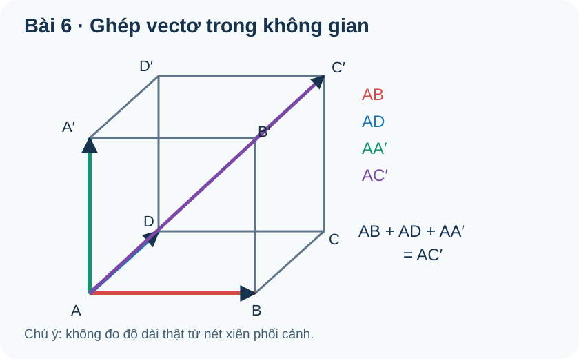
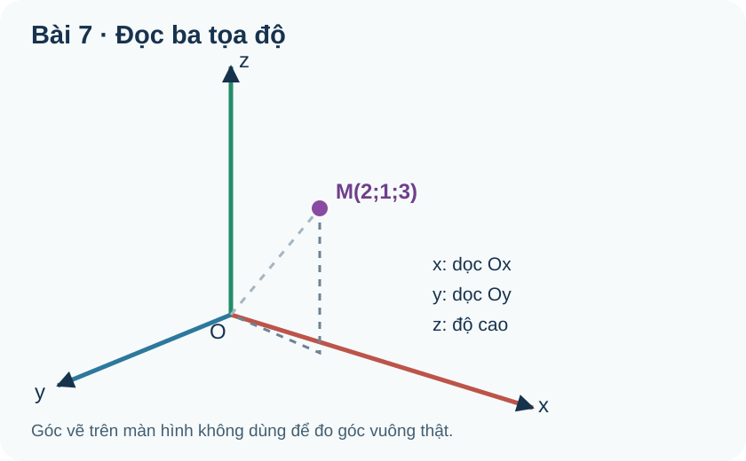
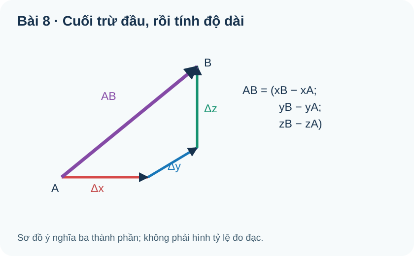
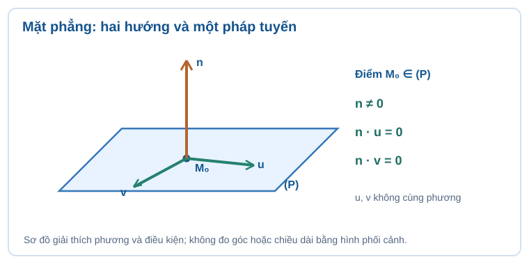
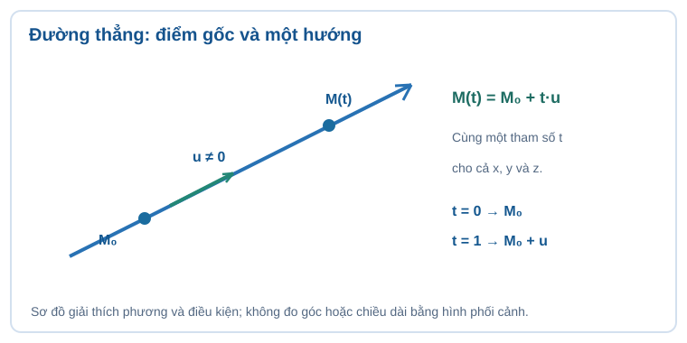
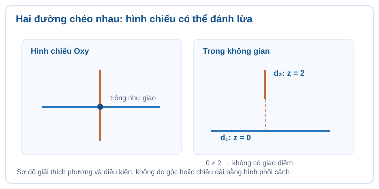
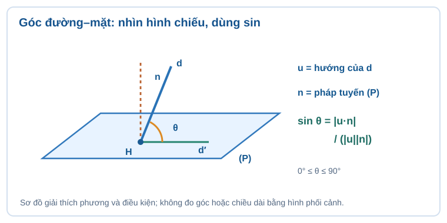
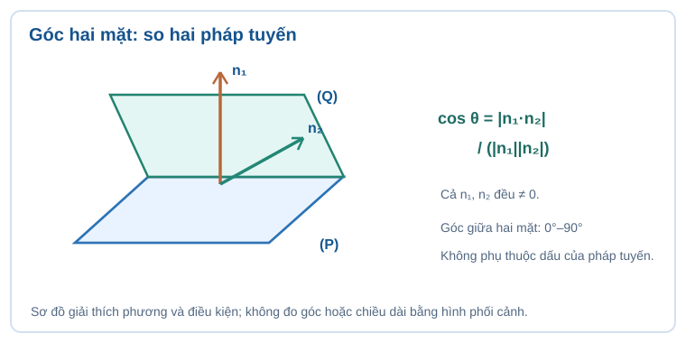
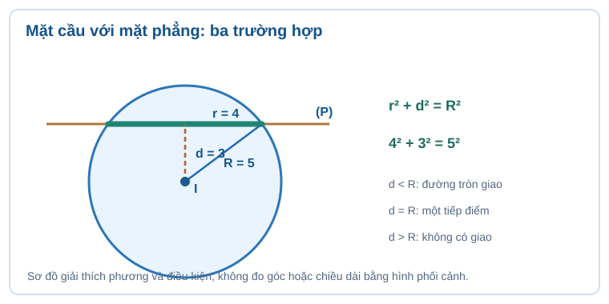
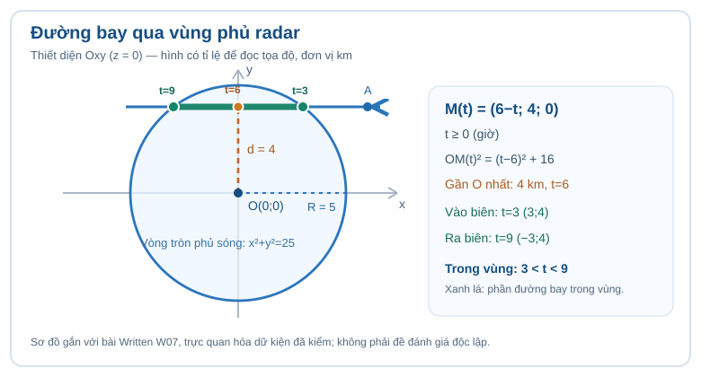

# Chuyên đề 18 — Phương pháp tọa độ trong không gian (Oxyz)

<!-- AUTHOR_ONLY_STATUS: AUTHORING_DRAFT_Q18_PENDING; NOT_CONTENT_READY; STANDARD=SLM-THPT-QUALITY-ONE v3.1.0 Q01-Q18; PLAN22-18_STUDY_ONLY; RUNTIME_TOPIC_ID=UNASSIGNED_OWNER_DECISION; B14_SBT_PRINTED_P25_SOURCE_GAP; G12_CHV_PNG_VISUAL_LABEL_QA_PENDING. -->

<!-- AUTHOR_ONLY_SOURCE_CUSTODY:
G12 KNTT CHII source public Git blob 856a37bd16d2746ffc2e12906de18d1f4338a3b6 (16 S1 outcomes, 64 SGK canonical pointers).
G12 KNTT CHV source public Git blob 11eb2834cfdb4a24685157f84666c2bb0767970a (24 outcomes, 96 SGK canonical pointers).
Exact source crosswalk blob 7cba588cfe60d3675df99d8aa7e4b9275da9690e; source matrix file Temp_TOPIC18_R01_S1_40_OUTCOME_160_SGK_CANONICAL_CROSSWALK_20261114.md.
SBT CHV B14 printed p25 missing in original scanned source, exercise 5.6 and 5.7 exact source→outcome mapping NOT reconstructed; DELTA_D_SOURCE_GAP scoped, no fake SGK review parity.
NotebookLM Gemini prose reference old Drive Temp_TOPIC_09_VECTO_VA_PHUONG_PHAP_TOA_DO_TRONG_KHONG_GIAN_O.md is DRAFT_NOT_REVIEWED; do not import incomplete B08/B17 scope or SOURCE_PENDING. Owner Issue #851 editorial only, not second standard.
AUTHOR_ONLY_SOURCE_CUSTODY_END -->

**Vì sao cần học?** Một chiếc máy bay được chỉ bằng tọa độ, nhưng một đường bay lại có vô số vị trí. Một bức tường hay một mặt cầu cũng chứa vô số điểm. Nếu tìm được đúng điểm gốc, hướng, pháp tuyến hoặc bán kính, ta sẽ chuyển câu hỏi ba chiều thành phép tính có thể kiểm lại từng bước. Bài học bắt đầu bằng độ dời và ba tọa độ, rồi đi sang đường thẳng, mặt phẳng, góc và mặt cầu; không cần hoàn thành Chuyên đề 13 để hiểu phần bắt buộc của CĐ18.

**Cách học độc lập:** Mỗi outcome có giải thích tự nhiên trước công thức, ví dụ vì sao chọn cách giải, Tự thử có đáp án chỉ tự mở và đường D6. Luyện tập với lời giải sau khi tự làm. Tự kiểm tra cuối chuyên đề công khai chỉ tự đối chiếu; không thay đề đánh giá độc lập, không có quyền ghi Mastery. Nội dung SGK nguyên bản chỉ tham chiếu `item_id` tại ma trận, không sao chép câu SGK.

## 1. Kiến thức

### Phần A — Từ độ dời đến tọa độ Oxyz

### Chặng A1 — Mũi tên tự do và quy tắc ghép đường đi

**Đọc hình:** Hãy chỉ điểm A, theo lần lượt ba hướng AB, AD, AA′ và xác định C′. Đường chéo AC′ là độ dời tổng hợp; không dùng độ dài nét xiên trên màn hình để tính độ dài thật.

<!-- AUTHOR_VISUAL_PROVENANCE: docs/assets/images/thpt/FIG-G12-CHII-B06-R00.svg; EXACT_SOURCE_BLOB: 26e388d873521aa5b0bae945343e69357490ec16; ORIGINAL_SOURCE_REUSED_NOT_DUPLICATED; SVG_LABELS_SOURCE_VERIFIED -->

#### 1. Nhận diện vectơ không gian, độ dài, hướng, vectơ-không; điều kiện: Đầu/cuối; vectơ-không không có hướng xác định

<!-- LESSON_ID: TOP18-M01; OUTCOME_ID: TOP18-O01; S1_ORIGINAL_OUTCOME: G12-CHII-B06-O01 -->

**Ý nghĩa trước công thức.** Một vectơ biểu diễn độ dời có hướng từ điểm đầu đến điểm cuối. Ta có thể tịnh tiến mũi tên song song mà không đổi vectơ; vì thế vectơ không gắn với vị trí tuyệt đối. Vectơ-không có độ dài 0 và không xác định một hướng riêng, nên không dùng nó để đo góc.

**Ví dụ suy luận.** Nếu A,B,C thẳng hàng và AB,BC cùng hướng thì khi đi A→B rồi B→C, ta thu được độ dời A→C. Khi A trùng B, vectơ AB là vectơ-không dù hai điểm mang cùng vị trí.

**Tự thử trước khi mở lời giải.** A trùng B. Vectơ AB có độ dài và hướng thế nào?

<!-- ITEM_ID: THPT-TOP18-T01; ROLE: TOPIC_FIRST_TRY; PRIMARY_OUTCOME: TOP18-O01 -->

Tự mở đối chiếu

Độ dài bằng 0; không có hướng xác định. Không gán góc riêng cho vectơ-không.

**Nếu chưa đúng (D6):** Không suy hướng từ nét vẽ, kiểm điểm đầu/cuối; vectơ-không không được đưa vào công thức góc.

#### 2. Phân biệt bằng nhau, đối nhau, cùng phương/cùng hướng; điều kiện: Bằng nhau cần cùng hướng và cùng độ dài

<!-- LESSON_ID: TOP18-M02; OUTCOME_ID: TOP18-O02; S1_ORIGINAL_OUTCOME: G12-CHII-B06-O02 -->

**Ý nghĩa trước công thức.** Hai vectơ bằng nhau phải cùng hướng và cùng độ dài; chỉ cùng độ dài chưa đủ. Hai vectơ đối nhau có cùng độ dài nhưng ngược hướng. 'Cùng phương' nói về giá song song hoặc trùng nhau, không tự khẳng định cùng hướng.

**Ví dụ suy luận.** Trên hình bình hành ABCD, vectơ AB bằng vectơ DC; vectơ AB đối vectơ CD. Cùng hai cạnh nhưng đổi thứ tự đầu–cuối thì đảo chiều, không đổi độ dài.

**Tự thử trước khi mở lời giải.** Trong hình bình hành ABCD, vectơ AB có bằng vectơ CD không?

<!-- ITEM_ID: THPT-TOP18-T02; ROLE: TOPIC_FIRST_TRY; PRIMARY_OUTCOME: TOP18-O02 -->

Tự mở đối chiếu

Không. AB và CD đối nhau; AB bằng DC.

**Nếu chưa đúng (D6):** Hãy vẽ mũi tên đầu/cuối thay vì so sánh riêng độ dài.

#### 3. Dựng và biến đổi tổng, hiệu theo tam giác/hình bình hành/hình hộp; điều kiện: Đọc đường đi và thứ tự mũi tên

<!-- LESSON_ID: TOP18-M03; OUTCOME_ID: TOP18-O03; S1_ORIGINAL_OUTCOME: G12-CHII-B06-O03 -->

**Ý nghĩa trước công thức.** Cộng vectơ là ghép các độ dời, không cộng số đo chiều dài tùy ý. Quy tắc ba điểm AB+BC=AC phản ánh đi liên tiếp; trong hình hộp, tổng ba cạnh kề ở A đưa đến đỉnh đối diện C′.

**Ví dụ suy luận.** Trong hình hộp ABCD.A′B′C′D′, đi A→B, rồi B→C, rồi C→C′ có cùng độ dời với A→C′. Vì AB+AD=AC và AC+AA′=AC′, suy AB+AD+AA′=AC′.

**Tự thử trước khi mở lời giải.** Tính dạng rút gọn của vectơ PQ + vectơ QR.

<!-- ITEM_ID: THPT-TOP18-T03; ROLE: TOPIC_FIRST_TRY; PRIMARY_OUTCOME: TOP18-O03 -->

Tự mở đối chiếu

Vectơ PR theo quy tắc ba điểm, miễn các điểm được lấy đúng thứ tự.

**Nếu chưa đúng (D6):** Nếu không ghép được đầu của mũi tên thứ hai vào cuối mũi tên thứ nhất, hãy tịnh tiến vectơ rồi mới cộng.

#### 4. Hiểu và sử dụng phép nhân vectơ với số thực; điều kiện: Độ dài, hướng, k=0 và đường thẳng song song

<!-- LESSON_ID: TOP18-M04; OUTCOME_ID: TOP18-O04; S1_ORIGINAL_OUTCOME: G12-CHII-B06-O04 -->

**Ý nghĩa trước công thức.** Nhân vectơ với số k thay đổi độ dài theo |k|, cùng hướng nếu k>0, ngược hướng nếu k<0 và tạo vectơ-không nếu k=0. Điều này giải thích tại sao nhân 3 biểu thị ba lần độ dời cùng hướng, còn nhân −1 là đảo chiều.

**Ví dụ suy luận.** Nếu vectơ u dài 2 m về hướng Bắc, −3u dài 6 m về hướng Nam. Không viết độ dài −6 m; độ dài luôn không âm.

**Tự thử trước khi mở lời giải.** Vectơ u khác không, 0u có cùng hướng u không?

<!-- ITEM_ID: THPT-TOP18-T04; ROLE: TOPIC_FIRST_TRY; PRIMARY_OUTCOME: TOP18-O04 -->

Tự mở đối chiếu

Không. 0u là vectơ-không, không có hướng xác định.

**Nếu chưa đúng (D6):** Nếu lẫn dấu và độ dài, tách riêng: độ dài nhân |k|, chiều quyết định theo dấu k.

#### 5. Giải thích góc và tích vô hướng của hai vectơ khác không; điều kiện: Góc không định nghĩa nếu một vectơ bằng 0

<!-- LESSON_ID: TOP18-M05; OUTCOME_ID: TOP18-O05; S1_ORIGINAL_OUTCOME: G12-CHII-B06-O05 -->

**Ý nghĩa trước công thức.** Tích vô hướng đo phần 'đi cùng phương' của hai vectơ; nó dương khi góc nhọn, âm khi góc tù và bằng 0 khi vuông góc. Công thức u·v=|u||v|cosφ đúng cho mọi vectơ, nhưng góc φ chỉ được định nghĩa khi hai vectơ khác không.

**Ví dụ suy luận.** Hai lực vuông góc có tích vô hướng 0 không có nghĩa chúng bằng vectơ-không. Chỉ là không có thành phần theo hướng của nhau.

**Tự thử trước khi mở lời giải.** Hai vectơ khác không vuông góc; tích vô hướng bằng bao nhiêu?

<!-- ITEM_ID: THPT-TOP18-T05; ROLE: TOPIC_FIRST_TRY; PRIMARY_OUTCOME: TOP18-O05 -->

Tự mở đối chiếu

Bằng 0 vì cos90°=0.

**Nếu chưa đúng (D6):** Nếu một vectơ bằng 0, tích vô hướng vẫn bằng 0 nhưng không dùng phép chia cho tích độ dài để tìm cos góc.

#### 6. Giải quyết bài hình học/lực bằng tổ hợp vectơ và tích vô hướng; điều kiện: Chỉ chọn tích vô hướng khi có góc hoặc hình chiếu

<!-- LESSON_ID: TOP18-M06; OUTCOME_ID: TOP18-O06; S1_ORIGINAL_OUTCOME: G12-CHII-B06-O06 -->

**Ý nghĩa trước công thức.** Bài lực ba chiều thường hỏi hợp lực, hình chiếu hay công sinh ra bởi một lực. Chọn phép cộng vectơ khi ghép các tác dụng, chọn tích vô hướng khi đo đóng góp của lực dọc theo chuyển dời; không cộng độ lớn nếu các lực khác hướng.

**Ví dụ suy luận.** Hai lực cùng điểm có độ lớn 3 N và 4 N vuông góc thì hợp lực dài 5 N theo Pitago. Nếu cùng hướng, hợp lực 7 N; vì thế phải đọc hướng trước khi tính.

**Tự thử trước khi mở lời giải.** Hai lực 6 N và 8 N vuông góc, độ lớn hợp lực?

<!-- ITEM_ID: THPT-TOP18-T06; ROLE: TOPIC_FIRST_TRY; PRIMARY_OUTCOME: TOP18-O06 -->

Tự mở đối chiếu

10 N vì bình phương độ lớn tổng bằng 6²+8².

**Nếu chưa đúng (D6):** D6: phân loại bài hỏi tổng vectơ hay hình chiếu; luôn có sơ đồ phương và đơn vị.

### Chặng A2 — Ba trục làm nên một vị trí có thể kiểm tra

**Từ mũi tên đến vị trí thật.** Hãy theo dõi một chiếc drone đang bay trong kho: nếu gốc O đặt ở một góc nhà, ta chọn Ox hướng Đông, Oy hướng Bắc, Oz hướng lên. Drone bắt đầu ở **A=(1;1;2)** (m). Thay vì mô tả “hơi lệch sang phải và khá cao”, ba tọa độ cho biết chính xác ba độ dời có dấu. Đến cuối chuyên đề, chính drone này sẽ giúp ta nối vectơ vận tốc, phương trình đường bay, mặt phẳng và hình cầu trong một bài toán.

**Tự quan sát trước công thức:** Trong mô hình công khai phía dưới, giữ x,y cố định và chỉ kéo z. Điểm M thay đổi độ cao nhưng chân H chiếu xuống mặt Oxy vẫn có tọa độ (x;y;0). Đây là ý nghĩa cụ thể của hình chiếu vuông góc, không phải một công thức cần thuộc lòng trước khi hiểu.

[Mở mô hình khám phá tọa độ và mặt cầu](Temp_THPT_TOPIC18_OXYZ_SPHERE_GEOMETRY_R00_20261114.html) — chọn phần **“Một điểm M có ba tọa độ”**. Mô hình chỉ giúp hình dung, không thay bước Tự thử và không ghi điểm.

<!-- AUTHOR_INTERACTIVE_PLACEMENT: MODEL_ID=SLM-TOP18-OXYZ-GEOMETRY-R00; SCENE=XYZ_PROJECTION; OUTCOMES=TOP18-O07/TOP18-O08/TOP18-O15; PUBLIC_DISCOVERY_NO_MASTERY -->

**Đọc hình:** Tìm O và ba trục x,y,z, rồi đọc M(2;1;3). Các nét đứt chỉ dẫn từ M xuống mặt Oxy: tọa độ z là độ cao theo trục chứ không phải độ dài đo trên giấy.

<!-- AUTHOR_VISUAL_PROVENANCE: docs/assets/images/thpt/FIG-G12-CHII-B07-R00.svg; EXACT_SOURCE_BLOB: 979ca912e99fdadfc4e91ae0edad5db34fc13928; ORIGINAL_SOURCE_REUSED_NOT_DUPLICATED; SVG_LABELS_SOURCE_VERIFIED -->

#### 7. Đọc hệ trục Oxyz, vectơ đơn vị, ba mặt phẳng tọa độ; điều kiện: Không nhầm ba trục với hình chiếu xiên của hình vẽ

<!-- LESSON_ID: TOP18-M07; OUTCOME_ID: TOP18-O07; S1_ORIGINAL_OUTCOME: G12-CHII-B07-O01 -->

**Ý nghĩa trước công thức.** Ba trục Ox,Oy,Oz vuông góc đôi một giúp định vị một điểm trong phòng bằng ba số. Các mặt phẳng tọa độ Oxy, Oyz, Oxz là ba mặt khác nhau: z=0, x=0, y=0. Hình phối cảnh không phải thước để đọc chiều sâu.

**Ví dụ suy luận.** Điểm nằm ở mặt Oxy thì z=0 dù hình vẽ giấy có thể cho cảm giác nó ở cao. Trục Oz có x=y=0, không phải x=z=0.

**Tự thử trước khi mở lời giải.** Điểm M=(2,−1,0) thuộc mặt phẳng tọa độ nào?

<!-- ITEM_ID: THPT-TOP18-T07; ROLE: TOPIC_FIRST_TRY; PRIMARY_OUTCOME: TOP18-O07 -->

Tự mở đối chiếu

Thuộc Oxy vì z=0.

**Nếu chưa đúng (D6):** Gắn điều kiện bằng 0 với tên của tọa độ bị thiếu, không suy vị trí chỉ từ hình xiên.

#### 8. Viết tọa độ điểm/vectơ theo ba vectơ đơn vị; điều kiện: Tọa độ phụ thuộc hệ quy chiếu đã chọn

<!-- LESSON_ID: TOP18-M08; OUTCOME_ID: TOP18-O08; S1_ORIGINAL_OUTCOME: G12-CHII-B07-O02 -->

**Ý nghĩa trước công thức.** Tọa độ của một điểm là ba số xác định vị trí so với gốc O; tọa độ vectơ là ba thành phần dịch chuyển theo cùng trục. Cùng bộ ba số vẫn là hai đối tượng khác nhau, dù vectơ OM có tọa độ trùng tọa độ của điểm M.

**Ví dụ suy luận.** M=(2,−1,3) thì vectơ OM=(2,−1,3). Nhưng chuyển gốc tọa độ sẽ đổi tọa độ điểm M, còn độ dời của một vectơ tự do không đổi trong các trục cùng hướng.

**Tự thử trước khi mở lời giải.** Điểm M(1,2,3), tọa độ vectơ OM?

<!-- ITEM_ID: THPT-TOP18-T08; ROLE: TOPIC_FIRST_TRY; PRIMARY_OUTCOME: TOP18-O08 -->

Tự mở đối chiếu

(1,2,3) trong cùng hệ Oxyz.

**Nếu chưa đúng (D6):** Nhắc lại điểm cần gốc, vectơ cần thành phần dịch chuyển; không tự đổi dấu khi đọc thành phần âm.

#### 9. Mô hình hóa điểm thực tế và kiểm tra dấu tọa độ; điều kiện: Có thể chọn hệ quy chiếu thuận tiện, ghi đơn vị

<!-- LESSON_ID: TOP18-M09; OUTCOME_ID: TOP18-O09; S1_ORIGINAL_OUTCOME: G12-CHII-B07-O03 -->

**Ý nghĩa trước công thức.** Ứng dụng Oxyz bắt đầu bằng chọn gốc, hướng dương và đơn vị. Một tọa độ âm không có nghĩa khoảng cách âm; nó chỉ nằm ở phía đối diện của trục. Bài radar, kho vận hoặc đồ họa đều cần tuyên bố hệ quy chiếu trước.

**Ví dụ suy luận.** Chọn O ở góc nhà, Ox hướng Đông, Oy hướng Bắc, Oz hướng lên. Một đèn ở (2,−1,3) m nằm lệch 1 m về Nam và cao 3 m; không phải thấp hơn sàn.

**Tự thử trước khi mở lời giải.** Trong hệ Ox Đông, Oy Bắc, Oz lên, N=(−4,3,2) m nằm về phía nào của O?

<!-- ITEM_ID: THPT-TOP18-T09; ROLE: TOPIC_FIRST_TRY; PRIMARY_OUTCOME: TOP18-O09 -->

Tự mở đối chiếu

4 m về Tây, 3 m về Bắc, cao 2 m.

**Nếu chưa đúng (D6):** Nếu quên quy ước dấu, vẽ ba trục và ghi rõ đơn vị trước khi giải.

#### 10. Tính tọa độ vectơ khi biết tọa độ hai đầu mút; điều kiện: Lấy cuối trừ đầu, không đảo chiều

<!-- LESSON_ID: TOP18-M10; OUTCOME_ID: TOP18-O10; S1_ORIGINAL_OUTCOME: G12-CHII-B07-O04 -->

**Ý nghĩa trước công thức.** Vectơ từ A đến B được tính bằng cuối trừ đầu theo từng trục: AB=(xB−xA,yB−yA,zB−zA). Công thức là bản dịch đại số của việc bắt đầu ở A rồi di chuyển tới B; đổi AB thành BA thì toàn bộ dấu đảo.

**Ví dụ suy luận.** A=(1,2,−1), B=(4,−2,3) cho AB=(3,−4,4). Kiểm bằng A+AB=B theo từng thành phần.

**Tự thử trước khi mở lời giải.** A=(2,0,−1), B=(5,−2,3). Tính vectơ AB.

<!-- ITEM_ID: THPT-TOP18-T10; ROLE: TOPIC_FIRST_TRY; PRIMARY_OUTCOME: TOP18-O10 -->

Tự mở đối chiếu

(3,−2,4).

**Nếu chưa đúng (D6):** Thường xuyên thử lấy tọa độ A cộng kết quả AB để xem có trở về B không.

### Chặng A3 — Phép toán tọa độ và độ dài

**Khi điểm bắt đầu chuyển động.** Drone từ A=(1;1;2) m, mỗi giây tiến **1 m theo Ox, 0 m theo Oy và 1 m theo Oz**. Ta ghi vectơ vận tốc v=(1;0;1) m/s: cùng một vectơ cho biết *hướng và tốc độ theo từng trục*. Sau t giây, vị trí trở thành M(t)=(1+t;1;2+t). Chỉ cần thử t=0 và t=1 là kiểm được: drone từ A tới (2;1;3), thay đổi (1;0;1). Nhờ vậy, phép cộng vectơ không còn là một bảng quy tắc rời rạc.

**Đọc hình:** Đọc ba nhãn Δx,Δy,Δz từ A sang B; từng thành phần là tọa độ B trừ tọa độ A. Đừng lấy tổng ba thành phần làm độ dài AB: còn phải áp dụng Pitago 3D.

<!-- AUTHOR_VISUAL_PROVENANCE: docs/assets/images/thpt/FIG-G12-CHII-B08-R00.svg; EXACT_SOURCE_BLOB: 13445da079245a556a08e7a57069d9987097a0be; ORIGINAL_SOURCE_REUSED_NOT_DUPLICATED; SVG_LABELS_SOURCE_VERIFIED -->

#### 11. Cộng, trừ, nhân số các vectơ theo từng tọa độ; điều kiện: Không trộn quy tắc tọa độ với công thức khoảng cách

<!-- LESSON_ID: TOP18-M11; OUTCOME_ID: TOP18-O11; S1_ORIGINAL_OUTCOME: G12-CHII-B08-O01 -->

**Ý nghĩa trước công thức.** Phép cộng, trừ và nhân số trên vectơ trong ba trục vuông góc thực hiện theo từng thành phần. Đây là phép cộng độ dời độc lập trên Ox,Oy,Oz chứ không cộng ba độ dài của vectơ.

**Ví dụ suy luận.** u=(1,2,−1), v=(−2,0,3) thì u+v=(−1,2,2); 2u−v=(4,4,−5).

**Tự thử trước khi mở lời giải.** u=(1,−2,3), v=(2,0,−1); u+v?

<!-- ITEM_ID: THPT-TOP18-T11; ROLE: TOPIC_FIRST_TRY; PRIMARY_OUTCOME: TOP18-O11 -->

Tự mở đối chiếu

(3,−2,2).

**Nếu chưa đúng (D6):** Không nhân chéo tọa độ khi cộng; làm theo từng trục và kiểm dấu số âm.

#### 12. Kiểm tra cùng phương qua bội số và nhận diện trường hợp zero; điều kiện: Cùng phương nếu a=k b hoặc b=k a; không chia tọa độ bằng 0

<!-- LESSON_ID: TOP18-M12; OUTCOME_ID: TOP18-O12; S1_ORIGINAL_OUTCOME: G12-CHII-B08-O02 -->

**Ý nghĩa trước công thức.** Hai vectơ khác không cùng phương nếu một vectơ là bội của vectơ kia. Đừng chia các tọa độ tùy tiện khi có thành phần bằng 0; cách chắc chắn là thử k sao cho u=kv ở *tất cả* ba vị trí. Vectơ-không cần xử lí theo định nghĩa quy ước chứ không chia để tìm tỉ số.

**Ví dụ suy luận.** u=(2,−4,0),v=(−1,2,0), ta có u=−2v nên cùng phương ngược hướng. Nếu v=(−1,2,1), quan hệ vỡ ở tọa độ thứ ba.

**Tự thử trước khi mở lời giải.** u=(3,6,0), v=(1,2,0) có cùng phương không?

<!-- ITEM_ID: THPT-TOP18-T12; ROLE: TOPIC_FIRST_TRY; PRIMARY_OUTCOME: TOP18-O12 -->

Tự mở đối chiếu

Có, u=3v và đều khác không.

**Nếu chưa đúng (D6):** Không chia cho 0; kiểm cả ba thành phần, nếu một vectơ là vectơ-không thì nói rõ trường hợp riêng.

#### 13. Tính trung điểm, trọng tâm tam giác bằng tọa độ; điều kiện: Trung bình theo từng thành phần, không cộng độ dài

<!-- LESSON_ID: TOP18-M13; OUTCOME_ID: TOP18-O13; S1_ORIGINAL_OUTCOME: G12-CHII-B08-O03 -->

**Ý nghĩa trước công thức.** Trung điểm và trọng tâm của tam giác là trung bình *tọa độ*, không phải trung bình khoảng cách tới gốc. Vì mỗi trục độc lập, trung điểm M=(A+B)/2; trọng tâm G=(A+B+C)/3 theo từng thành phần.

**Ví dụ suy luận.** A=(0,2,4),B=(2,0,0) có M=(1,1,2). Không lấy trung bình độ dài OA và OB.

**Tự thử trước khi mở lời giải.** Trung điểm A=(0,0,2), B=(2,4,0)?

<!-- ITEM_ID: THPT-TOP18-T13; ROLE: TOPIC_FIRST_TRY; PRIMARY_OUTCOME: TOP18-O13 -->

Tự mở đối chiếu

M=(1,2,1).

**Nếu chưa đúng (D6):** Nếu kết quả bất ngờ, lấy 2M−A phải thu B; với trọng tâm G, 3G=A+B+C.

#### 14. Tính tích vô hướng, kiểm tra vuông góc và góc giữa vectơ; điều kiện: Cos chỉ dùng khi hai vectơ khác không, cắt ngưỡng [-1,1] nếu làm tròn

<!-- LESSON_ID: TOP18-M14; OUTCOME_ID: TOP18-O14; S1_ORIGINAL_OUTCOME: G12-CHII-B08-O04 -->

**Ý nghĩa trước công thức.** Tích vô hướng trong hệ trực chuẩn Oxyz là u·v=uxvx+uyvy+uzvz; chia cho |u||v| chỉ khi hai vectơ khác không mới suy góc. Vuông góc nghĩa tích bằng 0; góc giữa các vectơ có thể tù, khác góc không tù giữa hai đường thẳng.

**Ví dụ suy luận.** u=(1,2,0),v=(2,−1,0), tích 1·2+2·(−1)+0=0, nên hai vectơ khác không vuông góc.

**Tự thử trước khi mở lời giải.** u=(1,1,0),v=(1,−1,0). Góc giữa chúng?

<!-- ITEM_ID: THPT-TOP18-T14; ROLE: TOPIC_FIRST_TRY; PRIMARY_OUTCOME: TOP18-O14 -->

Tự mở đối chiếu

90° vì tích vô hướng 1−1=0 và cả hai khác không.

**Nếu chưa đúng (D6):** Khi tìm cos, kiểm |u|,|v|>0; nếu làm tròn dữ liệu máy, cos chỉ nằm trong [−1,1].

#### 15. Tính độ dài vectơ và khoảng cách hai điểm; điều kiện: Căn tổng bình phương hiệu, giá trị không âm

<!-- LESSON_ID: TOP18-M15; OUTCOME_ID: TOP18-O15; S1_ORIGINAL_OUTCOME: G12-CHII-B08-O05 -->

**Ý nghĩa trước công thức.** Độ dài vectơ dùng căn tổng bình phương ba thành phần; khoảng cách AB là độ dài vectơ AB. Điều này nối Pitago phẳng thành ba phương vuông góc, kết quả luôn không âm.

**Ví dụ suy luận.** A=(1,2,3),B=(4,6,3) có AB=(3,4,0) nên AB=√(9+16)=5.

**Tự thử trước khi mở lời giải.** Độ dài vectơ u=(2,−1,2)?

<!-- ITEM_ID: THPT-TOP18-T15; ROLE: TOPIC_FIRST_TRY; PRIMARY_OUTCOME: TOP18-O15 -->

Tự mở đối chiếu

√(4+1+4)=3.

**Nếu chưa đúng (D6):** Nếu căn ra số âm hoặc thiếu tọa độ z, quay lại định lí Pitago ba chiều.

#### 16. Lập mô hình chuyển động / bố trí không gian với tọa độ; điều kiện: Nêu gốc, trục, đơn vị, kiểm tra nghiệm vật lý

<!-- LESSON_ID: TOP18-M16; OUTCOME_ID: TOP18-O16; S1_ORIGINAL_OUTCOME: G12-CHII-B08-O06 -->

**Ý nghĩa trước công thức.** Mô hình chuyển động thẳng đều có vị trí M(t)=M0+t·v, ba tọa độ thay đổi độc lập theo tốc độ trên từng trục. Đơn vị tốc độ và thời gian phải tương thích; kiểm t≥0 nếu bài chỉ nói chuyển động sau khi xuất phát.

**Ví dụ suy luận.** Drone xuất phát A=(0,0,5) m, v=(2,−1,0) m/s. Sau 3 s, ở (6,−3,5) m: cao độ không đổi.

**Tự thử trước khi mở lời giải.** M0=(1,0,2), v=(0,3,−1), t=2. Tọa độ M(2)?

<!-- ITEM_ID: THPT-TOP18-T16; ROLE: TOPIC_FIRST_TRY; PRIMARY_OUTCOME: TOP18-O16 -->

Tự mở đối chiếu

(1,6,0).

**Nếu chưa đúng (D6):** Nếu thấy độ cao âm mà vật không được dưới mặt đất, kiểm mốc t hoặc chiều dương và giới hạn vật lí.

— Phần B: bức tường, đường bay, góc và mặt cầu

### Chặng B1 — Mặt phẳng: một điểm và một phương vuông góc

**Từ vị trí một vật đến cả một bức tường.** Ở chặng trước, ta biết drone sau t giây ở M(t)=(1+t;1;2+t). Bây giờ xét tấm chắn có phương trình **(P): x+y+z=6**. Phương trình không cho một điểm đơn lẻ: bất cứ điểm nào có tổng ba tọa độ bằng 6 đều nằm trên tấm chắn ấy. Vectơ n=(1;1;1) vuông góc với mặt, nên được gọi là *pháp tuyến*. Hãy thử thế M(0)=(1;1;2): tổng là 4, chưa thuộc tấm chắn. Bao giờ tổng đạt 6? Ta sẽ tìm ngay khi học phương trình đường thẳng.

**Đọc hình:** Chỉ M₀ thuộc (P), hai vectơ u,v không cùng phương và pháp tuyến n khác 0. Kiểm n·u=n·v=0; hình phối cảnh không dùng để đo góc.

<!-- AUTHOR_TOPIC18_WHITE_SVG: docs/assets/images/thpt/FIG-TOP18-B14-NORMAL-WHITE-R00.svg; NEW_SOURCE_BLOB: 353ab2fb6f070c03e7895706fd68362c73904fc7; WHITE_BACKGROUND=YES; ORIGINAL_SGK_PNG_REFERENCE_ONLY=Temp_FIG-G12-CHV-B14-R00.png; ORIGINAL_PNG_BLOB=5763cbd3c555a40e2644e9666611a7b4ecaa4070; ORIGINAL_PNG_NOT_VISUALLY_QA_VERIFIED -->

#### 17. Vectơ pháp tuyến từ hai vectơ chỉ phương 

<!-- LESSON_ID: TOP18-M17; OUTCOME_ID: TOP18-O17; S1_ORIGINAL_OUTCOME: G12-CHV-B14-O01; SCOPE: G12_CHV -->

**Hình thành ý nghĩa.** Một mặt phẳng có vô số hướng nằm trong nó; một vectơ pháp tuyến n khác 0 phải vuông góc với mọi hướng đó. Nếu đã biết hai vectơ chỉ phương u,v **không cùng phương**, tích có hướng u×v là một cách dựng n. Tích có hướng bằng 0 khi u,v cùng phương, khi ấy chưa xác định được pháp tuyến mặt bằng cặp vectơ ấy.

**Ví dụ suy luận từng bước.** u=(1,0,1), v=(0,1,1) độc lập. Theo công thức tích có hướng, n=u×v=(−1,−1,1). Kiểm n·u=−1+1=0 và n·v=−1+1=0; vì n≠0, có thể dùng n làm pháp tuyến.

**Tự thử trước lời giải.** u=(1,0,0),v=(0,1,0) có pháp tuyến đơn giản nào?

<!-- ITEM_ID: THPT-TOP18-T17; ROLE: TOPIC_FIRST_TRY; PRIMARY_OUTCOME: TOP18-O17 -->

Tự mở đối chiếu

n=(0,0,1), vì vuông góc cả u lẫn v.

**D6 — Khi chưa đúng:** Nếu tích có hướng 0, phải kiểm hai hướng có cùng phương hay không; không dùng vectơ 0 làm pháp tuyến.

#### 18. Viết phương trình qua một điểm và một pháp tuyến 

<!-- LESSON_ID: TOP18-M18; OUTCOME_ID: TOP18-O18; S1_ORIGINAL_OUTCOME: G12-CHV-B14-O02; SCOPE: G12_CHV -->

**Hình thành ý nghĩa.** Một mặt phẳng là tập các điểm M có độ dời từ điểm M0 nằm vuông góc với một pháp tuyến n khác 0. Điều kiện n·M0M=0 dẫn đến A(x−x0)+B(y−y0)+C(z−z0)=0. Vì vậy cần một điểm đi qua và một hướng pháp tuyến, không thể chỉ biết n để xác định vị trí duy nhất.

**Ví dụ suy luận từng bước.** M0=(1,0,−1),n=(2,−1,3). Thay vào 2(x−1)−(y−0)+3(z+1)=0, thu 2x−y+3z+1=0. Thử điểm M0: 2−3+1=0.

**Tự thử trước lời giải.** M0=(0,0,2), n=(0,0,1). Viết mặt phẳng.

<!-- ITEM_ID: THPT-TOP18-T18; ROLE: TOPIC_FIRST_TRY; PRIMARY_OUTCOME: TOP18-O18 -->

Tự mở đối chiếu

z−2=0, tức z=2.

**D6 — Khi chưa đúng:** Không để pháp tuyến n=0; thay tọa độ điểm đã cho vào phương trình để phát hiện lỗi dấu.

#### 19. Mặt phẳng qua ba điểm không thẳng hàng 

<!-- LESSON_ID: TOP18-M19; OUTCOME_ID: TOP18-O19; S1_ORIGINAL_OUTCOME: G12-CHV-B14-O03; SCOPE: G12_CHV -->

**Hình thành ý nghĩa.** Ba điểm phân biệt chưa đủ xác định một mặt: chúng phải **không thẳng hàng**. Lấy AB và AC không cùng phương, dựng n=AB×AC rồi áp dụng phương trình mặt qua A. Nếu ba điểm thẳng hàng, tích có hướng bằng 0 và tồn tại vô số mặt phẳng qua đường đó.

**Ví dụ suy luận từng bước.** A=(1,0,0), B=(0,1,0), C=(0,0,1) cho AB=(−1,1,0), AC=(−1,0,1). Một n=(1,1,1) vuông cả hai; mặt phẳng qua A là x+y+z−1=0.

**Tự thử trước lời giải.** Ba giao điểm trục A=(2,0,0),B=(0,2,0),C=(0,0,2). Mặt phẳng?

<!-- ITEM_ID: THPT-TOP18-T19; ROLE: TOPIC_FIRST_TRY; PRIMARY_OUTCOME: TOP18-O19 -->

Tự mở đối chiếu

x+y+z=2. Ba điểm không thẳng hàng.

**D6 — Khi chưa đúng:** Kiểm AB,AC có cùng phương không trước khi dựng n, và thay đủ ba điểm vào đáp án.

#### 20. Mặt phẳng chứa hai hướng hoặc một trục 

<!-- LESSON_ID: TOP18-M20; OUTCOME_ID: TOP18-O20; S1_ORIGINAL_OUTCOME: G12-CHV-B14-O04; SCOPE: G12_CHV -->

**Hình thành ý nghĩa.** Khi mặt phẳng chứa một đường hoặc trục, mọi vectơ chỉ phương của đường ấy phải vuông góc với pháp tuyến của mặt. Nếu mặt chứa Ox và điểm P ngoài Ox, dùng e1=(1,0,0) và OP làm hai hướng độc lập. Điều kiện 'chứa trục' mạnh hơn 'song song trục' vì mặt còn phải đi qua mọi điểm trên trục.

**Ví dụ suy luận từng bước.** Mặt chứa Ox và P=(0,1,1). Hai hướng e1=(1,0,0), OP=(0,1,1) nên một pháp tuyến n=(0,−1,1); mặt qua O là y−z=0.

**Tự thử trước lời giải.** Mặt chứa trục Oz và điểm (1,1,0). Tìm phương trình đơn giản.

<!-- ITEM_ID: THPT-TOP18-T20; ROLE: TOPIC_FIRST_TRY; PRIMARY_OUTCOME: TOP18-O20 -->

Tự mở đối chiếu

x−y=0, vì mọi điểm Oz có x=y=0 và điểm thêm cũng thỏa.

**D6 — Khi chưa đúng:** Không bỏ điều kiện chứa điểm/đường; một mặt chỉ có pháp tuyến đúng nhưng lệch vị trí vẫn sai.

#### 21. Quan hệ song song và vuông góc giữa hai mặt phẳng 

<!-- LESSON_ID: TOP18-M21; OUTCOME_ID: TOP18-O21; S1_ORIGINAL_OUTCOME: G12-CHV-B14-O05; SCOPE: G12_CHV -->

**Hình thành ý nghĩa.** Hai mặt có pháp tuyến tỉ lệ có cùng phương, nhưng có thể **trùng nhau** hoặc **song song phân biệt**; phải kiểm thêm hằng số hoặc một điểm. Hai mặt vuông góc khi hai pháp tuyến khác không có tích vô hướng bằng 0. Góc giữa mặt là góc nhỏ, không phụ thuộc dấu chọn của pháp tuyến.

**Ví dụ suy luận từng bước.** P:x+2y−z=0 và Q:2x+4y−2z+3=0 có pháp tuyến tỉ lệ nhưng không trùng vì các hệ số cả phương trình không tỉ lệ; chúng song song phân biệt.

**Tự thử trước lời giải.** P:x+y+z=1, Q:2x+2y+2z=2. Hai mặt trùng hay song song phân biệt?

<!-- ITEM_ID: THPT-TOP18-T21; ROLE: TOPIC_FIRST_TRY; PRIMARY_OUTCOME: TOP18-O21 -->

Tự mở đối chiếu

Trùng nhau do chia phương trình Q cho 2 thu đúng P.

**D6 — Khi chưa đúng:** Nếu n1∥n2, kiểm tỉ lệ cả hệ số tự do trước khi nói 'hai mặt song song phân biệt'.

#### 22. Khoảng cách từ điểm đến mặt phẳng 

<!-- LESSON_ID: TOP18-M22; OUTCOME_ID: TOP18-O22; S1_ORIGINAL_OUTCOME: G12-CHV-B14-O06; SCOPE: G12_CHV -->

**Hình thành ý nghĩa.** Khoảng cách từ điểm M đến mặt P là độ dài đường vuông góc ngắn nhất, không phải khoảng cách đến một điểm tùy ý của P. Với P:Ax+By+Cz+D=0 có n=(A,B,C) khác không, lấy trị tuyệt đối của vế trái tại M và chia độ dài pháp tuyến √(A²+B²+C²).

**Ví dụ suy luận từng bước.** M=O, P:x+2y+2z−6=0 có độ dài n=3, trị tuyệt đối −6 là 6, nên d=6/3=2.

**Tự thử trước lời giải.** Khoảng cách từ O đến mặt z=−5?

<!-- ITEM_ID: THPT-TOP18-T22; ROLE: TOPIC_FIRST_TRY; PRIMARY_OUTCOME: TOP18-O22 -->

Tự mở đối chiếu

5 đơn vị, bởi pháp tuyến (0,0,1), độ chênh z là 5.

**D6 — Khi chưa đúng:** Đừng quên trị tuyệt đối và chuẩn hóa pháp tuyến; đáp án khoảng cách phải không âm.

### Chặng B2 — Đường thẳng: điểm xuất phát và hướng chuyển động

**Tiếp tục chuyến bay đã biết.** Drone có điểm xuất phát A=(1;1;2) và hướng v=(1;0;1), do đó đường bay là M(t)=(1+t;1;2+t). Thế vào (P):x+y+z=6, ta được (1+t)+1+(2+t)=6, tức **4+2t=6**; suy ra **t=1 giây**, vị trí gặp tấm chắn **M(1)=(2;1;3)**. Kiểm lại: 2+1+3=6. Một tham số chung cho đủ ba tọa độ chính là cách giữ cho ba phép tính đang nói về *cùng một điểm trên đường bay*.

**Đọc hình:** Xác định M₀, hướng u khác 0; M(t)=M₀+t u có cùng tham số t ở đủ ba tọa độ. Tại t=0 là M₀, tại t=1 là M₀+u.

<!-- AUTHOR_TOPIC18_WHITE_SVG: docs/assets/images/thpt/FIG-TOP18-B15-LINE-WHITE-R00.svg; NEW_SOURCE_BLOB: d99c0dd13170111f1b72aededc843d64c3ada4d8; WHITE_BACKGROUND=YES; ORIGINAL_SGK_PNG_REFERENCE_ONLY=Temp_FIG-G12-CHV-B15-R00.png; ORIGINAL_PNG_BLOB=8991b0aaa4e532c0b7b8284608462b2286035733; ORIGINAL_PNG_NOT_VISUALLY_QA_VERIFIED -->

**Đọc hình:** Khung trái chiếu lên Oxy trông có giao; khung phải d₁ có z=0, d₂ có z=2 nên không giao trong không gian. Hai hướng không cùng phương thì chúng chéo nhau.

<!-- AUTHOR_TOPIC18_WHITE_SVG: docs/assets/images/thpt/FIG-TOP18-B15-SKEW-WHITE-R00.svg; NEW_SOURCE_BLOB: 1683f44f7d159081caca47152c1bf75c16440488; WHITE_BACKGROUND=YES; ORIGINAL_SGK_PNG_REFERENCE_ONLY=Temp_FIG-G12-CHV-B151-R00.png; ORIGINAL_PNG_BLOB=447205394c355531845746ccf3a2474a2e910974; ORIGINAL_PNG_NOT_VISUALLY_QA_VERIFIED -->

#### 24. Vectơ chỉ phương và phương trình tham số đường thẳng 

<!-- LESSON_ID: TOP18-M24; OUTCOME_ID: TOP18-O24; S1_ORIGINAL_OUTCOME: G12-CHV-B15-O01; SCOPE: G12_CHV -->

**Hình thành ý nghĩa.** Một đường thẳng vô hạn được mô tả bằng một điểm M0 nó đi qua và một vectơ chỉ phương u khác không. Mọi điểm trên đường có M=M0+t u với t thực. Ba tọa độ phải dùng **cùng một tham số t**; nếu mỗi tọa độ có một t khác, đó không còn là phương trình một đường cụ thể.

**Ví dụ suy luận từng bước.** M0=(1,2,3),u=(2,−1,0): x=1+2t,y=2−t,z=3. Độ cao không đổi vì thành phần chỉ phương z bằng 0.

**Tự thử trước lời giải.** Đường qua O hướng u=(1,0,2). Viết dạng tham số.

<!-- ITEM_ID: THPT-TOP18-T24; ROLE: TOPIC_FIRST_TRY; PRIMARY_OUTCOME: TOP18-O24 -->

Tự mở đối chiếu

x=t, y=0, z=2t, t∈R.

**D6 — Khi chưa đúng:** Nếu thành phần hướng bằng 0, tọa độ tương ứng là hằng, không tùy tiện bỏ phương trình đó.

#### 25. Đường thẳng qua hai điểm phân biệt 

<!-- LESSON_ID: TOP18-M25; OUTCOME_ID: TOP18-O25; S1_ORIGINAL_OUTCOME: G12-CHV-B15-O02; SCOPE: G12_CHV -->

**Hình thành ý nghĩa.** Hai điểm phân biệt A,B xác định một đường và cho vectơ chỉ phương AB=B−A khác 0. Lấy A làm điểm t=0; không cần pháp tuyến như phương trình mặt. Nếu A=B, không có hướng AB khác không để xác định duy nhất một đường.

**Ví dụ suy luận từng bước.** A=(0,1,2),B=(2,3,2), AB=(2,2,0); đường AB có x=2t,y=1+2t,z=2. Thay t=1 cho B, nên phương trình phù hợp.

**Tự thử trước lời giải.** Đường qua A=(0,0,0), B=(1,2,3) có một dạng tham số?

<!-- ITEM_ID: THPT-TOP18-T25; ROLE: TOPIC_FIRST_TRY; PRIMARY_OUTCOME: TOP18-O25 -->

Tự mở đối chiếu

x=t,y=2t,z=3t.

**D6 — Khi chưa đúng:** Nhớ A≠B, lấy đúng B−A và thử lại tọa độ cả hai điểm.

#### 26. Phương trình chính tắc và tọa độ hướng bằng 0 

<!-- LESSON_ID: TOP18-M26; OUTCOME_ID: TOP18-O26; S1_ORIGINAL_OUTCOME: G12-CHV-B15-O03; SCOPE: G12_CHV -->

**Hình thành ý nghĩa.** Phương trình chính tắc của đường thẳng cần cẩn thận khi một thành phần vectơ chỉ phương bằng 0. Chỉ những tỉ số có mẫu khác 0 mới xuất hiện; thành phần bằng 0 thành phương trình tọa độ cố định. Không bao giờ viết phép chia cho 0.

**Ví dụ suy luận từng bước.** x=1+2t,y=3,z=4−t. Với thành phần y=0 của hướng, giữ y=3 và viết (x−1)/2=(z−4)/(−1).

**Tự thử trước lời giải.** Đường x=2+t,y=−1,z=3+2t. Dạng chính tắc an toàn?

<!-- ITEM_ID: THPT-TOP18-T26; ROLE: TOPIC_FIRST_TRY; PRIMARY_OUTCOME: TOP18-O26 -->

Tự mở đối chiếu

(x−2)/1=(z−3)/2; y=−1.

**D6 — Khi chưa đúng:** D6: nhận từng thành phần hướng bằng 0 rồi giữ phương trình hằng; tỉ số có mẫu 0 là vô nghĩa.

#### 27. Kiểm điểm thuộc đường thẳng bằng một tham số 

<!-- LESSON_ID: TOP18-M27; OUTCOME_ID: TOP18-O27; S1_ORIGINAL_OUTCOME: G12-CHV-B15-O04; SCOPE: G12_CHV -->

**Hình thành ý nghĩa.** Kiểm tra điểm M thuộc đường bằng cách tìm **một** giá trị t đồng thời thỏa cả ba phương trình tham số. Nếu tọa độ x cho t1 nhưng y cho t2 khác, điểm không thuộc đường, dù hai tọa độ trông khớp.

**Ví dụ suy luận từng bước.** Đường x=1+t,y=2−2t,z=t. M=(3,−2,2) cho t=2 theo x; y=2−4=−2 và z=2 đều đúng nên M thuộc đường.

**Tự thử trước lời giải.** Điểm N=(0,2,0) có thuộc d: x=t,y=2−t,z=0 không?

<!-- ITEM_ID: THPT-TOP18-T27; ROLE: TOPIC_FIRST_TRY; PRIMARY_OUTCOME: TOP18-O27 -->

Tự mở đối chiếu

Có, chọn t=0 thỏa cả ba.

**D6 — Khi chưa đúng:** Không dùng ba tham số khác nhau cho ba tọa độ; kiểm tất cả với một t chung.

#### 28. Quan hệ hướng giữa hai đường thẳng 

<!-- LESSON_ID: TOP18-M28; OUTCOME_ID: TOP18-O28; S1_ORIGINAL_OUTCOME: G12-CHV-B15-O05; SCOPE: G12_CHV -->

**Hình thành ý nghĩa.** Hai đường có vectơ chỉ phương cùng phương có thể song song phân biệt hoặc trùng nhau; vị trí quyết định bằng một điểm của đường này có thuộc đường kia không. Khi hai hướng khác phương, chúng hoặc cắt nhau hoặc chéo nhau; phải kiểm nghiệm hệ tham số tiếp.

**Ví dụ suy luận từng bước.** u=(1,2,0) và v=(2,4,0) cùng phương. Nếu cả hai qua O thì trùng; nếu đường thứ hai qua (0,0,1) thì chúng song song phân biệt.

**Tự thử trước lời giải.** Hai đường qua A=(0,0,0) và B=(0,0,1), cùng hướng (1,0,0). Quan hệ?

<!-- ITEM_ID: THPT-TOP18-T28; ROLE: TOPIC_FIRST_TRY; PRIMARY_OUTCOME: TOP18-O28 -->

Tự mở đối chiếu

Song song phân biệt; A không thuộc đường qua B vì z khác.

**D6 — Khi chưa đúng:** Khi đã có hướng tỉ lệ, đừng kết luận song song phân biệt trước khi kiểm một điểm.

#### 29. Hai đường thẳng cắt nhau, song song, trùng hoặc chéo nhau 

<!-- LESSON_ID: TOP18-M29; OUTCOME_ID: TOP18-O29; S1_ORIGINAL_OUTCOME: G12-CHV-B15-O06; SCOPE: G12_CHV -->

**Hình thành ý nghĩa.** Trong không gian, hai đường không cùng phương **chưa chắc cắt**: chúng còn có thể chéo nhau. Đặt phương trình tham số hai đường d1(t),d2(s), giải hệ ba tọa độ với chỉ hai ẩn t,s; nếu hệ vô nghiệm và hướng không song song, đó là hai đường chéo nhau.

**Ví dụ suy luận từng bước.** d1(t)=(t,0,0) và d2(s)=(0,s,1). Nếu cắt, tọa độ z phải đồng thời 0 và 1, bất khả; hai hướng (1,0,0),(0,1,0) khác phương nên chéo nhau.

**Tự thử trước lời giải.** d1(t)=(t,0,0),d2(s)=(0,s,0). Chúng cắt tại đâu?

<!-- ITEM_ID: THPT-TOP18-T29; ROLE: TOPIC_FIRST_TRY; PRIMARY_OUTCOME: TOP18-O29 -->

Tự mở đối chiếu

Tại O=(0,0,0) với t=s=0.

**D6 — Khi chưa đúng:** D6: giải đủ ba tọa độ; hình chiếu lên giấy giao nhau không chứng minh hai đường trong không gian cắt nhau.

#### 30. Giao của đường thẳng với mặt phẳng 

<!-- LESSON_ID: TOP18-M30; OUTCOME_ID: TOP18-O30; S1_ORIGINAL_OUTCOME: G12-CHV-B15-O07; SCOPE: G12_CHV -->

**Hình thành ý nghĩa.** Giao điểm của đường với mặt tìm bằng thay M(t)=M0+t u vào Ax+By+Cz+D=0. Nếu hệ số t là n·u khác 0 thì có một giao điểm; nếu n·u=0, kiểm hằng số: bằng 0 thì đường nằm trong mặt, khác 0 thì song song phân biệt.

**Ví dụ suy luận từng bước.** d(t)=(1+t,0,2−t), P:x=0. Thay x=1+t=0 suy t=−1, điểm giao (0,0,3). Với Q:x+z=4, vế trái luôn 3 nên đường song song Q nhưng không nằm trong Q.

**Tự thử trước lời giải.** d(t)=(t,1,2), P:z=2. Quan hệ?

<!-- ITEM_ID: THPT-TOP18-T30; ROLE: TOPIC_FIRST_TRY; PRIMARY_OUTCOME: TOP18-O30 -->

Tự mở đối chiếu

Đường nằm trong P vì mọi t đều z=2.

**D6 — Khi chưa đúng:** Khi n·u=0, không chia cho 0; so sánh hằng số để phân biệt nằm trong/sóng song.

### Chặng B3 — Góc và quan hệ vị trí: kiểm hướng trước, tính sau

**Vì sao độ dốc không phải góc với pháp tuyến?** Hướng drone v=(1;0;1) có độ tăng cao 1 m cho mỗi 1 m chuyển dời theo Ox, nên góc giữa đường bay và mặt phẳng sàn Oxy bằng **45°**. Nếu chuyển sang bức tường (P):x+y+z=6, phải dùng pháp tuyến n=(1;1;1): vì v·n=2, |v|=√2, |n|=√3 nên sinθ=2/√6. Góc đổi vì mặt dùng để so đã đổi. Không được dùng cùng một góc chỉ vì mũi tên bay không thay đổi.

**Đọc hình:** Đọc d, d′ trong (P), pháp tuyến n và góc θ. Vì góc đường–mặt là với hình chiếu nên dùng sinθ=|u·n|/(|u||n|), không phải góc trực tiếp với n.

<!-- AUTHOR_TOPIC18_WHITE_SVG: docs/assets/images/thpt/FIG-TOP18-B16-LINE-PLANE-ANGLE-WHITE-R00.svg; NEW_SOURCE_BLOB: dafbebf04cbe7cc740eb6d718bf22b6724411737; WHITE_BACKGROUND=YES; ORIGINAL_SGK_PNG_REFERENCE_ONLY=Temp_FIG-G12-CHV-B16-R00.png; ORIGINAL_PNG_BLOB=4dbe38abdc36744cedf69e4e411c8449d7f0b31d; ORIGINAL_PNG_NOT_VISUALLY_QA_VERIFIED -->

**Đọc hình:** Chỉ hai mặt (P),(Q) và hai pháp tuyến n₁,n₂ khác 0. Góc hai mặt lấy góc nhỏ nhờ trị tuyệt đối của tích vô hướng chia tích chuẩn; đổi chiều n không đổi kết quả.

<!-- AUTHOR_TOPIC18_WHITE_SVG: docs/assets/images/thpt/FIG-TOP18-B16-TWO-PLANES-WHITE-R00.svg; NEW_SOURCE_BLOB: 5eac9686ebce6bef48556067a61dfa71fa41b7a3; WHITE_BACKGROUND=YES; ORIGINAL_SGK_PNG_REFERENCE_ONLY=Temp_FIG-G12-CHV-B161-R00.png; ORIGINAL_PNG_BLOB=a6d03ef5310ad93ce2cb8cebc03ff6e54bed55fb; ORIGINAL_PNG_NOT_VISUALLY_QA_VERIFIED -->

#### 31. Góc giữa hai đường thẳng bằng vectơ chỉ phương 

<!-- LESSON_ID: TOP18-M31; OUTCOME_ID: TOP18-O31; S1_ORIGINAL_OUTCOME: G12-CHV-B16-O01; SCOPE: G12_CHV -->

**Hình thành ý nghĩa.** Góc giữa hai đường thẳng không định hướng được lấy là góc nhỏ 0°–90°. Nếu u,v là hai vectơ chỉ phương khác 0 thì cosθ=|u·v|/(|u||v|). Trị tuyệt đối cần thiết: đảo hướng vectơ không đổi góc hai đường.

**Ví dụ suy luận từng bước.** u=(1,0,0),v=(1,1,0), tích 1 và độ dài 1,√2, nên cosθ=1/√2 ⇒ 45°.

**Tự thử trước lời giải.** u=(1,0,0),v=(−1,0,0), góc giữa hai đường?

<!-- ITEM_ID: THPT-TOP18-T31; ROLE: TOPIC_FIRST_TRY; PRIMARY_OUTCOME: TOP18-O31 -->

Tự mở đối chiếu

0°, không phải 180°, vì hai phương cùng đường dù mũi tên ngược.

**D6 — Khi chưa đúng:** Nếu ra góc tù từ cos âm, nhớ góc giữa **đường** lấy giá trị không tù bằng trị tuyệt đối.

#### 32. Góc giữa đường thẳng và mặt phẳng 

<!-- LESSON_ID: TOP18-M32; OUTCOME_ID: TOP18-O32; S1_ORIGINAL_OUTCOME: G12-CHV-B16-O02; SCOPE: G12_CHV -->

**Hình thành ý nghĩa.** Góc θ giữa đường d và mặt P là góc giữa đường và hình chiếu vuông góc của nó, thuộc 0°–90°. Với vectơ chỉ phương u≠0, pháp tuyến n≠0, sinθ=|u·n|/(|u||n|). Đây là góc phụ của góc nhọn giữa u và n, không dùng cos trực tiếp để gọi góc đường–mặt.

**Ví dụ suy luận từng bước.** u=(1,0,1),n=(0,0,1), sinθ=1/√2 ⇒ θ=45°. Nếu u·n=0, θ=0 (đường song song hoặc nằm trong mặt).

**Tự thử trước lời giải.** Đường có hướng (0,0,1), mặt z=0. Góc đường–mặt?

<!-- ITEM_ID: THPT-TOP18-T32; ROLE: TOPIC_FIRST_TRY; PRIMARY_OUTCOME: TOP18-O32 -->

Tự mở đối chiếu

90° vì hướng đường trùng pháp tuyến.

**D6 — Khi chưa đúng:** Không nhầm góc pháp tuyến–đường với góc đường–mặt; trường hợp suy biến hình chiếu khi θ=90° vẫn xác định góc 90°.

#### 33. Góc giữa hai mặt phẳng 

<!-- LESSON_ID: TOP18-M33; OUTCOME_ID: TOP18-O33; S1_ORIGINAL_OUTCOME: G12-CHV-B16-O03; SCOPE: G12_CHV -->

**Hình thành ý nghĩa.** Góc nhỏ giữa hai mặt P,Q phụ thuộc pháp tuyến n1,n2 khác 0; cosθ=|n1·n2|/(|n1||n2|). Khi pháp tuyến vuông góc, hai mặt vuông góc; khi pháp tuyến cùng phương, hai mặt song song hoặc trùng và góc 0. Đừng lấy góc nhị diện tù làm góc giữa hai mặt.

**Ví dụ suy luận từng bước.** n1=(1,0,0),n2=(1,1,0), cosθ=1/√2 ⇒ θ=45°. Thay n2 bằng (−1,−1,0), kết quả vẫn 45° vì trị tuyệt đối.

**Tự thử trước lời giải.** Hai mặt P:x=0,Q:y=0 có góc bao nhiêu?

<!-- ITEM_ID: THPT-TOP18-T33; ROLE: TOPIC_FIRST_TRY; PRIMARY_OUTCOME: TOP18-O33 -->

Tự mở đối chiếu

90°, vì nP=(1,0,0),nQ=(0,1,0) vuông góc.

**D6 — Khi chưa đúng:** Kiểm chọn n≠0; nhớ góc giữa hai mặt là góc nhỏ, không lệ thuộc hướng n.

#### 34. Phân biệt song song và vuông góc trong các cặp hình 

<!-- LESSON_ID: TOP18-M34; OUTCOME_ID: TOP18-O34; S1_ORIGINAL_OUTCOME: G12-CHV-B16-O04; SCOPE: G12_CHV -->

**Hình thành ý nghĩa.** Cùng chữ 'song song' và 'vuông góc' nhưng các cặp đối tượng cần điều kiện khác nhau. Đường–mặt: n·u=0 chỉ khẳng định hướng song song mặt, còn phải thử điểm để phân biệt đường nằm trong mặt hay song song phân biệt. Mặt–mặt: n1,n2 cùng phương, cũng phải so hệ số tự do để loại trùng.

**Ví dụ suy luận từng bước.** Mặt z=0 và đường d(t)=(t,1,2) có u=(1,0,0), n=(0,0,1), u·n=0; vì z=2 mọi t nên đường song song phân biệt, không nằm trong mặt.

**Tự thử trước lời giải.** Đường d(t)=(t,0,0), mặt z=0. Quan hệ?

<!-- ITEM_ID: THPT-TOP18-T34; ROLE: TOPIC_FIRST_TRY; PRIMARY_OUTCOME: TOP18-O34 -->

Tự mở đối chiếu

Đường nằm trong mặt vì z=0 với mọi t.

**D6 — Khi chưa đúng:** Một đẳng thức hướng không quyết định vị trí; kiểm điểm/đường thuộc nhau.

#### 35. Ứng dụng độ dốc và độ nghiêng trong thực tế 

<!-- LESSON_ID: TOP18-M35; OUTCOME_ID: TOP18-O35; S1_ORIGINAL_OUTCOME: G12-CHV-B16-O05; SCOPE: G12_CHV -->

**Hình thành ý nghĩa.** Trong thiết kế đường dốc hoặc băng chuyền, độ nghiêng đối với nền ngang là góc đường–mặt, được tính từ tỉ số **độ tăng cao / chiều dài dốc** khi dùng sin, hoặc **độ tăng cao / quãng ngang** khi dùng tan. Hai tỉ số không giống nhau, và đơn vị chiều dài phải thống nhất.

**Ví dụ suy luận từng bước.** Đường dốc nâng cao 5 m trên quãng ngang 12 m thì chiều dài dốc 13 m theo Pitago; sinθ=5/13, tanθ=5/12. Không lấy θ sao cho sinθ=5/12.

**Tự thử trước lời giải.** Một dốc cao 3 m trên nền ngang 4 m, chiều dài dốc 5 m. sinθ?

<!-- ITEM_ID: THPT-TOP18-T35; ROLE: TOPIC_FIRST_TRY; PRIMARY_OUTCOME: TOP18-O35 -->

Tự mở đối chiếu

3/5, còn tanθ=3/4.

**D6 — Khi chưa đúng:** Phân biệt quãng ngang và chiều dài đường xiên; nếu có thể hãy kiểm bằng tam giác vuông.

### Chặng B4 — Mặt cầu: tất cả điểm cách một tâm cùng một khoảng

**Từ đường bay đến vùng bao phủ.** Giả sử tại điểm gặp tấm chắn C=(2;1;3), thiết bị phát sóng có vùng phủ dạng cầu bán kính **R=5 m**. Mặt sàn có z=0 nên cách tâm C một đoạn **d=3 m**. Tam giác vuông tạo bởi tâm C, chân H=(2;1;0) và một điểm trên đường tròn giao cho r²+d²=R², tức r=√(25−9)=**4 m**. Đây là lí do bán kính vòng phủ trên sàn nhỏ hơn bán kính hình cầu, dù hình minh họa trông gần bằng nhau.

[Mở mô hình mặt phẳng cắt mặt cầu](Temp_THPT_TOPIC18_OXYZ_SPHERE_GEOMETRY_R00_20261114.html) — chọn phần **“Mặt phẳng cắt mặt cầu”**, đặt R=5 và d=3 rồi thử lần lượt d=5 và d=6. Suy đoán kết quả trước khi kéo thanh trượt.

<!-- AUTHOR_INTERACTIVE_PLACEMENT: MODEL_ID=SLM-TOP18-OXYZ-GEOMETRY-R00; SCENE=SPHERE_PLANE; OUTCOMES=TOP18-O40/TOP18-O23; PUBLIC_DISCOVERY_NO_MASTERY -->

**Đọc hình:** Chỉ tâm I, khoảng cách vuông góc d=3 từ I tới (P), bán kính cầu R=5, bán kính thiết diện r=4. Pitago r²+d²=R²; d=R tiếp xúc, d>R không có giao.

<!-- AUTHOR_TOPIC18_WHITE_SVG: docs/assets/images/thpt/FIG-TOP18-B17-SPHERE-SECTION-WHITE-R00.svg; NEW_SOURCE_BLOB: 258d0059806bdc840e9c5200ca8944168aa62f67; WHITE_BACKGROUND=YES; ORIGINAL_SGK_PNG_REFERENCE_ONLY=Temp_FIG-G12-CHV-B17-R00.png; ORIGINAL_PNG_BLOB=3a87aa63ef68d3c12c170a213f7ea6a4ab719532; ORIGINAL_PNG_NOT_VISUALLY_QA_VERIFIED -->

#### 36. Phương trình mặt cầu tâm và bán kính 

<!-- LESSON_ID: TOP18-M36; OUTCOME_ID: TOP18-O36; S1_ORIGINAL_OUTCOME: G12-CHV-B17-O01; SCOPE: G12_CHV -->

**Hình thành ý nghĩa.** Mặt cầu tâm C bán kính R>0 gồm các điểm M có CM=R. Bình phương khoảng cách giúp viết phương trình (x−a)²+(y−b)²+(z−c)²=R², không phải một mặt phẳng vì có các số hạng bậc hai.

**Ví dụ suy luận từng bước.** Tâm C=(1,−2,3), R=4 cho (x−1)²+(y+2)²+(z−3)²=16. Kiểm M=(5,−2,3) thỏa.

**Tự thử trước lời giải.** Mặt cầu tâm O bán kính 5 có phương trình nào?

<!-- ITEM_ID: THPT-TOP18-T36; ROLE: TOPIC_FIRST_TRY; PRIMARY_OUTCOME: TOP18-O36 -->

Tự mở đối chiếu

x²+y²+z²=25.

**D6 — Khi chưa đúng:** Bán kính phải dương; phương trình không có điểm nếu tổng bình phương bằng số âm.

#### 37. Đưa phương trình tổng quát về tâm và bán kính 

<!-- LESSON_ID: TOP18-M37; OUTCOME_ID: TOP18-O37; S1_ORIGINAL_OUTCOME: G12-CHV-B17-O02; SCOPE: G12_CHV -->

**Hình thành ý nghĩa.** Từ phương trình x²+y²+z²+Dx+Ey+Fz+G=0, hoàn thành bình phương từng biến để tìm tâm (−D/2,−E/2,−F/2) và R²=(D²+E²+F²)/4−G. Chỉ có mặt cầu thực bán kính dương nếu R²>0; R²=0 chỉ cho một điểm.

**Ví dụ suy luận từng bước.** x²+y²+z²−2x+4y−6z+5=0 thành (x−1)²+(y+2)²+(z−3)²=9, nên tâm (1,−2,3), R=3.

**Tự thử trước lời giải.** x²+y²+z²−4x=0 có tâm, bán kính?

<!-- ITEM_ID: THPT-TOP18-T37; ROLE: TOPIC_FIRST_TRY; PRIMARY_OUTCOME: TOP18-O37 -->

Tự mở đối chiếu

(2,0,0), R=2 vì (x−2)²+y²+z²=4.

**D6 — Khi chưa đúng:** Không quên chuyển hằng số khi hoàn bình phương; tính R² trước khi lấy căn, kiểm >0.

#### 38. Điểm nằm trong, trên hay ngoài mặt cầu 

<!-- LESSON_ID: TOP18-M38; OUTCOME_ID: TOP18-O38; S1_ORIGINAL_OUTCOME: G12-CHV-B17-O03; SCOPE: G12_CHV -->

**Hình thành ý nghĩa.** Muốn biết điểm nằm trong/trên/ngoài mặt cầu, so CM² với R² thay vì bấm căn. Nếu nhỏ hơn là nằm trong, bằng là trên, lớn hơn là ngoài. Điều này là bài kiểm tra vị trí tương đối, không tự cho biết điểm có 'phía trước' trên hình phối cảnh.

**Ví dụ suy luận từng bước.** Mặt cầu tâm O, R=5; M=(3,4,0) có CM²=9+16=25 nên nằm trên. N=(1,1,1) có CM²=3<25 nên nằm trong.

**Tự thử trước lời giải.** Với mặt cầu tâm O R=3, điểm (0,0,4) ở đâu?

<!-- ITEM_ID: THPT-TOP18-T38; ROLE: TOPIC_FIRST_TRY; PRIMARY_OUTCOME: TOP18-O38 -->

Tự mở đối chiếu

Ngoài mặt vì khoảng cách bình phương 16>9.

**D6 — Khi chưa đúng:** So bình phương khoảng cách và bán kính; nếu nhầm tâm, thay hệ tọa độ dịch chuyển M−C.

#### 39. Mặt cầu có đường kính cho bởi hai điểm 

<!-- LESSON_ID: TOP18-M39; OUTCOME_ID: TOP18-O39; S1_ORIGINAL_OUTCOME: G12-CHV-B17-O04; SCOPE: G12_CHV -->

**Hình thành ý nghĩa.** Nếu hai điểm A,B là hai đầu đường kính của mặt cầu, tâm C là trung điểm AB, bán kính R=AB/2. Không nhầm độ dài đường kính với bán kính; tính trung điểm và độ dài phải theo ba tọa độ.

**Ví dụ suy luận từng bước.** A=(0,0,0),B=(2,4,0) cho C=(1,2,0), AB=√20=2√5, R=√5; phương trình (x−1)²+(y−2)²+z²=5.

**Tự thử trước lời giải.** A=(−2,0,0),B=(2,0,0). Viết phương trình mặt cầu đường kính AB.

<!-- ITEM_ID: THPT-TOP18-T39; ROLE: TOPIC_FIRST_TRY; PRIMARY_OUTCOME: TOP18-O39 -->

Tự mở đối chiếu

Tâm O và bán kính 2 nên x²+y²+z²=4.

**D6 — Khi chưa đúng:** Tính trung điểm trước; đường kính là AB, bán kính nửa AB, không dùng AB trực tiếp làm R.

#### 40. Tiếp xúc mặt cầu với mặt phẳng và thiết diện 

<!-- LESSON_ID: TOP18-M40; OUTCOME_ID: TOP18-O40; S1_ORIGINAL_OUTCOME: G12-CHV-B17-O05; SCOPE: G12_CHV -->

**Hình thành ý nghĩa.** Giao của mặt cầu bán kính R với mặt phẳng phụ thuộc khoảng cách d từ tâm đến mặt: d>R không có giao, d=R tiếp xúc một điểm, d<R cắt theo đường tròn bán kính √(R²−d²). Tâm đường tròn là chân vuông góc từ tâm mặt cầu đến mặt phẳng.

**Ví dụ suy luận từng bước.** Mặt cầu tâm O R=5 với mặt z=3 có d=3 và thiết diện bán kính 4. Với mặt z=5 là tiếp xúc ở (0,0,5).

**Tự thử trước lời giải.** Mặt cầu tâm O R=5, mặt z=6 có giao không?

<!-- ITEM_ID: THPT-TOP18-T40; ROLE: TOPIC_FIRST_TRY; PRIMARY_OUTCOME: TOP18-O40 -->

Tự mở đối chiếu

Không, vì khoảng cách tâm–mặt d=6>R.

**D6 — Khi chưa đúng:** Đầu tiên tính khoảng cách tâm–mặt chuẩn; không lấy trực tiếp số D của phương trình làm d nếu pháp tuyến chưa chuẩn hóa.

### Chặng B5 — Vận dụng tích hợp sau B17 (tùy chọn, không thuộc Core B14)

**Khép lại hành trình của một bài toán.** Câu chuyện drone ban đầu có thể được giải mà không học rời rạc sáu công thức: (1) chọn hệ trục và định vị A=(1;1;2); (2) đọc vectơ v=(1;0;1) để viết M(t); (3) tìm lúc M(t) thuộc mặt x+y+z=6, được t=1 và C=(2;1;3); (4) với cầu tâm C bán kính 5, tìm d(C,z=0)=3 và vòng giao mặt sàn bán kính 4. Mỗi bước chỉ sử dụng một ý nghĩa đã hình thành ở các chặng trước. Đây là ví dụ xuyên suốt, **không phải một câu kiểm tra có ID riêng**, và phần kết nối mặt cầu–mặt phẳng chỉ học sau kiến thức B17.

#### 23. Ứng dụng mặt phẳng: mặt cắt và khoảng cách thực tiễn (tự chọn sau B17)

<!-- LESSON_ID: TOP18-M23; OUTCOME_ID: TOP18-O23; S1_ORIGINAL_OUTCOME: G12-CHV-B14-O07; SCOPE: OPTIONAL_AFTER_B17 -->

**Hình thành ý nghĩa.** **Mở rộng tích hợp sau B17, không dùng để kiểm tra Core B14 trước khi học mặt cầu.** Khi cắt mặt cầu bằng mặt phẳng, chỉ cần so khoảng cách d từ tâm C đến mặt phẳng với bán kính R: d>R không cắt, d=R tiếp xúc, d<R cho đường tròn bán kính √(R²−d²). Đây là ứng dụng nối hình học mặt phẳng và hình học mặt cầu, không phải định lí mới thay SGK B14.

**Ví dụ suy luận từng bước.** Mặt cầu tâm O bán kính 5, mặt z=3. Khoảng cách tâm đến mặt d=3<R; thiết diện có bán kính √(25−9)=4. Hình tròn thiết diện không phải hình tròn lớn bán kính 5.

**Tự thử trước lời giải.** Mặt cầu tâm O R=4, mặt z=4 cắt theo hình gì?

<!-- ITEM_ID: THPT-TOP18-T23; ROLE: TOPIC_FIRST_TRY; PRIMARY_OUTCOME: TOP18-O23 -->

Tự mở đối chiếu

Tiếp xúc một điểm (0,0,4), vì d=R.

**D6 — Khi chưa đúng:** Cần học khái niệm mặt cầu B17 trước; không cho O23 làm outcome Core bắt buộc của B14 hay SGK-ChII.

## 2. Luyện tập

### Phần A — Vectơ và tọa độ Oxyz

Hãy nêu lí do chọn phép toán (cộng vectơ, nhân số, tích vô hướng hay độ dài) trước khi xem đáp án. Đọc lại đúng outcome nếu chưa hiểu.

### Luyện tập 1 · Nhận diện vectơ không gian, độ dài, hướng, vectơ-không; điều kiện: Đầu/cuối; vectơ-không không có hướng xác định

<!-- ITEM_ID: THPT-TOP18-P01; ROLE: TOPIC_PRACTICE; PRIMARY_OUTCOME: TOP18-O01 -->

Cho ba điểm P, Q, R thẳng hàng **theo thứ tự P–Q–R** (Q nằm giữa P và R), PQ=3 cm và QR=2 cm. Tính PR. Trong trường hợp riêng P=Q, vectơ PQ có phải vectơ đơn vị không?

Tự mở lời giải

Vì Q nằm giữa P và R nên PR=PQ+QR=3+2=5 cm. Ở trường hợp riêng P=Q thì vectơ PQ là vectơ-không, độ dài bằng 0 nên không phải vectơ đơn vị.

**D6:** Không suy hướng từ nét vẽ, kiểm điểm đầu/cuối; vectơ-không không được đưa vào công thức góc.

### Luyện tập 2 · Phân biệt bằng nhau, đối nhau, cùng phương/cùng hướng; điều kiện: Bằng nhau cần cùng hướng và cùng độ dài

<!-- ITEM_ID: THPT-TOP18-P02; ROLE: TOPIC_PRACTICE; PRIMARY_OUTCOME: TOP18-O02 -->

Một con đường đi 4 km về phía Đông, một đường khác dài 4 km về Tây. Hai vectơ độ dời bằng nhau hay đối nhau?

Tự mở lời giải

Đối nhau: độ dài bằng nhau nhưng hai hướng ngược nhau. Vị trí đặt mũi tên không làm đổi kết luận.

**D6:** Hãy vẽ mũi tên đầu/cuối thay vì so sánh riêng độ dài.

### Luyện tập 3 · Dựng và biến đổi tổng, hiệu theo tam giác/hình bình hành/hình hộp; điều kiện: Đọc đường đi và thứ tự mũi tên

<!-- ITEM_ID: THPT-TOP18-P03; ROLE: TOPIC_PRACTICE; PRIMARY_OUTCOME: TOP18-O03 -->

Trong tam giác ABC, viết vectơ AB + vectơ BC − vectơ AC dưới dạng đơn giản.

Tự mở lời giải

Bằng vectơ-không vì AB+BC=AC, nên hiệu với AC bằng 0.

**D6:** Nếu không ghép được đầu của mũi tên thứ hai vào cuối mũi tên thứ nhất, hãy tịnh tiến vectơ rồi mới cộng.

### Luyện tập 4 · Hiểu và sử dụng phép nhân vectơ với số thực; điều kiện: Độ dài, hướng, k=0 và đường thẳng song song

<!-- ITEM_ID: THPT-TOP18-P04; ROLE: TOPIC_PRACTICE; PRIMARY_OUTCOME: TOP18-O04 -->

Cho độ dời u có độ dài 5 cm và k=−2. Tính độ dài ku và so sánh hướng với u.

Tự mở lời giải

Độ dài |−2|·5=10 cm; vì k âm nên ngược hướng u.

**D6:** Nếu lẫn dấu và độ dài, tách riêng: độ dài nhân |k|, chiều quyết định theo dấu k.

### Luyện tập 5 · Giải thích góc và tích vô hướng của hai vectơ khác không; điều kiện: Góc không định nghĩa nếu một vectơ bằng 0

<!-- ITEM_ID: THPT-TOP18-P05; ROLE: TOPIC_PRACTICE; PRIMARY_OUTCOME: TOP18-O05 -->

Hai vectơ độ dài 3 và 4, góc giữa chúng 60°. Tính tích vô hướng.

Tự mở lời giải

3·4·cos60°=6. Cần biết cả độ dài và góc; không nhân 3·4 trực tiếp.

**D6:** Nếu một vectơ bằng 0, tích vô hướng vẫn bằng 0 nhưng không dùng phép chia cho tích độ dài để tìm cos góc.

### Luyện tập 6 · Giải quyết bài hình học/lực bằng tổ hợp vectơ và tích vô hướng; điều kiện: Chỉ chọn tích vô hướng khi có góc hoặc hình chiếu

<!-- ITEM_ID: THPT-TOP18-P06; ROLE: TOPIC_PRACTICE; PRIMARY_OUTCOME: TOP18-O06 -->

Một lực 10 N tạo góc 60° với độ dời dài 2 m. Công của lực theo hướng độ dời?

Tự mở lời giải

W=10·2·cos60°=10 J, vì chỉ thành phần lực dọc chuyển dời sinh công.

**D6:** D6: phân loại bài hỏi tổng vectơ hay hình chiếu; luôn có sơ đồ phương và đơn vị.

### Luyện tập 7 · Đọc hệ trục Oxyz, vectơ đơn vị, ba mặt phẳng tọa độ; điều kiện: Không nhầm ba trục với hình chiếu xiên của hình vẽ

<!-- ITEM_ID: THPT-TOP18-P07; ROLE: TOPIC_PRACTICE; PRIMARY_OUTCOME: TOP18-O07 -->

Điểm A=(0,4,−3) thuộc mặt phẳng Oyz không? Vì sao?

Tự mở lời giải

Có, vì x=0. Không bắt buộc y,z dương để thuộc mặt tọa độ.

**D6:** Gắn điều kiện bằng 0 với tên của tọa độ bị thiếu, không suy vị trí chỉ từ hình xiên.

### Luyện tập 8 · Viết tọa độ điểm/vectơ theo ba vectơ đơn vị; điều kiện: Tọa độ phụ thuộc hệ quy chiếu đã chọn

<!-- ITEM_ID: THPT-TOP18-P08; ROLE: TOPIC_PRACTICE; PRIMARY_OUTCOME: TOP18-O08 -->

Vectơ u=−2i+3j+k. Viết bộ ba tọa độ của u và của điểm N sao cho ON=u.

Tự mở lời giải

u=(−2,3,1) và N(−2,3,1) khi gốc là O và ba trục chuẩn.

**D6:** Nhắc lại điểm cần gốc, vectơ cần thành phần dịch chuyển; không tự đổi dấu khi đọc thành phần âm.

### Luyện tập 9 · Mô hình hóa điểm thực tế và kiểm tra dấu tọa độ; điều kiện: Có thể chọn hệ quy chiếu thuận tiện, ghi đơn vị

<!-- ITEM_ID: THPT-TOP18-P09; ROLE: TOPIC_PRACTICE; PRIMARY_OUTCOME: TOP18-O09 -->

Drone ở A=(1,−2,5) m; chuyển sang B=(1,2,5) m. Sự thay đổi theo Oy là bao nhiêu, theo chiều nào?

Tự mở lời giải

Tăng 4 m về Bắc; chiều cao z không đổi.

**D6:** Nếu quên quy ước dấu, vẽ ba trục và ghi rõ đơn vị trước khi giải.

### Luyện tập 10 · Tính tọa độ vectơ khi biết tọa độ hai đầu mút; điều kiện: Lấy cuối trừ đầu, không đảo chiều

<!-- ITEM_ID: THPT-TOP18-P10; ROLE: TOPIC_PRACTICE; PRIMARY_OUTCOME: TOP18-O10 -->

Cho C=(−1,3,2), D=(2,3,−2). Tính CD và DC; có đối nhau không?

Tự mở lời giải

CD=(3,0,−4), DC=(−3,0,4)=−CD.

**D6:** Thường xuyên thử lấy tọa độ A cộng kết quả AB để xem có trở về B không.

### Luyện tập 11 · Cộng, trừ, nhân số các vectơ theo từng tọa độ; điều kiện: Không trộn quy tắc tọa độ với công thức khoảng cách

<!-- ITEM_ID: THPT-TOP18-P11; ROLE: TOPIC_PRACTICE; PRIMARY_OUTCOME: TOP18-O11 -->

Cho u=(−1,2,4), v=(3,−2,1). Tính 2u−v.

Tự mở lời giải

2u−v=(−2,4,8)−(3,−2,1)=(−5,6,7).

**D6:** Không nhân chéo tọa độ khi cộng; làm theo từng trục và kiểm dấu số âm.

### Luyện tập 12 · Kiểm tra cùng phương qua bội số và nhận diện trường hợp zero; điều kiện: Cùng phương nếu a=k b hoặc b=k a; không chia tọa độ bằng 0

<!-- ITEM_ID: THPT-TOP18-P12; ROLE: TOPIC_PRACTICE; PRIMARY_OUTCOME: TOP18-O12 -->

Kiểm tra cùng phương của u=(2,4,1) và v=(1,2,0).

Tự mở lời giải

Không: từ hai thành phần đầu k=2 nhưng thành phần z yêu cầu 1=2·0 sai.

**D6:** Không chia cho 0; kiểm cả ba thành phần, nếu một vectơ là vectơ-không thì nói rõ trường hợp riêng.

### Luyện tập 13 · Tính trung điểm, trọng tâm tam giác bằng tọa độ; điều kiện: Trung bình theo từng thành phần, không cộng độ dài

<!-- ITEM_ID: THPT-TOP18-P13; ROLE: TOPIC_PRACTICE; PRIMARY_OUTCOME: TOP18-O13 -->

Tìm trọng tâm tam giác A=(0,0,0), B=(3,0,3), C=(0,6,0).

Tự mở lời giải

G=(1,2,1) vì cộng ba tọa độ từng trục rồi chia 3.

**D6:** Nếu kết quả bất ngờ, lấy 2M−A phải thu B; với trọng tâm G, 3G=A+B+C.

### Luyện tập 14 · Tính tích vô hướng, kiểm tra vuông góc và góc giữa vectơ; điều kiện: Cos chỉ dùng khi hai vectơ khác không, cắt ngưỡng [-1,1] nếu làm tròn

<!-- ITEM_ID: THPT-TOP18-P14; ROLE: TOPIC_PRACTICE; PRIMARY_OUTCOME: TOP18-O14 -->

u=(1,0,0),v=(1,1,0). Tính cos góc giữa hai vectơ.

Tự mở lời giải

cos=1/(1·√2)=1/√2 nên góc 45°.

**D6:** Khi tìm cos, kiểm |u|,|v|>0; nếu làm tròn dữ liệu máy, cos chỉ nằm trong [−1,1].

### Luyện tập 15 · Tính độ dài vectơ và khoảng cách hai điểm; điều kiện: Căn tổng bình phương hiệu, giá trị không âm

<!-- ITEM_ID: THPT-TOP18-P15; ROLE: TOPIC_PRACTICE; PRIMARY_OUTCOME: TOP18-O15 -->

Khoảng cách giữa A=(0,1,−2) và B=(2,−2,4)?

Tự mở lời giải

AB=(2,−3,6), nên khoảng cách √(4+9+36)=7.

**D6:** Nếu căn ra số âm hoặc thiếu tọa độ z, quay lại định lí Pitago ba chiều.

### Luyện tập 16 · Lập mô hình chuyển động / bố trí không gian với tọa độ; điều kiện: Nêu gốc, trục, đơn vị, kiểm tra nghiệm vật lý

<!-- ITEM_ID: THPT-TOP18-P16; ROLE: TOPIC_PRACTICE; PRIMARY_OUTCOME: TOP18-O16 -->

Máy bay mô hình M0=(2,−1,4) km, v=(1,2,−1) km/h. Sau 2 h ở đâu?

Tự mở lời giải

M=(2,−1,4)+2(1,2,−1)=(4,3,2) km.

**D6:** Nếu thấy độ cao âm mà vật không được dưới mặt đất, kiểm mốc t hoặc chiều dương và giới hạn vật lí.

### Phần B — Hình học bằng tọa độ

Trước mỗi bài, viết một dòng về đối tượng cần dựng và điều kiện để dùng công thức. Giải xong nên kiểm ngược bằng thế tọa độ/điều kiện. Đối chiếu tự mở không phải đánh giá chính thức.

### Luyện tập 17 · Vectơ pháp tuyến từ hai vectơ chỉ phương

<!-- ITEM_ID: THPT-TOP18-P17; ROLE: TOPIC_PRACTICE; PRIMARY_OUTCOME: TOP18-O17 -->

u=(1,1,0),v=(0,1,1). Tìm một pháp tuyến khác không bằng tích có hướng.

Tự mở lời giải và đối chiếu

u×v=(1,−1,1). Kiểm n·u=1−1=0, n·v=−1+1=0. Hai vectơ đã cho độc lập nên n≠0.

**Đường khắc phục D6:** Nếu tích có hướng 0, phải kiểm hai hướng có cùng phương hay không; không dùng vectơ 0 làm pháp tuyến.

### Luyện tập 18 · Viết phương trình qua một điểm và một pháp tuyến

<!-- ITEM_ID: THPT-TOP18-P18; ROLE: TOPIC_PRACTICE; PRIMARY_OUTCOME: TOP18-O18 -->

M0=(−1,2,0), n=(1,2,−1). Viết phương trình mặt phẳng và thử lại M0.

Tự mở lời giải và đối chiếu

(x+1)+2(y−2)−z=0, suy x+2y−z−3=0. Thay (−1,2,0) được −1+4−3=0.

**Đường khắc phục D6:** Không để pháp tuyến n=0; thay tọa độ điểm đã cho vào phương trình để phát hiện lỗi dấu.

### Luyện tập 19 · Mặt phẳng qua ba điểm không thẳng hàng

<!-- ITEM_ID: THPT-TOP18-P19; ROLE: TOPIC_PRACTICE; PRIMARY_OUTCOME: TOP18-O19 -->

Lập mặt phẳng qua A=(0,0,0),B=(1,0,1),C=(0,1,1).

Tự mở lời giải và đối chiếu

AB=(1,0,1),AC=(0,1,1), n=(−1,−1,1) nên mặt phẳng −x−y+z=0, hoặc z=x+y.

**Đường khắc phục D6:** Kiểm AB,AC có cùng phương không trước khi dựng n, và thay đủ ba điểm vào đáp án.

### Luyện tập 20 · Mặt phẳng chứa hai hướng hoặc một trục

<!-- ITEM_ID: THPT-TOP18-P20; ROLE: TOPIC_PRACTICE; PRIMARY_OUTCOME: TOP18-O20 -->

Tìm mặt phẳng chứa Oy và A=(2,0,−1).

Tự mở lời giải và đối chiếu

Dùng e2=(0,1,0) và OA=(2,0,−1); pháp tuyến n=(1,0,2), nên x+2z=0; Oy và A đều thỏa.

**Đường khắc phục D6:** Không bỏ điều kiện chứa điểm/đường; một mặt chỉ có pháp tuyến đúng nhưng lệch vị trí vẫn sai.

### Luyện tập 21 · Quan hệ song song và vuông góc giữa hai mặt phẳng

<!-- ITEM_ID: THPT-TOP18-P21; ROLE: TOPIC_PRACTICE; PRIMARY_OUTCOME: TOP18-O21 -->

P:x−y=0, Q:x+y=0. Chúng vuông góc không?

Tự mở lời giải và đối chiếu

Pháp tuyến n1=(1,−1,0),n2=(1,1,0); tích n1·n2=0 và cả hai khác không nên hai mặt vuông góc.

**Đường khắc phục D6:** Nếu n1∥n2, kiểm tỉ lệ cả hệ số tự do trước khi nói 'hai mặt song song phân biệt'.

### Luyện tập 22 · Khoảng cách từ điểm đến mặt phẳng

<!-- ITEM_ID: THPT-TOP18-P22; ROLE: TOPIC_PRACTICE; PRIMARY_OUTCOME: TOP18-O22 -->

Tính khoảng cách M=(1,1,1) đến P:2x−y+2z−6=0.

Tự mở lời giải và đối chiếu

Thay M: 2−1+2−6=−3, |−3|=3, |n|=√(4+1+4)=3 nên d=1.

**Đường khắc phục D6:** Đừng quên trị tuyệt đối và chuẩn hóa pháp tuyến; đáp án khoảng cách phải không âm.

### Luyện tập 24 · Vectơ chỉ phương và phương trình tham số đường thẳng

<!-- ITEM_ID: THPT-TOP18-P24; ROLE: TOPIC_PRACTICE; PRIMARY_OUTCOME: TOP18-O24 -->

Đường qua P=(−1,2,0) hướng v=(0,3,−2). Viết phương trình tham số.

Tự mở lời giải và đối chiếu

x=−1,y=2+3t,z=−2t (t∈R). Tại t=0 trở về P; vectơ v khác 0.

**Đường khắc phục D6:** Nếu thành phần hướng bằng 0, tọa độ tương ứng là hằng, không tùy tiện bỏ phương trình đó.

### Luyện tập 25 · Đường thẳng qua hai điểm phân biệt

<!-- ITEM_ID: THPT-TOP18-P25; ROLE: TOPIC_PRACTICE; PRIMARY_OUTCOME: TOP18-O25 -->

Tìm đường qua C=(1,−1,0),D=(1,1,4).

Tự mở lời giải và đối chiếu

CD=(0,2,4), nên x=1,y=−1+2t,z=4t; t=0 cho C, t=1 cho D.

**Đường khắc phục D6:** Nhớ A≠B, lấy đúng B−A và thử lại tọa độ cả hai điểm.

### Luyện tập 26 · Phương trình chính tắc và tọa độ hướng bằng 0

<!-- ITEM_ID: THPT-TOP18-P26; ROLE: TOPIC_PRACTICE; PRIMARY_OUTCOME: TOP18-O26 -->

Cho đường x=2,y=−1+3t,z=5−t. Viết chính tắc.

Tự mở lời giải và đối chiếu

x=2 và (y+1)/3=(z−5)/(−1). Không ghi (x−2)/0.

**Đường khắc phục D6:** D6: nhận từng thành phần hướng bằng 0 rồi giữ phương trình hằng; tỉ số có mẫu 0 là vô nghĩa.

### Luyện tập 27 · Kiểm điểm thuộc đường thẳng bằng một tham số

<!-- ITEM_ID: THPT-TOP18-P27; ROLE: TOPIC_PRACTICE; PRIMARY_OUTCOME: TOP18-O27 -->

Điểm P=(2,0,2) có thuộc d: x=1+t,y=t,z=t không?

Tự mở lời giải và đối chiếu

Không. Từ x=2 suy t=1; khi đó y=z=1, khác y=0,z=2 của P.

**Đường khắc phục D6:** Không dùng ba tham số khác nhau cho ba tọa độ; kiểm tất cả với một t chung.

### Luyện tập 28 · Quan hệ hướng giữa hai đường thẳng

<!-- ITEM_ID: THPT-TOP18-P28; ROLE: TOPIC_PRACTICE; PRIMARY_OUTCOME: TOP18-O28 -->

d1 qua (1,1,0) hướng (2,0,0), d2 qua (3,1,0) hướng (1,0,0). Trùng hay song song phân biệt?

Tự mở lời giải và đối chiếu

Trùng: hướng cùng phương và điểm (3,1,0) nằm trên d1 khi t=1.

**Đường khắc phục D6:** Khi đã có hướng tỉ lệ, đừng kết luận song song phân biệt trước khi kiểm một điểm.

### Luyện tập 29 · Hai đường thẳng cắt nhau, song song, trùng hoặc chéo nhau

<!-- ITEM_ID: THPT-TOP18-P29; ROLE: TOPIC_PRACTICE; PRIMARY_OUTCOME: TOP18-O29 -->

Phân loại d1(t)=(t,0,0), d2(s)=(0,s,2).

Tự mở lời giải và đối chiếu

Khác phương, z luôn 0 ở d1 nhưng luôn 2 ở d2, hệ vô nghiệm ⇒ chéo nhau.

**Đường khắc phục D6:** D6: giải đủ ba tọa độ; hình chiếu lên giấy giao nhau không chứng minh hai đường trong không gian cắt nhau.

### Luyện tập 30 · Giao của đường thẳng với mặt phẳng

<!-- ITEM_ID: THPT-TOP18-P30; ROLE: TOPIC_PRACTICE; PRIMARY_OUTCOME: TOP18-O30 -->

Tìm giao của d(t)=(2+t,−1,t) với mặt P:x+y+z=3.

Tự mở lời giải và đối chiếu

Thay: (2+t)−1+t=3 → 2t=2 → t=1, điểm (3,−1,1).

**Đường khắc phục D6:** Khi n·u=0, không chia cho 0; so sánh hằng số để phân biệt nằm trong/sóng song.

### Luyện tập 31 · Góc giữa hai đường thẳng bằng vectơ chỉ phương

<!-- ITEM_ID: THPT-TOP18-P31; ROLE: TOPIC_PRACTICE; PRIMARY_OUTCOME: TOP18-O31 -->

u=(1,1,0),v=(1,−1,0). Tính góc giữa hai đường.

Tự mở lời giải và đối chiếu

Tích vô hướng 0, nên góc 90°. Hai hướng đều khác không.

**Đường khắc phục D6:** Nếu ra góc tù từ cos âm, nhớ góc giữa **đường** lấy giá trị không tù bằng trị tuyệt đối.

### Luyện tập 32 · Góc giữa đường thẳng và mặt phẳng

<!-- ITEM_ID: THPT-TOP18-P32; ROLE: TOPIC_PRACTICE; PRIMARY_OUTCOME: TOP18-O32 -->

Đường có hướng u=(3,4,0), mặt z=0. Góc giữa đường và mặt?

Tự mở lời giải và đối chiếu

0°, do n=(0,0,1), u·n=0. Chưa biết đường nằm trong hay song song phân biệt nếu chưa kiểm điểm gốc.

**Đường khắc phục D6:** Không nhầm góc pháp tuyến–đường với góc đường–mặt; trường hợp suy biến hình chiếu khi θ=90° vẫn xác định góc 90°.

### Luyện tập 33 · Góc giữa hai mặt phẳng

<!-- ITEM_ID: THPT-TOP18-P33; ROLE: TOPIC_PRACTICE; PRIMARY_OUTCOME: TOP18-O33 -->

P:x+y=0,Q:x−y=1. Tính góc hai mặt.

Tự mở lời giải và đối chiếu

Pháp tuyến n1=(1,1,0),n2=(1,−1,0), dot=0 nên góc 90°.

**Đường khắc phục D6:** Kiểm chọn n≠0; nhớ góc giữa hai mặt là góc nhỏ, không lệ thuộc hướng n.

### Luyện tập 34 · Phân biệt song song và vuông góc trong các cặp hình

<!-- ITEM_ID: THPT-TOP18-P34; ROLE: TOPIC_PRACTICE; PRIMARY_OUTCOME: TOP18-O34 -->

Mặt x=0 và đường d(t)=(1,t,0). Quan hệ?

Tự mở lời giải và đối chiếu

n=(1,0,0),u=(0,1,0), n·u=0 và điểm (1,0,0) không thuộc x=0, nên song song phân biệt.

**Đường khắc phục D6:** Một đẳng thức hướng không quyết định vị trí; kiểm điểm/đường thuộc nhau.

### Luyện tập 35 · Ứng dụng độ dốc và độ nghiêng trong thực tế

<!-- ITEM_ID: THPT-TOP18-P35; ROLE: TOPIC_PRACTICE; PRIMARY_OUTCOME: TOP18-O35 -->

Một dây cáp có độ dời ngang 8 m, tăng cao 6 m. Tính sin góc cáp với nền và độ dài cáp.

Tự mở lời giải và đối chiếu

Độ dài cáp √(8²+6²)=10 m, sinθ=6/10=3/5.

**Đường khắc phục D6:** Phân biệt quãng ngang và chiều dài đường xiên; nếu có thể hãy kiểm bằng tam giác vuông.

### Luyện tập 36 · Phương trình mặt cầu tâm và bán kính

<!-- ITEM_ID: THPT-TOP18-P36; ROLE: TOPIC_PRACTICE; PRIMARY_OUTCOME: TOP18-O36 -->

Viết mặt cầu tâm (−1,2,0), bán kính 3.

Tự mở lời giải và đối chiếu

(x+1)²+(y−2)²+z²=9. Các dấu trong ngoặc đối với tọa độ tâm.

**Đường khắc phục D6:** Bán kính phải dương; phương trình không có điểm nếu tổng bình phương bằng số âm.

### Luyện tập 37 · Đưa phương trình tổng quát về tâm và bán kính

<!-- ITEM_ID: THPT-TOP18-P37; ROLE: TOPIC_PRACTICE; PRIMARY_OUTCOME: TOP18-O37 -->

Viết tâm và bán kính của x²+y²+z²+2x−4y+4=0.

Tự mở lời giải và đối chiếu

Hoàn bình phương: (x+1)²+(y−2)²+z²=1; tâm (−1,2,0), R=1.

**Đường khắc phục D6:** Không quên chuyển hằng số khi hoàn bình phương; tính R² trước khi lấy căn, kiểm >0.

### Luyện tập 38 · Điểm nằm trong, trên hay ngoài mặt cầu

<!-- ITEM_ID: THPT-TOP18-P38; ROLE: TOPIC_PRACTICE; PRIMARY_OUTCOME: TOP18-O38 -->

Mặt cầu tâm C=(1,1,1) R=2, xét P=(1,1,3) và Q=(2,2,2).

Tự mở lời giải và đối chiếu

CP²=4=R² nên P trên; CQ²=3<R² nên Q trong.

**Đường khắc phục D6:** So bình phương khoảng cách và bán kính; nếu nhầm tâm, thay hệ tọa độ dịch chuyển M−C.

### Luyện tập 39 · Mặt cầu có đường kính cho bởi hai điểm

<!-- ITEM_ID: THPT-TOP18-P39; ROLE: TOPIC_PRACTICE; PRIMARY_OUTCOME: TOP18-O39 -->

A=(0,2,0),B=(0,2,6). Xác định tâm, bán kính và phương trình mặt cầu.

Tự mở lời giải và đối chiếu

Tâm C=(0,2,3), AB=6, R=3, phương trình x²+(y−2)²+(z−3)²=9.

**Đường khắc phục D6:** Tính trung điểm trước; đường kính là AB, bán kính nửa AB, không dùng AB trực tiếp làm R.

### Luyện tập 40 · Tiếp xúc mặt cầu với mặt phẳng và thiết diện

<!-- ITEM_ID: THPT-TOP18-P40; ROLE: TOPIC_PRACTICE; PRIMARY_OUTCOME: TOP18-O40 -->

Mặt cầu tâm C=(0,0,1) bán kính 5, mặt z=4. Tính bán kính đường tròn thiết diện.

Tự mở lời giải và đối chiếu

Khoảng cách d=|4−1|=3, r=√(25−9)=4; hình tròn có tâm (0,0,4).

**Đường khắc phục D6:** Đầu tiên tính khoảng cách tâm–mặt chuẩn; không lấy trực tiếp số D của phương trình làm d nếu pháp tuyến chưa chuẩn hóa.

### Luyện tập 23 · Ứng dụng mặt phẳng: mặt cắt và khoảng cách thực tiễn

<!-- ITEM_ID: THPT-TOP18-P23; ROLE: TOPIC_PRACTICE; PRIMARY_OUTCOME: TOP18-O23 -->

Mặt cầu tâm O R=10, mặt phẳng z=6. Tính bán kính đường tròn cắt.

Tự mở lời giải và đối chiếu

r=√(100−36)=8. Nếu mặt ở z=11 thì d>R nên không có giao.

**Đường khắc phục D6:** Cần học khái niệm mặt cầu B17 trước; không cho O23 làm outcome Core bắt buộc của B14 hay SGK-ChII.

### Tự luận có rubric theo đúng chứng cứ suy luận

Viết lời giải trước khi tự mở, nêu vì sao chọn phương pháp và điều kiện. Mỗi bài có thang điểm phân tích /4; đây là rubric học sinh tự đối chiếu, không chấm Mastery.

#### Tự luận 1

<!-- ITEM_ID: THPT-TOP18-W01; ROLE: TOPIC_WRITTEN; PRIMARY_OUTCOME: TOP18-O15; RUBRIC_MAX: 4 -->

Cho A=(1,2,3), B=(4,6,3). Hãy tìm vectơ AB, độ dài AB và trung điểm I của AB, giải thích vì sao không lấy khoảng cách bằng tổng ba biến thiên tọa độ.

Tự mở lời giải và rubric /4

AB=B−A=(3,4,0). Bởi ba trục vuông góc, AB=√(3²+4²+0²)=5. Trung điểm I=((1+4)/2,(2+6)/2,(3+3)/2)=(5/2,4,3), không phải tổng 3+4+0.

**Rubric 4 điểm (mỗi tiêu chí 1 điểm):**
- Tính đúng ba tọa độ vectơ AB=(3,4,0) — **1 điểm**.
- Giải thích và dùng Pitago ba chiều — **1 điểm**.
- Kết luận đúng độ dài AB=5 — **1 điểm**.
- Tính trung điểm I=(5/2,4,3) và loại ngộ nhận cộng tọa độ — **1 điểm**.

#### Tự luận 2

<!-- ITEM_ID: THPT-TOP18-W02; ROLE: TOPIC_WRITTEN; PRIMARY_OUTCOME: TOP18-O19; RUBRIC_MAX: 4 -->

Trong Oxyz, cho A=(1,0,0), B=(0,1,0), C=(0,0,1). Chứng minh ba điểm không thẳng hàng, lập phương trình mặt phẳng (ABC) và kiểm lại cả ba điểm.

Tự mở lời giải và rubric /4

AB=(−1,1,0), AC=(−1,0,1) không cùng phương (chẳng hạn vì thành phần y). Pháp tuyến n=(1,1,1) vuông góc cả hai. Qua A: (x−1)+y+z=0 ⇒ x+y+z=1. Thay A,B,C đều có tổng tọa độ bằng 1.

**Rubric 4 điểm (mỗi tiêu chí 1 điểm):**
- Tính đúng AB,AC và chứng minh chúng không cùng phương — **1 điểm**.
- Dựng một pháp tuyến khác không của (ABC) — **1 điểm**.
- Viết đúng x+y+z=1 — **1 điểm**.
- Thử lại cả A,B,C và giải thích điều kiện qua ba điểm — **1 điểm**.

#### Tự luận 3

<!-- ITEM_ID: THPT-TOP18-W03; ROLE: TOPIC_WRITTEN; PRIMARY_OUTCOME: TOP18-O30; RUBRIC_MAX: 4 -->

Máy bay đi theo đường d(t)=(1+t,2−t,t), t đo bằng giờ. Nó đi qua mặt phẳng P:x+y+z=4 tại thời điểm nào và tọa độ nào? Tại sao phải dùng chung một t?

Tự mở lời giải và rubric /4

Thay tọa độ vào P: (1+t)+(2−t)+t=3+t=4 ⇒ t=1. Khi ấy M(1)=(2,1,1); kiểm 2+1+1=4. Nếu mỗi tọa độ một tham số, đó không còn là cùng một điểm trên quỹ đạo.

**Rubric 4 điểm (mỗi tiêu chí 1 điểm):**
- Viết đúng điều kiện 3+t=4 khi thế d vào mặt — **1 điểm**.
- Giải đúng t=1 giờ — **1 điểm**.
- Tính tọa độ (2,1,1) và thế kiểm lại P — **1 điểm**.
- Giải thích cùng một t trong ba tọa độ và đơn vị thời gian — **1 điểm**.

#### Tự luận 4

<!-- ITEM_ID: THPT-TOP18-W04; ROLE: TOPIC_WRITTEN; PRIMARY_OUTCOME: TOP18-O32; RUBRIC_MAX: 4 -->

Một đường d có vectơ chỉ phương u=(1,0,√3); mặt phẳng P:z=0. Tính góc giữa d và P. So sánh với góc giữa u và pháp tuyến n=(0,0,1), giải thích vì sao hai góc khác nhau.

Tự mở lời giải và rubric /4

u·n=√3, |u|=2, |n|=1 ⇒ sinθ=√3/2, nên góc đường–mặt θ=60°. Góc nhọn giữa u và pháp tuyến là arccos(√3/2)=30°, tức hai góc phụ nhau. Nếu dùng cos của u,n để gọi trực tiếp góc đường–mặt thì sai.

**Rubric 4 điểm (mỗi tiêu chí 1 điểm):**
- Nhận diện pháp tuyến n=(0,0,1) và hướng u khác không — **1 điểm**.
- Viết đúng sinθ=|u·n|/(|u||n|) — **1 điểm**.
- Tính được θ=60° và góc với pháp tuyến 30° — **1 điểm**.
- Giải thích vì sao dùng sin/hình chiếu và nêu giới hạn công thức — **1 điểm**.

#### Tự luận 5

<!-- ITEM_ID: THPT-TOP18-W05; ROLE: TOPIC_WRITTEN; PRIMARY_OUTCOME: TOP18-O39; RUBRIC_MAX: 4 -->

Mặt cầu có đường kính AB với A=(0,0,0), B=(2,4,0). Tìm tâm, bán kính và phương trình; tính bán kính đường tròn khi mặt phẳng z=1 cắt mặt cầu.

Tự mở lời giải và rubric /4

Tâm C=(1,2,0), AB=√(4+16)=2√5, R=√5. Phương trình (x−1)²+(y−2)²+z²=5. Mặt z=1 cách tâm d=1<R, nên tiết diện có bán kính √(5−1)=2.

**Rubric 4 điểm (mỗi tiêu chí 1 điểm):**
- Tính đúng tâm C=(1,2,0) — **1 điểm**.
- Tính đúng bán kính R=√5 và phương trình mặt cầu — **1 điểm**.
- Xác định d=1 đến mặt phẳng z=1, kiểm d<R — **1 điểm**.
- Tính đúng bán kính tiết diện 2 và phân biệt với R — **1 điểm**.

#### Tự luận 6

<!-- ITEM_ID: THPT-TOP18-W06; ROLE: TOPIC_WRITTEN; PRIMARY_OUTCOME: TOP18-O22; RUBRIC_MAX: 4 -->

Một đường bay được mô tả bởi d(t)=(2+t,−1,t), t thực; nó cắt mặt phẳng P:x+y+z=3. Tìm giao điểm và tính khoảng cách từ điểm M=(0,0,0) đến P.

Tự mở lời giải và rubric /4

Thay d(t) vào P: (2+t)−1+t=1+2t=3 ⇒ t=1, giao điểm (3,−1,1). Pháp tuyến P là (1,1,1), khoảng cách từ O đến P bằng |−3|/√3=√3; đây là khoảng cách vuông góc, không phải khoảng cách O đến giao điểm.

**Rubric 4 điểm (mỗi tiêu chí 1 điểm):**
- Thế đúng d vào P và giải t=1 — **1 điểm**.
- Kết luận giao điểm (3,−1,1), kiểm thuộc P — **1 điểm**.
- Xác định pháp tuyến (1,1,1) và tính d(O,P)=√3 — **1 điểm**.
- Phân biệt khoảng cách O–mặt với đoạn nối O–giao điểm — **1 điểm**.

### Vận dụng tổng hợp — radar và hành trình bay qua một vùng cầu (sau B17)

**Đọc hình nền trắng:** Xem thiết diện Oxy (z=0): đường tròn tâm O bán kính 5, đường bay có tung độ y=4. Mũi tên chỉ chiều bay từ A=(6;4) sang phía x giảm. Hai chấm xanh ở t=3 và t=9 là **giao với biên**; chấm cam ở t=6 là vị trí gần radar nhất, cách O đúng 4 km. Hình biểu diễn đúng tỉ lệ trong mặt phẳng Oxy nhưng **không** thay phép chứng minh bằng bình phương khoảng cách.

<!-- AUTHOR_ORIGINAL_SVG: docs/assets/images/thpt/FIG-TOP18-RADAR-TRAJECTORY-OXYZ-R00.svg; SOURCE_BLOB: c818e636ded54730582b139f4476ce9daa2156b2; ORIGINAL_NEW_FIGURE=YES; WHITE_BACKGROUND=YES; MATH_SCOPE=TOP18-O38/W07 -->

**Bối cảnh liên thông.** Một radar đặt tại O=(0;0;0), vùng phủ bán kính 5 km. Máy bay tại A=(6;4;0) km và bay theo hướng u=(−1;0;0) km/giờ, chỉ xét thời gian t≥0. Ta muốn biết **nó có đi vào vùng phủ hay không, và vào–ra lúc nào**. Đây là câu chuyện vận dụng nối tọa độ, phương trình tham số và mặt cầu, được biên tập lại từ ý tưởng tình huống radar trong tài liệu NotebookLM, không sao chép một ID câu NotebookLM cũ.

<!-- ITEM_ID: THPT-TOP18-W07; ROLE: TOPIC_WRITTEN; PRIMARY_OUTCOME: TOP18-O38; SECONDARY_OUTCOMES: TOP18-O16,TOP18-O24,TOP18-O36; RUBRIC_MAX: 4; APPLICATION_ONLY_AFTER_B17 -->

**Tự giải:** (a) Viết M(t) của máy bay. (b) Tính khoảng cách ngắn nhất từ radar đến đường bay trong khoảng t≥0. (c) Tìm những thời điểm máy bay nằm đúng biên vùng phủ sóng và kết luận khoảng thời gian máy bay nằm bên trong vùng.

Tự mở lời giải suy luận và rubric /4

**Bước 1 – biểu diễn hành trình:** M(t)=A+t u=(6−t;4;0), t≥0. Ta không dùng một tham số riêng cho mỗi tọa độ.

**Bước 2 – xác định điểm gần nhất:** OM(t)²=(6−t)²+4²+0²=(t−6)²+16. Vì (t−6)²≥0 và t=6 thỏa t≥0, khoảng cách nhỏ nhất bằng **4 km**, đạt khi M(6)=(0;4;0). Khoảng cách 4<5 nên máy bay có đi vào vùng phủ.

**Bước 3 – tìm hai thời điểm qua biên:** Biên cầu thỏa OM(t)²=5² nên (t−6)²+16=25, tức (t−6)²=9. Suy ra **t=3 giờ** và **t=9 giờ**, lần lượt tại M(3)=(3;4;0) và M(9)=(−3;4;0). Kiểm cả hai điểm: 3²+4²=5².

**Bước 4 – kết luận có điều kiện:** Với **3<t<9**, OM(t)<5, máy bay ở trong vùng cầu; t=3 hoặc t=9 ở đúng biên; t<3 hay t>9 ngoài vùng. Bài giả định máy bay đi đều với đơn vị km/giờ và radar có vùng phủ hình cầu cố định.

**Rubric 4 điểm, mỗi tiêu chí 1 điểm:**
- Viết đúng M(t)=(6−t;4;0), nêu t≥0 — **1 điểm**.
- Lập OM(t)²=(t−6)²+16 và tìm đúng khoảng cách nhỏ nhất 4 km tại t=6 — **1 điểm**.
- Giải đúng phương trình giao biên t=3 và t=9, kiểm lại tọa độ — **1 điểm**.
- Phân loại trong/ngoài/biên theo t, nêu rõ điều kiện thời gian và đơn vị — **1 điểm**.

**Nếu gặp lỗ hổng:** chưa viết được đường M(t) thì quay TOP18-O16/O24; nếu chưa nhận ra bình phương không âm thì xem TOP18-O15; nếu nhầm mặt cầu với khối cầu thì xem TOP18-O36/O38. Bài này là luyện tập mở rộng tự đối chiếu, **không đưa vào kiểm tra độc lập nếu học sinh đã xem lời giải**.

## 3. Tự kiểm tra

**Tự kiểm tra công khai để tự đối chiếu:** Chọn 12 câu đã gặp trong Luyện tập. Các mục này chỉ là `placement` của canonical ID đang có, không sinh nội dung câu, lời giải hay item ID thứ hai. Tại website có cơ chế nộp chính thức, phải ẩn đáp án/gợi ý/đúng-sai/rubric/AI Tutor **trước Final Submit**; nguồn Markdown tự đối chiếu không chứng minh `TOPIC_READINESS`, không ghi `Skill Mastery`.

- Câu 1: `THPT-TOP18-P03` — `TOPIC_SELF_CHECK_REPLAY`, `CLIENT_SELF_CHECK_NO_MASTERY`.
- Câu 2: `THPT-TOP18-P07` — `TOPIC_SELF_CHECK_REPLAY`, `CLIENT_SELF_CHECK_NO_MASTERY`.
- Câu 3: `THPT-TOP18-P10` — `TOPIC_SELF_CHECK_REPLAY`, `CLIENT_SELF_CHECK_NO_MASTERY`.
- Câu 4: `THPT-TOP18-P14` — `TOPIC_SELF_CHECK_REPLAY`, `CLIENT_SELF_CHECK_NO_MASTERY`.
- Câu 5: `THPT-TOP18-P16` — `TOPIC_SELF_CHECK_REPLAY`, `CLIENT_SELF_CHECK_NO_MASTERY`.
- Câu 6: `THPT-TOP18-P17` — `TOPIC_SELF_CHECK_REPLAY`, `CLIENT_SELF_CHECK_NO_MASTERY`.
- Câu 7: `THPT-TOP18-P19` — `TOPIC_SELF_CHECK_REPLAY`, `CLIENT_SELF_CHECK_NO_MASTERY`.
- Câu 8: `THPT-TOP18-P22` — `TOPIC_SELF_CHECK_REPLAY`, `CLIENT_SELF_CHECK_NO_MASTERY`.
- Câu 9: `THPT-TOP18-P24` — `TOPIC_SELF_CHECK_REPLAY`, `CLIENT_SELF_CHECK_NO_MASTERY`.
- Câu 10: `THPT-TOP18-P29` — `TOPIC_SELF_CHECK_REPLAY`, `CLIENT_SELF_CHECK_NO_MASTERY`.
- Câu 11: `THPT-TOP18-P35` — `TOPIC_SELF_CHECK_REPLAY`, `CLIENT_SELF_CHECK_NO_MASTERY`.
- Câu 12: `THPT-TOP18-P40` — `TOPIC_SELF_CHECK_REPLAY`, `CLIENT_SELF_CHECK_NO_MASTERY`.

**Sau khi tự đối chiếu**, quay về outcome chưa vững. Nếu lẫn điểm và vectơ, xem Chặng A2; nếu viết được pháp tuyến nhưng chưa biết chọn điểm, xem B1; nếu mơ hồ về đường chéo nhau, xem B2; nếu nhầm cos/sin góc, xem B3; nếu bán kính mặt cầu hoặc thiết diện bị sai, xem B4. O23 là vận dụng tùy chọn sau B17, không thay Core B14.

<!-- AUTHOR_ONLY_160_ORIGINAL_IMMUTABLE_SGK_PUBLIC_ITEM_POINTERS: THPT-G12-B06-C01, THPT-G12-B06-P01, THPT-G12-B06-P02, THPT-G12-B06-W01, THPT-G12-B06-C02, THPT-G12-B06-P03, THPT-G12-B06-P04, THPT-G12-B06-W02, THPT-G12-B06-C03, THPT-G12-B06-P05, THPT-G12-B06-P06, THPT-G12-B06-W03, THPT-G12-B06-C04, THPT-G12-B06-P07, THPT-G12-B06-P08, THPT-G12-B06-W04, THPT-G12-B06-C05, THPT-G12-B06-P09, THPT-G12-B06-P10, THPT-G12-B06-W05, THPT-G12-B06-C06, THPT-G12-B06-P11, THPT-G12-B06-P12, THPT-G12-B06-W06, THPT-G12-B07-C01, THPT-G12-B07-P01, THPT-G12-B07-P02, THPT-G12-B07-W01, THPT-G12-B07-C02, THPT-G12-B07-P03, THPT-G12-B07-P04, THPT-G12-B07-W02, THPT-G12-B07-C03, THPT-G12-B07-P05, THPT-G12-B07-P06, THPT-G12-B07-W03, THPT-G12-B07-C04, THPT-G12-B07-P07, THPT-G12-B07-P08, THPT-G12-B07-W04, THPT-G12-B08-C01, THPT-G12-B08-P01, THPT-G12-B08-P02, THPT-G12-B08-W01, THPT-G12-B08-C02, THPT-G12-B08-P03, THPT-G12-B08-P04, THPT-G12-B08-W02, THPT-G12-B08-C03, THPT-G12-B08-P05, THPT-G12-B08-P06, THPT-G12-B08-W03, THPT-G12-B08-C04, THPT-G12-B08-P07, THPT-G12-B08-P08, THPT-G12-B08-W04, THPT-G12-B08-C05, THPT-G12-B08-P09, THPT-G12-B08-P10, THPT-G12-B08-W05, THPT-G12-B08-C06, THPT-G12-B08-P11, THPT-G12-B08-P12, THPT-G12-B08-W06, THPT-G12-B14-C01, THPT-G12-B14-P01, THPT-G12-B14-A01, THPT-G12-B14-W01, THPT-G12-B14-C02, THPT-G12-B14-P02, THPT-G12-B14-A02, THPT-G12-B14-W02, THPT-G12-B14-C03, THPT-G12-B14-P03, THPT-G12-B14-A03, THPT-G12-B14-W03, THPT-G12-B14-C04, THPT-G12-B14-P04, THPT-G12-B14-A04, THPT-G12-B14-W04, THPT-G12-B14-C05, THPT-G12-B14-P05, THPT-G12-B14-A05, THPT-G12-B14-W05, THPT-G12-B14-C06, THPT-G12-B14-P06, THPT-G12-B14-A06, THPT-G12-B14-W06, THPT-G12-B14-C07, THPT-G12-B14-P07, THPT-G12-B14-A07, THPT-G12-B14-W07, THPT-G12-B15-C01, THPT-G12-B15-P01, THPT-G12-B15-A01, THPT-G12-B15-W01, THPT-G12-B15-C02, THPT-G12-B15-P02, THPT-G12-B15-A02, THPT-G12-B15-W02, THPT-G12-B15-C03, THPT-G12-B15-P03, THPT-G12-B15-A03, THPT-G12-B15-W03, THPT-G12-B15-C04, THPT-G12-B15-P04, THPT-G12-B15-A04, THPT-G12-B15-W04, THPT-G12-B15-C05, THPT-G12-B15-P05, THPT-G12-B15-A05, THPT-G12-B15-W05, THPT-G12-B15-C06, THPT-G12-B15-P06, THPT-G12-B15-A06, THPT-G12-B15-W06, THPT-G12-B15-C07, THPT-G12-B15-P07, THPT-G12-B15-A07, THPT-G12-B15-W07, THPT-G12-B16-C01, THPT-G12-B16-P01, THPT-G12-B16-A01, THPT-G12-B16-W01, THPT-G12-B16-C02, THPT-G12-B16-P02, THPT-G12-B16-A02, THPT-G12-B16-W02, THPT-G12-B16-C03, THPT-G12-B16-P03, THPT-G12-B16-A03, THPT-G12-B16-W03, THPT-G12-B16-C04, THPT-G12-B16-P04, THPT-G12-B16-A04, THPT-G12-B16-W04, THPT-G12-B16-C05, THPT-G12-B16-P05, THPT-G12-B16-A05, THPT-G12-B16-W05, THPT-G12-B17-C01, THPT-G12-B17-P01, THPT-G12-B17-A01, THPT-G12-B17-W01, THPT-G12-B17-C02, THPT-G12-B17-P02, THPT-G12-B17-A02, THPT-G12-B17-W02, THPT-G12-B17-C03, THPT-G12-B17-P03, THPT-G12-B17-A03, THPT-G12-B17-W03, THPT-G12-B17-C04, THPT-G12-B17-P04, THPT-G12-B17-A04, THPT-G12-B17-W04, THPT-G12-B17-C05, THPT-G12-B17-P05, THPT-G12-B17-A05, THPT-G12-B17-W05 -->
