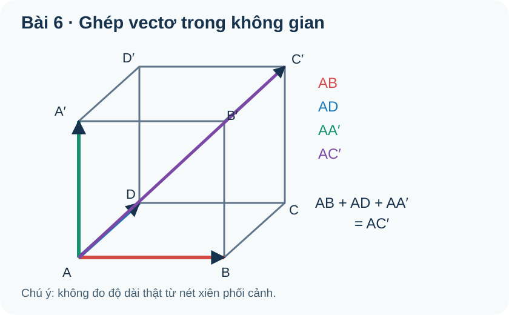
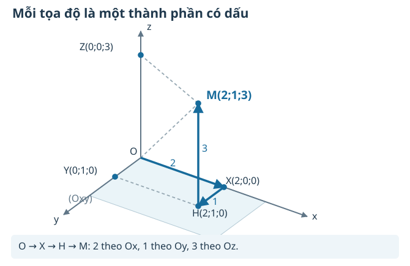
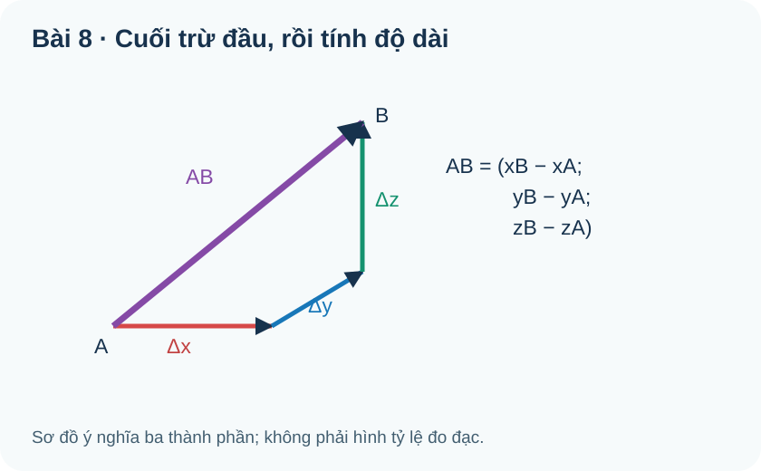
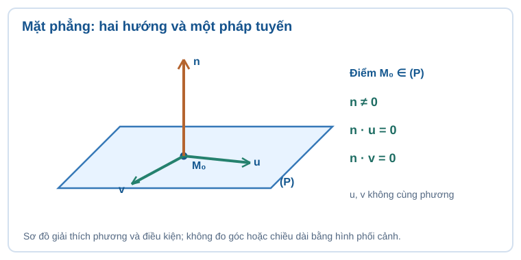
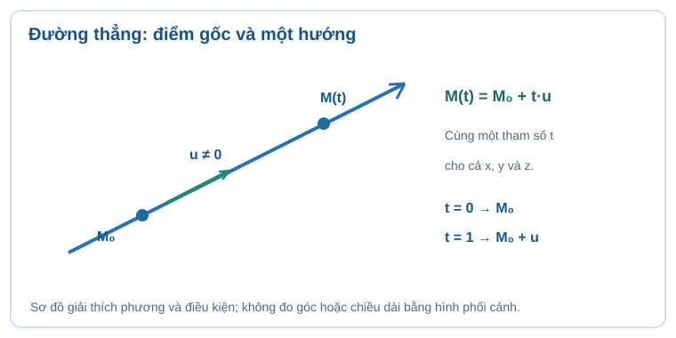
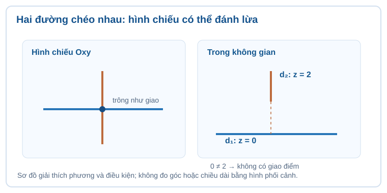
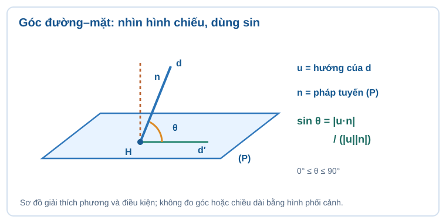
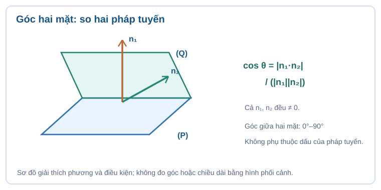
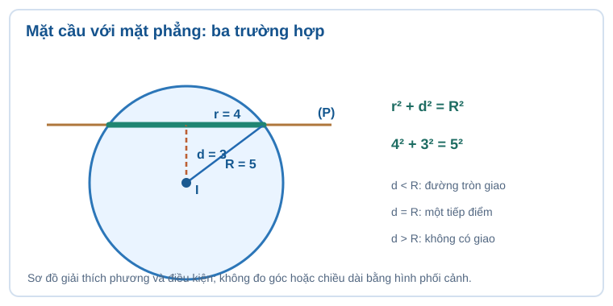
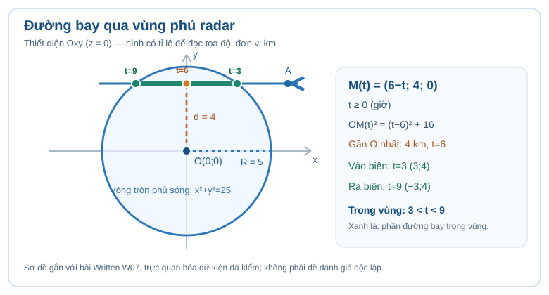

# Chuyên đề 18 — Phương pháp tọa độ trong không gian Oxyz

Ta bắt đầu từ những câu hỏi gần gũi: một vật chuyển động ra sao, mặt phẳng nghiêng thế nào, và một vùng không gian hình cầu có bao phủ một vị trí không? Tọa độ cho phép chuyển từng câu hỏi hình học thành suy luận có thể kiểm tra bằng phép tính. Mỗi khi dùng công thức, hãy nhận diện đối tượng và điều kiện trước.

<!-- AUTHORING_R04_LEARNER_CANDIDATE; EDITORIAL_R03_BLOB: 66df020c242cbbeb5c4bd50670e245a4d8c7f31f; FROZEN_R02_BLOB: f84dee296e2880c2d17fa2306c44458031c057cd; SGK_CHII_BLOB: 856a37bd16d2746ffc2e12906de18d1f4338a3b6; SGK_CHV_BLOB: 11eb2834cfdb4a24685157f84666c2bb0767970a; NOT_REVIEWED_INDEPENDENTLY; NO_PRIVATE_RD1 -->

# Kiến thức

## 1. Vectơ và phép toán hình học

**Đọc hình:** Hãy chỉ điểm A, theo lần lượt ba hướng AB, AD, AA′ và xác định C′. Đường chéo AC′ là độ dời tổng hợp; không dùng độ dài nét xiên trên màn hình để tính độ dài thật.

### 1.1. Vectơ và vectơ-không

<!-- LESSON_ID: TOP18-M01; OUTCOME_ID: TOP18-O01; S1_ORIGINAL_OUTCOME: G12-CHII-B06-O01 -->

Một vectơ biểu diễn độ dời có hướng từ điểm đầu đến điểm cuối. Ta có thể tịnh tiến mũi tên song song mà không đổi vectơ; vì thế vectơ không gắn với vị trí tuyệt đối. Vectơ-không có độ dài 0 và không xác định một hướng riêng, nên không dùng nó để đo góc.

> **Kiến thức cần ghi nhớ**
>
> Một vectơ biểu diễn độ dời có hướng từ điểm đầu đến điểm cuối.

**Ví dụ**

**Đề bài:** Trong ba điểm A–B–C thẳng hàng theo thứ tự, ghép AB với BC thu được độ dời nào? Khi A=B, AB có hướng riêng không?

**Lời giải:** Nếu A,B,C thẳng hàng và AB,BC cùng hướng thì khi đi A→B rồi B→C, ta thu được độ dời A→C. Khi A trùng B, vectơ AB là vectơ-không dù hai điểm mang cùng vị trí. Vectơ-không không được gán một góc riêng.

**Vận dụng:** A trùng B. Vectơ AB có độ dài và hướng thế nào?

<!-- ITEM_ID: THPT-TOP18-T01; ROLE: TOPIC_FIRST_TRY; PRIMARY_OUTCOME: TOP18-O01 -->

Đối chiếu

Độ dài bằng 0; không có hướng xác định. Không gán góc riêng cho vectơ-không.

**Nếu làm sai:** Không suy hướng từ nét vẽ, kiểm điểm đầu/cuối; vectơ-không không được đưa vào công thức góc.

### 1.2. Bằng nhau, đối nhau và cùng phương

<!-- LESSON_ID: TOP18-M02; OUTCOME_ID: TOP18-O02; S1_ORIGINAL_OUTCOME: G12-CHII-B06-O02 -->

Hai vectơ bằng nhau phải cùng hướng và cùng độ dài; chỉ cùng độ dài chưa đủ. Hai vectơ đối nhau có cùng độ dài nhưng ngược hướng. 'Cùng phương' nói về giá song song hoặc trùng nhau, không tự khẳng định cùng hướng.

> **Kiến thức cần ghi nhớ**
>
> Hai vectơ bằng nhau phải cùng hướng và cùng độ dài; chỉ cùng độ dài chưa đủ.

**Ví dụ**

**Đề bài:** Trong hình bình hành ABCD, so các vectơ AB, DC và CD: đâu là cặp bằng nhau, đâu là cặp đối?

**Lời giải:** Trên hình bình hành ABCD, vectơ AB bằng vectơ DC; vectơ AB đối vectơ CD. Cùng hai cạnh nhưng đổi thứ tự đầu–cuối thì đảo chiều, không đổi độ dài.

**Vận dụng:** Trong hình bình hành ABCD, vectơ AB có bằng vectơ CD không?

<!-- ITEM_ID: THPT-TOP18-T02; ROLE: TOPIC_FIRST_TRY; PRIMARY_OUTCOME: TOP18-O02 -->

Đối chiếu

Không. AB và CD đối nhau; AB bằng DC.

**Nếu làm sai:** Hãy vẽ mũi tên đầu/cuối thay vì so sánh riêng độ dài.

### 1.3. Cộng vectơ theo đường đi

<!-- LESSON_ID: TOP18-M03; OUTCOME_ID: TOP18-O03; S1_ORIGINAL_OUTCOME: G12-CHII-B06-O03 -->

Cộng vectơ là ghép các độ dời, không cộng số đo chiều dài tùy ý. Quy tắc ba điểm AB+BC=AC phản ánh đi liên tiếp; trong hình hộp, tổng ba cạnh kề ở A đưa đến đỉnh đối diện C′.

> **Kiến thức cần ghi nhớ**
>
> Cộng vectơ là ghép các độ dời, không cộng số đo chiều dài tùy ý.

**Ví dụ**

**Đề bài:** Trong hình hộp ABCD.A′B′C′D′, ba độ dời AB, AD, AA′ đưa ta tới đỉnh nào?

**Lời giải:** Trong hình hộp ABCD.A′B′C′D′, đi A→B, rồi B→C, rồi C→C′ có cùng độ dời với A→C′. Vì AB+AD=AC và AC+AA′=AC′, suy AB+AD+AA′=AC′.

**Vận dụng:** Tính dạng rút gọn của vectơ PQ + vectơ QR.

<!-- ITEM_ID: THPT-TOP18-T03; ROLE: TOPIC_FIRST_TRY; PRIMARY_OUTCOME: TOP18-O03 -->

Đối chiếu

Vectơ PR theo quy tắc ba điểm, miễn các điểm được lấy đúng thứ tự.

**Nếu làm sai:** Nếu không ghép được đầu của mũi tên thứ hai vào cuối mũi tên thứ nhất, hãy tịnh tiến vectơ rồi mới cộng.

### 1.4. Nhân vectơ với một số

<!-- LESSON_ID: TOP18-M04; OUTCOME_ID: TOP18-O04; S1_ORIGINAL_OUTCOME: G12-CHII-B06-O04 -->

Nhân vectơ với số k thay đổi độ dài theo |k|, cùng hướng nếu k>0, ngược hướng nếu k<0 và tạo vectơ-không nếu k=0. Điều này giải thích tại sao nhân 3 biểu thị ba lần độ dời cùng hướng, còn nhân −1 là đảo chiều.

> **Kiến thức cần ghi nhớ**
>
> Nhân vectơ với số k thay đổi độ dài theo |k|, cùng hướng nếu k>0, ngược hướng nếu k<0 và tạo vectơ-không nếu k=0.

**Ví dụ**

**Đề bài:** Vectơ u dài 2 m hướng Bắc. Xác định độ dài và hướng của −3u.

**Lời giải:** Nếu vectơ u dài 2 m về hướng Bắc, −3u dài 6 m về hướng Nam. Không viết độ dài −6 m; độ dài luôn không âm.

**Vận dụng:** Vectơ u khác không, 0u có cùng hướng u không?

<!-- ITEM_ID: THPT-TOP18-T04; ROLE: TOPIC_FIRST_TRY; PRIMARY_OUTCOME: TOP18-O04 -->

Đối chiếu

Không. 0u là vectơ-không, không có hướng xác định.

**Nếu làm sai:** Nếu lẫn dấu và độ dài, tách riêng: độ dài nhân |k|, chiều quyết định theo dấu k.

### 1.5. Góc và tích vô hướng

<!-- LESSON_ID: TOP18-M05; OUTCOME_ID: TOP18-O05; S1_ORIGINAL_OUTCOME: G12-CHII-B06-O05 -->

Tích vô hướng đo phần 'đi cùng phương' của hai vectơ; nó dương khi góc nhọn, âm khi góc tù và bằng 0 khi vuông góc. Công thức u·v=|u||v|cosφ đúng cho mọi vectơ, nhưng góc φ chỉ được định nghĩa khi hai vectơ khác không.

> **Kiến thức cần ghi nhớ**
>
> Hai vectơ khác không có tích vô hướng \(\vec u\cdot\vec v=|\vec u||\vec v|\cos\theta\); tích bằng 0 khi chúng vuông góc. Không định nghĩa góc với vectơ-không.

**Ví dụ**

**Đề bài:** Hai vectơ lực khác 0 vuông góc nhau. Tích vô hướng bằng bao nhiêu? Có vectơ nào phải bằng 0 không?

**Lời giải:** Hai lực vuông góc có tích vô hướng 0 không có nghĩa chúng bằng vectơ-không. Chỉ là không có thành phần theo hướng của nhau. Hai vectơ vuông góc vẫn có thể cùng khác 0.

**Vận dụng:** Hai vectơ khác không vuông góc; tích vô hướng bằng bao nhiêu?

<!-- ITEM_ID: THPT-TOP18-T05; ROLE: TOPIC_FIRST_TRY; PRIMARY_OUTCOME: TOP18-O05 -->

Đối chiếu

Bằng 0 vì cos90°=0.

**Nếu làm sai:** Nếu một vectơ bằng 0, tích vô hướng vẫn bằng 0 nhưng không dùng phép chia cho tích độ dài để tìm cos góc.

### 1.6. Hợp lực và tổng vectơ

<!-- LESSON_ID: TOP18-M06; OUTCOME_ID: TOP18-O06; S1_ORIGINAL_OUTCOME: G12-CHII-B06-O06 -->

Bài lực ba chiều thường hỏi hợp lực, hình chiếu hay công sinh ra bởi một lực. Chọn phép cộng vectơ khi ghép các tác dụng, chọn tích vô hướng khi đo đóng góp của lực dọc theo chuyển dời; không cộng độ lớn nếu các lực khác hướng.

> **Kiến thức cần ghi nhớ**
>
> Hợp lực hai lực là tổng hai vectơ lực. Nếu chúng vuông góc, độ lớn hợp lực là \(\sqrt{F_1^2+F_2^2}\), không phải \(F_1+F_2\).

**Ví dụ**

**Đề bài:** Hai lực cùng điểm dài 3 N và 4 N vuông góc. Tính hợp lực và so với hai lực cùng hướng.

**Lời giải:** Hai lực cùng điểm có độ lớn 3 N và 4 N vuông góc thì hợp lực dài 5 N theo Pitago. Nếu cùng hướng, hợp lực 7 N; vì thế phải đọc hướng trước khi tính.

**Vận dụng:** Hai lực 6 N và 8 N vuông góc, độ lớn hợp lực?

<!-- ITEM_ID: THPT-TOP18-T06; ROLE: TOPIC_FIRST_TRY; PRIMARY_OUTCOME: TOP18-O06 -->

Đối chiếu

10 N vì bình phương độ lớn tổng bằng 6²+8².

**Nếu làm sai:** D6: phân loại bài hỏi tổng vectơ hay hình chiếu; luôn có sơ đồ phương và đơn vị.

## 2. Làm quen hệ tọa độ Oxyz

**Từ mũi tên đến vị trí thật.** Hãy theo dõi một chiếc drone đang bay trong kho: nếu gốc O đặt ở một góc nhà, ta chọn Ox hướng Đông, Oy hướng Bắc, Oz hướng lên. Drone bắt đầu ở **A=(1;1;2)** (m). Thay vì mô tả “hơi lệch sang phải và khá cao”, ba tọa độ cho biết chính xác ba độ dời có dấu. Đến cuối chuyên đề, chính drone này sẽ giúp ta nối vectơ vận tốc, phương trình đường bay, mặt phẳng và hình cầu trong một bài toán.

**Tự quan sát trước công thức:** Trong mô hình công khai phía dưới, giữ x,y cố định và chỉ kéo z. Điểm M thay đổi độ cao nhưng chân H chiếu xuống mặt Oxy vẫn có tọa độ (x;y;0). Đây là ý nghĩa cụ thể của hình chiếu vuông góc, không phải một công thức cần thuộc lòng trước khi hiểu.

[Mở mô hình khám phá tọa độ và mặt cầu](Temp_THPT_TOPIC18_OXYZ_SPHERE_GEOMETRY_R00_20261114.html) — chọn phần **“Một điểm M có ba tọa độ”**. Mô hình chỉ giúp hình dung, không thay bước Vận dụng và không ghi điểm.

<!-- AUTHOR_INTERACTIVE_PLACEMENT: MODEL_ID=SLM-TOP18-OXYZ-GEOMETRY-R00; SCENE=XYZ_PROJECTION; OUTCOMES=TOP18-O07/TOP18-O08/TOP18-O15; PUBLIC_DISCOVERY_NO_MASTERY -->

**Đọc hình:** Tìm O và ba trục x,y,z, rồi đọc M(2;1;3). Các nét đứt chỉ dẫn từ M xuống mặt Oxy: tọa độ z là độ cao theo trục chứ không phải độ dài đo trên giấy.

### 2.1. Hệ trục và các mặt tọa độ

<!-- LESSON_ID: TOP18-M07; OUTCOME_ID: TOP18-O07; S1_ORIGINAL_OUTCOME: G12-CHII-B07-O01 -->

Ba trục Ox,Oy,Oz vuông góc đôi một giúp định vị một điểm trong phòng bằng ba số. Các mặt phẳng tọa độ Oxy, Oyz, Oxz là ba mặt khác nhau: z=0, x=0, y=0. Hình phối cảnh không phải thước để đọc chiều sâu.

> **Kiến thức cần ghi nhớ**
>
> Trong hệ trực chuẩn Oxyz, điểm thuộc (Oxy) khi z=0, thuộc (Oxz) khi y=0, thuộc (Oyz) khi x=0.

**Ví dụ**

**Đề bài:** Điểm thuộc (Oxy) và điểm thuộc trục Oz cần có những tọa độ nào bằng 0?

**Lời giải:** Điểm nằm ở mặt Oxy thì z=0 dù hình vẽ giấy có thể cho cảm giác nó ở cao. Trục Oz có x=y=0, không phải x=z=0. Hình phối cảnh không thay điều kiện tọa độ z=0.

**Vận dụng:** Điểm M=(2,−1,0) thuộc mặt phẳng tọa độ nào?

<!-- ITEM_ID: THPT-TOP18-T07; ROLE: TOPIC_FIRST_TRY; PRIMARY_OUTCOME: TOP18-O07 -->

Đối chiếu

Thuộc Oxy vì z=0.

**Nếu làm sai:** Gắn điều kiện bằng 0 với tên của tọa độ bị thiếu, không suy vị trí chỉ từ hình xiên.

### 2.2. Tọa độ của điểm và vectơ

<!-- LESSON_ID: TOP18-M08; OUTCOME_ID: TOP18-O08; S1_ORIGINAL_OUTCOME: G12-CHII-B07-O02 -->

Tọa độ của một điểm là ba số xác định vị trí so với gốc O; tọa độ vectơ là ba thành phần dịch chuyển theo cùng trục. Cùng bộ ba số vẫn là hai đối tượng khác nhau, dù vectơ OM có tọa độ trùng tọa độ của điểm M.

> **Kiến thức cần ghi nhớ**
>
> Tọa độ của một điểm là ba số xác định vị trí so với gốc O; tọa độ vectơ là ba thành phần dịch chuyển theo cùng trục.

**Ví dụ**

**Đề bài:** Điểm M(2;−1;3). Viết tọa độ OM và giải thích ảnh hưởng của đổi gốc.

**Lời giải:** M=(2,−1,3) thì vectơ OM=(2,−1,3). Nhưng chuyển gốc tọa độ sẽ đổi tọa độ điểm M, còn độ dời của một vectơ tự do không đổi trong các trục cùng hướng.

**Vận dụng:** Điểm M(1,2,3), tọa độ vectơ OM?

<!-- ITEM_ID: THPT-TOP18-T08; ROLE: TOPIC_FIRST_TRY; PRIMARY_OUTCOME: TOP18-O08 -->

Đối chiếu

(1,2,3) trong cùng hệ Oxyz.

**Nếu làm sai:** Nhắc lại điểm cần gốc, vectơ cần thành phần dịch chuyển; không tự đổi dấu khi đọc thành phần âm.

### 2.3. Chọn hệ quy chiếu thực tế

<!-- LESSON_ID: TOP18-M09; OUTCOME_ID: TOP18-O09; S1_ORIGINAL_OUTCOME: G12-CHII-B07-O03 -->

Ứng dụng Oxyz bắt đầu bằng chọn gốc, hướng dương và đơn vị. Một tọa độ âm không có nghĩa khoảng cách âm; nó chỉ nằm ở phía đối diện của trục. Bài radar, kho vận hoặc đồ họa đều cần tuyên bố hệ quy chiếu trước.

> **Kiến thức cần ghi nhớ**
>
> Ứng dụng Oxyz bắt đầu bằng chọn gốc, hướng dương và đơn vị.

**Ví dụ**

**Đề bài:** Chọn Ox Đông, Oy Bắc, Oz hướng lên. Đèn ở (2;−1;3) m nằm về hướng nào?

**Lời giải:** Chọn O ở góc nhà, Ox hướng Đông, Oy hướng Bắc, Oz hướng lên. Một đèn ở (2,−1,3) m nằm lệch 1 m về Nam và cao 3 m; không phải thấp hơn sàn.

**Vận dụng:** Trong hệ Ox Đông, Oy Bắc, Oz lên, N=(−4,3,2) m nằm về phía nào của O?

<!-- ITEM_ID: THPT-TOP18-T09; ROLE: TOPIC_FIRST_TRY; PRIMARY_OUTCOME: TOP18-O09 -->

Đối chiếu

4 m về Tây, 3 m về Bắc, cao 2 m.

**Nếu làm sai:** Nếu quên quy ước dấu, vẽ ba trục và ghi rõ đơn vị trước khi giải.

### 2.4. Vectơ từ hai điểm

<!-- LESSON_ID: TOP18-M10; OUTCOME_ID: TOP18-O10; S1_ORIGINAL_OUTCOME: G12-CHII-B07-O04 -->

Vectơ từ A đến B được tính bằng cuối trừ đầu theo từng trục: AB=(xB−xA,yB−yA,zB−zA). Công thức là bản dịch đại số của việc bắt đầu ở A rồi di chuyển tới B; đổi AB thành BA thì toàn bộ dấu đảo.

> **Kiến thức cần ghi nhớ**
>
> Vectơ từ A đến B được tính bằng cuối trừ đầu theo từng trục: AB=(xB−xA,yB−yA,zB−zA).

**Ví dụ**

**Đề bài:** Cho hai điểm A(1;2;−1) và B(4;−2;3) trong cùng hệ Oxyz. Tính vectơ độ dời từ A đến B, rồi kiểm bằng cộng tọa độ.

**Lời giải:** A=(1,2,−1), B=(4,−2,3) cho AB=(3,−4,4). Kiểm bằng A+AB=B theo từng thành phần. Ta lấy từng tọa độ điểm cuối trừ điểm đầu: (4−1;−2−2;3−(−1))=(3;−4;4). Lấy A cộng độ dời thu lại đúng B, nên không bị đảo dấu.

**Vận dụng:** A=(2,0,−1), B=(5,−2,3). Tính vectơ AB.

<!-- ITEM_ID: THPT-TOP18-T10; ROLE: TOPIC_FIRST_TRY; PRIMARY_OUTCOME: TOP18-O10 -->

Đối chiếu

(3,−2,4).

**Nếu làm sai:** Thường xuyên thử lấy tọa độ A cộng kết quả AB để xem có trở về B không.

## 3. Phép toán tọa độ và khoảng cách

**Khi điểm bắt đầu chuyển động.** Drone từ A=(1;1;2) m, mỗi giây tiến **1 m theo Ox, 0 m theo Oy và 1 m theo Oz**. Ta ghi vectơ vận tốc v=(1;0;1) m/s: cùng một vectơ cho biết *hướng và tốc độ theo từng trục*. Sau t giây, vị trí trở thành M(t)=(1+t;1;2+t). Chỉ cần thử t=0 và t=1 là kiểm được: drone từ A tới (2;1;3), thay đổi (1;0;1). Nhờ vậy, phép cộng vectơ không còn là một bảng quy tắc rời rạc.

**Đọc hình:** Đọc ba nhãn Δx,Δy,Δz từ A sang B; từng thành phần là tọa độ B trừ tọa độ A. Đừng lấy tổng ba thành phần làm độ dài AB: còn phải áp dụng Pitago 3D.

### 3.1. Phép toán theo từng tọa độ

<!-- LESSON_ID: TOP18-M11; OUTCOME_ID: TOP18-O11; S1_ORIGINAL_OUTCOME: G12-CHII-B08-O01 -->

Phép cộng, trừ và nhân số trên vectơ trong ba trục vuông góc thực hiện theo từng thành phần. Đây là phép cộng độ dời độc lập trên Ox,Oy,Oz chứ không cộng ba độ dài của vectơ.

> **Kiến thức cần ghi nhớ**
>
> Phép cộng, trừ và nhân số trên vectơ trong ba trục vuông góc thực hiện theo từng thành phần.

**Ví dụ**

**Đề bài:** Hai vectơ u=(1;2;−1), v=(−2;0;3) được cho theo ba trục Oxyz. Tính u+v và tổ hợp 2u−v.

**Lời giải:** u=(1,2,−1), v=(−2,0,3) thì u+v=(−1,2,2); 2u−v=(4,4,−5). Mỗi phép cộng và trừ xử lý từng thành phần. Cộng theo tọa độ cho (1−2;2+0;−1+3)=(−1;2;2). Với 2u−v, tính 2u=(2;4;−2) rồi trừ v được (4;4;−5).

**Vận dụng:** u=(1,−2,3), v=(2,0,−1); u+v?

<!-- ITEM_ID: THPT-TOP18-T11; ROLE: TOPIC_FIRST_TRY; PRIMARY_OUTCOME: TOP18-O11 -->

Đối chiếu

(3,−2,2).

**Nếu làm sai:** Không nhân chéo tọa độ khi cộng; làm theo từng trục và kiểm dấu số âm.

### 3.2. Kiểm hai vectơ cùng phương

<!-- LESSON_ID: TOP18-M12; OUTCOME_ID: TOP18-O12; S1_ORIGINAL_OUTCOME: G12-CHII-B08-O02 -->

Hai vectơ khác không cùng phương nếu một vectơ là bội của vectơ kia. Đừng chia các tọa độ tùy tiện khi có thành phần bằng 0; cách chắc chắn là thử k sao cho u=kv ở *tất cả* ba vị trí. Vectơ-không cần xử lí theo định nghĩa quy ước chứ không chia để tìm tỉ số.

> **Kiến thức cần ghi nhớ**
>
> Hai vectơ khác không cùng phương nếu một vectơ là bội của vectơ kia.

**Ví dụ**

**Đề bài:** Với u=(2;−4;0), v=(−1;2;0), hai vectơ cùng phương/hướng thế nào? Nếu v_z=1?

**Lời giải:** u=(2,−4,0),v=(−1,2,0), ta có u=−2v nên cùng phương ngược hướng. Nếu v=(−1,2,1), quan hệ vỡ ở tọa độ thứ ba.

**Vận dụng:** u=(3,6,0), v=(1,2,0) có cùng phương không?

<!-- ITEM_ID: THPT-TOP18-T12; ROLE: TOPIC_FIRST_TRY; PRIMARY_OUTCOME: TOP18-O12 -->

Đối chiếu

Có, u=3v và đều khác không.

**Nếu làm sai:** Không chia cho 0; kiểm cả ba thành phần, nếu một vectơ là vectơ-không thì nói rõ trường hợp riêng.

### 3.3. Trung điểm và trọng tâm

<!-- LESSON_ID: TOP18-M13; OUTCOME_ID: TOP18-O13; S1_ORIGINAL_OUTCOME: G12-CHII-B08-O03 -->

Trung điểm và trọng tâm của tam giác là trung bình *tọa độ*, không phải trung bình khoảng cách tới gốc. Vì mỗi trục độc lập, trung điểm M=(A+B)/2; trọng tâm G=(A+B+C)/3 theo từng thành phần.

> **Kiến thức cần ghi nhớ**
>
> Trung điểm A,B có tọa độ \(((x_A+x_B)/2;(y_A+y_B)/2;(z_A+z_B)/2)\); trọng tâm tam giác là trung bình tọa độ ba đỉnh.

**Ví dụ**

**Đề bài:** Trong hệ tọa độ Oxyz, hai điểm A(0;2;4), B(2;0;0) là hai đầu của một đoạn. Hãy tìm trung điểm.

**Lời giải:** A=(0,2,4),B=(2,0,0) có M=(1,1,2). Không lấy trung bình độ dài OA và OB. Điểm giữa phải cân bằng độ dời tới hai đầu mút, nên mỗi tọa độ là trung bình của hai giá trị tương ứng: ((0+2)/2;(2+0)/2;(4+0)/2)=(1;1;2).

**Vận dụng:** Trung điểm A=(0,0,2), B=(2,4,0)?

<!-- ITEM_ID: THPT-TOP18-T13; ROLE: TOPIC_FIRST_TRY; PRIMARY_OUTCOME: TOP18-O13 -->

Đối chiếu

M=(1,2,1).

**Nếu làm sai:** Nếu kết quả bất ngờ, lấy 2M−A phải thu B; với trọng tâm G, 3G=A+B+C.

### 3.4. Tích vô hướng trong tọa độ

<!-- LESSON_ID: TOP18-M14; OUTCOME_ID: TOP18-O14; S1_ORIGINAL_OUTCOME: G12-CHII-B08-O04 -->

Tích vô hướng trong hệ trực chuẩn Oxyz là u·v=uxvx+uyvy+uzvz; chia cho |u||v| chỉ khi hai vectơ khác không mới suy góc. Vuông góc nghĩa tích bằng 0; góc giữa các vectơ có thể tù, khác góc không tù giữa hai đường thẳng.

> **Kiến thức cần ghi nhớ**
>
> Tích vô hướng trong hệ trực chuẩn Oxyz là u·v=uxvx+uyvy+uzvz; chia cho |u||v| chỉ khi hai vectơ khác không mới suy góc.

**Ví dụ**

**Đề bài:** Cho u=(1;2;0), v=(2;−1;0). Dùng tích vô hướng kiểm vuông góc.

**Lời giải:** u=(1,2,0),v=(2,−1,0), tích 1·2+2·(−1)+0=0, nên hai vectơ khác không vuông góc. Trước khi kết luận vuông góc, kiểm cả hai vectơ đều khác 0; ở đây u và v đều có thành phần không bằng 0. Tích vô hướng bằng 0 nên góc giữa chúng là 90°.

**Vận dụng:** u=(1,1,0),v=(1,−1,0). Góc giữa chúng?

<!-- ITEM_ID: THPT-TOP18-T14; ROLE: TOPIC_FIRST_TRY; PRIMARY_OUTCOME: TOP18-O14 -->

Đối chiếu

90° vì tích vô hướng 1−1=0 và cả hai khác không.

**Nếu làm sai:** Khi tìm cos, kiểm |u|,|v|>0; nếu làm tròn dữ liệu máy, cos chỉ nằm trong [−1,1].

### 3.5. Độ dài và khoảng cách hai điểm

<!-- LESSON_ID: TOP18-M15; OUTCOME_ID: TOP18-O15; S1_ORIGINAL_OUTCOME: G12-CHII-B08-O05 -->

Độ dài vectơ dùng căn tổng bình phương ba thành phần; khoảng cách AB là độ dài vectơ AB. Điều này nối Pitago phẳng thành ba phương vuông góc, kết quả luôn không âm.

> **Kiến thức cần ghi nhớ**
>
> Độ dài \(|\vec u|=\sqrt{u_x^2+u_y^2+u_z^2}\); khoảng cách AB là độ dài vectơ \(\overrightarrow{AB}=\vec B-\vec A\).

**Ví dụ**

**Đề bài:** Cho hai điểm A(1;2;3) và B(4;6;3) trong hệ Oxyz. Tính tọa độ vectơ AB và độ dài đoạn thẳng AB.

**Lời giải:** A=(1,2,3),B=(4,6,3) có AB=(3,4,0) nên AB=√(9+16)=5. Dùng cuối trừ đầu, AB=(4−1;6−2;3−3)=(3;4;0). Độ dài là căn tổng bình phương ba tọa độ, được √(9+16)=5; tọa độ z không đổi không làm mất dữ kiện.

**Vận dụng:** Độ dài vectơ u=(2,−1,2)?

<!-- ITEM_ID: THPT-TOP18-T15; ROLE: TOPIC_FIRST_TRY; PRIMARY_OUTCOME: TOP18-O15 -->

Đối chiếu

√(4+1+4)=3.

**Nếu làm sai:** Nếu căn ra số âm hoặc thiếu tọa độ z, quay lại định lí Pitago ba chiều.

### 3.6. Mô hình chuyển động

<!-- LESSON_ID: TOP18-M16; OUTCOME_ID: TOP18-O16; S1_ORIGINAL_OUTCOME: G12-CHII-B08-O06 -->

Mô hình chuyển động thẳng đều có vị trí M(t)=M0+t·v, ba tọa độ thay đổi độc lập theo tốc độ trên từng trục. Đơn vị tốc độ và thời gian phải tương thích; kiểm t≥0 nếu bài chỉ nói chuyển động sau khi xuất phát.

> **Kiến thức cần ghi nhớ**
>
> Mô hình chuyển động thẳng đều có vị trí M(t)=M0+t·v, ba tọa độ thay đổi độc lập theo tốc độ trên từng trục.

**Ví dụ**

**Đề bài:** Drone tại A=(0;0;5) m bay theo v=(2;−1;0) m/s. Sau 3 giây ở đâu?

**Lời giải:** Drone xuất phát A=(0,0,5) m, v=(2,−1,0) m/s. Sau 3 s, ở (6,−3,5) m: cao độ không đổi. Theo công thức vị trí A+t v, ba thành phần là (0+3·2;0+3·(−1);5+3·0)=(6;−3;5). Đơn vị mét khớp vì v tính bằng m/s và thời gian tính bằng giây.

**Vận dụng:** M0=(1,0,2), v=(0,3,−1), t=2. Tọa độ M(2)?

<!-- ITEM_ID: THPT-TOP18-T16; ROLE: TOPIC_FIRST_TRY; PRIMARY_OUTCOME: TOP18-O16 -->

Đối chiếu

(1,6,0).

**Nếu làm sai:** Nếu thấy độ cao âm mà vật không được dưới mặt đất, kiểm mốc t hoặc chiều dương và giới hạn vật lí.

— Phần B: bức tường, đường bay, góc và mặt cầu

### 2. Phương pháp tọa độ trong không gian

## 4. Mặt phẳng trong Oxyz

**Từ vị trí một vật đến cả một bức tường.** Ở chặng trước, ta biết drone sau t giây ở M(t)=(1+t;1;2+t). Bây giờ xét tấm chắn có phương trình **(P): x+y+z=6**. Phương trình không cho một điểm đơn lẻ: bất cứ điểm nào có tổng ba tọa độ bằng 6 đều nằm trên tấm chắn ấy. Vectơ n=(1;1;1) vuông góc với mặt, nên được gọi là *pháp tuyến*. Hãy thử thế M(0)=(1;1;2): tổng là 4, chưa thuộc tấm chắn. Bao giờ tổng đạt 6? Ta sẽ tìm ngay khi học phương trình đường thẳng.

**Đọc hình:** Chỉ M₀ thuộc (P), hai vectơ u,v không cùng phương và pháp tuyến n khác 0. Kiểm n·u=n·v=0; hình phối cảnh không dùng để đo góc.

<!-- AUTHOR_TOPIC18_WHITE_SVG: docs/assets/images/thpt/FIG-TOP18-B14-NORMAL-WHITE-R00.svg; NEW_SOURCE_BLOB: 353ab2fb6f070c03e7895706fd68362c73904fc7; WHITE_BACKGROUND=YES; ORIGINAL_SGK_PNG_REFERENCE_ONLY=Temp_FIG-G12-CHV-B14-R00.png; ORIGINAL_PNG_BLOB=5763cbd3c555a40e2644e9666611a7b4ecaa4070; ORIGINAL_PNG_NOT_VISUALLY_QA_VERIFIED -->

### 4.1. Dựng vectơ pháp tuyến

<!-- LESSON_ID: TOP18-M17; OUTCOME_ID: TOP18-O17; S1_ORIGINAL_OUTCOME: G12-CHV-B14-O01; SCOPE: G12_CHV -->

Một mặt phẳng có vô số hướng nằm trong nó; một vectơ pháp tuyến n khác 0 phải vuông góc với mọi hướng đó. Nếu đã biết hai vectơ chỉ phương u,v **không cùng phương**, tích có hướng u×v là một cách dựng n. Tích có hướng bằng 0 khi u,v cùng phương, khi ấy chưa xác định được pháp tuyến mặt bằng cặp vectơ ấy.

> **Kiến thức cần ghi nhớ**
>
> Nếu u,v không cùng phương, một pháp tuyến mặt phẳng là \(n=u\times v\ne 0\), vuông góc với cả hai hướng u,v.

**Cách thực sự tính được pháp tuyến (không cần học thuộc ngay):** Nếu hai hướng là u=(u₁;u₂;u₃), v=(v₁;v₂;v₃) thì có thể tìm n=(a;b;c) bằng cách giải hai điều kiện **a·u₁+b·u₂+c·u₃=0** và **a·v₁+b·v₂+c·v₃=0**, rồi chọn một nghiệm n khác 0. Một cách gọn hơn là công thức tích có hướng

\[
u\times v=(u_2v_3-u_3v_2;\;u_3v_1-u_1v_3;\;u_1v_2-u_2v_1).
\]

Từng thành phần được tạo để khi nhân vô hướng lại với u hay v, các hạng tử triệt tiêu nhau, nên n·u=n·v=0. **Điều kiện quan trọng:** u và v phải không cùng phương, nếu không tích có hướng trở thành vectơ-không và không xác định được một pháp tuyến khác 0. Tính xong hãy **thử lại hai tích vô hướng**, không chỉ chép công thức.

**Ví dụ**

**Đề bài:** u=(1;0;1), v=(0;1;1) là hai hướng độc lập trong mặt. Hãy dựng và kiểm pháp tuyến.

**Lời giải:** u=(1,0,1), v=(0,1,1) độc lập. Theo công thức tích có hướng, n=u×v=(−1,−1,1). Kiểm n·u=−1+1=0 và n·v=−1+1=0; vì n≠0, có thể dùng n làm pháp tuyến. Hai hướng không cùng phương làm tích có hướng khác vectơ-không.

**Vận dụng:** u=(1,0,0),v=(0,1,0) có pháp tuyến đơn giản nào?

<!-- ITEM_ID: THPT-TOP18-T17; ROLE: TOPIC_FIRST_TRY; PRIMARY_OUTCOME: TOP18-O17 -->

Đối chiếu

n=(0,0,1), vì vuông góc cả u lẫn v.

**D6 — Khi chưa đúng:** Nếu tích có hướng 0, phải kiểm hai hướng có cùng phương hay không; không dùng vectơ 0 làm pháp tuyến.

### 4.2. Mặt phẳng qua một điểm

<!-- LESSON_ID: TOP18-M18; OUTCOME_ID: TOP18-O18; S1_ORIGINAL_OUTCOME: G12-CHV-B14-O02; SCOPE: G12_CHV -->

Một mặt phẳng là tập các điểm M có độ dời từ điểm M0 nằm vuông góc với một pháp tuyến n khác 0. Điều kiện n·M0M=0 dẫn đến A(x−x0)+B(y−y0)+C(z−z0)=0. Vì vậy cần một điểm đi qua và một hướng pháp tuyến, không thể chỉ biết n để xác định vị trí duy nhất.

> **Kiến thức cần ghi nhớ**
>
> Một mặt phẳng là tập các điểm M có độ dời từ điểm M0 nằm vuông góc với một pháp tuyến n khác 0.

**Ví dụ**

**Đề bài:** Qua M0=(1;0;−1) có n=(2;−1;3). Viết phương trình mặt và kiểm M0.

**Lời giải:** M0=(1,0,−1),n=(2,−1,3). Thay vào 2(x−1)−(y−0)+3(z+1)=0, thu 2x−y+3z+1=0. Thử điểm M0: 2−3+1=0. Thử lại điểm M0 giúp phát hiện lỗi hệ số tự do.

**Vận dụng:** M0=(0,0,2), n=(0,0,1). Viết mặt phẳng.

<!-- ITEM_ID: THPT-TOP18-T18; ROLE: TOPIC_FIRST_TRY; PRIMARY_OUTCOME: TOP18-O18 -->

Đối chiếu

z−2=0, tức z=2.

**D6 — Khi chưa đúng:** Không để pháp tuyến n=0; thay tọa độ điểm đã cho vào phương trình để phát hiện lỗi dấu.

### 4.3. Mặt phẳng qua ba điểm

<!-- LESSON_ID: TOP18-M19; OUTCOME_ID: TOP18-O19; S1_ORIGINAL_OUTCOME: G12-CHV-B14-O03; SCOPE: G12_CHV -->

Ba điểm phân biệt chưa đủ xác định một mặt: chúng phải **không thẳng hàng**. Lấy AB và AC không cùng phương, dựng n=AB×AC rồi áp dụng phương trình mặt qua A. Nếu ba điểm thẳng hàng, tích có hướng bằng 0 và tồn tại vô số mặt phẳng qua đường đó.

> **Kiến thức cần ghi nhớ**
>
> Ba điểm phân biệt chưa đủ xác định một mặt: chúng phải **không thẳng hàng**.

**Ví dụ**

**Đề bài:** Qua A=(1;0;0), B=(0;1;0), C=(0;0;1), lập phương trình mặt.

**Lời giải:** A=(1,0,0), B=(0,1,0), C=(0,0,1) cho AB=(−1,1,0), AC=(−1,0,1). Một n=(1,1,1) vuông cả hai; mặt phẳng qua A là x+y+z−1=0. Ba điểm phải không thẳng hàng.

**Vận dụng:** Ba giao điểm trục A=(2,0,0),B=(0,2,0),C=(0,0,2). Mặt phẳng?

<!-- ITEM_ID: THPT-TOP18-T19; ROLE: TOPIC_FIRST_TRY; PRIMARY_OUTCOME: TOP18-O19 -->

Đối chiếu

x+y+z=2. Ba điểm không thẳng hàng.

**D6 — Khi chưa đúng:** Kiểm AB,AC có cùng phương không trước khi dựng n, và thay đủ ba điểm vào đáp án.

### 4.4. Mặt phẳng chứa trục

<!-- LESSON_ID: TOP18-M20; OUTCOME_ID: TOP18-O20; S1_ORIGINAL_OUTCOME: G12-CHV-B14-O04; SCOPE: G12_CHV -->

Khi mặt phẳng chứa một đường hoặc trục, mọi vectơ chỉ phương của đường ấy phải vuông góc với pháp tuyến của mặt. Nếu mặt chứa Ox và điểm P ngoài Ox, dùng e1=(1,0,0) và OP làm hai hướng độc lập. Điều kiện 'chứa trục' mạnh hơn 'song song trục' vì mặt còn phải đi qua mọi điểm trên trục.

> **Kiến thức cần ghi nhớ**
>
> Khi mặt phẳng chứa một đường hoặc trục, mọi vectơ chỉ phương của đường ấy phải vuông góc với pháp tuyến của mặt.

**Ví dụ**

**Đề bài:** Mặt phẳng cần đi qua toàn bộ trục Ox và điểm P(0;1;1) nằm ngoài trục. Hãy tìm một phương trình đơn giản của mặt phẳng.

**Lời giải:** Mặt chứa Ox và P=(0,1,1). Hai hướng e1=(1,0,0), OP=(0,1,1) nên một pháp tuyến n=(0,−1,1); mặt qua O là y−z=0. Mặt phải chứa cả trục và điểm đã cho. Chọn hai vectơ độc lập trong mặt: e1=(1;0;0) và OP=(0;1;1). Một pháp tuyến là (0;−1;1), do đó mặt qua O có phương trình y−z=0.

**Vận dụng:** Mặt chứa trục Oz và điểm (1,1,0). Tìm phương trình đơn giản.

<!-- ITEM_ID: THPT-TOP18-T20; ROLE: TOPIC_FIRST_TRY; PRIMARY_OUTCOME: TOP18-O20 -->

Đối chiếu

x−y=0, vì mọi điểm Oz có x=y=0 và điểm thêm cũng thỏa.

**D6 — Khi chưa đúng:** Không bỏ điều kiện chứa điểm/đường; một mặt chỉ có pháp tuyến đúng nhưng lệch vị trí vẫn sai.

### 4.5. Hai mặt phẳng: song song hay vuông góc?

<!-- LESSON_ID: TOP18-M21; OUTCOME_ID: TOP18-O21; S1_ORIGINAL_OUTCOME: G12-CHV-B14-O05; SCOPE: G12_CHV -->

Hai mặt có pháp tuyến tỉ lệ có cùng phương, nhưng có thể **trùng nhau** hoặc **song song phân biệt**; phải kiểm thêm hằng số hoặc một điểm. Hai mặt vuông góc khi hai pháp tuyến khác không có tích vô hướng bằng 0. Góc giữa mặt là góc nhỏ, không phụ thuộc dấu chọn của pháp tuyến.

> **Kiến thức cần ghi nhớ**
>
> Hai mặt có pháp tuyến tỉ lệ có cùng phương, nhưng có thể **trùng nhau** hoặc **song song phân biệt**; phải kiểm thêm hằng số hoặc một điểm.

**Ví dụ**

**Đề bài:** P:x+2y−z=0 và Q:2x+4y−2z+3=0: trùng hay song song phân biệt?

**Lời giải:** P:x+2y−z=0 và Q:2x+4y−2z+3=0 có pháp tuyến tỉ lệ nhưng không trùng vì các hệ số cả phương trình không tỉ lệ; chúng song song phân biệt. Pháp tuyến cùng phương chưa đủ để hai mặt trùng.

**Vận dụng:** P:x+y+z=1, Q:2x+2y+2z=2. Hai mặt trùng hay song song phân biệt?

<!-- ITEM_ID: THPT-TOP18-T21; ROLE: TOPIC_FIRST_TRY; PRIMARY_OUTCOME: TOP18-O21 -->

Đối chiếu

Trùng nhau do chia phương trình Q cho 2 thu đúng P.

**D6 — Khi chưa đúng:** Nếu n1∥n2, kiểm tỉ lệ cả hệ số tự do trước khi nói 'hai mặt song song phân biệt'.

### 4.6. Khoảng cách điểm đến mặt phẳng

<!-- LESSON_ID: TOP18-M22; OUTCOME_ID: TOP18-O22; S1_ORIGINAL_OUTCOME: G12-CHV-B14-O06; SCOPE: G12_CHV -->

Khoảng cách từ điểm M đến mặt P là độ dài đường vuông góc ngắn nhất, không phải khoảng cách đến một điểm tùy ý của P. Với P:Ax+By+Cz+D=0 có n=(A,B,C) khác không, lấy trị tuyệt đối của vế trái tại M và chia độ dài pháp tuyến √(A²+B²+C²).

> **Kiến thức cần ghi nhớ**
>
> Với \((P):Ax+By+Cz+D=0\) có \((A;B;C)\ne(0;0;0)\), khoảng cách \(d(M,(P))=\frac{|Ax_M+By_M+Cz_M+D|}{\sqrt{A^2+B^2+C^2}}\).

**Ví dụ**

**Đề bài:** Cho mặt phẳng (P):x+2y+2z−6=0 và điểm O(0;0;0). Hãy tính khoảng cách từ O đến (P) và nêu điều kiện áp dụng công thức.

**Lời giải:** M=O, P:x+2y+2z−6=0 có độ dài n=3, trị tuyệt đối −6 là 6, nên d=6/3=2. Mẫu số là độ dài pháp tuyến, phải khác 0. Pháp tuyến n=(1;2;2) khác 0 có độ dài √(1+4+4)=3. Tại O, trị tuyệt đối của vế trái là 6 nên d=6/3=2; giá trị không âm vì đây là độ dài đoạn vuông góc.

**Vận dụng:** Khoảng cách từ O đến mặt z=−5?

<!-- ITEM_ID: THPT-TOP18-T22; ROLE: TOPIC_FIRST_TRY; PRIMARY_OUTCOME: TOP18-O22 -->

Đối chiếu

5 đơn vị, bởi pháp tuyến (0,0,1), độ chênh z là 5.

**D6 — Khi chưa đúng:** Đừng quên trị tuyệt đối và chuẩn hóa pháp tuyến; đáp án khoảng cách phải không âm.

## 5. Đường thẳng và giao điểm

**Tiếp tục chuyến bay đã biết.** Drone có điểm xuất phát A=(1;1;2) và hướng v=(1;0;1), do đó đường bay là M(t)=(1+t;1;2+t). Thế vào (P):x+y+z=6, ta được (1+t)+1+(2+t)=6, tức **4+2t=6**; suy ra **t=1 giây**, vị trí gặp tấm chắn **M(1)=(2;1;3)**. Kiểm lại: 2+1+3=6. Một tham số chung cho đủ ba tọa độ chính là cách giữ cho ba phép tính đang nói về *cùng một điểm trên đường bay*.

**Đọc hình:** Xác định M₀, hướng u khác 0; M(t)=M₀+t u có cùng tham số t ở đủ ba tọa độ. Tại t=0 là M₀, tại t=1 là M₀+u.

<!-- AUTHOR_TOPIC18_WHITE_SVG: docs/assets/images/thpt/FIG-TOP18-B15-LINE-WHITE-R00.svg; NEW_SOURCE_BLOB: d99c0dd13170111f1b72aededc843d64c3ada4d8; WHITE_BACKGROUND=YES; ORIGINAL_SGK_PNG_REFERENCE_ONLY=Temp_FIG-G12-CHV-B15-R00.png; ORIGINAL_PNG_BLOB=8991b0aaa4e532c0b7b8284608462b2286035733; ORIGINAL_PNG_NOT_VISUALLY_QA_VERIFIED -->

**Đọc hình:** Khung trái chiếu lên Oxy trông có giao; khung phải d₁ có z=0, d₂ có z=2 nên không giao trong không gian. Hai hướng không cùng phương thì chúng chéo nhau.

<!-- AUTHOR_TOPIC18_WHITE_SVG: docs/assets/images/thpt/FIG-TOP18-B15-SKEW-WHITE-R00.svg; NEW_SOURCE_BLOB: 1683f44f7d159081caca47152c1bf75c16440488; WHITE_BACKGROUND=YES; ORIGINAL_SGK_PNG_REFERENCE_ONLY=Temp_FIG-G12-CHV-B151-R00.png; ORIGINAL_PNG_BLOB=447205394c355531845746ccf3a2474a2e910974; ORIGINAL_PNG_NOT_VISUALLY_QA_VERIFIED -->

### 5.1. Phương trình tham số đường thẳng

<!-- LESSON_ID: TOP18-M24; OUTCOME_ID: TOP18-O24; S1_ORIGINAL_OUTCOME: G12-CHV-B15-O01; SCOPE: G12_CHV -->

Một đường thẳng vô hạn được mô tả bằng một điểm M0 nó đi qua và một vectơ chỉ phương u khác không. Mọi điểm trên đường có M=M0+t u với t thực. Ba tọa độ phải dùng **cùng một tham số t**; nếu mỗi tọa độ có một t khác, đó không còn là phương trình một đường cụ thể.

> **Kiến thức cần ghi nhớ**
>
> Đường qua \(M_0\) có hướng \(u\ne0\) có phương trình tham số \(M(t)=M_0+tu\) với cùng một tham số thực t ở cả ba tọa độ.

**Ví dụ**

**Đề bài:** Đường qua M0=(1;2;3) có hướng u=(2;−1;0). Viết tham số.

**Lời giải:** M0=(1,2,3),u=(2,−1,0): x=1+2t,y=2−t,z=3. Độ cao không đổi vì thành phần chỉ phương z bằng 0. Cả ba tọa độ đều dùng một tham số t.

**Vận dụng:** Đường qua O hướng u=(1,0,2). Viết dạng tham số.

<!-- ITEM_ID: THPT-TOP18-T24; ROLE: TOPIC_FIRST_TRY; PRIMARY_OUTCOME: TOP18-O24 -->

Đối chiếu

x=t, y=0, z=2t, t∈R.

**D6 — Khi chưa đúng:** Nếu thành phần hướng bằng 0, tọa độ tương ứng là hằng, không tùy tiện bỏ phương trình đó.

### 5.2. Đường thẳng qua hai điểm

<!-- LESSON_ID: TOP18-M25; OUTCOME_ID: TOP18-O25; S1_ORIGINAL_OUTCOME: G12-CHV-B15-O02; SCOPE: G12_CHV -->

Hai điểm phân biệt A,B xác định một đường và cho vectơ chỉ phương AB=B−A khác 0. Lấy A làm điểm t=0; không cần pháp tuyến như phương trình mặt. Nếu A=B, không có hướng AB khác không để xác định duy nhất một đường.

> **Kiến thức cần ghi nhớ**
>
> Hai điểm phân biệt A,B xác định một đường và cho vectơ chỉ phương AB=B−A khác 0.

**Ví dụ**

**Đề bài:** Đường qua A=(0;1;2), B=(2;3;2). Viết tham số và kiểm B.

**Lời giải:** A=(0,1,2),B=(2,3,2), AB=(2,2,0); đường AB có x=2t,y=1+2t,z=2. Thay t=1 cho B, nên phương trình phù hợp.

**Vận dụng:** Đường qua A=(0,0,0), B=(1,2,3) có một dạng tham số?

<!-- ITEM_ID: THPT-TOP18-T25; ROLE: TOPIC_FIRST_TRY; PRIMARY_OUTCOME: TOP18-O25 -->

Đối chiếu

x=t,y=2t,z=3t.

**D6 — Khi chưa đúng:** Nhớ A≠B, lấy đúng B−A và thử lại tọa độ cả hai điểm.

### 5.3. Khi một tọa độ hướng bằng không

<!-- LESSON_ID: TOP18-M26; OUTCOME_ID: TOP18-O26; S1_ORIGINAL_OUTCOME: G12-CHV-B15-O03; SCOPE: G12_CHV -->

Phương trình chính tắc của đường thẳng cần cẩn thận khi một thành phần vectơ chỉ phương bằng 0. Chỉ những tỉ số có mẫu khác 0 mới xuất hiện; thành phần bằng 0 thành phương trình tọa độ cố định. Không bao giờ viết phép chia cho 0.

> **Kiến thức cần ghi nhớ**
>
> Dạng chính tắc chỉ viết tỉ số ở tọa độ có thành phần hướng khác 0; thành phần hướng bằng 0 phải viết thành tọa độ cố định, không chia cho 0.

**Ví dụ**

**Đề bài:** Đường x=1+2t, y=3, z=4−t. Viết dạng chính tắc mà không chia cho 0.

**Lời giải:** x=1+2t,y=3,z=4−t. Với thành phần y=0 của hướng, giữ y=3 và viết (x−1)/2=(z−4)/(−1). Tọa độ chỉ phương bằng 0 tương ứng tọa độ cố định.

**Vận dụng:** Đường x=2+t,y=−1,z=3+2t. Dạng chính tắc an toàn?

<!-- ITEM_ID: THPT-TOP18-T26; ROLE: TOPIC_FIRST_TRY; PRIMARY_OUTCOME: TOP18-O26 -->

Đối chiếu

(x−2)/1=(z−3)/2; y=−1.

**D6 — Khi chưa đúng:** D6: nhận từng thành phần hướng bằng 0 rồi giữ phương trình hằng; tỉ số có mẫu 0 là vô nghĩa.

### 5.4. Kiểm điểm thuộc đường thẳng

<!-- LESSON_ID: TOP18-M27; OUTCOME_ID: TOP18-O27; S1_ORIGINAL_OUTCOME: G12-CHV-B15-O04; SCOPE: G12_CHV -->

Kiểm tra điểm M thuộc đường bằng cách tìm **một** giá trị t đồng thời thỏa cả ba phương trình tham số. Nếu tọa độ x cho t1 nhưng y cho t2 khác, điểm không thuộc đường, dù hai tọa độ trông khớp.

> **Kiến thức cần ghi nhớ**
>
> Kiểm tra điểm M thuộc đường bằng cách tìm **một** giá trị t đồng thời thỏa cả ba phương trình tham số.

**Ví dụ**

**Đề bài:** d: x=1+t, y=2−2t, z=t. Kiểm M=(3;−2;2) có thuộc không.

**Lời giải:** Đường x=1+t,y=2−2t,z=t. M=(3,−2,2) cho t=2 theo x; y=2−4=−2 và z=2 đều đúng nên M thuộc đường. Không được dùng ba tham số khác nhau cho ba tọa độ.

**Vận dụng:** Điểm N=(0,2,0) có thuộc d: x=t,y=2−t,z=0 không?

<!-- ITEM_ID: THPT-TOP18-T27; ROLE: TOPIC_FIRST_TRY; PRIMARY_OUTCOME: TOP18-O27 -->

Đối chiếu

Có, chọn t=0 thỏa cả ba.

**D6 — Khi chưa đúng:** Không dùng ba tham số khác nhau cho ba tọa độ; kiểm tất cả với một t chung.

### 5.5. Hai đường có cùng phương

<!-- LESSON_ID: TOP18-M28; OUTCOME_ID: TOP18-O28; S1_ORIGINAL_OUTCOME: G12-CHV-B15-O05; SCOPE: G12_CHV -->

Hai đường có vectơ chỉ phương cùng phương có thể song song phân biệt hoặc trùng nhau; vị trí quyết định bằng một điểm của đường này có thuộc đường kia không. Khi hai hướng khác phương, chúng hoặc cắt nhau hoặc chéo nhau; phải kiểm nghiệm hệ tham số tiếp.

> **Kiến thức cần ghi nhớ**
>
> Hai đường có vectơ chỉ phương cùng phương có thể song song phân biệt hoặc trùng nhau; vị trí quyết định bằng một điểm của đường này có thuộc đường kia không.

**Ví dụ**

**Đề bài:** u=(1;2;0), v=(2;4;0). Hai đường trùng khi cùng qua O? Nếu đường thứ hai qua (0;0;1)?

**Lời giải:** u=(1,2,0) và v=(2,4,0) cùng phương. Nếu cả hai qua O thì trùng; nếu đường thứ hai qua (0,0,1) thì chúng song song phân biệt. Cùng phương chưa kết luận trùng, phải kiểm vị trí.

**Vận dụng:** Hai đường qua A=(0,0,0) và B=(0,0,1), cùng hướng (1,0,0). Quan hệ?

<!-- ITEM_ID: THPT-TOP18-T28; ROLE: TOPIC_FIRST_TRY; PRIMARY_OUTCOME: TOP18-O28 -->

Đối chiếu

Song song phân biệt; A không thuộc đường qua B vì z khác.

**D6 — Khi chưa đúng:** Khi đã có hướng tỉ lệ, đừng kết luận song song phân biệt trước khi kiểm một điểm.

### 5.6. Hai đường cắt hay chéo nhau?

<!-- LESSON_ID: TOP18-M29; OUTCOME_ID: TOP18-O29; S1_ORIGINAL_OUTCOME: G12-CHV-B15-O06; SCOPE: G12_CHV -->

Trong không gian, hai đường không cùng phương **chưa chắc cắt**: chúng còn có thể chéo nhau. Đặt phương trình tham số hai đường d1(t),d2(s), giải hệ ba tọa độ với chỉ hai ẩn t,s; nếu hệ vô nghiệm và hướng không song song, đó là hai đường chéo nhau.

> **Kiến thức cần ghi nhớ**
>
> Trong không gian, hai đường không cùng phương **chưa chắc cắt**: chúng còn có thể chéo nhau.

**Ví dụ**

**Đề bài:** d1(t)=(t;0;0), d2(s)=(0;s;1): hai đường cắt hay chéo?

**Lời giải:** d1(t)=(t,0,0) và d2(s)=(0,s,1). Nếu cắt, tọa độ z phải đồng thời 0 và 1, bất khả; hai hướng (1,0,0),(0,1,0) khác phương nên chéo nhau. Trong không gian, hai hướng khác nhau có thể chéo nhau.

**Vận dụng:** d1(t)=(t,0,0),d2(s)=(0,s,0). Chúng cắt tại đâu?

<!-- ITEM_ID: THPT-TOP18-T29; ROLE: TOPIC_FIRST_TRY; PRIMARY_OUTCOME: TOP18-O29 -->

Đối chiếu

Tại O=(0,0,0) với t=s=0.

**D6 — Khi chưa đúng:** D6: giải đủ ba tọa độ; hình chiếu lên giấy giao nhau không chứng minh hai đường trong không gian cắt nhau.

### 5.7. Tìm giao giữa đường và mặt

<!-- LESSON_ID: TOP18-M30; OUTCOME_ID: TOP18-O30; S1_ORIGINAL_OUTCOME: G12-CHV-B15-O07; SCOPE: G12_CHV -->

Giao điểm của đường với mặt tìm bằng thay M(t)=M0+t u vào Ax+By+Cz+D=0. Nếu hệ số t là n·u khác 0 thì có một giao điểm; nếu n·u=0, kiểm hằng số: bằng 0 thì đường nằm trong mặt, khác 0 thì song song phân biệt.

> **Kiến thức cần ghi nhớ**
>
> Giao điểm của đường với mặt tìm bằng thay M(t)=M0+t u vào Ax+By+Cz+D=0.

**Ví dụ**

**Đề bài:** d(t)=(1+t;0;2−t), P:x=0, Q:x+z=4. Tìm giao d/P và quan hệ d/Q.

**Lời giải:** d(t)=(1+t,0,2−t), P:x=0. Thay x=1+t=0 suy t=−1, điểm giao (0,0,3). Với Q:x+z=4, vế trái luôn 3 nên đường song song Q nhưng không nằm trong Q. Thay tham số vào mặt giúp phân biệt cắt, nằm trong và song song.

**Vận dụng:** d(t)=(t,1,2), P:z=2. Quan hệ?

<!-- ITEM_ID: THPT-TOP18-T30; ROLE: TOPIC_FIRST_TRY; PRIMARY_OUTCOME: TOP18-O30 -->

Đối chiếu

Đường nằm trong P vì mọi t đều z=2.

**D6 — Khi chưa đúng:** Khi n·u=0, không chia cho 0; so sánh hằng số để phân biệt nằm trong/sóng song.

## 6. Góc và quan hệ vị trí

**Vì sao độ dốc không phải góc với pháp tuyến?** Hướng drone v=(1;0;1) có độ tăng cao 1 m cho mỗi 1 m chuyển dời theo Ox, nên góc giữa đường bay và mặt phẳng sàn Oxy bằng **45°**. Nếu chuyển sang bức tường (P):x+y+z=6, phải dùng pháp tuyến n=(1;1;1): vì v·n=2, |v|=√2, |n|=√3 nên sinθ=2/√6. Góc đổi vì mặt dùng để so đã đổi. Không được dùng cùng một góc chỉ vì mũi tên bay không thay đổi.

**Đọc hình:** Đọc d, d′ trong (P), pháp tuyến n và góc θ. Vì góc đường–mặt là với hình chiếu nên dùng sinθ=|u·n|/(|u||n|), không phải góc trực tiếp với n.

<!-- AUTHOR_TOPIC18_WHITE_SVG: docs/assets/images/thpt/FIG-TOP18-B16-LINE-PLANE-ANGLE-WHITE-R00.svg; NEW_SOURCE_BLOB: dafbebf04cbe7cc740eb6d718bf22b6724411737; WHITE_BACKGROUND=YES; ORIGINAL_SGK_PNG_REFERENCE_ONLY=Temp_FIG-G12-CHV-B16-R00.png; ORIGINAL_PNG_BLOB=4dbe38abdc36744cedf69e4e411c8449d7f0b31d; ORIGINAL_PNG_NOT_VISUALLY_QA_VERIFIED -->

**Đọc hình:** Chỉ hai mặt (P),(Q) và hai pháp tuyến n₁,n₂ khác 0. Góc hai mặt lấy góc nhỏ nhờ trị tuyệt đối của tích vô hướng chia tích chuẩn; đổi chiều n không đổi kết quả.

<!-- AUTHOR_TOPIC18_WHITE_SVG: docs/assets/images/thpt/FIG-TOP18-B16-TWO-PLANES-WHITE-R00.svg; NEW_SOURCE_BLOB: 5eac9686ebce6bef48556067a61dfa71fa41b7a3; WHITE_BACKGROUND=YES; ORIGINAL_SGK_PNG_REFERENCE_ONLY=Temp_FIG-G12-CHV-B161-R00.png; ORIGINAL_PNG_BLOB=a6d03ef5310ad93ce2cb8cebc03ff6e54bed55fb; ORIGINAL_PNG_NOT_VISUALLY_QA_VERIFIED -->

### 6.1. Góc giữa hai đường

<!-- LESSON_ID: TOP18-M31; OUTCOME_ID: TOP18-O31; S1_ORIGINAL_OUTCOME: G12-CHV-B16-O01; SCOPE: G12_CHV -->

Góc giữa hai đường thẳng không định hướng được lấy là góc nhỏ 0°–90°. Nếu u,v là hai vectơ chỉ phương khác 0 thì cosθ=|u·v|/(|u||v|). Trị tuyệt đối cần thiết: đảo hướng vectơ không đổi góc hai đường.

> **Kiến thức cần ghi nhớ**
>
> Với hai vectơ chỉ phương u,v khác 0, góc nhỏ giữa hai đường thẳng thỏa \(\cos\theta=\frac{|u\cdot v|}{|u||v|}\), \(0^\circ\le\theta\le90^\circ\).

**Ví dụ**

**Đề bài:** Góc nhỏ giữa hai đường có hướng u=(1;0;0), v=(1;1;0) là bao nhiêu?

**Lời giải:** u=(1,0,0),v=(1,1,0), tích 1 và độ dài 1,√2, nên cosθ=1/√2 ⇒ 45°. Góc hai đường dùng trị tuyệt đối để không phụ thuộc chiều vectơ.

**Vận dụng:** u=(1,0,0),v=(−1,0,0), góc giữa hai đường?

<!-- ITEM_ID: THPT-TOP18-T31; ROLE: TOPIC_FIRST_TRY; PRIMARY_OUTCOME: TOP18-O31 -->

Đối chiếu

0°, không phải 180°, vì hai phương cùng đường dù mũi tên ngược.

**D6 — Khi chưa đúng:** Nếu ra góc tù từ cos âm, nhớ góc giữa **đường** lấy giá trị không tù bằng trị tuyệt đối.

### 6.2. Góc giữa đường và mặt

<!-- LESSON_ID: TOP18-M32; OUTCOME_ID: TOP18-O32; S1_ORIGINAL_OUTCOME: G12-CHV-B16-O02; SCOPE: G12_CHV -->

Góc θ giữa đường d và mặt P là góc giữa đường và hình chiếu vuông góc của nó, thuộc 0°–90°. Với vectơ chỉ phương u≠0, pháp tuyến n≠0, sinθ=|u·n|/(|u||n|). Đây là góc phụ của góc nhọn giữa u và n, không dùng cos trực tiếp để gọi góc đường–mặt.

> **Kiến thức cần ghi nhớ**
>
> Với hướng đường u và pháp tuyến mặt n đều khác 0, góc đường–mặt thỏa \(\sin\theta=\frac{|u\cdot n|}{|u||n|}\), \(0^\circ\le\theta\le90^\circ\).

**Ví dụ**

**Đề bài:** Cho đường u=(1;0;1) và mặt có pháp tuyến n=(0;0;1). Tính góc đường–mặt.

**Lời giải:** u=(1,0,1),n=(0,0,1), sinθ=1/√2 ⇒ θ=45°. Nếu u·n=0, θ=0 (đường song song hoặc nằm trong mặt). Góc đường–mặt dùng sin với pháp tuyến, không dùng nhầm cos.

**Vận dụng:** Đường có hướng (0,0,1), mặt z=0. Góc đường–mặt?

<!-- ITEM_ID: THPT-TOP18-T32; ROLE: TOPIC_FIRST_TRY; PRIMARY_OUTCOME: TOP18-O32 -->

Đối chiếu

90° vì hướng đường trùng pháp tuyến.

**D6 — Khi chưa đúng:** Không nhầm góc pháp tuyến–đường với góc đường–mặt; trường hợp suy biến hình chiếu khi θ=90° vẫn xác định góc 90°.

### 6.3. Góc giữa hai mặt

<!-- LESSON_ID: TOP18-M33; OUTCOME_ID: TOP18-O33; S1_ORIGINAL_OUTCOME: G12-CHV-B16-O03; SCOPE: G12_CHV -->

Góc nhỏ giữa hai mặt P,Q phụ thuộc pháp tuyến n1,n2 khác 0; cosθ=|n1·n2|/(|n1||n2|). Khi pháp tuyến vuông góc, hai mặt vuông góc; khi pháp tuyến cùng phương, hai mặt song song hoặc trùng và góc 0. Đừng lấy góc nhị diện tù làm góc giữa hai mặt.

> **Kiến thức cần ghi nhớ**
>
> Góc nhỏ giữa hai mặt P,Q phụ thuộc pháp tuyến n1,n2 khác 0; cosθ=|n1·n2|/(|n1||n2|).

**Ví dụ**

**Đề bài:** Hai mặt có pháp tuyến n1=(1;0;0), n2=(1;1;0). Tính góc và thử đổi dấu n2.

**Lời giải:** n1=(1,0,0),n2=(1,1,0), cosθ=1/√2 ⇒ θ=45°. Thay n2 bằng (−1,−1,0), kết quả vẫn 45° vì trị tuyệt đối. Đổi dấu pháp tuyến không đổi góc hai mặt.

**Vận dụng:** Hai mặt P:x=0,Q:y=0 có góc bao nhiêu?

<!-- ITEM_ID: THPT-TOP18-T33; ROLE: TOPIC_FIRST_TRY; PRIMARY_OUTCOME: TOP18-O33 -->

Đối chiếu

90°, vì nP=(1,0,0),nQ=(0,1,0) vuông góc.

**D6 — Khi chưa đúng:** Kiểm chọn n≠0; nhớ góc giữa hai mặt là góc nhỏ, không lệ thuộc hướng n.

### 6.4. Nhận diện đường–mặt song song

<!-- LESSON_ID: TOP18-M34; OUTCOME_ID: TOP18-O34; S1_ORIGINAL_OUTCOME: G12-CHV-B16-O04; SCOPE: G12_CHV -->

Cùng chữ 'song song' và 'vuông góc' nhưng các cặp đối tượng cần điều kiện khác nhau. Đường–mặt: n·u=0 chỉ khẳng định hướng song song mặt, còn phải thử điểm để phân biệt đường nằm trong mặt hay song song phân biệt. Mặt–mặt: n1,n2 cùng phương, cũng phải so hệ số tự do để loại trùng.

> **Kiến thức cần ghi nhớ**
>
> Đường d có hướng u khác 0, mặt (P) có pháp tuyến n khác 0: u·n=0 chỉ cho biết phương của d song song (P); kiểm điểm trên d để phân biệt d nằm trong (P) hay song song phân biệt.

**Ví dụ**

**Đề bài:** Đường d(t)=(t;1;2), mặt z=0. Đường nằm trong hay song song phân biệt?

**Lời giải:** Mặt z=0 và đường d(t)=(t,1,2) có u=(1,0,0), n=(0,0,1), u·n=0; vì z=2 mọi t nên đường song song phân biệt, không nằm trong mặt. Phải kiểm một điểm thuộc mặt.

**Vận dụng:** Đường d(t)=(t,0,0), mặt z=0. Quan hệ?

<!-- ITEM_ID: THPT-TOP18-T34; ROLE: TOPIC_FIRST_TRY; PRIMARY_OUTCOME: TOP18-O34 -->

Đối chiếu

Đường nằm trong mặt vì z=0 với mọi t.

**D6 — Khi chưa đúng:** Một đẳng thức hướng không quyết định vị trí; kiểm điểm/đường thuộc nhau.

### 6.5. Góc dốc và độ nghiêng

<!-- LESSON_ID: TOP18-M35; OUTCOME_ID: TOP18-O35; S1_ORIGINAL_OUTCOME: G12-CHV-B16-O05; SCOPE: G12_CHV -->

Trong thiết kế đường dốc hoặc băng chuyền, độ nghiêng đối với nền ngang là góc đường–mặt, được tính từ tỉ số **độ tăng cao / chiều dài dốc** khi dùng sin, hoặc **độ tăng cao / quãng ngang** khi dùng tan. Hai tỉ số không giống nhau, và đơn vị chiều dài phải thống nhất.

> **Kiến thức cần ghi nhớ**
>
> Đường dốc có độ tăng cao h, khoảng ngang d>0, chiều dài L>0: \(\tan\theta=h/d\), \(\sin\theta=h/L\).

**Ví dụ**

**Đề bài:** Dốc cao 5 m, ngang 12 m. Tính chiều dài, sin và tan góc dốc.

**Lời giải:** Đường dốc nâng cao 5 m trên quãng ngang 12 m thì chiều dài dốc 13 m theo Pitago; sinθ=5/13, tanθ=5/12. Không lấy θ sao cho sinθ=5/12. Độ dài dốc là cạnh huyền, không phải khoảng ngang.

**Vận dụng:** Một dốc cao 3 m trên nền ngang 4 m, chiều dài dốc 5 m. sinθ?

<!-- ITEM_ID: THPT-TOP18-T35; ROLE: TOPIC_FIRST_TRY; PRIMARY_OUTCOME: TOP18-O35 -->

Đối chiếu

3/5, còn tanθ=3/4.

**D6 — Khi chưa đúng:** Phân biệt quãng ngang và chiều dài đường xiên; nếu có thể hãy kiểm bằng tam giác vuông.

## 7. Mặt cầu và thiết diện

**Từ đường bay đến vùng bao phủ.** Giả sử tại điểm gặp tấm chắn C=(2;1;3), thiết bị phát sóng có vùng phủ dạng cầu bán kính **R=5 m**. Mặt sàn có z=0 nên cách tâm C một đoạn **d=3 m**. Tam giác vuông tạo bởi tâm C, chân H=(2;1;0) và một điểm trên đường tròn giao cho r²+d²=R², tức r=√(25−9)=**4 m**. Đây là lí do bán kính vòng phủ trên sàn nhỏ hơn bán kính hình cầu, dù hình minh họa trông gần bằng nhau.

[Mở mô hình mặt phẳng cắt mặt cầu](Temp_THPT_TOPIC18_OXYZ_SPHERE_GEOMETRY_R00_20261114.html) — chọn phần **“Mặt phẳng cắt mặt cầu”**, đặt R=5 và d=3 rồi thử lần lượt d=5 và d=6. Suy đoán kết quả trước khi kéo thanh trượt.

<!-- AUTHOR_INTERACTIVE_PLACEMENT: MODEL_ID=SLM-TOP18-OXYZ-GEOMETRY-R00; SCENE=SPHERE_PLANE; OUTCOMES=TOP18-O40/TOP18-O23; PUBLIC_DISCOVERY_NO_MASTERY -->

**Đọc hình:** Chỉ tâm I, khoảng cách vuông góc d=3 từ I tới (P), bán kính cầu R=5, bán kính thiết diện r=4. Pitago r²+d²=R²; d=R tiếp xúc, d>R không có giao.

<!-- AUTHOR_TOPIC18_WHITE_SVG: docs/assets/images/thpt/FIG-TOP18-B17-SPHERE-SECTION-WHITE-R00.svg; NEW_SOURCE_BLOB: 258d0059806bdc840e9c5200ca8944168aa62f67; WHITE_BACKGROUND=YES; ORIGINAL_SGK_PNG_REFERENCE_ONLY=Temp_FIG-G12-CHV-B17-R00.png; ORIGINAL_PNG_BLOB=3a87aa63ef68d3c12c170a213f7ea6a4ab719532; ORIGINAL_PNG_NOT_VISUALLY_QA_VERIFIED -->

### 7.1. Mặt cầu từ tâm và bán kính

<!-- LESSON_ID: TOP18-M36; OUTCOME_ID: TOP18-O36; S1_ORIGINAL_OUTCOME: G12-CHV-B17-O01; SCOPE: G12_CHV -->

Mặt cầu tâm C bán kính R>0 gồm các điểm M có CM=R. Bình phương khoảng cách giúp viết phương trình (x−a)²+(y−b)²+(z−c)²=R², không phải một mặt phẳng vì có các số hạng bậc hai.

> **Kiến thức cần ghi nhớ**
>
> Mặt cầu tâm C bán kính R>0 gồm các điểm M có CM=R.

**Ví dụ**

**Đề bài:** Lập mặt cầu C=(1;−2;3), R=4 và thử điểm M=(5;−2;3).

**Lời giải:** Tâm C=(1,−2,3), R=4 cho (x−1)²+(y+2)²+(z−3)²=16. Kiểm M=(5,−2,3) thỏa. Kiểm bằng bình phương khoảng cách bằng R².

**Vận dụng:** Mặt cầu tâm O bán kính 5 có phương trình nào?

<!-- ITEM_ID: THPT-TOP18-T36; ROLE: TOPIC_FIRST_TRY; PRIMARY_OUTCOME: TOP18-O36 -->

Đối chiếu

x²+y²+z²=25.

**D6 — Khi chưa đúng:** Bán kính phải dương; phương trình không có điểm nếu tổng bình phương bằng số âm.

### 7.2. Hoàn thành bình phương tìm mặt cầu

<!-- LESSON_ID: TOP18-M37; OUTCOME_ID: TOP18-O37; S1_ORIGINAL_OUTCOME: G12-CHV-B17-O02; SCOPE: G12_CHV -->

Từ phương trình x²+y²+z²+Dx+Ey+Fz+G=0, hoàn thành bình phương từng biến để tìm tâm (−D/2,−E/2,−F/2) và R²=(D²+E²+F²)/4−G. Chỉ có mặt cầu thực bán kính dương nếu R²>0; R²=0 chỉ cho một điểm.

> **Kiến thức cần ghi nhớ**
>
> Từ phương trình x²+y²+z²+Dx+Ey+Fz+G=0, hoàn thành bình phương từng biến để tìm tâm (−D/2,−E/2,−F/2) và R²=(D²+E²+F²)/4−G.

**Ví dụ**

**Đề bài:** Cho phương trình x²+y²+z²−2x+4y−6z+5=0. Hãy hoàn thành bình phương để tìm tâm và bán kính nếu là mặt cầu.

**Lời giải:** x²+y²+z²−2x+4y−6z+5=0 thành (x−1)²+(y+2)²+(z−3)²=9, nên tâm (1,−2,3), R=3. Hoàn thành bình phương đúng cả hằng số. Nhóm ba bình phương: (x−1)²+(y+2)²+(z−3)²=1+4+9−5=9. Vì R²=9>0, đây là mặt cầu tâm (1;−2;3) và bán kính R=3.

**Vận dụng:** x²+y²+z²−4x=0 có tâm, bán kính?

<!-- ITEM_ID: THPT-TOP18-T37; ROLE: TOPIC_FIRST_TRY; PRIMARY_OUTCOME: TOP18-O37 -->

Đối chiếu

(2,0,0), R=2 vì (x−2)²+y²+z²=4.

**D6 — Khi chưa đúng:** Không quên chuyển hằng số khi hoàn bình phương; tính R² trước khi lấy căn, kiểm >0.

### 7.3. Điểm trong, trên hay ngoài cầu

<!-- LESSON_ID: TOP18-M38; OUTCOME_ID: TOP18-O38; S1_ORIGINAL_OUTCOME: G12-CHV-B17-O03; SCOPE: G12_CHV -->

Muốn biết điểm nằm trong/trên/ngoài mặt cầu, so CM² với R² thay vì bấm căn. Nếu nhỏ hơn là nằm trong, bằng là trên, lớn hơn là ngoài. Điều này là bài kiểm tra vị trí tương đối, không tự cho biết điểm có 'phía trước' trên hình phối cảnh.

> **Kiến thức cần ghi nhớ**
>
> Muốn biết điểm nằm trong/trên/ngoài mặt cầu, so CM² với R² thay vì bấm căn.

**Ví dụ**

**Đề bài:** Trong hệ Oxyz, mặt cầu có tâm O(0;0;0) và bán kính R=5. Hãy xác định M(3;4;0) và N(1;1;1) nằm trong, trên hay ngoài mặt cầu.

**Lời giải:** Mặt cầu tâm O, R=5; M=(3,4,0) có CM²=9+16=25 nên nằm trên. N=(1,1,1) có CM²=3<25 nên nằm trong. So CM² với R² tránh bấm căn không cần thiết.

**Vận dụng:** Với mặt cầu tâm O R=3, điểm (0,0,4) ở đâu?

<!-- ITEM_ID: THPT-TOP18-T38; ROLE: TOPIC_FIRST_TRY; PRIMARY_OUTCOME: TOP18-O38 -->

Đối chiếu

Ngoài mặt vì khoảng cách bình phương 16>9.

**D6 — Khi chưa đúng:** So bình phương khoảng cách và bán kính; nếu nhầm tâm, thay hệ tọa độ dịch chuyển M−C.

### 7.4. Mặt cầu qua hai đầu đường kính

<!-- LESSON_ID: TOP18-M39; OUTCOME_ID: TOP18-O39; S1_ORIGINAL_OUTCOME: G12-CHV-B17-O04; SCOPE: G12_CHV -->

Nếu hai điểm A,B là hai đầu đường kính của mặt cầu, tâm C là trung điểm AB, bán kính R=AB/2. Không nhầm độ dài đường kính với bán kính; tính trung điểm và độ dài phải theo ba tọa độ.

> **Kiến thức cần ghi nhớ**
>
> Nếu hai điểm A,B là hai đầu đường kính của mặt cầu, tâm C là trung điểm AB, bán kính R=AB/2.

**Ví dụ**

**Đề bài:** Cầu có đường kính A=(0;0;0), B=(2;4;0). Tìm tâm, bán kính, phương trình.

**Lời giải:** A=(0,0,0),B=(2,4,0) cho C=(1,2,0), AB=√20=2√5, R=√5; phương trình (x−1)²+(y−2)²+z²=5. Bán kính bằng nửa đường kính.

**Vận dụng:** A=(−2,0,0),B=(2,0,0). Viết phương trình mặt cầu đường kính AB.

<!-- ITEM_ID: THPT-TOP18-T39; ROLE: TOPIC_FIRST_TRY; PRIMARY_OUTCOME: TOP18-O39 -->

Đối chiếu

Tâm O và bán kính 2 nên x²+y²+z²=4.

**D6 — Khi chưa đúng:** Tính trung điểm trước; đường kính là AB, bán kính nửa AB, không dùng AB trực tiếp làm R.

### 7.5. Tiếp xúc và thiết diện mặt cầu

<!-- LESSON_ID: TOP18-M40; OUTCOME_ID: TOP18-O40; S1_ORIGINAL_OUTCOME: G12-CHV-B17-O05; SCOPE: G12_CHV -->

Giao của mặt cầu bán kính R với mặt phẳng phụ thuộc khoảng cách d từ tâm đến mặt: d>R không có giao, d=R tiếp xúc một điểm, d<R cắt theo đường tròn bán kính √(R²−d²). Tâm đường tròn là chân vuông góc từ tâm mặt cầu đến mặt phẳng.

> **Kiến thức cần ghi nhớ**
>
> Giao của mặt cầu bán kính R với mặt phẳng phụ thuộc khoảng cách d từ tâm đến mặt: d>R không có giao, d=R tiếp xúc một điểm, d<R cắt theo đường tròn bán kính √(R²−d²).

**Ví dụ**

**Đề bài:** Cầu O, R=5: mặt z=3 tạo thiết diện gì và mặt z=5 có tiếp xúc không?

**Lời giải:** Mặt cầu tâm O R=5 với mặt z=3 có d=3 và thiết diện bán kính 4. Với mặt z=5 là tiếp xúc ở (0,0,5). Phân loại theo d so với R.

**Vận dụng:** Mặt cầu tâm O R=5, mặt z=6 có giao không?

<!-- ITEM_ID: THPT-TOP18-T40; ROLE: TOPIC_FIRST_TRY; PRIMARY_OUTCOME: TOP18-O40 -->

Đối chiếu

Không, vì khoảng cách tâm–mặt d=6>R.

**D6 — Khi chưa đúng:** Đầu tiên tính khoảng cách tâm–mặt chuẩn; không lấy trực tiếp số D của phương trình làm d nếu pháp tuyến chưa chuẩn hóa.

## 8. Vận dụng tích hợp sau B17 (tự chọn)

**Khép lại hành trình của một bài toán.** Câu chuyện drone ban đầu có thể được giải mà không học rời rạc sáu công thức: (1) chọn hệ trục và định vị A=(1;1;2); (2) đọc vectơ v=(1;0;1) để viết M(t); (3) tìm lúc M(t) thuộc mặt x+y+z=6, được t=1 và C=(2;1;3); (4) với cầu tâm C bán kính 5, tìm d(C,z=0)=3 và vòng giao mặt sàn bán kính 4. Mỗi bước chỉ sử dụng một ý nghĩa đã hình thành ở các chặng trước. Đây là ví dụ xuyên suốt, **không phải một câu kiểm tra có ID riêng**, và phần kết nối mặt cầu–mặt phẳng chỉ học sau kiến thức B17.

### 8.1. Mặt cắt và khoảng cách đến mặt cầu

<!-- LESSON_ID: TOP18-M23; OUTCOME_ID: TOP18-O23; S1_ORIGINAL_OUTCOME: G12-CHV-B14-O07; SCOPE: OPTIONAL_AFTER_B17 -->

**Mở rộng tích hợp sau B17, không dùng để kiểm tra Core B14 trước khi học mặt cầu.** Khi cắt mặt cầu bằng mặt phẳng, chỉ cần so khoảng cách d từ tâm C đến mặt phẳng với bán kính R: d>R không cắt, d=R tiếp xúc, d<R cho đường tròn bán kính √(R²−d²). Đây là ứng dụng nối hình học mặt phẳng và hình học mặt cầu, không phải định lí mới thay SGK B14.

> **Kiến thức cần ghi nhớ**
>
> Chỉ dùng sau B17: với mặt cầu tâm C bán kính R>0 và mặt phẳng cách tâm d≥0, nếu d<R thiết diện là đường tròn bán kính \(\sqrt{R^2-d^2}\); d=R tiếp xúc một điểm; d>R không cắt.

**Ví dụ**

**Đề bài:** Sau khi học B17, cho mặt cầu tâm C(1;−2;3), bán kính 13 và mặt phẳng z=8. Xác định tâm, bán kính thiết diện và giải thích vì sao điều kiện d<R quan trọng.

**Lời giải:** Chân đường vuông góc từ tâm C xuống mặt z=8 là H(1;−2;8), nên d(C,(P))=5<13. Mặt cắt là đường tròn tâm H với bán kính r=√(13²−5²)=√144=12. Độ dài r không phải bán kính cầu 13, vì mặt phẳng không qua tâm. Bài kết hợp phương pháp khoảng cách điểm–mặt và kiến thức mặt cầu sau B17, không lấy làm Core bắt buộc ở B14.

**Vận dụng:** Mặt cầu tâm O R=4, mặt z=4 cắt theo hình gì?

<!-- ITEM_ID: THPT-TOP18-T23; ROLE: TOPIC_FIRST_TRY; PRIMARY_OUTCOME: TOP18-O23 -->

Đối chiếu

Tiếp xúc một điểm (0,0,4), vì d=R.

**D6 — Khi chưa đúng:** Cần học khái niệm mặt cầu B17 trước; không cho O23 làm outcome Core bắt buộc của B14 hay SGK-ChII.

# Luyện tập

Hãy đọc đề, thử giải vào vở rồi tự mở lời giải. Khi chọn vectơ pháp tuyến hay chỉ phương, hãy viết rõ điều kiện khác 0; khi tìm góc, chú ý trị tuyệt đối và công thức sin/cos; khi kiểm vị trí, đừng bỏ qua nghiệm tham số và trường hợp suy biến.

## 1. Vectơ và phép toán hình học

**Bài dùng chung từ nguồn SGK**

<!-- DISPLAY_ONLY_CANONICAL: THPT-G12-B06-C01; ORIGINAL_SOURCE_BLOB: 856a37bd16d2746ffc2e12906de18d1f4338a3b6; ORIGINAL_OWNER: SGK; NO_NEW_ITEM_ID; CHII_SOURCE -->
**Bài SGK 1.** Trong hình lập phương cạnh 4 cm, độ dài vectơ đi dọc một cạnh bằng bao nhiêu?

Lời giải

- **Đáp án:** 4 cm
- **Lời giải/suy luận:** Độ dài vectơ bằng khoảng cách hai đầu cạnh, bằng đúng độ dài cạnh.

<!-- DISPLAY_ONLY_CANONICAL: THPT-G12-B06-P01; ORIGINAL_SOURCE_BLOB: 856a37bd16d2746ffc2e12906de18d1f4338a3b6; ORIGINAL_OWNER: SGK; NO_NEW_ITEM_ID; CHII_SOURCE -->
**Bài SGK 2.** Hình hộp chữ nhật có các cạnh theo ba phương vuông góc dài 3, 4, 12 cm. Độ dài vectơ nối hai đỉnh đối diện?

Lời giải

- **Đáp án:** 13 cm
- **Lời giải/suy luận:** Đường chéo không gian dài $\sqrt{3^2+4^2+12^2}=13$ cm.

<!-- DISPLAY_ONLY_CANONICAL: THPT-G12-B06-P02; ORIGINAL_SOURCE_BLOB: 856a37bd16d2746ffc2e12906de18d1f4338a3b6; ORIGINAL_OWNER: SGK; NO_NEW_ITEM_ID; CHII_SOURCE -->
**Bài SGK 3.** Với hai điểm phân biệt A, B, vectơ $\overrightarrow{AA}$ có độ dài và hướng thế nào?

Lời giải

- **Đáp án:** Độ dài 0, hướng không xác định
- **Lời giải/suy luận:** Vectơ-không có hai đầu trùng nhau, không có hướng xác định.

<!-- DISPLAY_ONLY_CANONICAL: THPT-G12-B06-W01; ORIGINAL_SOURCE_BLOB: 856a37bd16d2746ffc2e12906de18d1f4338a3b6; ORIGINAL_OWNER: SGK; NO_NEW_ITEM_ID; CHII_SOURCE -->
**Tự luận SGK 1.** Hình hộp chữ nhật có ba kích thước 2, 3, 6 cm. Giải thích vì sao vectơ nối hai đỉnh đối diện có độ dài 7 cm, không phải 11 cm.

Lời giải và rubric

- **Đáp án:** 7 cm
- **Lời giải/suy luận:** Chọn ba cạnh vuông góc, áp dụng Pythagore không gian: $\sqrt{2^2+3^2+6^2}=7$. Tổng $2+3+6$ là độ dài đường đi theo ba cạnh, không phải độ dời.

- **Rubric tự luận (tổng 5 điểm, tự đối chiếu sau khi làm):** 2 điểm lập mô hình ba phương vuông góc; 2 điểm tính căn tổng bình phương; 1 điểm phân biệt đường đi với độ dời.

<!-- CANONICAL_ITEM_ID: THPT-TOP18-P01; PRIMARY_OUTCOME: TOP18-O01; ROLE: TOPIC_PRACTICE; ORIGINAL_R03_ANSWER_UNCHANGED -->
**Bài luyện 1.** Cho ba điểm P, Q, R thẳng hàng **theo thứ tự P–Q–R** (Q nằm giữa P và R), PQ=3 cm và QR=2 cm. Tính PR. Trong trường hợp riêng P=Q, vectơ PQ có phải vectơ đơn vị không?

Lời giải và tự đối chiếu

Vì Q nằm giữa P và R nên PR=PQ+QR=3+2=5 cm. Ở trường hợp riêng P=Q thì vectơ PQ là vectơ-không, độ dài bằng 0 nên không phải vectơ đơn vị.

**D6:** Không suy hướng từ nét vẽ, kiểm điểm đầu/cuối; vectơ-không không được đưa vào công thức góc.

**Bài dùng chung từ nguồn SGK**

<!-- DISPLAY_ONLY_CANONICAL: THPT-G12-B06-C02; ORIGINAL_SOURCE_BLOB: 856a37bd16d2746ffc2e12906de18d1f4338a3b6; ORIGINAL_OWNER: SGK; NO_NEW_ITEM_ID; CHII_SOURCE -->
**Bài SGK 4.** Trong hình bình hành ABCD, vectơ nào bằng $\overrightarrow{AB}$?

Lời giải

- **Đáp án:** $\overrightarrow{DC}$
- **Lời giải/suy luận:** Hai vectơ cùng chiều và cùng độ dài trên hai cạnh đối.

<!-- DISPLAY_ONLY_CANONICAL: THPT-G12-B06-P03; ORIGINAL_SOURCE_BLOB: 856a37bd16d2746ffc2e12906de18d1f4338a3b6; ORIGINAL_OWNER: SGK; NO_NEW_ITEM_ID; CHII_SOURCE -->
**Bài SGK 5.** Trong hình bình hành ABCD, vectơ nào đối với $\overrightarrow{AB}$?

Lời giải

- **Đáp án:** $\overrightarrow{BA}$ hoặc $\overrightarrow{CD}$
- **Lời giải/suy luận:** Đều cùng độ dài và ngược chiều so với $\overrightarrow{AB}$.

<!-- DISPLAY_ONLY_CANONICAL: THPT-G12-B06-P04; ORIGINAL_SOURCE_BLOB: 856a37bd16d2746ffc2e12906de18d1f4338a3b6; ORIGINAL_OWNER: SGK; NO_NEW_ITEM_ID; CHII_SOURCE -->
**Bài SGK 6.** Hai vectơ không bằng 0 cùng phương, một vectơ dài 2 cm, vectơ kia dài 5 cm. Chúng có thể bằng nhau không?

Lời giải

- **Đáp án:** Không
- **Lời giải/suy luận:** Hai vectơ bằng nhau phải cùng hướng và cùng độ dài; 2 khác 5.

<!-- DISPLAY_ONLY_CANONICAL: THPT-G12-B06-W02; ORIGINAL_SOURCE_BLOB: 856a37bd16d2746ffc2e12906de18d1f4338a3b6; ORIGINAL_OWNER: SGK; NO_NEW_ITEM_ID; CHII_SOURCE -->
**Tự luận SGK 2.** Trong hình hộp $ABCD.A\prime B\prime C\prime D\prime$, liệt kê hai vectơ khác vị trí bằng $\overrightarrow{AB}$ và một vectơ đối với nó; giải thích dựa vào hướng và độ dài.

Lời giải và rubric

- **Đáp án:** $\overrightarrow{DC}$ và $\overrightarrow{A\prime B\prime}$ bằng $\overrightarrow{AB}$; $\overrightarrow{BA}$ là vectơ đối.
- **Lời giải/suy luận:** Các cạnh song song đồng hướng tương ứng trong hình hộp có độ dài bằng nhau; đảo đầu-cuối đổi hướng.

- **Rubric tự luận (tổng 5 điểm, tự đối chiếu sau khi làm):** 2 điểm tìm hai vectơ bằng; 1 điểm vectơ đối; 2 điểm giải thích chiều/độ dài.

<!-- CANONICAL_ITEM_ID: THPT-TOP18-P02; PRIMARY_OUTCOME: TOP18-O02; ROLE: TOPIC_PRACTICE; ORIGINAL_R03_ANSWER_UNCHANGED -->
**Bài luyện 2.** Một con đường đi 4 km về phía Đông, một đường khác dài 4 km về Tây. Hai vectơ độ dời bằng nhau hay đối nhau?

Lời giải và tự đối chiếu

Đối nhau: độ dài bằng nhau nhưng hai hướng ngược nhau. Vị trí đặt mũi tên không làm đổi kết luận.

**D6:** Hãy vẽ mũi tên đầu/cuối thay vì so sánh riêng độ dài.

**Bài dùng chung từ nguồn SGK**

<!-- DISPLAY_ONLY_CANONICAL: THPT-G12-B06-C03; ORIGINAL_SOURCE_BLOB: 856a37bd16d2746ffc2e12906de18d1f4338a3b6; ORIGINAL_OWNER: SGK; NO_NEW_ITEM_ID; CHII_SOURCE -->
**Bài SGK 7.** Với A,B,C bất kì, $\overrightarrow{AB}+\overrightarrow{BC}$ bằng gì?

Lời giải

- **Đáp án:** $\overrightarrow{AC}$
- **Lời giải/suy luận:** Ghép đường đi đầu–đuôi A→B→C.

<!-- DISPLAY_ONLY_CANONICAL: THPT-G12-B06-P05; ORIGINAL_SOURCE_BLOB: 856a37bd16d2746ffc2e12906de18d1f4338a3b6; ORIGINAL_OWNER: SGK; NO_NEW_ITEM_ID; CHII_SOURCE -->
**Bài SGK 8.** Trong hình bình hành ABCD, $\overrightarrow{AB}+\overrightarrow{AD}$ bằng gì?

Lời giải

- **Đáp án:** $\overrightarrow{AC}$
- **Lời giải/suy luận:** Quy tắc đường chéo hình bình hành.

<!-- DISPLAY_ONLY_CANONICAL: THPT-G12-B06-P06; ORIGINAL_SOURCE_BLOB: 856a37bd16d2746ffc2e12906de18d1f4338a3b6; ORIGINAL_OWNER: SGK; NO_NEW_ITEM_ID; CHII_SOURCE -->
**Bài SGK 9.** Trong hình hộp $ABCD.A\prime B\prime C\prime D\prime$, $\overrightarrow{AB}+\overrightarrow{AD}+\overrightarrow{AA\prime}$ bằng gì?

Lời giải

- **Đáp án:** $\overrightarrow{AC\prime}$
- **Lời giải/suy luận:** Hai cạnh đáy cho AC, cạnh đứng bằng CC′; nối thành AC′.

<!-- DISPLAY_ONLY_CANONICAL: THPT-G12-B06-W03; ORIGINAL_SOURCE_BLOB: 856a37bd16d2746ffc2e12906de18d1f4338a3b6; ORIGINAL_OWNER: SGK; NO_NEW_ITEM_ID; CHII_SOURCE -->
**Tự luận SGK 3.** Cho tứ diện ABCD. Rút gọn $\overrightarrow{AB}+\overrightarrow{BC}+\overrightarrow{CD}$ theo hai cách: nối đường đi và nhóm đại số.

Lời giải và rubric

- **Đáp án:** $\overrightarrow{AD}$
- **Lời giải/suy luận:** Nối A→B→C→D được AD. Hoặc AB+BC=AC, AC+CD=AD.

- **Rubric tự luận (tổng 5 điểm, tự đối chiếu sau khi làm):** 2 điểm mô tả đường đi; 2 điểm nhóm đúng; 1 điểm kết luận AD.

<!-- CANONICAL_ITEM_ID: THPT-TOP18-P03; PRIMARY_OUTCOME: TOP18-O03; ROLE: TOPIC_PRACTICE; ORIGINAL_R03_ANSWER_UNCHANGED -->
**Bài luyện 3.** Trong tam giác ABC, viết vectơ AB + vectơ BC − vectơ AC dưới dạng đơn giản.

Lời giải và tự đối chiếu

Bằng vectơ-không vì AB+BC=AC, nên hiệu với AC bằng 0.

**D6:** Nếu không ghép được đầu của mũi tên thứ hai vào cuối mũi tên thứ nhất, hãy tịnh tiến vectơ rồi mới cộng.

**Bài dùng chung từ nguồn SGK**

<!-- DISPLAY_ONLY_CANONICAL: THPT-G12-B06-C04; ORIGINAL_SOURCE_BLOB: 856a37bd16d2746ffc2e12906de18d1f4338a3b6; ORIGINAL_OWNER: SGK; NO_NEW_ITEM_ID; CHII_SOURCE -->
**Bài SGK 10.** Nếu $|\vec a|=3$ và $k=-2$, độ dài $k\vec a$ bằng bao nhiêu?

Lời giải

- **Đáp án:** 6
- **Lời giải/suy luận:** $|-2|\cdot 3=6$; hướng đổi do k âm.

<!-- DISPLAY_ONLY_CANONICAL: THPT-G12-B06-P07; ORIGINAL_SOURCE_BLOB: 856a37bd16d2746ffc2e12906de18d1f4338a3b6; ORIGINAL_OWNER: SGK; NO_NEW_ITEM_ID; CHII_SOURCE -->
**Bài SGK 11.** Điểm M là trung điểm đoạn AB. Biểu diễn $\overrightarrow{AM}$ qua $\overrightarrow{AB}$.

Lời giải

- **Đáp án:** $\tfrac12\overrightarrow{AB}$
- **Lời giải/suy luận:** Cùng hướng và độ dài bằng một nửa.

<!-- DISPLAY_ONLY_CANONICAL: THPT-G12-B06-P08; ORIGINAL_SOURCE_BLOB: 856a37bd16d2746ffc2e12906de18d1f4338a3b6; ORIGINAL_OWNER: SGK; NO_NEW_ITEM_ID; CHII_SOURCE -->
**Bài SGK 12.** Điểm N ở tia đối của AB, AN=3AB. Viết $\overrightarrow{AN}$ qua $\overrightarrow{AB}$.

Lời giải

- **Đáp án:** $-3\overrightarrow{AB}$
- **Lời giải/suy luận:** Ngược hướng, độ dài gấp ba.

<!-- DISPLAY_ONLY_CANONICAL: THPT-G12-B06-W04; ORIGINAL_SOURCE_BLOB: 856a37bd16d2746ffc2e12906de18d1f4338a3b6; ORIGINAL_OWNER: SGK; NO_NEW_ITEM_ID; CHII_SOURCE -->
**Tự luận SGK 4.** Cho $\vec a\ne\vec0$. Hai vectơ $\vec b=-\tfrac32\vec a$ và $\vec c=\tfrac12\vec a$ có cùng phương không? Hướng và tỉ số độ dài?

Lời giải và rubric

- **Đáp án:** Có; b ngược hướng a, c cùng hướng a; $|b|:|c|=3:1$.
- **Lời giải/suy luận:** b,c là bội số của a; dấu hệ số xác định chiều, độ lớn xác định tỉ lệ.

- **Rubric tự luận (tổng 5 điểm, tự đối chiếu sau khi làm):** 2 điểm chứng minh cùng phương; 2 điểm giải thích hướng; 1 điểm tỉ số.

<!-- CANONICAL_ITEM_ID: THPT-TOP18-P04; PRIMARY_OUTCOME: TOP18-O04; ROLE: TOPIC_PRACTICE; ORIGINAL_R03_ANSWER_UNCHANGED -->
**Bài luyện 4.** Cho độ dời u có độ dài 5 cm và k=−2. Tính độ dài ku và so sánh hướng với u.

Lời giải và tự đối chiếu

Độ dài |−2|·5=10 cm; vì k âm nên ngược hướng u.

**D6:** Nếu lẫn dấu và độ dài, tách riêng: độ dài nhân |k|, chiều quyết định theo dấu k.

**Bài dùng chung từ nguồn SGK**

<!-- DISPLAY_ONLY_CANONICAL: THPT-G12-B06-C05; ORIGINAL_SOURCE_BLOB: 856a37bd16d2746ffc2e12906de18d1f4338a3b6; ORIGINAL_OWNER: SGK; NO_NEW_ITEM_ID; CHII_SOURCE -->
**Bài SGK 13.** Hai vectơ khác 0 dài 2 và 3, tạo góc 60°. Tính tích vô hướng.

Lời giải

- **Đáp án:** 3
- **Lời giải/suy luận:** $2\cdot3\cdot\cos60^\circ=3$.

<!-- DISPLAY_ONLY_CANONICAL: THPT-G12-B06-P09; ORIGINAL_SOURCE_BLOB: 856a37bd16d2746ffc2e12906de18d1f4338a3b6; ORIGINAL_OWNER: SGK; NO_NEW_ITEM_ID; CHII_SOURCE -->
**Bài SGK 14.** Hai vectơ khác 0 dài 5 và 4 vuông góc. Tích vô hướng bằng bao nhiêu?

Lời giải

- **Đáp án:** 0
- **Lời giải/suy luận:** Cos90°=0 nên tích bằng 0.

<!-- DISPLAY_ONLY_CANONICAL: THPT-G12-B06-P10; ORIGINAL_SOURCE_BLOB: 856a37bd16d2746ffc2e12906de18d1f4338a3b6; ORIGINAL_OWNER: SGK; NO_NEW_ITEM_ID; CHII_SOURCE -->
**Bài SGK 15.** Hai vectơ khác 0 dài 3 và 8 tạo góc 120°. Tích vô hướng bằng bao nhiêu?

Lời giải

- **Đáp án:** -12
- **Lời giải/suy luận:** $3\cdot8\cdot\cos120^\circ=-12$.

<!-- DISPLAY_ONLY_CANONICAL: THPT-G12-B06-W05; ORIGINAL_SOURCE_BLOB: 856a37bd16d2746ffc2e12906de18d1f4338a3b6; ORIGINAL_OWNER: SGK; NO_NEW_ITEM_ID; CHII_SOURCE -->
**Tự luận SGK 5.** Giả sử $|\vec u|=2$, $|\vec v|=5$ và $\vec u\cdot\vec v=-5$. Hãy tìm góc và giải thích dấu âm.

Lời giải và rubric

- **Đáp án:** 120°
- **Lời giải/suy luận:** $\cos\theta=-5/(2\cdot5)=-1/2$ nên $\theta=120^\circ$; hình chiếu ngược hướng.

- **Rubric tự luận (tổng 5 điểm, tự đối chiếu sau khi làm):** 1 điểm kiểm hai độ dài dương; 2 điểm thiết lập cos; 1 điểm tìm góc; 1 điểm giải thích dấu.

<!-- CANONICAL_ITEM_ID: THPT-TOP18-P05; PRIMARY_OUTCOME: TOP18-O05; ROLE: TOPIC_PRACTICE; ORIGINAL_R03_ANSWER_UNCHANGED -->
**Bài luyện 5.** Hai vectơ độ dài 3 và 4, góc giữa chúng 60°. Tính tích vô hướng.

Lời giải và tự đối chiếu

3·4·cos60°=6. Cần biết cả độ dài và góc; không nhân 3·4 trực tiếp.

**D6:** Nếu một vectơ bằng 0, tích vô hướng vẫn bằng 0 nhưng không dùng phép chia cho tích độ dài để tìm cos góc.

**Bài dùng chung từ nguồn SGK**

<!-- DISPLAY_ONLY_CANONICAL: THPT-G12-B06-C06; ORIGINAL_SOURCE_BLOB: 856a37bd16d2746ffc2e12906de18d1f4338a3b6; ORIGINAL_OWNER: SGK; NO_NEW_ITEM_ID; CHII_SOURCE -->
**Bài SGK 16.** Lực 10 N cùng hướng với độ dời 4 m. Công của lực là bao nhiêu?

Lời giải

- **Đáp án:** 40 J
- **Lời giải/suy luận:** Góc 0°, W=10·4·cos0°=40 J.

<!-- DISPLAY_ONLY_CANONICAL: THPT-G12-B06-P11; ORIGINAL_SOURCE_BLOB: 856a37bd16d2746ffc2e12906de18d1f4338a3b6; ORIGINAL_OWNER: SGK; NO_NEW_ITEM_ID; CHII_SOURCE -->
**Bài SGK 17.** Lực 12 N vuông góc với độ dời 5 m. Công bằng bao nhiêu?

Lời giải

- **Đáp án:** 0 J
- **Lời giải/suy luận:** Góc 90° nên thành phần lực theo độ dời bằng 0.

<!-- DISPLAY_ONLY_CANONICAL: THPT-G12-B06-P12; ORIGINAL_SOURCE_BLOB: 856a37bd16d2746ffc2e12906de18d1f4338a3b6; ORIGINAL_OWNER: SGK; NO_NEW_ITEM_ID; CHII_SOURCE -->
**Bài SGK 18.** Lực 8 N tạo góc 120° với độ dời 3 m. Công bằng bao nhiêu?

Lời giải

- **Đáp án:** -12 J
- **Lời giải/suy luận:** $W=8\cdot3\cdot(-1/2)=-12$ J; công âm do lực chống chuyển động.

<!-- DISPLAY_ONLY_CANONICAL: THPT-G12-B06-W06; ORIGINAL_SOURCE_BLOB: 856a37bd16d2746ffc2e12906de18d1f4338a3b6; ORIGINAL_OWNER: SGK; NO_NEW_ITEM_ID; CHII_SOURCE -->
**Tự luận SGK 6.** Hai lực không đổi $\vec F_1,\vec F_2$ lần lượt 10 N, 20 N, cùng tạo góc 60° với cùng độ dời 2 m. Tính tổng công và nêu vì sao có thể cộng.

Lời giải và rubric

- **Đáp án:** 30 J
- **Lời giải/suy luận:** Theo tính phân phối của tích vô hướng, W=W1+W2=10·2·1/2+20·2·1/2=10+20=30 J.

- **Rubric tự luận (tổng 5 điểm, tự đối chiếu sau khi làm):** 2 điểm công mỗi lực; 2 điểm cộng hợp lí bằng phân phối; 1 điểm đơn vị và giả thiết.

<!-- CANONICAL_ITEM_ID: THPT-TOP18-P06; PRIMARY_OUTCOME: TOP18-O06; ROLE: TOPIC_PRACTICE; ORIGINAL_R03_ANSWER_UNCHANGED -->
**Bài luyện 6.** Một lực 10 N tạo góc 60° với độ dời dài 2 m. Công của lực theo hướng độ dời?

Lời giải và tự đối chiếu

W=10·2·cos60°=10 J, vì chỉ thành phần lực dọc chuyển dời sinh công.

**D6:** D6: phân loại bài hỏi tổng vectơ hay hình chiếu; luôn có sơ đồ phương và đơn vị.

## 2. Làm quen hệ tọa độ Oxyz

**Bài dùng chung từ nguồn SGK**

<!-- DISPLAY_ONLY_CANONICAL: THPT-G12-B07-C01; ORIGINAL_SOURCE_BLOB: 856a37bd16d2746ffc2e12906de18d1f4338a3b6; ORIGINAL_OWNER: SGK; NO_NEW_ITEM_ID; CHII_SOURCE -->
**Bài SGK 19.** Trong hệ Oxyz, điểm P(4;2;0) nằm trên mặt phẳng tọa độ nào?

Lời giải

- **Đáp án:** (Oxy)
- **Lời giải/suy luận:** Mặt phẳng Oxy đặc trưng bởi z=0.

<!-- DISPLAY_ONLY_CANONICAL: THPT-G12-B07-P01; ORIGINAL_SOURCE_BLOB: 856a37bd16d2746ffc2e12906de18d1f4338a3b6; ORIGINAL_OWNER: SGK; NO_NEW_ITEM_ID; CHII_SOURCE -->
**Bài SGK 20.** Một điểm Q thuộc trục Oz. Hai tọa độ nào bắt buộc bằng 0?

Lời giải

- **Đáp án:** x=0 và y=0
- **Lời giải/suy luận:** Trên trục Oz chỉ có thành phần z.

<!-- DISPLAY_ONLY_CANONICAL: THPT-G12-B07-P02; ORIGINAL_SOURCE_BLOB: 856a37bd16d2746ffc2e12906de18d1f4338a3b6; ORIGINAL_OWNER: SGK; NO_NEW_ITEM_ID; CHII_SOURCE -->
**Bài SGK 21.** Điểm M(-1;0;3) thuộc mặt phẳng tọa độ nào?

Lời giải

- **Đáp án:** (Oxz)
- **Lời giải/suy luận:** y=0 nên M thuộc mặt phẳng Oxz.

<!-- DISPLAY_ONLY_CANONICAL: THPT-G12-B07-W01; ORIGINAL_SOURCE_BLOB: 856a37bd16d2746ffc2e12906de18d1f4338a3b6; ORIGINAL_OWNER: SGK; NO_NEW_ITEM_ID; CHII_SOURCE -->
**Tự luận SGK 7.** Phân loại A(0;2;-1), B(0;0;5), C(3;-2;0) theo mặt phẳng tọa độ hoặc trục tọa độ; giải thích.

Lời giải và rubric

- **Đáp án:** A thuộc Oyz; B thuộc Oz và cả Oxz, Oyz; C thuộc Oxy.
- **Lời giải/suy luận:** Xét các tọa độ bằng 0 cho từng điểm. Đừng nhầm điều kiện 1 tọa độ bằng 0 của mặt phẳng với 2 tọa độ bằng 0 của trục.

- **Rubric tự luận (tổng 5 điểm, tự đối chiếu sau khi làm):** 3 điểm xác định đúng A/B/C; 2 điểm giải thích điều kiện các tọa độ 0.

<!-- CANONICAL_ITEM_ID: THPT-TOP18-P07; PRIMARY_OUTCOME: TOP18-O07; ROLE: TOPIC_PRACTICE; ORIGINAL_R03_ANSWER_UNCHANGED -->
**Bài luyện 7.** Điểm A=(0,4,−3) thuộc mặt phẳng Oyz không? Vì sao?

Lời giải và tự đối chiếu

Có, vì x=0. Không bắt buộc y,z dương để thuộc mặt tọa độ.

**D6:** Gắn điều kiện bằng 0 với tên của tọa độ bị thiếu, không suy vị trí chỉ từ hình xiên.

**Bài dùng chung từ nguồn SGK**

<!-- DISPLAY_ONLY_CANONICAL: THPT-G12-B07-C02; ORIGINAL_SOURCE_BLOB: 856a37bd16d2746ffc2e12906de18d1f4338a3b6; ORIGINAL_OWNER: SGK; NO_NEW_ITEM_ID; CHII_SOURCE -->
**Bài SGK 22.** Cho $\vec a=3\vec i-2\vec j+\vec k$. Tọa độ $\vec a$ là gì?

Lời giải

- **Đáp án:** (3;-2;1)
- **Lời giải/suy luận:** Hệ số theo i,j,k tạo thành ba tọa độ.

<!-- DISPLAY_ONLY_CANONICAL: THPT-G12-B07-P03; ORIGINAL_SOURCE_BLOB: 856a37bd16d2746ffc2e12906de18d1f4338a3b6; ORIGINAL_OWNER: SGK; NO_NEW_ITEM_ID; CHII_SOURCE -->
**Bài SGK 23.** Nếu M(-2;4;1), tọa độ vectơ $\overrightarrow{OM}$ bằng gì?

Lời giải

- **Đáp án:** (-2;4;1)
- **Lời giải/suy luận:** Theo định nghĩa tọa độ điểm từ vectơ vị trí.

<!-- DISPLAY_ONLY_CANONICAL: THPT-G12-B07-P04; ORIGINAL_SOURCE_BLOB: 856a37bd16d2746ffc2e12906de18d1f4338a3b6; ORIGINAL_OWNER: SGK; NO_NEW_ITEM_ID; CHII_SOURCE -->
**Bài SGK 24.** Vectơ $\vec u=(0;0;-5)$ viết dưới dạng i,j,k thế nào?

Lời giải

- **Đáp án:** $-5\vec k$
- **Lời giải/suy luận:** Hai tọa độ x,y bằng 0.

<!-- DISPLAY_ONLY_CANONICAL: THPT-G12-B07-W02; ORIGINAL_SOURCE_BLOB: 856a37bd16d2746ffc2e12906de18d1f4338a3b6; ORIGINAL_OWNER: SGK; NO_NEW_ITEM_ID; CHII_SOURCE -->
**Tự luận SGK 8.** Cho P(1;-2;3). Viết vectơ vị trí OP và giải thích vì sao vectơ bằng OP đặt ở một điểm khác vẫn có tọa độ tương tự.

Lời giải và rubric

- **Đáp án:** $\overrightarrow{OP}=\vec i-2\vec j+3\vec k$; tọa độ phụ thuộc hướng và độ dài vectơ trong cùng hệ, không phụ thuộc nơi dời song song.
- **Lời giải/suy luận:** Theo định nghĩa tọa độ điểm, $P(1;-2;3)$ nghĩa là $\overrightarrow{OP}=\vec i-2\vec j+3\vec k$. Vectơ có thể dời song song mà không đổi tọa độ trong cùng hệ, nhưng điểm cuối sẽ đổi nếu đổi điểm đầu.

- **Rubric tự luận (tổng 5 điểm, tự đối chiếu sau khi làm):** 2 điểm phân tích đúng; 2 điểm giải thích vectơ tự do; 1 điểm phân biệt điểm/tọa độ.

<!-- CANONICAL_ITEM_ID: THPT-TOP18-P08; PRIMARY_OUTCOME: TOP18-O08; ROLE: TOPIC_PRACTICE; ORIGINAL_R03_ANSWER_UNCHANGED -->
**Bài luyện 8.** Vectơ u=−2i+3j+k. Viết bộ ba tọa độ của u và của điểm N sao cho ON=u.

Lời giải và tự đối chiếu

u=(−2,3,1) và N(−2,3,1) khi gốc là O và ba trục chuẩn.

**D6:** Nhắc lại điểm cần gốc, vectơ cần thành phần dịch chuyển; không tự đổi dấu khi đọc thành phần âm.

**Bài dùng chung từ nguồn SGK**

<!-- DISPLAY_ONLY_CANONICAL: THPT-G12-B07-C03; ORIGINAL_SOURCE_BLOB: 856a37bd16d2746ffc2e12906de18d1f4338a3b6; ORIGINAL_OWNER: SGK; NO_NEW_ITEM_ID; CHII_SOURCE -->
**Bài SGK 25.** Trong phòng lấy O góc sàn và ba trục dọc dài/rộng/cao. Vật cách O lần lượt 2,3,4 m theo ba chiều dương có tọa độ gì?

Lời giải

- **Đáp án:** (2;3;4) m
- **Lời giải/suy luận:** Ba chuyển động độc lập theo ba trục từ O.

<!-- DISPLAY_ONLY_CANONICAL: THPT-G12-B07-P05; ORIGINAL_SOURCE_BLOB: 856a37bd16d2746ffc2e12906de18d1f4338a3b6; ORIGINAL_OWNER: SGK; NO_NEW_ITEM_ID; CHII_SOURCE -->
**Bài SGK 26.** Một cảm biến ở trần trong phòng cao 3 m, chọn Oz hướng lên từ sàn. Tọa độ z của cảm biến là gì?

Lời giải

- **Đáp án:** 3 m
- **Lời giải/suy luận:** Độ cao được đo từ mặt sàn z=0 theo chiều dương.

<!-- DISPLAY_ONLY_CANONICAL: THPT-G12-B07-P06; ORIGINAL_SOURCE_BLOB: 856a37bd16d2746ffc2e12906de18d1f4338a3b6; ORIGINAL_OWNER: SGK; NO_NEW_ITEM_ID; CHII_SOURCE -->
**Bài SGK 27.** Khi lấy gốc ở góc trần và Oz hướng xuống, sàn cách gốc 3 m có tọa độ z gì?

Lời giải

- **Đáp án:** 3 m
- **Lời giải/suy luận:** Trục dương đã đổi hướng; do chọn Oz xuống nên sàn có z dương.

<!-- DISPLAY_ONLY_CANONICAL: THPT-G12-B07-W03; ORIGINAL_SOURCE_BLOB: 856a37bd16d2746ffc2e12906de18d1f4338a3b6; ORIGINAL_OWNER: SGK; NO_NEW_ITEM_ID; CHII_SOURCE -->
**Tự luận SGK 9.** Phòng 5×4×3 m; lấy O ở góc sàn, Ox dài, Oy rộng, Oz cao. Điểm A(5;4;3) là vị trí nào? Nếu gốc thay thành điểm trần đối diện và trục Oz vẫn hướng lên, z của O cũ bằng bao nhiêu?

Lời giải và rubric

- **Đáp án:** A là góc trần đối diện O; z của O cũ bằng -3 m trong hệ mới.
- **Lời giải/suy luận:** Nêu rõ gốc mới; điểm sàn thấp hơn gốc trần 3 m.

- **Rubric tự luận (tổng 5 điểm, tự đối chiếu sau khi làm):** 2 điểm mô tả A; 2 điểm trục mới và dấu; 1 điểm giải thích tính tương đối.

<!-- CANONICAL_ITEM_ID: THPT-TOP18-P09; PRIMARY_OUTCOME: TOP18-O09; ROLE: TOPIC_PRACTICE; ORIGINAL_R03_ANSWER_UNCHANGED -->
**Bài luyện 9.** Drone ở A=(1,−2,5) m; chuyển sang B=(1,2,5) m. Sự thay đổi theo Oy là bao nhiêu, theo chiều nào?

Lời giải và tự đối chiếu

Tăng 4 m về Bắc; chiều cao z không đổi.

**D6:** Nếu quên quy ước dấu, vẽ ba trục và ghi rõ đơn vị trước khi giải.

**Bài dùng chung từ nguồn SGK**

<!-- DISPLAY_ONLY_CANONICAL: THPT-G12-B07-C04; ORIGINAL_SOURCE_BLOB: 856a37bd16d2746ffc2e12906de18d1f4338a3b6; ORIGINAL_OWNER: SGK; NO_NEW_ITEM_ID; CHII_SOURCE -->
**Bài SGK 28.** A(1;2;3), B(5;2;1). Tọa độ $\overrightarrow{AB}$?

Lời giải

- **Đáp án:** (4;0;-2)
- **Lời giải/suy luận:** B-A theo từng tọa độ.

<!-- DISPLAY_ONLY_CANONICAL: THPT-G12-B07-P07; ORIGINAL_SOURCE_BLOB: 856a37bd16d2746ffc2e12906de18d1f4338a3b6; ORIGINAL_OWNER: SGK; NO_NEW_ITEM_ID; CHII_SOURCE -->
**Bài SGK 29.** A(-2;3;4), B(1;-1;2). Tọa độ $\overrightarrow{BA}$?

Lời giải

- **Đáp án:** (-3;4;2)
- **Lời giải/suy luận:** A-B vì điểm đầu B, cuối A.

<!-- DISPLAY_ONLY_CANONICAL: THPT-G12-B07-P08; ORIGINAL_SOURCE_BLOB: 856a37bd16d2746ffc2e12906de18d1f4338a3b6; ORIGINAL_OWNER: SGK; NO_NEW_ITEM_ID; CHII_SOURCE -->
**Bài SGK 30.** A(0;0;0), B(-3;2;5). Tọa độ $\overrightarrow{AB}$?

Lời giải

- **Đáp án:** (-3;2;5)
- **Lời giải/suy luận:** Lấy vị trí B trừ vị trí gốc A.

<!-- DISPLAY_ONLY_CANONICAL: THPT-G12-B07-W04; ORIGINAL_SOURCE_BLOB: 856a37bd16d2746ffc2e12906de18d1f4338a3b6; ORIGINAL_OWNER: SGK; NO_NEW_ITEM_ID; CHII_SOURCE -->
**Tự luận SGK 10.** Cho A(2;-3;1), B(-4;5;0). Tính AB và BA theo tọa độ, rồi giải thích quan hệ.

Lời giải và rubric

- **Đáp án:** $\overrightarrow{AB}=(-6;8;-1)$ và $\overrightarrow{BA}=(6;-8;1)$; đối nhau.
- **Lời giải/suy luận:** B-A và A-B có dấu ngược nhau ở cả 3 thành phần.

- **Rubric tự luận (tổng 5 điểm, tự đối chiếu sau khi làm):** 2 điểm AB; 2 điểm BA; 1 điểm quan hệ vectơ đối.

<!-- CANONICAL_ITEM_ID: THPT-TOP18-P10; PRIMARY_OUTCOME: TOP18-O10; ROLE: TOPIC_PRACTICE; ORIGINAL_R03_ANSWER_UNCHANGED -->
**Bài luyện 10.** Cho C=(−1,3,2), D=(2,3,−2). Tính CD và DC; có đối nhau không?

Lời giải và tự đối chiếu

CD=(3,0,−4), DC=(−3,0,4)=−CD.

**D6:** Thường xuyên thử lấy tọa độ A cộng kết quả AB để xem có trở về B không.

## 3. Phép toán tọa độ và khoảng cách

**Bài dùng chung từ nguồn SGK**

<!-- DISPLAY_ONLY_CANONICAL: THPT-G12-B08-C01; ORIGINAL_SOURCE_BLOB: 856a37bd16d2746ffc2e12906de18d1f4338a3b6; ORIGINAL_OWNER: SGK; NO_NEW_ITEM_ID; CHII_SOURCE -->
**Bài SGK 31.** Với a=(1;2;3), b=(3;-1;2), tính a+b.

Lời giải

- **Đáp án:** (4;1;5)
- **Lời giải/suy luận:** Cộng ba tọa độ tương ứng.

<!-- DISPLAY_ONLY_CANONICAL: THPT-G12-B08-P01; ORIGINAL_SOURCE_BLOB: 856a37bd16d2746ffc2e12906de18d1f4338a3b6; ORIGINAL_OWNER: SGK; NO_NEW_ITEM_ID; CHII_SOURCE -->
**Bài SGK 32.** Với a=(2;-3;1), b=(-1;4;0), tính a-b.

Lời giải

- **Đáp án:** (3;-7;1)
- **Lời giải/suy luận:** Trừ ba tọa độ tương ứng; -3-4=-7.

<!-- DISPLAY_ONLY_CANONICAL: THPT-G12-B08-P02; ORIGINAL_SOURCE_BLOB: 856a37bd16d2746ffc2e12906de18d1f4338a3b6; ORIGINAL_OWNER: SGK; NO_NEW_ITEM_ID; CHII_SOURCE -->
**Bài SGK 33.** Với a=(1;-2;4), tính -3a.

Lời giải

- **Đáp án:** (-3;6;-12)
- **Lời giải/suy luận:** Nhân từng tọa độ với -3.

<!-- DISPLAY_ONLY_CANONICAL: THPT-G12-B08-W01; ORIGINAL_SOURCE_BLOB: 856a37bd16d2746ffc2e12906de18d1f4338a3b6; ORIGINAL_OWNER: SGK; NO_NEW_ITEM_ID; CHII_SOURCE -->
**Tự luận SGK 11.** Với a=(2;1;-1), b=(-1;3;2), hãy tính 2a-3b và mô tả vì sao mỗi thành phần được tính riêng.

Lời giải và rubric

- **Đáp án:** (7;-7;-8)
- **Lời giải/suy luận:** $2a=(4;2;-2)$, $3b=(-3;9;6)$, lấy hiệu (7;-7;-8); tính duy nhất cơ sở trực giao.

- **Rubric tự luận (tổng 5 điểm, tự đối chiếu sau khi làm):** 3 điểm tính đúng ba tọa độ; 2 điểm lý giải phép toán theo trục.

<!-- CANONICAL_ITEM_ID: THPT-TOP18-P11; PRIMARY_OUTCOME: TOP18-O11; ROLE: TOPIC_PRACTICE; ORIGINAL_R03_ANSWER_UNCHANGED -->
**Bài luyện 11.** Cho u=(−1,2,4), v=(3,−2,1). Tính 2u−v.

Lời giải và tự đối chiếu

2u−v=(−2,4,8)−(3,−2,1)=(−5,6,7).

**D6:** Không nhân chéo tọa độ khi cộng; làm theo từng trục và kiểm dấu số âm.

**Bài dùng chung từ nguồn SGK**

<!-- DISPLAY_ONLY_CANONICAL: THPT-G12-B08-C02; ORIGINAL_SOURCE_BLOB: 856a37bd16d2746ffc2e12906de18d1f4338a3b6; ORIGINAL_OWNER: SGK; NO_NEW_ITEM_ID; CHII_SOURCE -->
**Bài SGK 34.** a=(2;4;6) và b=(1;2;3) có cùng phương không?

Lời giải

- **Đáp án:** Có; a=2b
- **Lời giải/suy luận:** Một hệ số 2 khớp cả ba tọa độ.

<!-- DISPLAY_ONLY_CANONICAL: THPT-G12-B08-P03; ORIGINAL_SOURCE_BLOB: 856a37bd16d2746ffc2e12906de18d1f4338a3b6; ORIGINAL_OWNER: SGK; NO_NEW_ITEM_ID; CHII_SOURCE -->
**Bài SGK 35.** u=(3;0;-6) và v=(-1;0;2) có cùng phương không?

Lời giải

- **Đáp án:** Có; u=-3v
- **Lời giải/suy luận:** Kiểm thành phần x,z và 0= -3·0; không lấy tỉ số 0/0.

<!-- DISPLAY_ONLY_CANONICAL: THPT-G12-B08-P04; ORIGINAL_SOURCE_BLOB: 856a37bd16d2746ffc2e12906de18d1f4338a3b6; ORIGINAL_OWNER: SGK; NO_NEW_ITEM_ID; CHII_SOURCE -->
**Bài SGK 36.** a=(1;2;3) và b=(2;4;7) có cùng phương không?

Lời giải

- **Đáp án:** Không
- **Lời giải/suy luận:** Tỉ lệ x,y là 2 nhưng z phải là 6, không phải 7.

<!-- DISPLAY_ONLY_CANONICAL: THPT-G12-B08-W02; ORIGINAL_SOURCE_BLOB: 856a37bd16d2746ffc2e12906de18d1f4338a3b6; ORIGINAL_OWNER: SGK; NO_NEW_ITEM_ID; CHII_SOURCE -->
**Tự luận SGK 12.** Cho u=(t;2;4), v=(3;1;2). Tìm t để u, v cùng phương; chỉ ra hướng của chúng.

Lời giải và rubric

- **Đáp án:** t=6; cùng hướng
- **Lời giải/suy luận:** Từ tọa độ y: u=2v, kiểm z: 4=2·2, suy t=2·3=6; k=2>0.

- **Rubric tự luận (tổng 5 điểm, tự đối chiếu sau khi làm):** 2 điểm xác định hệ số; 2 điểm suy t và kiểm z; 1 điểm giải thích hướng.

<!-- CANONICAL_ITEM_ID: THPT-TOP18-P12; PRIMARY_OUTCOME: TOP18-O12; ROLE: TOPIC_PRACTICE; ORIGINAL_R03_ANSWER_UNCHANGED -->
**Bài luyện 12.** Kiểm tra cùng phương của u=(2,4,1) và v=(1,2,0).

Lời giải và tự đối chiếu

Không: từ hai thành phần đầu k=2 nhưng thành phần z yêu cầu 1=2·0 sai.

**D6:** Không chia cho 0; kiểm cả ba thành phần, nếu một vectơ là vectơ-không thì nói rõ trường hợp riêng.

**Bài dùng chung từ nguồn SGK**

<!-- DISPLAY_ONLY_CANONICAL: THPT-G12-B08-C03; ORIGINAL_SOURCE_BLOB: 856a37bd16d2746ffc2e12906de18d1f4338a3b6; ORIGINAL_OWNER: SGK; NO_NEW_ITEM_ID; CHII_SOURCE -->
**Bài SGK 37.** Trung điểm A(1;3;5), B(3;1;7) có tọa độ?

Lời giải

- **Đáp án:** (2;2;6)
- **Lời giải/suy luận:** Trung bình từng thành phần.

<!-- DISPLAY_ONLY_CANONICAL: THPT-G12-B08-P05; ORIGINAL_SOURCE_BLOB: 856a37bd16d2746ffc2e12906de18d1f4338a3b6; ORIGINAL_OWNER: SGK; NO_NEW_ITEM_ID; CHII_SOURCE -->
**Bài SGK 38.** Trọng tâm tam giác A(0;0;0), B(3;0;0), C(0;6;0) là?

Lời giải

- **Đáp án:** (1;2;0)
- **Lời giải/suy luận:** Lấy tổng ba tọa độ rồi chia 3.

<!-- DISPLAY_ONLY_CANONICAL: THPT-G12-B08-P06; ORIGINAL_SOURCE_BLOB: 856a37bd16d2746ffc2e12906de18d1f4338a3b6; ORIGINAL_OWNER: SGK; NO_NEW_ITEM_ID; CHII_SOURCE -->
**Bài SGK 39.** Trung điểm đoạn AB với A(-2;4;0) B(4;-2;6) là?

Lời giải

- **Đáp án:** (1;1;3)
- **Lời giải/suy luận:** Trung bình theo trục x,y,z.

<!-- DISPLAY_ONLY_CANONICAL: THPT-G12-B08-W03; ORIGINAL_SOURCE_BLOB: 856a37bd16d2746ffc2e12906de18d1f4338a3b6; ORIGINAL_OWNER: SGK; NO_NEW_ITEM_ID; CHII_SOURCE -->
**Tự luận SGK 13.** Cho A(1;2;3), B(3;4;5), C(5;0;1). Tìm trọng tâm G và kiểm tra tọa độ của trung điểm M của AB.

Lời giải và rubric

- **Đáp án:** $G=(3;2;3)$; $M=(2;3;4)$.
- **Lời giải/suy luận:** $G=((1+3+5)/3;(2+4+0)/3;(3+5+1)/3)=(3;2;3)$. Trung điểm là (2;3;4).

- **Rubric tự luận (tổng 5 điểm, tự đối chiếu sau khi làm):** 3 điểm G; 2 điểm M và cách tính từng tọa độ.

<!-- CANONICAL_ITEM_ID: THPT-TOP18-P13; PRIMARY_OUTCOME: TOP18-O13; ROLE: TOPIC_PRACTICE; ORIGINAL_R03_ANSWER_UNCHANGED -->
**Bài luyện 13.** Tìm trọng tâm tam giác A=(0,0,0), B=(3,0,3), C=(0,6,0).

Lời giải và tự đối chiếu

G=(1,2,1) vì cộng ba tọa độ từng trục rồi chia 3.

**D6:** Nếu kết quả bất ngờ, lấy 2M−A phải thu B; với trọng tâm G, 3G=A+B+C.

**Bài dùng chung từ nguồn SGK**

<!-- DISPLAY_ONLY_CANONICAL: THPT-G12-B08-C04; ORIGINAL_SOURCE_BLOB: 856a37bd16d2746ffc2e12906de18d1f4338a3b6; ORIGINAL_OWNER: SGK; NO_NEW_ITEM_ID; CHII_SOURCE -->
**Bài SGK 40.** a=(1;2;3), b=(2;0;-1). Tính tích vô hướng a·b.

Lời giải

- **Đáp án:** -1
- **Lời giải/suy luận:** $1·2+2·0+3·(-1)=-1$.

<!-- DISPLAY_ONLY_CANONICAL: THPT-G12-B08-P07; ORIGINAL_SOURCE_BLOB: 856a37bd16d2746ffc2e12906de18d1f4338a3b6; ORIGINAL_OWNER: SGK; NO_NEW_ITEM_ID; CHII_SOURCE -->
**Bài SGK 41.** u=(1;1;0), v=(1;-1;0) có vuông góc không?

Lời giải

- **Đáp án:** Có
- **Lời giải/suy luận:** Tích vô hướng 1-1+0=0, cả hai vectơ khác 0.

<!-- DISPLAY_ONLY_CANONICAL: THPT-G12-B08-P08; ORIGINAL_SOURCE_BLOB: 856a37bd16d2746ffc2e12906de18d1f4338a3b6; ORIGINAL_OWNER: SGK; NO_NEW_ITEM_ID; CHII_SOURCE -->
**Bài SGK 42.** a=(1;0;0), b=(1;1;0). Góc giữa hai vectơ?

Lời giải

- **Đáp án:** 45°
- **Lời giải/suy luận:** $\cos\theta=1/(1\cdot\sqrt2)=1/\sqrt2$.

<!-- DISPLAY_ONLY_CANONICAL: THPT-G12-B08-W04; ORIGINAL_SOURCE_BLOB: 856a37bd16d2746ffc2e12906de18d1f4338a3b6; ORIGINAL_OWNER: SGK; NO_NEW_ITEM_ID; CHII_SOURCE -->
**Tự luận SGK 14.** Cho a=(1;2;2), b=(2;-1;0). Chứng minh chúng vuông góc và nêu điều kiện để sử dụng tiêu chuẩn tích vô hướng bằng 0.

Lời giải và rubric

- **Đáp án:** a·b=2-2+0=0, hai vectơ khác 0 nên vuông góc.
- **Lời giải/suy luận:** Không được suy vuông góc giữa vectơ-không và vectơ bất kì chỉ từ tích 0.

- **Rubric tự luận (tổng 5 điểm, tự đối chiếu sau khi làm):** 2 điểm tính tích; 1 điểm kiểm khác 0; 2 điểm kết luận và điều kiện.

<!-- CANONICAL_ITEM_ID: THPT-TOP18-P14; PRIMARY_OUTCOME: TOP18-O14; ROLE: TOPIC_PRACTICE; ORIGINAL_R03_ANSWER_UNCHANGED -->
**Bài luyện 14.** u=(1,0,0),v=(1,1,0). Tính cos góc giữa hai vectơ.

Lời giải và tự đối chiếu

cos=1/(1·√2)=1/√2 nên góc 45°.

**D6:** Khi tìm cos, kiểm |u|,|v|>0; nếu làm tròn dữ liệu máy, cos chỉ nằm trong [−1,1].

**Bài dùng chung từ nguồn SGK**

<!-- DISPLAY_ONLY_CANONICAL: THPT-G12-B08-C05; ORIGINAL_SOURCE_BLOB: 856a37bd16d2746ffc2e12906de18d1f4338a3b6; ORIGINAL_OWNER: SGK; NO_NEW_ITEM_ID; CHII_SOURCE -->
**Bài SGK 43.** Tính độ dài vectơ u=(3;4;0).

Lời giải

- **Đáp án:** 5
- **Lời giải/suy luận:** $\sqrt{9+16+0}=5$.

<!-- DISPLAY_ONLY_CANONICAL: THPT-G12-B08-P09; ORIGINAL_SOURCE_BLOB: 856a37bd16d2746ffc2e12906de18d1f4338a3b6; ORIGINAL_OWNER: SGK; NO_NEW_ITEM_ID; CHII_SOURCE -->
**Bài SGK 44.** Khoảng cách A(1;2;3), B(1;2;7) bằng?

Lời giải

- **Đáp án:** 4
- **Lời giải/suy luận:** Độ chênh tọa độ (0;0;4) có độ dài 4.

<!-- DISPLAY_ONLY_CANONICAL: THPT-G12-B08-P10; ORIGINAL_SOURCE_BLOB: 856a37bd16d2746ffc2e12906de18d1f4338a3b6; ORIGINAL_OWNER: SGK; NO_NEW_ITEM_ID; CHII_SOURCE -->
**Bài SGK 45.** Độ dài vectơ v=(-2;3;6) bằng?

Lời giải

- **Đáp án:** 7
- **Lời giải/suy luận:** $\sqrt{4+9+36}=7$.

<!-- DISPLAY_ONLY_CANONICAL: THPT-G12-B08-W05; ORIGINAL_SOURCE_BLOB: 856a37bd16d2746ffc2e12906de18d1f4338a3b6; ORIGINAL_OWNER: SGK; NO_NEW_ITEM_ID; CHII_SOURCE -->
**Tự luận SGK 15.** Cho A(-1;2;3), B(2;-2;15). Tính AB. Nêu vì sao không thể lấy tổng trị tuyệt đối ba độ chênh.

Lời giải và rubric

- **Đáp án:** 13
- **Lời giải/suy luận:** $\overrightarrow{AB}=(3;-4;12)$, $AB=\sqrt{9+16+144}=13$. Tổng trị tuyệt đối là độ dài đi theo ba trục, không phải khoảng cách thẳng.

- **Rubric tự luận (tổng 5 điểm, tự đối chiếu sau khi làm):** 2 điểm vectơ AB; 2 điểm độ dài; 1 điểm giải thích hình học.

<!-- CANONICAL_ITEM_ID: THPT-TOP18-P15; PRIMARY_OUTCOME: TOP18-O15; ROLE: TOPIC_PRACTICE; ORIGINAL_R03_ANSWER_UNCHANGED -->
**Bài luyện 15.** Khoảng cách giữa A=(0,1,−2) và B=(2,−2,4)?

Lời giải và tự đối chiếu

AB=(2,−3,6), nên khoảng cách √(4+9+36)=7.

**D6:** Nếu căn ra số âm hoặc thiếu tọa độ z, quay lại định lí Pitago ba chiều.

<!-- CANONICAL_ITEM_ID: THPT-TOP18-W01; PRIMARY_OUTCOME: TOP18-O15; ROLE: TOPIC_WRITTEN; RUBRIC_ORIGINAL_UNCHANGED -->
**Tự luận 1.** Cho A=(1,2,3), B=(4,6,3). Hãy tìm vectơ AB, độ dài AB và trung điểm I của AB, giải thích vì sao không lấy khoảng cách bằng tổng ba biến thiên tọa độ.

Lời giải và tự đối chiếu

AB=B−A=(3,4,0). Bởi ba trục vuông góc, AB=√(3²+4²+0²)=5. Trung điểm I=((1+4)/2,(2+6)/2,(3+3)/2)=(5/2,4,3), không phải tổng 3+4+0.

**Rubric 4 điểm (mỗi tiêu chí 1 điểm):**
- Tính đúng ba tọa độ vectơ AB=(3,4,0) — **1 điểm**.
- Giải thích và dùng Pitago ba chiều — **1 điểm**.
- Kết luận đúng độ dài AB=5 — **1 điểm**.
- Tính trung điểm I=(5/2,4,3) và loại ngộ nhận cộng tọa độ — **1 điểm**.

**Bài dùng chung từ nguồn SGK**

<!-- DISPLAY_ONLY_CANONICAL: THPT-G12-B08-C06; ORIGINAL_SOURCE_BLOB: 856a37bd16d2746ffc2e12906de18d1f4338a3b6; ORIGINAL_OWNER: SGK; NO_NEW_ITEM_ID; CHII_SOURCE -->
**Bài SGK 46.** Robot đi thẳng từ A(0;0;0) tới B(3;4;0), tọa độ mét. Quãng đường đi thẳng là bao nhiêu?

Lời giải

- **Đáp án:** 5 m
- **Lời giải/suy luận:** Độ dài đoạn AB là 5 m.

<!-- DISPLAY_ONLY_CANONICAL: THPT-G12-B08-P11; ORIGINAL_SOURCE_BLOB: 856a37bd16d2746ffc2e12906de18d1f4338a3b6; ORIGINAL_OWNER: SGK; NO_NEW_ITEM_ID; CHII_SOURCE -->
**Bài SGK 47.** Drone đi thẳng 10 m trong 2 s. Tốc độ không đổi?

Lời giải

- **Đáp án:** 5 m/s
- **Lời giải/suy luận:** Lấy độ dài đường đi chia thời gian dương.

<!-- DISPLAY_ONLY_CANONICAL: THPT-G12-B08-P12; ORIGINAL_SOURCE_BLOB: 856a37bd16d2746ffc2e12906de18d1f4338a3b6; ORIGINAL_OWNER: SGK; NO_NEW_ITEM_ID; CHII_SOURCE -->
**Bài SGK 48.** Máy bay A(1;2;3) tới B(4;6;15) theo đường thẳng; độ dời dài bao nhiêu?

Lời giải

- **Đáp án:** 13 đơn vị
- **Lời giải/suy luận:** Hiệu (3;4;12), độ dài 13.

<!-- DISPLAY_ONLY_CANONICAL: THPT-G12-B08-W06; ORIGINAL_SOURCE_BLOB: 856a37bd16d2746ffc2e12906de18d1f4338a3b6; ORIGINAL_OWNER: SGK; NO_NEW_ITEM_ID; CHII_SOURCE -->
**Tự luận SGK 16.** Một thiết bị chuyển động thẳng từ A(2;0;5) đến B(8;-8;11) trong 4 s (tọa độ mét). Tìm vectơ độ dời, độ dài và tốc độ. Khi nào độ dài độ dời khác quãng đường?

Lời giải và rubric

- **Đáp án:** Độ dời (6;-8;6) m, độ dài $\sqrt{136}=2\sqrt{34}$ m, tốc độ $\sqrt{34}/2$ m/s.
- **Lời giải/suy luận:** 4 s>0; nếu đường đi cong hoặc vòng lại thì độ dài độ dời nhỏ hơn hoặc bằng quãng đường thực.

- **Rubric tự luận (tổng 5 điểm, tự đối chiếu sau khi làm):** 2 điểm độ dời; 1 điểm độ dài; 1 điểm tốc độ; 1 điểm điều kiện đường thẳng.

<!-- CANONICAL_ITEM_ID: THPT-TOP18-P16; PRIMARY_OUTCOME: TOP18-O16; ROLE: TOPIC_PRACTICE; ORIGINAL_R03_ANSWER_UNCHANGED -->
**Bài luyện 16.** Máy bay mô hình M0=(2,−1,4) km, v=(1,2,−1) km/h. Sau 2 h ở đâu?

Lời giải và tự đối chiếu

M=(2,−1,4)+2(1,2,−1)=(4,3,2) km.

**D6:** Nếu thấy độ cao âm mà vật không được dưới mặt đất, kiểm mốc t hoặc chiều dương và giới hạn vật lí.

## 4. Mặt phẳng trong Oxyz

**Bài dùng chung từ nguồn SGK**

<!-- DISPLAY_ONLY_CANONICAL: THPT-G12-B14-C01; ORIGINAL_SOURCE_BLOB: 11eb2834cfdb4a24685157f84666c2bb0767970a; ORIGINAL_OWNER: SGK; NO_NEW_ITEM_ID; CHV_SOURCE -->
**Bài SGK 49.** Mặt phẳng x−2y+3z−4=0 có pháp tuyến nào?

Lời giải

- **Đáp án:** (1,-2,3)
- **Lời giải có suy luận:** Đọc hệ số x,y,z; (1,-2,3) khác 0.

<!-- DISPLAY_ONLY_CANONICAL: THPT-G12-B14-P01; ORIGINAL_SOURCE_BLOB: 11eb2834cfdb4a24685157f84666c2bb0767970a; ORIGINAL_OWNER: SGK; NO_NEW_ITEM_ID; CHV_SOURCE -->
**Bài SGK 50.** Tìm một n vuông góc với u=(1,2,0),v=(0,1,2).

Lời giải

- **Đáp án:** (4,-2,1)
- **Lời giải có suy luận:** u×v=(4,-2,1); hai tích vô hướng lần lượt 4-4 và -2+2 đều 0.

<!-- DISPLAY_ONLY_CANONICAL: THPT-G12-B14-A01; ORIGINAL_SOURCE_BLOB: 11eb2834cfdb4a24685157f84666c2bb0767970a; ORIGINAL_OWNER: SGK; NO_NEW_ITEM_ID; CHV_SOURCE -->
**Bài SGK 51.** Hai mép mái có hướng (1,0,1) và (0,2,1). Tìm hướng vuông góc mái.

Lời giải

- **Đáp án:** (-2,-1,2)
- **Lời giải có suy luận:** Tích có hướng (-2,-1,2), kiểm trực giao với cả hai mép.

<!-- DISPLAY_ONLY_CANONICAL: THPT-G12-B14-W01; ORIGINAL_SOURCE_BLOB: 11eb2834cfdb4a24685157f84666c2bb0767970a; ORIGINAL_OWNER: SGK; NO_NEW_ITEM_ID; CHV_SOURCE -->
**Tự luận SGK 17.** Giải thích vì sao u=(1,1,0),v=(2,2,0) không đủ để xác định pháp tuyến duy nhất bằng tích có hướng.

Lời giải và rubric

- **Đáp án:** u×v=0, vì u và v cùng phương.
- **Lời giải có suy luận:** v=2u nên tích có hướng bằng 0. Cần hướng thứ hai không cùng phương; không được lấy n=0 làm pháp tuyến.
- **Rubric Written /5 (chấm theo từng bước) — R01 đã review DELTA_C:** 2đ chỉ ra v=2u, hai vectơ cùng phương/phụ thuộc tuyến tính nên không tạo cặp hướng độc lập; 1đ tính hoặc chứng minh u×v=(0,0,0); 1đ giải thích vectơ không không được dùng làm vectơ pháp tuyến; 1đ nêu cách khắc phục: chọn hướng thứ hai không cùng phương với u rồi mới tính tích có hướng.
- **Written:** học sinh tự đối chiếu, không được tự động ghi Mastery từ câu tự luận chưa chấm độc lập.

<!-- CANONICAL_ITEM_ID: THPT-TOP18-P17; PRIMARY_OUTCOME: TOP18-O17; ROLE: TOPIC_PRACTICE; ORIGINAL_R03_ANSWER_UNCHANGED -->
**Bài luyện 17.** u=(1,1,0),v=(0,1,1). Tìm một pháp tuyến khác không bằng tích có hướng.

Lời giải và tự đối chiếu

u×v=(1,−1,1). Kiểm n·u=1−1=0, n·v=−1+1=0. Hai vectơ đã cho độc lập nên n≠0.

**Đường khắc phục D6:** Nếu tích có hướng 0, phải kiểm hai hướng có cùng phương hay không; không dùng vectơ 0 làm pháp tuyến.

**Bài dùng chung từ nguồn SGK**

<!-- DISPLAY_ONLY_CANONICAL: THPT-G12-B14-C02; ORIGINAL_SOURCE_BLOB: 11eb2834cfdb4a24685157f84666c2bb0767970a; ORIGINAL_OWNER: SGK; NO_NEW_ITEM_ID; CHV_SOURCE -->
**Bài SGK 52.** Qua M(0,1,-1), n=(1,2,3) viết mặt phẳng.

Lời giải

- **Đáp án:** x+2y+3z+1=0
- **Lời giải có suy luận:** x+2(y−1)+3(z+1)=0 ⇒ x+2y+3z+1=0.

<!-- DISPLAY_ONLY_CANONICAL: THPT-G12-B14-P02; ORIGINAL_SOURCE_BLOB: 11eb2834cfdb4a24685157f84666c2bb0767970a; ORIGINAL_OWNER: SGK; NO_NEW_ITEM_ID; CHV_SOURCE -->
**Bài SGK 53.** Qua M(2,0,1), n=(1,-2,2), viết (P).

Lời giải

- **Đáp án:** x−2y+2z−4=0
- **Lời giải có suy luận:** (x−2)−2y+2(z−1)=0 ⇒ x−2y+2z−4=0.

<!-- DISPLAY_ONLY_CANONICAL: THPT-G12-B14-A02; ORIGINAL_SOURCE_BLOB: 11eb2834cfdb4a24685157f84666c2bb0767970a; ORIGINAL_OWNER: SGK; NO_NEW_ITEM_ID; CHV_SOURCE -->
**Bài SGK 54.** Mặt sàn ngang qua điểm A(1,2,4). Viết phương trình của sàn.

Lời giải

- **Đáp án:** z=4
- **Lời giải có suy luận:** Mặt ngang có pháp tuyến (0,0,1); đi qua z=4 nên z−4=0.

<!-- DISPLAY_ONLY_CANONICAL: THPT-G12-B14-W02; ORIGINAL_SOURCE_BLOB: 11eb2834cfdb4a24685157f84666c2bb0767970a; ORIGINAL_OWNER: SGK; NO_NEW_ITEM_ID; CHV_SOURCE -->
**Tự luận SGK 18.** Qua M(-1,2,0) có pháp tuyến n=(2,3,-1). Viết phương trình và kiểm tại M.

Lời giải và rubric

- **Đáp án:** 2x+3y−z−4=0
- **Lời giải có suy luận:** 2(x+1)+3(y−2)−z=0 ⇒ 2x+3y−z−4=0; tại M: -2+6-4=0.
- **Rubric Written /5 (chấm theo từng bước):** 2đ lập đúng dạng điểm–pháp tuyến; 1đ triển khai hệ số tự do; 1đ thử lại điểm M; 1đ ghi điều kiện n khác 0.
- **Written:** học sinh tự đối chiếu, không được tự động ghi Mastery từ câu tự luận chưa chấm độc lập.

<!-- CANONICAL_ITEM_ID: THPT-TOP18-P18; PRIMARY_OUTCOME: TOP18-O18; ROLE: TOPIC_PRACTICE; ORIGINAL_R03_ANSWER_UNCHANGED -->
**Bài luyện 18.** M0=(−1,2,0), n=(1,2,−1). Viết phương trình mặt phẳng và thử lại M0.

Lời giải và tự đối chiếu

(x+1)+2(y−2)−z=0, suy x+2y−z−3=0. Thay (−1,2,0) được −1+4−3=0.

**Đường khắc phục D6:** Không để pháp tuyến n=0; thay tọa độ điểm đã cho vào phương trình để phát hiện lỗi dấu.

**Bài dùng chung từ nguồn SGK**

<!-- DISPLAY_ONLY_CANONICAL: THPT-G12-B14-C03; ORIGINAL_SOURCE_BLOB: 11eb2834cfdb4a24685157f84666c2bb0767970a; ORIGINAL_OWNER: SGK; NO_NEW_ITEM_ID; CHV_SOURCE -->
**Bài SGK 55.** A(1,0,0),B(1,1,0),C(1,0,1). Viết (ABC).

Lời giải

- **Đáp án:** x=1
- **Lời giải có suy luận:** AB=(0,1,0),AC=(0,0,1) ⇒ n=(1,0,0); qua A ⇒ x−1=0.

<!-- DISPLAY_ONLY_CANONICAL: THPT-G12-B14-P03; ORIGINAL_SOURCE_BLOB: 11eb2834cfdb4a24685157f84666c2bb0767970a; ORIGINAL_OWNER: SGK; NO_NEW_ITEM_ID; CHV_SOURCE -->
**Bài SGK 56.** A(0,0,0),B(1,1,0),C(0,0,1). Tìm mặt phẳng.

Lời giải

- **Đáp án:** x−y=0
- **Lời giải có suy luận:** AB=(1,1,0), AC=(0,0,1), n=(1,-1,0) theo hệ số khác 0; qua O ⇒ x−y=0.

<!-- DISPLAY_ONLY_CANONICAL: THPT-G12-B14-A03; ORIGINAL_SOURCE_BLOB: 11eb2834cfdb4a24685157f84666c2bb0767970a; ORIGINAL_OWNER: SGK; NO_NEW_ITEM_ID; CHV_SOURCE -->
**Bài SGK 57.** Ba đỉnh tường (4,0,0),(0,4,0),(4,0,2). Viết mặt phẳng tường.

Lời giải

- **Đáp án:** x+y−4=0
- **Lời giải có suy luận:** Hai vectơ trong tường (-4,4,0),(0,0,2) có pháp tuyến cùng phương (1,1,0); qua (4,0,0).

<!-- DISPLAY_ONLY_CANONICAL: THPT-G12-B14-W03; ORIGINAL_SOURCE_BLOB: 11eb2834cfdb4a24685157f84666c2bb0767970a; ORIGINAL_OWNER: SGK; NO_NEW_ITEM_ID; CHV_SOURCE -->
**Tự luận SGK 19.** Viết mặt phẳng qua A(1,0,0),B(0,1,0),C(0,0,1) và chứng minh ba điểm không thẳng hàng.

Lời giải và rubric

- **Đáp án:** x+y+z−1=0
- **Lời giải có suy luận:** AB=(-1,1,0), AC=(-1,0,1), tích có hướng khác 0; ba điểm đều thỏa x+y+z=1.
- **Rubric Written /5 (chấm theo từng bước):** 2đ lập AB, AC và kiểm không thẳng hàng; 1đ xác định pháp tuyến; 1đ viết phương trình và thử đủ ba điểm; 1đ nêu tính duy nhất.
- **Written:** học sinh tự đối chiếu, không được tự động ghi Mastery từ câu tự luận chưa chấm độc lập.

<!-- CANONICAL_ITEM_ID: THPT-TOP18-P19; PRIMARY_OUTCOME: TOP18-O19; ROLE: TOPIC_PRACTICE; ORIGINAL_R03_ANSWER_UNCHANGED -->
**Bài luyện 19.** Lập mặt phẳng qua A=(0,0,0),B=(1,0,1),C=(0,1,1).

Lời giải và tự đối chiếu

AB=(1,0,1),AC=(0,1,1), n=(−1,−1,1) nên mặt phẳng −x−y+z=0, hoặc z=x+y.

**Đường khắc phục D6:** Kiểm AB,AC có cùng phương không trước khi dựng n, và thay đủ ba điểm vào đáp án.

<!-- CANONICAL_ITEM_ID: THPT-TOP18-W02; PRIMARY_OUTCOME: TOP18-O19; ROLE: TOPIC_WRITTEN; RUBRIC_ORIGINAL_UNCHANGED -->
**Tự luận 2.** Trong Oxyz, cho A=(1,0,0), B=(0,1,0), C=(0,0,1). Chứng minh ba điểm không thẳng hàng, lập phương trình mặt phẳng (ABC) và kiểm lại cả ba điểm.

Lời giải và tự đối chiếu

AB=(−1,1,0), AC=(−1,0,1) không cùng phương (chẳng hạn vì thành phần y). Pháp tuyến n=(1,1,1) vuông góc cả hai. Qua A: (x−1)+y+z=0 ⇒ x+y+z=1. Thay A,B,C đều có tổng tọa độ bằng 1.

**Rubric 4 điểm (mỗi tiêu chí 1 điểm):**
- Tính đúng AB,AC và chứng minh chúng không cùng phương — **1 điểm**.
- Dựng một pháp tuyến khác không của (ABC) — **1 điểm**.
- Viết đúng x+y+z=1 — **1 điểm**.
- Thử lại cả A,B,C và giải thích điều kiện qua ba điểm — **1 điểm**.

**Bài dùng chung từ nguồn SGK**

<!-- DISPLAY_ONLY_CANONICAL: THPT-G12-B14-C04; ORIGINAL_SOURCE_BLOB: 11eb2834cfdb4a24685157f84666c2bb0767970a; ORIGINAL_OWNER: SGK; NO_NEW_ITEM_ID; CHV_SOURCE -->
**Bài SGK 58.** Qua (2,1,0) song song Ox và Oz. Viết mặt phẳng.

Lời giải

- **Đáp án:** y=1
- **Lời giải có suy luận:** Có 2 hướng (1,0,0),(0,0,1), pháp tuyến (0,1,0); qua điểm cho trước ⇒ y=1.

<!-- DISPLAY_ONLY_CANONICAL: THPT-G12-B14-P04; ORIGINAL_SOURCE_BLOB: 11eb2834cfdb4a24685157f84666c2bb0767970a; ORIGINAL_OWNER: SGK; NO_NEW_ITEM_ID; CHV_SOURCE -->
**Bài SGK 59.** Mặt phẳng chứa trục Oy và điểm (1,0,2). Viết phương trình.

Lời giải

- **Đáp án:** 2x−z=0
- **Lời giải có suy luận:** Hai hướng Oy=(0,1,0) và (1,0,2), n=(2,0,-1); qua O.

<!-- DISPLAY_ONLY_CANONICAL: THPT-G12-B14-A04; ORIGINAL_SOURCE_BLOB: 11eb2834cfdb4a24685157f84666c2bb0767970a; ORIGINAL_OWNER: SGK; NO_NEW_ITEM_ID; CHV_SOURCE -->
**Bài SGK 60.** Mái qua P(0,0,2), song song hai hướng (1,1,0),(0,1,1). Viết mặt mái.

Lời giải

- **Đáp án:** x−y+z−2=0
- **Lời giải có suy luận:** n=(1,-1,1); qua P ⇒ x−y+z−2=0.

<!-- DISPLAY_ONLY_CANONICAL: THPT-G12-B14-W04; ORIGINAL_SOURCE_BLOB: 11eb2834cfdb4a24685157f84666c2bb0767970a; ORIGINAL_OWNER: SGK; NO_NEW_ITEM_ID; CHV_SOURCE -->
**Tự luận SGK 20.** Mặt phẳng qua O chứa Ox và điểm B(0,2,1); lập phương trình.

Lời giải và rubric

- **Đáp án:** y−2z=0
- **Lời giải có suy luận:** Hai hướng Ox và OB=(0,2,1), n=(0,-1,2) hay (0,1,-2); thay B được 0.
- **Rubric Written /5 (chấm theo từng bước):** 2đ nhận đúng hai hướng của mặt; 1đ tìm pháp tuyến; 1đ lập và thử phương trình; 1đ giải thích điều kiện chứa trục so với song song trục.
- **Written:** học sinh tự đối chiếu, không được tự động ghi Mastery từ câu tự luận chưa chấm độc lập.

<!-- CANONICAL_ITEM_ID: THPT-TOP18-P20; PRIMARY_OUTCOME: TOP18-O20; ROLE: TOPIC_PRACTICE; ORIGINAL_R03_ANSWER_UNCHANGED -->
**Bài luyện 20.** Tìm mặt phẳng chứa Oy và A=(2,0,−1).

Lời giải và tự đối chiếu

Dùng e2=(0,1,0) và OA=(2,0,−1); pháp tuyến n=(1,0,2), nên x+2z=0; Oy và A đều thỏa.

**Đường khắc phục D6:** Không bỏ điều kiện chứa điểm/đường; một mặt chỉ có pháp tuyến đúng nhưng lệch vị trí vẫn sai.

**Bài dùng chung từ nguồn SGK**

<!-- DISPLAY_ONLY_CANONICAL: THPT-G12-B14-C05; ORIGINAL_SOURCE_BLOB: 11eb2834cfdb4a24685157f84666c2bb0767970a; ORIGINAL_OWNER: SGK; NO_NEW_ITEM_ID; CHV_SOURCE -->
**Bài SGK 61.** x−2y+z=1 và 2x−4y+2z=5 có vị trí gì?

Lời giải

- **Đáp án:** Song song phân biệt
- **Lời giải có suy luận:** Hai pháp tuyến tỉ lệ 2, nhưng nếu nhân cả phương trình đầu với 2 có vế phải 2 khác 5.

<!-- DISPLAY_ONLY_CANONICAL: THPT-G12-B14-P05; ORIGINAL_SOURCE_BLOB: 11eb2834cfdb4a24685157f84666c2bb0767970a; ORIGINAL_OWNER: SGK; NO_NEW_ITEM_ID; CHV_SOURCE -->
**Bài SGK 62.** Hai mặt 2x+y−z=0 và x−2y=0 có vuông góc?

Lời giải

- **Đáp án:** Có
- **Lời giải có suy luận:** n1=(2,1,-1), n2=(1,-2,0), dot=2−2+0=0.

<!-- DISPLAY_ONLY_CANONICAL: THPT-G12-B14-A05; ORIGINAL_SOURCE_BLOB: 11eb2834cfdb4a24685157f84666c2bb0767970a; ORIGINAL_OWNER: SGK; NO_NEW_ITEM_ID; CHV_SOURCE -->
**Bài SGK 63.** Mặt sàn z=0 và tường x=0 có vuông góc?

Lời giải

- **Đáp án:** Có
- **Lời giải có suy luận:** Pháp tuyến (0,0,1) và (1,0,0) có dot=0.

<!-- DISPLAY_ONLY_CANONICAL: THPT-G12-B14-W05; ORIGINAL_SOURCE_BLOB: 11eb2834cfdb4a24685157f84666c2bb0767970a; ORIGINAL_OWNER: SGK; NO_NEW_ITEM_ID; CHV_SOURCE -->
**Tự luận SGK 21.** Chứng minh (P):x+y−z=0 song song (Q):2x+2y−2z+1=0 và vuông góc (R):x−y=0.

Lời giải và rubric

- **Đáp án:** P∥Q phân biệt; P⊥R
- **Lời giải có suy luận:** nQ=2nP nhưng hai phương trình không trùng; nP·nR=1−1=0.
- **Rubric Written /5 (chấm theo từng bước):** 2đ xác định hai cặp pháp tuyến; 1đ so sánh tỉ lệ/dot; 1đ kiểm hằng số để phân biệt trùng/song song; 1đ kết luận hai quan hệ rõ ràng.
- **Written:** học sinh tự đối chiếu, không được tự động ghi Mastery từ câu tự luận chưa chấm độc lập.

<!-- CANONICAL_ITEM_ID: THPT-TOP18-P21; PRIMARY_OUTCOME: TOP18-O21; ROLE: TOPIC_PRACTICE; ORIGINAL_R03_ANSWER_UNCHANGED -->
**Bài luyện 21.** P:x−y=0, Q:x+y=0. Chúng vuông góc không?

Lời giải và tự đối chiếu

Pháp tuyến n1=(1,−1,0),n2=(1,1,0); tích n1·n2=0 và cả hai khác không nên hai mặt vuông góc.

**Đường khắc phục D6:** Nếu n1∥n2, kiểm tỉ lệ cả hệ số tự do trước khi nói 'hai mặt song song phân biệt'.

**Bài dùng chung từ nguồn SGK**

<!-- DISPLAY_ONLY_CANONICAL: THPT-G12-B14-C06; ORIGINAL_SOURCE_BLOB: 11eb2834cfdb4a24685157f84666c2bb0767970a; ORIGINAL_OWNER: SGK; NO_NEW_ITEM_ID; CHV_SOURCE -->
**Bài SGK 64.** Khoảng cách O tới x+2y+2z−3=0?

Lời giải

- **Đáp án:** 1
- **Lời giải có suy luận:** Tử |−3|=3, mẫu √9=3.

<!-- DISPLAY_ONLY_CANONICAL: THPT-G12-B14-P06; ORIGINAL_SOURCE_BLOB: 11eb2834cfdb4a24685157f84666c2bb0767970a; ORIGINAL_OWNER: SGK; NO_NEW_ITEM_ID; CHV_SOURCE -->
**Bài SGK 65.** M(2,-1,1), P:2x+y+2z−1=0. Tính d.

Lời giải

- **Đáp án:** 4/3
- **Lời giải có suy luận:** Tử |4−1+2−1|=4, mẫu 3.

<!-- DISPLAY_ONLY_CANONICAL: THPT-G12-B14-A06; ORIGINAL_SOURCE_BLOB: 11eb2834cfdb4a24685157f84666c2bb0767970a; ORIGINAL_OWNER: SGK; NO_NEW_ITEM_ID; CHV_SOURCE -->
**Bài SGK 66.** Hai mặt sàn z=0 và trần z=3 có khoảng cách bao nhiêu mét nếu tọa độ mét?

Lời giải

- **Đáp án:** 3m
- **Lời giải có suy luận:** Chọn điểm O thuộc sàn, d(O,z−3=0)=3m.

<!-- DISPLAY_ONLY_CANONICAL: THPT-G12-B14-W06; ORIGINAL_SOURCE_BLOB: 11eb2834cfdb4a24685157f84666c2bb0767970a; ORIGINAL_OWNER: SGK; NO_NEW_ITEM_ID; CHV_SOURCE -->
**Tự luận SGK 22.** Tính khoảng cách M(1,1,2) đến 2x−2y+z−4=0. Viết đủ tử, mẫu và kết luận.

Lời giải và rubric

- **Đáp án:** 2/3
- **Lời giải có suy luận:** Tử |2−2+2−4|=2; mẫu √(4+4+1)=3 nên d=2/3.
- **Rubric Written /5 (chấm theo từng bước):** 2đ thế tọa độ vào tử số và tính chuẩn n; 1đ sử dụng trị tuyệt đối; 1đ kết quả khoảng cách đúng; 1đ giải thích đơn vị và không âm.
- **Written:** học sinh tự đối chiếu, không được tự động ghi Mastery từ câu tự luận chưa chấm độc lập.

<!-- CANONICAL_ITEM_ID: THPT-TOP18-P22; PRIMARY_OUTCOME: TOP18-O22; ROLE: TOPIC_PRACTICE; ORIGINAL_R03_ANSWER_UNCHANGED -->
**Bài luyện 22.** Tính khoảng cách M=(1,1,1) đến P:2x−y+2z−6=0.

Lời giải và tự đối chiếu

Thay M: 2−1+2−6=−3, |−3|=3, |n|=√(4+1+4)=3 nên d=1.

**Đường khắc phục D6:** Đừng quên trị tuyệt đối và chuẩn hóa pháp tuyến; đáp án khoảng cách phải không âm.

<!-- CANONICAL_ITEM_ID: THPT-TOP18-W06; PRIMARY_OUTCOME: TOP18-O22; ROLE: TOPIC_WRITTEN; RUBRIC_ORIGINAL_UNCHANGED -->
**Tự luận 3.** Một đường bay được mô tả bởi d(t)=(2+t,−1,t), t thực; nó cắt mặt phẳng P:x+y+z=3. Tìm giao điểm và tính khoảng cách từ điểm M=(0,0,0) đến P.

Lời giải và tự đối chiếu

Thay d(t) vào P: (2+t)−1+t=1+2t=3 ⇒ t=1, giao điểm (3,−1,1). Pháp tuyến P là (1,1,1), khoảng cách từ O đến P bằng |−3|/√3=√3; đây là khoảng cách vuông góc, không phải khoảng cách O đến giao điểm.

**Rubric 4 điểm (mỗi tiêu chí 1 điểm):**
- Thế đúng d vào P và giải t=1 — **1 điểm**.
- Kết luận giao điểm (3,−1,1), kiểm thuộc P — **1 điểm**.
- Xác định pháp tuyến (1,1,1) và tính d(O,P)=√3 — **1 điểm**.
- Phân biệt khoảng cách O–mặt với đoạn nối O–giao điểm — **1 điểm**.

## 5. Đường thẳng và giao điểm

**Bài dùng chung từ nguồn SGK**

<!-- DISPLAY_ONLY_CANONICAL: THPT-G12-B15-C01; ORIGINAL_SOURCE_BLOB: 11eb2834cfdb4a24685157f84666c2bb0767970a; ORIGINAL_OWNER: SGK; NO_NEW_ITEM_ID; CHV_SOURCE -->
**Bài SGK 67.** Đường thẳng qua O hướng (1,0,2)?

Lời giải

- **Đáp án:** (t,0,2t)
- **Lời giải có suy luận:** M=(0,0,0)+t(1,0,2).

<!-- DISPLAY_ONLY_CANONICAL: THPT-G12-B15-P01; ORIGINAL_SOURCE_BLOB: 11eb2834cfdb4a24685157f84666c2bb0767970a; ORIGINAL_OWNER: SGK; NO_NEW_ITEM_ID; CHV_SOURCE -->
**Bài SGK 68.** Qua (-1,0,4), hướng (3,2,-1), viết tham số.

Lời giải

- **Đáp án:** (-1+3t,2t,4−t)
- **Lời giải có suy luận:** Cùng một t nhân từng thành phần của u.

<!-- DISPLAY_ONLY_CANONICAL: THPT-G12-B15-A01; ORIGINAL_SOURCE_BLOB: 11eb2834cfdb4a24685157f84666c2bb0767970a; ORIGINAL_OWNER: SGK; NO_NEW_ITEM_ID; CHV_SOURCE -->
**Bài SGK 69.** Drone xuất phát (0,2,1), bay thẳng theo tốc độ (1,-1,2) m/s. Vị trí sau t giây?

Lời giải

- **Đáp án:** (t,2−t,1+2t)
- **Lời giải có suy luận:** Vị trí=điểm đầu+t·v, điều kiện vật lý t≥0; đường thẳng hình học có t∈R.

<!-- DISPLAY_ONLY_CANONICAL: THPT-G12-B15-W01; ORIGINAL_SOURCE_BLOB: 11eb2834cfdb4a24685157f84666c2bb0767970a; ORIGINAL_OWNER: SGK; NO_NEW_ITEM_ID; CHV_SOURCE -->
**Tự luận SGK 23.** Qua P(2,1,-1), hướng (-1,3,2). Viết tham số và tìm tọa độ khi t=2.

Lời giải và rubric

- **Đáp án:** (2−t,1+3t,−1+2t); khi t=2 là (0,7,3)
- **Lời giải có suy luận:** Thay t=0 thu P; cùng t=2 vào cả ba dòng: (0,7,3).
- **Rubric Written /5 (chấm theo từng bước):** 2đ xác định M0 và hướng u khác 0; 1đ viết một tham số chung t; 1đ tính tọa độ kiểm theo t; 1đ phân biệt đường thẳng t∈R với chuyển động t≥0.
- **Written:** học sinh tự đối chiếu, không được tự động ghi Mastery từ câu tự luận chưa chấm độc lập.

<!-- CANONICAL_ITEM_ID: THPT-TOP18-P24; PRIMARY_OUTCOME: TOP18-O24; ROLE: TOPIC_PRACTICE; ORIGINAL_R03_ANSWER_UNCHANGED -->
**Bài luyện 23.** Đường qua P=(−1,2,0) hướng v=(0,3,−2). Viết phương trình tham số.

Lời giải và tự đối chiếu

x=−1,y=2+3t,z=−2t (t∈R). Tại t=0 trở về P; vectơ v khác 0.

**Đường khắc phục D6:** Nếu thành phần hướng bằng 0, tọa độ tương ứng là hằng, không tùy tiện bỏ phương trình đó.

**Bài dùng chung từ nguồn SGK**

<!-- DISPLAY_ONLY_CANONICAL: THPT-G12-B15-C02; ORIGINAL_SOURCE_BLOB: 11eb2834cfdb4a24685157f84666c2bb0767970a; ORIGINAL_OWNER: SGK; NO_NEW_ITEM_ID; CHV_SOURCE -->
**Bài SGK 70.** Qua A(0,0,0), B(2,0,1).

Lời giải

- **Đáp án:** (2t,0,t)
- **Lời giải có suy luận:** AB=(2,0,1), t=0→A,t=1→B.

<!-- DISPLAY_ONLY_CANONICAL: THPT-G12-B15-P02; ORIGINAL_SOURCE_BLOB: 11eb2834cfdb4a24685157f84666c2bb0767970a; ORIGINAL_OWNER: SGK; NO_NEW_ITEM_ID; CHV_SOURCE -->
**Bài SGK 71.** Qua A(1,2,0),B(1,5,3).

Lời giải

- **Đáp án:** (1,2+3t,3t)
- **Lời giải có suy luận:** AB=(0,3,3) không phải vectơ 0.

<!-- DISPLAY_ONLY_CANONICAL: THPT-G12-B15-A02; ORIGINAL_SOURCE_BLOB: 11eb2834cfdb4a24685157f84666c2bb0767970a; ORIGINAL_OWNER: SGK; NO_NEW_ITEM_ID; CHV_SOURCE -->
**Bài SGK 72.** Cáp căng từ (0,0,4) tới (4,2,0). Viết quỹ đạo cáp.

Lời giải

- **Đáp án:** (4t,2t,4−4t)
- **Lời giải có suy luận:** AB=(4,2,-4), đoạn vật lý 0≤t≤1; đường thẳng kéo dài t∈R.

<!-- DISPLAY_ONLY_CANONICAL: THPT-G12-B15-W02; ORIGINAL_SOURCE_BLOB: 11eb2834cfdb4a24685157f84666c2bb0767970a; ORIGINAL_OWNER: SGK; NO_NEW_ITEM_ID; CHV_SOURCE -->
**Tự luận SGK 24.** Viết tham số qua P(2,-1,0),Q(0,3,2) và kiểm Q.

Lời giải và rubric

- **Đáp án:** (2−2t,−1+4t,2t)
- **Lời giải có suy luận:** PQ=(-2,4,2). t=1 cho Q; P khác Q nên đường thẳng xác định.
- **Rubric Written /5 (chấm theo từng bước):** 2đ lấy đúng hiệu B−A khác 0; 1đ viết đủ ba phương trình cùng t; 1đ kiểm t=0,1; 1đ giải thích đoạn thẳng 0≤t≤1.
- **Written:** học sinh tự đối chiếu, không được tự động ghi Mastery từ câu tự luận chưa chấm độc lập.

<!-- CANONICAL_ITEM_ID: THPT-TOP18-P25; PRIMARY_OUTCOME: TOP18-O25; ROLE: TOPIC_PRACTICE; ORIGINAL_R03_ANSWER_UNCHANGED -->
**Bài luyện 24.** Tìm đường qua C=(1,−1,0),D=(1,1,4).

Lời giải và tự đối chiếu

CD=(0,2,4), nên x=1,y=−1+2t,z=4t; t=0 cho C, t=1 cho D.

**Đường khắc phục D6:** Nhớ A≠B, lấy đúng B−A và thử lại tọa độ cả hai điểm.

**Bài dùng chung từ nguồn SGK**

<!-- DISPLAY_ONLY_CANONICAL: THPT-G12-B15-C03; ORIGINAL_SOURCE_BLOB: 11eb2834cfdb4a24685157f84666c2bb0767970a; ORIGINAL_OWNER: SGK; NO_NEW_ITEM_ID; CHV_SOURCE -->
**Bài SGK 73.** Qua O, hướng (1,2,3). Viết chính tắc.

Lời giải

- **Đáp án:** x/1=y/2=z/3
- **Lời giải có suy luận:** Khử tham số từ (t,2t,3t).

<!-- DISPLAY_ONLY_CANONICAL: THPT-G12-B15-P03; ORIGINAL_SOURCE_BLOB: 11eb2834cfdb4a24685157f84666c2bb0767970a; ORIGINAL_OWNER: SGK; NO_NEW_ITEM_ID; CHV_SOURCE -->
**Bài SGK 74.** Qua (1,2,0), hướng (0,1,-2). Viết dạng không chia cho 0.

Lời giải

- **Đáp án:** x=1; y−2=z/(−2)
- **Lời giải có suy luận:** x là hằng, chỉ khử tham số từ y=2+t và z=−2t.

<!-- DISPLAY_ONLY_CANONICAL: THPT-G12-B15-A03; ORIGINAL_SOURCE_BLOB: 11eb2834cfdb4a24685157f84666c2bb0767970a; ORIGINAL_OWNER: SGK; NO_NEW_ITEM_ID; CHV_SOURCE -->
**Bài SGK 75.** Đường trục thẳng đứng qua (2,3,0) theo hướng Oz có phương trình?

Lời giải

- **Đáp án:** x=2, y=3, z=t
- **Lời giải có suy luận:** Hướng (0,0,1); không tạo x/0 hoặc y/0.

<!-- DISPLAY_ONLY_CANONICAL: THPT-G12-B15-W03; ORIGINAL_SOURCE_BLOB: 11eb2834cfdb4a24685157f84666c2bb0767970a; ORIGINAL_OWNER: SGK; NO_NEW_ITEM_ID; CHV_SOURCE -->
**Tự luận SGK 25.** Qua (-1,1,2),u=(2,0,3). Viết cả tham số và dạng chính tắc đúng.

Lời giải và rubric

- **Đáp án:** (-1+2t,1,2+3t); y=1, (x+1)/2=(z−2)/3
- **Lời giải có suy luận:** Do thành phần y của hướng bằng 0 nên y phải cố định bằng 1; kiểm ngược bằng t.
- **Rubric Written /5 (chấm theo từng bước):** 2đ xét chính xác thành phần hướng bằng 0; 1đ viết dạng chính tắc/chuyển đúng; 1đ kiểm dạng tham số; 1đ nói rõ vì sao không chia 0.
- **Written:** học sinh tự đối chiếu, không được tự động ghi Mastery từ câu tự luận chưa chấm độc lập.

<!-- CANONICAL_ITEM_ID: THPT-TOP18-P26; PRIMARY_OUTCOME: TOP18-O26; ROLE: TOPIC_PRACTICE; ORIGINAL_R03_ANSWER_UNCHANGED -->
**Bài luyện 25.** Cho đường x=2,y=−1+3t,z=5−t. Viết chính tắc.

Lời giải và tự đối chiếu

x=2 và (y+1)/3=(z−5)/(−1). Không ghi (x−2)/0.

**Đường khắc phục D6:** D6: nhận từng thành phần hướng bằng 0 rồi giữ phương trình hằng; tỉ số có mẫu 0 là vô nghĩa.

**Bài dùng chung từ nguồn SGK**

<!-- DISPLAY_ONLY_CANONICAL: THPT-G12-B15-C04; ORIGINAL_SOURCE_BLOB: 11eb2834cfdb4a24685157f84666c2bb0767970a; ORIGINAL_OWNER: SGK; NO_NEW_ITEM_ID; CHV_SOURCE -->
**Bài SGK 76.** d=(t,2t,3). Điểm M(2,4,3) thuộc d?

Lời giải

- **Đáp án:** Có
- **Lời giải có suy luận:** t=2 thỏa x=2,y=4,z cố định 3.

<!-- DISPLAY_ONLY_CANONICAL: THPT-G12-B15-P04; ORIGINAL_SOURCE_BLOB: 11eb2834cfdb4a24685157f84666c2bb0767970a; ORIGINAL_OWNER: SGK; NO_NEW_ITEM_ID; CHV_SOURCE -->
**Bài SGK 77.** d=(1+2t,3−t,0). M(5,1,0) thuộc d?

Lời giải

- **Đáp án:** Có
- **Lời giải có suy luận:** t=2 thỏa x=5,y=1,z=0.

<!-- DISPLAY_ONLY_CANONICAL: THPT-G12-B15-A04; ORIGINAL_SOURCE_BLOB: 11eb2834cfdb4a24685157f84666c2bb0767970a; ORIGINAL_OWNER: SGK; NO_NEW_ITEM_ID; CHV_SOURCE -->
**Bài SGK 78.** Vị trí p(t)=(1+t,2+t,3−t). Tại t=3 drone ở đâu?

Lời giải

- **Đáp án:** (4,5,0)
- **Lời giải có suy luận:** Thay cùng t=3 cho ba tọa độ.

<!-- DISPLAY_ONLY_CANONICAL: THPT-G12-B15-W04; ORIGINAL_SOURCE_BLOB: 11eb2834cfdb4a24685157f84666c2bb0767970a; ORIGINAL_OWNER: SGK; NO_NEW_ITEM_ID; CHV_SOURCE -->
**Tự luận SGK 26.** d=(2−t,1+2t,3t). Kiểm M(0,5,6) và N(0,5,5).

Lời giải và rubric

- **Đáp án:** M thuộc d, N không
- **Lời giải có suy luận:** M yêu cầu t=2: x=0,y=5,z=6; N cùng x,y đòi t=2 nhưng z phải là 6 khác 5.
- **Rubric Written /5 (chấm theo từng bước):** 2đ giải tham số t từ tọa độ có hệ số khác 0; 1đ kiểm tọa độ thứ hai; 1đ kiểm tọa độ thứ ba và kết luận; 1đ nêu quy tắc cùng một t.
- **Written:** học sinh tự đối chiếu, không được tự động ghi Mastery từ câu tự luận chưa chấm độc lập.

<!-- CANONICAL_ITEM_ID: THPT-TOP18-P27; PRIMARY_OUTCOME: TOP18-O27; ROLE: TOPIC_PRACTICE; ORIGINAL_R03_ANSWER_UNCHANGED -->
**Bài luyện 26.** Điểm P=(2,0,2) có thuộc d: x=1+t,y=t,z=t không?

Lời giải và tự đối chiếu

Không. Từ x=2 suy t=1; khi đó y=z=1, khác y=0,z=2 của P.

**Đường khắc phục D6:** Không dùng ba tham số khác nhau cho ba tọa độ; kiểm tất cả với một t chung.

**Bài dùng chung từ nguồn SGK**

<!-- DISPLAY_ONLY_CANONICAL: THPT-G12-B15-C05; ORIGINAL_SOURCE_BLOB: 11eb2834cfdb4a24685157f84666c2bb0767970a; ORIGINAL_OWNER: SGK; NO_NEW_ITEM_ID; CHV_SOURCE -->
**Bài SGK 79.** u=(1,2,0),v=(2,4,0). Hai hướng?

Lời giải

- **Đáp án:** Cùng phương
- **Lời giải có suy luận:** v=2u.

<!-- DISPLAY_ONLY_CANONICAL: THPT-G12-B15-P05; ORIGINAL_SOURCE_BLOB: 11eb2834cfdb4a24685157f84666c2bb0767970a; ORIGINAL_OWNER: SGK; NO_NEW_ITEM_ID; CHV_SOURCE -->
**Bài SGK 80.** u=(1,0,1),v=(1,0,-1). Hai hướng?

Lời giải

- **Đáp án:** Vuông góc
- **Lời giải có suy luận:** u·v=1−1=0.

<!-- DISPLAY_ONLY_CANONICAL: THPT-G12-B15-A05; ORIGINAL_SOURCE_BLOB: 11eb2834cfdb4a24685157f84666c2bb0767970a; ORIGINAL_OWNER: SGK; NO_NEW_ITEM_ID; CHV_SOURCE -->
**Bài SGK 81.** Hai hành lang có hướng (2,1,0),(-1,2,0). Các hướng vuông góc?

Lời giải

- **Đáp án:** Có
- **Lời giải có suy luận:** Tích vô hướng −2+2=0.

<!-- DISPLAY_ONLY_CANONICAL: THPT-G12-B15-W05; ORIGINAL_SOURCE_BLOB: 11eb2834cfdb4a24685157f84666c2bb0767970a; ORIGINAL_OWNER: SGK; NO_NEW_ITEM_ID; CHV_SOURCE -->
**Tự luận SGK 27.** Chứng minh u=(1,2,-1) vuông góc v=(2,-1,0) và song song w=(3,6,-3).

Lời giải và rubric

- **Đáp án:** u·v=0 và w=3u
- **Lời giải có suy luận:** u·v=2−2+0=0; w=3u. Cần thêm giao điểm để gọi hai đường thẳng vuông góc hình học.
- **Rubric Written /5 (chấm theo từng bước):** 2đ tính dot và kiểm cùng phương đúng; 1đ kết luận hướng vuông góc; 1đ kết luận hướng song song; 1đ phân biệt hướng với quan hệ giao nhau hình học.
- **Written:** học sinh tự đối chiếu, không được tự động ghi Mastery từ câu tự luận chưa chấm độc lập.

<!-- CANONICAL_ITEM_ID: THPT-TOP18-P28; PRIMARY_OUTCOME: TOP18-O28; ROLE: TOPIC_PRACTICE; ORIGINAL_R03_ANSWER_UNCHANGED -->
**Bài luyện 27.** d1 qua (1,1,0) hướng (2,0,0), d2 qua (3,1,0) hướng (1,0,0). Trùng hay song song phân biệt?

Lời giải và tự đối chiếu

Trùng: hướng cùng phương và điểm (3,1,0) nằm trên d1 khi t=1.

**Đường khắc phục D6:** Khi đã có hướng tỉ lệ, đừng kết luận song song phân biệt trước khi kiểm một điểm.

**Bài dùng chung từ nguồn SGK**

<!-- DISPLAY_ONLY_CANONICAL: THPT-G12-B15-C06; ORIGINAL_SOURCE_BLOB: 11eb2834cfdb4a24685157f84666c2bb0767970a; ORIGINAL_OWNER: SGK; NO_NEW_ITEM_ID; CHV_SOURCE -->
**Bài SGK 82.** d1=(t,0,0), d2=(0,s,0). Có giao?

Lời giải

- **Đáp án:** Cắt tại O
- **Lời giải có suy luận:** x,y buộc t=s=0, z đều 0; hai hướng không cùng phương.

<!-- DISPLAY_ONLY_CANONICAL: THPT-G12-B15-P06; ORIGINAL_SOURCE_BLOB: 11eb2834cfdb4a24685157f84666c2bb0767970a; ORIGINAL_OWNER: SGK; NO_NEW_ITEM_ID; CHV_SOURCE -->
**Bài SGK 83.** d1=(t,1,0), d2=(0,s,1). Quan hệ?

Lời giải

- **Đáp án:** Chéo nhau
- **Lời giải có suy luận:** Không thể giao vì z luôn là 0 và 1; hai hướng độc lập.

<!-- DISPLAY_ONLY_CANONICAL: THPT-G12-B15-A06; ORIGINAL_SOURCE_BLOB: 11eb2834cfdb4a24685157f84666c2bb0767970a; ORIGINAL_OWNER: SGK; NO_NEW_ITEM_ID; CHV_SOURCE -->
**Bài SGK 84.** Hai cáp d1=(t,0,2),d2=(0,s,2). Chúng giao đâu?

Lời giải

- **Đáp án:** (0,0,2)
- **Lời giải có suy luận:** Từ x=y=0 t=s=0; cùng cao độ z=2.

<!-- DISPLAY_ONLY_CANONICAL: THPT-G12-B15-W06; ORIGINAL_SOURCE_BLOB: 11eb2834cfdb4a24685157f84666c2bb0767970a; ORIGINAL_OWNER: SGK; NO_NEW_ITEM_ID; CHV_SOURCE -->
**Tự luận SGK 28.** Chứng minh d1=(1+t,t,0), d2=(0,s,1) chéo nhau.

Lời giải và rubric

- **Đáp án:** Không giao và khác hướng
- **Lời giải có suy luận:** Mọi điểm d1 có z=0, d2 có z=1 nên không giao; hướng (1,1,0) và (0,1,0) không cùng phương.
- **Rubric Written /5 (chấm theo từng bước):** 2đ lập hệ giao với hai tham số t,s; 1đ xét hai tọa độ; 1đ kiểm tọa độ còn lại và khác hướng; 1đ kết luận chéo/giao có căn cứ.
- **Written:** học sinh tự đối chiếu, không được tự động ghi Mastery từ câu tự luận chưa chấm độc lập.

<!-- CANONICAL_ITEM_ID: THPT-TOP18-P29; PRIMARY_OUTCOME: TOP18-O29; ROLE: TOPIC_PRACTICE; ORIGINAL_R03_ANSWER_UNCHANGED -->
**Bài luyện 28.** Phân loại d1(t)=(t,0,0), d2(s)=(0,s,2).

Lời giải và tự đối chiếu

Khác phương, z luôn 0 ở d1 nhưng luôn 2 ở d2, hệ vô nghiệm ⇒ chéo nhau.

**Đường khắc phục D6:** D6: giải đủ ba tọa độ; hình chiếu lên giấy giao nhau không chứng minh hai đường trong không gian cắt nhau.

**Bài dùng chung từ nguồn SGK**

<!-- DISPLAY_ONLY_CANONICAL: THPT-G12-B15-C07; ORIGINAL_SOURCE_BLOB: 11eb2834cfdb4a24685157f84666c2bb0767970a; ORIGINAL_OWNER: SGK; NO_NEW_ITEM_ID; CHV_SOURCE -->
**Bài SGK 85.** d=(1+t,0,1), P:x=3. Tìm giao.

Lời giải

- **Đáp án:** (3,0,1)
- **Lời giải có suy luận:** 1+t=3 ⇒ t=2.

<!-- DISPLAY_ONLY_CANONICAL: THPT-G12-B15-P07; ORIGINAL_SOURCE_BLOB: 11eb2834cfdb4a24685157f84666c2bb0767970a; ORIGINAL_OWNER: SGK; NO_NEW_ITEM_ID; CHV_SOURCE -->
**Bài SGK 86.** d=(1+2t,t,3−t), P:x+y+z=8. Tìm giao.

Lời giải

- **Đáp án:** (5,2,1)
- **Lời giải có suy luận:** Tổng 4+2t=8 ⇒ t=2; điểm (5,2,1).

<!-- DISPLAY_ONLY_CANONICAL: THPT-G12-B15-A07; ORIGINAL_SOURCE_BLOB: 11eb2834cfdb4a24685157f84666c2bb0767970a; ORIGINAL_OWNER: SGK; NO_NEW_ITEM_ID; CHV_SOURCE -->
**Bài SGK 87.** Quỹ đạo drone (2t,0,5−t), t≥0, chạm mặt đất z=0 ở đâu?

Lời giải

- **Đáp án:** (10,0,0) khi t=5
- **Lời giải có suy luận:** Giải 5−t=0 ⇒ t=5; tọa độ (10,0,0).

<!-- DISPLAY_ONLY_CANONICAL: THPT-G12-B15-W07; ORIGINAL_SOURCE_BLOB: 11eb2834cfdb4a24685157f84666c2bb0767970a; ORIGINAL_OWNER: SGK; NO_NEW_ITEM_ID; CHV_SOURCE -->
**Tự luận SGK 29.** Tìm giao d=(1+t,2−t,3+2t) với P:x−2y+z=10, kiểm kết quả.

Lời giải và rubric

- **Đáp án:** (3,0,7)
- **Lời giải có suy luận:** Thế vào vế trái: 1+t−2(2−t)+3+2t=5t ⇒ t=2, điểm (3,0,7), 3+0+7=10.
- **Rubric Written /5 (chấm theo từng bước):** 2đ thế đúng ba tham số vào phương trình mặt phẳng; 1đ giải t; 1đ viết và kiểm giao điểm; 1đ nêu trường hợp 0/1/vô số nghiệm.
- **Written:** học sinh tự đối chiếu, không được tự động ghi Mastery từ câu tự luận chưa chấm độc lập.

<!-- CANONICAL_ITEM_ID: THPT-TOP18-P30; PRIMARY_OUTCOME: TOP18-O30; ROLE: TOPIC_PRACTICE; ORIGINAL_R03_ANSWER_UNCHANGED -->
**Bài luyện 29.** Tìm giao của d(t)=(2+t,−1,t) với mặt P:x+y+z=3.

Lời giải và tự đối chiếu

Thay: (2+t)−1+t=3 → 2t=2 → t=1, điểm (3,−1,1).

**Đường khắc phục D6:** Khi n·u=0, không chia cho 0; so sánh hằng số để phân biệt nằm trong/sóng song.

<!-- CANONICAL_ITEM_ID: THPT-TOP18-W03; PRIMARY_OUTCOME: TOP18-O30; ROLE: TOPIC_WRITTEN; RUBRIC_ORIGINAL_UNCHANGED -->
**Tự luận 4.** Máy bay đi theo đường d(t)=(1+t,2−t,t), t đo bằng giờ. Nó đi qua mặt phẳng P:x+y+z=4 tại thời điểm nào và tọa độ nào? Tại sao phải dùng chung một t?

Lời giải và tự đối chiếu

Thay tọa độ vào P: (1+t)+(2−t)+t=3+t=4 ⇒ t=1. Khi ấy M(1)=(2,1,1); kiểm 2+1+1=4. Nếu mỗi tọa độ một tham số, đó không còn là cùng một điểm trên quỹ đạo.

**Rubric 4 điểm (mỗi tiêu chí 1 điểm):**
- Viết đúng điều kiện 3+t=4 khi thế d vào mặt — **1 điểm**.
- Giải đúng t=1 giờ — **1 điểm**.
- Tính tọa độ (2,1,1) và thế kiểm lại P — **1 điểm**.
- Giải thích cùng một t trong ba tọa độ và đơn vị thời gian — **1 điểm**.

## 6. Góc và quan hệ vị trí

**Bài dùng chung từ nguồn SGK**

<!-- DISPLAY_ONLY_CANONICAL: THPT-G12-B16-C01; ORIGINAL_SOURCE_BLOB: 11eb2834cfdb4a24685157f84666c2bb0767970a; ORIGINAL_OWNER: SGK; NO_NEW_ITEM_ID; CHV_SOURCE -->
**Bài SGK 88.** u=(1,0,0),v=(0,1,0). Góc?

Lời giải

- **Đáp án:** 90°
- **Lời giải có suy luận:** Dot=0 nên cosθ=0.

<!-- DISPLAY_ONLY_CANONICAL: THPT-G12-B16-P01; ORIGINAL_SOURCE_BLOB: 11eb2834cfdb4a24685157f84666c2bb0767970a; ORIGINAL_OWNER: SGK; NO_NEW_ITEM_ID; CHV_SOURCE -->
**Bài SGK 89.** u=(1,1,0),v=(1,-1,0). Góc?

Lời giải

- **Đáp án:** 90°
- **Lời giải có suy luận:** Dot=1−1=0.

<!-- DISPLAY_ONLY_CANONICAL: THPT-G12-B16-A01; ORIGINAL_SOURCE_BLOB: 11eb2834cfdb4a24685157f84666c2bb0767970a; ORIGINAL_OWNER: SGK; NO_NEW_ITEM_ID; CHV_SOURCE -->
**Bài SGK 90.** Hai hướng (1,0,0) và (1,1,0) tạo góc mấy độ?

Lời giải

- **Đáp án:** 45°
- **Lời giải có suy luận:** Cosθ=1/√2, góc45°.

<!-- DISPLAY_ONLY_CANONICAL: THPT-G12-B16-W01; ORIGINAL_SOURCE_BLOB: 11eb2834cfdb4a24685157f84666c2bb0767970a; ORIGINAL_OWNER: SGK; NO_NEW_ITEM_ID; CHV_SOURCE -->
**Tự luận SGK 30.** Góc giữa u=(1,1,1) và v=(1,1,-1). Tính cos góc, giải thích trị tuyệt đối.

Lời giải và rubric

- **Đáp án:** cosθ=1/3; θ=arccos(1/3)
- **Lời giải có suy luận:** dot=1+1−1=1; hai chuẩn √3, cos=|1|/3. Đảo chiều v không đổi góc đường thẳng.
- **Rubric Written /5 (chấm theo từng bước):** 2đ tìm đúng hai vectơ hướng và tích vô hướng; 1đ tính hai chuẩn; 1đ lấy trị tuyệt đối và kết luận cos/góc; 1đ giải thích góc đường thẳng không tù.
- **Written:** học sinh tự đối chiếu, không được tự động ghi Mastery từ câu tự luận chưa chấm độc lập.

<!-- CANONICAL_ITEM_ID: THPT-TOP18-P31; PRIMARY_OUTCOME: TOP18-O31; ROLE: TOPIC_PRACTICE; ORIGINAL_R03_ANSWER_UNCHANGED -->
**Bài luyện 30.** u=(1,1,0),v=(1,−1,0). Tính góc giữa hai đường.

Lời giải và tự đối chiếu

Tích vô hướng 0, nên góc 90°. Hai hướng đều khác không.

**Đường khắc phục D6:** Nếu ra góc tù từ cos âm, nhớ góc giữa **đường** lấy giá trị không tù bằng trị tuyệt đối.

**Bài dùng chung từ nguồn SGK**

<!-- DISPLAY_ONLY_CANONICAL: THPT-G12-B16-C02; ORIGINAL_SOURCE_BLOB: 11eb2834cfdb4a24685157f84666c2bb0767970a; ORIGINAL_OWNER: SGK; NO_NEW_ITEM_ID; CHV_SOURCE -->
**Bài SGK 91.** u=(1,0,0) và mặt z=0 tạo góc?

Lời giải

- **Đáp án:** 0°
- **Lời giải có suy luận:** u·n=0 nên sinθ=0.

<!-- DISPLAY_ONLY_CANONICAL: THPT-G12-B16-P02; ORIGINAL_SOURCE_BLOB: 11eb2834cfdb4a24685157f84666c2bb0767970a; ORIGINAL_OWNER: SGK; NO_NEW_ITEM_ID; CHV_SOURCE -->
**Bài SGK 92.** u=(0,0,1) và mặt z=0 tạo góc?

Lời giải

- **Đáp án:** 90°
- **Lời giải có suy luận:** |u·n|/(|u||n|)=1.

<!-- DISPLAY_ONLY_CANONICAL: THPT-G12-B16-A02; ORIGINAL_SOURCE_BLOB: 11eb2834cfdb4a24685157f84666c2bb0767970a; ORIGINAL_OWNER: SGK; NO_NEW_ITEM_ID; CHV_SOURCE -->
**Bài SGK 93.** Đường dốc hướng (3,0,4) so với nền z=0 có góc?

Lời giải

- **Đáp án:** arcsin(4/5) ≈53.13°
- **Lời giải có suy luận:** Độ tăng theo pháp tuyến z là4 trên quãng dài5, sinθ=4/5.

<!-- DISPLAY_ONLY_CANONICAL: THPT-G12-B16-W02; ORIGINAL_SOURCE_BLOB: 11eb2834cfdb4a24685157f84666c2bb0767970a; ORIGINAL_OWNER: SGK; NO_NEW_ITEM_ID; CHV_SOURCE -->
**Tự luận SGK 31.** u=(1,2,2), (P):z=0. Tìm sin và góc đường–mặt.

Lời giải và rubric

- **Đáp án:** sinθ=2/3; θ=arcsin(2/3)
- **Lời giải có suy luận:** n=(0,0,1), |u|=3, dot=2 nên sinθ=2/3.
- **Rubric Written /5 (chấm theo từng bước):** 2đ nhận hướng u và pháp tuyến n; 1đ tính tích vô hướng và chuẩn; 1đ dùng đúng sin để tìm góc; 1đ kiểm trường hợp song song/vuông góc.
- **Written:** học sinh tự đối chiếu, không được tự động ghi Mastery từ câu tự luận chưa chấm độc lập.

<!-- CANONICAL_ITEM_ID: THPT-TOP18-P32; PRIMARY_OUTCOME: TOP18-O32; ROLE: TOPIC_PRACTICE; ORIGINAL_R03_ANSWER_UNCHANGED -->
**Bài luyện 31.** Đường có hướng u=(3,4,0), mặt z=0. Góc giữa đường và mặt?

Lời giải và tự đối chiếu

0°, do n=(0,0,1), u·n=0. Chưa biết đường nằm trong hay song song phân biệt nếu chưa kiểm điểm gốc.

**Đường khắc phục D6:** Không nhầm góc pháp tuyến–đường với góc đường–mặt; trường hợp suy biến hình chiếu khi θ=90° vẫn xác định góc 90°.

<!-- CANONICAL_ITEM_ID: THPT-TOP18-W04; PRIMARY_OUTCOME: TOP18-O32; ROLE: TOPIC_WRITTEN; RUBRIC_ORIGINAL_UNCHANGED -->
**Tự luận 5.** Một đường d có vectơ chỉ phương u=(1,0,√3); mặt phẳng P:z=0. Tính góc giữa d và P. So sánh với góc giữa u và pháp tuyến n=(0,0,1), giải thích vì sao hai góc khác nhau.

Lời giải và tự đối chiếu

u·n=√3, |u|=2, |n|=1 ⇒ sinθ=√3/2, nên góc đường–mặt θ=60°. Góc nhọn giữa u và pháp tuyến là arccos(√3/2)=30°, tức hai góc phụ nhau. Nếu dùng cos của u,n để gọi trực tiếp góc đường–mặt thì sai.

**Rubric 4 điểm (mỗi tiêu chí 1 điểm):**
- Nhận diện pháp tuyến n=(0,0,1) và hướng u khác không — **1 điểm**.
- Viết đúng sinθ=|u·n|/(|u||n|) — **1 điểm**.
- Tính được θ=60° và góc với pháp tuyến 30° — **1 điểm**.
- Giải thích vì sao dùng sin/hình chiếu và nêu giới hạn công thức — **1 điểm**.

**Bài dùng chung từ nguồn SGK**

<!-- DISPLAY_ONLY_CANONICAL: THPT-G12-B16-C03; ORIGINAL_SOURCE_BLOB: 11eb2834cfdb4a24685157f84666c2bb0767970a; ORIGINAL_OWNER: SGK; NO_NEW_ITEM_ID; CHV_SOURCE -->
**Bài SGK 94.** Hai mặt z=0 và x=0 tạo góc?

Lời giải

- **Đáp án:** 90°
- **Lời giải có suy luận:** Pháp tuyến vuông góc.

<!-- DISPLAY_ONLY_CANONICAL: THPT-G12-B16-P03; ORIGINAL_SOURCE_BLOB: 11eb2834cfdb4a24685157f84666c2bb0767970a; ORIGINAL_OWNER: SGK; NO_NEW_ITEM_ID; CHV_SOURCE -->
**Bài SGK 95.** Hai mặt x+y=0 và x−y=0 tạo góc?

Lời giải

- **Đáp án:** 90°
- **Lời giải có suy luận:** n1·n2=1−1=0.

<!-- DISPLAY_ONLY_CANONICAL: THPT-G12-B16-A03; ORIGINAL_SOURCE_BLOB: 11eb2834cfdb4a24685157f84666c2bb0767970a; ORIGINAL_OWNER: SGK; NO_NEW_ITEM_ID; CHV_SOURCE -->
**Bài SGK 96.** Mái z=x và nền z=0 tạo góc?

Lời giải

- **Đáp án:** 45°
- **Lời giải có suy luận:** n_mái=(-1,0,1),n_nền=(0,0,1), cos=1/√2.

<!-- DISPLAY_ONLY_CANONICAL: THPT-G12-B16-W03; ORIGINAL_SOURCE_BLOB: 11eb2834cfdb4a24685157f84666c2bb0767970a; ORIGINAL_OWNER: SGK; NO_NEW_ITEM_ID; CHV_SOURCE -->
**Tự luận SGK 32.** Góc giữa P:x+2y+2z=0 và Q:z=0?

Lời giải và rubric

- **Đáp án:** cosθ=2/3, θ=arccos(2/3)
- **Lời giải có suy luận:** nP=(1,2,2), |nP|=3, nQ=(0,0,1), cos=2/3.
- **Rubric Written /5 (chấm theo từng bước):** 2đ tìm đúng pháp tuyến của cả hai mặt; 1đ tính dot/chuẩn; 1đ dùng cos trị tuyệt đối; 1đ so sánh với công thức góc đường–mặt.
- **Written:** học sinh tự đối chiếu, không được tự động ghi Mastery từ câu tự luận chưa chấm độc lập.

<!-- CANONICAL_ITEM_ID: THPT-TOP18-P33; PRIMARY_OUTCOME: TOP18-O33; ROLE: TOPIC_PRACTICE; ORIGINAL_R03_ANSWER_UNCHANGED -->
**Bài luyện 32.** P:x+y=0,Q:x−y=1. Tính góc hai mặt.

Lời giải và tự đối chiếu

Pháp tuyến n1=(1,1,0),n2=(1,−1,0), dot=0 nên góc 90°.

**Đường khắc phục D6:** Kiểm chọn n≠0; nhớ góc giữa hai mặt là góc nhỏ, không lệ thuộc hướng n.

**Bài dùng chung từ nguồn SGK**

<!-- DISPLAY_ONLY_CANONICAL: THPT-G12-B16-C04; ORIGINAL_SOURCE_BLOB: 11eb2834cfdb4a24685157f84666c2bb0767970a; ORIGINAL_OWNER: SGK; NO_NEW_ITEM_ID; CHV_SOURCE -->
**Bài SGK 97.** u=(0,0,1), mặt z=0. Quan hệ hướng?

Lời giải

- **Đáp án:** Đường vuông góc mặt
- **Lời giải có suy luận:** u cùng phương n=(0,0,1), góc90°.

<!-- DISPLAY_ONLY_CANONICAL: THPT-G12-B16-P04; ORIGINAL_SOURCE_BLOB: 11eb2834cfdb4a24685157f84666c2bb0767970a; ORIGINAL_OWNER: SGK; NO_NEW_ITEM_ID; CHV_SOURCE -->
**Bài SGK 98.** u=(1,0,0), mặt z=0. Góc?

Lời giải

- **Đáp án:** 0°
- **Lời giải có suy luận:** u·n=0, hướng song song mặt.

<!-- DISPLAY_ONLY_CANONICAL: THPT-G12-B16-A04; ORIGINAL_SOURCE_BLOB: 11eb2834cfdb4a24685157f84666c2bb0767970a; ORIGINAL_OWNER: SGK; NO_NEW_ITEM_ID; CHV_SOURCE -->
**Bài SGK 99.** Thang máy đi theo hướng Oz; sàn nằm z=2. Góc đường với sàn?

Lời giải

- **Đáp án:** 90°
- **Lời giải có suy luận:** Oz cùng phương pháp tuyến mặt sàn.

<!-- DISPLAY_ONLY_CANONICAL: THPT-G12-B16-W04; ORIGINAL_SOURCE_BLOB: 11eb2834cfdb4a24685157f84666c2bb0767970a; ORIGINAL_OWNER: SGK; NO_NEW_ITEM_ID; CHV_SOURCE -->
**Tự luận SGK 33.** u=(1,1,0) và P:x−y=0. Chứng minh góc0 và cho biết điều kiện để đường nằm trọn trong P.

Lời giải và rubric

- **Đáp án:** u·n=0; phải có điểm xuất phát nằm trong P
- **Lời giải có suy luận:** n=(1,-1,0); u·n=1−1=0. Nếu M0∈P thì mọi M0+t u∈P, ngược lại song song phân biệt.
- **Rubric Written /5 (chấm theo từng bước):** 2đ tính dot u·n; 1đ phân biệt u·n=0 và u∥n; 1đ kiểm điểm gốc để nói nằm trong hay song song; 1đ kết luận góc đúng.
- **Written:** học sinh tự đối chiếu, không được tự động ghi Mastery từ câu tự luận chưa chấm độc lập.

<!-- CANONICAL_ITEM_ID: THPT-TOP18-P34; PRIMARY_OUTCOME: TOP18-O34; ROLE: TOPIC_PRACTICE; ORIGINAL_R03_ANSWER_UNCHANGED -->
**Bài luyện 33.** Mặt x=0 và đường d(t)=(1,t,0). Quan hệ?

Lời giải và tự đối chiếu

n=(1,0,0),u=(0,1,0), n·u=0 và điểm (1,0,0) không thuộc x=0, nên song song phân biệt.

**Đường khắc phục D6:** Một đẳng thức hướng không quyết định vị trí; kiểm điểm/đường thuộc nhau.

**Bài dùng chung từ nguồn SGK**

<!-- DISPLAY_ONLY_CANONICAL: THPT-G12-B16-C05; ORIGINAL_SOURCE_BLOB: 11eb2834cfdb4a24685157f84666c2bb0767970a; ORIGINAL_OWNER: SGK; NO_NEW_ITEM_ID; CHV_SOURCE -->
**Bài SGK 100.** Đường có hướng (1,0,1) so với nền ngang?

Lời giải

- **Đáp án:** 45°
- **Lời giải có suy luận:** Độ cao1 trên độ dài√2.

<!-- DISPLAY_ONLY_CANONICAL: THPT-G12-B16-P05; ORIGINAL_SOURCE_BLOB: 11eb2834cfdb4a24685157f84666c2bb0767970a; ORIGINAL_OWNER: SGK; NO_NEW_ITEM_ID; CHV_SOURCE -->
**Bài SGK 101.** Pháp tuyến mái n=(0,3,4); mặt đất n0=(0,0,1). Góc hai mặt?

Lời giải

- **Đáp án:** arccos(4/5) ≈36.87°
- **Lời giải có suy luận:** Cos góc giữa pháp tuyến =4/5.

<!-- DISPLAY_ONLY_CANONICAL: THPT-G12-B16-A05; ORIGINAL_SOURCE_BLOB: 11eb2834cfdb4a24685157f84666c2bb0767970a; ORIGINAL_OWNER: SGK; NO_NEW_ITEM_ID; CHV_SOURCE -->
**Bài SGK 102.** Một mái có n=(0,3,4) và nền z=0; độ nghiêng?

Lời giải

- **Đáp án:** ≈36.87°
- **Lời giải có suy luận:** Lấy arccos(|n·n0|/(|n||n0|))=arccos(4/5).

<!-- DISPLAY_ONLY_CANONICAL: THPT-G12-B16-W05; ORIGINAL_SOURCE_BLOB: 11eb2834cfdb4a24685157f84666c2bb0767970a; ORIGINAL_OWNER: SGK; NO_NEW_ITEM_ID; CHV_SOURCE -->
**Tự luận SGK 34.** Một thanh chống có hướng (6,0,8) dài 10m. Tính sin góc với nền và độ cao tăng sau đoạn đó.

Lời giải và rubric

- **Đáp án:** sinθ=4/5, độ cao8m
- **Lời giải có suy luận:** Chuẩn u=10, thành phần z=8; sinθ=8/10=4/5, độ cao tăng8m.
- **Rubric Written /5 (chấm theo từng bước):** 2đ xác định độ dài dốc và thành phần độ cao; 1đ thiết lập sinθ=Δh/L; 1đ kết quả góc/độ cao; 1đ kiểm đơn vị và ý nghĩa thực tiễn.
- **Written:** học sinh tự đối chiếu, không được tự động ghi Mastery từ câu tự luận chưa chấm độc lập.

<!-- CANONICAL_ITEM_ID: THPT-TOP18-P35; PRIMARY_OUTCOME: TOP18-O35; ROLE: TOPIC_PRACTICE; ORIGINAL_R03_ANSWER_UNCHANGED -->
**Bài luyện 34.** Một dây cáp có độ dời ngang 8 m, tăng cao 6 m. Tính sin góc cáp với nền và độ dài cáp.

Lời giải và tự đối chiếu

Độ dài cáp √(8²+6²)=10 m, sinθ=6/10=3/5.

**Đường khắc phục D6:** Phân biệt quãng ngang và chiều dài đường xiên; nếu có thể hãy kiểm bằng tam giác vuông.

## 7. Mặt cầu và thiết diện

**Bài dùng chung từ nguồn SGK**

<!-- DISPLAY_ONLY_CANONICAL: THPT-G12-B17-C01; ORIGINAL_SOURCE_BLOB: 11eb2834cfdb4a24685157f84666c2bb0767970a; ORIGINAL_OWNER: SGK; NO_NEW_ITEM_ID; CHV_SOURCE -->
**Bài SGK 103.** Tâm O, bán kính2, phương trình?

Lời giải

- **Đáp án:** x²+y²+z²=4
- **Lời giải có suy luận:** M cách O đúng2 nên OM²=4.

<!-- DISPLAY_ONLY_CANONICAL: THPT-G12-B17-P01; ORIGINAL_SOURCE_BLOB: 11eb2834cfdb4a24685157f84666c2bb0767970a; ORIGINAL_OWNER: SGK; NO_NEW_ITEM_ID; CHV_SOURCE -->
**Bài SGK 104.** C(2,0,-1),R=3. Viết phương trình.

Lời giải

- **Đáp án:** (x−2)²+y²+(z+1)²=9
- **Lời giải có suy luận:** Trừ đúng tọa độ tâm, R²=9.

<!-- DISPLAY_ONLY_CANONICAL: THPT-G12-B17-A01; ORIGINAL_SOURCE_BLOB: 11eb2834cfdb4a24685157f84666c2bb0767970a; ORIGINAL_OWNER: SGK; NO_NEW_ITEM_ID; CHV_SOURCE -->
**Bài SGK 105.** Bộ phát sóng tâm (0,0,5), bán kính 10m. Biên phủ 3D?

Lời giải

- **Đáp án:** x²+y²+(z−5)²=100
- **Lời giải có suy luận:** Mặt cầu bán kính10m quanh tâm; vùng phủ là bất đẳng thức ≤100 chứ không phải phương trình bề mặt.

<!-- DISPLAY_ONLY_CANONICAL: THPT-G12-B17-W01; ORIGINAL_SOURCE_BLOB: 11eb2834cfdb4a24685157f84666c2bb0767970a; ORIGINAL_OWNER: SGK; NO_NEW_ITEM_ID; CHV_SOURCE -->
**Tự luận SGK 35.** C(-1,2,0), R=√5. Lập phương trình mặt cầu và chứng minh R>0.

Lời giải và rubric

- **Đáp án:** (x+1)²+(y−2)²+z²=5
- **Lời giải có suy luận:** Thế tâm cho vế trái0; R²=5 dương, dùng công thức chuẩn.
- **Rubric Written /5 (chấm theo từng bước):** 2đ xác định tâm C và bán kính R>0; 1đ lập ba hiệu bình phương; 1đ ghi chính xác R²; 1đ phân biệt bề mặt cầu với khối cầu.
- **Written:** học sinh tự đối chiếu, không được tự động ghi Mastery từ câu tự luận chưa chấm độc lập.

<!-- CANONICAL_ITEM_ID: THPT-TOP18-P36; PRIMARY_OUTCOME: TOP18-O36; ROLE: TOPIC_PRACTICE; ORIGINAL_R03_ANSWER_UNCHANGED -->
**Bài luyện 35.** Viết mặt cầu tâm (−1,2,0), bán kính 3.

Lời giải và tự đối chiếu

(x+1)²+(y−2)²+z²=9. Các dấu trong ngoặc đối với tọa độ tâm.

**Đường khắc phục D6:** Bán kính phải dương; phương trình không có điểm nếu tổng bình phương bằng số âm.

**Bài dùng chung từ nguồn SGK**

<!-- DISPLAY_ONLY_CANONICAL: THPT-G12-B17-C02; ORIGINAL_SOURCE_BLOB: 11eb2834cfdb4a24685157f84666c2bb0767970a; ORIGINAL_OWNER: SGK; NO_NEW_ITEM_ID; CHV_SOURCE -->
**Bài SGK 106.** x²+y²+z²−2x=0 có tâm và bán kính?

Lời giải

- **Đáp án:** C(1,0,0), R=1
- **Lời giải có suy luận:** (x−1)²+y²+z²=1.

<!-- DISPLAY_ONLY_CANONICAL: THPT-G12-B17-P02; ORIGINAL_SOURCE_BLOB: 11eb2834cfdb4a24685157f84666c2bb0767970a; ORIGINAL_OWNER: SGK; NO_NEW_ITEM_ID; CHV_SOURCE -->
**Bài SGK 107.** x²+y²+z²+2x−4y+6z+5=0 có tâm, R?

Lời giải

- **Đáp án:** C(-1,2,-3), R=3
- **Lời giải có suy luận:** Hoàn chỉnh: (x+1)²+(y−2)²+(z+3)²=1+4+9−5=9.

<!-- DISPLAY_ONLY_CANONICAL: THPT-G12-B17-A02; ORIGINAL_SOURCE_BLOB: 11eb2834cfdb4a24685157f84666c2bb0767970a; ORIGINAL_OWNER: SGK; NO_NEW_ITEM_ID; CHV_SOURCE -->
**Bài SGK 108.** x²+y²+z²+4=0 có là mặt cầu thực?

Lời giải

- **Đáp án:** Không
- **Lời giải có suy luận:** Tổng ba bình phương ≥0 nên không thể bằng −4; R²<0.

<!-- DISPLAY_ONLY_CANONICAL: THPT-G12-B17-W02; ORIGINAL_SOURCE_BLOB: 11eb2834cfdb4a24685157f84666c2bb0767970a; ORIGINAL_OWNER: SGK; NO_NEW_ITEM_ID; CHV_SOURCE -->
**Tự luận SGK 36.** Hoàn chỉnh và phân loại x²+y²+z²−4x+2y−2z+1=0.

Lời giải và rubric

- **Đáp án:** C(2,-1,1), R=√5
- **Lời giải có suy luận:** Chuyển về (x−2)²+(y+1)²+(z−1)²=5; R²=4+1+1−1=5>0.
- **Rubric Written /5 (chấm theo từng bước):** 2đ hoàn chỉnh ba bình phương; 1đ tìm đúng tâm; 1đ tính R² và R; 1đ xét điều kiện R²>0 và trường hợp suy biến.
- **Written:** học sinh tự đối chiếu, không được tự động ghi Mastery từ câu tự luận chưa chấm độc lập.

<!-- CANONICAL_ITEM_ID: THPT-TOP18-P37; PRIMARY_OUTCOME: TOP18-O37; ROLE: TOPIC_PRACTICE; ORIGINAL_R03_ANSWER_UNCHANGED -->
**Bài luyện 36.** Viết tâm và bán kính của x²+y²+z²+2x−4y+4=0.

Lời giải và tự đối chiếu

Hoàn bình phương: (x+1)²+(y−2)²+z²=1; tâm (−1,2,0), R=1.

**Đường khắc phục D6:** Không quên chuyển hằng số khi hoàn bình phương; tính R² trước khi lấy căn, kiểm >0.

**Bài dùng chung từ nguồn SGK**

<!-- DISPLAY_ONLY_CANONICAL: THPT-G12-B17-C03; ORIGINAL_SOURCE_BLOB: 11eb2834cfdb4a24685157f84666c2bb0767970a; ORIGINAL_OWNER: SGK; NO_NEW_ITEM_ID; CHV_SOURCE -->
**Bài SGK 109.** C=O,R=3,P(1,1,1). Vị trí?

Lời giải

- **Đáp án:** Trong khối cầu
- **Lời giải có suy luận:** OP²=3<9.

<!-- DISPLAY_ONLY_CANONICAL: THPT-G12-B17-P03; ORIGINAL_SOURCE_BLOB: 11eb2834cfdb4a24685157f84666c2bb0767970a; ORIGINAL_OWNER: SGK; NO_NEW_ITEM_ID; CHV_SOURCE -->
**Bài SGK 110.** C(1,0,0),R=2,P(4,0,0). Vị trí?

Lời giải

- **Đáp án:** Ngoài khối cầu
- **Lời giải có suy luận:** CP²=(4−1)²=9>4.

<!-- DISPLAY_ONLY_CANONICAL: THPT-G12-B17-A03; ORIGINAL_SOURCE_BLOB: 11eb2834cfdb4a24685157f84666c2bb0767970a; ORIGINAL_OWNER: SGK; NO_NEW_ITEM_ID; CHV_SOURCE -->
**Bài SGK 111.** Mặt cầu tâm (0,0,3), R=5 cắt nền z=0 theo vòng tròn bán kính?

Lời giải

- **Đáp án:** 4m
- **Lời giải có suy luận:** Khoảng cách tâm-nền3; r²=25−9=16 nên r=4.

<!-- DISPLAY_ONLY_CANONICAL: THPT-G12-B17-W03; ORIGINAL_SOURCE_BLOB: 11eb2834cfdb4a24685157f84666c2bb0767970a; ORIGINAL_OWNER: SGK; NO_NEW_ITEM_ID; CHV_SOURCE -->
**Tự luận SGK 37.** C(1,2,2),R=3. Phân loại P(4,2,2), Q(1,2,0), Z(1,2,6).

Lời giải và rubric

- **Đáp án:** P trên; Q trong; Z ngoài
- **Lời giải có suy luận:** CP²=9, CQ²=4, CZ²=16, so với R²=9.
- **Rubric Written /5 (chấm theo từng bước):** 2đ tính ba khoảng cách bình phương so với tâm; 1đ so với R²; 1đ phân loại đủ từng điểm; 1đ phân biệt trong khối cầu và trên mặt cầu.
- **Written:** học sinh tự đối chiếu, không được tự động ghi Mastery từ câu tự luận chưa chấm độc lập.

<!-- CANONICAL_ITEM_ID: THPT-TOP18-P38; PRIMARY_OUTCOME: TOP18-O38; ROLE: TOPIC_PRACTICE; ORIGINAL_R03_ANSWER_UNCHANGED -->
**Bài luyện 37.** Mặt cầu tâm C=(1,1,1) R=2, xét P=(1,1,3) và Q=(2,2,2).

Lời giải và tự đối chiếu

CP²=4=R² nên P trên; CQ²=3<R² nên Q trong.

**Đường khắc phục D6:** So bình phương khoảng cách và bán kính; nếu nhầm tâm, thay hệ tọa độ dịch chuyển M−C.

**Bài dùng chung từ nguồn SGK**

<!-- DISPLAY_ONLY_CANONICAL: THPT-G12-B17-C04; ORIGINAL_SOURCE_BLOB: 11eb2834cfdb4a24685157f84666c2bb0767970a; ORIGINAL_OWNER: SGK; NO_NEW_ITEM_ID; CHV_SOURCE -->
**Bài SGK 112.** A=(0,0,0),B=(2,0,0). Mặt cầu?

Lời giải

- **Đáp án:** (x−1)²+y²+z²=1
- **Lời giải có suy luận:** Tâm (1,0,0), R=1.

<!-- DISPLAY_ONLY_CANONICAL: THPT-G12-B17-P04; ORIGINAL_SOURCE_BLOB: 11eb2834cfdb4a24685157f84666c2bb0767970a; ORIGINAL_OWNER: SGK; NO_NEW_ITEM_ID; CHV_SOURCE -->
**Bài SGK 113.** A(1,1,1), B(3,1,1). Mặt cầu?

Lời giải

- **Đáp án:** (x−2)²+(y−1)²+(z−1)²=1
- **Lời giải có suy luận:** Trung điểm(2,1,1), R=1.

<!-- DISPLAY_ONLY_CANONICAL: THPT-G12-B17-A04; ORIGINAL_SOURCE_BLOB: 11eb2834cfdb4a24685157f84666c2bb0767970a; ORIGINAL_OWNER: SGK; NO_NEW_ITEM_ID; CHV_SOURCE -->
**Bài SGK 114.** Cáp đối diện A(0,0,0),B(0,6,8). Tâm và bán kính mặt cầu đường kính AB?

Lời giải

- **Đáp án:** C(0,3,4), R=5
- **Lời giải có suy luận:** AB=10, trung điểm (0,3,4), R=5.

<!-- DISPLAY_ONLY_CANONICAL: THPT-G12-B17-W04; ORIGINAL_SOURCE_BLOB: 11eb2834cfdb4a24685157f84666c2bb0767970a; ORIGINAL_OWNER: SGK; NO_NEW_ITEM_ID; CHV_SOURCE -->
**Tự luận SGK 38.** A(-1,0,2),B(3,2,0) là hai đầu đường kính. Viết mặt cầu và kiểm A,B.

Lời giải và rubric

- **Đáp án:** (x−1)²+(y−1)²+(z−1)²=6
- **Lời giải có suy luận:** C=(1,1,1), AB²=4²+2²+(−2)²=24 nên R²=6. CA²=CB²=6.
- **Rubric Written /5 (chấm theo từng bước):** 2đ tính đúng trung điểm AB; 1đ tính AB² và chia 4; 1đ lập phương trình; 1đ kiểm cả A và B trên mặt cầu.
- **Written:** học sinh tự đối chiếu, không được tự động ghi Mastery từ câu tự luận chưa chấm độc lập.

<!-- CANONICAL_ITEM_ID: THPT-TOP18-P39; PRIMARY_OUTCOME: TOP18-O39; ROLE: TOPIC_PRACTICE; ORIGINAL_R03_ANSWER_UNCHANGED -->
**Bài luyện 38.** A=(0,2,0),B=(0,2,6). Xác định tâm, bán kính và phương trình mặt cầu.

Lời giải và tự đối chiếu

Tâm C=(0,2,3), AB=6, R=3, phương trình x²+(y−2)²+(z−3)²=9.

**Đường khắc phục D6:** Tính trung điểm trước; đường kính là AB, bán kính nửa AB, không dùng AB trực tiếp làm R.

<!-- CANONICAL_ITEM_ID: THPT-TOP18-W05; PRIMARY_OUTCOME: TOP18-O39; ROLE: TOPIC_WRITTEN; RUBRIC_ORIGINAL_UNCHANGED -->
**Tự luận 6.** Mặt cầu có đường kính AB với A=(0,0,0), B=(2,4,0). Tìm tâm, bán kính và phương trình; tính bán kính đường tròn khi mặt phẳng z=1 cắt mặt cầu.

Lời giải và tự đối chiếu

Tâm C=(1,2,0), AB=√(4+16)=2√5, R=√5. Phương trình (x−1)²+(y−2)²+z²=5. Mặt z=1 cách tâm d=1<R, nên tiết diện có bán kính √(5−1)=2.

**Rubric 4 điểm (mỗi tiêu chí 1 điểm):**
- Tính đúng tâm C=(1,2,0) — **1 điểm**.
- Tính đúng bán kính R=√5 và phương trình mặt cầu — **1 điểm**.
- Xác định d=1 đến mặt phẳng z=1, kiểm d<R — **1 điểm**.
- Tính đúng bán kính tiết diện 2 và phân biệt với R — **1 điểm**.

**Bài dùng chung từ nguồn SGK**

<!-- DISPLAY_ONLY_CANONICAL: THPT-G12-B17-C05; ORIGINAL_SOURCE_BLOB: 11eb2834cfdb4a24685157f84666c2bb0767970a; ORIGINAL_OWNER: SGK; NO_NEW_ITEM_ID; CHV_SOURCE -->
**Bài SGK 115.** C=O, R=3, mặt z=3 phân loại?

Lời giải

- **Đáp án:** Tiếp xúc
- **Lời giải có suy luận:** h=3=R.

<!-- DISPLAY_ONLY_CANONICAL: THPT-G12-B17-P05; ORIGINAL_SOURCE_BLOB: 11eb2834cfdb4a24685157f84666c2bb0767970a; ORIGINAL_OWNER: SGK; NO_NEW_ITEM_ID; CHV_SOURCE -->
**Bài SGK 116.** C(0,0,1),R=5, mặt z=0 cắt theo vòng tròn bán kính?

Lời giải

- **Đáp án:** 2√6
- **Lời giải có suy luận:** h=1<5, r=√(25−1)=√24=2√6.

<!-- DISPLAY_ONLY_CANONICAL: THPT-G12-B17-A05; ORIGINAL_SOURCE_BLOB: 11eb2834cfdb4a24685157f84666c2bb0767970a; ORIGINAL_OWNER: SGK; NO_NEW_ITEM_ID; CHV_SOURCE -->
**Bài SGK 117.** Vùng phát sóng tâm (0,0,10),R=6m có chạm nền z=0 không?

Lời giải

- **Đáp án:** Không
- **Lời giải có suy luận:** h=10>R=6, không có điểm chung.

<!-- DISPLAY_ONLY_CANONICAL: THPT-G12-B17-W05; ORIGINAL_SOURCE_BLOB: 11eb2834cfdb4a24685157f84666c2bb0767970a; ORIGINAL_OWNER: SGK; NO_NEW_ITEM_ID; CHV_SOURCE -->
**Tự luận SGK 39.** C(1,-2,3), R=4, P:2x−y+2z+2=0. Chứng minh tiếp xúc và tìm tiếp điểm.

Lời giải và rubric

- **Đáp án:** Tiếp xúc tại H(-5/3,-2/3,1/3)
- **Lời giải có suy luận:** h=|2+2+6+2|/3=12/3=4; pháp tuyến n=(2,-1,2); H=C−(12/9)n=(-5/3,-2/3,1/3), H∈P.
- **Rubric Written /5 (chấm theo từng bước):** 2đ tính khoảng cách h từ tâm tới mặt phẳng; 1đ so với R; 1đ tìm bán kính thiết diện hoặc tiếp điểm; 1đ kiểm kết luận và điều kiện h<R/h=R/h>R.
- **Written:** học sinh tự đối chiếu, không được tự động ghi Mastery từ câu tự luận chưa chấm độc lập.

<!-- CANONICAL_ITEM_ID: THPT-TOP18-P40; PRIMARY_OUTCOME: TOP18-O40; ROLE: TOPIC_PRACTICE; ORIGINAL_R03_ANSWER_UNCHANGED -->
**Bài luyện 39.** Mặt cầu tâm C=(0,0,1) bán kính 5, mặt z=4. Tính bán kính đường tròn thiết diện.

Lời giải và tự đối chiếu

Khoảng cách d=|4−1|=3, r=√(25−9)=4; hình tròn có tâm (0,0,4).

**Đường khắc phục D6:** Đầu tiên tính khoảng cách tâm–mặt chuẩn; không lấy trực tiếp số D của phương trình làm d nếu pháp tuyến chưa chuẩn hóa.

**Vận dụng tổng hợp — radar và hành trình bay**

**Đọc hình nền trắng:** Xem thiết diện Oxy (z=0): đường tròn tâm O bán kính 5, đường bay có tung độ y=4. Mũi tên chỉ chiều bay từ A=(6;4) sang phía x giảm. Hai chấm xanh ở t=3 và t=9 là **giao với biên**; chấm cam ở t=6 là vị trí gần radar nhất, cách O đúng 4 km. Hình biểu diễn đúng tỉ lệ trong mặt phẳng Oxy nhưng **không** thay phép chứng minh bằng bình phương khoảng cách.

**Bối cảnh liên thông.** Một radar đặt tại O=(0;0;0), vùng phủ bán kính 5 km. Máy bay tại A=(6;4;0) km và bay theo hướng u=(−1;0;0) km/giờ, chỉ xét thời gian t≥0. Ta muốn biết **nó có đi vào vùng phủ hay không, và vào–ra lúc nào**. Đây là câu chuyện vận dụng nối tọa độ, phương trình tham số và mặt cầu, được biên tập lại từ ý tưởng tình huống radar trong tài liệu NotebookLM, không sao chép một ID câu NotebookLM cũ.

<!-- CANONICAL_ITEM_ID: THPT-TOP18-W07; PRIMARY_OUTCOME: TOP18-O38; ROLE: TOPIC_WRITTEN; APPLICATION_ONLY_AFTER_B17; ORIGINAL_R03_RUBRIC_UNCHANGED -->
**Tự luận 7.**  (a) Viết M(t) của máy bay. (b) Tính khoảng cách ngắn nhất từ radar đến đường bay trong khoảng t≥0. (c) Tìm những thời điểm máy bay nằm đúng biên vùng phủ sóng và kết luận khoảng thời gian máy bay nằm bên trong vùng.

Lời giải và tự đối chiếu

**Bước 1 – biểu diễn hành trình:** M(t)=A+t u=(6−t;4;0), t≥0. Ta không dùng một tham số riêng cho mỗi tọa độ.

**Bước 2 – xác định điểm gần nhất:** OM(t)²=(6−t)²+4²+0²=(t−6)²+16. Vì (t−6)²≥0 và t=6 thỏa t≥0, khoảng cách nhỏ nhất bằng **4 km**, đạt khi M(6)=(0;4;0). Khoảng cách 4<5 nên máy bay có đi vào vùng phủ.

**Bước 3 – tìm hai thời điểm qua biên:** Biên cầu thỏa OM(t)²=5² nên (t−6)²+16=25, tức (t−6)²=9. Suy ra **t=3 giờ** và **t=9 giờ**, lần lượt tại M(3)=(3;4;0) và M(9)=(−3;4;0). Kiểm cả hai điểm: 3²+4²=5².

**Bước 4 – kết luận có điều kiện:** Với **3<t<9**, OM(t)<5, máy bay ở trong vùng cầu; t=3 hoặc t=9 ở đúng biên; t<3 hay t>9 ngoài vùng. Bài giả định máy bay đi đều với đơn vị km/giờ và radar có vùng phủ hình cầu cố định.

**Rubric 4 điểm, mỗi tiêu chí 1 điểm:**
- Viết đúng M(t)=(6−t;4;0), nêu t≥0 — **1 điểm**.
- Lập OM(t)²=(t−6)²+16 và tìm đúng khoảng cách nhỏ nhất 4 km tại t=6 — **1 điểm**.
- Giải đúng phương trình giao biên t=3 và t=9, kiểm lại tọa độ — **1 điểm**.
- Phân loại trong/ngoài/biên theo t, nêu rõ điều kiện thời gian và đơn vị — **1 điểm**.

## 8. Vận dụng tích hợp sau B17 (tự chọn)

**Bài mở rộng dùng chung từ nguồn SGK**

<!-- DISPLAY_ONLY_CANONICAL: THPT-G12-B14-C07; ORIGINAL_SOURCE_BLOB: 11eb2834cfdb4a24685157f84666c2bb0767970a; ORIGINAL_OWNER: SGK; NO_NEW_ITEM_ID; CHV_SOURCE -->
**Bài SGK 118.** C(0,0,2),R=3; sàn z=0. Bán kính giao?

Lời giải

- **Đáp án:** √5
- **Lời giải có suy luận:** r=√(3²−2²)=√5.

<!-- DISPLAY_ONLY_CANONICAL: THPT-G12-B14-P07; ORIGINAL_SOURCE_BLOB: 11eb2834cfdb4a24685157f84666c2bb0767970a; ORIGINAL_OWNER: SGK; NO_NEW_ITEM_ID; CHV_SOURCE -->
**Bài SGK 119.** C(1,2,1),R=2; sàn z=0. Bán kính giao?

Lời giải

- **Đáp án:** √3
- **Lời giải có suy luận:** h=1, r=√(4−1)=√3.

<!-- DISPLAY_ONLY_CANONICAL: THPT-G12-B14-A07; ORIGINAL_SOURCE_BLOB: 11eb2834cfdb4a24685157f84666c2bb0767970a; ORIGINAL_OWNER: SGK; NO_NEW_ITEM_ID; CHV_SOURCE -->
**Bài SGK 120.** Bóng phủ của nguồn cầu đặt cao 6m, bán kính 10m trên nền ngang có bán kính?

Lời giải

- **Đáp án:** 8m
- **Lời giải có suy luận:** h=6<R=10 nên r=√(100−36)=8m.

<!-- DISPLAY_ONLY_CANONICAL: THPT-G12-B14-W07; ORIGINAL_SOURCE_BLOB: 11eb2834cfdb4a24685157f84666c2bb0767970a; ORIGINAL_OWNER: SGK; NO_NEW_ITEM_ID; CHV_SOURCE -->
**Tự luận SGK 40.** Giải thích ba trường hợp giao của cầu tâm cách mặt phẳng h và bán kính R.

Lời giải và rubric

- **Đáp án:** h<R: hình tròn; h=R: tiếp xúc; h>R: không giao.
- **Lời giải có suy luận:** Dùng vuông góc tâm–mặt phẳng và r²=R²−h² khi vế phải không âm.
- **Rubric Written /5 (chấm theo từng bước):** 2đ xác định khoảng cách tâm–mặt và điều kiện h so R; 1đ lập r²+h²=R²; 1đ tính bán kính/3 trường hợp; 1đ giải thích ý nghĩa vật lý.
- **Written:** học sinh tự đối chiếu, không được tự động ghi Mastery từ câu tự luận chưa chấm độc lập.

<!-- CANONICAL_ITEM_ID: THPT-TOP18-P23; PRIMARY_OUTCOME: TOP18-O23; ROLE: TOPIC_PRACTICE; ORIGINAL_R03_ANSWER_UNCHANGED -->
**Bài luyện 40.** Mặt cầu tâm O R=10, mặt phẳng z=6. Tính bán kính đường tròn cắt.

Lời giải và tự đối chiếu

r=√(100−36)=8. Nếu mặt ở z=11 thì d>R nên không có giao.

**Đường khắc phục D6:** Cần học khái niệm mặt cầu B17 trước; không cho O23 làm outcome Core bắt buộc của B14 hay SGK-ChII.

# Tự kiểm tra

Những câu dưới đây là bài tự ôn đã có trong Luyện tập, không phải đề độc lập để cấp điểm năng lực. Hãy tự làm trên giấy, ghi rõ giả thiết và phép tính trước khi quay về phần Luyện tập để tự đối chiếu; không có đáp án hay gợi ý trên trang này.

## 1. Câu hỏi tự ôn

<!-- DISPLAY_ONLY_CANONICAL: THPT-TOP18-P03; PLACEMENT: PUBLIC_SELF_CHECK_QUESTION_ONLY; ASSESSMENT_MODE: CLIENT_SELF_CHECK_NO_MASTERY; NEVER_OFFICIAL_RD1; NO_PRE_SUBMIT_KEY_RUBRIC_AI -->
**Câu 1.** Trong tam giác ABC, viết vectơ AB + vectơ BC − vectơ AC dưới dạng đơn giản.

<!-- DISPLAY_ONLY_CANONICAL: THPT-TOP18-P07; PLACEMENT: PUBLIC_SELF_CHECK_QUESTION_ONLY; ASSESSMENT_MODE: CLIENT_SELF_CHECK_NO_MASTERY; NEVER_OFFICIAL_RD1; NO_PRE_SUBMIT_KEY_RUBRIC_AI -->
**Câu 2.** Điểm A=(0,4,−3) thuộc mặt phẳng Oyz không? Vì sao?

<!-- DISPLAY_ONLY_CANONICAL: THPT-TOP18-P10; PLACEMENT: PUBLIC_SELF_CHECK_QUESTION_ONLY; ASSESSMENT_MODE: CLIENT_SELF_CHECK_NO_MASTERY; NEVER_OFFICIAL_RD1; NO_PRE_SUBMIT_KEY_RUBRIC_AI -->
**Câu 3.** Cho C=(−1,3,2), D=(2,3,−2). Tính CD và DC; có đối nhau không?

<!-- DISPLAY_ONLY_CANONICAL: THPT-TOP18-P14; PLACEMENT: PUBLIC_SELF_CHECK_QUESTION_ONLY; ASSESSMENT_MODE: CLIENT_SELF_CHECK_NO_MASTERY; NEVER_OFFICIAL_RD1; NO_PRE_SUBMIT_KEY_RUBRIC_AI -->
**Câu 4.** u=(1,0,0),v=(1,1,0). Tính cos góc giữa hai vectơ.

<!-- DISPLAY_ONLY_CANONICAL: THPT-TOP18-P16; PLACEMENT: PUBLIC_SELF_CHECK_QUESTION_ONLY; ASSESSMENT_MODE: CLIENT_SELF_CHECK_NO_MASTERY; NEVER_OFFICIAL_RD1; NO_PRE_SUBMIT_KEY_RUBRIC_AI -->
**Câu 5.** Máy bay mô hình M0=(2,−1,4) km, v=(1,2,−1) km/h. Sau 2 h ở đâu?

<!-- DISPLAY_ONLY_CANONICAL: THPT-TOP18-P17; PLACEMENT: PUBLIC_SELF_CHECK_QUESTION_ONLY; ASSESSMENT_MODE: CLIENT_SELF_CHECK_NO_MASTERY; NEVER_OFFICIAL_RD1; NO_PRE_SUBMIT_KEY_RUBRIC_AI -->
**Câu 6.** u=(1,1,0),v=(0,1,1). Tìm một pháp tuyến khác không bằng tích có hướng.

<!-- DISPLAY_ONLY_CANONICAL: THPT-TOP18-P19; PLACEMENT: PUBLIC_SELF_CHECK_QUESTION_ONLY; ASSESSMENT_MODE: CLIENT_SELF_CHECK_NO_MASTERY; NEVER_OFFICIAL_RD1; NO_PRE_SUBMIT_KEY_RUBRIC_AI -->
**Câu 7.** Lập mặt phẳng qua A=(0,0,0),B=(1,0,1),C=(0,1,1).

<!-- DISPLAY_ONLY_CANONICAL: THPT-TOP18-P22; PLACEMENT: PUBLIC_SELF_CHECK_QUESTION_ONLY; ASSESSMENT_MODE: CLIENT_SELF_CHECK_NO_MASTERY; NEVER_OFFICIAL_RD1; NO_PRE_SUBMIT_KEY_RUBRIC_AI -->
**Câu 8.** Tính khoảng cách M=(1,1,1) đến P:2x−y+2z−6=0.

<!-- DISPLAY_ONLY_CANONICAL: THPT-TOP18-P24; PLACEMENT: PUBLIC_SELF_CHECK_QUESTION_ONLY; ASSESSMENT_MODE: CLIENT_SELF_CHECK_NO_MASTERY; NEVER_OFFICIAL_RD1; NO_PRE_SUBMIT_KEY_RUBRIC_AI -->
**Câu 9.** Đường qua P=(−1,2,0) hướng v=(0,3,−2). Viết phương trình tham số.

<!-- DISPLAY_ONLY_CANONICAL: THPT-TOP18-P29; PLACEMENT: PUBLIC_SELF_CHECK_QUESTION_ONLY; ASSESSMENT_MODE: CLIENT_SELF_CHECK_NO_MASTERY; NEVER_OFFICIAL_RD1; NO_PRE_SUBMIT_KEY_RUBRIC_AI -->
**Câu 10.** Phân loại d1(t)=(t,0,0), d2(s)=(0,s,2).

<!-- DISPLAY_ONLY_CANONICAL: THPT-TOP18-P35; PLACEMENT: PUBLIC_SELF_CHECK_QUESTION_ONLY; ASSESSMENT_MODE: CLIENT_SELF_CHECK_NO_MASTERY; NEVER_OFFICIAL_RD1; NO_PRE_SUBMIT_KEY_RUBRIC_AI -->
**Câu 11.** Một dây cáp có độ dời ngang 8 m, tăng cao 6 m. Tính sin góc cáp với nền và độ dài cáp.

<!-- DISPLAY_ONLY_CANONICAL: THPT-TOP18-P40; PLACEMENT: PUBLIC_SELF_CHECK_QUESTION_ONLY; ASSESSMENT_MODE: CLIENT_SELF_CHECK_NO_MASTERY; NEVER_OFFICIAL_RD1; NO_PRE_SUBMIT_KEY_RUBRIC_AI -->
**Câu 12.** Mặt cầu tâm C=(0,0,1) bán kính 5, mặt z=4. Tính bán kính đường tròn thiết diện.

**Nguồn tài liệu:** SGK Toán 12 Kết nối tri thức với cuộc sống, Tập Một (Chương II, Bài 6–8) và Tập Hai (Chương V, Bài 14–17).
