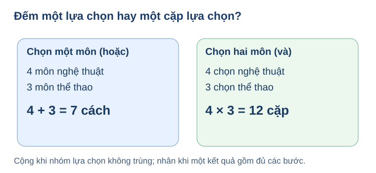
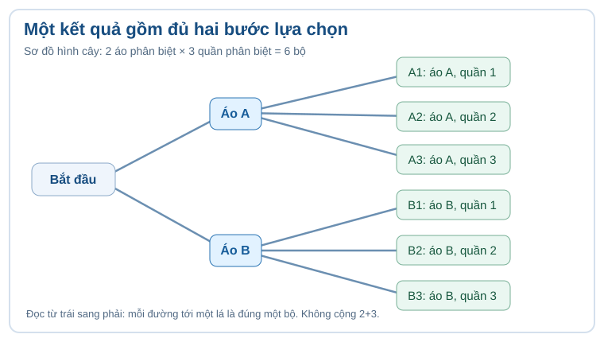
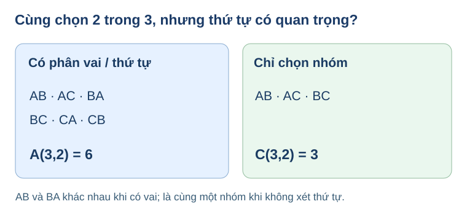
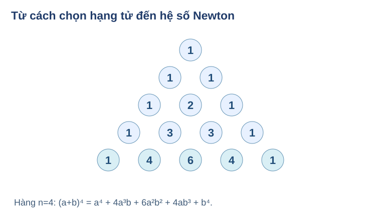

# Chuyên đề 19 — Đại số tổ hợp và Nhị thức Newton

<!-- CURRENT_R11_ONE_LEARNER_AUTHORING_TARGETED_DELTA_20261121; PREVIOUS_R09_SOURCE_BLOB: 2b46a2c92004f2c030d030e2b2021a34157bc95d; CURRENT_Q18_EVIDENCE_EXTERNAL_SOURCE_LOCK; PREVIOUS_R08_SOURCE_BLOB: 989c648e2218096aa63696e1852562d79f40949c; G10_SGK_SHARED_CANONICAL_JS_BLOB: 2ae62fada28913ec336b3507684408a1e05a3232; EXACT_25_SOURCE_DISPLAYS; PUBLIC_SELF_CHECK_ONLY; NO_RD1; NO_RELEASE -->

# Kiến thức

Trong hội chợ của lớp, ban tổ chức cần chọn câu lạc bộ tham gia, ghép áo với huy hiệu thành bộ quà, lập mã thẻ và phân vai cho một nhóm học sinh. Mỗi việc có một cách đếm khác nhau: chọn một phương án, ghép các lựa chọn qua nhiều bước, xếp theo thứ tự hoặc chọn nhóm không xét thứ tự. Ta sẽ lần lượt tìm hiểu các cách đếm ấy rồi dùng chúng để giải thích vì sao khai triển \((a+b)^4\) có các hệ số \(1,4,6,4,1\). Điểm xuất phát luôn là câu hỏi: **một kết quả gồm những gì và khi nào hai kết quả được coi là khác nhau?**

**Cần biết trước (được ôn ngay tại đây):** phép nhân/cộng số tự nhiên, tập hợp rời nhau, đếm ô trống, lũy thừa của biểu thức, biến và hệ số đa thức. Không bắt người học mở SGK hoặc Topic khác mới hiểu khái niệm bắt buộc.

## 1. Quy tắc đếm và chia trường hợp

**Cách đọc cây:** Đi từ nút “Bắt đầu”, mỗi lần chọn một áo rồi một quần. Hai nhánh áo A/B, mỗi nhánh có ba lá A1,A2,A3/B1,B2,B3. Mỗi lá là **một kết quả đầy đủ**: \(2\cdot3=6\). Chỉ cần đếm lá để kiểm quy tắc nhân, không đo nhánh qua màu hoặc độ dài.

**Đọc hình:** Khung “hoặc” gồm 4 nhóm nghệ thuật, 3 thể thao không trùng nên \(4+3=7\); khung “và” yêu cầu một mục ở **mỗi** nhóm, nên \(4\cdot3=12\) cặp. Hình mang màu nền trắng; phép đếm không phụ thuộc màu. Chỉ dùng quy tắc cộng đơn giản khi hai danh sách không giao nhau.

[Mở mô hình tương tác công khai: “Hoặc / Và”](Temp_THPT_TOPIC19_COUNT_CHOOSE_PASCAL_R00_20261114.html) — kéo hai số lượng, chuyển chế độ và so liệt kê trước khi áp dụng quy tắc. Mô hình không chấm điểm.

### 1.1. Đếm đúng một lựa chọn: khi nào cộng?

<!-- LESSON_ID: TOP19-M01; OUTCOME_ID: TOP19-O01; ORIGINAL_SGK_SKILL: G10-B23-ADDITION; S1_LESSON: G10-B23; SOURCE_ROLE: SGK_CORE_AUTHORITY -->

Ở hội chợ trường, mỗi học sinh chỉ đăng ký một câu lạc bộ. Nếu hai nhóm câu lạc bộ rời nhau, em có thể gộp số lựa chọn; nhưng nếu một câu lạc bộ nằm trong cả hai danh sách thì cộng thẳng sẽ đếm hai lần.

Một kết quả hoàn chỉnh ở đây chỉ là **một** câu lạc bộ. Chia các kết quả thành các nhóm không trùng nhau rồi cộng số phần tử từng nhóm. Nếu A và B giao nhau, phải trừ phần giao: \(\lvert A\cup B\rvert=\lvert A\rvert+\lvert B\rvert-\lvert A\cap B\rvert\); phần có giao là kiến thức giúp kiểm điều kiện, không thay quy tắc cộng rời nhau của B23.

**Điều kiện áp dụng:** Các trường hợp cộng phải rời nhau hoặc đã sửa đếm trùng; không nhầm “chọn đúng một” với “làm cả hai bước”.

> **PHƯƠNG PHÁP · Quy tắc cộng**
>
> Nếu kết quả thuộc **một trong các trường hợp rời nhau** với số cách lần lượt m và n, số lựa chọn là \(m+n\). Nếu nhóm giao nhau phải trừ phần giao.

**Ví dụ**

**Đề bài:** Một hội chợ có 4 câu lạc bộ nghệ thuật và 3 câu lạc bộ thể thao khác nhau; hai danh sách không trùng nhau. Một học sinh chọn đúng một câu lạc bộ để tham gia. Có bao nhiêu lựa chọn?

**Lời giải:** Một kết quả chỉ là **một** câu lạc bộ, thuộc nhóm nghệ thuật **hoặc** thể thao. Hai nhóm rời nhau nên áp dụng quy tắc cộng: \(4+3=7\) cách. Không nhân \(4\cdot3\), vì học sinh không chọn đồng thời một câu lạc bộ từ mỗi nhóm.

**Vận dụng**

Một tủ sách có 5 truyện khác nhau và 4 sách tranh khác nhau, không có cuốn nào trùng hai nhóm. Chọn đúng một cuốn để đọc. Hỏi có mấy cách?

<!-- ITEM_ID: THPT-TOP19-T01; CONTENT_VERSION: TOP19-R11-20261121-T01; ROLE: TOPIC_FIRST_TRY; PRIMARY_OUTCOME: TOP19-O01; ANSWER_REVEAL: OPT_IN_AFTER_TRY; ASSESSMENT: FORMATIVE_ONLY_NO_MASTERY -->

Đối chiếu

**9 cách**, vì hai nhóm cuốn sách không trùng nhau và mỗi kết quả chỉ lấy đúng một cuốn: \(5+4=9\).

**Kiểm lỗi**

Nếu tính \(5\cdot4\), hãy thử viết một kết quả: chỉ tên **một** cuốn sách, không phải một cặp. Quay lại xem điều kiện “hoặc”. Đọc lại **Kiến thức 1.1**, sau đó thử **Bài luyện 1** và **Bài luyện 3** trong phần Luyện tập; mở lời giải chỉ sau khi tự làm.

Nhớ kiểm chính xác một kết quả cần đếm và điều kiện của nó trước khi dùng công thức.

### 1.2. Một kết quả gồm nhiều bước: khi nào nhân?

<!-- LESSON_ID: TOP19-M02; OUTCOME_ID: TOP19-O02; ORIGINAL_SGK_SKILL: G10-B23-MULTIPLICATION; S1_LESSON: G10-B23; SOURCE_ROLE: SGK_CORE_AUTHORITY -->

Ở hội chợ, để làm một bộ quà học sinh phải chọn cả áo và huy hiệu. Một chiếc áo riêng lẻ chưa phải bộ quà hoàn chỉnh, nên cách đếm khác với chọn chỉ một món.

Nếu có \(m\) kiểu áo và với **mỗi kiểu áo** đều ghép được đúng \(n\) loại huy hiệu, ta có \(m\cdot n\) bộ quà. Phép nhân đúng vì sau bất kỳ lựa chọn áo nào, số cách chọn huy hiệu đều bằng \(n\). Nếu một số kiểu áo ghép được với ít loại huy hiệu hơn, em phải đếm số bộ của từng kiểu áo rồi cộng các kết quả.

**Điều kiện áp dụng:** Các bước phải mô tả **một** kết quả có đủ thành phần; kiểm lựa chọn lặp, phụ thuộc nhánh và giới hạn mỗi bước.

> **PHƯƠNG PHÁP · Quy tắc nhân**
>
> Nếu một kết quả gồm **hai bước**, bước đầu có \(m\) cách và **mỗi cách ở bước đầu đều cho đúng \(n\) cách ở bước sau**, tổng số kết quả là \(m\cdot n\). Các lựa chọn cụ thể ở bước sau có thể khác nhau, nhưng số lượng phải luôn bằng \(n\). Nếu số lượng thay đổi, hãy đếm từng nhánh rồi cộng.

**Vì sao không được máy móc nhân khi các nhánh có số cách khác nhau?** Quy tắc nhân \(m\cdot n\) chỉ đúng nếu **mỗi** kết quả của bước đầu đều có **chính xác \(n\)** cách hoàn thành bước sau. Khi số cách hoàn thành thay đổi theo bước đầu, cách đầy đủ là **đếm từng nhánh rồi cộng số lá**; viết \(n_1+n_2+\cdots+n_m\), không lấy một số \(n\) bất kỳ nhân \(m\). Đây là nối tiếp hợp lệ của quy tắc cộng và sơ đồ cây B23.

**Ví dụ minh họa.** Có ba loại hộp A, B, C; loại A có hai nhãn phù hợp, B có ba nhãn, C chỉ có một nhãn. Một bộ quà gồm một hộp và một nhãn **phù hợp với loại hộp**. Sơ đồ cây có \(2+3+1=6\) lá, không phải \(3\cdot3=9\). Nếu giả sử mỗi hộp đều có 3 nhãn thì sẽ vô tình đếm những bộ không được phép. **Chọn phương pháp:** phải liệt kê số nhãn theo từng loại hộp trước khi viết phép tính.

**Ví dụ**

**Đề bài:** Có 3 kiểu áo và 2 loại huy hiệu. Một bộ quà gồm đúng một kiểu áo và một loại huy hiệu. Có bao nhiêu bộ quà khác nhau?

**Lời giải:** Mỗi kết quả là cặp **(áo, huy hiệu)**, cần đủ cả hai thành phần. Với từng kiểu áo có 2 loại huy hiệu, nên quy tắc nhân cho \(3\cdot2=6\) bộ. Phép cộng \(3+2\) chỉ đếm các món đơn lẻ, không đếm bộ quà.

**Vận dụng**

Có 5 loại áo và 3 kiểu huy hiệu, mỗi loại áo đều có thể ghép với đủ ba kiểu huy hiệu. Mỗi bộ quà gồm đúng một loại áo và một kiểu huy hiệu. Hỏi có bao nhiêu bộ quà khác nhau?

<!-- ITEM_ID: THPT-TOP19-T02; CONTENT_VERSION: TOP19-R11-20261121-T02; ROLE: TOPIC_FIRST_TRY; PRIMARY_OUTCOME: TOP19-O02; ANSWER_REVEAL: OPT_IN_AFTER_TRY; ASSESSMENT: FORMATIVE_ONLY_NO_MASTERY -->

Đối chiếu

**15 bộ.** Với mỗi loại trong 5 loại áo đều có 3 cách chọn huy hiệu, nên theo quy tắc nhân ta có \(5\cdot3=15\) bộ.

**Kiểm lỗi**

Nếu được 8, em có thể đã cộng \(5+3\). Hãy vẽ bảng gồm 5 hàng cho các loại áo và 3 cột cho các kiểu huy hiệu. Mỗi ô là một bộ quà; đếm đủ 15 ô để kiểm tra phép nhân. Đọc lại **Kiến thức 1.2**, sau đó thử **Bài luyện 4** và **Bài luyện 7** trong phần Luyện tập; mở lời giải chỉ sau khi tự làm.

### 1.3. Đếm các số: chữ số đầu và điều kiện lặp

<!-- LESSON_ID: TOP19-M03; OUTCOME_ID: TOP19-O03; ORIGINAL_SGK_SKILL: G10-B23-DIGIT_COUNT; S1_LESSON: G10-B23; SOURCE_ROLE: SGK_CORE_AUTHORITY -->

Mã thẻ học sinh có thể bắt đầu bằng 0, nhưng một số tự nhiên có ba chữ số thì không. Cùng một tập chữ số, hai cách đếm khác nhau vì đối tượng phải đếm khác nhau.

Vẽ ba ô hàng trăm, chục, đơn vị; chọn thứ tự theo ô có điều kiện nghiêm ngặt nhất trước. Khi các chữ số không lặp, số cách chọn giảm sau mỗi ô. Chữ số 0 có thể xuất hiện ở ô sau nhưng không được nằm đầu số ba chữ số.

**Điều kiện áp dụng:** Cần nêu rõ đây là **số** hay **mã**, chữ số đầu có bị cấm 0 không, có được lặp không, và ba vị trí có khác nhau không.

> **GHI NHỚ · Đếm số theo chữ số**
>
> Số tự nhiên nhiều chữ số không thể có chữ số đầu bằng 0. Cần ghi rõ số chữ số, thứ tự, cho lặp hay không và áp dụng quy tắc nhân cho đúng số cách từng ô.

**Ví dụ**

**Đề bài:** Một mã gồm hai ký tự đầu lấy từ \(\{A,B,C,D\}\), được phép lặp, và một chữ số cuối lấy từ 0 đến 9. Có bao nhiêu mã khác nhau? Mã có được kết thúc bằng 0 không?

**Lời giải:** Mỗi ký tự trong hai vị trí đầu có 4 lựa chọn; chữ số cuối có 10 lựa chọn, **kể cả 0**. Theo quy tắc nhân có \(4\cdot4\cdot10=160\) mã. Mã có thể kết thúc bằng 0 vì đề cho phép mọi chữ số từ 0 đến 9 ở vị trí cuối. Số tự nhiên có ba chữ số cũng có thể tận cùng bằng 0 (ví dụ 120); điểm khác biệt là số có ba chữ số không được bắt đầu bằng 0, còn mã có thể bắt đầu bằng 0 nếu quy định của mã cho phép.

**Ví dụ**

**Đề bài:** Từ các chữ số \(\{0,1,2,3\}\), lập các số tự nhiên có đúng ba chữ số **khác nhau**. Có bao nhiêu số?

**Lời giải:** Chữ số hàng trăm không được bằng 0 nên có 3 cách: 1, 2 hoặc 3. Sau đó hàng chục còn 3 chữ số chưa dùng (có thể gồm 0), hàng đơn vị còn 2. Do thứ tự vị trí quan trọng, quy tắc nhân cho \(3\cdot3\cdot2=18\) số. Những chuỗi bắt đầu bằng 0 không phải số tự nhiên có ba chữ số.

**Vận dụng**

Từ \(\{0,1,2,3,4\}\) lập số tự nhiên có hai chữ số khác nhau. Có bao nhiêu số?

<!-- ITEM_ID: THPT-TOP19-T03; CONTENT_VERSION: TOP19-R03; ROLE: TOPIC_FIRST_TRY; PRIMARY_OUTCOME: TOP19-O03; ANSWER_REVEAL: OPT_IN_AFTER_TRY; ASSESSMENT: FORMATIVE_ONLY_NO_MASTERY -->

Đối chiếu

Hàng chục có 4 cách (1–4); hàng đơn vị còn 4 cách (kể cả 0 nếu chưa dùng): \(4\cdot4=16\) số.

**Kiểm lỗi**

Nếu có 20, em đã cho chữ số hàng chục nhận 0. Nếu có 12, em có thể đã loại 0 khỏi cả hàng đơn vị. Đọc lại **Kiến thức 1.3**, sau đó thử **Bài luyện 8** và **Bài luyện 9** trong phần Luyện tập; mở lời giải chỉ sau khi tự làm.

### 1.4. Chia trường hợp khi đếm số chẵn

<!-- LESSON_ID: TOP19-M04; OUTCOME_ID: TOP19-O04; ORIGINAL_SGK_SKILL: G10-B23-CASE_SPLIT; S1_LESSON: G10-B23; SOURCE_ROLE: SGK_CORE_AUTHORITY -->

Nếu yêu cầu số chẵn, chữ số cuối phải chẵn. Nhưng chọn số cuối bằng 0 và bằng 2 có thể làm số cách ở hàng đầu khác nhau; nhân mù một số cố định sẽ sai.

Chia theo chữ số hàng đơn vị thành các nhóm **rời nhau**. Trong từng nhóm, dùng quy tắc nhân cho các ô còn lại; sau đó cộng các nhóm. Cấu trúc là cộng các tích, không phải chọn cộng hay nhân một cách máy móc.

**Điều kiện áp dụng:** Các trường hợp phải phủ hết và không trùng; chữ số 0 đứng đầu bị cấm; không được lặp khi đề nói khác nhau.

> **PHƯƠNG PHÁP · Chia trường hợp**
>
> Chia thành các trường hợp **rời nhau**, đếm từng trường hợp theo điều kiện chữ số cuối/đầu rồi cộng. Không nhân một số cố định nếu số cách ở bước khác thay đổi.

**Kiểm bằng hai cách đếm.** Với chữ số \(\{0,1,2,3,4\}\), đếm số tự nhiên **chẵn có ba chữ số khác nhau** theo chữ số tận cùng. Nếu chữ số cuối là 0 thì hàng trăm có 4 cách, hàng chục có 3 cách: \(4\cdot3=12\). Nếu chữ số cuối là 2 hoặc 4, có 2 cách chọn cuối, hàng trăm không được là 0 và không trùng chữ số cuối nên có 3 cách, hàng chục còn 3 cách: \(2\cdot3\cdot3=18\). Vậy tổng số chẵn là \(12+18=30\). Hai trường hợp rời nhau và phủ hết mọi chữ số chẵn tận cùng; đó là lý do **cộng** hai tích.

**Thử phản biện:** Viết \(3\cdot4\cdot3=36\) vì chữ số cuối có ba lựa chọn chẵn là sai: sau khi chọn 0 ở cuối có 4 cách chọn chữ số đầu, còn sau khi chọn 2 hoặc 4 chỉ có 3. Bài này cũng giúp em kiểm khi nào phải chọn chữ số **cuối trước** thay vì điền lần lượt từ trái qua phải.

**Ví dụ**

**Đề bài:** Từ các chữ số \(\{0,1,2,3,4\}\), lập số tự nhiên **chẵn có ba chữ số khác nhau**. Có bao nhiêu số?

**Lời giải:** Chia hai trường hợp rời nhau theo chữ số cuối. **Cuối là 0:** hàng trăm có 4 cách, hàng chục còn 3, được \(4\cdot3=12\). **Cuối là 2 hoặc 4:** có 2 cách chọn cuối, hàng trăm có 3 lựa chọn khác 0 và khác chữ số cuối, hàng chục còn 3, được \(2\cdot3\cdot3=18\). Hai trường hợp không trùng nên cộng \(12+18=30\) số.

**Vận dụng**

Từ \(\{0,1,2,3\}\) lập số chẵn có hai chữ số khác nhau. Có bao nhiêu số?

<!-- ITEM_ID: THPT-TOP19-T04; CONTENT_VERSION: TOP19-R03; ROLE: TOPIC_FIRST_TRY; PRIMARY_OUTCOME: TOP19-O04; ANSWER_REVEAL: OPT_IN_AFTER_TRY; ASSESSMENT: FORMATIVE_ONLY_NO_MASTERY -->

Đối chiếu

Đơn vị 0: hàng chục có 3 cách; đơn vị 2: hàng chục chỉ 1 hoặc 3, có 2 cách; tổng **\(3+2=5\)** số.

**Kiểm lỗi**

Nếu em nhân \(2\cdot3\), hãy xét riêng đuôi 0: hàng chục có 3 lựa chọn, còn đuôi 2 chỉ có 2. Đọc lại **Kiến thức 1.4**, sau đó thử **Bài luyện 10** và **Bài luyện 12** trong phần Luyện tập; mở lời giải chỉ sau khi tự làm.

Từ đếm từng số hợp lệ, ta chuyển sang đếm các cách sắp người và chọn nhóm; kết quả có hoặc không có thứ tự là câu hỏi quyết định.

## 2. Hoán vị, chỉnh hợp, tổ hợp và công cụ tính

**Đọc hình:** Từ A, B, C, khi có hai **vai khác nhau**: AB,BA là hai kết quả; khi chỉ chọn nhóm hai người, AB và BA trùng nhau. Đếm trực tiếp \(n=3,k=2\) là 6 và 3. Điều kiện là các thành viên phân biệt và không chọn lặp.

[Mở mô hình tương tác công khai: “Chọn nhóm / Phân vai”](Temp_THPT_TOPIC19_COUNT_CHOOSE_PASCAL_R00_20261114.html) — thử \(n=4,k=2\) và \(n=5,k=3\). Cần so **cả danh sách kết quả** để thấy vì sao phải chia \(k!\), không chỉ so hai con số.

### 2.1. Hoán vị: xếp tất cả đối tượng

<!-- LESSON_ID: TOP19-M05; OUTCOME_ID: TOP19-O05; ORIGINAL_SGK_SKILL: G10-B24-PERMUTATION; S1_LESSON: G10-B24; SOURCE_ROLE: SGK_CORE_AUTHORITY -->

Bốn bạn cùng tham gia hội chợ nhưng đứng thành hàng theo thứ tự khác nhau sẽ tạo ra ảnh xếp hàng khác nhau, dù tập bốn bạn không đổi.

Để xếp hết n đối tượng **phân biệt**, vị trí thứ nhất có n lựa chọn, vị trí sau còn \(n-1\),… đến vị trí cuối còn 1. Do đó số hoán vị bằng \(n!=n(n-1)\cdots2\cdot1\); quy ước \(0!=1\) giúp công thức nhất quán với tập rỗng, nghĩa là có đúng một cách sắp xếp không có phần tử nào.

**Điều kiện áp dụng:** Đếm thứ tự của **tất cả** n đối tượng riêng biệt, mỗi đối tượng dùng đúng một lần. Nếu vật trùng nhau thì \(n!\) có thể đếm lặp, cần quy tắc khác.

> **ĐỊNH NGHĨA · HOÁN VỊ**
>
> Với \(n\) đối tượng phân biệt, một hoán vị là một cách **xếp thứ tự toàn bộ n đối tượng**; số hoán vị \(P_n=n!,\quad n\ge1.\)

**Ví dụ**

**Đề bài:** Có bốn cuốn sách Toán, Văn, Anh và Lý phân biệt. Xếp cả bốn cuốn thành một hàng. Có bao nhiêu cách xếp?

**Lời giải:** Vì thay đổi thứ tự làm thay đổi kết quả, đây là **hoán vị của cả bốn đối tượng**. Vị trí đầu có 4 lựa chọn, tiếp theo 3, rồi 2 và 1. Số cách xếp bằng \(4!=4\cdot3\cdot2\cdot1=24\). Không dùng tổ hợp vì tổ hợp không phân biệt thứ tự.

**Vận dụng**

Có 5 học sinh khác nhau xếp thành một hàng, không ràng buộc. Có bao nhiêu thứ tự?

<!-- ITEM_ID: THPT-TOP19-T05; CONTENT_VERSION: TOP19-R03; ROLE: TOPIC_FIRST_TRY; PRIMARY_OUTCOME: TOP19-O05; ANSWER_REVEAL: OPT_IN_AFTER_TRY; ASSESSMENT: FORMATIVE_ONLY_NO_MASTERY -->

Đối chiếu

Hoán vị cả 5 học sinh, mỗi người một vị trí: \(5!=120\).

**Kiểm lỗi**

Nếu em dùng tổ hợp, hãy đổi chỗ hai học sinh; thứ tự hàng đổi thành kết quả khác, do đó phải đếm tất cả thứ tự. Đọc lại **Kiến thức 2.1**, sau đó thử **Bài luyện 14** và **Bài luyện 17** trong phần Luyện tập; mở lời giải chỉ sau khi tự làm.

### 2.2. Chỉnh hợp: chọn một số rồi phân vai

<!-- LESSON_ID: TOP19-M06; OUTCOME_ID: TOP19-O06; ORIGINAL_SGK_SKILL: G10-B24-ARRANGEMENT; S1_LESSON: G10-B24; SOURCE_ROLE: SGK_CORE_AUTHORITY -->

Hội chợ có ban ba người giữ ba vai trưởng, thư ký, thủ quỹ. Chọn đúng ba bạn nhưng đổi người giữ vai sẽ thay đổi kết quả.

Chỉnh hợp chập k của n phần tử phân biệt là chọn k phần tử **có thứ tự**, không lặp. Vị trí đầu có n cách, kế có \(n-1\),… k vị trí: \(A_n^k=\frac{n!}{(n-k)!}\).

**Điều kiện áp dụng:** \(1\le k\le n\) với n và k nguyên; trường hợp \(k=0\) là quy ước mở rộng. Các vai/ô có phân biệt thứ tự, mỗi đối tượng chỉ nhận một vai. Không dùng công thức này khi một người được giữ nhiều vai nếu đề cho phép.

> **ĐỊNH NGHĨA · CHỈNH HỢP**
>
> Chỉnh hợp chập \(k\) của \(n\) phần tử phân biệt là chọn \(k\) phần tử **có thứ tự, không lặp**. \(A_n^k=\frac{n!}{(n-k)!},\qquad 1\le k\le n.\) **Điều kiện trong nội dung SGK:** \(n,k\) nguyên, \(n\ge1\). Quy ước trường hợp \(k=0\) là một mở rộng của phép đếm rỗng, không trình bày như định nghĩa bắt buộc ở đây.

**Ví dụ**

**Đề bài:** Từ 5 học sinh khác nhau, chọn ba bạn giữ ba vai **trưởng nhóm, thư ký, thủ quỹ**, mỗi bạn một vai và không kiêm nhiệm. Có bao nhiêu cách?

**Lời giải:** Ba vai khác nhau nên cùng bộ ba người nhưng đổi vai tạo kết quả khác. Chọn trưởng có 5 cách, thư ký còn 4, thủ quỹ còn 3. Theo quy tắc nhân, \(A_5^3=5\cdot4\cdot3=60\) cách. Đây là chỉnh hợp vì chọn **một phần** số người và **phân thứ tự theo vai**.

**Vận dụng**

Từ 6 bạn chọn một trưởng nhóm và một phó nhóm khác nhau. Có bao nhiêu cách?

<!-- ITEM_ID: THPT-TOP19-T06; CONTENT_VERSION: TOP19-R03; ROLE: TOPIC_FIRST_TRY; PRIMARY_OUTCOME: TOP19-O06; ANSWER_REVEAL: OPT_IN_AFTER_TRY; ASSESSMENT: FORMATIVE_ONLY_NO_MASTERY -->

Đối chiếu

Hai vai phân biệt, lần lượt 6 rồi 5 lựa chọn: \(A_6^2=30\).

**Kiểm lỗi**

Nếu ra 15, em đang coi A làm trưởng/B làm phó giống B trưởng/A phó; hãy viết hai kết quả để thấy khác. Đọc lại **Kiến thức 2.2**, sau đó thử **Bài luyện 18** và **Bài luyện 20** trong phần Luyện tập; mở lời giải chỉ sau khi tự làm.

### 2.3. Tổ hợp: chỉ chọn nhóm, không phân vai

<!-- LESSON_ID: TOP19-M07; OUTCOME_ID: TOP19-O07; ORIGINAL_SGK_SKILL: G10-B24-COMBINATION; S1_LESSON: G10-B24; SOURCE_ROLE: SGK_CORE_AUTHORITY -->

Nhóm bạn đại diện đi thi không phân vai. Viết nhóm AB hay BA vẫn cùng hai người, nên phép đếm có thứ tự đang đếm nhiều lần một nhóm.

Mỗi nhóm k người có đúng \(k!\) cách hoán đổi thứ tự (k người phân biệt). Vì chỉnh hợp đã đếm mỗi nhóm \(k!\) lần, số nhóm \(C_n^k=\frac{A_n^k}{k!}=\frac{n!}{k!(n-k)!}\). Đây là số tập con k phần tử, không phải công thức học riêng khỏi chỉnh hợp.

**Điều kiện áp dụng:** \(0\le k\le n\) là số nguyên; nhóm không phân vai/không xét thứ tự và mỗi người chỉ chọn một lần. \(C_n^0=C_n^n=1\); \(C_n^k=C_n^{n-k}\) do chọn người cũng tương ứng chọn nhóm không được chọn.

> **ĐỊNH NGHĨA · TỔ HỢP**
>
> Tổ hợp chập k của n phần tử phân biệt là chọn k phần tử **không xét thứ tự, không lặp**. \(C_n^k=\binom nk=\frac{n!}{k!(n-k)!}.\)

**Ba mối liên hệ giúp tự kiểm công thức**, không phải ba công thức rời rạc. Với tập gồm \(n\) phần tử phân biệt và \(0\le k\le n\):

1. Chọn \(k\) người tham gia tương đương **chọn \(n-k\) người không tham gia**, nên \(\binom nk=\binom n{n-k}\).
2. Cố định một người \(P\); mọi nhóm \(k\) người chia thành **hai trường hợp rời nhau**: nhóm có P — chọn thêm \(k-1\) trong \(n-1\) người; nhóm không có P — chọn \(k\) trong \(n-1\) người. Vì vậy \(\binom nk=\binom{n-1}{k-1}+\binom{n-1}{k}\) với \(1\le k\le n-1\).
3. Nếu đã chọn \(k\) người rồi phân \(k\) vai khác nhau, mỗi nhóm có \(k!\) cách phân vai, nên \(A_n^k=k!\,C_n^k\). Không nhân thêm \(k!\) khi đề **chỉ hỏi chọn nhóm**.

**Ví dụ minh họa.** Chọn 3 trong 5 học sinh: \(\binom53=10\). Chia theo việc bạn A có mặt: chọn thêm 2 từ 4 người \(\binom42=6\) nhóm; không có A: \(\binom43=4\) nhóm. Tổng \(6+4=10\). Cách kiểm đối xứng là \(\binom53=\binom52=10\); cả ba cách phải khớp nếu đã xác định đúng **đối tượng được đếm**.

**Ví dụ**

**Đề bài:** Từ 5 học sinh phân biệt, chọn một nhóm 2 người, **không phân vai**. Có bao nhiêu nhóm?

**Lời giải:** Nếu chọn có thứ tự, có \(5\cdot4=20\) cặp; nhưng mỗi nhóm hai người đã bị đếm hai lần, ví dụ AB và BA. Chia cho \(2!=2\) để được \(C_5^2=\frac{20}{2}=10\) nhóm. Vì không phân vai, không dùng 20 làm đáp số.

**Vận dụng**

Chọn một nhóm 3 người từ 6 người khác nhau, không phân vai. Có bao nhiêu nhóm?

<!-- ITEM_ID: THPT-TOP19-T07; CONTENT_VERSION: TOP19-R03; ROLE: TOPIC_FIRST_TRY; PRIMARY_OUTCOME: TOP19-O07; ANSWER_REVEAL: OPT_IN_AFTER_TRY; ASSESSMENT: FORMATIVE_ONLY_NO_MASTERY -->

Đối chiếu

\(C_6^3=\frac{6\cdot5\cdot4}{3\cdot2\cdot1}=20\) nhóm.

**Kiểm lỗi**

Nếu em ra 120, đó là số thứ tự của bộ ba; mỗi nhóm bị đếm \(3!=6\) lần, phải chia 6. Đọc lại **Kiến thức 2.3**, sau đó thử **Bài luyện 21** và **Bài luyện 22** trong phần Luyện tập; mở lời giải chỉ sau khi tự làm.

### 2.4. Chọn nhóm có điều kiện và phân vai sau

<!-- LESSON_ID: TOP19-M08; OUTCOME_ID: TOP19-O08; ORIGINAL_SGK_SKILL: G10-B24-CONSTRAINTS; S1_LESSON: G10-B24; SOURCE_ROLE: SGK_CORE_AUTHORITY -->

Đội hội chợ cần đủ nữ và nam, nhưng chỉ chọn bốn người không phân vai. Ta cần đếm đúng thành phần trước; nếu sau đó chỉ định trưởng nhóm mới nhân thêm số cách chọn trưởng.

Cố định số lượng ở từng nhóm rời nhau rồi dùng tổ hợp từng nhóm; nhân vì một kết quả cần đủ các phần; nếu có nhiều cấu hình thành phần khác nhau thì cộng các tích. Nếu sau khi chọn nhóm phân vai, nhân tiếp số cách phân vai **trong từng nhóm**.

**Điều kiện áp dụng:** Các nhóm người ban đầu không giao; ràng buộc “đúng” hay “ít nhất” phải đọc chính xác; không nhân thêm vai trò khi đề không có.

> **PHƯƠNG PHÁP · Chọn nhóm theo điều kiện**
>
> Đếm số cách chọn mỗi nhóm bằng tổ hợp, nhân khi cần lựa chọn ở các nhóm đồng thời; chỉ sau khi nhóm đã chọn mới nhân số cách phân vai nếu đề yêu cầu.

**Ví dụ**

**Đề bài:** Có 5 học sinh nữ và 4 học sinh nam. (a) Chọn một nhóm 3 người gồm **đúng 2 nữ, 1 nam**, không phân vai. (b) Nếu sau đó chọn thêm một đội trưởng từ ba thành viên đã chọn, có bao nhiêu nhóm **có đội trưởng**?

**Lời giải:** (a) Chọn 2 nữ có \(C_5^2=10\) nhóm, chọn 1 nam có \(C_4^1=4\) cách. Hai lựa chọn kết hợp thành một nhóm nên có \(10\cdot4=40\) nhóm. (b) Với mỗi nhóm có 3 lựa chọn đội trưởng, nên có \(40\cdot3=120\) nhóm có đội trưởng. Chỉ nhân 3 ở câu (b), vì câu (a) không phân vai.

**Vận dụng**

Từ 4 bạn nữ và 3 bạn nam chọn nhóm 3 người gồm đúng 2 nữ, 1 nam, không phân vai. Bao nhiêu nhóm?

<!-- ITEM_ID: THPT-TOP19-T08; CONTENT_VERSION: TOP19-R03; ROLE: TOPIC_FIRST_TRY; PRIMARY_OUTCOME: TOP19-O08; ANSWER_REVEAL: OPT_IN_AFTER_TRY; ASSESSMENT: FORMATIVE_ONLY_NO_MASTERY -->

Đối chiếu

Chọn 2 nữ trong 4: \(C_4^2=6\); chọn 1 nam trong 3: 3. Nhân: **18** nhóm.

**Kiểm lỗi**

Nếu tính \(A_4^2\cdot3\), em đã phân biệt thứ tự hai nữ; bài này chỉ chọn nhóm nên dùng tổ hợp. Đọc lại **Kiến thức 2.4**, sau đó thử **Bài luyện 23** và **Bài luyện 25** trong phần Luyện tập; mở lời giải chỉ sau khi tự làm.

Hãy tự kiểm thử \(n!\), nPr và nCr ở mục Kiến thức 2.5 để nhớ khi nào kết quả là một **nhóm** và khi nào là **danh sách có thứ tự**. Sau đó \(C_n^k\) sẽ trở thành hệ số trong khai triển Newton.

### 2.5. Máy tính cầm tay hỗ trợ tính n!, chỉnh hợp và tổ hợp — và cách tự kiểm kết quả

<!-- LESSON_ID: TOP19-M14; OUTCOME_ID: TOP19-O14; ORIGINAL_SGK_SKILL: G10-B24-CALCULATOR_N_FACTORIAL_NPR_NCR; S1_LESSON: G10-B24; S1_PRINT_PAGE: 70; SOURCE_ROLE: SGK_CORE_AUTHORITY; SOURCE_STATUS: DIRECT_ORIGINAL_PDF_VERIFIED -->

Khi số phần tử tăng lên, việc nhân thủ công dễ mất thời gian và sai số. Bài học phần này hướng dẫn dùng máy tính cầm tay để tính **hoán vị, chỉnh hợp, tổ hợp**. Máy chỉ giúp tính số nhanh hơn; em vẫn phải hiểu bài toán là **xếp có thứ tự hay chọn nhóm**, nếu không máy sẽ cho đúng phép tính nhưng sai phương pháp.

Trước hết hãy viết rõ ý nghĩa và đối số: \(n!\) là số cách xếp hết n vật; `nPr` (hay \(A_n^k\)) là chọn k vật **có thứ tự** từ n; `nCr` (hay \(C_n^k\)) là chỉ chọn k vật **không thứ tự**. Một số máy có menu xác suất/hoán vị/tổ hợp, máy khác cần phím `SHIFT` hoặc tổ hợp phím riêng; **không có một chuỗi phím chung cho mọi mẫu máy**. Trên máy đang dùng, tìm chức năng được ghi `x!`, `nPr`, `nCr` trong hướng dẫn/nhãn phím, nhập đúng n rồi k, nhấn dấu bằng. Nếu máy không có chức năng này, em dùng các tích ngắn và chia bằng tay; kiến thức phải tự đủ, không phụ thuộc thương hiệu máy.

**Điều kiện áp dụng:** n và k nguyên, \(n\ge0\), \(0\le k\le n\); số hoán vị/chỉnh hợp/tổ hợp luôn không âm và nguyên. Để kiểm kết quả, dùng \(A_n^k=C_n^k\cdot k!\). Lưu ý `nPr` không phải `nCr`; giới hạn số lớn của máy có thể gây tràn, không được xem hiển thị `E` hoặc kết quả thập phân xấp xỉ là số cách chính xác nếu đề đếm hữu hạn.

> **PHƯƠNG PHÁP · Máy tính cầm tay**
>
> Các phép \(n!\), \(\operatorname{nPr}\), \(\operatorname{nCr}\) giúp tính số khi đã xác định đúng **xếp hết, chọn và xếp k, hay chọn k không thứ tự**. Dùng máy để kiểm phép tính, không thay bước nhận dạng mô hình.

**Ví dụ**

**Đề bài:** Dùng máy tính cầm tay (nếu có chức năng phù hợp) và phép tính tay để xác định: (a) số cách xếp cả 6 sách khác nhau; (b) số cách phân hai chức danh khác nhau từ 8 người; (c) số nhóm 2 người không phân vai chọn từ 8 người.

**Lời giải:** (a) Dùng \(6!\), kiểm bằng \(6\cdot5\cdot4\cdot3\cdot2\cdot1=720\). (b) Vì hai chức danh khác nhau, dùng \(8\operatorname{nPr}2=A_8^2=8\cdot7=56\). (c) Vì chỉ chọn nhóm, dùng \(8\operatorname{nCr}2=C_8^2=\frac{56}{2}=28\). Máy chỉ tính phép đã chọn; trước khi bấm phải xác định **có xét thứ tự hay không**.

**Vận dụng**

Từ 8 ứng viên khác nhau, chọn 3 bạn giữ ba vai trò phân biệt. Hãy (a) xác định phép tính máy cần dùng, (b) cho số cách và (c) tự kiểm bằng tích không cần máy.

<!-- ITEM_ID: THPT-TOP19-T14; CONTENT_VERSION: TOP19-R03; ROLE: TOPIC_FIRST_TRY; PRIMARY_OUTCOME: TOP19-O14; ANSWER_REVEAL: OPT_IN_AFTER_TRY; ASSESSMENT: FORMATIVE_ONLY_NO_MASTERY -->

Đối chiếu

Ba vai khác nhau, nên dùng **nPr** (chỉnh hợp): \(A_8^3=8\cdot7\cdot6=336\) cách. Trên máy có `nPr`, tính `8 nPr 3`; trên máy không có, nhân ba số giảm dần \(8\cdot7\cdot6\). Không dùng \(C_8^3\) vì đó là chọn **nhóm không phân vai**.

**Kiểm lỗi**

Nếu kết quả ra 56, em mới chọn hai vai thay vì ba. Nếu ra \(C_8^3=56\), em quên **ba vai phân biệt**; so \(A_8^3=C_8^3\cdot3!=56\cdot6=336\). Quay lại Kiến thức 2.2–2.3 để phân biệt kết quả có thứ tự và không có thứ tự. Đọc lại **Kiến thức 2.5**, sau đó thử **Bài luyện 20** và **Bài luyện 27** trong phần Luyện tập; mở lời giải chỉ sau khi tự làm.

Các giá trị tổ hợp \(C_n^k\) tính bằng chức năng `nCr` trên máy không phải một loại hệ số bí ẩn: chúng chính là số cách chọn k vị trí trong n thừa số của nhị thức. Bây giờ em có thể nhìn tam giác Pascal và hiểu vì sao các số tổ hợp trở thành hệ số Newton.

## 3. Nhị thức Newton và các vận dụng

**Đọc hình:** Hàng thứ tư 1,4,6,4,1 giải thích hệ số của \((a+b)^4\). Số 6 ở giữa nhận từ \(3+3\) của hàng trên, đồng thời bằng \(C_4^2\) là số cách lấy hai vị trí b. Đây là kết nối **tổ hợp → hệ số**, không phải công thức cần nhớ rời nhau.

[Mở mô hình tương tác công khai: “Hệ số Newton \(n=4,5\)”](Temp_THPT_TOPIC19_COUNT_CHOOSE_PASCAL_R00_20261114.html) — đổi k và đọc hạng tử, không dùng ngoài phạm vi \(n=4,5\) khi chưa học mở rộng.

### 3.1. Nhị thức Newton: hệ số là số cách chọn vị trí

<!-- LESSON_ID: TOP19-M09; OUTCOME_ID: TOP19-O09; ORIGINAL_SGK_SKILL: G10-B25-NEWTON_EXPANSION; S1_LESSON: G10-B25; SOURCE_ROLE: SGK_CORE_AUTHORITY -->

Khi khai triển \((a+b)^4\), ta nhân bốn thừa số \((a+b)\). Mỗi lần tạo một hạng tử, ta chọn \(a\) hoặc \(b\) từ từng thừa số. Vì thế, hệ số của một hạng tử được xác định bằng số cách chọn các vị trí lấy \(b\); chẳng hạn chọn đúng hai trong bốn vị trí có 6 cách.

Để nhận hạng tử \(a^{n-k}b^k\) trong \((a+b)^n\), chọn đúng k trong n vị trí lấy b, các vị trí còn lại lấy a. Có \(C_n^k\) cách. Vì thế khai triển là tổng các hạng tử \(\binom nk a^{n-k}b^k\), trong đó \(\binom nk\) là hệ số tổ hợp. Ở Toán 10, trước tiên luyện hai trường hợp \(n=4\) và \(n=5\); công thức tổng quát là phần mở rộng.

**Điều kiện áp dụng:** n là số nguyên không âm; trong chương này đặc biệt dùng \(n=4\) hoặc \(n=5\). Hệ số là số cách chọn vị trí, không phải số lần ta viết chữ b trong một tích.

> **CÔNG THỨC · Nhị thức Newton**
>
> \((a+b)^n=\sum_{k=0}^{n}\binom nk a^{n-k}b^k,\qquad n\in\mathbb N.\) Hệ số \(\binom nk\) đếm số cách chọn \(k\) vị trí lấy \(b\) trong \(n\) thừa số. **Phạm vi học:** Trước tiên luyện trường hợp \(n=4\) và \(n=5\) ở Toán 10; ký hiệu tổng \(\sum\) cho số mũ tổng quát là **kiến thức mở rộng**, không coi là yêu cầu bắt buộc của bài Toán 10.

**Vì sao hệ số giữa là \(6\) trong \((a+b)^4\)?** Bốn thừa số \((a+b)\) có bốn **vị trí phân biệt**. Để tạo \(a^2b^2\), em chọn hai vị trí lấy \(b\) trong bốn vị trí, tức chọn cặp vị trí \(\{1,2\},\{1,3\},\{1,4\},\{2,3\},\{2,4\},\{3,4\}\) — đúng \(C_4^2=6\) cách. Các tích thu được đều có cùng dạng \(a^2b^2\), nên chúng được cộng hệ số. Điều này **giải thích**, không chỉ ghi nhớ, dãy \(1,4,6,4,1\).

**Ví dụ minh họa.** Trong \((2x+3)^4\), hệ số của \(x^2\) phải lấy đúng **hai** vị trí \(2x\) và hai vị trí \(3\): \(C_4^2(2^2)(3^2)=6\cdot4\cdot9=216\). Đừng lấy \(C_4^2\) một mình vì hệ số của từng hạng tử \(2x\) và \(3\) cũng đóng góp. Kiểm nhanh: mỗi tích tạo \(x^2\) có giá trị \(36x^2\), xuất hiện sáu lần.

**Ví dụ**

**Đề bài:** Xét khai triển \((a+b)^4\). (a) Tìm hệ số của \(a^2b^2\). (b) Viết khai triển đầy đủ.

**Lời giải:** (a) Để tạo \(a^2b^2\), ta chọn 2 trong 4 vị trí dùng \(b\), có \(C_4^2=6\) cách, nên hệ số là **6**. (b) Theo số lần chọn \(b\) từ 0 đến 4, khai triển là \((a+b)^4=a^4+4a^3b+6a^2b^2+4ab^3+b^4\). Hệ số nhị thức xuất phát từ **số cách chọn vị trí**, không phải số lần viết lại một hạng tử.

**Vận dụng**

Hệ số của \(x^3\) trong \((x+3)^4\) bằng bao nhiêu? Giải thích số cách chọn ba thừa số chứa x và hệ số của thừa số còn lại.

<!-- ITEM_ID: THPT-TOP19-T09; CONTENT_VERSION: TOP19-R11-20261121-T09; ROLE: TOPIC_FIRST_TRY; PRIMARY_OUTCOME: TOP19-O09; ANSWER_REVEAL: OPT_IN_AFTER_TRY; ASSESSMENT: FORMATIVE_ONLY_NO_MASTERY -->

Đối chiếu

Muốn \(x^3\) chọn x tại 3 trong 4 vị trí: \(C_4^3=4\) cách; vị trí còn lại phải chọn 3, nên hệ số là \(4\cdot3=12\).

**Kiểm lỗi**

Nếu em chép số 4 ở hàng \(n=4\) của tam giác Pascal thì mới đếm số cách chọn vị trí, chưa nhân hệ số 3 của thừa số không chứa x. Viết rõ ba lần chọn x và một lần chọn 3: \(C_4^3\cdot3=12\). Đọc lại **Kiến thức 3.1**, sau đó thử **Bài luyện 28** và **Bài luyện 30** trong phần Luyện tập; mở lời giải chỉ sau khi tự làm.

### 3.2. Khai triển có dấu âm: dấu đến từ số lần chọn

<!-- LESSON_ID: TOP19-M10; OUTCOME_ID: TOP19-O10; ORIGINAL_SGK_SKILL: G10-B25-COEFFICIENT_SIGN; S1_LESSON: G10-B25; SOURCE_ROLE: SGK_CORE_AUTHORITY -->

Cùng hệ số tổ hợp nhưng (x−2)^5 có hạng tử dương và âm. Nếu chỉ nhớ 'dấu xen kẽ' mà không xét số lần chọn −2, ta rất dễ sai.

Trong \((u+v)^n\), hạng tử ứng với việc chọn \(v\) đúng \(k\) lần là \(\binom nk u^{n-k}v^k\); hệ số tổ hợp là \(\binom nk\). Nếu \(u>0,\ v<0\), dấu của hạng tử là \((-1)^k\). Khi hỏi hệ số \(x^m\), tìm số lần chọn bằng cách giải phương trình số mũ trước rồi mới tính dấu.

**Điều kiện áp dụng:** Với đa thức, số mũ x là không âm; không nhầm thứ tự k là số lần lấy hạng tử thứ hai. Đặc biệt \(0\le k\le n\).

> **TÍNH CHẤT · Dấu của hạng tử**
>
> \((a-b)^n=\sum_{k=0}^{n}(-1)^k\binom nk a^{n-k}b^k.\) Dấu \((-1)^k\) đến từ chọn \(-b\) k lần, không tự gắn dấu theo vị trí nhìn vào biểu thức.

**Cách tránh nhầm dấu và số mũ.** Khi tìm hệ số của \(x^m\) trong \((ax+b)^n\), với \(n\) nguyên không âm và \(a,b\) là số thực, hạng tử chọn \(b\) đúng \(k\) lần có dạng

\[
\binom nk (ax)^{n-k}b^k=\binom nk a^{n-k}b^k x^{n-k}.
\]

Vì vậy phải giải **\(n-k=m\)**, kiểm \(k\) là số nguyên từ \(0\) đến \(n\), rồi mới tính hệ số. Nếu \(b<0\), dấu đến từ \(b^k\); nếu \(a<0\), dấu còn phụ thuộc vào \(a^{n-k}\), nên không có quy tắc “dấu xen kẽ” áp dụng mù cho mọi nhị thức.

**Ví dụ minh họa.** Tìm hệ số \(x^3\) trong \((2x-3)^5\): ta cần \(5-k=3\Rightarrow k=2\). Hệ số là \(\binom52 2^3(-3)^2=10\cdot8\cdot9=720\), dương vì lấy \(-3\) **hai lần**. Không nhầm với \(\binom53=10\) rồi bỏ qua lũy thừa \(2^3\).

**Ví dụ**

**Đề bài:** Tìm hệ số của \(x^3\) trong khai triển \((2x-1)^5\). Giải thích dấu của hệ số.

**Lời giải:** Chọn \(-1\) đúng \(k\) lần thì lũy thừa còn lại là \((2x)^{5-k}\). Muốn số mũ của \(x\) bằng 3 phải có \(5-k=3\), suy ra \(k=2\). Hệ số là \(C_5^2\cdot 2^3\cdot(-1)^2=10\cdot8=80\). Dấu dương vì hạng tử âm được chọn **hai lần**.

**Vận dụng**

Hệ số \(x^2\) trong \((x-2)^4\) là bao nhiêu?

<!-- ITEM_ID: THPT-TOP19-T10; CONTENT_VERSION: TOP19-R03; ROLE: TOPIC_FIRST_TRY; PRIMARY_OUTCOME: TOP19-O10; ANSWER_REVEAL: OPT_IN_AFTER_TRY; ASSESSMENT: FORMATIVE_ONLY_NO_MASTERY -->

Đối chiếu

Muốn \(x^2\) thì \(k=2\) lần chọn −2. Hệ số \(C_4^2(-2)^2=6\cdot4=24\).

**Kiểm lỗi**

Nếu ra −24, kiểm lại: chọn −2 hai lần thì tích dương; dấu phụ thuộc k chẵn/lẻ. Đọc lại **Kiến thức 3.2**, sau đó thử **Bài luyện 31** và **Bài luyện 36** trong phần Luyện tập; mở lời giải chỉ sau khi tự làm.

### 3.3. Nhị thức Newton để ước lượng tăng trưởng: không nhầm gần đúng với chính xác

<!-- LESSON_ID: TOP19-M13; OUTCOME_ID: TOP19-O13; ORIGINAL_SGK_SKILL: G10-B25-BINOMIAL_APPROX_APPLICATION; S1_LESSON: G10-B25; S1_PRINT_PAGE: 75; SOURCE_ROLE: SGK_CORE_AUTHORITY; SGK_EXERCISES: 8.15_AND_8.16_ORIGINAL_CONTEXT_NOT_COPIED -->

Hội chợ muốn ước tính nhanh lượng đơn đặt hàng sau vài đợt tăng trưởng. Nhân lặp (1+r)^5 có thể tính chính xác bằng máy, nhưng đôi khi ta chỉ cần **ước lượng có lý do** và biết mình đang bỏ qua phần nào.

Nếu lượng ban đầu \(N_0\) tăng tỉ lệ r (viết dạng số thập phân) ở cuối mỗi năm, sau 5 năm ta có \(N_5=N_0(1+r)^5\). Nhị thức Newton cho \((1+r)^5=1+5r+10r^2+10r^3+5r^4+r^5\). Khi \(0<r\ll1\), các hạng chứa \(r^2,r^3,\ldots\) nhỏ hơn nhiều so với \(5r\). **Hai số hạng đầu** cho ước tính \(N_5\approx N_0(1+5r)\), chứ không phải một đẳng thức chính xác.

**Điều kiện áp dụng:** r>-1 để hệ số tăng hằng năm không âm theo mô hình thực tế, và chỉ khi |r| nhỏ mới hy vọng bỏ qua các hạng bậc cao mà vẫn gần chính xác. Với r>0, các hạng bỏ đi đều dương, nên dùng hai số hạng đầu **ước lượng thấp hơn** số chính xác. Phải nêu rõ đơn vị số lượng, thời gian và giả thiết tỉ lệ mỗi năm như nhau.

> **PHƯƠNG PHÁP — Ước tính tăng trưởng (vận dụng)**
>
> \((1+r)^5=1+5r+10r^2+10r^3+5r^4+r^5.\) Khi \(|r|\) nhỏ, có thể dùng \(1+5r\) để **ước lượng**, nhưng phải nêu phần còn bỏ và không gọi là đẳng thức chính xác.

**Ví dụ**

**Đề bài:** Một kho có 1.000 bộ dụng cụ và số lượng tăng **2% mỗi năm trong 5 năm**, theo cùng tỉ lệ tăng trưởng. (a) Ước lượng lượng cuối kỳ bằng hai số hạng đầu của \((1+r)^5\). (b) So sánh với phép tính đủ năm năm và giải thích độ lệch.

**Lời giải:** Đổi \(2\%\) thành \(r=0{,}02\). (a) Lấy hai số hạng đầu \((1+r)^5\approx1+5r\), được \(1000(1+5\cdot0{,}02)=1100\) bộ. (b) Giá trị theo mô hình tăng trưởng kép là \(1000(1{,}02)^5\approx1104{,}08\) bộ, lớn hơn ước lượng khoảng \(4{,}08\) bộ. Phần bị bỏ qua gồm \(10r^2+10r^3+5r^4+r^5>0\) khi \(r>0\), nên ước lượng **không phải giá trị chính xác**.

**Vận dụng**

Một kho ban đầu có 5 000 bộ dụng cụ, tăng 1% mỗi năm theo cùng tỉ lệ, trong 5 năm. Dùng **hai số hạng đầu** của (1+0,01)^5 để ước tính số bộ cuối kỳ và nêu vì sao đây không phải giá trị đúng tuyệt đối.

<!-- ITEM_ID: THPT-TOP19-T13; CONTENT_VERSION: TOP19-R03; ROLE: TOPIC_FIRST_TRY; PRIMARY_OUTCOME: TOP19-O13; ANSWER_REVEAL: OPT_IN_AFTER_TRY; ASSESSMENT: FORMATIVE_ONLY_NO_MASTERY -->

Đối chiếu

\(r=0{,}01\). Hai số hạng đầu là \(1+5r=1{,}05\). Do đó \(5000\cdot1{,}05=5250\) bộ (ước tính). Các hạng bậc 2 trở lên đều dương nên số thực tế mô hình \(5000\cdot1{,}01^5\) lớn hơn 5 250 một ít.

**Kiểm lỗi**

Nếu tính \(5000(1+0{,}01)\) mà bỏ mũ 5, em mới tính tăng một năm. Quay lại Kiến thức 3.1 để viết năm thừa số rồi đọc hệ số của r là \(C_5^1=5\). Nếu viết dấu bằng chính xác, hãy chỉ phần \(r^2\) còn bị bỏ qua. Đọc lại **Kiến thức 3.3**, sau đó thử **Bài luyện 29** và **Bài luyện 38** trong phần Luyện tập; mở lời giải chỉ sau khi tự làm.

Em đã dùng quy tắc nhân trong đếm bước, tổ hợp trong chọn nhóm và chính số tổ hợp làm hệ số để ước lượng một mô hình thực tế. Không thay một ước lượng bằng kết quả chính xác khi đề yêu cầu độ sai số.

**Mở rộng sau mạch SGK bắt buộc (tự chọn)**

Hai chặng tiếp theo giúp giải các bài SBT có lũy thừa \(\frac1x\) hoặc nhận biết tổng hệ số qua \(P(1)\). Đây là phần **mở rộng**, không phải điều kiện tiên quyết để học Bài 25 trong SGK; có thể học sau khi em đã làm bài Vận dụng ở Kiến thức 3.3.

### 3.4. Số hạng không chứa x: từ đa thức đến mở rộng phân thức

<!-- LESSON_ID: TOP19-M11; OUTCOME_ID: TOP19-O11; ORIGINAL_SGK_SKILL: G10-B25-CONSTANT_TERM; S1_LESSON: G10-B25; SOURCE_ROLE: SGK_CORE_POLYNOMIAL_CONSTANT_WITH_SBT_OPTIONAL_RECIPROCAL -->

Trong \((3x-2)^5\), mỗi thừa số cho hai lựa chọn: \(3x\) hoặc \(-2\). Số hạng **không chứa \(x\)** xuất hiện khi ta chọn \(-2\) ở cả năm thừa số, tức không chọn \(3x\) lần nào. Như vậy, ta tìm số hạng tự do ngay từ cách chọn hạng tử của từng thừa số, không cần ghi nhớ một mẹo riêng.

Trong khai triển \((ax+b)^n\), nếu chọn \(b\) đúng \(k\) lần thì số mũ của \(x\) là \(n-k\) (khi a khác 0). Muốn số hạng tự do, cần \(n-k=0\), tức \(k=n\): chọn \(b\) ở cả \(n\) thừa số, nên số hạng không chứa \(x\) là \(b^n\). Với nhị thức như \((4x-3)^5\), nó bằng \((-3)^5\), **âm**. Đừng nhân thêm \(C_n^1\) khi chỉ có đúng một cách chọn tất cả các vị trí b: \(C_n^n=1\).

**Điều kiện áp dụng:** Đây là đa thức theo \(x\), nên không phải loại \(x=0\). Trong trường hợp \(a=0\), toàn bộ nhị thức là hằng số, vẫn có số hạng tự do \(b^n\). Chỉ khi gặp hạng tử dạng \(\frac1x\) (tham khảo SBT), mới phải kiểm \(x\ne0\), theo dõi số mũ âm và giải phương trình tổng số mũ bằng 0. Bài chứa \(\frac1x\) là **mở rộng tự chọn**, không coi là SGK Core.

> **PHƯƠNG PHÁP — Số hạng không chứa x (mở rộng)**
>
> Trong mỗi số hạng khai triển, cộng số mũ của x từ các thừa số đã chọn. Chỉ giữ số hạng có **tổng số mũ bằng 0**; với phân thức cần điều kiện \(x\ne0\). Đây là mở rộng thực hành, không phải toàn bộ Core B25.

**Ví dụ**

**Đề bài:** Tìm số hạng không chứa \(x\) trong khai triển \((2x-3)^4\). Giải thích vì sao chỉ có một số hạng như vậy.

**Lời giải:** Mỗi lần chọn \(2x\) từ một thừa số sẽ tạo thêm ít nhất một lũy thừa của \(x\). Vì không có lũy thừa âm trong biểu thức này, muốn số hạng không chứa \(x\) phải chọn \(-3\) ở cả bốn vị trí. Số hạng cần tìm là \((-3)^4=81\).

**Vận dụng**

Trong khai triển \((3x-2)^5\), số hạng không chứa \(x\) là bao nhiêu? Giải thích bằng cách chọn hạng tử từ năm thừa số.

<!-- ITEM_ID: THPT-TOP19-T11; CONTENT_VERSION: TOP19-R03; ROLE: TOPIC_FIRST_TRY; PRIMARY_OUTCOME: TOP19-O11; ANSWER_REVEAL: OPT_IN_AFTER_TRY; ASSESSMENT: FORMATIVE_ONLY_NO_MASTERY -->

Đối chiếu

Chọn \(-2\) từ cả năm thừa số, không chọn \(3x\) ở vị trí nào, nên có duy nhất \(C_5^5=1\) cách cho hạng tử đó. Hệ số tự do là \((-2)^5=\mathbf{-32}\).

**Kiểm lỗi**

Nếu được +32, em đã quên số lần chọn thừa số âm là **5 lần (lẻ)**. Nếu tính \(5\cdot(-2)\), em đã nhầm cộng năm lần với **nhân năm thừa số**. Thử \(n=2\) trước: \((x-2)^2=x^2-4x+4\) có hằng số \((-2)^2=4\). Đọc lại **Kiến thức 3.4**, sau đó thử **Bài luyện 35** và **Bài luyện 40** trong phần Luyện tập; mở lời giải chỉ sau khi tự làm.

**Tự chọn mở rộng sau khi hiểu đa thức:** Với \((x+\frac2x)^4\), \(x\ne0\), nếu chọn \(\frac2x\) đúng \(k\) lần thì số mũ \(x\) là \(4-2k\). Số hạng không chứa \(x\) chỉ khi \(4-2k=0\), \(k=2\), được \(C_4^2\cdot2^2=\mathbf{24}\). Đây là một họ bài mở rộng, **không thay câu Vận dụng cơ bản**.

Từ đọc từng số hạng, em có thể kiểm toàn bộ hệ số bằng cách thay \(x=1\) với đa thức hoặc tổng hữu hạn các lũy thừa nguyên của x.

### 3.5. Tổng hệ số và tam giác Pascal (vận dụng sau khai triển)

<!-- LESSON_ID: TOP19-M12; OUTCOME_ID: TOP19-O12; ORIGINAL_SGK_SKILL: G10-B25-COEFFICIENT_SUM; S1_LESSON: G10-B25; SOURCE_ROLE: TOPIC_EXTENSION_OPTIONAL; OPTIONAL_SCOPE -->

Khi khai triển dài, cộng từng hệ số là việc nặng. Nhưng tổng hệ số của đa thức \(P(x)\) lại có một cách kiểm đơn giản: thay \(x=1\) để mọi \(x^k\) trở thành 1.

Với đa thức \(P(x)=a_0+a_1x+\cdots+a_nx^n\), \(P(1)=a_0+\cdots+a_n\). Các hệ số tổ hợp hàng n tạo thành tam giác Pascal; mỗi số ở giữa bằng tổng hai số ở hàng \(n-1\) vì có thể chọn hoặc không chọn một phần tử cố định.

**Điều kiện áp dụng:** Với đa thức hữu hạn, thay \(x=1\) cho tổng các hệ số. Mẹo này cũng đúng cho tổng hữu hạn các lũy thừa nguyên của \(x\), kể cả số mũ âm, vì \(1^k=1\) với mọi số nguyên \(k\). Không áp dụng tùy tiện cho phân thức không xác định tại 1 hoặc biểu thức chưa được viết thành tổng hữu hạn các lũy thừa. Đây là kiến thức mở rộng sau khai triển nhị thức.

> **TÍNH CHẤT — Tổng hệ số và tam giác Pascal (mở rộng)**
>
> Với \(P(x)=\sum_{k=0}^{n}a_kx^k\), tổng hệ số bằng \(P(1)\). Tam giác Pascal thỏa \(\binom nk=\binom{n-1}{k-1}+\binom{n-1}{k}\) cho \(1\le k\le n-1\); nếu đếm tất cả nhóm con, \(\sum_{k=0}^{n}\binom nk=2^n\).

**Ví dụ**

**Đề bài:** Cho đa thức \(P(x)=(2x-1)^4\). Tính tổng tất cả hệ số của \(P(x)\) mà không khai triển đủ.

**Lời giải:** Với một **đa thức** \(P(x)=a_0+a_1x+\cdots+a_nx^n\), thay \(x=1\) sẽ cho \(P(1)=a_0+a_1+\cdots+a_n\). Vậy tổng hệ số của \((2x-1)^4\) bằng \(P(1)=(2-1)^4=1\). Cách này hợp lệ với đa thức hữu hạn. Chẳng hạn, tổng hệ số của \(2x^{-1}+3x\) cũng bằng \(2+3=5\), đúng bằng giá trị tại \(x=1\); nhưng không áp dụng cho biểu thức không xác định tại 1.

**Vận dụng**

Tổng hệ số của đa thức \((x+2)^5\) bằng bao nhiêu?

<!-- ITEM_ID: THPT-TOP19-T12; CONTENT_VERSION: TOP19-R03; ROLE: TOPIC_FIRST_TRY; PRIMARY_OUTCOME: TOP19-O12; ANSWER_REVEAL: OPT_IN_AFTER_TRY; ASSESSMENT: FORMATIVE_ONLY_NO_MASTERY -->

Đối chiếu

Thay \(x=1\): \((1+2)^5=243\).

**Kiểm lỗi**

Nếu cộng lẻ từng số hạng và sai, nhớ thay \(x=1\) vào toàn bộ biểu thức hữu hạn đã khai triển, kể cả các thừa số hằng; không chỉ cộng các hệ số tổ hợp. Đọc lại **Kiến thức 3.5**, sau đó thử **Bài luyện 41** và **Bài luyện 42** trong phần Luyện tập; mở lời giải chỉ sau khi tự làm.

Thử nhìn lại một tình huống thực tế: từ quy tắc nhân tạo kết quả nhiều bước, từ không thứ tự suy ra tổ hợp, rồi tổ hợp trở thành hệ số trong khai triển.

> **Kiến thức cần ghi nhớ**
>
> - **Quy tắc đếm:** dùng *cộng* cho các trường hợp loại trừ nhau; dùng *nhân* cho một kết quả được tạo qua nhiều bước. Khi các trường hợp chồng nhau, phải loại trùng hoặc dùng phép bù.
> - **Chọn hay sắp xếp:** hoán vị \(P_n=n!\) xếp tất cả \(n\) phần tử phân biệt; chỉnh hợp \(A_n^k=\dfrac{n!}{(n-k)!}\) khi **có thứ tự**; tổ hợp \(\binom nk=\dfrac{n!}{k!(n-k)!}\) khi **không xét thứ tự**, với \(0\le k\le n\).
> - **Nhị thức Newton:** \((a+b)^n=\sum_{k=0}^{n}\binom nk a^{n-k}b^k\) cho \(n\) nguyên không âm. Khi \(b\) âm, dấu của mỗi hạng phụ thuộc số lần chọn \(b\).
> - **Tự kiểm:** giải thích vì sao thứ tự có/không quan trọng trước khi bấm máy; tổng hệ số của **đa thức** \(P(x)\) bằng \(P(1)\), cũng đúng với tổng hữu hạn các lũy thừa nguyên, kể cả mũ âm; không áp dụng cho biểu thức không xác định tại 1.

# Luyện tập

Luyện tập theo ba mạch toán: khi nào hai cách chọn khác nhau, có thứ tự hay không, và vì sao hệ số nhị thức là số cách chọn. Hãy tự giải, nêu lý do chọn phép đếm cùng các điều kiện trước khi mở **Lời giải**. Các bài của SGK được luyện xen kẽ với bài của chuyên đề.

## 1. Quy tắc đếm và chia trường hợp

<!-- DISPLAY_ONLY_CANONICAL: THPT-G10-B23-C01; ORIGINAL_BANK_BLOB: 2ae62fada28913ec336b3507684408a1e05a3232; OUTCOME_ID: TOP19-O01; SOURCE_ROLE: CORE; NO_NEW_ID -->
**Bài luyện 1.** Một cửa hàng có 4 loại bút mực và 3 loại bút chì khác nhau. Chọn đúng một cây bút. Có bao nhiêu cách chọn?

Lời giải

Đáp án: 7 cách
Lời giải: Hai loại lựa chọn loại trừ nhau nên áp dụng quy tắc cộng: \(4+3=7\).

<!-- DISPLAY_ONLY_CANONICAL: THPT-G10-B23-P03; ORIGINAL_BANK_BLOB: 2ae62fada28913ec336b3507684408a1e05a3232; OUTCOME_ID: TOP19-O01; SOURCE_ROLE: PRACTICE; NO_NEW_ID -->
**Bài luyện 2.** Học sinh chọn tham gia đúng một câu lạc bộ: 5 CLB khoa học hoặc 4 CLB thể thao, danh sách hai nhóm không trùng nhau. Có bao nhiêu cách?

Lời giải

Đáp án: 9 cách
Lời giải: Hai nhóm lựa chọn rời nhau, cộng \(5+4=9\).

<!-- CANONICAL_ITEM_ID: THPT-TOP19-P01; PRIMARY_OUTCOME: TOP19-O01; ROLE: TOPIC_PRACTICE; ORIGINAL_R08_KEY_UNCHANGED -->
**Bài luyện 3.** Trong quầy có 6 loại nước trà và 4 loại nước trái cây khác nhau, các loại không trùng nhau. Khách chọn đúng một loại. Có bao nhiêu cách?

Lời giải

**Lời giải:** Một kết quả là **một** loại nước uống. Sáu loại trà và bốn loại nước trái cây không trùng nhau, nên đây là hai trường hợp **rời nhau**. Áp dụng quy tắc cộng, có \(6+4=10\) cách. Không dùng phép nhân vì khách không chọn đồng thời một loại ở mỗi nhóm.

**Khi làm sai:** Nếu cộng hai danh sách vẫn bị trùng một sản phẩm, phải tách/loại giao trước. Bài này đã nêu rõ không trùng.

<!-- DISPLAY_ONLY_CANONICAL: THPT-G10-B23-C02; ORIGINAL_BANK_BLOB: 2ae62fada28913ec336b3507684408a1e05a3232; OUTCOME_ID: TOP19-O02; SOURCE_ROLE: CORE; NO_NEW_ID -->
**Bài luyện 4.** Có 3 áo khác màu và 2 quần khác màu. Mỗi bộ gồm đúng một áo và một quần. Có bao nhiêu bộ?

Lời giải

Đáp án: 6 bộ
Lời giải: Mỗi lựa chọn áo kết hợp được với 2 quần: \(3\cdot2=6\).

<!-- DISPLAY_ONLY_CANONICAL: THPT-G10-B23-P02; ORIGINAL_BANK_BLOB: 2ae62fada28913ec336b3507684408a1e05a3232; OUTCOME_ID: TOP19-O02; SOURCE_ROLE: PRACTICE; NO_NEW_ID -->
**Bài luyện 5.** Từ A đến B có 3 tuyến đường, từ B đến C có 4 tuyến. Mọi hành trình A→C bắt buộc qua B và chọn một tuyến ở mỗi đoạn. Có bao nhiêu hành trình?

Lời giải

Đáp án: 12 hành trình
Lời giải: Quy tắc nhân cho hai chặng: \(3\cdot4=12\).

<!-- DISPLAY_ONLY_CANONICAL: THPT-G10-B23-P04; ORIGINAL_BANK_BLOB: 2ae62fada28913ec336b3507684408a1e05a3232; OUTCOME_ID: TOP19-O02; SOURCE_ROLE: APPLICATION; NO_NEW_ID -->
**Bài luyện 6.** Một thực đơn có 2 món khai vị, 3 món chính, 2 món tráng miệng. Suất ăn gồm đúng một món mỗi nhóm. Có bao nhiêu thực đơn khác nhau?

Lời giải

Đáp án: 12 thực đơn
Lời giải: Quy tắc nhân ba bước: \(2\cdot3\cdot2=12\).

<!-- CANONICAL_ITEM_ID: THPT-TOP19-P02; PRIMARY_OUTCOME: TOP19-O02; ROLE: TOPIC_PRACTICE; ORIGINAL_R08_KEY_UNCHANGED -->
**Bài luyện 7.** Một suất ăn gồm đúng một món khai vị từ 2 món, một món chính từ 3 món và một đồ uống từ 4 món. Có bao nhiêu suất ăn?

Lời giải

**Lời giải:** Một suất ăn phải gồm **đủ ba phần**: khai vị, món chính và nước uống. Mỗi khai vị ghép được với 3 món chính; mỗi cặp đó ghép được với 4 đồ uống. Theo quy tắc nhân, có \(2\cdot3\cdot4=24\) suất. Không bỏ sót bước nước uống.

**Khi làm sai:** Nếu chỉ nhân \(2\cdot3\), em quên bước đồ uống. Viết rõ ba vị trí của một suất trước khi đếm.

<!-- DISPLAY_ONLY_CANONICAL: THPT-G10-B23-P01; ORIGINAL_BANK_BLOB: 2ae62fada28913ec336b3507684408a1e05a3232; OUTCOME_ID: TOP19-O03; SOURCE_ROLE: PRACTICE; NO_NEW_ID -->
**Bài luyện 8.** Mã gồm hai chữ cái lấy từ \(\{A,B,C\}\), được lặp, tiếp theo một chữ số từ 0 đến 9. Có bao nhiêu mã?

Lời giải

Đáp án: 90 mã
Lời giải: Có \(3\cdot3\cdot10=90\) mã; mỗi vị trí là một bước độc lập, có lặp chữ cái.

<!-- CANONICAL_ITEM_ID: THPT-TOP19-P03; PRIMARY_OUTCOME: TOP19-O03; ROLE: TOPIC_PRACTICE; ORIGINAL_R08_KEY_UNCHANGED -->
**Bài luyện 9.** Từ \(\{0,1,2,3,4\}\) lập số tự nhiên ba chữ số đôi một khác nhau. Có bao nhiêu số?

Lời giải

**Lời giải:** Hàng trăm của **số có ba chữ số** không thể là 0, nên có 4 cách chọn từ \(\{1,2,3,4\}\). Hàng chục có thể là 0 nhưng không được lặp hàng trăm: còn 4 cách. Hàng đơn vị khác cả hai chữ số trước: còn 3 cách. Vậy \(4\cdot4\cdot3=48\) số. Không tính các chuỗi bắt đầu bằng 0.

**Khi làm sai:** Vẽ các ô hàng trăm/chục/đơn vị; chỉ ô đầu cấm 0. Sau mỗi lựa chọn xóa chữ số đã dùng.

<!-- DISPLAY_ONLY_CANONICAL: THPT-G10-B23-P05; ORIGINAL_BANK_BLOB: 2ae62fada28913ec336b3507684408a1e05a3232; OUTCOME_ID: TOP19-O04; SOURCE_ROLE: PRACTICE; NO_NEW_ID -->
**Bài luyện 10.** Từ các chữ số \(0,1,2,3,4\), lập số tự nhiên có ba chữ số khác nhau và là số chẵn. Có bao nhiêu số?

Lời giải

Đáp án: \(30\) số.
Lời giải: Chia hai trường hợp rời nhau. (i) Hàng đơn vị bằng 0: hàng trăm có 4 lựa chọn, hàng chục còn 3, được \(4\cdot3=12\). (ii) Hàng đơn vị là 2 hoặc 4: có 2 lựa chọn; hàng trăm chọn trong ba chữ số khác 0 và khác chữ số đơn vị; hàng chục còn 3 lựa chọn (có thể là 0). Được \(2\cdot3\cdot3=18\). Tổng \(12+18=30\).

<!-- DISPLAY_ONLY_CANONICAL: THPT-G10-B23-P06; ORIGINAL_BANK_BLOB: 2ae62fada28913ec336b3507684408a1e05a3232; OUTCOME_ID: TOP19-O04; SOURCE_ROLE: PRACTICE; NO_NEW_ID -->
**Bài luyện 11.** Một khách có thể chọn đúng một cách đi lại: 3 tuyến xe đạp khác nhau hoặc 2 tuyến xe buýt khác nhau. Nếu đi xe buýt, mỗi tuyến có 2 loại vé. Nếu đi xe đạp thì không chọn vé. Có bao nhiêu phương án hoàn chỉnh?

Lời giải

Đáp án: \(7\) phương án.
Lời giải: Phương án xe đạp: 3. Phương án xe buýt: \(2\) tuyến nhân \(2\) loại vé bằng \(4\). Hai nhóm lựa chọn loại trừ nhau, tổng \(3+4=7\).

<!-- CANONICAL_ITEM_ID: THPT-TOP19-P04; PRIMARY_OUTCOME: TOP19-O04; ROLE: TOPIC_PRACTICE; ORIGINAL_R08_KEY_UNCHANGED -->
**Bài luyện 12.** Từ \(\{0,1,2,3,4,5\}\) lập số chẵn có ba chữ số khác nhau. Có bao nhiêu số?

Lời giải

**Lời giải:** Số chẵn phải có hàng đơn vị là 0, 2 hoặc 4. Vì số 0 bị cấm ở đầu số, chia hai trường hợp **rời nhau**. **Cuối 0:** chọn hàng trăm trong 5 chữ số khác 0, hàng chục còn 4; được \(5\cdot4=20\). **Cuối 2 hoặc 4:** có 2 cách chọn cuối; hàng trăm có 4 lựa chọn khác 0 và chữ số cuối, hàng chục còn 4, được \(2\cdot4\cdot4=32\). Tổng \(20+32=52\) số.

**Khi làm sai:** Không gộp các chữ số cuối thành một nhánh trước khi xét 0. Kiểm \(20+32=52\), tránh thiếu điều kiện khác nhau.

<!-- CANONICAL_ITEM_ID: THPT-TOP19-W01; PRIMARY_OUTCOME: TOP19-O04; ROLE: TOPIC_WRITTEN; RUBRIC_ORIGINAL_R08_UNCHANGED -->
**Bài luyện 13.** Dùng các chữ số \(\{0,1,2,3,4\}\), lập số tự nhiên **ba chữ số lẻ**, các chữ số không lặp. Hãy đếm bằng chia trường hợp và giải thích vì sao không đếm cả chuỗi bắt đầu 0.

Lời giải và rubric

**Lời giải:** Chọn hàng đơn vị lẻ 1 hoặc 3: 2 cách. Hàng trăm khác 0 và khác hàng đơn vị: còn 3 cách; hàng chục còn 3 cách (có thể là 0). Theo quy tắc nhân **\(2\cdot3\cdot3=18\)** số.

**Rubric:**
- Nhận ra đơn vị thuộc \(\{1,3\}\): 2 cách — **1 điểm**.
- Hàng trăm còn 3 lựa chọn hợp lệ khác 0 — **1 điểm**.
- Hàng chục còn 3 lựa chọn và không lặp — **1 điểm**.
- Nhân \(2\cdot3\cdot3=18\), nêu đây là số có ba chữ số — **1 điểm**.

**Khi làm sai:** Nếu ra 24, em đang đếm cả chữ số 0 ở hàng trăm hoặc không cố định hàng đơn vị lẻ. Viết ba ô [trăm][chục][đơn vị], đặt đơn vị trước (1 hoặc 3), rồi loại 0 và chữ số đã dùng ở hàng trăm. Làm lại bài Vận dụng ở Kiến thức 1.4 (đuôi 0/2 và giới hạn chữ số đầu) trước khi giải lại bài tự luận 1. Đáp án đã xem không được dùng làm chứng cứ Tự kiểm tra độc lập.

## 2. Hoán vị, chỉnh hợp, tổ hợp và công cụ tính

<!-- DISPLAY_ONLY_CANONICAL: THPT-G10-B24-C01; ORIGINAL_BANK_BLOB: 2ae62fada28913ec336b3507684408a1e05a3232; OUTCOME_ID: TOP19-O05; SOURCE_ROLE: CORE; NO_NEW_ID -->
**Bài luyện 14.** Có 5 người khác nhau đứng thành một hàng. Có bao nhiêu thứ tự xếp?

Lời giải

Đáp án: 120 cách
Lời giải: Số hoán vị \(5!=120\).

<!-- DISPLAY_ONLY_CANONICAL: THPT-G10-B24-P03; ORIGINAL_BANK_BLOB: 2ae62fada28913ec336b3507684408a1e05a3232; OUTCOME_ID: TOP19-O05; SOURCE_ROLE: PRACTICE; NO_NEW_ID -->
**Bài luyện 15.** Các chữ T, O, A, N khác nhau được sắp thành một dãy 4 chữ. Có bao nhiêu dãy?

Lời giải

Đáp án: 24 dãy
Lời giải: Hoán vị của 4 chữ khác nhau: \(4!=24\).

<!-- DISPLAY_ONLY_CANONICAL: THPT-G10-B24-P06; ORIGINAL_BANK_BLOB: 2ae62fada28913ec336b3507684408a1e05a3232; OUTCOME_ID: TOP19-O05; SOURCE_ROLE: PRACTICE; NO_NEW_ID -->
**Bài luyện 16.** Xếp 5 học sinh khác nhau thành một hàng, biết hai bạn A và B phải đứng cạnh nhau. Có bao nhiêu cách?

Lời giải

Đáp án: \(48\) cách.
Lời giải: Gộp A và B thành một khối, cùng 3 học sinh còn lại là 4 đối tượng phân biệt, có \(4!=24\) cách. Trong khối A/B có 2 thứ tự, tổng \(24\cdot2=48\).

<!-- CANONICAL_ITEM_ID: THPT-TOP19-P05; PRIMARY_OUTCOME: TOP19-O05; ROLE: TOPIC_PRACTICE; ORIGINAL_R08_KEY_UNCHANGED -->
**Bài luyện 17.** Có 6 quyển sách phân biệt xếp vào 6 vị trí liên tiếp. Có bao nhiêu cách?

Lời giải

**Lời giải:** Vì xếp **tất cả** sáu quyển sách phân biệt và mỗi thứ tự là một kết quả khác, đây là hoán vị. Các vị trí lần lượt có 6, 5, 4, 3, 2, 1 cách chọn, nên \(6!=6\cdot5\cdot4\cdot3\cdot2\cdot1=720\). Không dùng tổ hợp vì tổ hợp không phân biệt thứ tự.

**Khi làm sai:** Kiểm từng ô nhận lần lượt 6,5,4,3,2,1 lựa chọn. Không cộng \(6+5+\cdots+1\).

<!-- DISPLAY_ONLY_CANONICAL: THPT-G10-B24-C02; ORIGINAL_BANK_BLOB: 2ae62fada28913ec336b3507684408a1e05a3232; OUTCOME_ID: TOP19-O06; SOURCE_ROLE: CORE; NO_NEW_ID -->
**Bài luyện 18.** Từ 7 học sinh khác nhau, chọn 3 người vào ba vị trí có tên A, B, C. Có bao nhiêu cách?

Lời giải

Đáp án: 210 cách
Lời giải: Chỉnh hợp chập 3 của 7: \(A_7^3=7\cdot6\cdot5=210\).

<!-- DISPLAY_ONLY_CANONICAL: THPT-G10-B24-P02; ORIGINAL_BANK_BLOB: 2ae62fada28913ec336b3507684408a1e05a3232; OUTCOME_ID: TOP19-O06; SOURCE_ROLE: PRACTICE; NO_NEW_ID -->
**Bài luyện 19.** Một lớp có 6 ứng viên, chọn một lớp trưởng và một lớp phó (hai người khác nhau). Có bao nhiêu cách?

Lời giải

Đáp án: 30 cách
Lời giải: Có 6 lựa chọn lớp trưởng, sau đó 5 lựa chọn lớp phó: \(6\cdot5=30\).

<!-- CANONICAL_ITEM_ID: THPT-TOP19-P06; PRIMARY_OUTCOME: TOP19-O06; ROLE: TOPIC_PRACTICE; ORIGINAL_R08_KEY_UNCHANGED -->
**Bài luyện 20.** Có 7 vận động viên phân biệt, trao huy chương vàng, bạc, đồng cho 3 người khác nhau. Có bao nhiêu kết quả?

Lời giải

**Lời giải:** Vàng, bạc, đồng là **ba vị trí phân biệt**; một người không nhận hai huy chương. Chọn người nhận vàng có 7 cách, bạc còn 6, đồng còn 5. Do đó chỉnh hợp \(A_7^3=7\cdot6\cdot5=210\) kết quả. Đổi người giữa vàng và bạc làm kết quả thay đổi nên không dùng \(C_7^3\).

**Khi làm sai:** Chọn 3 người chưa xong vì còn phân vai vàng/bạc/đồng. Kiểm vai nào được chọn đầu tiên.

<!-- DISPLAY_ONLY_CANONICAL: THPT-G10-B24-P01; ORIGINAL_BANK_BLOB: 2ae62fada28913ec336b3507684408a1e05a3232; OUTCOME_ID: TOP19-O07; SOURCE_ROLE: PRACTICE; NO_NEW_ID -->
**Bài luyện 21.** Chọn một nhóm gồm 3 học sinh từ 8 học sinh khác nhau, không phân vai. Có bao nhiêu nhóm?

Lời giải

Đáp án: 56 nhóm
Lời giải: \(\binom83=\frac{8\cdot7\cdot6}{3\cdot2\cdot1}=56\).

<!-- CANONICAL_ITEM_ID: THPT-TOP19-P07; PRIMARY_OUTCOME: TOP19-O07; ROLE: TOPIC_PRACTICE; ORIGINAL_R08_KEY_UNCHANGED -->
**Bài luyện 22.** Chọn nhóm 4 người từ 7 người khác nhau, không phân vai. Có bao nhiêu nhóm?

Lời giải

**Lời giải:** Nhóm bốn người **không phân vai**, nên đổi thứ tự ghi tên không tạo nhóm mới. Chọn bốn từ bảy bằng tổ hợp \(C_7^4=\frac{7!}{4!3!}=\frac{7\cdot6\cdot5}{3\cdot2\cdot1}=35\). Kiểm bằng việc chọn ba người không có mặt: \(C_7^3=35\), cho cùng kết quả.

**Khi làm sai:** Không dùng \(7\cdot6\cdot5\cdot4\) vì thứ tự của thành viên không quan trọng; mỗi nhóm bị lặp \(4!\) lần.

<!-- DISPLAY_ONLY_CANONICAL: THPT-G10-B24-P04; ORIGINAL_BANK_BLOB: 2ae62fada28913ec336b3507684408a1e05a3232; OUTCOME_ID: TOP19-O08; SOURCE_ROLE: APPLICATION; NO_NEW_ID -->
**Bài luyện 23.** Chọn đội gồm 2 bạn nữ từ 5 nữ và 3 bạn nam từ 7 nam, không phân vai. Có bao nhiêu đội?

Lời giải

Đáp án: 350 đội
Lời giải: \(\binom52\binom73=10\cdot35=350\).

<!-- DISPLAY_ONLY_CANONICAL: THPT-G10-B24-P05; ORIGINAL_BANK_BLOB: 2ae62fada28913ec336b3507684408a1e05a3232; OUTCOME_ID: TOP19-O08; SOURCE_ROLE: PRACTICE; NO_NEW_ID -->
**Bài luyện 24.** Chọn nhóm 3 người từ 6 người khác nhau, trong đó có hai người được chỉ định A và B. Có bao nhiêu nhóm chứa ít nhất một trong hai người A, B?

Lời giải

Đáp án: \(16\) nhóm.
Lời giải: Tổng số nhóm \(\binom63=20\). Nhóm không có A lẫn B chỉ chọn 3 trong 4 người còn lại: \(\binom43=4\). Vậy \(20-4=16\).

<!-- CANONICAL_ITEM_ID: THPT-TOP19-P08; PRIMARY_OUTCOME: TOP19-O08; ROLE: TOPIC_PRACTICE; ORIGINAL_R08_KEY_UNCHANGED -->
**Bài luyện 25.** Một lớp có 6 bạn nam và 5 bạn nữ. Chọn nhóm 4 người gồm đúng 2 nam, 2 nữ, không phân vai. Có bao nhiêu nhóm?

Lời giải

**Lời giải:** Cần chọn **đúng hai nam, hai nữ**, không có vai. Chọn hai trong sáu nam: \(C_6^2=15\); chọn hai trong năm nữ: \(C_5^2=10\). Mỗi nhóm hợp lệ cần cả hai lựa chọn, nên nhân \(15\cdot10=150\) nhóm. Không nhân thêm \(4!\) vì đề không có thứ tự hay vị trí.

**Khi làm sai:** Nếu nhân thêm 4! khi chưa phân vai, em sẽ đếm lặp mỗi nhóm. Không thêm điều kiện mà đề không nêu.

<!-- CANONICAL_ITEM_ID: THPT-TOP19-W02; PRIMARY_OUTCOME: TOP19-O08; ROLE: TOPIC_WRITTEN; RUBRIC_ORIGINAL_R08_UNCHANGED -->
**Bài luyện 26.** Có 5 học sinh nữ và 4 học sinh nam. Chọn một nhóm gồm đúng 2 nữ và 2 nam không phân vai. Sau đó chọn đúng **một đội trưởng từ nhóm đã chọn**. Có bao nhiêu cách lập nhóm **có đội trưởng**?

Lời giải và rubric

**Lời giải:** Chọn 2 nữ: \(C_5^2=10\); chọn 2 nam: \(C_4^2=6\). Có **60 nhóm không phân vai**. Mỗi nhóm có 4 người để chọn một trưởng, nên có **\(60\cdot4=240\)** kết quả nhóm có trưởng. Nếu chỉ hỏi số nhóm thì đáp án phải dừng ở 60.

**Rubric:**
- Chọn 2 nữ bằng tổ hợp \(C_5^2=10\) — **1 điểm**.
- Chọn 2 nam bằng tổ hợp \(C_4^2=6\) — **1 điểm**.
- Tính \(10\cdot6=60\) nhóm không phân vai — **1 điểm**.
- Chọn trưởng trong nhóm 4 cách, ra 240 và phân biệt 60 với 240 — **1 điểm**.

**Khi làm sai:** Nếu ra 60, em mới chọn nhóm và quên phân vai trưởng; nếu ra 240 ngay khi chỉ hỏi số nhóm, em đã thêm vai không có trong đề. Tách câu trả lời thành hai hàng: \(10\cdot6=60\) nhóm và **mỗi nhóm 4 chọn trưởng**. Luyện lại Vận dụng ở Kiến thức 2.4 và Luyện tập 2.8 để nhớ chỉ dùng tổ hợp khi không phân vai; sau đó giải lại bài tự luận 2. Đáp án đã xem không được dùng làm chứng cứ Tự kiểm tra độc lập.

<!-- CANONICAL_ITEM_ID: THPT-TOP19-P14; PRIMARY_OUTCOME: TOP19-O14; ROLE: TOPIC_PRACTICE; ORIGINAL_R08_KEY_UNCHANGED -->
**Bài luyện 27.** Từ 9 người khác nhau: (a) chỉ chọn nhóm 3 người không phân vai, (b) chọn 3 người giữ ba chức danh phân biệt. Hãy nêu phép tính trên máy (nCr hay nPr), cho đáp án và kiểm quan hệ giữa hai kết quả mà không cần máy.

Lời giải

**Lời giải:** (a) Chỉ chọn **nhóm** ba người nên dùng nCr: \(C_9^3=\frac{9\cdot8\cdot7}{3\cdot2\cdot1}=84\) nhóm. (b) Chọn **ba chức danh khác nhau** nên dùng nPr: \(A_9^3=9\cdot8\cdot7=504\). Kiểm tay: một nhóm ba người có \(3!=6\) cách phân vai, \(84\cdot6=504\). Phải quyết định phép tính trước khi bấm máy.

**Khi làm sai:** Nếu dùng nPr ở câu (a), hãy đổi chỗ ba người mà không phân vai: đó vẫn là cùng một nhóm. Nếu cả hai câu cùng ra 84, hãy nêu ba chức danh và nhân \(3!\) số cách phân vai. Kiểm cặp \((n,k)=(9,3)\) nhập đúng thứ tự, không dùng nCr khi cần nPr.

## 3. Nhị thức Newton và ứng dụng

<!-- DISPLAY_ONLY_CANONICAL: THPT-G10-B25-C01; ORIGINAL_BANK_BLOB: 2ae62fada28913ec336b3507684408a1e05a3232; OUTCOME_ID: TOP19-O09; SOURCE_ROLE: CORE; NO_NEW_ID -->
**Bài luyện 28.** Hệ số của \(a^2b^2\) trong \((a+b)^4\) là bao nhiêu?

Lời giải

Đáp án: 6
Lời giải: Trong khai triển Newton, hệ số là \(\binom42=6\).

<!-- DISPLAY_ONLY_CANONICAL: THPT-G10-B25-C02; ORIGINAL_BANK_BLOB: 2ae62fada28913ec336b3507684408a1e05a3232; OUTCOME_ID: TOP19-O09; SOURCE_ROLE: CORE; NO_NEW_ID -->
**Bài luyện 29.** Hệ số của \(x^2\) trong \((1+x)^5\) bằng bao nhiêu?

Lời giải

Đáp án: 10
Lời giải: \(\binom52=10\).

<!-- CANONICAL_ITEM_ID: THPT-TOP19-P09; PRIMARY_OUTCOME: TOP19-O09; ROLE: TOPIC_PRACTICE; ORIGINAL_R08_KEY_UNCHANGED -->
**Bài luyện 30.** Hãy khai triển đầy đủ \((x+2)^4\) và cho biết hệ số \(x^2\).

Lời giải

**Lời giải:** Trong \((x+2)^4\), chọn số \(2\) trong \(k\) vị trí trong bốn thừa số. Với \(k=0,1,2,3,4\), hệ số tổ hợp là \(1,4,6,4,1\). Vậy \((x+2)^4=x^4+4\cdot2x^3+6\cdot2^2x^2+4\cdot2^3x+2^4=x^4+8x^3+24x^2+32x+16\). Hệ số \(x^2\) là \(6\cdot2^2=24\), không chỉ là 6.

**Khi làm sai:** Nếu viết hệ số \(x^2\) chỉ là 6, em quên chọn hạng tử 2 ở hai vị trí, nên còn nhân \(2^2\).

<!-- DISPLAY_ONLY_CANONICAL: THPT-G10-B25-P01; ORIGINAL_BANK_BLOB: 2ae62fada28913ec336b3507684408a1e05a3232; OUTCOME_ID: TOP19-O10; SOURCE_ROLE: PRACTICE; NO_NEW_ID -->
**Bài luyện 31.** Tìm hệ số của \(x^3\) trong \((2x-1)^4\).

Lời giải

Đáp án: -32
Lời giải: Chọn 3 lần \(2x\), một lần \(-1\): \(\binom43(2)^3(-1)=-32\).

<!-- DISPLAY_ONLY_CANONICAL: THPT-G10-B25-P03; ORIGINAL_BANK_BLOB: 2ae62fada28913ec336b3507684408a1e05a3232; OUTCOME_ID: TOP19-O10; SOURCE_ROLE: PRACTICE; NO_NEW_ID -->
**Bài luyện 32.** Tìm hệ số của \(x^2\) trong \((1+3x)^4\).

Lời giải

Đáp án: 54
Lời giải: \(\binom42(3)^2=6\cdot9=54\).

<!-- DISPLAY_ONLY_CANONICAL: THPT-G10-B25-P04; ORIGINAL_BANK_BLOB: 2ae62fada28913ec336b3507684408a1e05a3232; OUTCOME_ID: TOP19-O10; SOURCE_ROLE: APPLICATION; NO_NEW_ID -->
**Bài luyện 33.** Tìm hệ số của \(x^4\) trong \((x-2)^5\).

Lời giải

Đáp án: -10
Lời giải: Lấy 4 thừa số x và 1 thừa số \(-2\): \(\binom51(-2)=-10\).

<!-- DISPLAY_ONLY_CANONICAL: THPT-G10-B25-P05; ORIGINAL_BANK_BLOB: 2ae62fada28913ec336b3507684408a1e05a3232; OUTCOME_ID: TOP19-O10; SOURCE_ROLE: SUPPORT_EXTENSION; NO_NEW_ID -->
**Bài luyện 34.** Tìm hệ số của \(x^3\) trong \((2-x)^6\). Bài tham khảo/mở rộng tự chọn, không dùng làm Core bắt buộc.

Lời giải

Đáp án: \(-160\).
Lời giải: Chọn 3 thừa số \((-x)\) và 3 thừa số \(2\): hệ số \(\binom63(-1)^3 2^3=20\cdot(-1)\cdot8=-160\).

<!-- DISPLAY_ONLY_CANONICAL: THPT-G10-B25-P07; ORIGINAL_BANK_BLOB: 2ae62fada28913ec336b3507684408a1e05a3232; OUTCOME_ID: TOP19-O10; SOURCE_ROLE: PRACTICE; NO_NEW_ID -->
**Bài luyện 35.** Trong khai triển nhị thức \((4x-3)^5\), hãy tìm số hạng không chứa \(x\) mà không cần khai triển toàn bộ. Giải thích vì sao chỉ có đúng một số hạng như vậy.

Lời giải

Đáp án: \(-243\), tức số hạng tự do bằng \(-243\) (không phải số mũ hoặc hệ số đi kèm \(x\)).
Lời giải: Theo nhị thức Newton, số hạng tương ứng với chọn \(k\) thừa số \(4x\) là

\[
T_k=\binom{5}{k}(4x)^k(-3)^{5-k},\qquad k=0,1,2,3,4,5.
\]

Số mũ của \(x\) bằng \(k\); vì \(k\geq 0\), điều kiện số hạng không chứa \(x\) là \(k=0\), và đây là giá trị duy nhất. Số hạng tự do:

\[
T_0=\binom50 (4x)^0 (-3)^5=\boxed{-243}.
\]

<!-- CANONICAL_ITEM_ID: THPT-TOP19-P10; PRIMARY_OUTCOME: TOP19-O10; ROLE: TOPIC_PRACTICE; ORIGINAL_R08_KEY_UNCHANGED -->
**Bài luyện 36.** Tìm hệ số của \(x^4\) trong \((3x-2)^5\).

Lời giải

**Lời giải:** Trong \((3x-2)^5\), để nhận \(x^4\) phải chọn \(3x\) ở **bốn** vị trí và \(-2\) ở vị trí còn lại. Có \(C_5^1=5\) cách chọn vị trí của \(-2\). Mỗi tích có hệ số \(3^4(-2)=81(-2)\), nên hệ số cần tìm là \(5\cdot81\cdot(-2)=-810\). Dấu âm do chọn \(-2\) **một lần**.

**Khi làm sai:** Nếu ra +810, hãy viết riêng thừa số −2 trước khi nhân; số lần chọn nó là \(k=1\) lẻ.

<!-- CANONICAL_ITEM_ID: THPT-TOP19-W03; PRIMARY_OUTCOME: TOP19-O10; ROLE: TOPIC_WRITTEN; RUBRIC_ORIGINAL_R08_UNCHANGED -->
**Bài luyện 37.** Với đa thức \(P(x)=(x-2)^5\), hãy **(a)** tìm hệ số của \(x^2\), **(b)** tính tổng tất cả hệ số của P mà không cần khai triển đủ. Giải thích vì sao dấu âm xuất hiện.

Lời giải và rubric

**Lời giải:** (a) Muốn \(x^2\) phải chọn hạng tử −2 đúng 3 trong 5 vị trí: \(k=3\). Hệ số \(C_5^3(-2)^3=10\cdot(-8)=-80\). Dấu âm vì k lẻ. (b) Vì \(P(x)\) là đa thức nên tổng hệ số bằng \(P(1)=(1-2)^5=-1\).

**Rubric:**
- Nêu đúng \(k=3\) để được \(x^2\) từ năm thừa số — **1 điểm**.
- Tính \(C_5^3=10\) và \((-2)^3=-8\) — **1 điểm**.
- Kết luận hệ số \(x^2\) là −80, giải thích dấu âm — **1 điểm**.
- Tính \(P(1)=-1\) và nêu lý do tổng hệ số — **1 điểm**.

**Khi làm sai:** Nếu hệ số \(x^2\) là +80, em đã bỏ dấu của \((-2)^3\). Trước khi thế số, giải **\(5-k=2\Rightarrow k=3\)**, sau đó ghi ba lần nhân hạng tử âm nên hệ số âm. Nếu tổng hệ số không bằng −1, hãy thay \(x=1\) vào **cả đa thức \(P(x)\)** chứ không cộng dấu từng hạng theo cảm tính. Luyện lại Vận dụng ở Kiến thức 3.2 và Luyện tập 2.11 về số lần chọn hạng tử âm; tiếp đó kiểm \(P(1)\) như Kiến thức 3.5 rồi giải lại bài tự luận 3. Đáp án đã xem không được dùng làm chứng cứ Tự kiểm tra độc lập.

<!-- CANONICAL_ITEM_ID: THPT-TOP19-P13; PRIMARY_OUTCOME: TOP19-O13; ROLE: TOPIC_PRACTICE; ORIGINAL_R08_KEY_UNCHANGED -->
**Bài luyện 38.** Một kho ban đầu có 2 000 sản phẩm. Số sản phẩm tăng theo hệ số 2% mỗi năm trong 5 năm. **(a)** Dùng hai số hạng đầu của \((1+0{,}02)^5\) để ước lượng số sản phẩm. **(b)** Tính giá trị mô hình chính xác bằng máy (làm tròn đến 2 chữ số thập phân) và nhận xét ước lượng cao hay thấp.

Lời giải

**Lời giải:** Đổi \(2\%\) thành \(r=0{,}02\). Sau năm năm có \(2000(1+r)^5\). (a) Lấy **hai số hạng đầu** \((1+r)^5\approx1+5r\), được \(2000(1+5\cdot0{,}02)=2200\) sản phẩm. (b) Tính đầy đủ \(2000(1{,}02)^5=2208{,}1616064\approx2208{,}16\), lớn hơn ước lượng khoảng \(8{,}16\). Các số hạng bỏ qua \(10r^2+10r^3+5r^4+r^5>0\), nên ước lượng **không chính xác tuyệt đối**.

**Khi làm sai:** Nếu ra 2040, em chỉ tính 1 năm, cần hệ số \(5r\) cho 5 năm. Nếu trừ 8,16 ra số khác, hãy xác định rõ “ước lượng thấp hơn” nghĩa là 2 200 nhỏ hơn 2 208,16.

<!-- DISPLAY_ONLY_CANONICAL: THPT-G10-B25-P02; ORIGINAL_BANK_BLOB: 2ae62fada28913ec336b3507684408a1e05a3232; OUTCOME_ID: TOP19-O11; SOURCE_ROLE: SUPPORT_EXTENSION; NO_NEW_ID -->
**Bài luyện 39.** Tìm số hạng không chứa \(x\) trong \((x+\frac1x)^6\) với \(x\ne0\). Bài tham khảo/mở rộng tự chọn, không dùng làm Core bắt buộc.

Lời giải

Đáp án: 20
Lời giải: Số hạng thứ \(k+1\) có lũy thừa \(x^{6-2k}\). Bằng \(x^0\) khi \(k=3\), hệ số \(\binom63=20\).

<!-- CANONICAL_ITEM_ID: THPT-TOP19-P11; PRIMARY_OUTCOME: TOP19-O11; ROLE: TOPIC_PRACTICE; ORIGINAL_R08_KEY_UNCHANGED -->
**Bài luyện 40.** **Tự chọn mở rộng SBT (sau phần đa thức):** Tìm số hạng không chứa x trong \((2x+\frac1x)^4\), \(x\ne0\).

Lời giải

**Lời giải:** Phải có \(x\ne0\) để \(\frac1x\) xác định. Chọn \(\frac1x\) ở \(k\) vị trí trong bốn thừa số của \((2x+\frac1x)^4\), còn \(4-k\) vị trí chọn \(2x\). Số mũ của \(x\) là \(4-2k\). Số hạng không chứa \(x\) cần \(4-2k=0\), tức \(k=2\). Hệ số bằng \(C_4^2\cdot2^{4-2}=6\cdot4=24\). Đây là bài mở rộng, không phải kiến thức bắt buộc của SGK B25.

**Khi làm sai:** Dù chọn phần \(\frac1x\) hai lần, còn hai phần 2x nên phải nhân \(2^2\); đừng bỏ hệ số 2.

<!-- DISPLAY_ONLY_CANONICAL: THPT-G10-B25-P06; ORIGINAL_BANK_BLOB: 2ae62fada28913ec336b3507684408a1e05a3232; OUTCOME_ID: TOP19-O12; SOURCE_ROLE: OPTIONAL_SPECIALIZED; NO_NEW_ID -->
**Bài luyện 41.** Tính tổng các hệ số của những số hạng có số mũ lẻ của \(x\) trong khai triển \((1+x)^7\). Bài tham khảo/mở rộng tự chọn, không dùng làm Core bắt buộc.

Lời giải

Đáp án: \(64\).
Lời giải: Đặt \(f(x)=(1+x)^7\). Tổng hệ số bậc chẵn trừ tổng hệ số bậc lẻ là \(f(-1)=0\); tổng tất cả hệ số là \(f(1)=2^7=128\). Vậy tổng hệ số bậc lẻ bằng \(\frac{128-0}{2}=64\).

<!-- CANONICAL_ITEM_ID: THPT-TOP19-P12; PRIMARY_OUTCOME: TOP19-O12; ROLE: TOPIC_PRACTICE; ORIGINAL_R08_KEY_UNCHANGED -->
**Bài luyện 42.** Tổng hệ số của đa thức \((2x+1)^4\) bằng bao nhiêu?

Lời giải

**Lời giải:** Nếu \(P(x)=a_0+a_1x+\cdots+a_nx^n\) là đa thức, thay \(x=1\) được \(P(1)=a_0+a_1+\cdots+a_n\), tức **tổng hệ số**. Với \(P(x)=(2x+1)^4\), \(P(1)=(2\cdot1+1)^4=3^4=81\). Không cần khai triển đầy đủ; không áp dụng máy móc cho biểu thức có lũy thừa âm của \(x\).

**Khi làm sai:** Nếu ra 16, em đã bỏ hạng tử +1. Thay toàn bộ nhị thức tại \(x=1\) trước khi nâng lũy thừa.

# Tự kiểm tra

Bảy câu dưới đây dùng lại các bài trong phần Luyện tập để em ôn và tự đối chiếu, **không phải bài đánh giá độc lập**. Hãy tự giải trước, sau đó quay lại lời giải của bài tương ứng để kiểm tra; tại đây không hiển thị đáp án hay gợi ý.

## 1. Câu hỏi tự ôn

<!-- DISPLAY_ONLY_CANONICAL: THPT-TOP19-P02; PLACEMENT: PUBLIC_SELF_CHECK_QUESTION_ONLY; ASSESSMENT_MODE: CLIENT_SELF_CHECK_NO_MASTERY; NO_KEY_HINT_RUBRIC -->
**Câu 1.** Một suất ăn gồm đúng một món khai vị từ 2 món, một món chính từ 3 món và một đồ uống từ 4 món. Có bao nhiêu suất ăn?

<!-- DISPLAY_ONLY_CANONICAL: THPT-TOP19-P04; PLACEMENT: PUBLIC_SELF_CHECK_QUESTION_ONLY; ASSESSMENT_MODE: CLIENT_SELF_CHECK_NO_MASTERY; NO_KEY_HINT_RUBRIC -->
**Câu 2.** Từ \(\{0,1,2,3,4,5\}\) lập số chẵn có ba chữ số khác nhau. Có bao nhiêu số?

<!-- DISPLAY_ONLY_CANONICAL: THPT-TOP19-P06; PLACEMENT: PUBLIC_SELF_CHECK_QUESTION_ONLY; ASSESSMENT_MODE: CLIENT_SELF_CHECK_NO_MASTERY; NO_KEY_HINT_RUBRIC -->
**Câu 3.** Có 7 vận động viên phân biệt, trao huy chương vàng, bạc, đồng cho 3 người khác nhau. Có bao nhiêu kết quả?

<!-- DISPLAY_ONLY_CANONICAL: THPT-TOP19-P07; PLACEMENT: PUBLIC_SELF_CHECK_QUESTION_ONLY; ASSESSMENT_MODE: CLIENT_SELF_CHECK_NO_MASTERY; NO_KEY_HINT_RUBRIC -->
**Câu 4.** Chọn nhóm 4 người từ 7 người khác nhau, không phân vai. Có bao nhiêu nhóm?

<!-- DISPLAY_ONLY_CANONICAL: THPT-TOP19-P14; PLACEMENT: PUBLIC_SELF_CHECK_QUESTION_ONLY; ASSESSMENT_MODE: CLIENT_SELF_CHECK_NO_MASTERY; NO_KEY_HINT_RUBRIC -->
**Câu 5.** Từ 9 người khác nhau: (a) chỉ chọn nhóm 3 người không phân vai, (b) chọn 3 người giữ ba chức danh phân biệt. Hãy nêu phép tính trên máy (nCr hay nPr), cho đáp án và kiểm quan hệ giữa hai kết quả mà không cần máy.

<!-- DISPLAY_ONLY_CANONICAL: THPT-TOP19-P09; PLACEMENT: PUBLIC_SELF_CHECK_QUESTION_ONLY; ASSESSMENT_MODE: CLIENT_SELF_CHECK_NO_MASTERY; NO_KEY_HINT_RUBRIC -->
**Câu 6.** Hãy khai triển đầy đủ \((x+2)^4\) và cho biết hệ số \(x^2\).

<!-- DISPLAY_ONLY_CANONICAL: THPT-TOP19-P11; PLACEMENT: PUBLIC_SELF_CHECK_QUESTION_ONLY; ASSESSMENT_MODE: CLIENT_SELF_CHECK_NO_MASTERY; NO_KEY_HINT_RUBRIC -->
**Câu 7.** **Tự chọn mở rộng SBT (sau phần đa thức):** Tìm số hạng không chứa x trong \((2x+\frac1x)^4\), \(x\ne0\).

Đối chiếu

Chỉ sau khi tự làm đủ **bảy câu**, em tìm lại bài có **cùng câu hỏi** trong Luyện tập và tự mở **Lời giải**. Các số dưới đây là vị trí bài đã có, không phải đáp án của một đề kiểm tra độc lập.

| Câu tự kiểm tra | Vị trí lời giải trong Luyện tập |
| --- | --- |
| Câu 1 | Bài luyện 7 |
| Câu 2 | Bài luyện 12 |
| Câu 3 | Bài luyện 20 |
| Câu 4 | Bài luyện 22 |
| Câu 5 | Bài luyện 27 |
| Câu 6 | Bài luyện 30 |
| Câu 7 (mở rộng tự chọn) | Bài luyện 40 |

**Nguồn tài liệu:** SGK Toán 10 Kết nối tri thức với cuộc sống, Tập Hai, Chương VIII (Bài 23–25).
