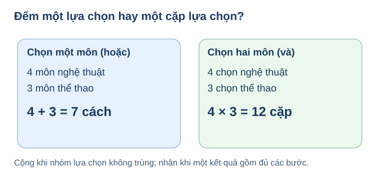
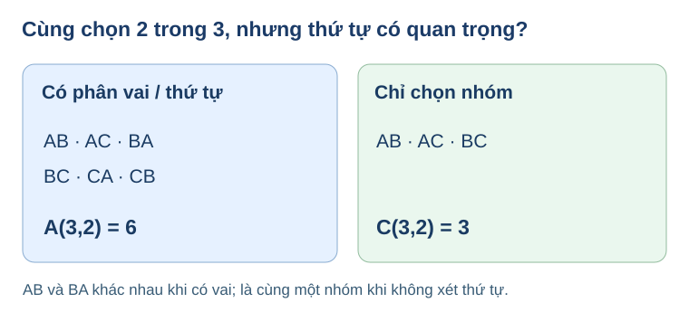
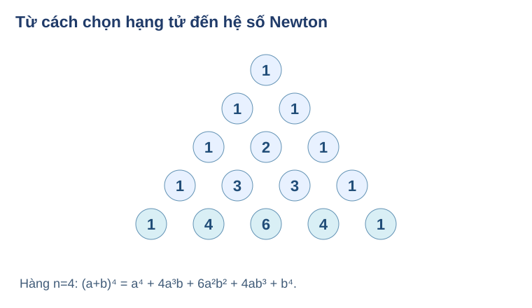

# Chuyên đề 19 — Đại số tổ hợp và Nhị thức Newton · R01 AUTHORING candidate

<!-- AUTHOR_ONLY_SOURCE: TOP19-R01_CANDIDATE; LEARNING_PATH: TOPIC; STANDARD: SLM-THPT-QUALITY-ONE v3.1.0; Q18_MODE: NOT_YET_SIGNED; ACADEMIC_STATE: AUTHORING_MATH_PED_QA_PENDING; NOT_CONTENT_READY; NO_WEBSITE_INTEGRATION. -->

**Ba trang học sinh duy nhất:** **Kiến thức / Luyện tập / Tự kiểm tra**. Không tạo Core riêng. Mọi lời giải ở trang Kiến thức/Luyện tập là so sánh tự chọn sau khi tự thử, **không phải đáp án kiểm tra độc lập**. Không tạo đề RD1 hoặc ghi Mastery.

**Nguồn SGK bắt buộc và giới hạn chứng cứ:** Toán 10 KNTT Tập Hai ChVIII B23–B25. Biên bản GitHub đã trực tiếp xem ảnh trang sách gốc `prototypes/thpt/THPT_G10_CHVIII_S1_VISUAL_SOURCE_RECEIPT_AND_SCOPE_20261028.md`, blob `a989cda41a4de81f7e676fb97c2a0a8095a10b8a`: **SGK B23 trang in 59–64, B24 65–71, B25 72–77, cuối chương 78–79**; SBT B23 50–52, B24 53–54, B25 55–56, cuối 57–59. Một số mục lục công khai ghi B23 bắt đầu p60 và B24 p66: thấp quyền hơn biên bản xem ảnh trực tiếp, **trang in/PDF index cần đối chiếu lại từ chính PDF nếu phát hành/điều chỉnh outcome cụ thể**. Receipt gốc chỉ xác nhận cấu trúc trang, chưa tự trở thành Academic/PED PASS cho Topic này.

**Nguồn đã đọc và tái sử dụng có kiểm soát:** Các thẻ kiến thức nguồn B23/B24/B25 UX795 R02 tại main, bản nháp NotebookLM/Gemini `lớp 10-bài 23,24,25,26,27.docx` trên Drive và các nguồn tài liệu tác giả cũ; giữ mạch tự học, nhưng không sao chép placeholder hoặc làm lệch S1. **25 canonical SGK formative** có một định nghĩa item duy nhất trong `docs/assets/javascripts/thpt-chviii-reviewed-formative-v1.js` blob `2ae62fada28913ec336b3507684408a1e05a3232`; trong Topic chỉ **tham chiếu ID**, không chép stem/key/solution/hint. B25 các biến thể 1/x và tổng hệ số được đánh dấu **mở rộng / vận dụng**, không thay phạm vi SGK n=4,5.

## 1. Kiến thức

### Mạch xuyên suốt: Hội chợ của lớp — từ chọn một món đến khai triển một nhị thức

Buổi hội chợ của lớp cần giải một chuỗi câu hỏi: chọn **một** câu lạc bộ thì có bao nhiêu lựa chọn; chuẩn bị **một bộ gồm áo và huy hiệu** thì bao nhiêu bộ; lập số/mã và loại cấu hình không hợp lệ; chọn đội và **phân vai**; cuối cùng vì sao hệ số trong (a+b)⁴ lại là 1,4,6,4,1? Tất cả dùng một ý tưởng: **phải xác định khi nào hai kết quả được coi là khác nhau và một kết quả có bao nhiêu bước/đối tượng**.

**Cần biết trước (được ôn ngay tại đây):** phép nhân/cộng số tự nhiên, tập hợp rời nhau, đếm ô trống, lũy thừa của biểu thức, biến và hệ số đa thức. Không bắt người học mở SGK hoặc Topic khác mới hiểu khái niệm bắt buộc.

### Mảng A — Quy tắc đếm: “một lựa chọn” và “một tổ hợp bước” (Bài 23)

**Đọc hình:** Khung “hoặc” gồm 4 nhóm nghệ thuật, 3 thể thao không trùng nên 4+3=7; khung “và” yêu cầu một mục ở **mỗi** nhóm, nên 4×3=12 cặp. Hình mang màu nền trắng; phép đếm không phụ thuộc màu. Chỉ dùng quy tắc cộng đơn giản khi hai danh sách không giao nhau.

[Mở mô hình tương tác công khai: “Hoặc / Và”](Temp_THPT_TOPIC19_COUNT_CHOOSE_PASCAL_R00_20261114.html) — kéo hai số lượng, chuyển chế độ và so liệt kê trước khi áp dụng quy tắc. Mô hình không chấm điểm.

### 1. Đếm đúng một lựa chọn: khi nào cộng?

<!-- LESSON_ID: TOP19-M01; OUTCOME_ID: TOP19-O01; ORIGINAL_SGK_SKILL: G10-B23-ADDITION; S1_LESSON: G10-B23; SOURCE_ROLE: SGK_CORE_AUTHORITY -->

**Vì sao cần học?** Ở hội chợ trường, mỗi học sinh chỉ đăng ký một câu lạc bộ. Nếu hai nhóm câu lạc bộ rời nhau, em có thể gộp số lựa chọn; nhưng nếu một câu lạc bộ nằm trong cả hai danh sách thì cộng thẳng sẽ đếm hai lần.

**Hiểu bản chất trước công thức.** Một kết quả hoàn chỉnh ở đây chỉ là **một** câu lạc bộ. Chia các kết quả thành các nhóm không trùng nhau rồi cộng số phần tử từng nhóm. Nếu A và B giao nhau, phải trừ phần giao: |A∪B|=|A|+|B|−|A∩B|; phần có giao là kiến thức giúp kiểm điều kiện, không thay quy tắc cộng rời nhau của B23.

**Điều kiện và giới hạn:** Các trường hợp cộng phải rời nhau hoặc đã sửa đếm trùng; không nhầm “chọn đúng một” với “làm cả hai bước”.

**Ví dụ có suy luận – vì sao chọn phương pháp này?** Có 4 câu lạc bộ nghệ thuật và 3 câu lạc bộ thể thao khác nhau, danh sách không trùng. Người học chọn đúng một câu lạc bộ. Tập kết quả gồm 4 lựa chọn nhóm nghệ thuật **hoặc** 3 lựa chọn thể thao, nên có 4+3=**7** cách. Ta cộng vì không thể cùng chọn cả hai nhóm.

**Tự thử trước khi đối chiếu.** Một tủ sách có 5 truyện khác nhau và 2 sách tranh khác nhau. Chọn đúng một cuốn để đọc. Hỏi có mấy cách?

<!-- ITEM_ID: THPT-TOP19-T01; CONTENT_VERSION: TOP19-R01; ROLE: TOPIC_FIRST_TRY; PRIMARY_OUTCOME: TOP19-O01; ANSWER_REVEAL: OPT_IN_AFTER_TRY; ASSESSMENT: FORMATIVE_ONLY_NO_MASTERY -->

Mở lời giải sau khi tự thử

**7 cách**, vì hai nhóm cuốn sách không trùng nhau và mỗi kết quả chỉ lấy đúng một cuốn: 5+2=7.

**Nếu chưa đúng (D6):** Nếu tính 5×2, hãy thử viết một kết quả: chỉ tên **một** cuốn sách, không phải một cặp. Quay lại xem điều kiện “hoặc”.

**Nối sang bài kế:** Nhớ kiểm chính xác một kết quả cần đếm và điều kiện của nó trước khi dùng công thức.

### 2. Một kết quả gồm nhiều bước: khi nào nhân?

<!-- LESSON_ID: TOP19-M02; OUTCOME_ID: TOP19-O02; ORIGINAL_SGK_SKILL: G10-B23-MULTIPLICATION; S1_LESSON: G10-B23; SOURCE_ROLE: SGK_CORE_AUTHORITY -->

**Vì sao cần học?** Ở hội chợ, để làm một bộ quà học sinh phải chọn cả áo và huy hiệu. Một chiếc áo riêng lẻ chưa phải bộ quà hoàn chỉnh, nên cách đếm khác với chọn chỉ một món.

**Hiểu bản chất trước công thức.** Nếu mỗi kết quả là cặp (áo,huy hiệu), với mỗi lựa chọn áo có thể ghép cùng tất cả lựa chọn huy hiệu, số cặp bằng số nhánh của bước đầu nhân với số nhánh của bước sau. Khi lượng chọn ở bước sau phụ thuộc bước đầu, phải tính từng nhánh rồi cộng.

**Điều kiện và giới hạn:** Các bước phải mô tả **một** kết quả có đủ thành phần; kiểm lựa chọn lặp, phụ thuộc nhánh và giới hạn mỗi bước.

**Ví dụ có suy luận – vì sao chọn phương pháp này?** Có 3 kiểu áo và 2 loại huy hiệu, một bộ quà cần đúng mỗi loại một món. Với mỗi áo có 2 bộ; có 3 áo nên **3×2=6** bộ. Không dùng 3+2 vì như vậy chỉ đếm các món riêng lẻ, không đếm cặp.

**Tự thử trước khi đối chiếu.** Có 4 loại áo và 3 kiểu huy hiệu. Một bộ gồm đúng một loại mỗi nhóm. Hỏi có bao nhiêu bộ?

<!-- ITEM_ID: THPT-TOP19-T02; CONTENT_VERSION: TOP19-R01; ROLE: TOPIC_FIRST_TRY; PRIMARY_OUTCOME: TOP19-O02; ANSWER_REVEAL: OPT_IN_AFTER_TRY; ASSESSMENT: FORMATIVE_ONLY_NO_MASTERY -->

Mở lời giải sau khi tự thử

**12 bộ**, mỗi trong 4 áo ghép với 3 huy hiệu: 4×3=12.

**Nếu chưa đúng (D6):** Nếu chỉ được 7, hãy dùng mô hình A/B để liệt kê (áo 1, huy hiệu 1)… rồi xem mỗi áo xuất hiện bao nhiêu lần.

**Nối sang bài kế:** Nhớ kiểm chính xác một kết quả cần đếm và điều kiện của nó trước khi dùng công thức.

### 3. Đếm các số: chữ số đầu và điều kiện lặp

<!-- LESSON_ID: TOP19-M03; OUTCOME_ID: TOP19-O03; ORIGINAL_SGK_SKILL: G10-B23-DIGIT_COUNT; S1_LESSON: G10-B23; SOURCE_ROLE: SGK_CORE_AUTHORITY -->

**Vì sao cần học?** Mã thẻ học sinh có thể bắt đầu bằng 0, nhưng một số tự nhiên có ba chữ số thì không. Cùng một tập chữ số, hai cách đếm khác nhau vì đối tượng phải đếm khác nhau.

**Hiểu bản chất trước công thức.** Vẽ ba ô hàng trăm, chục, đơn vị; chọn thứ tự theo ô có điều kiện nghiêm ngặt nhất trước. Khi các chữ số không lặp, số cách chọn giảm sau mỗi ô. Chữ số 0 có thể xuất hiện ở ô sau nhưng không được nằm đầu số ba chữ số.

**Điều kiện và giới hạn:** Cần nêu rõ đây là **số** hay **mã**, chữ số đầu có bị cấm 0 không, có được lặp không, và ba vị trí có khác nhau không.

**Ví dụ có suy luận – vì sao chọn phương pháp này?** Từ {0,1,2,3} lập số tự nhiên có **ba chữ số khác nhau**. Hàng trăm chọn từ 1,2,3: 3 cách; hàng chục còn 3 chữ số (có thể có 0): 3; hàng đơn vị còn 2: 2. Có 3×3×2=**18** số. Không tính cả chuỗi bắt đầu bằng 0.

**Tự thử trước khi đối chiếu.** Từ {0,1,2,3,4} lập số tự nhiên có hai chữ số khác nhau. Có bao nhiêu số?

<!-- ITEM_ID: THPT-TOP19-T03; CONTENT_VERSION: TOP19-R01; ROLE: TOPIC_FIRST_TRY; PRIMARY_OUTCOME: TOP19-O03; ANSWER_REVEAL: OPT_IN_AFTER_TRY; ASSESSMENT: FORMATIVE_ONLY_NO_MASTERY -->

Mở lời giải sau khi tự thử

Hàng chục có 4 cách (1–4); hàng đơn vị còn 4 cách (kể cả 0 nếu chưa dùng): 4×4=**16** số.

**Nếu chưa đúng (D6):** Nếu có 20, em đã cho chữ số hàng chục nhận 0. Nếu có 12, em có thể đã loại 0 khỏi cả hàng đơn vị.

**Nối sang bài kế:** Nhớ kiểm chính xác một kết quả cần đếm và điều kiện của nó trước khi dùng công thức.

### 4. Chia trường hợp khi đếm số chẵn

<!-- LESSON_ID: TOP19-M04; OUTCOME_ID: TOP19-O04; ORIGINAL_SGK_SKILL: G10-B23-CASE_SPLIT; S1_LESSON: G10-B23; SOURCE_ROLE: SGK_CORE_AUTHORITY -->

**Vì sao cần học?** Nếu yêu cầu số chẵn, chữ số cuối phải chẵn. Nhưng chọn số cuối bằng 0 và bằng 2 có thể làm số cách ở hàng đầu khác nhau; nhân mù một số cố định sẽ sai.

**Hiểu bản chất trước công thức.** Chia theo chữ số hàng đơn vị thành các nhóm **rời nhau**. Trong từng nhóm, dùng quy tắc nhân cho các ô còn lại; sau đó cộng các nhóm. Cấu trúc là cộng các tích, không phải chọn cộng hay nhân một cách máy móc.

**Điều kiện và giới hạn:** Các trường hợp phải phủ hết và không trùng; chữ số 0 đứng đầu bị cấm; không được lặp khi đề nói khác nhau.

**Ví dụ có suy luận – vì sao chọn phương pháp này?** Từ {0,1,2,3,4} lập số chẵn có ba chữ số khác nhau. Nếu tận cùng 0: hàng trăm 4, hàng chục 3, được 12. Nếu tận cùng 2 hoặc 4: 2 chọn số cuối; hàng trăm có 3 chữ số khác 0 còn lại; hàng chục 3, được 2×3×3=18. Tổng **12+18=30** số.

**Tự thử trước khi đối chiếu.** Từ {0,1,2,3} lập số chẵn có hai chữ số khác nhau. Có bao nhiêu số?

<!-- ITEM_ID: THPT-TOP19-T04; CONTENT_VERSION: TOP19-R01; ROLE: TOPIC_FIRST_TRY; PRIMARY_OUTCOME: TOP19-O04; ANSWER_REVEAL: OPT_IN_AFTER_TRY; ASSESSMENT: FORMATIVE_ONLY_NO_MASTERY -->

Mở lời giải sau khi tự thử

Đơn vị 0: hàng chục có 3 cách; đơn vị 2: hàng chục chỉ 1 hoặc 3, có 2 cách; tổng **3+2=5** số.

**Nếu chưa đúng (D6):** Nếu em nhân 2×3, hãy xét riêng đuôi 0: hàng chục có 3 lựa chọn, còn đuôi 2 chỉ có 2.

**Nối sang bài kế:** Từ đếm từng số hợp lệ, ta chuyển sang đếm các cách sắp người và chọn nhóm; kết quả có hoặc không có thứ tự là câu hỏi quyết định.

### Mảng B — Hoán vị, chỉnh hợp, tổ hợp: thứ tự có đổi kết quả không? (Bài 24)

**Đọc hình:** Từ A, B, C, khi có hai **vai khác nhau**: AB,BA là hai kết quả; khi chỉ chọn nhóm hai người, AB và BA trùng nhau. Đếm trực tiếp n=3,k=2 là 6 và 3. Điều kiện là các thành viên phân biệt và không chọn lặp.

[Mở mô hình tương tác công khai: “Chọn nhóm / Phân vai”](Temp_THPT_TOPIC19_COUNT_CHOOSE_PASCAL_R00_20261114.html) — thử n=4,k=2 và n=5,k=3. Cần so **cả danh sách kết quả** để thấy vì sao phải chia k!, không chỉ so hai con số.

### 5. Hoán vị: xếp tất cả đối tượng

<!-- LESSON_ID: TOP19-M05; OUTCOME_ID: TOP19-O05; ORIGINAL_SGK_SKILL: G10-B24-PERMUTATION; S1_LESSON: G10-B24; SOURCE_ROLE: SGK_CORE_AUTHORITY -->

**Vì sao cần học?** Bốn bạn cùng tham gia hội chợ nhưng đứng thành hàng theo thứ tự khác nhau sẽ tạo ra ảnh xếp hàng khác nhau, dù tập bốn bạn không đổi.

**Hiểu bản chất trước công thức.** Để xếp hết n đối tượng **phân biệt**, vị trí thứ nhất có n lựa chọn, vị trí sau còn n−1,… đến vị trí cuối còn 1. Do đó số hoán vị bằng n!=n(n−1)…2·1; quy ước 0!=1 giúp công thức nhất quán với tập rỗng, không có nghĩa là 0 vật có nhiều cách.

**Điều kiện và giới hạn:** Đếm thứ tự của **tất cả** n đối tượng riêng biệt, mỗi đối tượng dùng đúng một lần. Nếu vật trùng nhau thì n! có thể đếm lặp, cần quy tắc khác.

**Ví dụ có suy luận – vì sao chọn phương pháp này?** Có 4 cuốn sách Toán, Văn, Anh, Lý khác nhau, xếp theo hàng. Chọn vị trí đầu có 4 cách, vị trí sau 3, rồi 2, rồi 1. Tổng 4×3×2×1=**24** cách.

**Tự thử trước khi đối chiếu.** Có 5 học sinh khác nhau xếp thành một hàng, không ràng buộc. Có bao nhiêu thứ tự?

<!-- ITEM_ID: THPT-TOP19-T05; CONTENT_VERSION: TOP19-R01; ROLE: TOPIC_FIRST_TRY; PRIMARY_OUTCOME: TOP19-O05; ANSWER_REVEAL: OPT_IN_AFTER_TRY; ASSESSMENT: FORMATIVE_ONLY_NO_MASTERY -->

Mở lời giải sau khi tự thử

Hoán vị cả 5 học sinh, mỗi người một vị trí: 5!=**120**.

**Nếu chưa đúng (D6):** Nếu em dùng tổ hợp, hãy đổi chỗ hai học sinh; thứ tự hàng đổi thành kết quả khác, do đó phải đếm tất cả thứ tự.

**Nối sang bài kế:** Nhớ kiểm chính xác một kết quả cần đếm và điều kiện của nó trước khi dùng công thức.

### 6. Chỉnh hợp: chọn một số rồi phân vai

<!-- LESSON_ID: TOP19-M06; OUTCOME_ID: TOP19-O06; ORIGINAL_SGK_SKILL: G10-B24-ARRANGEMENT; S1_LESSON: G10-B24; SOURCE_ROLE: SGK_CORE_AUTHORITY -->

**Vì sao cần học?** Hội chợ có ban ba người giữ ba vai trưởng, thư ký, thủ quỹ. Chọn đúng ba bạn nhưng đổi người giữ vai sẽ thay đổi kết quả.

**Hiểu bản chất trước công thức.** Chỉnh hợp chập k của n phần tử phân biệt là chọn k phần tử **có thứ tự**, không lặp. Vị trí đầu có n cách, kế có n−1,… k vị trí: A(n,k)=n!/(n−k)!.

**Điều kiện và giới hạn:** 0≤k≤n là số nguyên; các vai/ô có phân biệt thứ tự, mỗi đối tượng chỉ nhận một vai. Không dùng công thức này khi một người được giữ nhiều vai nếu đề cho phép.

**Ví dụ có suy luận – vì sao chọn phương pháp này?** Từ 5 bạn chọn trưởng, thư ký, thủ quỹ, mỗi vai một người. Trưởng 5 cách, thư ký 4, thủ quỹ 3: A(5,3)=5×4×3=**60**.

**Tự thử trước khi đối chiếu.** Từ 6 bạn chọn một trưởng nhóm và một phó nhóm khác nhau. Có bao nhiêu cách?

<!-- ITEM_ID: THPT-TOP19-T06; CONTENT_VERSION: TOP19-R01; ROLE: TOPIC_FIRST_TRY; PRIMARY_OUTCOME: TOP19-O06; ANSWER_REVEAL: OPT_IN_AFTER_TRY; ASSESSMENT: FORMATIVE_ONLY_NO_MASTERY -->

Mở lời giải sau khi tự thử

Hai vai phân biệt, lần lượt 6 rồi 5 lựa chọn: A(6,2)=**30**.

**Nếu chưa đúng (D6):** Nếu ra 15, em đang coi A làm trưởng/B làm phó giống B trưởng/A phó; hãy viết hai kết quả để thấy khác.

**Nối sang bài kế:** Nhớ kiểm chính xác một kết quả cần đếm và điều kiện của nó trước khi dùng công thức.

### 7. Tổ hợp: chỉ chọn nhóm, không phân vai

<!-- LESSON_ID: TOP19-M07; OUTCOME_ID: TOP19-O07; ORIGINAL_SGK_SKILL: G10-B24-COMBINATION; S1_LESSON: G10-B24; SOURCE_ROLE: SGK_CORE_AUTHORITY -->

**Vì sao cần học?** Nhóm bạn đại diện đi thi không phân vai. Viết nhóm AB hay BA vẫn cùng hai người, nên phép đếm có thứ tự đang đếm nhiều lần một nhóm.

**Hiểu bản chất trước công thức.** Mỗi nhóm k người có đúng k! cách hoán đổi thứ tự (k người phân biệt). Vì chỉnh hợp đã đếm mỗi nhóm k! lần, số nhóm C(n,k)=A(n,k)/k!=n!/[k!(n−k)!]. Đây là số tập con k phần tử, không phải công thức học riêng khỏi chỉnh hợp.

**Điều kiện và giới hạn:** 0≤k≤n là số nguyên; nhóm không phân vai/không xét thứ tự và mỗi người chỉ chọn một lần. C(n,0)=C(n,n)=1; C(n,k)=C(n,n−k) do chọn người cũng tương ứng chọn nhóm không được chọn.

**Ví dụ có suy luận – vì sao chọn phương pháp này?** Chọn 2 người từ 5 người khác nhau, không phân vai: chọn có thứ tự 5×4=20 cặp. Mỗi nhóm bị kể 2!=2 lần (AB,BA), nên C(5,2)=20/2=**10** nhóm.

**Tự thử trước khi đối chiếu.** Chọn một nhóm 3 người từ 6 người khác nhau, không phân vai. Có bao nhiêu nhóm?

<!-- ITEM_ID: THPT-TOP19-T07; CONTENT_VERSION: TOP19-R01; ROLE: TOPIC_FIRST_TRY; PRIMARY_OUTCOME: TOP19-O07; ANSWER_REVEAL: OPT_IN_AFTER_TRY; ASSESSMENT: FORMATIVE_ONLY_NO_MASTERY -->

Mở lời giải sau khi tự thử

C(6,3)=6×5×4/(3×2×1)=**20** nhóm.

**Nếu chưa đúng (D6):** Nếu em ra 120, đó là số thứ tự của bộ ba; mỗi nhóm bị đếm 3!=6 lần, phải chia 6.

**Nối sang bài kế:** Nhớ kiểm chính xác một kết quả cần đếm và điều kiện của nó trước khi dùng công thức.

### 8. Chọn nhóm có điều kiện và phân vai sau

<!-- LESSON_ID: TOP19-M08; OUTCOME_ID: TOP19-O08; ORIGINAL_SGK_SKILL: G10-B24-CONSTRAINTS; S1_LESSON: G10-B24; SOURCE_ROLE: SGK_CORE_AUTHORITY -->

**Vì sao cần học?** Đội hội chợ cần đủ nữ và nam, nhưng chỉ chọn bốn người không phân vai. Ta cần đếm đúng thành phần trước; nếu sau đó chỉ định trưởng nhóm mới nhân thêm số cách chọn trưởng.

**Hiểu bản chất trước công thức.** Cố định số lượng ở từng nhóm rời nhau rồi dùng tổ hợp từng nhóm; nhân vì một kết quả cần đủ các phần; nếu có nhiều cấu hình thành phần khác nhau thì cộng các tích. Nếu sau khi chọn nhóm phân vai, nhân tiếp số cách phân vai **trong từng nhóm**.

**Điều kiện và giới hạn:** Các nhóm người ban đầu không giao; ràng buộc “đúng” hay “ít nhất” phải đọc chính xác; không nhân thêm vai trò khi đề không có.

**Ví dụ có suy luận – vì sao chọn phương pháp này?** Từ 5 nữ và 4 nam, chọn nhóm 3 người gồm đúng 2 nữ, 1 nam, không phân vai: C(5,2)×C(4,1)=10×4=**40** nhóm. Nếu cần thêm đội trưởng từ nhóm đã chọn, mới nhân 3, được 120 trường hợp có trưởng.

**Tự thử trước khi đối chiếu.** Từ 4 bạn nữ và 3 bạn nam chọn nhóm 3 người gồm đúng 2 nữ, 1 nam, không phân vai. Bao nhiêu nhóm?

<!-- ITEM_ID: THPT-TOP19-T08; CONTENT_VERSION: TOP19-R01; ROLE: TOPIC_FIRST_TRY; PRIMARY_OUTCOME: TOP19-O08; ANSWER_REVEAL: OPT_IN_AFTER_TRY; ASSESSMENT: FORMATIVE_ONLY_NO_MASTERY -->

Mở lời giải sau khi tự thử

Chọn 2 nữ trong 4: C(4,2)=6; chọn 1 nam trong 3: 3. Nhân: **18** nhóm.

**Nếu chưa đúng (D6):** Nếu tính A(4,2)×3, em đã phân biệt thứ tự hai nữ; bài này chỉ chọn nhóm nên dùng tổ hợp.

**Nối sang bài kế:** Khi đã biết C(n,k) đếm số nhóm, hãy xem chính C(n,k) giải thích hệ số a^(n−k)b^k trong nhị thức như thế nào.

### Mảng C — Hệ số nhị thức Newton chính là số nhóm vị trí (Bài 25)

**Đọc hình:** Hàng thứ tư 1,4,6,4,1 giải thích hệ số của (a+b)⁴. Số 6 ở giữa nhận từ 3+3 của hàng trên, đồng thời bằng C(4,2) là số cách lấy hai vị trí b. Đây là kết nối **tổ hợp → hệ số**, không phải công thức cần nhớ rời nhau.

[Mở mô hình tương tác công khai: “Hệ số Newton n=4,5”](Temp_THPT_TOPIC19_COUNT_CHOOSE_PASCAL_R00_20261114.html) — đổi k và đọc hạng tử, không dùng ngoài phạm vi n=4,5 khi chưa học mở rộng.

### 9. Nhị thức Newton: hệ số là số cách chọn vị trí

<!-- LESSON_ID: TOP19-M09; OUTCOME_ID: TOP19-O09; ORIGINAL_SGK_SKILL: G10-B25-NEWTON_EXPANSION; S1_LESSON: G10-B25; SOURCE_ROLE: SGK_CORE_AUTHORITY -->

**Vì sao cần học?** Khai triển (a+b)^4 bằng nhân từng thừa số rất dài. Nhưng mỗi hạng tử tương ứng một quyết định lấy a hay b ở bốn vị trí; hệ số được đếm bằng chính tổ hợp vừa học.

**Hiểu bản chất trước công thức.** Để nhận hạng tử a^(n−k)b^k trong (a+b)^n, chọn đúng k trong n vị trí lấy b, các vị trí còn lại lấy a. Có C(n,k) cách. Vì thế khai triển là tổng các hệ số C(n,k)a^(n−k)b^k. Ở phạm vi SGK đang đối chiếu chỉ học chắc n=4,5; không đưa mũ bất kỳ vào Core nếu chưa xác nhận.

**Điều kiện và giới hạn:** n là số nguyên không âm; trong chương này đặc biệt dùng n=4 hoặc n=5. Hệ số là số cách chọn vị trí, không phải số lần ta viết chữ b trong một tích.

**Ví dụ có suy luận – vì sao chọn phương pháp này?** Trong (a+b)^4 muốn có a²b² phải lấy b ở 2 trong 4 thừa số. Có C(4,2)=**6** cách, nên hạng tử là 6a²b². Khai triển đầy đủ: (a+b)^4=a⁴+4a³b+6a²b²+4ab³+b⁴.

**Tự thử trước khi đối chiếu.** Hệ số của x³ trong (x+1)^4 bằng bao nhiêu?

<!-- ITEM_ID: THPT-TOP19-T09; CONTENT_VERSION: TOP19-R01; ROLE: TOPIC_FIRST_TRY; PRIMARY_OUTCOME: TOP19-O09; ANSWER_REVEAL: OPT_IN_AFTER_TRY; ASSESSMENT: FORMATIVE_ONLY_NO_MASTERY -->

Mở lời giải sau khi tự thử

Muốn x³ chọn x tại 3 trong 4 vị trí: C(4,3)=**4**.

**Nếu chưa đúng (D6):** Nếu em lấy C(4,1) thì vẫn ra 4 vì đối xứng, nhưng phải giải thích số lần chọn x là 3; thử hệ số x² để tự kiểm khái niệm.

**Nối sang bài kế:** Nhớ kiểm chính xác một kết quả cần đếm và điều kiện của nó trước khi dùng công thức.

### 10. Khai triển có dấu âm: dấu đến từ số lần chọn

<!-- LESSON_ID: TOP19-M10; OUTCOME_ID: TOP19-O10; ORIGINAL_SGK_SKILL: G10-B25-COEFFICIENT_SIGN; S1_LESSON: G10-B25; SOURCE_ROLE: SGK_CORE_AUTHORITY -->

**Vì sao cần học?** Cùng hệ số tổ hợp nhưng (x−2)^5 có hạng tử dương và âm. Nếu chỉ nhớ 'dấu xen kẽ' mà không xét số lần chọn −2, ta rất dễ sai.

**Hiểu bản chất trước công thức.** Trong (u+v)^n, hạng tử chọn v đúng k lần có hệ số C(n,k)u^(n−k)v^k. Nếu v âm, dấu của hạng tử là (−1)^k. Khi hỏi hệ số x^m, tìm số lần chọn bằng cách giải phương trình số mũ trước rồi mới tính dấu.

**Điều kiện và giới hạn:** Với một đa thức thật, số mũ x là không âm; không nhầm thứ tự k là số lần lấy hạng tử thứ hai. Đặc biệt 0≤k≤n.

**Ví dụ có suy luận – vì sao chọn phương pháp này?** Tìm hệ số x³ trong (2x−1)^5. Mỗi hạng tử chọn −1 đúng k lần còn (2x)^(5−k); muốn x³ thì 5−k=3 nên k=2. Hệ số C(5,2)·2³·(−1)²=10·8=**80**. Dấu dương do hai dấu âm nhân nhau.

**Tự thử trước khi đối chiếu.** Hệ số x² trong (x−2)^4 là bao nhiêu?

<!-- ITEM_ID: THPT-TOP19-T10; CONTENT_VERSION: TOP19-R01; ROLE: TOPIC_FIRST_TRY; PRIMARY_OUTCOME: TOP19-O10; ANSWER_REVEAL: OPT_IN_AFTER_TRY; ASSESSMENT: FORMATIVE_ONLY_NO_MASTERY -->

Mở lời giải sau khi tự thử

Muốn x² thì k=2 lần chọn −2. Hệ số C(4,2)(−2)²=6·4=**24**.

**Nếu chưa đúng (D6):** Nếu ra −24, kiểm lại: chọn −2 hai lần thì tích dương; dấu phụ thuộc k chẵn/lẻ.

**Nối sang bài kế:** Nhớ kiểm chính xác một kết quả cần đếm và điều kiện của nó trước khi dùng công thức.

### 11. Số hạng không chứa x: tìm số mũ bằng 0 (mở rộng)

<!-- LESSON_ID: TOP19-M11; OUTCOME_ID: TOP19-O11; ORIGINAL_SGK_SKILL: G10-B25-CONSTANT_TERM; S1_LESSON: G10-B25; SOURCE_ROLE: SGK_CORE_AUTHORITY; OPTIONAL_SCOPE -->

**Vì sao cần học?** Một biểu thức như (x+2/x)^4 chứa cả x và 1/x. Không thể chỉ nhìn hệ số Pascal mà biết số hạng nào biến mất x; cần theo dõi **số mũ** của x.

**Hiểu bản chất trước công thức.** Trong (x+2/x)^4, nếu chọn 2/x đúng k lần thì số mũ x là (4−k)−k=4−2k. Số hạng tự do khi 4−2k=0→k=2; hệ số C(4,2)2²=24. Đây là **mở rộng/tự chọn** vì có số mũ âm trước khai triển, không tự biến thành Core B25 nếu chưa kiểm gốc.

**Điều kiện và giới hạn:** x≠0 do có 1/x, n=4 cụ thể, k nguyên từ 0 đến 4. Có số hạng tự do chỉ khi tồn tại k nguyên thỏa điều kiện số mũ bằng 0.

**Ví dụ có suy luận – vì sao chọn phương pháp này?** Với (x+2/x)^4, x≠0, số hạng tổng quát khi chọn 2/x k lần là C(4,k)2^k x^(4−2k). Chỉ k=2 cho số mũ 0 nên số hạng không chứa x là C(4,2)2²=**24**.

**Tự thử trước khi đối chiếu.** Số hạng không chứa x trong (x+1/x)^4, x≠0, là bao nhiêu?

<!-- ITEM_ID: THPT-TOP19-T11; CONTENT_VERSION: TOP19-R01; ROLE: TOPIC_FIRST_TRY; PRIMARY_OUTCOME: TOP19-O11; ANSWER_REVEAL: OPT_IN_AFTER_TRY; ASSESSMENT: FORMATIVE_ONLY_NO_MASTERY -->

Mở lời giải sau khi tự thử

Điều kiện 4−2k=0→k=2, hệ số C(4,2)=**6**.

**Nếu chưa đúng (D6):** Nếu ra 4 hoặc 1, em đang chọn nhầm k. Hãy ghi số mũ x là 4−2k rồi giải đúng phương trình bằng 0.

**Nối sang bài kế:** Nhớ kiểm chính xác một kết quả cần đếm và điều kiện của nó trước khi dùng công thức.

### 12. Tổng hệ số và tam giác Pascal (vận dụng sau khai triển)

<!-- LESSON_ID: TOP19-M12; OUTCOME_ID: TOP19-O12; ORIGINAL_SGK_SKILL: G10-B25-COEFFICIENT_SUM; S1_LESSON: G10-B25; SOURCE_ROLE: SGK_CORE_AUTHORITY; OPTIONAL_SCOPE -->

**Vì sao cần học?** Khi khai triển dài, cộng từng hệ số là việc nặng. Nhưng tổng hệ số của đa thức P(x) lại có một cách kiểm đơn giản: thay x=1 để mọi x^k trở thành 1.

**Hiểu bản chất trước công thức.** Với đa thức P(x)=a₀+a₁x+...+aₙxⁿ, P(1)=a₀+...+aₙ. Các hệ số tổ hợp hàng n tạo thành tam giác Pascal; mỗi số ở giữa bằng tổng hai số ở hàng n−1 vì có thể chọn hoặc không chọn một phần tử cố định.

**Điều kiện và giới hạn:** Chỉ áp dụng tổng hệ số bằng P(1) khi biểu thức là **đa thức theo x**, không tùy tiện áp dụng cho phân thức chưa xác định tại 1. Tổng hệ số/tổng chẵn lẻ cao hơn yêu cầu n=4,5 phải gắn nhãn vận dụng hoặc mở rộng.

**Ví dụ có suy luận – vì sao chọn phương pháp này?** Tính tổng hệ số của P(x)=(2x−1)^4. Vì P là đa thức, thay x=1 được P(1)=(2−1)^4=**1**. Nếu khai triển, hệ số âm dương triệt tiêu để cho tổng đúng 1.

**Tự thử trước khi đối chiếu.** Tổng hệ số của đa thức (x+2)^5 bằng bao nhiêu?

<!-- ITEM_ID: THPT-TOP19-T12; CONTENT_VERSION: TOP19-R01; ROLE: TOPIC_FIRST_TRY; PRIMARY_OUTCOME: TOP19-O12; ANSWER_REVEAL: OPT_IN_AFTER_TRY; ASSESSMENT: FORMATIVE_ONLY_NO_MASTERY -->

Mở lời giải sau khi tự thử

Thay x=1: (1+2)^5=**243**.

**Nếu chưa đúng (D6):** Nếu cộng lẻ từng số hạng và sai, nhớ P(1) chỉ đúng khi cả đa thức được tính tại 1, không chỉ thay hệ số tổ hợp.

**Nối sang bài kế:** Thử nhìn lại một tình huống thực tế: từ quy tắc nhân tạo kết quả nhiều bước, từ không thứ tự suy ra tổ hợp, rồi tổ hợp trở thành hệ số trong khai triển.

## 2. Luyện tập

**Học theo độ sâu:** Từng nhóm câu được xếp từ hiểu cấu trúc kết quả → áp dụng phép đếm → xử lý điều kiện → vận dụng tổng hợp. Hãy giải trước, tự mở lời giải sau. Ở nơi có câu SGK tương đương, trang này dùng placement trỏ **một ID canonical**, không chép lại đề/đáp án.

### Luyện tập 1 — Đếm đúng một lựa chọn: khi nào cộng?

<!-- ITEM_ID: THPT-TOP19-P01; CONTENT_VERSION: TOP19-R01; ROLE: TOPIC_PRACTICE; PRIMARY_OUTCOME: TOP19-O01; ASSESSMENT: FORMATIVE_ONLY_NO_MASTERY -->

Trong quầy có 6 loại nước trà và 4 loại nước trái cây khác nhau, các loại không trùng nhau. Khách chọn đúng một loại. Có bao nhiêu cách?

Tự đối chiếu lời giải từng bước

Hai nhóm không giao; mỗi kết quả chỉ chọn một loại. Áp dụng cộng 6+4=**10** cách.

**D6 – Khắc phục lỗi thường gặp:** Nếu cộng hai danh sách vẫn bị trùng một sản phẩm, phải tách/loại giao trước. Bài này đã nêu rõ không trùng.

### Luyện tập 2 — Một kết quả gồm nhiều bước: khi nào nhân?

<!-- ITEM_ID: THPT-TOP19-P02; CONTENT_VERSION: TOP19-R01; ROLE: TOPIC_PRACTICE; PRIMARY_OUTCOME: TOP19-O02; ASSESSMENT: FORMATIVE_ONLY_NO_MASTERY -->

Một suất ăn gồm đúng một món khai vị từ 2 món, một món chính từ 3 món và một đồ uống từ 4 món. Có bao nhiêu suất ăn?

Tự đối chiếu lời giải từng bước

Mỗi kết quả có đủ 3 thành phần. Theo quy tắc nhân: 2×3×4=**24** suất ăn khác nhau.

**D6 – Khắc phục lỗi thường gặp:** Nếu chỉ nhân 2×3, em quên bước đồ uống. Viết rõ ba vị trí của một suất trước khi đếm.

### Luyện tập 3 — Đếm các số: chữ số đầu và điều kiện lặp

<!-- ITEM_ID: THPT-TOP19-P03; CONTENT_VERSION: TOP19-R01; ROLE: TOPIC_PRACTICE; PRIMARY_OUTCOME: TOP19-O03; ASSESSMENT: FORMATIVE_ONLY_NO_MASTERY -->

Từ {0,1,2,3,4} lập số tự nhiên ba chữ số đôi một khác nhau. Có bao nhiêu số?

Tự đối chiếu lời giải từng bước

Hàng trăm có 4 cách (khác 0); hàng chục còn 4; hàng đơn vị còn 3. Vậy **4×4×3=48** số.

**D6 – Khắc phục lỗi thường gặp:** Vẽ các ô hàng trăm/chục/đơn vị; chỉ ô đầu cấm 0. Sau mỗi lựa chọn xóa chữ số đã dùng.

### Luyện tập 4 — Chia trường hợp khi đếm số chẵn

<!-- ITEM_ID: THPT-TOP19-P04; CONTENT_VERSION: TOP19-R01; ROLE: TOPIC_PRACTICE; PRIMARY_OUTCOME: TOP19-O04; ASSESSMENT: FORMATIVE_ONLY_NO_MASTERY -->

Từ {0,1,2,3,4,5} lập số chẵn có ba chữ số khác nhau. Có bao nhiêu số?

Tự đối chiếu lời giải từng bước

Cuối 0: 5×4=20. Cuối 2 hoặc 4: 2 cách, hàng trăm còn 4 chữ số khác 0, hàng chục còn 4; 2×4×4=32. Tổng **52** số.

**D6 – Khắc phục lỗi thường gặp:** Không gộp các chữ số cuối thành một nhánh trước khi xét 0. Kiểm 20+32=52, tránh thiếu điều kiện khác nhau.

### Luyện tập 5 — Hoán vị: xếp tất cả đối tượng

<!-- ITEM_ID: THPT-TOP19-P05; CONTENT_VERSION: TOP19-R01; ROLE: TOPIC_PRACTICE; PRIMARY_OUTCOME: TOP19-O05; ASSESSMENT: FORMATIVE_ONLY_NO_MASTERY -->

Có 6 quyển sách phân biệt xếp vào 6 vị trí liên tiếp. Có bao nhiêu cách?

Tự đối chiếu lời giải từng bước

Hoán vị tất cả 6 quyển: 6!=**720** cách.

**D6 – Khắc phục lỗi thường gặp:** Kiểm từng ô nhận lần lượt 6,5,4,3,2,1 lựa chọn. Không cộng 6+5+…+1.

### Luyện tập 6 — Chỉnh hợp: chọn một số rồi phân vai

<!-- ITEM_ID: THPT-TOP19-P06; CONTENT_VERSION: TOP19-R01; ROLE: TOPIC_PRACTICE; PRIMARY_OUTCOME: TOP19-O06; ASSESSMENT: FORMATIVE_ONLY_NO_MASTERY -->

Có 7 vận động viên phân biệt, trao huy chương vàng, bạc, đồng cho 3 người khác nhau. Có bao nhiêu kết quả?

Tự đối chiếu lời giải từng bước

Ba vị trí có thứ tự: A(7,3)=7×6×5=**210** cách.

**D6 – Khắc phục lỗi thường gặp:** Chọn 3 người chưa xong vì còn phân vai vàng/bạc/đồng. Kiểm vai nào được chọn đầu tiên.

### Luyện tập 7 — Tổ hợp: chỉ chọn nhóm, không phân vai

<!-- ITEM_ID: THPT-TOP19-P07; CONTENT_VERSION: TOP19-R01; ROLE: TOPIC_PRACTICE; PRIMARY_OUTCOME: TOP19-O07; ASSESSMENT: FORMATIVE_ONLY_NO_MASTERY -->

Chọn nhóm 4 người từ 7 người khác nhau, không phân vai. Có bao nhiêu nhóm?

Tự đối chiếu lời giải từng bước

C(7,4)=7!/(4!3!)=7×6×5/(3×2×1)=**35** nhóm.

**D6 – Khắc phục lỗi thường gặp:** Không dùng 7×6×5×4 vì thứ tự của thành viên không quan trọng; mỗi nhóm bị lặp 4! lần.

### Luyện tập 8 — Chọn nhóm có điều kiện và phân vai sau

<!-- ITEM_ID: THPT-TOP19-P08; CONTENT_VERSION: TOP19-R01; ROLE: TOPIC_PRACTICE; PRIMARY_OUTCOME: TOP19-O08; ASSESSMENT: FORMATIVE_ONLY_NO_MASTERY -->

Một lớp có 6 bạn nam và 5 bạn nữ. Chọn nhóm 4 người gồm đúng 2 nam, 2 nữ, không phân vai. Có bao nhiêu nhóm?

Tự đối chiếu lời giải từng bước

C(6,2)×C(5,2)=15×10=**150** nhóm.

**D6 – Khắc phục lỗi thường gặp:** Nếu nhân thêm 4! khi chưa phân vai, em sẽ đếm lặp mỗi nhóm. Không thêm điều kiện mà đề không nêu.

### Luyện tập 9 — Nhị thức Newton: hệ số là số cách chọn vị trí

<!-- ITEM_ID: THPT-TOP19-P09; CONTENT_VERSION: TOP19-R01; ROLE: TOPIC_PRACTICE; PRIMARY_OUTCOME: TOP19-O09; ASSESSMENT: FORMATIVE_ONLY_NO_MASTERY -->

Hãy khai triển đầy đủ (x+2)^4 và cho biết hệ số x².

Tự đối chiếu lời giải từng bước

Dùng hệ số hàng n=4 là 1,4,6,4,1: (x+2)^4=x⁴+4·2x³+6·2²x²+4·2³x+2⁴=**x⁴+8x³+24x²+32x+16**. Hệ số x² là **24**.

**D6 – Khắc phục lỗi thường gặp:** Nếu viết hệ số x² chỉ là 6, em quên chọn hạng tử 2 ở hai vị trí, nên còn nhân 2².

### Luyện tập 10 — Khai triển có dấu âm: dấu đến từ số lần chọn

<!-- ITEM_ID: THPT-TOP19-P10; CONTENT_VERSION: TOP19-R01; ROLE: TOPIC_PRACTICE; PRIMARY_OUTCOME: TOP19-O10; ASSESSMENT: FORMATIVE_ONLY_NO_MASTERY -->

Tìm hệ số của x⁴ trong (3x−2)^5.

Tự đối chiếu lời giải từng bước

Muốn x⁴ thì chọn −2 đúng một lần, 3x bốn lần. Hệ số C(5,1)·3⁴·(−2)=5·81·(−2)=**−810**.

**D6 – Khắc phục lỗi thường gặp:** Nếu ra +810, hãy viết riêng thừa số −2 trước khi nhân; số lần chọn nó là k=1 lẻ.

### Luyện tập 11 — Số hạng không chứa x: tìm số mũ bằng 0 (mở rộng)

<!-- ITEM_ID: THPT-TOP19-P11; CONTENT_VERSION: TOP19-R01; ROLE: TOPIC_PRACTICE; PRIMARY_OUTCOME: TOP19-O11; ASSESSMENT: FORMATIVE_ONLY_NO_MASTERY -->

Tìm số hạng không chứa x trong (2x+1/x)^4, x≠0.

Tự đối chiếu lời giải từng bước

Hạng tử với k lần chọn 1/x có số mũ x là 4−2k. Lấy k=2, hệ số C(4,2)·(2)^(4−2)·1²=6·4=**24**.

**D6 – Khắc phục lỗi thường gặp:** Dù chọn phần 1/x hai lần, còn hai phần 2x nên phải nhân 2²; đừng bỏ hệ số 2.

### Luyện tập 12 — Tổng hệ số và tam giác Pascal (vận dụng sau khai triển)

<!-- ITEM_ID: THPT-TOP19-P12; CONTENT_VERSION: TOP19-R01; ROLE: TOPIC_PRACTICE; PRIMARY_OUTCOME: TOP19-O12; ASSESSMENT: FORMATIVE_ONLY_NO_MASTERY -->

Tổng hệ số của đa thức (2x+1)^4 bằng bao nhiêu?

Tự đối chiếu lời giải từng bước

P(1)=(2+1)^4=3⁴=**81**. Kiểm cách khác: hệ số khai triển cộng lại phải bằng 81.

**D6 – Khắc phục lỗi thường gặp:** Nếu ra 16, em đã bỏ hạng tử +1. Thay toàn bộ nhị thức tại x=1 trước khi nâng lũy thừa.

### Tự luận có lời giải và rubric — câu mới thuộc một thư viện canonical chung

### Tự luận W01 /4 — giải thích phương pháp và điều kiện

<!-- ITEM_ID: THPT-TOP19-W01; CONTENT_VERSION: TOP19-R01; ROLE: TOPIC_WRITTEN; PRIMARY_OUTCOME: TOP19-O04; PUBLIC_SELF_SCORED_ONLY_NO_MASTERY; NO_OFFICIAL_READINESS -->

Dùng các chữ số {0,1,2,3,4}, lập số tự nhiên **ba chữ số lẻ**, các chữ số không lặp. Hãy đếm bằng chia trường hợp và giải thích vì sao không đếm cả chuỗi bắt đầu 0.

Đối chiếu sau khi tự giải và chấm theo rubric /4

**Lời giải:** Chọn hàng đơn vị lẻ 1 hoặc 3: 2 cách. Hàng trăm khác 0 và khác hàng đơn vị: còn 3 cách; hàng chục còn 3 cách (có thể là 0). Theo quy tắc nhân **2×3×3=18** số.

**Rubric 4 điểm:**
- Nhận ra đơn vị thuộc {1,3}: 2 cách — **1 điểm**.
- Hàng trăm còn 3 lựa chọn hợp lệ khác 0 — **1 điểm**.
- Hàng chục còn 3 lựa chọn và không lặp — **1 điểm**.
- Nhân 2×3×3=18, nêu đây là số có ba chữ số — **1 điểm**.

**D6:** Nếu sai, quay lại phần Kiến thức của TOP19-O04, giải lại câu T/P cùng outcome và chỉ mở lời giải sau khi tự thử. Không sử dụng bài đã xem đáp án làm chứng cứ Tự kiểm tra độc lập.

### Tự luận W02 /4 — giải thích phương pháp và điều kiện

<!-- ITEM_ID: THPT-TOP19-W02; CONTENT_VERSION: TOP19-R01; ROLE: TOPIC_WRITTEN; PRIMARY_OUTCOME: TOP19-O08; PUBLIC_SELF_SCORED_ONLY_NO_MASTERY; NO_OFFICIAL_READINESS -->

Có 5 học sinh nữ và 4 học sinh nam. Chọn một nhóm gồm đúng 2 nữ và 2 nam không phân vai. Sau đó chọn đúng **một đội trưởng từ nhóm đã chọn**. Có bao nhiêu cách lập nhóm **có đội trưởng**?

Đối chiếu sau khi tự giải và chấm theo rubric /4

**Lời giải:** Chọn 2 nữ: C(5,2)=10; chọn 2 nam: C(4,2)=6. Có **60 nhóm không phân vai**. Mỗi nhóm có 4 người để chọn một trưởng, nên có **60×4=240** kết quả nhóm có trưởng. Nếu chỉ hỏi số nhóm thì đáp án phải dừng ở 60.

**Rubric 4 điểm:**
- Chọn 2 nữ bằng tổ hợp C(5,2)=10 — **1 điểm**.
- Chọn 2 nam bằng tổ hợp C(4,2)=6 — **1 điểm**.
- Tính 10×6=60 nhóm không phân vai — **1 điểm**.
- Chọn trưởng trong nhóm 4 cách, ra 240 và phân biệt 60 với 240 — **1 điểm**.

**D6:** Nếu sai, quay lại phần Kiến thức của TOP19-O08, giải lại câu T/P cùng outcome và chỉ mở lời giải sau khi tự thử. Không sử dụng bài đã xem đáp án làm chứng cứ Tự kiểm tra độc lập.

### Tự luận W03 /4 — giải thích phương pháp và điều kiện

<!-- ITEM_ID: THPT-TOP19-W03; CONTENT_VERSION: TOP19-R01; ROLE: TOPIC_WRITTEN; PRIMARY_OUTCOME: TOP19-O10; PUBLIC_SELF_SCORED_ONLY_NO_MASTERY; NO_OFFICIAL_READINESS -->

Với đa thức P(x)=(x−2)^5, hãy **(a)** tìm hệ số của x², **(b)** tính tổng tất cả hệ số của P mà không cần khai triển đủ. Giải thích vì sao dấu âm xuất hiện.

Đối chiếu sau khi tự giải và chấm theo rubric /4

**Lời giải:** (a) Muốn x² phải chọn hạng tử −2 đúng 3 trong 5 vị trí: k=3. Hệ số C(5,3)·(−2)³=10·(−8)=**−80**. Dấu âm vì k lẻ. (b) Vì P(x) là đa thức nên tổng hệ số bằng P(1)=(1−2)^5=**−1**.

**Rubric 4 điểm:**
- Nêu đúng k=3 để được x² từ năm thừa số — **1 điểm**.
- Tính C(5,3)=10 và (−2)³=−8 — **1 điểm**.
- Kết luận hệ số x² là −80, giải thích dấu âm — **1 điểm**.
- Tính P(1)=−1 và nêu lý do tổng hệ số — **1 điểm**.

**D6:** Nếu sai, quay lại phần Kiến thức của TOP19-O10, giải lại câu T/P cùng outcome và chỉ mở lời giải sau khi tự thử. Không sử dụng bài đã xem đáp án làm chứng cứ Tự kiểm tra độc lập.

### Thư viện SGK dùng chung — 25 ID canonical public đã có (chỉ trỏ placement)

**Nguồn duy nhất của nội dung 25 câu SGK** là tệp JS đã khóa Git blob `2ae62fada28913ec336b3507684408a1e05a3232`, `CONTENT_VERSION=THPT-G10-CHVIII-D3D4-R01-PLUS-P07-DELTA-20261028`. Mỗi ID dưới đây chỉ xuất hiện như **metadata tham chiếu**; không lặp stem/answer/solution/hint, không coi SGK từng bài đã review là Topic PASS.

| SGK canonical item_id | Topic primary outcome | Topic placement | source role |
|---|---|---|---|
| THPT-G10-B23-C01 | TOP19-O01 | TOPIC/LUYEN_TAP/SGK_PUBLIC_REUSE | SGK_CANONICAL_REUSE |
| THPT-G10-B23-C02 | TOP19-O02 | TOPIC/LUYEN_TAP/SGK_PUBLIC_REUSE | SGK_CANONICAL_REUSE |
| THPT-G10-B23-P01 | TOP19-O03 | TOPIC/LUYEN_TAP/SGK_PUBLIC_REUSE | SGK_CANONICAL_REUSE |
| THPT-G10-B23-P02 | TOP19-O02 | TOPIC/LUYEN_TAP/SGK_PUBLIC_REUSE | SGK_CANONICAL_REUSE |
| THPT-G10-B23-P03 | TOP19-O01 | TOPIC/LUYEN_TAP/SGK_PUBLIC_REUSE | SGK_CANONICAL_REUSE |
| THPT-G10-B23-P04 | TOP19-O02 | TOPIC/LUYEN_TAP/SGK_PUBLIC_REUSE | SGK_CANONICAL_REUSE |
| THPT-G10-B23-P05 | TOP19-O04 | TOPIC/LUYEN_TAP/SGK_PUBLIC_REUSE | SGK_CANONICAL_REUSE |
| THPT-G10-B23-P06 | TOP19-O04 | TOPIC/LUYEN_TAP/SGK_PUBLIC_REUSE | SGK_CANONICAL_REUSE |
| THPT-G10-B24-C01 | TOP19-O05 | TOPIC/LUYEN_TAP/SGK_PUBLIC_REUSE | SGK_CANONICAL_REUSE |
| THPT-G10-B24-C02 | TOP19-O06 | TOPIC/LUYEN_TAP/SGK_PUBLIC_REUSE | SGK_CANONICAL_REUSE |
| THPT-G10-B24-P01 | TOP19-O07 | TOPIC/LUYEN_TAP/SGK_PUBLIC_REUSE | SGK_CANONICAL_REUSE |
| THPT-G10-B24-P02 | TOP19-O06 | TOPIC/LUYEN_TAP/SGK_PUBLIC_REUSE | SGK_CANONICAL_REUSE |
| THPT-G10-B24-P03 | TOP19-O05 | TOPIC/LUYEN_TAP/SGK_PUBLIC_REUSE | SGK_CANONICAL_REUSE |
| THPT-G10-B24-P04 | TOP19-O08 | TOPIC/LUYEN_TAP/SGK_PUBLIC_REUSE | SGK_CANONICAL_REUSE |
| THPT-G10-B24-P05 | TOP19-O08 | TOPIC/LUYEN_TAP/SGK_PUBLIC_REUSE | SGK_CANONICAL_REUSE |
| THPT-G10-B24-P06 | TOP19-O05 | TOPIC/LUYEN_TAP/SGK_PUBLIC_REUSE | SGK_CANONICAL_REUSE |
| THPT-G10-B25-C01 | TOP19-O09 | TOPIC/LUYEN_TAP/SGK_PUBLIC_REUSE | SGK_CANONICAL_REUSE |
| THPT-G10-B25-C02 | TOP19-O09 | TOPIC/LUYEN_TAP/SGK_PUBLIC_REUSE | SGK_CANONICAL_REUSE |
| THPT-G10-B25-P01 | TOP19-O10 | TOPIC/LUYEN_TAP/SGK_PUBLIC_REUSE | SGK_CANONICAL_REUSE |
| THPT-G10-B25-P02 | TOP19-O11 | TOPIC/LUYEN_TAP/SGK_PUBLIC_REUSE | SGK_CANONICAL_REUSE |
| THPT-G10-B25-P03 | TOP19-O10 | TOPIC/LUYEN_TAP/SGK_PUBLIC_REUSE | SGK_CANONICAL_REUSE |
| THPT-G10-B25-P04 | TOP19-O10 | TOPIC/LUYEN_TAP/SGK_PUBLIC_REUSE | SGK_CANONICAL_REUSE |
| THPT-G10-B25-P05 | TOP19-O10 | TOPIC/LUYEN_TAP/SGK_PUBLIC_REUSE | SGK_CANONICAL_REUSE |
| THPT-G10-B25-P06 | TOP19-O12 | TOPIC/LUYEN_TAP/SGK_PUBLIC_REUSE | SGK_CANONICAL_REUSE |
| THPT-G10-B25-P07 | TOP19-O11 | TOPIC/LUYEN_TAP/SGK_PUBLIC_REUSE | SGK_CANONICAL_REUSE |

## 3. Tự kiểm tra

**Chế độ hiện tại: `CLIENT_SELF_CHECK_NO_MASTERY` / chỉ tự đối chiếu.** Sáu câu đại diện dưới đây **dùng lại** câu công khai đã luyện với cùng item_id, **không** phải ngân hàng đánh giá độc lập hay `TOPIC_READINESS`. Vì đã có quyền mở lời giải, tuyệt đối không dùng điểm ở đây để chứng minh Skill Mastery. Trước Final Submit của kiểm tra độc lập trong website sau này, không được lộ đáp án, đúng/sai, rubric, gợi ý hay AI Tutor; chưa có RD1 private owner-held cho Topic.

| Tự đối chiếu | Canonical item có sẵn | Kiểm trọng tâm | Tình trạng |
|---|---|---|---|
| Bước 1 | THPT-TOP19-P02 | TOP19-O02 | PUBLIC_REPLAY_ONLY / NO_MASTERY |
| Bước 2 | THPT-TOP19-P04 | TOP19-O04 | PUBLIC_REPLAY_ONLY / NO_MASTERY |
| Bước 3 | THPT-TOP19-P06 | TOP19-O06 | PUBLIC_REPLAY_ONLY / NO_MASTERY |
| Bước 4 | THPT-TOP19-P07 | TOP19-O07 | PUBLIC_REPLAY_ONLY / NO_MASTERY |
| Bước 5 | THPT-TOP19-P09 | TOP19-O09 | PUBLIC_REPLAY_ONLY / NO_MASTERY |
| Bước 6 | THPT-TOP19-P10 | TOP19-O10 | PUBLIC_REPLAY_ONLY / NO_MASTERY |

**Đường khắc phục:** Nếu sai bài nào, trở lại đúng `TOP19-Oxx` → đọc “vì sao/bản chất/điều kiện” → làm FirstTry `Txx` → luyện `Pxx`. Đây là lộ trình hỗ trợ thật, không chỉ một câu “ôn lại lý thuyết”.

<!-- AUTHOR_ONLY_HOLD: TOP19_Q01_SCOPED_S1_ORIGINAL_PDF_PAGE_INDEX_AND_ACTIVITY_AUDIT_REQUIRED; TOP19_Q18_ALL_12_OUTCOMES_27_NEW_ITEMS_PED_DEPTH_AND_RUBRIC_SELF_VERIFY_REQUIRED; NO_V2_OR_READY_REGISTER; NO_PRODUCTION_MERGE; NO_PRIVATE_RD1 -->
