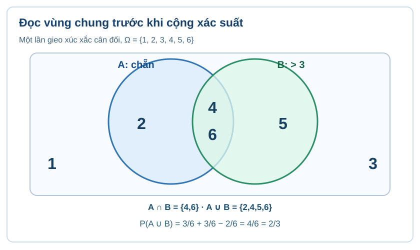

# CĐ20 · PLAN22-20 · Xác suất cổ điển và các quy tắc tính xác suất · R02 meaning-first candidate

STATE: AUTHORING_CANDIDATE_NOT_CONTENT_READY
STANDARD: SLM-THPT-QUALITY-ONE v3.1.0 Q01–Q18
LEARNING_PATH: TOPIC
OWNER_TAXONOMY: PLAN22-20 (G10 ChIX + G11 ChVIII), NOT A RUNTIME_TOPIC_ID
AUTHORING_ORIGINAL_SOURCE: PR #810 combined G10-G12 R02, blob 1258a2748c01ba288b706a08c79af237de799cf3
AUTHORING_DELTA: New separate G10-G11 learner narrative, 17 newly authored independent FirstTry T01-T17; G12 conditional/total-probability/Bayes excluded from required Topic20 scope.
QA_VERDICT: NOT_SIGNED / Q18_NEEDS_17_OUTCOME_ITEM_DEPTH_REVIEW
RELEASE_AUTHORIZATION: NO

## 1. Kiến thức — câu chuyện xuyên suốt từ rút phiếu đến trò chơi hai vòng

Một lượt quay số tại hội chợ có những kết quả nào? Nếu kết quả nằm trong hai nhóm thưởng, có bị tính trùng không? Hai lượt chơi có thực sự độc lập? Em sẽ học cách mô tả đúng không gian mẫu và biến cố trước, rồi mới chọn phép đếm, quy tắc cộng hoặc nhân. Kiến thức về tập hợp, phân số và đếm theo bước được nhắc lại tại chỗ; không phải hoàn thành một chuyên đề khác mới học được.

**Nguyên tắc đối chiếu:** Tất cả lời giải Tự thử là nội dung public formative, chỉ mở sau khi thử. Không dùng các câu đã xem đáp án làm kiểm tra độc lập, không ghi Mastery.

### 1 · Mô hình ngẫu nhiên (nền tảng)

#### Phép thử, không gian mẫu và biến cố

Một phép thử ngẫu nhiên có nhiều kết quả có thể xuất hiện, nhưng không biết chắc kết quả của một lần thực hiện. Tập tất cả kết quả sơ cấp là **không gian mẫu** \(\Omega\). Mỗi kết quả ghi nhận phải được mô tả rõ: số nào được chọn, thứ tự các lượt có quan trọng hay không, thẻ có được trả lại hay không.

Một **biến cố** \(A\) là tập con \(A\subseteq\Omega\): chỉ gồm những kết quả khiến câu phát biểu của \(A\) đúng. \(A=\varnothing\) là biến cố không thể, \(A=\Omega\) là biến cố chắc chắn.

**Ví dụ hướng dẫn:** Rút đều một thẻ trong bảy thẻ mang số \(1,2,\ldots,7\). Khi đó \(\Omega=\{1,2,3,4,5,6,7\}\). Biến cố “lấy được số nguyên tố” có tập kết quả \(\{2,3,5,7\}\); biến cố đối là \(\{1,4,6\}\). Không được gọi “số nguyên tố” là một kết quả sơ cấp duy nhất.

**Tự chốt kiến thức:** Hãy luôn viết \(\Omega\) trước khi đếm; một cặp có thứ tự \((a,b)\) khác cặp không thứ tự \(\{a,b\}\).

**Tự thử trước khi xem lời giải.** Gieo một xúc xắc 8 mặt đồng khả năng ghi các số 1–8. Viết Ω và biến cố “ra số chẵn”.

<!-- ITEM_ID: THPT-TOP20-T01; ROLE: TOPIC_FIRST_TRY; PRIMARY_OUTCOME: TOP20-O01; CONTENT_VERSION: TOP20-R02; Q15_CANONICAL_NEW_ONLY; ASSESSMENT: PUBLIC_FORMATIVE_NO_MASTERY -->

Mở đối chiếu sau khi tự thử

Ω={1,2,3,4,5,6,7,8}; A={2,4,6,8}.

**D6 – Tự khắc phục:** Nếu chỉ viết xác suất 1/2, em chưa mô tả biến cố; hãy ghi kết quả sơ cấp vào tập.

#### Đồng khả năng và cách tính xác suất

Đối với không gian mẫu hữu hạn với **mọi kết quả sơ cấp đồng khả năng**, xác suất của \(A\) là
\[
P(A)=\frac{n(A)}{n(\Omega)},\qquad n(\Omega)>0.
\]
Nếu đề chỉ nói có ba “loại kết quả”, chưa thể kết luận mỗi loại có xác suất \(1/3\). Phải xác định các kết quả sơ cấp thực sự có cơ hội như nhau, rồi mới đếm.

**Ví dụ hướng dẫn:** Một hộp có 8 phiếu khác nhau, mang nhãn \(A,A,B,B,B,C,C,C\), chọn ngẫu nhiên đều một phiếu. Không gian mẫu là 8 **phiếu vật lí**. Biến cố “nhãn B” có xác suất \(3/8\); ba nhãn A, B, C **không** có xác suất \(1/3\). Mô hình này dùng để *dạy kiến thức*, không lấy làm câu Tự kiểm tra độc lập.

**Kiểm tra trước khi tính:** Có đang đếm nhóm không thứ tự trong khi mẫu gốc là chuỗi có thứ tự không? Các kết quả được đếm có thực sự đồng khả năng không? Nếu không, không được dùng công thức cổ điển theo tỉ số đơn giản.

**Tự thử trước khi xem lời giải.** Hộp có 2 phiếu đỏ và 4 phiếu xanh khác nhau, rút đều một phiếu. P(đỏ) có phải 1/2 vì có hai màu không?

<!-- ITEM_ID: THPT-TOP20-T02; ROLE: TOPIC_FIRST_TRY; PRIMARY_OUTCOME: TOP20-O03; CONTENT_VERSION: TOP20-R02; Q15_CANONICAL_NEW_ONLY; ASSESSMENT: PUBLIC_FORMATIVE_NO_MASTERY -->

Mở đối chiếu sau khi tự thử

Không. Sáu phiếu vật lí đồng khả năng, P(đỏ)=2/6=1/3.

**D6 – Tự khắc phục:** Nếu dùng 1/2, em đếm màu thay vì từng phiếu; hãy đặt tên cho sáu phiếu.

**Tự thử bổ sung theo outcome G10-B26-EVENT_SUBSET (phân biệt khỏi câu SGK đã có).** Một vòng quay cân đối có các kết quả ghi 1 đến 6. Biến cố A là “kết quả không lớn hơn 2”. Hãy viết A và nói khi nào A xảy ra.

<!-- ITEM_ID: THPT-TOP20-T10; ROLE: TOPIC_FIRST_TRY; PRIMARY_OUTCOME: TOP20-O02; CONTENT_VERSION: TOP20-R02; Q15_CANONICAL_NEW_ONLY; ASSESSMENT: PUBLIC_FORMATIVE_NO_MASTERY -->

Mở lời giải sau khi tự thử

**Giải:** A={1,2}; A xảy ra nếu lượt quay cho kết quả 1 hoặc 2.

**D6 – Tự khắc phục:** Nếu viết A={2}, em đã bỏ kết quả 1 cũng không lớn hơn 2. Xem từng phần tử Ω={1,…,6}.

#### Biến cố đối và xác suất bé

Với biến cố \(A\) trong \(\Omega\), biến cố đối \(\bar A=\Omega\setminus A\) gồm tất cả kết quả **không** làm \(A\) xảy ra. Hai tập không giao nhau và hợp bằng \(\Omega\), nên
\[
P(\bar A)=1-P(A).
\]
Cách tính biến cố đối hữu ích khi đếm trực tiếp các trường hợp “ít nhất một” khó hơn đếm trường hợp “không có”.

**Ví dụ hướng dẫn:** Có 20 phiếu khác nhau được chọn đều, trong đó 2 phiếu thưởng. Biến cố \(A\) là “không trúng thưởng”. Khi đó \(P(A)=18/20=9/10\); biến cố đối “trúng một trong hai phiếu thưởng” có xác suất \(1/10\).

**Nguyên lí xác suất bé:** Một biến cố có \(0<P(A)\ll 1\) vẫn có thể xảy ra. Không suy ra biến cố không thể và không khẳng định số lần xảy ra trong một số lượt thử bằng chính xác “số lượt × xác suất”.

**Tự thử trước khi xem lời giải.** Có 20 thẻ đồng khả năng, đúng 1 thẻ màu đen. Tính P(không đen). Biến cố đen có phải không thể?

<!-- ITEM_ID: THPT-TOP20-T03; ROLE: TOPIC_FIRST_TRY; PRIMARY_OUTCOME: TOP20-O04; CONTENT_VERSION: TOP20-R02; Q15_CANONICAL_NEW_ONLY; ASSESSMENT: PUBLIC_FORMATIVE_NO_MASTERY -->

Mở đối chiếu sau khi tự thử

P(không đen)=19/20; P(đen)=1/20>0 nên đen là hiếm, không phải không thể.

**D6 – Tự khắc phục:** Nếu nói xác suất 0, em đã nhầm ít xảy ra với biến cố rỗng.

**Tự thử bổ sung theo outcome G10-B27-EQUIPROBABLE_MODELLING (phân biệt khỏi câu SGK đã có).** Một túi có 1 phiếu đỏ và 4 phiếu xanh khác nhau. Rút đều một phiếu. Xác suất nhãn “đỏ” có phải là 1/2 vì có hai màu?

<!-- ITEM_ID: THPT-TOP20-T11; ROLE: TOPIC_FIRST_TRY; PRIMARY_OUTCOME: TOP20-O06; CONTENT_VERSION: TOP20-R02; Q15_CANONICAL_NEW_ONLY; ASSESSMENT: PUBLIC_FORMATIVE_NO_MASTERY -->

Mở lời giải sau khi tự thử

**Giải:** Không. Không gian mẫu gồm 5 **phiếu vật lí** đồng khả năng, đúng 1 phiếu đỏ, P(đỏ)=1/5.

**D6 – Tự khắc phục:** Nếu ra 1/2, em lấy **màu** làm kết quả sơ cấp. Đặt tên phiếu R, B1,…,B4 rồi đếm.

**Tự thử bổ sung theo outcome G10-B26-SCOPE_SMALL_PROBABILITY (phân biệt khỏi câu SGK đã có).** Trong 100 vé đồng khả năng chỉ có một vé trúng. Biến cố trúng vé là không thể hay hiếm? Viết xác suất.

<!-- ITEM_ID: THPT-TOP20-T12; ROLE: TOPIC_FIRST_TRY; PRIMARY_OUTCOME: TOP20-O05; CONTENT_VERSION: TOP20-R02; Q15_CANONICAL_NEW_ONLY; ASSESSMENT: PUBLIC_FORMATIVE_NO_MASTERY -->

Mở lời giải sau khi tự thử

**Giải:** P(trúng)=1/100>0; hiếm chứ không phải biến cố không thể.

**D6 – Tự khắc phục:** Nếu P=0, em đã bỏ một vé trúng còn có mặt trong Ω. Đếm n(A)=1 và n(Ω)=100.

#### Đếm kết quả bằng tổ hợp và sơ đồ cây

Có hai kiểu phép thử cần phân biệt:

- **Chọn đồng thời không xét thứ tự:** chọn \(k\) trong \(n\) vật khác nhau và mọi nhóm đồng khả năng, tổng số kết quả là \(\binom nk\). Số trường hợp thuận lợi phải được đếm cùng kiểu “nhóm” này.
- **Thực hiện tuần tự:** dùng quy tắc nhân theo số lựa chọn từng bước hoặc sơ đồ cây. Nếu không hoàn lại, số lựa chọn ở bước sau thay đổi; nếu có hoàn lại, số lựa chọn có thể giữ nguyên. **Không được tự động coi mọi lá cây là đồng khả năng**, trừ khi đã kiểm chứng cách chọn ở mỗi giai đoạn.

**Ví dụ hướng dẫn (tổ hợp):** Có 8 lá phiếu khác nhau đánh số từ 1 đến 8, bốc đồng thời 3 phiếu và mọi bộ 3 đồng khả năng. Số nhóm là \(\binom83=56\). Có 4 phiếu mang số chẵn; biến cố “cả ba số đều chẵn” có \(\binom43=4\) nhóm thuận lợi, do đó \(P=4/56=1/14\).

**Ví dụ hướng dẫn (đếm theo bước):** Có 4 chiếc thẻ khác nhau; rút liên tiếp 2 thẻ không hoàn lại. Mỗi kết quả là một **cặp có thứ tự**, với \(4\cdot3=12\) khả năng đồng đều nếu rút đều mỗi bước. Nếu bốc đồng thời 2 thẻ không xét thứ tự thì mô hình lại có \(\binom42=6\) nhóm, không thể trộn hai mẫu khi lập tỉ số.

**Tự thử trước khi xem lời giải.** Từ 6 học sinh chọn một nhóm 2 người không phân vai; so với chọn trưởng rồi phó, có bao nhiêu kết quả mỗi loại?

<!-- ITEM_ID: THPT-TOP20-T04; ROLE: TOPIC_FIRST_TRY; PRIMARY_OUTCOME: TOP20-O07; CONTENT_VERSION: TOP20-R02; Q15_CANONICAL_NEW_ONLY; ASSESSMENT: PUBLIC_FORMATIVE_NO_MASTERY -->

Mở đối chiếu sau khi tự thử

Không phân vai có C(6,2)=15 nhóm; phân hai vai có 6×5=30 cặp có thứ tự.

**D6 – Tự khắc phục:** Nếu có cả hai bằng 30, nhóm AB và BA đã bị đếm hai lần ở trường hợp không phân vai.

**Tự thử bổ sung theo outcome G10-B27-COMPLEMENT_PROBABILITY (phân biệt khỏi câu SGK đã có).** Từ 5 phiếu khác nhau (1 đỏ, 4 xanh), chọn đều **hai phiếu không xét thứ tự**. Xác suất ít nhất một phiếu đỏ?

<!-- ITEM_ID: THPT-TOP20-T13; ROLE: TOPIC_FIRST_TRY; PRIMARY_OUTCOME: TOP20-O08; CONTENT_VERSION: TOP20-R02; Q15_CANONICAL_NEW_ONLY; ASSESSMENT: PUBLIC_FORMATIVE_NO_MASTERY -->

Mở lời giải sau khi tự thử

**Giải:** P=1−P(cả hai xanh)=1−C(4,2)/C(5,2)=1−6/10=2/5.

**D6 – Tự khắc phục:** Nếu dùng 1−4/5 thì em đang xét một phiếu. Mẫu này là **nhóm hai phiếu**, phải đếm C(5,2).

#### Chọn đúng mô hình trước khi tính

Trước khi giải một bài xác suất, học sinh cần tự trả lời: (1) Kết quả sơ cấp là gì? (2) Đồng khả năng đã được xác nhận chưa? (3) Thứ tự có quan trọng không? (4) Có hoàn lại không? (5) Biến cố thuận lợi là tập nào? (6) Có thể dùng biến cố đối, đếm theo nhóm hoặc sơ đồ cây nào để tránh đếm sót hay đếm trùng?

**Bài mẫu phân tích sai lầm (không chấm điểm):** Khi gieo hai xúc xắc phân biệt, 11 tổng số chấm từ 2 đến 12 không đồng khả năng; chẳng hạn tổng 2 chỉ do một cặp, trong khi tổng 7 do sáu cặp. Nếu tính xác suất biến cố theo số “loại tổng” thay vì 36 cặp có thứ tự đồng khả năng thì mô hình sai dù phép chia đúng số học.

**Tự đánh giá sau phần Kiến thức:** Một xác suất hợp lệ luôn ở \([0,1]\), nhưng điều đó **chưa đủ** chứng minh phương pháp đếm là đúng. Trình bày bằng lời vì sao các kết quả đang đếm có khả năng như nhau.

**Tự thử trước khi xem lời giải.** Gieo hai xúc xắc phân biệt, cân đối. Có bao nhiêu cặp sơ cấp đồng khả năng và P(tổng số chấm bằng 12)?

<!-- ITEM_ID: THPT-TOP20-T05; ROLE: TOPIC_FIRST_TRY; PRIMARY_OUTCOME: TOP20-O10; CONTENT_VERSION: TOP20-R02; Q15_CANONICAL_NEW_ONLY; ASSESSMENT: PUBLIC_FORMATIVE_NO_MASTERY -->

Mở đối chiếu sau khi tự thử

Có 36 cặp có thứ tự; chỉ (6,6) có tổng12 nên P=1/36.

**D6 – Tự khắc phục:** Không coi 11 tổng số chấm từ 2 đến12 là đồng khả năng; tổng12 chỉ có một cặp.

**Tự thử bổ sung theo outcome G10-B27-TREE_SEQUENCE (phân biệt khỏi câu SGK đã có).** Tung một đồng xu cân đối ba lần, coi chuỗi có thứ tự. Có mấy kết quả đồng khả năng và xác suất đúng hai mặt ngửa?

<!-- ITEM_ID: THPT-TOP20-T14; ROLE: TOPIC_FIRST_TRY; PRIMARY_OUTCOME: TOP20-O09; CONTENT_VERSION: TOP20-R02; Q15_CANONICAL_NEW_ONLY; ASSESSMENT: PUBLIC_FORMATIVE_NO_MASTERY -->

Mở lời giải sau khi tự thử

**Giải:** Có 2³=8 chuỗi; đúng hai ngửa là NNS, NSN, SNN (3 chuỗi), P=3/8.

**D6 – Tự khắc phục:** Nếu đếm ba loại “0/1/2/3 ngửa” là 4 kết quả đồng khả năng, em đã gộp các chuỗi khác nhau. Vẽ cây ba tầng.

### 2 · Kết hợp các biến cố

#### Hợp, giao và xung khắc

**Khám phá trên mô hình:** [Chọn các mặt thuộc A và B, quan sát hợp/giao và kiểm độc lập](Temp_PLAN22_20_EVENTS_INTERACTIVE_WHITE_R00_20261114.html). Đây là mô hình minh họa công khai, không phải bài Tự kiểm tra và không ghi điểm.

**Cách đọc hình:** Khung Ω ghi các kết quả 1–6. Bên trái A chứa {2,4,6}, bên phải B chứa {4,5,6}; vùng chồng nhau chỉ có **4 và 6**, vùng chỉ A là 2, vùng chỉ B là 5; 1 và 3 ở ngoài hai tập. Do đó hợp chứa **bốn** kết quả, giao chứa **hai** kết quả: khi tính P(A∪B) phải trừ đi phần giao đã đếm hai lần. Độ lớn/vị trí hình tròn chỉ để hướng dẫn nhìn tập hợp, **không** mang ý nghĩa diện tích xác suất.

**Vì sao cần học?** Một người có thể thích cả bóng đá và bóng rổ. Khi hỏi “thích ít nhất một”, ta cần gom hai nhóm nhưng không được đếm một người hai lần. Trong xác suất, mỗi **biến cố** là một tập kết quả.

- **Hợp** \(A\cup B\): xảy ra \(A\) hoặc \(B\) (kể cả cả hai).
- **Giao** \(A\cap B\): đồng thời xảy ra cả \(A\) và \(B\).
- **Xung khắc**: \(A\cap B=\varnothing\), không thể xảy ra cùng lần thử. Biến cố đối \(\bar A\) là trường hợp đặc biệt của xung khắc với \(A\), đồng thời \(A\cup\bar A=\Omega\).

**Ví dụ có suy luận.** Chọn đều một số từ 1 đến 12; \(A\): chia hết cho 3, \(B\): chẵn. Ta có \(A=\{3,6,9,12\}\), \(B=\{2,4,6,8,10,12\}\), \(A\cap B=\{6,12\}\). Hợp gồm \(4+6-2=8\) kết quả, nên \(P(A\cup B)=8/12=2/3\). Hai biến cố này **không xung khắc** vì có hai kết quả chung.

**Hướng dẫn đọc hình:** Nhìn vùng chỉ thuộc A, chỉ thuộc B, vùng chồng nhau và vùng ở ngoài cả hai. Đếm vùng chồng **một lần** khi tìm hợp.

**Tự thử trước khi xem lời giải.** Gieo xúc xắc cân đối. A=ra số chẵn, B=ra số lớn hơn 4. Viết A∩B và A∪B.

<!-- ITEM_ID: THPT-TOP20-T06; ROLE: TOPIC_FIRST_TRY; PRIMARY_OUTCOME: TOP20-O11; CONTENT_VERSION: TOP20-R02; Q15_CANONICAL_NEW_ONLY; ASSESSMENT: PUBLIC_FORMATIVE_NO_MASTERY -->

Mở đối chiếu sau khi tự thử

A={2,4,6}, B={5,6}; giao={6}, hợp={2,4,5,6}.

**D6 – Tự khắc phục:** Giao chỉ lấy phần có chung, hợp chứa tất cả nhưng mỗi số chỉ ghi một lần.

    

    **Đọc hình:** Vùng chồng là giao, gồm 6 và 12; toàn bộ hai hình tròn là hợp (8 kết quả), còn bốn số bên ngoài không thuộc hợp. Hình chỉ minh họa bài toán số 1–12, không mặc định xác suất của mọi tình huống đều đồng khả năng.

#### Độc lập không phải xung khắc

**Vì sao cần học?** Đầu ra của hai thiết bị có thể không ảnh hưởng nhau, còn hai lần rút thẻ *không hoàn lại* thường phụ thuộc nhau. Ta cần tiêu chuẩn chính xác để quyết định có được nhân xác suất riêng hay không.

Hai biến cố \(A,B\) **độc lập** khi việc biết \(A\) xảy ra không làm thay đổi khả năng xảy ra \(B\). Trong các tình huống hữu hạn đang xét, kiểm bằng
\[
P(A\cap B)=P(A)P(B).
\]
Đây là **điều kiện**, không phải công thức luôn đúng.

**Ví dụ có suy luận.** Tung hai đồng xu công bằng, độc lập; xét kết quả có thứ tự \(\{NN,NS,SN,SS\}\). \(A\): xu đầu ngửa; \(B\): xu sau ngửa. Ta có \(P(A)=P(B)=1/2\), \(P(A\cap B)=1/4=(1/2)(1/2)\): độc lập. Trái lại, nếu \(C\) là “cả hai đều ngửa” và \(D\) là “xu đầu sấp” thì \(C\cap D=\varnothing\) nhưng \(P(C),P(D)>0\); chúng **xung khắc nhưng không độc lập**.

**Giới hạn:** Không suy độc lập chỉ vì hai biến cố có thể đồng thời xảy ra; phải xem mô hình hoặc kiểm công thức.

**Tự thử trước khi xem lời giải.** Tung một đồng xu cân đối và gieo xúc xắc cân đối độc lập. Xác suất đồng xu ngửa và xúc xắc chẵn là bao nhiêu?

<!-- ITEM_ID: THPT-TOP20-T07; ROLE: TOPIC_FIRST_TRY; PRIMARY_OUTCOME: TOP20-O12; CONTENT_VERSION: TOP20-R02; Q15_CANONICAL_NEW_ONLY; ASSESSMENT: PUBLIC_FORMATIVE_NO_MASTERY -->

Mở đối chiếu sau khi tự thử

P=1/2×3/6=1/4. Hai phép thử độc lập nên số cặp thuận lợi=1×3 trong 12 cặp.

**D6 – Tự khắc phục:** Nếu tính 1/2+1/2, em đang cộng xác suất mà đề yêu cầu cùng xảy ra.

**Tự thử bổ sung theo outcome G11-B28-DISJOINT_EVENTS (phân biệt khỏi câu SGK đã có).** Gieo một xúc xắc: A=ra 1 và B=ra 6. A,B có xung khắc không? Có độc lập không?

<!-- ITEM_ID: THPT-TOP20-T15; ROLE: TOPIC_FIRST_TRY; PRIMARY_OUTCOME: TOP20-O13; CONTENT_VERSION: TOP20-R02; Q15_CANONICAL_NEW_ONLY; ASSESSMENT: PUBLIC_FORMATIVE_NO_MASTERY -->

Mở lời giải sau khi tự thử

**Giải:** A∩B=∅ nên xung khắc; P(A)P(B)=1/36>0 nhưng P(A∩B)=0 nên **không độc lập**.

**D6 – Tự khắc phục:** Nếu viết “vì không xảy ra cùng nên độc lập”, em đã đảo khái niệm. Xung khắc là giao rỗng, độc lập cần kiểm tích xác suất.

#### Quy tắc cộng xác suất

**Từ đếm người đến công thức.** Nếu cộng số phần tử của \(A\) và \(B\), mỗi phần tử của giao đã được tính hai lần. Vì thế
\[
P(A\cup B)=P(A)+P(B)-P(A\cap B).
\]
Công thức đúng cho **mọi** hai biến cố trong cùng mô hình xác suất. Nếu chúng xung khắc thì giao bằng 0 và chỉ còn phép cộng.

**Ví dụ có suy luận.** Trong 50 người được chọn đều, 30 thích hoạt động A, 25 thích B, 10 thích cả hai. Số thích ít nhất một là \(30+25-10=45\), nên xác suất \(45/50=9/10\). Ta không cần giả thiết hai sở thích độc lập. Kiểm lại: 45 không vượt 50; hợp phải chứa từng biến cố.

**Sai lầm điển hình:** Cộng \(P(A)+P(B)\) mà quên trừ giao, dẫn tới xác suất có thể vượt 1.

**Tự thử trước khi xem lời giải.** Gieo xúc xắc cân đối. A=lẻ, B=lớn hơn 3. Tính P(A∪B) bằng quy tắc cộng.

<!-- ITEM_ID: THPT-TOP20-T08; ROLE: TOPIC_FIRST_TRY; PRIMARY_OUTCOME: TOP20-O14; CONTENT_VERSION: TOP20-R02; Q15_CANONICAL_NEW_ONLY; ASSESSMENT: PUBLIC_FORMATIVE_NO_MASTERY -->

Mở đối chiếu sau khi tự thử

A={1,3,5}, B={4,5,6}, giao={5}; P(hợp)=3/6+3/6−1/6=5/6.

**D6 – Tự khắc phục:** Nếu ra 1, em đã cộng mà quên trừ kết quả 5 được đếm hai lần.

#### Quy tắc nhân độc lập và biến cố đối

**Vì sao cần học?** Với hai hệ thống hoạt động độc lập, đôi khi câu hỏi là “cả hai cùng làm việc”, nhưng đôi khi là “ít nhất một làm việc”. Mỗi câu cần một cách nhìn khác.

Chỉ khi \(A,B\) **độc lập**, ta mới viết \(P(A\cap B)=P(A)P(B)\). Tính “ít nhất một xảy ra” thường dễ bằng biến cố đối:
\[
P(A\cup B)=1-P(\bar A\cap\bar B).
\]
Nếu \(A,B\) độc lập thì \(\bar A,\bar B\) cũng độc lập.

**Ví dụ có suy luận.** Hai thiết bị độc lập có xác suất chạy được \(3/4\) và \(4/5\). Cả hai chạy: \((3/4)(4/5)=3/5\). Cả hai hỏng: \((1/4)(1/5)=1/20\). Ít nhất một chạy: \(1-1/20=19/20\). So sánh ba câu hỏi trước khi chọn công thức.

**Giới hạn:** Khi rút liên tiếp không hoàn lại hoặc có quan hệ nguyên nhân, không tự nhân hai xác suất biên; sang mảng Xác suất có điều kiện để giải quyết đúng.

**Tự thử trước khi xem lời giải.** Hai thiết bị hoạt động độc lập, xác suất hỏng lần lượt 1/5 và 1/4. Xác suất có ít nhất một thiết bị hoạt động là bao nhiêu?

<!-- ITEM_ID: THPT-TOP20-T09; ROLE: TOPIC_FIRST_TRY; PRIMARY_OUTCOME: TOP20-O16; CONTENT_VERSION: TOP20-R02; Q15_CANONICAL_NEW_ONLY; ASSESSMENT: PUBLIC_FORMATIVE_NO_MASTERY -->

Mở đối chiếu sau khi tự thử

P=1−P(cả hai hỏng)=1−(1/5)(1/4)=19/20.

**D6 – Tự khắc phục:** Nếu nhân hai xác suất hoạt động 4/5×3/4, em đang tính cả hai hoạt động, không phải ít nhất một.

**Tự thử bổ sung theo outcome G11-B29-ADDITION_DISJOINT (phân biệt khỏi câu SGK đã có).** Gieo xúc xắc cân đối. A={1,2}, B={5,6}. Tính P(A∪B) và nêu vì sao cộng trực tiếp.

<!-- ITEM_ID: THPT-TOP20-T16; ROLE: TOPIC_FIRST_TRY; PRIMARY_OUTCOME: TOP20-O15; CONTENT_VERSION: TOP20-R02; Q15_CANONICAL_NEW_ONLY; ASSESSMENT: PUBLIC_FORMATIVE_NO_MASTERY -->

Mở lời giải sau khi tự thử

**Giải:** Hai tập rời nhau nên P(A∩B)=0, P(A∪B)=2/6+2/6=4/6=2/3.

**D6 – Tự khắc phục:** Nếu nhân 2/6×2/6, em đã tính giao của biến cố độc lập; ở đây A,B xung khắc và đề hỏi hợp.

**Tự thử bổ sung theo outcome G11-B30-COMBINED_RULES (phân biệt khỏi câu SGK đã có).** Tung đồng xu cân đối và gieo xúc xắc cân đối độc lập. A=đồng xu ngửa, B=xúc xắc chẵn. Tính P(A∪B).

<!-- ITEM_ID: THPT-TOP20-T17; ROLE: TOPIC_FIRST_TRY; PRIMARY_OUTCOME: TOP20-O17; CONTENT_VERSION: TOP20-R02; Q15_CANONICAL_NEW_ONLY; ASSESSMENT: PUBLIC_FORMATIVE_NO_MASTERY -->

Mở lời giải sau khi tự thử

**Giải:** P(A)=1/2, P(B)=1/2, P(A∩B)=1/4. Vậy P(A∪B)=1/2+1/2−1/4=3/4.

**D6 – Tự khắc phục:** Nếu được 1, em đã cộng mà chưa trừ phần **cả hai cùng xảy ra**; nếu được 1/4 đó là giao, không phải hợp.

## 2. Luyện tập — 34 canonical SGK/shared tham chiếu, chưa nhân bản đề/đáp án

Đây là nguồn ứng viên AUTHORING. 34 item đã có trong PR #810 được tham chiếu **chỉ ID** từ đúng hai thư viện canonical G10/G11 và các extension R02, không lấy nội dung câu/correctness/rubric sang đây. Ma trận riêng cần nối chính xác từng `item_id` với 17 outcome G10/G11 và kiểm tra độ sâu mỗi outcome trước Q18; các bản ghi SBT/SGK cũ không tự PASS CĐ20.

### P01 — Luyện tập tương ứng TOP20-O01

<!-- ITEM_ID: THPT-TOP20-P01; ROLE: TOPIC_PRACTICE; PRIMARY_OUTCOME: TOP20-O01; CONTENT_VERSION: TOP20-R02; PUBLIC_FORMATIVE_NO_MASTERY -->

Rút đều một thẻ trong 10 thẻ đánh số 0 đến 9. Viết Ω và biến cố A “số chẵn”.

Mở lời giải sau khi tự làm

**Giải:** Ω={0,1,2,3,4,5,6,7,8,9}; A={0,2,4,6,8}. A có 5 kết quả.

**D6 – Lỗi cần sửa:** Nếu loại 0 vì không phải số chẵn, hãy nhớ 0 chia hết cho 2.

### P02 — Luyện tập tương ứng TOP20-O02

<!-- ITEM_ID: THPT-TOP20-P02; ROLE: TOPIC_PRACTICE; PRIMARY_OUTCOME: TOP20-O02; CONTENT_VERSION: TOP20-R02; PUBLIC_FORMATIVE_NO_MASTERY -->

Gieo xúc xắc sáu mặt một lần. Biến cố “kết quả bé hơn 2” gồm những phần tử nào và có chắc chắn không?

Mở lời giải sau khi tự làm

**Giải:** A={1}, không chắc chắn vì Ω có sáu kết quả, chỉ một kết quả thuận lợi.

**D6 – Lỗi cần sửa:** Phân biệt “bé hơn” với “bé hơn hoặc bằng”; A là một tập con chứ không phải số 1/6.

### P03 — Luyện tập tương ứng TOP20-O03

<!-- ITEM_ID: THPT-TOP20-P03; ROLE: TOPIC_PRACTICE; PRIMARY_OUTCOME: TOP20-O03; CONTENT_VERSION: TOP20-R02; PUBLIC_FORMATIVE_NO_MASTERY -->

Túi chứa 10 phiếu khác nhau, đúng 3 phiếu có thưởng, rút đều một phiếu. Tính P(trúng).

Mở lời giải sau khi tự làm

**Giải:** Ba kết quả thuận lợi trong 10 phiếu đồng khả năng, P=3/10.

**D6 – Lỗi cần sửa:** Nếu dùng tỷ số số loại giải thưởng, em đã chọn sai đơn vị kết quả sơ cấp.

### P04 — Luyện tập tương ứng TOP20-O04

<!-- ITEM_ID: THPT-TOP20-P04; ROLE: TOPIC_PRACTICE; PRIMARY_OUTCOME: TOP20-O04; CONTENT_VERSION: TOP20-R02; PUBLIC_FORMATIVE_NO_MASTERY -->

Trong 12 thẻ khác nhau, có 4 thẻ bị lỗi. Rút đều một thẻ. Tính P(không lỗi) bằng biến cố đối.

Mở lời giải sau khi tự làm

**Giải:** P=1−4/12=8/12=2/3.

**D6 – Lỗi cần sửa:** Kiểm A và A̅ phủ hết 12 thẻ, không tính 4/12 là không lỗi.

### P05 — Luyện tập tương ứng TOP20-O05

<!-- ITEM_ID: THPT-TOP20-P05; ROLE: TOPIC_PRACTICE; PRIMARY_OUTCOME: TOP20-O05; CONTENT_VERSION: TOP20-R02; PUBLIC_FORMATIVE_NO_MASTERY -->

Trong 40 vé khác nhau có một vé trúng. Phân biệt xác suất trúng với trường hợp không có vé trúng.

Mở lời giải sau khi tự làm

**Giải:** Nếu có một vé trúng: P=1/40>0, hiếm nhưng có thể. Nếu không vé trúng: P=0, biến cố không thể trong mô hình này.

**D6 – Lỗi cần sửa:** Đừng dùng chữ “rất khó” thay cho “bằng 0”.

### P06 — Luyện tập tương ứng TOP20-O06

<!-- ITEM_ID: THPT-TOP20-P06; ROLE: TOPIC_PRACTICE; PRIMARY_OUTCOME: TOP20-O06; CONTENT_VERSION: TOP20-R02; PUBLIC_FORMATIVE_NO_MASTERY -->

Một hộp có 1 phiếu xanh và 5 phiếu đỏ khác nhau. Rút đều một phiếu. Tính P(nhãn đỏ); có được nói 1/2 vì có hai màu không?

Mở lời giải sau khi tự làm

**Giải:** Không. Ω gồm 6 phiếu vật lí đồng khả năng, P(đỏ)=5/6.

**D6 – Lỗi cần sửa:** Ghi từng phiếu trước, không lấy hai nhãn màu làm hai kết quả bằng nhau.

### P07 — Luyện tập tương ứng TOP20-O07

<!-- ITEM_ID: THPT-TOP20-P07; ROLE: TOPIC_PRACTICE; PRIMARY_OUTCOME: TOP20-O07; CONTENT_VERSION: TOP20-R02; PUBLIC_FORMATIVE_NO_MASTERY -->

Từ 7 thẻ khác nhau, trong đó có 3 thẻ ghi sao, lấy đều 2 thẻ cùng lúc (không xét thứ tự). Tính P(cả hai sao).

Mở lời giải sau khi tự làm

**Giải:** Số nhóm C(7,2)=21; nhóm sao C(3,2)=3, nên P=3/21=1/7.

**D6 – Lỗi cần sửa:** Nếu dùng 7×6 ở mẫu mà C(3,2) ở tử, em đã trộn có và không xét thứ tự.

### P08 — Luyện tập tương ứng TOP20-O08

<!-- ITEM_ID: THPT-TOP20-P08; ROLE: TOPIC_PRACTICE; PRIMARY_OUTCOME: TOP20-O08; CONTENT_VERSION: TOP20-R02; PUBLIC_FORMATIVE_NO_MASTERY -->

Túi có 2 bóng đỏ và 4 bóng xanh khác nhau. Chọn đều 2 bóng cùng lúc. Tính P(ít nhất một bóng đỏ).

Mở lời giải sau khi tự làm

**Giải:** 1−C(4,2)/C(6,2)=1−6/15=3/5.

**D6 – Lỗi cần sửa:** Biến cố đối là “không có đỏ”, tức cả hai xanh, không phải “đúng một đỏ”.

### P09 — Luyện tập tương ứng TOP20-O09

<!-- ITEM_ID: THPT-TOP20-P09; ROLE: TOPIC_PRACTICE; PRIMARY_OUTCOME: TOP20-O09; CONTENT_VERSION: TOP20-R02; PUBLIC_FORMATIVE_NO_MASTERY -->

Tung một đồng xu cân đối ba lần độc lập. Xác suất đúng một mặt sấp là bao nhiêu nếu xét các chuỗi có thứ tự?

Mở lời giải sau khi tự làm

**Giải:** Có 8 chuỗi đồng khả năng; đúng một S là SNN, NSN, NNS (3), P=3/8.

**D6 – Lỗi cần sửa:** Nếu đếm bốn loại “0,1,2,3 sấp” là đồng khả năng, hãy vẽ cây ba tầng.

### P10 — Luyện tập tương ứng TOP20-O10

<!-- ITEM_ID: THPT-TOP20-P10; ROLE: TOPIC_PRACTICE; PRIMARY_OUTCOME: TOP20-O10; CONTENT_VERSION: TOP20-R02; PUBLIC_FORMATIVE_NO_MASTERY -->

Hộp 5 thẻ khác nhau (2 đỏ, 3 xanh), rút đều liên tiếp 2 thẻ không hoàn lại. Tính P(cả hai đỏ) bằng đếm chuỗi.

Mở lời giải sau khi tự làm

**Giải:** Tổng 5×4=20 cặp có thứ tự; hai đỏ có 2×1=2 cặp; P=2/20=1/10.

**D6 – Lỗi cần sửa:** Nếu dùng (2/5)², em đã giả sử lượt sau vẫn có 2 đỏ trong 5 thẻ.

### P11 — Luyện tập tương ứng TOP20-O11

<!-- ITEM_ID: THPT-TOP20-P11; ROLE: TOPIC_PRACTICE; PRIMARY_OUTCOME: TOP20-O11; CONTENT_VERSION: TOP20-R02; PUBLIC_FORMATIVE_NO_MASTERY -->

Gieo xúc xắc: A=ra số lẻ, B=ra số không nhỏ hơn 5. Viết A∩B và A∪B.

Mở lời giải sau khi tự làm

**Giải:** A={1,3,5}, B={5,6}; A∩B={5}, A∪B={1,3,5,6}.

**D6 – Lỗi cần sửa:** Nếu gộp kết quả 5 hai lần trong hợp, em chưa coi hợp là tập hợp.

### P12 — Luyện tập tương ứng TOP20-O12

<!-- ITEM_ID: THPT-TOP20-P12; ROLE: TOPIC_PRACTICE; PRIMARY_OUTCOME: TOP20-O12; CONTENT_VERSION: TOP20-R02; PUBLIC_FORMATIVE_NO_MASTERY -->

Hai xúc xắc cân đối độc lập. A: con thứ nhất ra số lớn hơn 4; B: con thứ hai ra số chẵn. Tính P(A∩B).

Mở lời giải sau khi tự làm

**Giải:** P(A)=2/6=1/3, P(B)=3/6=1/2; độc lập nên P(A∩B)=1/6.

**D6 – Lỗi cần sửa:** Nếu ra 5/6, em đang cộng hai biến cố thay vì lấy giao.

### P13 — Luyện tập tương ứng TOP20-O13

<!-- ITEM_ID: THPT-TOP20-P13; ROLE: TOPIC_PRACTICE; PRIMARY_OUTCOME: TOP20-O13; CONTENT_VERSION: TOP20-R02; PUBLIC_FORMATIVE_NO_MASTERY -->

Một xúc xắc: A={1,2}, B={3,4}. Chúng có xung khắc và độc lập không?

Mở lời giải sau khi tự làm

**Giải:** Xung khắc vì giao rỗng. Không độc lập vì P(A∩B)=0 trong khi P(A)P(B)=(2/6)(2/6)=1/9>0.

**D6 – Lỗi cần sửa:** Hai biến cố không cùng xảy ra có xác suất dương thì không độc lập.

### P14 — Luyện tập tương ứng TOP20-O14

<!-- ITEM_ID: THPT-TOP20-P14; ROLE: TOPIC_PRACTICE; PRIMARY_OUTCOME: TOP20-O14; CONTENT_VERSION: TOP20-R02; PUBLIC_FORMATIVE_NO_MASTERY -->

Gieo xúc xắc. A={1,2,3,4}, B={2,4,6}. Tính P(A∪B) theo quy tắc cộng.

Mở lời giải sau khi tự làm

**Giải:** Giao {2,4}: P(A∪B)=4/6+3/6−2/6=5/6. Liệt kê hợp {1,2,3,4,6} kiểm lại.

**D6 – Lỗi cần sửa:** Nếu ra 7/6>1, phép cộng đã đếm trùng 2,4.

### P15 — Luyện tập tương ứng TOP20-O15

<!-- ITEM_ID: THPT-TOP20-P15; ROLE: TOPIC_PRACTICE; PRIMARY_OUTCOME: TOP20-O15; CONTENT_VERSION: TOP20-R02; PUBLIC_FORMATIVE_NO_MASTERY -->

Gieo xúc xắc, A=ra 1 và B=ra 6. Tính P(A∪B) và giải thích vì sao cộng trực tiếp.

Mở lời giải sau khi tự làm

**Giải:** A∩B=∅ nên P(A∪B)=1/6+1/6=1/3.

**D6 – Lỗi cần sửa:** Nếu gọi A,B độc lập, thử kiểm P(A)P(B)=1/36 khác 0.

### P16 — Luyện tập tương ứng TOP20-O16

<!-- ITEM_ID: THPT-TOP20-P16; ROLE: TOPIC_PRACTICE; PRIMARY_OUTCOME: TOP20-O16; CONTENT_VERSION: TOP20-R02; PUBLIC_FORMATIVE_NO_MASTERY -->

Tung đồng xu cân đối và gieo xúc xắc cân đối độc lập. P(ngửa và mặt xúc xắc chia hết cho 3)?

Mở lời giải sau khi tự làm

**Giải:** P=1/2×2/6=1/6; biến cố có mặt xúc xắc 3 hoặc 6.

**D6 – Lỗi cần sửa:** Đừng lấy 1/2+2/6 vì câu hỏi yêu cầu cùng xuất hiện.

### P17 — Luyện tập tương ứng TOP20-O17

<!-- ITEM_ID: THPT-TOP20-P17; ROLE: TOPIC_PRACTICE; PRIMARY_OUTCOME: TOP20-O17; CONTENT_VERSION: TOP20-R02; PUBLIC_FORMATIVE_NO_MASTERY -->

Gieo hai xúc xắc cân đối độc lập. A: con thứ nhất ra số lẻ, B: con thứ hai không lớn hơn 2. Tính P(A∪B).

Mở lời giải sau khi tự làm

**Giải:** P(A)=3/6=1/2, P(B)=2/6=1/3, P(A∩B)=1/6. Vậy P(A∪B)=1/2+1/3−1/6=2/3.

**D6 – Lỗi cần sửa:** Nếu kết quả 5/6, em quên trừ phần giao; nếu 1/6 đó là giao chứ không phải hợp.

### Bài tự luận có rubric độc lập

### W01 — Tự luận /4 và lập luận toán học

<!-- ITEM_ID: THPT-TOP20-W01; ROLE: TOPIC_WRITTEN; PRIMARY_OUTCOME: TOP20-O08; CONTENT_VERSION: TOP20-R02; PUBLIC_SELF_SCORED_NO_MASTERY; NOT_PROTECTED_RD1 -->

Có 8 phiếu phân biệt, 3 phiếu đỏ và 5 phiếu xanh. Chọn đều một nhóm 2 phiếu không xét thứ tự. (a) Có bao nhiêu nhóm kết quả? (b) Tính P(cả hai đỏ). (c) Tính P(ít nhất một đỏ) bằng biến cố đối.

Mở lời giải và rubric /4 sau khi tự làm

**Lời giải:** (a) C(8,2)=28 nhóm. (b) C(3,2)/C(8,2)=3/28. (c) 1−C(5,2)/C(8,2)=1−10/28=18/28=9/14.

**Rubric /4:**
- Xác định đúng kết quả sơ cấp là nhóm không thứ tự và C(8,2)=28 — **1 điểm**.
- Đếm nhóm toàn đỏ C(3,2)=3, tính 3/28 — **1 điểm**.
- Chọn biến cố đối hai phiếu xanh với C(5,2)=10 — **1 điểm**.
- Tính 1−10/28=9/14 và diễn giải ít nhất một đỏ — **1 điểm**.

**D6:** Nếu sai, trở lại outcome TOP20-O08, tự thử T/P liên quan và chỉ đối chiếu sau khi tự giải. Kết quả tự đối chiếu không ghi Skill Mastery hoặc chính thức xác nhận Readiness.

### W02 — Tự luận /4 và lập luận toán học

<!-- ITEM_ID: THPT-TOP20-W02; ROLE: TOPIC_WRITTEN; PRIMARY_OUTCOME: TOP20-O14; CONTENT_VERSION: TOP20-R02; PUBLIC_SELF_SCORED_NO_MASTERY; NOT_PROTECTED_RD1 -->

Một lần gieo xúc xắc cân đối. A={2,4,6}, B={2,3,5}. (a) Tìm giao và hợp. (b) Tính xác suất hợp bằng quy tắc cộng. (c) Hai biến cố có độc lập không?

Mở lời giải và rubric /4 sau khi tự làm

**Lời giải:** A∩B={2}, A∪B={2,3,4,5,6}. P(A∪B)=3/6+3/6−1/6=5/6. P(A∩B)=1/6 nhưng P(A)P(B)=(1/2)(1/2)=1/4, nên không độc lập.

**Rubric /4:**
- Liệt kê giao {2} và hợp {2,3,4,5,6} — **1 điểm**.
- Tính đúng P(A)=P(B)=3/6 và P(A∩B)=1/6 — **1 điểm**.
- Áp dụng cộng tổng quát để được 5/6 — **1 điểm**.
- So 1/6 với 1/4, kết luận không độc lập và nêu lý do — **1 điểm**.

**D6:** Nếu sai, trở lại outcome TOP20-O14, tự thử T/P liên quan và chỉ đối chiếu sau khi tự giải. Kết quả tự đối chiếu không ghi Skill Mastery hoặc chính thức xác nhận Readiness.

### W03 — Tự luận /4 và lập luận toán học

<!-- ITEM_ID: THPT-TOP20-W03; ROLE: TOPIC_WRITTEN; PRIMARY_OUTCOME: TOP20-O17; CONTENT_VERSION: TOP20-R02; PUBLIC_SELF_SCORED_NO_MASTERY; NOT_PROTECTED_RD1 -->

Tung đồng xu cân đối và gieo một xúc xắc cân đối, hai phép thử độc lập. A: xu ngửa; B: xúc xắc lớn hơn 4. (a) Tính P(A∩B). (b) Tính P(A∪B). (c) Tính xác suất cả A và B đều không xảy ra.

Mở lời giải và rubric /4 sau khi tự làm

**Lời giải:** P(A)=1/2, P(B)=2/6=1/3. Vì độc lập nên P(A∩B)=1/6. P(A∪B)=1/2+1/3−1/6=2/3. Cả A,B đều không xảy ra là biến cố đối của hợp, xác suất=1−2/3=1/3.

**Rubric /4:**
- Nhận đúng P(A)=1/2, P(B)=1/3 và tính độc lập — **1 điểm**.
- Tính giao bằng phép nhân là 1/6 — **1 điểm**.
- Tính hợp 1/2+1/3−1/6=2/3 — **1 điểm**.
- Lấy biến cố đối để được 1/3, giải thích cả hai đều không xảy ra — **1 điểm**.

**D6:** Nếu sai, trở lại outcome TOP20-O17, tự thử T/P liên quan và chỉ đối chiếu sau khi tự giải. Kết quả tự đối chiếu không ghi Skill Mastery hoặc chính thức xác nhận Readiness.

## 3. Tự kiểm tra — demo công khai, chưa có ngân hàng độc lập

Hiện chỉ quy hoạch public replay không mastery. Không có đề private RD1 hay Final Submit chính thức. Release phải bảo vệ đáp án/gợi ý/Tutor/trạng thái đúng sai trước Submit nếu sau này chủ dự án cấp ngân hàng đánh giá riêng. Không đưa source G12 ChVI hoặc Bayes vào phạm vi bắt buộc CĐ20.

<!-- BLOCKED_BY_AUTHORING: Q01_G10_G11_DIRECT_SOURCE_AND_ACTIVITY_RECEIPT; Q02_17_OUTCOME_DEPTH_MAP; Q06_TOPIC20_WRITTEN_RUBRIC; Q18_NEW_SPLIT_SOURCE_AUTHOR_MATH_PED_PROOF; NO_V2_READY_REGISTER -->