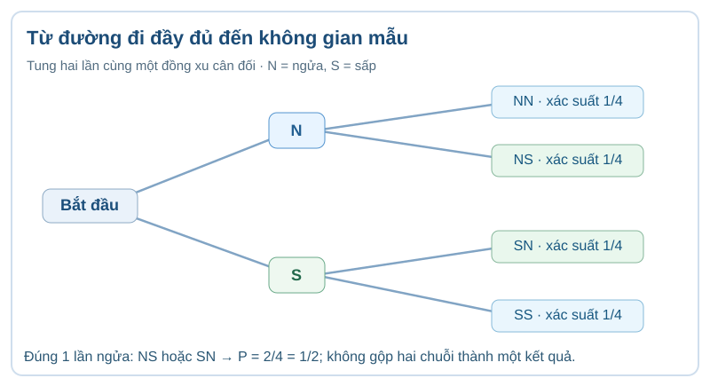
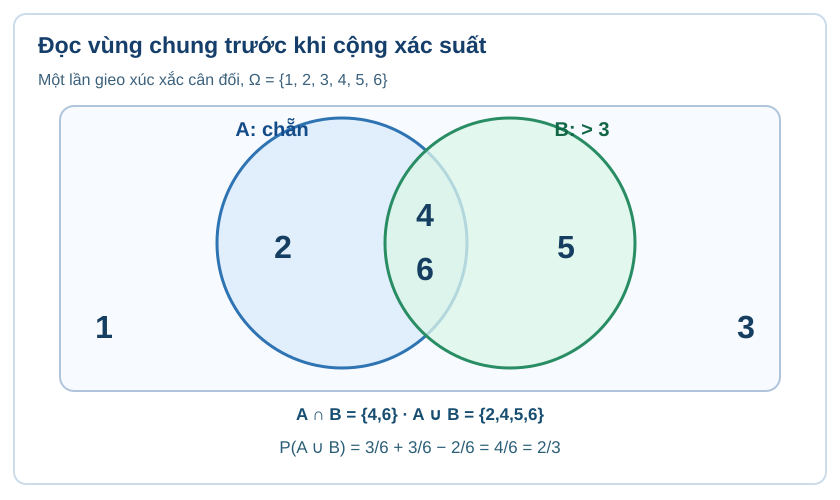

# Chuyên đề 20 · Xác suất cổ điển và các quy tắc tính xác suất

## 1. Kiến thức

Một lượt quay số tại hội chợ có những kết quả nào? Nếu kết quả nằm trong hai nhóm thưởng, có bị tính trùng không? Hai lượt chơi có thực sự độc lập? Em sẽ học cách mô tả đúng không gian mẫu và biến cố trước, rồi mới chọn phép đếm, quy tắc cộng hoặc nhân. Kiến thức về tập hợp, phân số và đếm theo bước được nhắc lại tại chỗ; không phải hoàn thành một chuyên đề khác mới học được.

**Cách học:** Em hãy tự làm từng câu Vận dụng trước, sau đó chủ động mở phần Đối chiếu để hiểu cách giải và nhận ra lỗi sai. Những bài đã xem lời giải dùng để ôn luyện, không thay thế bài Tự kiểm tra độc lập.

### 1. Mô hình ngẫu nhiên

#### 1.1. Phép thử, không gian mẫu và biến cố

**Khám phá kiến thức**

Khi rút ngẫu nhiên một thẻ trong bảy thẻ được đánh số từ 1 đến 7, ta không biết trước sẽ rút được thẻ nào. Tuy vậy, ta hoàn toàn có thể liệt kê những kết quả có thể xảy ra. Nếu chỉ ghi số trên thẻ thì mỗi số là **một kết quả sơ cấp**; tập hợp gồm cả bảy số mới là **không gian mẫu**. Cần phân biệt một kết quả riêng lẻ với tập tất cả kết quả, bởi hai đối tượng này giữ vai trò khác nhau trong cách mô tả phép thử.

Bây giờ giả sử câu hỏi là “rút được số nguyên tố”. Ta không thực hiện một phép thử khác: vẫn rút một thẻ như trước, nhưng chỉ những kết quả 2, 3, 5 và 7 làm câu nói ấy đúng. Vì vậy, một biến cố được biểu diễn bằng **tập các kết quả thuận lợi** bên trong không gian mẫu. Nếu không có kết quả nào phù hợp thì biến cố không thể xảy ra; nếu mọi kết quả đều phù hợp thì biến cố chắc chắn xảy ra. Cách nhìn bằng tập hợp này giúp em hiểu rõ mình đang tính xác suất cho điều gì, trước khi dùng bất kỳ phép đếm hay công thức nào.

> **ĐỊNH NGHĨA — Phép thử, không gian mẫu và biến cố**
>
> **Không gian mẫu** \(\Omega\) là **tập hợp tất cả các kết quả có thể xảy ra** của một phép thử ngẫu nhiên; mỗi kết quả sơ cấp là một phần tử \(\omega\in\Omega\). **Biến cố** \(A\subseteq\Omega\) là tập các kết quả làm biến cố xảy ra; \(\varnothing\) là biến cố không thể và \(\Omega\) là biến cố chắc chắn.

**Ví dụ hướng dẫn:** Rút đều một thẻ trong bảy thẻ mang số \(1,2,\ldots,7\). Khi đó \(\Omega=\{1,2,3,4,5,6,7\}\). Biến cố “lấy được số nguyên tố” có tập kết quả \(\{2,3,5,7\}\); biến cố đối là \(\{1,4,6\}\). Không được gọi “số nguyên tố” là một kết quả sơ cấp duy nhất.

**Tự chốt kiến thức:** Hãy luôn viết \(\Omega\) trước khi đếm; một cặp có thứ tự \((a,b)\) khác cặp không thứ tự \(\{a,b\}\).

**Vận dụng trước khi xem lời giải.** Gieo một xúc xắc 8 mặt đồng khả năng ghi các số 1–8. Viết Ω và biến cố “ra số chẵn”.

<!-- ITEM_ID: THPT-TOP20-T01; ROLE: TOPIC_FIRST_TRY; PRIMARY_OUTCOME: TOP20-O01; CONTENT_VERSION: TOP20-R02; Q15_CANONICAL_NEW_ONLY; ASSESSMENT: PUBLIC_FORMATIVE_NO_MASTERY -->

Mở đối chiếu sau khi tự thử

Ω={1,2,3,4,5,6,7,8}; A={2,4,6,8}.

**D6 – Tự khắc phục:** Nếu chỉ viết xác suất 1/2, em chưa mô tả biến cố; hãy ghi kết quả sơ cấp vào tập.

**Vì sao cần xét tập con?** Khi đổi tên một kết quả thành một câu “trúng hay không”, em phải nhận biết **mọi kết quả** làm câu ấy đúng; nếu bỏ sót một phần tử, tử số xác suất sẽ sai. **Bản chất:** A là tập con Ω, kết quả thuộc A thì A xảy ra. **Ví dụ:** xúc xắc chia hết cho 3 có A={3,6}. **Giới hạn:** ∅ là biến cố không thể, Ω là chắc chắn, A không phải một con số xác suất.

**Vận dụng mở rộng — tự giải trước khi đối chiếu.** Một vòng quay cân đối có các kết quả ghi 1 đến 6. Biến cố A là “kết quả không lớn hơn 2”. Hãy viết A và nói khi nào A xảy ra.

<!-- ITEM_ID: THPT-TOP20-T10; ROLE: TOPIC_FIRST_TRY; PRIMARY_OUTCOME: TOP20-O02; CONTENT_VERSION: TOP20-R02; Q15_CANONICAL_NEW_ONLY; ASSESSMENT: PUBLIC_FORMATIVE_NO_MASTERY -->

Mở lời giải sau khi tự thử

**Giải:** A={1,2}; A xảy ra nếu lượt quay cho kết quả 1 hoặc 2.

**D6 – Tự khắc phục:** Nếu viết A={2}, em đã bỏ kết quả 1 cũng không lớn hơn 2. Xem từng phần tử Ω={1,…,6}.

#### 1.2. Đồng khả năng và cách tính xác suất

**Khám phá kiến thức**

Giả sử một hộp có nhiều phiếu khác nhau nhưng các phiếu chỉ mang ba loại nhãn A, B và C. Nếu mỗi phiếu được rút với cơ hội như nhau, liệu ba nhãn có nhất thiết cùng cơ hội xuất hiện? Không: một nhãn có trên nhiều phiếu hơn sẽ dễ xuất hiện hơn. Điểm quyết định không phải là có bao nhiêu **loại nhãn**, mà là có bao nhiêu **kết quả sơ cấp thực sự đồng khả năng** tạo ra từng nhãn.

Khi không gian mẫu gồm hữu hạn kết quả đồng khả năng, mỗi kết quả đóng góp một phần bằng nhau vào xác suất. Muốn tính khả năng xảy ra của biến cố A, ta đếm số kết quả thuộc A rồi so với số kết quả của cả không gian mẫu. Từ cách suy luận đó mới hình thành công thức xác suất cổ điển. Nếu các kết quả ban đầu không đồng khả năng, tỉ số đếm đơn thuần không còn là cách tính hợp lệ; ta phải thay đổi cách mô hình hóa hoặc sử dụng thông tin xác suất thích hợp.

> **CÔNG THỨC — Xác suất cổ điển**
>
> \[P(A)=\frac{n(A)}{n(\Omega)},\quad n(\Omega)>0.\] Chỉ dùng khi các kết quả sơ cấp hữu hạn và đồng khả năng.

**Ví dụ hướng dẫn:** Một hộp có 8 phiếu khác nhau, mang nhãn \(A,A,B,B,B,C,C,C\), chọn ngẫu nhiên đều một phiếu. Không gian mẫu là 8 **phiếu vật lí**. Biến cố “nhãn B” có xác suất \(3/8\); ba nhãn A, B, C **không** có xác suất \(1/3\). Đếm theo từng phiếu, không chia đều theo ba nhãn.

**Kiểm tra trước khi tính:** Có đang đếm nhóm không thứ tự trong khi mẫu gốc là chuỗi có thứ tự không? Các kết quả được đếm có thực sự đồng khả năng không? Nếu không, không được dùng công thức cổ điển theo tỉ số đơn giản.

**Vận dụng trước khi xem lời giải.** Hộp có 2 phiếu đỏ và 4 phiếu xanh khác nhau, rút đều một phiếu. P(đỏ) có phải 1/2 vì có hai màu không?

<!-- ITEM_ID: THPT-TOP20-T02; ROLE: TOPIC_FIRST_TRY; PRIMARY_OUTCOME: TOP20-O03; CONTENT_VERSION: TOP20-R02; Q15_CANONICAL_NEW_ONLY; ASSESSMENT: PUBLIC_FORMATIVE_NO_MASTERY -->

Mở đối chiếu sau khi tự thử

Không. Sáu phiếu vật lí đồng khả năng, P(đỏ)=2/6=1/3.

**D6 – Tự khắc phục:** Nếu dùng 1/2, em đếm màu thay vì từng phiếu; hãy đặt tên cho sáu phiếu.

**Vì sao gộp kết quả có thể làm hỏng đồng khả năng?** Hai lần tung đồng xu cân đối, độc lập tạo bốn chuỗi có thứ tự NN, NS, SN, SS đồng khả năng. Khi chỉ ghi **số mặt ngửa**, ta được ba nhãn 0, 1, 2 nhưng chúng tương ứng lần lượt với **1, 2, 1** chuỗi. **Bản chất:** chỉ các chuỗi sơ cấp đã xác nhận đồng khả năng, không phải ba nhãn sau khi gộp. **Ví dụ:** \(P(\text{đúng một ngửa})=2/4=1/2\), không phải 1/3. **Giới hạn:** trước khi dùng tỉ số đếm, phải chứng minh các kết quả sơ cấp được chọn có cùng xác suất.

**Vận dụng mở rộng — tự giải trước khi đối chiếu.** Tung hai đồng xu cân đối và độc lập. Nếu chỉ ghi số mặt ngửa 0, 1, 2 thì ba giá trị ấy có đồng khả năng không? Hãy viết các chuỗi sơ cấp và tính xác suất có đúng một mặt ngửa.

<!-- ITEM_ID: THPT-TOP20-T11; ROLE: TOPIC_FIRST_TRY; PRIMARY_OUTCOME: TOP20-O06; CONTENT_VERSION: TOP20-R02; Q15_CANONICAL_NEW_ONLY; ASSESSMENT: PUBLIC_FORMATIVE_NO_MASTERY -->

Mở lời giải sau khi tự thử

**Giải:** Không. Không gian mẫu gồm NN, NS, SN, SS, mỗi chuỗi có xác suất 1/4. Số ngửa 0 ứng với SS, số ngửa 1 ứng với NS và SN, số ngửa 2 ứng với NN. Vì vậy ba giá trị **không** đồng khả năng; xác suất đúng một ngửa là \(2/4=1/2\).

**D6 – Tự khắc phục:** Nếu ra 1/3, em đã đếm ba **nhãn** thay vì bốn chuỗi sơ cấp. Liệt kê đủ NN, NS, SN, SS rồi ghép mỗi chuỗi với số mặt ngửa tương ứng.

#### 1.3. Biến cố đối và xác suất bé

**Khám phá kiến thức**

Có những câu hỏi hỏi một sự việc xảy ra, nhưng đếm trực tiếp các trường hợp thuận lợi lại khó. Chẳng hạn, khi gieo một đồng xu nhiều lần và hỏi “có ít nhất một lần ngửa”, ta phải tính tất cả các chuỗi chứa một, hai hoặc nhiều lần ngửa. Ngược lại, câu “không có lần ngửa nào” chỉ mô tả một kiểu kết quả: mọi lần đều sấp. Hai tình huống ấy phủ hết các khả năng và không thể đồng thời xảy ra.

Nếu gọi sự việc cần tìm là A, phần còn lại của không gian mẫu chính là **biến cố đối** của A. Vì tổng xác suất của tất cả khả năng là 1, xác suất của A và biến cố đối cộng lại bằng 1. Nhờ đó ta có thể tính gián tiếp qua trường hợp dễ đếm hơn. Cũng cần hiểu một khác biệt quan trọng: xác suất **rất nhỏ nhưng dương** vẫn có nghĩa là sự việc có thể xảy ra; trong mô hình hữu hạn đồng khả năng, biến cố không thể có xác suất 0; ngược lại, một biến cố có xác suất dương dù rất nhỏ vẫn có thể xảy ra.

> **TÍNH CHẤT — Biến cố đối**
>
> \[\bar A=\Omega\setminus A,\qquad P(\bar A)=1-P(A).\] A và đối A xung khắc, phủ hết mẫu.

**Ví dụ hướng dẫn:** Có 20 phiếu khác nhau được chọn đều, trong đó 2 phiếu thưởng. Biến cố \(A\) là “không trúng thưởng”. Khi đó \(P(A)=18/20=9/10\); biến cố đối “trúng một trong hai phiếu thưởng” có xác suất \(1/10\).

**Nguyên lí xác suất bé:** Một biến cố có \(0<P(A)\ll 1\) vẫn có thể xảy ra. Không suy ra biến cố không thể và không khẳng định số lần xảy ra trong một số lượt thử bằng chính xác “số lượt × xác suất”.

**Vận dụng trước khi xem lời giải.** Có 20 thẻ đồng khả năng, đúng 1 thẻ màu đen. Tính P(không đen). Biến cố đen có phải không thể?

<!-- ITEM_ID: THPT-TOP20-T03; ROLE: TOPIC_FIRST_TRY; PRIMARY_OUTCOME: TOP20-O04; CONTENT_VERSION: TOP20-R02; Q15_CANONICAL_NEW_ONLY; ASSESSMENT: PUBLIC_FORMATIVE_NO_MASTERY -->

Mở đối chiếu sau khi tự thử

P(không đen)=19/20; P(đen)=1/20>0 nên đen là hiếm, không phải không thể.

**D6 – Tự khắc phục:** Nếu nói xác suất 0, em đã nhầm ít xảy ra với biến cố rỗng.

**Vì sao phải phân biệt hiếm và không thể?** Một giải thưởng có ít vé vẫn có thể xuất hiện ở lượt đầu. **Bản chất:** một kết quả thuộc Ω cho xác suất dương khi các kết quả sơ cấp hữu hạn đồng khả năng. **Ví dụ:** 1 vé thưởng trong 50 vé có P=1/50, trong khi không có vé thưởng thì P=0. **Giới hạn:** xác suất nhỏ không dự đoán chính xác số lần xuất hiện của một cuộc chơi ngắn.

**Vận dụng mở rộng — tự giải trước khi đối chiếu.** Trong 100 vé đồng khả năng chỉ có một vé trúng. Biến cố trúng vé là không thể hay hiếm? Viết xác suất.

<!-- ITEM_ID: THPT-TOP20-T12; ROLE: TOPIC_FIRST_TRY; PRIMARY_OUTCOME: TOP20-O05; CONTENT_VERSION: TOP20-R02; Q15_CANONICAL_NEW_ONLY; ASSESSMENT: PUBLIC_FORMATIVE_NO_MASTERY -->

Mở lời giải sau khi tự thử

**Giải:** P(trúng)=1/100>0; hiếm chứ không phải biến cố không thể.

**D6 – Tự khắc phục:** Nếu P=0, em đã bỏ một vé trúng còn có mặt trong Ω. Đếm n(A)=1 và n(Ω)=100.

#### 1.4. Đếm kết quả bằng tổ hợp và sơ đồ cây

**Khám phá kiến thức**

Khi tung một đồng xu cân đối hai lần, kết quả “lần đầu ngửa, lần sau sấp” khác với “lần đầu sấp, lần sau ngửa”. Vì phép thử diễn ra theo từng bước, cách tự nhiên để không bỏ sót kết quả là vẽ một **sơ đồ cây**: từ mỗi khả năng ở lượt đầu, ta tiếp tục xét những khả năng ở lượt hai. Mỗi đường đi từ gốc đến lá mô tả một kết quả có thứ tự, chứ không chỉ một nhóm ký hiệu.

Quan sát hình dưới đây trước khi tính: sau mỗi nhánh N (ngửa) hoặc S (sấp), cây lại tách thành N và S. Ta nhận được bốn đường đi NN, NS, SN, SS. Trong phép tung đồng xu cân đối và độc lập, bốn đường đi ấy đồng khả năng. Tuy nhiên, nếu cơ chế ở lượt sau phụ thuộc lượt trước, các lá trên cây không nhất thiết còn có xác suất bằng nhau; cây giúp **liệt kê** các kết quả, không tự bảo đảm đồng khả năng.

**Hướng dẫn đọc hình:** Theo một đường đi từ trái sang phải để biết thứ tự hai lần tung. Muốn có đúng một lần ngửa, em chỉ chọn hai lá NS và SN, không gộp chúng thành một kết quả. Trong mô hình đồng xu cân đối, đó là hai trong bốn kết quả đồng khả năng, nên xác suất bằng \(2/4\).

Với bài toán **chọn đồng thời** một nhóm \(k\) vật từ \(n\) vật phân biệt và không phân vai, thứ tự chọn không tạo ra kết quả mới: ta cần đếm các **nhóm** khác nhau chứ không đếm mọi cách sắp xếp của từng nhóm. Còn với việc **thực hiện tuần tự**, thứ tự thường quan trọng và ta đếm bằng quy tắc nhân hoặc sơ đồ cây. Vì vậy, trước khi tính xác suất, phải xác định đúng mình đang đếm **nhóm không thứ tự** hay **chuỗi có thứ tự**, và dùng cùng một kiểu kết quả ở tử số lẫn mẫu số.

> **PHƯƠNG PHÁP — Đếm và đọc sơ đồ cây**
>
> Đếm chuỗi có thứ tự khác nhóm không thứ tự; dùng \(\binom nk\) khi chọn nhóm không phân vai. Không suy mọi lá của cây đồng khả năng nếu chưa kiểm.

**Ví dụ hướng dẫn (tổ hợp):** Có 8 lá phiếu khác nhau đánh số từ 1 đến 8, bốc đồng thời 3 phiếu và mọi bộ 3 đồng khả năng. Số nhóm là \(\binom83=56\). Có 4 phiếu mang số chẵn; biến cố “cả ba số đều chẵn” có \(\binom43=4\) nhóm thuận lợi, do đó \(P=4/56=1/14\).

**Ví dụ hướng dẫn (đếm theo bước):** Có 4 chiếc thẻ khác nhau; rút liên tiếp 2 thẻ không hoàn lại. Mỗi kết quả là một **cặp có thứ tự**, với \(4\cdot3=12\) khả năng đồng đều nếu rút đều mỗi bước. Nếu bốc đồng thời 2 thẻ không xét thứ tự thì mô hình lại có \(\binom42=6\) nhóm, không thể trộn hai mẫu khi lập tỉ số.

**Vận dụng trước khi xem lời giải.** Từ 6 học sinh chọn một nhóm 2 người không phân vai; so với chọn trưởng rồi phó, có bao nhiêu kết quả mỗi loại?

<!-- ITEM_ID: THPT-TOP20-T04; ROLE: TOPIC_FIRST_TRY; PRIMARY_OUTCOME: TOP20-O07; CONTENT_VERSION: TOP20-R02; Q15_CANONICAL_NEW_ONLY; ASSESSMENT: PUBLIC_FORMATIVE_NO_MASTERY -->

Mở đối chiếu sau khi tự thử

Không phân vai có C(6,2)=15 nhóm; phân hai vai có 6×5=30 cặp có thứ tự.

**D6 – Tự khắc phục:** Nếu có cả hai bằng 30, nhóm AB và BA đã bị đếm hai lần ở trường hợp không phân vai.

**Vì sao dùng biến cố đối cho “ít nhất một”?** Khi chọn 2 trong 5 phiếu, có nhiều cách có ít nhất một phiếu thưởng, còn “không phiếu thưởng” thường chỉ có một họ trường hợp. **Bản chất:** P(ít nhất một)=1−P(không có). **Ví dụ:** nếu 2 đỏ, 3 xanh, nhóm 2 phiếu đồng khả năng, P(ít nhất một đỏ)=1−C(3,2)/C(5,2)=7/10. **Giới hạn:** đừng lấy 1−P(đúng một đỏ) nếu có thể có hai đỏ; cùng dùng **nhóm không thứ tự** ở cả tử lẫn mẫu.

**Vận dụng mở rộng — tự giải trước khi đối chiếu.** Từ 5 phiếu khác nhau (1 đỏ, 4 xanh), chọn đều **hai phiếu không xét thứ tự**. Xác suất ít nhất một phiếu đỏ?

<!-- ITEM_ID: THPT-TOP20-T13; ROLE: TOPIC_FIRST_TRY; PRIMARY_OUTCOME: TOP20-O08; CONTENT_VERSION: TOP20-R02; Q15_CANONICAL_NEW_ONLY; ASSESSMENT: PUBLIC_FORMATIVE_NO_MASTERY -->

Mở lời giải sau khi tự thử

**Giải:** P=1−P(cả hai xanh)=1−C(4,2)/C(5,2)=1−6/10=2/5.

**D6 – Tự khắc phục:** Nếu dùng 1−4/5 thì em đang xét một phiếu. Mẫu này là **nhóm hai phiếu**, phải đếm C(5,2).

#### 1.5. Chọn đúng mô hình trước khi tính

**Khám phá kiến thức**

Một lời giải có thể tính toán hoàn toàn chính xác mà vẫn cho xác suất sai nếu ngay từ đầu ta lựa chọn sai mô hình. Chẳng hạn, khi gieo hai xúc xắc, các cặp \((1,6)\) và \((6,1)\) là hai kết quả khác nhau nếu ghi riêng số chấm của từng con. Nhưng nếu chỉ nhìn vào tổng số chấm thì cả hai đều được ghi thành 7. Số **nhãn tổng** ít hơn số **cặp kết quả**, và các nhãn tổng lại không đồng khả năng.

Vì thế, trước khi chọn công thức, ta cần hiểu chính xác một kết quả sơ cấp gồm những thông tin gì; các kết quả ấy có đồng khả năng không; thứ tự hoặc việc hoàn lại có làm thay đổi tập kết quả không. Sau đó mới xác định tập kết quả thuận lợi và quyết định nên đếm trực tiếp, dùng biến cố đối hay lập sơ đồ cây. Làm theo thứ tự này giúp em kiểm tra tính đúng đắn của mô hình trước khi kiểm tra phép tính, thay vì chỉ dựa vào việc đáp số cuối cùng nằm giữa 0 và 1.

> **GHI NHỚ — Kiểm mô hình trước phép tính**
>
> Xác định kết quả sơ cấp, tính đồng khả năng, thứ tự, có/không hoàn lại, tập kết quả thuận lợi và điều kiện dùng công thức.

**Bài mẫu phân tích sai lầm (không chấm điểm):** Khi gieo hai xúc xắc phân biệt, 11 tổng số chấm từ 2 đến 12 không đồng khả năng; chẳng hạn tổng 2 chỉ do một cặp, trong khi tổng 7 do sáu cặp. Nếu tính xác suất biến cố theo số “loại tổng” thay vì 36 cặp có thứ tự đồng khả năng thì mô hình sai dù phép chia đúng số học.

**Tự đánh giá sau phần Kiến thức:** Một xác suất hợp lệ luôn ở \([0,1]\), nhưng điều đó **chưa đủ** chứng minh phương pháp đếm là đúng. Trình bày bằng lời vì sao các kết quả đang đếm có khả năng như nhau.

**Vận dụng trước khi xem lời giải.** Gieo hai xúc xắc phân biệt, cân đối. Có bao nhiêu cặp sơ cấp đồng khả năng và P(tổng số chấm bằng 12)?

<!-- ITEM_ID: THPT-TOP20-T05; ROLE: TOPIC_FIRST_TRY; PRIMARY_OUTCOME: TOP20-O10; CONTENT_VERSION: TOP20-R02; Q15_CANONICAL_NEW_ONLY; ASSESSMENT: PUBLIC_FORMATIVE_NO_MASTERY -->

Mở đối chiếu sau khi tự thử

Có 36 cặp có thứ tự; chỉ (6,6) có tổng12 nên P=1/36.

**D6 – Tự khắc phục:** Không coi 11 tổng số chấm từ 2 đến12 là đồng khả năng; tổng12 chỉ có một cặp.

**Vì sao cần sơ đồ cây?** Hai lượt rút có thể tạo AB khác BA và nhánh thứ hai có thể giảm lựa chọn. **Bản chất:** mỗi đường đi hoàn chỉnh là một chuỗi kết quả; chỉ lấy tỉ số số lá nếu các lá **đồng khả năng**. **Ví dụ:** hai lần tung đồng xu cân đối có NN,NS,SN,SS với P(đúng một ngửa)=2/4. **Giới hạn:** rút không hoàn lại khác rút có hoàn lại; không tự nhân xác suất biên như hai lượt độc lập.

**Vận dụng mở rộng — tự giải trước khi đối chiếu.** Tung một đồng xu cân đối ba lần, coi chuỗi có thứ tự. Có mấy kết quả đồng khả năng và xác suất đúng hai mặt ngửa?

<!-- ITEM_ID: THPT-TOP20-T14; ROLE: TOPIC_FIRST_TRY; PRIMARY_OUTCOME: TOP20-O09; CONTENT_VERSION: TOP20-R02; Q15_CANONICAL_NEW_ONLY; ASSESSMENT: PUBLIC_FORMATIVE_NO_MASTERY -->

Mở lời giải sau khi tự thử

**Giải:** Có 2³=8 chuỗi; đúng hai ngửa là NNS, NSN, SNN (3 chuỗi), P=3/8.

**D6 – Tự khắc phục:** Nếu đếm ba loại “0/1/2/3 ngửa” là 4 kết quả đồng khả năng, em đã gộp các chuỗi khác nhau. Vẽ cây ba tầng.

### 2. Kết hợp các biến cố

#### 2.1. Hợp, giao và xung khắc

**Khám phá kiến thức**

Trong một lớp học, có bạn thích bóng đá, có bạn thích bóng rổ và có bạn thích cả hai. Nếu cần đếm những bạn thích **ít nhất một** môn, ta phải gộp hai nhóm nhưng chỉ tính mỗi người một lần. Nếu cần đếm những bạn thích **cả hai** môn, ta chỉ giữ phần chung của hai nhóm. Trong xác suất, hai cách chọn kết quả ấy dẫn đến hai khái niệm khác nhau: **hợp** và **giao** của các biến cố.

Hãy xét một lần gieo xúc xắc, với A là biến cố ra số chẵn và B là biến cố ra số từ 4 trở lên. Khi biểu diễn trên hình, A chứa các số 2, 4, 6 còn B chứa các số 4, 5, 6. Phần chồng nhau gồm 4 và 6 — đó là kết quả làm **cả A và B** xảy ra. Phần nằm trong ít nhất một vùng gồm 2, 4, 5, 6 — đó là kết quả làm **A hoặc B** xảy ra. Nếu hai vùng không có kết quả chung, ta gọi hai biến cố là **xung khắc**; khi ấy chúng không thể đồng thời xảy ra trong một lần thử.

**Hướng dẫn đọc hình:** Khung \(\Omega\) biểu diễn sáu kết quả của phép gieo xúc xắc. Quan sát riêng phần giao chứa 4, 6; phần chỉ thuộc A chứa 2; phần chỉ thuộc B chứa 5. Kết quả 1 và 3 nằm ngoài cả hai biến cố. Các vòng tròn giúp nhìn quan hệ tập hợp, **không** có nghĩa là diện tích các vùng tỉ lệ với xác suất.

**Tương tác khám phá:** [Thay đổi các kết quả thuộc A và B trên mô hình](Temp_PLAN22_20_EVENTS_INTERACTIVE_WHITE_R00_20261114.html) để tự kiểm tra sự khác nhau giữa “hoặc”, “và” và “không xảy ra cùng nhau”.

> **ĐỊNH NGHĨA — Hợp, giao, xung khắc**
>
> \(A\cup B\) là ít nhất một; \(A\cap B\) là cả hai; xung khắc khi \(A\cap B=\varnothing\). Hợp đếm mỗi kết quả ở giao chỉ một lần.

**Ví dụ có suy luận.** Chọn đều một số từ 1 đến 12; \(A\): chia hết cho 3, \(B\): chẵn. Ta có \(A=\{3,6,9,12\}\), \(B=\{2,4,6,8,10,12\}\), \(A\cap B=\{6,12\}\). Hợp gồm \(4+6-2=8\) kết quả, nên \(P(A\cup B)=8/12=2/3\). Hai biến cố này **không xung khắc** vì có hai kết quả chung.

**Hướng dẫn đọc hình:** Nhìn vùng chỉ thuộc A, chỉ thuộc B, vùng chồng nhau và vùng ở ngoài cả hai. Đếm vùng chồng **một lần** khi tìm hợp.

**Vận dụng trước khi xem lời giải.** Gieo xúc xắc cân đối. A=ra số chẵn, B=ra số lớn hơn 4. Viết A∩B và A∪B.

<!-- ITEM_ID: THPT-TOP20-T06; ROLE: TOPIC_FIRST_TRY; PRIMARY_OUTCOME: TOP20-O11; CONTENT_VERSION: TOP20-R02; Q15_CANONICAL_NEW_ONLY; ASSESSMENT: PUBLIC_FORMATIVE_NO_MASTERY -->

Mở đối chiếu sau khi tự thử

A={2,4,6}, B={5,6}; giao={6}, hợp={2,4,5,6}.

**D6 – Tự khắc phục:** Giao chỉ lấy phần có chung, hợp chứa tất cả nhưng mỗi số chỉ ghi một lần.

**Ghi nhớ khi đối chiếu:** Hình Venn ở đây dùng \(\Omega=\{1,2,3,4,5,6\}\), giao \(\{4,6\}\) và hợp \(\{2,4,5,6\}\). Ví dụ chọn số từ 1 đến 12 ở đoạn trên là **mô hình khác**, không được lấy số 6, 12 trong ví dụ đó để đọc thành phần giao của hình xúc xắc.

#### 2.2. Độc lập không phải xung khắc

**Khám phá kiến thức**

Giả sử ta tung hai đồng xu cân đối và việc tung đồng xu thứ nhất không ảnh hưởng đến đồng xu thứ hai. Biết đồng xu đầu tiên ra ngửa không làm kết quả ngửa của đồng xu thứ hai dễ hay khó hơn. Đó là trực giác của **hai biến cố độc lập**: thông tin rằng biến cố này xảy ra không làm thay đổi xác suất của biến cố kia (khi xác suất có điều kiện được xác định).

Bây giờ hãy so sánh với hai biến cố “lần tung đầu ra ngửa” và “lần tung đầu ra sấp”. Chúng không thể cùng xảy ra, nên **xung khắc**; nhưng khi đã biết biến cố thứ nhất xảy ra, biến cố thứ hai chắc chắn không xảy ra. Với hai biến cố đều có xác suất dương, xung khắc và độc lập vì thế không thể là cùng một tính chất. Tiêu chuẩn toán học để kiểm tra độc lập là so sánh xác suất của **giao** với **tích hai xác suất riêng**. Đây là điều kiện phải được kiểm tra, không phải công thức được phép áp dụng cho mọi cặp biến cố.

> **TÍNH CHẤT — Độc lập**
>
> \[P(A\cap B)=P(A)P(B).\] Đây là tiêu chuẩn độc lập; không suy từ việc hai biến cố không xung khắc.

**Ví dụ có suy luận.** Tung hai đồng xu công bằng, độc lập; xét kết quả có thứ tự \(\{NN,NS,SN,SS\}\). \(A\): xu đầu ngửa; \(B\): xu sau ngửa. Ta có \(P(A)=P(B)=1/2\), \(P(A\cap B)=1/4=(1/2)(1/2)\): độc lập. Trái lại, nếu \(C\) là “cả hai đều ngửa” và \(D\) là “xu đầu sấp” thì \(C\cap D=\varnothing\) nhưng \(P(C),P(D)>0\); chúng **xung khắc nhưng không độc lập**.

**Giới hạn:** Không suy độc lập chỉ vì hai biến cố có thể đồng thời xảy ra; phải xem mô hình hoặc kiểm công thức.

**Vận dụng trước khi xem lời giải.** Tung một đồng xu cân đối và gieo xúc xắc cân đối độc lập. Xác suất đồng xu ngửa và xúc xắc chẵn là bao nhiêu?

<!-- ITEM_ID: THPT-TOP20-T07; ROLE: TOPIC_FIRST_TRY; PRIMARY_OUTCOME: TOP20-O12; CONTENT_VERSION: TOP20-R02; Q15_CANONICAL_NEW_ONLY; ASSESSMENT: PUBLIC_FORMATIVE_NO_MASTERY -->

Mở đối chiếu sau khi tự thử

P=1/2×3/6=1/4. Hai phép thử độc lập nên số cặp thuận lợi=1×3 trong 12 cặp.

**D6 – Tự khắc phục:** Nếu tính 1/2+1/2, em đang cộng xác suất mà đề yêu cầu cùng xảy ra.

**Vì sao xung khắc không phải độc lập?** Khi một xúc xắc ra số chẵn, nó không thể đồng thời ra số lẻ, nên biến cố này **loại trừ** nhau. **Bản chất:** xung khắc khi giao rỗng; độc lập lại yêu cầu P(A∩B)=P(A)P(B). **Ví dụ:** A=chẵn và B=lẻ đều có P=1/2 nhưng giao 0≠1/4. **Giới hạn:** nếu một biến cố có P=0 thì vẫn có thể vừa xung khắc vừa độc lập; không áp kết luận không độc lập một cách tuyệt đối.

**Vận dụng mở rộng — tự giải trước khi đối chiếu.** Gieo một xúc xắc: A=ra 1 và B=ra 6. A,B có xung khắc không? Có độc lập không?

<!-- ITEM_ID: THPT-TOP20-T15; ROLE: TOPIC_FIRST_TRY; PRIMARY_OUTCOME: TOP20-O13; CONTENT_VERSION: TOP20-R02; Q15_CANONICAL_NEW_ONLY; ASSESSMENT: PUBLIC_FORMATIVE_NO_MASTERY -->

Mở lời giải sau khi tự thử

**Giải:** A∩B=∅ nên xung khắc; P(A)P(B)=1/36>0 nhưng P(A∩B)=0 nên **không độc lập**.

**D6 – Tự khắc phục:** Nếu viết “vì không xảy ra cùng nên độc lập”, em đã đảo khái niệm. Xung khắc là giao rỗng, độc lập cần kiểm tích xác suất.

#### 2.3. Quy tắc cộng xác suất

**Khám phá kiến thức**

Khi đếm số người tham gia ít nhất một trong hai câu lạc bộ, cách cộng số người của từng câu lạc bộ có thể đếm trùng những người tham gia cả hai. Cụ thể, mỗi người ở phần giao đã xuất hiện một lần trong nhóm A và thêm một lần trong nhóm B. Muốn đếm đúng hợp, ta phải **trừ phần giao một lần**.

Lập luận ấy cũng áp dụng cho xác suất: cộng xác suất của A và B rồi trừ xác suất của phần xảy ra đồng thời. Ta không cần giả thiết hai biến cố độc lập, bởi đây là quy tắc về việc phân chia và đếm những kết quả thuộc hợp. Trường hợp hai biến cố xung khắc thì phần giao không có kết quả nào, số hạng cần trừ bằng 0 và công thức tự rút gọn thành phép cộng hai xác suất.

> **CÔNG THỨC — Quy tắc cộng**
>
> \[P(A\cup B)=P(A)+P(B)-P(A\cap B).\] Nếu giao rỗng thì bỏ số hạng giao.

**Ví dụ có suy luận.** Trong 50 người được chọn đều, 30 thích hoạt động A, 25 thích B, 10 thích cả hai. Số thích ít nhất một là \(30+25-10=45\), nên xác suất \(45/50=9/10\). Ta không cần giả thiết hai sở thích độc lập. Kiểm lại: 45 không vượt 50; hợp phải chứa từng biến cố.

**Sai lầm điển hình:** Cộng \(P(A)+P(B)\) mà quên trừ giao, dẫn tới xác suất có thể vượt 1.

**Vận dụng trước khi xem lời giải.** Gieo xúc xắc cân đối. A=lẻ, B=lớn hơn 3. Tính P(A∪B) bằng quy tắc cộng.

<!-- ITEM_ID: THPT-TOP20-T08; ROLE: TOPIC_FIRST_TRY; PRIMARY_OUTCOME: TOP20-O14; CONTENT_VERSION: TOP20-R02; Q15_CANONICAL_NEW_ONLY; ASSESSMENT: PUBLIC_FORMATIVE_NO_MASTERY -->

Mở đối chiếu sau khi tự thử

A={1,3,5}, B={4,5,6}, giao={5}; P(hợp)=3/6+3/6−1/6=5/6.

**D6 – Tự khắc phục:** Nếu ra 1, em đã cộng mà quên trừ kết quả 5 được đếm hai lần.

**Vì sao công thức cộng có bản rút gọn?** Khi một lần quay chỉ có thể rơi vào ô A **hoặc** ô B, không có ô nào nằm cả hai nhóm nên không đếm trùng. **Bản chất:** A∩B=∅ làm P(A∪B)=P(A)+P(B). **Ví dụ:** xúc xắc A={1}, B={4}, hợp hai kết quả nên P=2/6=1/3. **Giới hạn:** khi có phần giao, phải trở lại công thức tổng quát và trừ P(A∩B), không dùng rút gọn.

**Vận dụng mở rộng — tự giải trước khi đối chiếu.** Gieo xúc xắc cân đối. A={1,2}, B={5,6}. Tính P(A∪B) và nêu vì sao cộng trực tiếp.

<!-- ITEM_ID: THPT-TOP20-T16; ROLE: TOPIC_FIRST_TRY; PRIMARY_OUTCOME: TOP20-O15; CONTENT_VERSION: TOP20-R02; Q15_CANONICAL_NEW_ONLY; ASSESSMENT: PUBLIC_FORMATIVE_NO_MASTERY -->

Mở lời giải sau khi tự thử

**Giải:** Hai tập rời nhau nên P(A∩B)=0, P(A∪B)=2/6+2/6=4/6=2/3.

**D6 – Tự khắc phục:** Nếu nhân 2/6×2/6, em đã tính giao của biến cố độc lập; ở đây A,B xung khắc và đề hỏi hợp.

#### 2.4. Quy tắc nhân độc lập và biến cố đối

**Khám phá kiến thức**

Giả sử một hệ thống có hai thiết bị hoạt động độc lập. Nếu câu hỏi là “**cả hai** thiết bị cùng hoạt động”, ta xét giao của hai biến cố. Vì các kết quả hoạt động không ảnh hưởng nhau, xác suất cả hai cùng hoạt động bằng tích các xác suất riêng. Nhưng nếu câu hỏi đổi thành “**ít nhất một** thiết bị hoạt động”, việc cộng ngay hai xác suất hoạt động sẽ đếm trùng trường hợp cả hai đều hoạt động.

Cách suy nghĩ gọn hơn là xét tình huống ngược lại: “không có thiết bị nào hoạt động”, tức là **cả hai đều hỏng**. Đây là biến cố đối của “ít nhất một hoạt động”. Khi hai thiết bị độc lập, sự cố hỏng của chúng cũng độc lập, nên có thể nhân hai xác suất hỏng rồi lấy 1 trừ kết quả đó. Lập luận này **không được tự động áp dụng** cho hai thiết bị có chung nguồn điện hoặc một phép rút thẻ không hoàn lại: những tình huống ấy có thể làm các biến cố phụ thuộc nhau.

> **CÔNG THỨC — Nhân độc lập và biến cố đối**
>
> Nếu A,B độc lập: \[P(A\cap B)=P(A)P(B),\quad P(A\cup B)=1-P(\bar A)P(\bar B).\] Không nhân xác suất biên cho biến cố phụ thuộc.

**Ví dụ có suy luận.** Hai thiết bị độc lập có xác suất chạy được \(3/4\) và \(4/5\). Cả hai chạy: \((3/4)(4/5)=3/5\). Cả hai hỏng: \((1/4)(1/5)=1/20\). Ít nhất một chạy: \(1-1/20=19/20\). So sánh ba câu hỏi trước khi chọn công thức.

**Giới hạn:** Khi rút liên tiếp không hoàn lại hoặc hai biến cố phụ thuộc, không nhân hai xác suất ban đầu như thể độc lập. Trong chuyên đề này, em vẫn có thể **đếm các chuỗi kết quả đồng khả năng** để giải tình huống cụ thể; công thức xác suất có điều kiện sẽ được học ở chuyên đề khác, không phải tiền đề bắt buộc ở đây.

**Vận dụng trước khi xem lời giải.** Hai thiết bị hoạt động độc lập, xác suất hỏng lần lượt 1/5 và 1/4. Xác suất có ít nhất một thiết bị hoạt động là bao nhiêu?

<!-- ITEM_ID: THPT-TOP20-T09; ROLE: TOPIC_FIRST_TRY; PRIMARY_OUTCOME: TOP20-O16; CONTENT_VERSION: TOP20-R02; Q15_CANONICAL_NEW_ONLY; ASSESSMENT: PUBLIC_FORMATIVE_NO_MASTERY -->

Mở đối chiếu sau khi tự thử

P=1−P(cả hai hỏng)=1−(1/5)(1/4)=19/20.

**D6 – Tự khắc phục:** Nếu nhân hai xác suất hoạt động 4/5×3/4, em đang tính cả hai hoạt động, không phải ít nhất một.

**Vì sao phải phối hợp quy tắc?** Khi hai biến cố độc lập nhưng vẫn có thể cùng xảy ra, phép nhân giúp tính **giao**, sau đó phép cộng–trừ giao mới cho **hợp**. **Bản chất:** với hai phép thử độc lập P(A∩B)=P(A)P(B), P(A∪B)=P(A)+P(B)−P(A∩B). **Ví dụ:** xu ngửa P=1/2, xúc xắc >4 P=1/3, hợp=1/2+1/3−1/6=2/3. **Giới hạn:** đừng dùng phép nhân giản lược khi không chứng minh độc lập.

**Vận dụng mở rộng — tự giải trước khi đối chiếu.** Tung đồng xu cân đối và gieo xúc xắc cân đối độc lập. A=đồng xu ngửa, B=xúc xắc chẵn. Tính P(A∪B).

<!-- ITEM_ID: THPT-TOP20-T17; ROLE: TOPIC_FIRST_TRY; PRIMARY_OUTCOME: TOP20-O17; CONTENT_VERSION: TOP20-R02; Q15_CANONICAL_NEW_ONLY; ASSESSMENT: PUBLIC_FORMATIVE_NO_MASTERY -->

Mở lời giải sau khi tự thử

**Giải:** P(A)=1/2, P(B)=1/2, P(A∩B)=1/4. Vậy P(A∪B)=1/2+1/2−1/4=3/4.

**D6 – Tự khắc phục:** Nếu được 1, em đã cộng mà chưa trừ phần **cả hai cùng xảy ra**; nếu được 1/4 đó là giao, không phải hợp.

## 2. Luyện tập

Các bài dưới đây cần chọn mô hình xác suất đúng, giải thích cách đếm rồi tự mở Đối chiếu. Nếu chưa đạt, sử dụng D6 quay về đúng mảng Kiến thức.

<!-- AUTHOR_ONLY_Q15: 34 historical G10/G11 PR #810 public items are ID-only source pointers; no stems/keys/rubrics replicated. Source custody Q15 HOLD. -->

### 2.1. Bài luyện tập 1

<!-- ITEM_ID: THPT-TOP20-P01; ROLE: TOPIC_PRACTICE; PRIMARY_OUTCOME: TOP20-O01; CONTENT_VERSION: TOP20-R02; PUBLIC_FORMATIVE_NO_MASTERY -->

Rút đều một thẻ trong 10 thẻ đánh số 0 đến 9. Viết Ω và biến cố A “số chẵn”.

Mở lời giải sau khi tự làm

**Giải:** Ω={0,1,2,3,4,5,6,7,8,9}; A={0,2,4,6,8}. A có 5 kết quả.

**D6 – Lỗi cần sửa:** Nếu loại 0 vì không phải số chẵn, hãy nhớ 0 chia hết cho 2.

### 2.2. Bài luyện tập 2

<!-- ITEM_ID: THPT-TOP20-P02; ROLE: TOPIC_PRACTICE; PRIMARY_OUTCOME: TOP20-O02; CONTENT_VERSION: TOP20-R02; PUBLIC_FORMATIVE_NO_MASTERY -->

Gieo xúc xắc sáu mặt một lần. Biến cố “kết quả bé hơn 2” gồm những phần tử nào và có chắc chắn không?

Mở lời giải sau khi tự làm

**Giải:** A={1}, không chắc chắn vì Ω có sáu kết quả, chỉ một kết quả thuận lợi.

**D6 – Lỗi cần sửa:** Phân biệt “bé hơn” với “bé hơn hoặc bằng”; A là một tập con chứ không phải số 1/6.

### 2.3. Bài luyện tập 3

<!-- ITEM_ID: THPT-TOP20-P03; ROLE: TOPIC_PRACTICE; PRIMARY_OUTCOME: TOP20-O03; CONTENT_VERSION: TOP20-R02; PUBLIC_FORMATIVE_NO_MASTERY -->

Túi chứa 10 phiếu khác nhau, đúng 3 phiếu có thưởng, rút đều một phiếu. Tính P(trúng).

Mở lời giải sau khi tự làm

**Giải:** Ba kết quả thuận lợi trong 10 phiếu đồng khả năng, P=3/10.

**D6 – Lỗi cần sửa:** Nếu dùng tỷ số số loại giải thưởng, em đã chọn sai đơn vị kết quả sơ cấp.

### 2.4. Bài luyện tập 4

<!-- ITEM_ID: THPT-TOP20-P04; ROLE: TOPIC_PRACTICE; PRIMARY_OUTCOME: TOP20-O04; CONTENT_VERSION: TOP20-R02; PUBLIC_FORMATIVE_NO_MASTERY -->

Trong 12 thẻ khác nhau, có 4 thẻ bị lỗi. Rút đều một thẻ. Tính P(không lỗi) bằng biến cố đối.

Mở lời giải sau khi tự làm

**Giải:** P=1−4/12=8/12=2/3.

**D6 – Lỗi cần sửa:** Kiểm A và A̅ phủ hết 12 thẻ, không tính 4/12 là không lỗi.

### 2.5. Bài luyện tập 5

<!-- ITEM_ID: THPT-TOP20-P05; ROLE: TOPIC_PRACTICE; PRIMARY_OUTCOME: TOP20-O05; CONTENT_VERSION: TOP20-R02; PUBLIC_FORMATIVE_NO_MASTERY -->

Trong 40 vé khác nhau có một vé trúng. Phân biệt xác suất trúng với trường hợp không có vé trúng.

Mở lời giải sau khi tự làm

**Giải:** Nếu có một vé trúng: P=1/40>0, hiếm nhưng có thể. Nếu không vé trúng: P=0, biến cố không thể trong mô hình này.

**D6 – Lỗi cần sửa:** Đừng dùng chữ “rất khó” thay cho “bằng 0”.

### 2.6. Bài luyện tập 6

<!-- ITEM_ID: THPT-TOP20-P06; ROLE: TOPIC_PRACTICE; PRIMARY_OUTCOME: TOP20-O06; CONTENT_VERSION: TOP20-R02; PUBLIC_FORMATIVE_NO_MASTERY -->

Bốn thẻ phân biệt được ghi 1, 2, 3, 4. Rút lần lượt hai thẻ **không hoàn lại**, mỗi lượt chọn đều trong các thẻ còn lại; chỉ ghi **tổng hai số**. So sánh xác suất tổng bằng 5 và tổng bằng 7. Có được xem các tổng có thể xuất hiện là đồng khả năng không?

Mở lời giải sau khi tự làm

**Giải:** Mỗi cặp có thứ tự của hai thẻ khác nhau có xác suất \(1/(4\cdot3)=1/12\). Tổng 5 do bốn cặp (1,4),(4,1),(2,3),(3,2), nên \(P(S=5)=4/12=1/3\). Tổng 7 do hai cặp (3,4),(4,3), nên \(P(S=7)=2/12=1/6\). Các tổng không đồng khả năng dù mỗi lần rút từng thẻ là đều.

**D6 – Lỗi cần sửa:** Nếu chia cho 5 vì thấy các tổng 3,4,5,6,7, em đang coi các **nhãn tổng** là kết quả đồng khả năng. Hãy lập bảng cặp có thứ tự \((a,b)\) với \(a\ne b\), khoanh bốn cặp tổng 5 và hai cặp tổng 7. Không tính cặp \((a,a)\) vì rút không hoàn lại.

### 2.7. Bài luyện tập 7

<!-- ITEM_ID: THPT-TOP20-P07; ROLE: TOPIC_PRACTICE; PRIMARY_OUTCOME: TOP20-O07; CONTENT_VERSION: TOP20-R02; PUBLIC_FORMATIVE_NO_MASTERY -->

Từ 7 thẻ khác nhau, trong đó có 3 thẻ ghi sao, lấy đều 2 thẻ cùng lúc (không xét thứ tự). Tính P(cả hai sao).

Mở lời giải sau khi tự làm

**Giải:** Số nhóm C(7,2)=21; nhóm sao C(3,2)=3, nên P=3/21=1/7.

**D6 – Lỗi cần sửa:** Nếu dùng 7×6 ở mẫu mà C(3,2) ở tử, em đã trộn có và không xét thứ tự.

### 2.8. Bài luyện tập 8

<!-- ITEM_ID: THPT-TOP20-P08; ROLE: TOPIC_PRACTICE; PRIMARY_OUTCOME: TOP20-O08; CONTENT_VERSION: TOP20-R02; PUBLIC_FORMATIVE_NO_MASTERY -->

Túi có 2 bóng đỏ và 4 bóng xanh khác nhau. Chọn đều 2 bóng cùng lúc. Tính P(ít nhất một bóng đỏ).

Mở lời giải sau khi tự làm

**Giải:** 1−C(4,2)/C(6,2)=1−6/15=3/5.

**D6 – Lỗi cần sửa:** Biến cố đối là “không có đỏ”, tức cả hai xanh, không phải “đúng một đỏ”.

### 2.9. Bài luyện tập 9

<!-- ITEM_ID: THPT-TOP20-P09; ROLE: TOPIC_PRACTICE; PRIMARY_OUTCOME: TOP20-O09; CONTENT_VERSION: TOP20-R02; PUBLIC_FORMATIVE_NO_MASTERY -->

Tung một đồng xu cân đối ba lần độc lập. Vẽ cây ba tầng hoặc liệt kê chuỗi có thứ tự để tính xác suất **lượt đầu và lượt cuối đều ngửa**, không giới hạn lượt ở giữa.

Mở lời giải sau khi tự làm

**Giải:** Có \(2^3=8\) chuỗi đồng khả năng. Lượt đầu và cuối ngửa cho **NNN và NSN**, tức 2 chuỗi; xác suất \(2/8=1/4\). Kết quả ở lượt giữa có thể ngửa hoặc sấp.

**D6 – Lỗi cần sửa:** Nếu chỉ đếm NNN, em đã tự áp thêm điều kiện “lượt giữa cũng ngửa”. Nếu gộp chuỗi theo số lần ngửa, em mất thông tin về vị trí; hãy giữ cả ba lượt trên mỗi lá cây.

### 2.10. Bài luyện tập 10

<!-- ITEM_ID: THPT-TOP20-P10; ROLE: TOPIC_PRACTICE; PRIMARY_OUTCOME: TOP20-O10; CONTENT_VERSION: TOP20-R02; PUBLIC_FORMATIVE_NO_MASTERY -->

Hộp 5 thẻ khác nhau (2 đỏ, 3 xanh), rút đều liên tiếp 2 thẻ không hoàn lại. Tính P(cả hai đỏ) bằng đếm chuỗi.

Mở lời giải sau khi tự làm

**Giải:** Tổng 5×4=20 cặp có thứ tự; hai đỏ có 2×1=2 cặp; P=2/20=1/10.

**D6 – Lỗi cần sửa:** Nếu dùng (2/5)², em đã giả sử lượt sau vẫn có 2 đỏ trong 5 thẻ.

### 2.11. Bài luyện tập 11

<!-- ITEM_ID: THPT-TOP20-P11; ROLE: TOPIC_PRACTICE; PRIMARY_OUTCOME: TOP20-O11; CONTENT_VERSION: TOP20-R02; PUBLIC_FORMATIVE_NO_MASTERY -->

Gieo xúc xắc: A=ra số lẻ, B=ra số không nhỏ hơn 5. Viết A∩B và A∪B.

Mở lời giải sau khi tự làm

**Giải:** A={1,3,5}, B={5,6}; A∩B={5}, A∪B={1,3,5,6}.

**D6 – Lỗi cần sửa:** Nếu gộp kết quả 5 hai lần trong hợp, em chưa coi hợp là tập hợp.

### 2.12. Bài luyện tập 12

<!-- ITEM_ID: THPT-TOP20-P12; ROLE: TOPIC_PRACTICE; PRIMARY_OUTCOME: TOP20-O12; CONTENT_VERSION: TOP20-R02; PUBLIC_FORMATIVE_NO_MASTERY -->

Hai xúc xắc cân đối độc lập. A: con thứ nhất ra số lớn hơn 4; B: con thứ hai ra số chẵn. Tính P(A∩B).

Mở lời giải sau khi tự làm

**Giải:** P(A)=2/6=1/3, P(B)=3/6=1/2; độc lập nên P(A∩B)=1/6.

**D6 – Lỗi cần sửa:** Nếu ra 5/6, em đang cộng hai biến cố thay vì lấy giao.

### 2.13. Bài luyện tập 13

<!-- ITEM_ID: THPT-TOP20-P13; ROLE: TOPIC_PRACTICE; PRIMARY_OUTCOME: TOP20-O13; CONTENT_VERSION: TOP20-R02; PUBLIC_FORMATIVE_NO_MASTERY -->

Một xúc xắc: A={1,2}, B={3,4}. Chúng có xung khắc và độc lập không?

Mở lời giải sau khi tự làm

**Giải:** Xung khắc vì giao rỗng. Không độc lập vì P(A∩B)=0 trong khi P(A)P(B)=(2/6)(2/6)=1/9>0.

**D6 – Lỗi cần sửa:** Hai biến cố không cùng xảy ra có xác suất dương thì không độc lập.

### 2.14. Bài luyện tập 14

<!-- ITEM_ID: THPT-TOP20-P14; ROLE: TOPIC_PRACTICE; PRIMARY_OUTCOME: TOP20-O14; CONTENT_VERSION: TOP20-R02; PUBLIC_FORMATIVE_NO_MASTERY -->

Gieo xúc xắc. A={1,2,3,4}, B={2,4,6}. Tính P(A∪B) theo quy tắc cộng.

Mở lời giải sau khi tự làm

**Giải:** Giao {2,4}: P(A∪B)=4/6+3/6−2/6=5/6. Liệt kê hợp {1,2,3,4,6} kiểm lại.

**D6 – Lỗi cần sửa:** Nếu ra 7/6>1, phép cộng đã đếm trùng 2,4.

### 2.15. Bài luyện tập 15

<!-- ITEM_ID: THPT-TOP20-P15; ROLE: TOPIC_PRACTICE; PRIMARY_OUTCOME: TOP20-O15; CONTENT_VERSION: TOP20-R02; PUBLIC_FORMATIVE_NO_MASTERY -->

Gieo xúc xắc, A=ra 1 và B=ra 6. Tính P(A∪B) và giải thích vì sao cộng trực tiếp.

Mở lời giải sau khi tự làm

**Giải:** A∩B=∅ nên P(A∪B)=1/6+1/6=1/3.

**D6 – Lỗi cần sửa:** Nếu gọi A,B độc lập, thử kiểm P(A)P(B)=1/36 khác 0.

### 2.16. Bài luyện tập 16

<!-- ITEM_ID: THPT-TOP20-P16; ROLE: TOPIC_PRACTICE; PRIMARY_OUTCOME: TOP20-O16; CONTENT_VERSION: TOP20-R02; PUBLIC_FORMATIVE_NO_MASTERY -->

Tung đồng xu cân đối và gieo xúc xắc cân đối độc lập. P(ngửa và mặt xúc xắc chia hết cho 3)?

Mở lời giải sau khi tự làm

**Giải:** P=1/2×2/6=1/6; biến cố có mặt xúc xắc 3 hoặc 6.

**D6 – Lỗi cần sửa:** Đừng lấy 1/2+2/6 vì câu hỏi yêu cầu cùng xuất hiện.

### 2.17. Bài luyện tập 17

<!-- ITEM_ID: THPT-TOP20-P17; ROLE: TOPIC_PRACTICE; PRIMARY_OUTCOME: TOP20-O17; CONTENT_VERSION: TOP20-R02; PUBLIC_FORMATIVE_NO_MASTERY -->

Gieo hai xúc xắc cân đối độc lập. A: con thứ nhất ra số lẻ, B: con thứ hai không lớn hơn 2. Tính P(A∪B).

Mở lời giải sau khi tự làm

**Giải:** P(A)=3/6=1/2, P(B)=2/6=1/3, P(A∩B)=1/6. Vậy P(A∪B)=1/2+1/3−1/6=2/3.

**D6 – Lỗi cần sửa:** Nếu kết quả 5/6, em quên trừ phần giao; nếu 1/6 đó là giao chứ không phải hợp.

### 2.18. Vận dụng tự luận có rubric

#### 2.18.1. Tự luận 1 (W01) — lập luận và rubric /4

<!-- ITEM_ID: THPT-TOP20-W01; ROLE: TOPIC_WRITTEN; PRIMARY_OUTCOME: TOP20-O08; CONTENT_VERSION: TOP20-R02; PUBLIC_SELF_SCORED_NO_MASTERY; NOT_PROTECTED_RD1 -->

Có 8 phiếu phân biệt, 3 phiếu đỏ và 5 phiếu xanh. Chọn đều một nhóm 2 phiếu không xét thứ tự. (a) Có bao nhiêu nhóm kết quả? (b) Tính P(cả hai đỏ). (c) Tính P(ít nhất một đỏ) bằng biến cố đối.

Mở lời giải và rubric /4 sau khi tự làm

**Lời giải:** (a) C(8,2)=28 nhóm. (b) C(3,2)/C(8,2)=3/28. (c) 1−C(5,2)/C(8,2)=1−10/28=18/28=9/14.

**Rubric /4:**
- Xác định đúng kết quả sơ cấp là nhóm không thứ tự và C(8,2)=28 — **1 điểm**.
- Đếm nhóm toàn đỏ C(3,2)=3, tính 3/28 — **1 điểm**.
- Chọn biến cố đối hai phiếu xanh với C(5,2)=10 — **1 điểm**.
- Tính 1−10/28=9/14 và diễn giải ít nhất một đỏ — **1 điểm**.

**D6:** Nếu ra **3/56** hoặc **6/28**, em đã trộn quy ước đếm: tử số là nhóm không thứ tự còn mẫu số là cặp có thứ tự, hoặc ngược lại. **Chú ý:** \(6/56=3/28\) vẫn là đáp án **đúng**, nếu đếm nhất quán 6 cặp đỏ có thứ tự trong tổng 56 cặp có thứ tự. Hãy thử liệt kê bốn phiếu chọn hai để phân biệt (A,B) với (B,A), rồi ôn đúng năng lực đếm theo nhóm tại O07 → **T04/P07** trước khi làm lại. Nếu tính “ít nhất một đỏ” bằng cách lấy 1−P(đúng một đỏ), hãy viết biến cố đối **không có đỏ** = hai phiếu xanh, tính C(5,2)/C(8,2) rồi đối chiếu O08 → T08/P08.

#### 2.18.2. Tự luận 2 (W02) — lập luận và rubric /4

<!-- ITEM_ID: THPT-TOP20-W02; ROLE: TOPIC_WRITTEN; PRIMARY_OUTCOME: TOP20-O14; CONTENT_VERSION: TOP20-R02; PUBLIC_SELF_SCORED_NO_MASTERY; NOT_PROTECTED_RD1 -->

Một lần gieo xúc xắc cân đối. A={2,4,6}, B={2,3,5}. (a) Tìm giao và hợp. (b) Tính xác suất hợp bằng quy tắc cộng. (c) Hai biến cố có độc lập không?

Mở lời giải và rubric /4 sau khi tự làm

**Lời giải:** A∩B={2}, A∪B={2,3,4,5,6}. P(A∪B)=3/6+3/6−1/6=5/6. P(A∩B)=1/6 nhưng P(A)P(B)=(1/2)(1/2)=1/4, nên không độc lập.

**Rubric /4:**
- Liệt kê giao {2} và hợp {2,3,4,5,6} — **1 điểm**.
- Tính đúng P(A)=P(B)=3/6 và P(A∩B)=1/6 — **1 điểm**.
- Áp dụng cộng tổng quát để được 5/6 — **1 điểm**.
- So 1/6 với 1/4, kết luận không độc lập và nêu lý do — **1 điểm**.

**D6:** Nếu P(hợp)=1, em đã cộng P(A)+P(B) mà **chưa trừ giao {2}**; vẽ lại Venn và viết A∩B một lần, rồi giải T08/P14. Nếu kết luận độc lập vì A,B có phần giao, hãy tách hai câu hỏi: giao rỗng là xung khắc, còn độc lập kiểm **1/6 so với (1/2)(1/2)=1/4**; trở lại O12/O13 → T07/T15 rồi tự kiểm.

#### 2.18.3. Tự luận 3 (W03) — lập luận và rubric /4

<!-- ITEM_ID: THPT-TOP20-W03; ROLE: TOPIC_WRITTEN; PRIMARY_OUTCOME: TOP20-O17; CONTENT_VERSION: TOP20-R02; PUBLIC_SELF_SCORED_NO_MASTERY; NOT_PROTECTED_RD1 -->

Tung đồng xu cân đối và gieo một xúc xắc cân đối, hai phép thử độc lập. A: xu ngửa; B: xúc xắc lớn hơn 4. (a) Tính P(A∩B). (b) Tính P(A∪B). (c) Tính xác suất cả A và B đều không xảy ra.

Mở lời giải và rubric /4 sau khi tự làm

**Lời giải:** P(A)=1/2, P(B)=2/6=1/3. Vì độc lập nên P(A∩B)=1/6. P(A∪B)=1/2+1/3−1/6=2/3. Cả A,B đều không xảy ra là biến cố đối của hợp, xác suất=1−2/3=1/3.

**Rubric /4:**
- Nhận đúng P(A)=1/2, P(B)=1/3 và tính độc lập — **1 điểm**.
- Tính giao bằng phép nhân là 1/6 — **1 điểm**.
- Tính hợp 1/2+1/3−1/6=2/3 — **1 điểm**.
- Lấy biến cố đối để được 1/3, giải thích cả hai đều không xảy ra — **1 điểm**.

**D6:** Nếu câu (a) ra 5/6, em đã tính hợp thay cho giao; dùng từ **“cả A và B”** để chọn phép nhân trên hai phép thử độc lập (xem O16/T09/P16). Nếu câu (b) ra 1/6, em mới tính giao và quên cộng hai xác suất biên rồi trừ phần chung (xem O14/T08/P14). Nếu câu (c) ra 2/3, em quên lấy biến cố đối của hợp, nên cần viết **không A và không B = (A∪B)̅** trước khi lấy 1−2/3.

## 3. Tự kiểm tra

**Ôn lại kiến thức đã luyện:** Em có thể quay về các Bài luyện tập **2.1, 2.3, 2.4, 2.7, 2.8, 2.10, 2.11, 2.13, 2.14, 2.16 và 2.17**, giải lại trên giấy rồi tự mở Đối chiếu để nhận ra điều mình đã hiểu hoặc còn nhầm.

Đây là **bài ôn tập bằng câu đã gặp**, không phải một lượt đánh giá độc lập. Nếu muốn biết mình có thực sự vận dụng được kiến thức trong tình huống mới hay chưa, em cần một bài Tự kiểm tra với câu hỏi khác chưa xem lời giải. Trong khi chế độ đó chưa khả dụng, em vẫn có thể tiếp tục luyện tập và tự sửa lỗi.

<!-- AUTHORING_ONLY_Q15_Q16_PUBLIC_REPLAY_MAPPING (NOT STUDENT TEXT)
REPLAY_1|THPT-TOP20-P01|TOP20-O01|CLIENT_SELF_CHECK_NO_MASTERY
REPLAY_2|THPT-TOP20-P03|TOP20-O03|CLIENT_SELF_CHECK_NO_MASTERY
REPLAY_3|THPT-TOP20-P04|TOP20-O04|CLIENT_SELF_CHECK_NO_MASTERY
REPLAY_4|THPT-TOP20-P07|TOP20-O07|CLIENT_SELF_CHECK_NO_MASTERY
REPLAY_5|THPT-TOP20-P08|TOP20-O08|CLIENT_SELF_CHECK_NO_MASTERY
REPLAY_6|THPT-TOP20-P10|TOP20-O10|CLIENT_SELF_CHECK_NO_MASTERY
REPLAY_7|THPT-TOP20-P11|TOP20-O11|CLIENT_SELF_CHECK_NO_MASTERY
REPLAY_8|THPT-TOP20-P13|TOP20-O13|CLIENT_SELF_CHECK_NO_MASTERY
REPLAY_9|THPT-TOP20-P14|TOP20-O14|CLIENT_SELF_CHECK_NO_MASTERY
REPLAY_10|THPT-TOP20-P16|TOP20-O16|CLIENT_SELF_CHECK_NO_MASTERY
REPLAY_11|THPT-TOP20-P17|TOP20-O17|CLIENT_SELF_CHECK_NO_MASTERY
END_AUTHORING_ONLY_Q15_Q16_PUBLIC_REPLAY_MAPPING -->

Các câu này chỉ dùng để **tự đối chiếu**, không đánh giá độc lập và không ghi điểm thành thạo.

<!-- AUTHOR_ONLY_Q16: official protected RD1 and Final Submit not implemented, no owner-controlled private bank on public GitHub; future RELEASE must guard answer disclosure before Final Submit. G12 Bayes/conditional out of scope. -->

<!-- BLOCKED_BY_AUTHORING: Q01_G10_G11_DIRECT_SOURCE_AND_ACTIVITY_RECEIPT; Q02_17_OUTCOME_DEPTH_MAP; Q18_NEW_SPLIT_SOURCE_AUTHOR_MATH_PED_PROOF; NO_V2_READY_REGISTER -->
**Nguồn tham khảo:** Học liệu được xây dựng dựa trên Chương IX SGK Toán 10 (Tập Hai) và Chương VIII SGK Toán 11 (Tập Hai), bộ sách *Kết nối tri thức với cuộc sống*.

