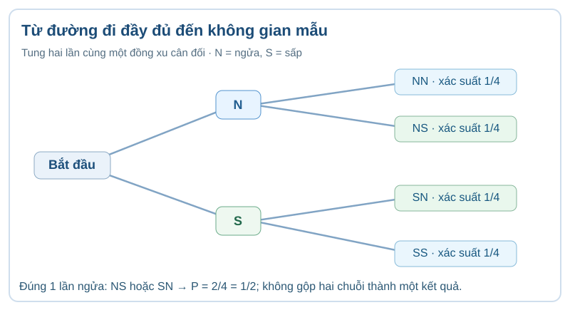
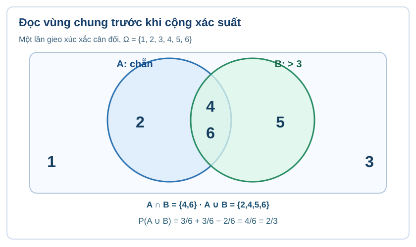

# Chuyên đề 20 · Xác suất cổ điển và các quy tắc tính xác suất

## 1. Kiến thức

Một lượt quay số tại hội chợ có những kết quả nào? Nếu kết quả nằm trong hai nhóm thưởng, có bị tính trùng không? Hai lượt chơi có thực sự độc lập? Em sẽ học cách mô tả đúng không gian mẫu và biến cố trước, rồi mới chọn phép đếm, quy tắc cộng hoặc nhân. Kiến thức về tập hợp, phân số và đếm theo bước được nhắc lại tại chỗ; không phải hoàn thành một chuyên đề khác mới học được.

**Cách học:** Em hãy tự làm từng câu Vận dụng trước, sau đó chủ động mở phần Đối chiếu để hiểu cách giải và nhận ra lỗi sai. Những bài đã xem lời giải dùng để ôn luyện, không thay thế bài Tự kiểm tra độc lập.

### 1. Mô hình ngẫu nhiên

#### 1.1. Phép thử, không gian mẫu và biến cố

**Khám phá kiến thức**

Khi rút ngẫu nhiên một thẻ trong bảy thẻ được đánh số từ 1 đến 7, ta không biết trước sẽ rút được thẻ nào. Tuy vậy, ta hoàn toàn có thể liệt kê những kết quả có thể xảy ra. Nếu chỉ ghi số trên thẻ thì mỗi số là **một kết quả sơ cấp**; tập hợp gồm cả bảy số mới là **không gian mẫu**. Cần phân biệt một kết quả riêng lẻ với tập tất cả kết quả, bởi hai đối tượng này giữ vai trò khác nhau trong cách mô tả phép thử.

Bây giờ giả sử câu hỏi là “rút được số nguyên tố”. Ta không thực hiện một phép thử khác: vẫn rút một thẻ như trước, nhưng chỉ những kết quả 2, 3, 5 và 7 làm câu nói ấy đúng. Vì vậy, một biến cố được biểu diễn bằng **tập các kết quả thuận lợi** bên trong không gian mẫu. Nếu không có kết quả nào phù hợp thì biến cố không thể xảy ra; nếu mọi kết quả đều phù hợp thì biến cố chắc chắn xảy ra. Cách nhìn bằng tập hợp này giúp em hiểu rõ mình đang tính xác suất cho điều gì, trước khi dùng bất kỳ phép đếm hay công thức nào.

> **ĐỊNH NGHĨA — Phép thử, không gian mẫu và biến cố**
>
> **Không gian mẫu** \(\Omega\) là **tập hợp tất cả các kết quả có thể xảy ra** của một phép thử ngẫu nhiên; mỗi kết quả sơ cấp là một phần tử \(\omega\in\Omega\). **Biến cố** \(A\subseteq\Omega\) là tập các kết quả làm biến cố xảy ra; \(\varnothing\) là biến cố không thể và \(\Omega\) là biến cố chắc chắn.

**Ví dụ**

**Đề bài:** Một hộp có bảy thẻ khác nhau ghi các số từ 1 đến 7. Rút ngẫu nhiên đều một thẻ. Hãy viết không gian mẫu \(\Omega\), biến cố \(A\) “rút được số nguyên tố” và biến cố đối của \(A\).

**Lời giải:** Vì chỉ rút một thẻ và ghi số trên thẻ nên \(\Omega=\{1,2,3,4,5,6,7\}\). Các số nguyên tố trong tập này là 2, 3, 5, 7, do đó \(A=\{2,3,5,7\}\). Biến cố đối gồm những kết quả còn lại: \(\bar A=\{1,4,6\}\). Chú ý: \(A\) là **một tập các kết quả**, không phải một kết quả sơ cấp duy nhất.

**Kiến thức cần ghi nhớ**

Trước khi đếm kết quả thuận lợi, phải xác định đúng không gian mẫu \(\Omega\). Mỗi kết quả riêng lẻ là một phần tử của \(\Omega\), còn biến cố \(A\) là tập hợp những kết quả làm điều kiện của \(A\) đúng, tức \(A\subseteq\Omega\). Biến cố không thể là tập rỗng; biến cố chắc chắn chính là \(\Omega\).

**Vận dụng**

Gieo một xúc xắc 8 mặt đồng khả năng ghi các số 1–8. Viết Ω và biến cố “ra số chẵn”.

<!-- ITEM_ID: THPT-TOP20-T01; ROLE: TOPIC_FIRST_TRY; PRIMARY_OUTCOME: TOP20-O01; CONTENT_VERSION: TOP20-R02; Q15_CANONICAL_NEW_ONLY; ASSESSMENT: PUBLIC_FORMATIVE_NO_MASTERY -->

Đối chiếu

Ω={1,2,3,4,5,6,7,8}; A={2,4,6,8}.

**Khi làm sai:** Nếu chỉ viết xác suất 1/2, em chưa mô tả biến cố; hãy ghi kết quả sơ cấp vào tập.

**Vận dụng**

Một vòng quay cân đối có các kết quả ghi 1 đến 6. Biến cố A là “kết quả không lớn hơn 2”. Hãy viết A và nói khi nào A xảy ra.

<!-- ITEM_ID: THPT-TOP20-T10; ROLE: TOPIC_FIRST_TRY; PRIMARY_OUTCOME: TOP20-O02; CONTENT_VERSION: TOP20-R02; Q15_CANONICAL_NEW_ONLY; ASSESSMENT: PUBLIC_FORMATIVE_NO_MASTERY -->

Đối chiếu

**Lời giải:** A={1,2}; A xảy ra nếu lượt quay cho kết quả 1 hoặc 2.

**Khi làm sai:** Nếu viết A={2}, em đã bỏ kết quả 1 cũng không lớn hơn 2. Xem từng phần tử Ω={1,…,6}.

#### 1.2. Đồng khả năng và cách tính xác suất

**Khám phá kiến thức**

Giả sử một hộp có nhiều phiếu khác nhau nhưng các phiếu chỉ mang ba loại nhãn A, B và C. Nếu mỗi phiếu được rút với cơ hội như nhau, liệu ba nhãn có nhất thiết cùng cơ hội xuất hiện? Không: một nhãn có trên nhiều phiếu hơn sẽ dễ xuất hiện hơn. Điểm quyết định không phải là có bao nhiêu **loại nhãn**, mà là có bao nhiêu **kết quả sơ cấp thực sự đồng khả năng** tạo ra từng nhãn.

Khi không gian mẫu gồm hữu hạn kết quả đồng khả năng, mỗi kết quả đóng góp một phần bằng nhau vào xác suất. Muốn tính khả năng xảy ra của biến cố A, ta đếm số kết quả thuộc A rồi so với số kết quả của cả không gian mẫu. Từ cách suy luận đó mới hình thành công thức xác suất cổ điển. Nếu các kết quả ban đầu không đồng khả năng, tỉ số đếm đơn thuần không còn là cách tính hợp lệ; ta phải thay đổi cách mô hình hóa hoặc sử dụng thông tin xác suất thích hợp.

> **CÔNG THỨC — Xác suất cổ điển**
>
> \[P(A)=\frac{n(A)}{n(\Omega)},\quad n(\Omega)>0.\] Chỉ dùng khi các kết quả sơ cấp hữu hạn và đồng khả năng.

**Ví dụ**

**Đề bài:** Một hộp có tám phiếu khác nhau: hai phiếu ghi A, ba phiếu ghi B và ba phiếu ghi C. Rút ngẫu nhiên đều một phiếu. Tính xác suất rút được nhãn B. Có thể chia đều xác suất cho ba loại nhãn không?

**Lời giải:** Tám **phiếu vật lí** là tám kết quả đồng khả năng. Ba phiếu mang nhãn B làm biến cố cần tìm xảy ra, vì thế \(P(B)=3/8\). Không thể lấy \(1/3\) chỉ vì có ba nhãn A, B, C: mỗi nhãn đại diện cho một số phiếu khác nhau, nên ba nhãn không đồng khả năng.

**Kiểm tra trước khi tính:** Có đang đếm nhóm không thứ tự trong khi mẫu gốc là chuỗi có thứ tự không? Các kết quả được đếm có thực sự đồng khả năng không? Nếu không, không được dùng công thức cổ điển theo tỉ số đơn giản.

**Kiến thức cần ghi nhớ**

Gộp các kết quả sơ cấp đồng khả năng thành vài nhãn có thể làm mất tính đồng khả năng. Khi tung hai đồng xu cân đối, độc lập, bốn chuỗi NN, NS, SN, SS đồng khả năng nhưng các nhãn “không ngửa”, “một ngửa”, “hai ngửa” tương ứng với 1, 2 và 1 chuỗi. Bởi vậy, xác suất đúng một lần ngửa là \(2/4=1/2\), không phải \(1/3\). Muốn dùng tỉ số đếm, hãy xác nhận các kết quả được đem ra đếm thực sự đồng khả năng.

**Vận dụng**

Hộp có 2 phiếu đỏ và 4 phiếu xanh khác nhau, rút đều một phiếu. P(đỏ) có phải 1/2 vì có hai màu không?

<!-- ITEM_ID: THPT-TOP20-T02; ROLE: TOPIC_FIRST_TRY; PRIMARY_OUTCOME: TOP20-O03; CONTENT_VERSION: TOP20-R02; Q15_CANONICAL_NEW_ONLY; ASSESSMENT: PUBLIC_FORMATIVE_NO_MASTERY -->

Đối chiếu

Không. Sáu phiếu vật lí đồng khả năng, P(đỏ)=2/6=1/3.

**Khi làm sai:** Nếu dùng 1/2, em đếm màu thay vì từng phiếu; hãy đặt tên cho sáu phiếu.

**Vận dụng**

Tung hai đồng xu cân đối và độc lập. Nếu chỉ ghi số mặt ngửa 0, 1, 2 thì ba giá trị ấy có đồng khả năng không? Hãy viết các chuỗi sơ cấp và tính xác suất có đúng một mặt ngửa.

<!-- ITEM_ID: THPT-TOP20-T11; ROLE: TOPIC_FIRST_TRY; PRIMARY_OUTCOME: TOP20-O06; CONTENT_VERSION: TOP20-R02; Q15_CANONICAL_NEW_ONLY; ASSESSMENT: PUBLIC_FORMATIVE_NO_MASTERY -->

Đối chiếu

**Lời giải:** Không. Không gian mẫu gồm NN, NS, SN, SS, mỗi chuỗi có xác suất 1/4. Số ngửa 0 ứng với SS, số ngửa 1 ứng với NS và SN, số ngửa 2 ứng với NN. Vì vậy ba giá trị **không** đồng khả năng; xác suất đúng một ngửa là \(2/4=1/2\).

**Khi làm sai:** Nếu ra 1/3, em đã đếm ba **nhãn** thay vì bốn chuỗi sơ cấp. Liệt kê đủ NN, NS, SN, SS rồi ghép mỗi chuỗi với số mặt ngửa tương ứng.

#### 1.3. Biến cố đối và xác suất bé

**Khám phá kiến thức**

Có những câu hỏi hỏi một sự việc xảy ra, nhưng đếm trực tiếp các trường hợp thuận lợi lại khó. Chẳng hạn, khi gieo một đồng xu nhiều lần và hỏi “có ít nhất một lần ngửa”, ta phải tính tất cả các chuỗi chứa một, hai hoặc nhiều lần ngửa. Ngược lại, câu “không có lần ngửa nào” chỉ mô tả một kiểu kết quả: mọi lần đều sấp. Hai tình huống ấy phủ hết các khả năng và không thể đồng thời xảy ra.

Nếu gọi sự việc cần tìm là A, phần còn lại của không gian mẫu chính là **biến cố đối** của A. Vì tổng xác suất của tất cả khả năng là 1, xác suất của A và biến cố đối cộng lại bằng 1. Nhờ đó ta có thể tính gián tiếp qua trường hợp dễ đếm hơn. Cũng cần hiểu một khác biệt quan trọng: xác suất **rất nhỏ nhưng dương** vẫn có nghĩa là sự việc có thể xảy ra; trong mô hình hữu hạn đồng khả năng, biến cố không thể có xác suất 0; ngược lại, một biến cố có xác suất dương dù rất nhỏ vẫn có thể xảy ra.

> **TÍNH CHẤT — Biến cố đối**
>
> \[\bar A=\Omega\setminus A,\qquad P(\bar A)=1-P(A).\] A và đối A xung khắc, phủ hết mẫu.

**Ví dụ**

**Đề bài:** Một hộp có 20 phiếu khác nhau, trong đó đúng hai phiếu trúng thưởng. Chọn ngẫu nhiên đều một phiếu. Tính xác suất **không trúng thưởng** và xác suất **trúng thưởng**.

**Lời giải:** Có 18 phiếu không trúng trong 20 phiếu đồng khả năng, nên \(P(\text{không trúng})=18/20=9/10\). Biến cố “trúng thưởng” là biến cố đối của “không trúng thưởng”, do đó \(P(\text{trúng})=1-9/10=1/10\). Dùng biến cố đối giúp kiểm tra ngay hai xác suất cộng lại bằng 1.

**Nguyên lí xác suất bé:** Một biến cố có \(0<P(A)\ll 1\) vẫn có thể xảy ra. Không suy ra biến cố không thể và không khẳng định số lần xảy ra trong một số lượt thử bằng chính xác “số lượt × xác suất”.

**Kiến thức cần ghi nhớ**

Không được đồng nhất **hiếm** với **không thể**. Một vé trúng thưởng trong 50 vé đồng khả năng vẫn cho xác suất \(1/50>0\), còn một hộp không có vé trúng nào mới cho xác suất trúng bằng 0. Xác suất nhỏ cũng không có nghĩa rằng số lần xảy ra trong một số lượt thử ngắn phải bằng đúng tích số lượt với xác suất.

**Vận dụng**

Có 20 thẻ đồng khả năng, đúng 1 thẻ màu đen. Tính P(không đen). Biến cố đen có phải không thể?

<!-- ITEM_ID: THPT-TOP20-T03; ROLE: TOPIC_FIRST_TRY; PRIMARY_OUTCOME: TOP20-O04; CONTENT_VERSION: TOP20-R02; Q15_CANONICAL_NEW_ONLY; ASSESSMENT: PUBLIC_FORMATIVE_NO_MASTERY -->

Đối chiếu

P(không đen)=19/20; P(đen)=1/20>0 nên đen là hiếm, không phải không thể.

**Khi làm sai:** Nếu nói xác suất 0, em đã nhầm ít xảy ra với biến cố rỗng.

**Vận dụng**

Trong 100 vé đồng khả năng chỉ có một vé trúng. Biến cố trúng vé là không thể hay hiếm? Viết xác suất.

<!-- ITEM_ID: THPT-TOP20-T12; ROLE: TOPIC_FIRST_TRY; PRIMARY_OUTCOME: TOP20-O05; CONTENT_VERSION: TOP20-R02; Q15_CANONICAL_NEW_ONLY; ASSESSMENT: PUBLIC_FORMATIVE_NO_MASTERY -->

Đối chiếu

**Lời giải:** P(trúng)=1/100>0; hiếm chứ không phải biến cố không thể.

**Khi làm sai:** Nếu P=0, em đã bỏ một vé trúng còn có mặt trong Ω. Đếm n(A)=1 và n(Ω)=100.

#### 1.4. Đếm kết quả bằng tổ hợp và sơ đồ cây

**Khám phá kiến thức**

Khi tung một đồng xu cân đối hai lần, kết quả “lần đầu ngửa, lần sau sấp” khác với “lần đầu sấp, lần sau ngửa”. Vì phép thử diễn ra theo từng bước, cách tự nhiên để không bỏ sót kết quả là vẽ một **sơ đồ cây**: từ mỗi khả năng ở lượt đầu, ta tiếp tục xét những khả năng ở lượt hai. Mỗi đường đi từ gốc đến lá mô tả một kết quả có thứ tự, chứ không chỉ một nhóm ký hiệu.

Quan sát hình dưới đây trước khi tính: sau mỗi nhánh N (ngửa) hoặc S (sấp), cây lại tách thành N và S. Ta nhận được bốn đường đi NN, NS, SN, SS. Trong phép tung đồng xu cân đối và độc lập, bốn đường đi ấy đồng khả năng. Tuy nhiên, nếu cơ chế ở lượt sau phụ thuộc lượt trước, các lá trên cây không nhất thiết còn có xác suất bằng nhau; cây giúp **liệt kê** các kết quả, không tự bảo đảm đồng khả năng.

**Hướng dẫn đọc hình:** Theo một đường đi từ trái sang phải để biết thứ tự hai lần tung. Muốn có đúng một lần ngửa, em chỉ chọn hai lá NS và SN, không gộp chúng thành một kết quả. Trong mô hình đồng xu cân đối, đó là hai trong bốn kết quả đồng khả năng, nên xác suất bằng \(2/4\).

Với bài toán **chọn đồng thời** một nhóm \(k\) vật từ \(n\) vật phân biệt và không phân vai, thứ tự chọn không tạo ra kết quả mới: ta cần đếm các **nhóm** khác nhau chứ không đếm mọi cách sắp xếp của từng nhóm. Còn với việc **thực hiện tuần tự**, thứ tự thường quan trọng và ta đếm bằng quy tắc nhân hoặc sơ đồ cây. Vì vậy, trước khi tính xác suất, phải xác định đúng mình đang đếm **nhóm không thứ tự** hay **chuỗi có thứ tự**, và dùng cùng một kiểu kết quả ở tử số lẫn mẫu số.

> **PHƯƠNG PHÁP — Đếm và đọc sơ đồ cây**
>
> Đếm chuỗi có thứ tự khác nhóm không thứ tự; dùng \(\binom nk\) khi chọn nhóm không phân vai. Không suy mọi lá của cây đồng khả năng nếu chưa kiểm.

**Ví dụ**

**Đề bài:** Có tám lá phiếu khác nhau ghi các số từ 1 đến 8, trong đó bốn số chẵn. Rút đồng thời ngẫu nhiên ba phiếu, các nhóm ba phiếu đồng khả năng. Tính xác suất cả ba phiếu đều ghi số chẵn.

**Lời giải:** Vì rút đồng thời và không phân vai ba vị trí, mỗi kết quả là một **nhóm không thứ tự**. Số nhóm có thể rút là \(\binom83=56\). Có bốn phiếu mang số chẵn, nên số nhóm ba phiếu đều chẵn là \(\binom43=4\). Xác suất cần tìm là \(P=4/56=1/14\). Tử và mẫu đều đếm nhóm không thứ tự.

**Ví dụ**

**Đề bài:** Có bốn thẻ khác nhau. So sánh số kết quả khi (a) rút liên tiếp hai thẻ không hoàn lại, ghi thứ tự rút; (b) lấy đồng thời hai thẻ không xét thứ tự. Mỗi trường hợp cần dùng cách đếm nào?

**Lời giải:** Ở (a), lượt đầu có bốn cách chọn, lượt sau còn ba cách, nên có \(4\cdot3=12\) **cặp có thứ tự**. Ở (b), chỉ xét nhóm hai thẻ, nên có \(\binom42=6\) **nhóm không thứ tự**. Hai phép thử có cách mô tả kết quả khác nhau; khi tính xác suất, không được trộn tử số đếm nhóm với mẫu số đếm cặp.

**Kiến thức cần ghi nhớ**

Với câu hỏi “ít nhất một”, biến cố đối thường là “không có lần nào”. Khi chọn đều hai phiếu trong năm phiếu khác nhau (hai đỏ, ba xanh), xác suất có ít nhất một phiếu đỏ là \(1-\binom32/\binom52=7/10\). Phải lấy biến cố đối là **cả hai phiếu xanh**, không phải “đúng một phiếu đỏ”, và đếm cùng một kiểu nhóm ở cả tử số lẫn mẫu số.

**Vận dụng**

Từ 6 học sinh chọn một nhóm 2 người không phân vai; so với chọn trưởng rồi phó, có bao nhiêu kết quả mỗi loại?

<!-- ITEM_ID: THPT-TOP20-T04; ROLE: TOPIC_FIRST_TRY; PRIMARY_OUTCOME: TOP20-O07; CONTENT_VERSION: TOP20-R02; Q15_CANONICAL_NEW_ONLY; ASSESSMENT: PUBLIC_FORMATIVE_NO_MASTERY -->

Đối chiếu

Không phân vai có C(6,2)=15 nhóm; phân hai vai có 6×5=30 cặp có thứ tự.

**Khi làm sai:** Nếu có cả hai bằng 30, nhóm AB và BA đã bị đếm hai lần ở trường hợp không phân vai.

**Vận dụng**

Từ 5 phiếu khác nhau (1 đỏ, 4 xanh), chọn đều **hai phiếu không xét thứ tự**. Xác suất ít nhất một phiếu đỏ?

<!-- ITEM_ID: THPT-TOP20-T13; ROLE: TOPIC_FIRST_TRY; PRIMARY_OUTCOME: TOP20-O08; CONTENT_VERSION: TOP20-R02; Q15_CANONICAL_NEW_ONLY; ASSESSMENT: PUBLIC_FORMATIVE_NO_MASTERY -->

Đối chiếu

**Lời giải:** P=1−P(cả hai xanh)=1−C(4,2)/C(5,2)=1−6/10=2/5.

**Khi làm sai:** Nếu dùng 1−4/5 thì em đang xét một phiếu. Mẫu này là **nhóm hai phiếu**, phải đếm C(5,2).

#### 1.5. Chọn đúng mô hình trước khi tính

**Khám phá kiến thức**

Một lời giải có thể tính toán hoàn toàn chính xác mà vẫn cho xác suất sai nếu ngay từ đầu ta lựa chọn sai mô hình. Chẳng hạn, khi gieo hai xúc xắc, các cặp \((1,6)\) và \((6,1)\) là hai kết quả khác nhau nếu ghi riêng số chấm của từng con. Nhưng nếu chỉ nhìn vào tổng số chấm thì cả hai đều được ghi thành 7. Số **nhãn tổng** ít hơn số **cặp kết quả**, và các nhãn tổng lại không đồng khả năng.

Vì thế, trước khi chọn công thức, ta cần hiểu chính xác một kết quả sơ cấp gồm những thông tin gì; các kết quả ấy có đồng khả năng không; thứ tự hoặc việc hoàn lại có làm thay đổi tập kết quả không. Sau đó mới xác định tập kết quả thuận lợi và quyết định nên đếm trực tiếp, dùng biến cố đối hay lập sơ đồ cây. Làm theo thứ tự này giúp em kiểm tra tính đúng đắn của mô hình trước khi kiểm tra phép tính, thay vì chỉ dựa vào việc đáp số cuối cùng nằm giữa 0 và 1.

> **KIẾN THỨC CẦN GHI NHỚ — Kiểm mô hình trước phép tính**
>
> Xác định kết quả sơ cấp, tính đồng khả năng, thứ tự, có/không hoàn lại, tập kết quả thuận lợi và điều kiện dùng công thức.

**Ví dụ**

**Đề bài:** Gieo hai xúc xắc cân đối, phân biệt. Tính xác suất tổng số chấm bằng 5 và giải thích vì sao không thể lấy \(1/11\) chỉ vì tổng số chấm có 11 giá trị từ 2 đến 12.

**Lời giải:** Một kết quả sơ cấp là cặp có thứ tự \((a,b)\), với \(a,b\in\{1,2,3,4,5,6\}\), nên có \(6\cdot6=36\) cặp đồng khả năng. Tổng bằng 5 khi rơi vào một trong bốn cặp \((1,4),(2,3),(3,2),(4,1)\), do đó \(P(\text{tổng}=5)=4/36=1/9\). Mười một giá trị tổng không đồng khả năng vì mỗi tổng có số cặp tạo thành khác nhau; vì vậy \(1/11\) không phải xác suất cần tìm.

**Lỗi thường gặp**

Khi gieo hai xúc xắc phân biệt, có 36 **cặp có thứ tự** đồng khả năng, nhưng 11 **giá trị tổng** từ 2 đến 12 không đồng khả năng. Tổng bằng 2 chỉ xuất hiện ở cặp \((1,1)\), trong khi tổng bằng 7 xuất hiện ở sáu cặp. Nếu đếm 11 giá trị tổng như 11 kết quả đồng khả năng, lời giải sẽ sai dù phép chia được tính đúng.

Đáp số nằm trong khoảng \([0,1]\) chưa đủ bảo đảm mô hình đúng. Trước khi sử dụng tỉ số đếm, hãy kiểm tra và giải thích vì sao các kết quả sơ cấp mình chọn thực sự đồng khả năng.

**Vận dụng**

Gieo hai xúc xắc phân biệt, cân đối. Có bao nhiêu cặp sơ cấp đồng khả năng và P(tổng số chấm bằng 12)?

<!-- ITEM_ID: THPT-TOP20-T05; ROLE: TOPIC_FIRST_TRY; PRIMARY_OUTCOME: TOP20-O10; CONTENT_VERSION: TOP20-R02; Q15_CANONICAL_NEW_ONLY; ASSESSMENT: PUBLIC_FORMATIVE_NO_MASTERY -->

Đối chiếu

Có 36 cặp có thứ tự; chỉ (6,6) có tổng12 nên P=1/36.

**Khi làm sai:** Không coi 11 tổng số chấm từ 2 đến12 là đồng khả năng; tổng12 chỉ có một cặp.

**Vận dụng**

Tung một đồng xu cân đối ba lần, coi chuỗi có thứ tự. Có mấy kết quả đồng khả năng và xác suất đúng hai mặt ngửa?

<!-- ITEM_ID: THPT-TOP20-T14; ROLE: TOPIC_FIRST_TRY; PRIMARY_OUTCOME: TOP20-O09; CONTENT_VERSION: TOP20-R02; Q15_CANONICAL_NEW_ONLY; ASSESSMENT: PUBLIC_FORMATIVE_NO_MASTERY -->

Đối chiếu

**Lời giải:** Có 2³=8 chuỗi; đúng hai ngửa là NNS, NSN, SNN (3 chuỗi), P=3/8.

**Khi làm sai:** Nếu đếm ba loại “0/1/2/3 ngửa” là 4 kết quả đồng khả năng, em đã gộp các chuỗi khác nhau. Vẽ cây ba tầng.

### 2. Kết hợp các biến cố

#### 2.1. Hợp, giao và xung khắc

**Khám phá kiến thức**

Trong một lớp học, có bạn thích bóng đá, có bạn thích bóng rổ và có bạn thích cả hai. Nếu cần đếm những bạn thích **ít nhất một** môn, ta phải gộp hai nhóm nhưng chỉ tính mỗi người một lần. Nếu cần đếm những bạn thích **cả hai** môn, ta chỉ giữ phần chung của hai nhóm. Trong xác suất, hai cách chọn kết quả ấy dẫn đến hai khái niệm khác nhau: **hợp** và **giao** của các biến cố.

Hãy xét một lần gieo xúc xắc, với A là biến cố ra số chẵn và B là biến cố ra số từ 4 trở lên. Khi biểu diễn trên hình, A chứa các số 2, 4, 6 còn B chứa các số 4, 5, 6. Phần chồng nhau gồm 4 và 6 — đó là kết quả làm **cả A và B** xảy ra. Phần nằm trong ít nhất một vùng gồm 2, 4, 5, 6 — đó là kết quả làm **A hoặc B** xảy ra. Nếu hai vùng không có kết quả chung, ta gọi hai biến cố là **xung khắc**; khi ấy chúng không thể đồng thời xảy ra trong một lần thử.

**Hướng dẫn đọc hình:** Khung \(\Omega\) biểu diễn sáu kết quả của phép gieo xúc xắc. Quan sát riêng phần giao chứa 4, 6; phần chỉ thuộc A chứa 2; phần chỉ thuộc B chứa 5. Kết quả 1 và 3 nằm ngoài cả hai biến cố. Các vòng tròn giúp nhìn quan hệ tập hợp, **không** có nghĩa là diện tích các vùng tỉ lệ với xác suất.

**Tương tác khám phá:** [Thay đổi các kết quả thuộc A và B trên mô hình](Temp_PLAN22_20_EVENTS_INTERACTIVE_WHITE_R00_20261114.html) để tự kiểm tra sự khác nhau giữa “hoặc”, “và” và “không xảy ra cùng nhau”.

> **ĐỊNH NGHĨA — Hợp, giao, xung khắc**
>
> \(A\cup B\) là ít nhất một; \(A\cap B\) là cả hai; xung khắc khi \(A\cap B=\varnothing\). Hợp đếm mỗi kết quả ở giao chỉ một lần.

**Ví dụ**

**Đề bài:** Gieo một xúc xắc sáu mặt cân đối. Gọi \(A\) là biến cố “ra số chẵn” và \(B\) là biến cố “ra số lớn hơn 3”. Dựa vào hình Venn ngay phía trên, hãy viết \(A\cap B\), \(A\cup B\), tính \(P(A\cup B)\) và cho biết hai biến cố có xung khắc không.

**Lời giải:** Ta có \(A=\{2,4,6\}\) và \(B=\{4,5,6\}\), nên \(A\cap B=\{4,6\}\). Hợp của hai tập là \(A\cup B=\{2,4,5,6\}\), gồm bốn kết quả. Vì sáu mặt xúc xắc đồng khả năng, \(P(A\cup B)=4/6=2/3\); cũng có thể kiểm bằng quy tắc cộng: \(3/6+3/6-2/6=4/6\). Hai biến cố **không xung khắc**, bởi 4 và 6 thuộc cả hai tập. Các tập kết quả và xác suất đều khớp với hình minh họa.

**Hướng dẫn đọc hình:** Nhìn vùng chỉ thuộc A, chỉ thuộc B, vùng chồng nhau và vùng ở ngoài cả hai. Đếm vùng chồng **một lần** khi tìm hợp.

**Vận dụng**

Gieo xúc xắc cân đối. A=ra số chẵn, B=ra số lớn hơn 4. Viết A∩B và A∪B.

<!-- ITEM_ID: THPT-TOP20-T06; ROLE: TOPIC_FIRST_TRY; PRIMARY_OUTCOME: TOP20-O11; CONTENT_VERSION: TOP20-R02; Q15_CANONICAL_NEW_ONLY; ASSESSMENT: PUBLIC_FORMATIVE_NO_MASTERY -->

Đối chiếu

A={2,4,6}, B={5,6}; giao={6}, hợp={2,4,5,6}.

**Khi làm sai:** Giao chỉ lấy phần có chung, hợp chứa tất cả nhưng mỗi số chỉ ghi một lần.

#### 2.2. Độc lập không phải xung khắc

**Khám phá kiến thức**

Giả sử ta tung hai đồng xu cân đối và việc tung đồng xu thứ nhất không ảnh hưởng đến đồng xu thứ hai. Biết đồng xu đầu tiên ra ngửa không làm kết quả ngửa của đồng xu thứ hai dễ hay khó hơn. Đó là trực giác của **hai biến cố độc lập**: thông tin rằng biến cố này xảy ra không làm thay đổi xác suất của biến cố kia (khi xác suất có điều kiện được xác định).

Bây giờ hãy so sánh với hai biến cố “lần tung đầu ra ngửa” và “lần tung đầu ra sấp”. Chúng không thể cùng xảy ra, nên **xung khắc**; nhưng khi đã biết biến cố thứ nhất xảy ra, biến cố thứ hai chắc chắn không xảy ra. Với hai biến cố đều có xác suất dương, xung khắc và độc lập vì thế không thể là cùng một tính chất. Tiêu chuẩn toán học để kiểm tra độc lập là so sánh xác suất của **giao** với **tích hai xác suất riêng**. Đây là điều kiện phải được kiểm tra, không phải công thức được phép áp dụng cho mọi cặp biến cố.

> **TÍNH CHẤT — Độc lập**
>
> \[P(A\cap B)=P(A)P(B).\] Đây là tiêu chuẩn độc lập; không suy từ việc hai biến cố không xung khắc.

**Ví dụ**

**Đề bài:** Tung hai đồng xu cân đối, độc lập; ghi kết quả theo thứ tự. (a) Xét \(A\): “xu đầu ngửa” và \(B\): “xu sau ngửa”. Kiểm tra xem \(A,B\) có độc lập không. (b) Xét \(C\): “cả hai xu ngửa” và \(D\): “xu đầu sấp”. Hai biến cố \(C,D\) có xung khắc và độc lập không?

**Lời giải:** Không gian mẫu là \(\{NN,NS,SN,SS\}\), gồm bốn kết quả đồng khả năng. (a) \(P(A)=P(B)=1/2\) và \(P(A\cap B)=1/4=P(A)P(B)\), nên \(A,B\) độc lập. (b) \(C=\{NN\}\), \(D=\{SN,SS\}\), do đó \(C\cap D=\varnothing\): hai biến cố **xung khắc**. Nhưng \(P(C\cap D)=0\), còn \(P(C)P(D)=(1/4)(1/2)=1/8\), nên chúng **không độc lập**. Xung khắc và độc lập là hai tính chất khác nhau.

**Giới hạn:** Không suy độc lập chỉ vì hai biến cố có thể đồng thời xảy ra; phải xem mô hình hoặc kiểm công thức.

**Kiến thức cần ghi nhớ**

Hai biến cố **xung khắc** không cùng xảy ra, còn hai biến cố **độc lập** phải thỏa \(P(A\cap B)=P(A)P(B)\). Trên một lần gieo xúc xắc cân đối, “ra số chẵn” và “ra số lẻ” đều có xác suất \(1/2\) nhưng giao rỗng, nên không độc lập. Kết luận “xung khắc thì không độc lập” cần điều kiện **cả hai xác suất đều dương**; trường hợp có xác suất bằng 0 là ngoại lệ phải xét riêng.

**Vận dụng**

Tung một đồng xu cân đối và gieo xúc xắc cân đối độc lập. Xác suất đồng xu ngửa và xúc xắc chẵn là bao nhiêu?

<!-- ITEM_ID: THPT-TOP20-T07; ROLE: TOPIC_FIRST_TRY; PRIMARY_OUTCOME: TOP20-O12; CONTENT_VERSION: TOP20-R02; Q15_CANONICAL_NEW_ONLY; ASSESSMENT: PUBLIC_FORMATIVE_NO_MASTERY -->

Đối chiếu

P=1/2×3/6=1/4. Hai phép thử độc lập nên số cặp thuận lợi=1×3 trong 12 cặp.

**Khi làm sai:** Nếu tính 1/2+1/2, em đang cộng xác suất mà đề yêu cầu cùng xảy ra.

**Vận dụng**

Gieo một xúc xắc: A=ra 1 và B=ra 6. A,B có xung khắc không? Có độc lập không?

<!-- ITEM_ID: THPT-TOP20-T15; ROLE: TOPIC_FIRST_TRY; PRIMARY_OUTCOME: TOP20-O13; CONTENT_VERSION: TOP20-R02; Q15_CANONICAL_NEW_ONLY; ASSESSMENT: PUBLIC_FORMATIVE_NO_MASTERY -->

Đối chiếu

**Lời giải:** A∩B=∅ nên xung khắc; P(A)P(B)=1/36>0 nhưng P(A∩B)=0 nên **không độc lập**.

**Khi làm sai:** Nếu viết “vì không xảy ra cùng nên độc lập”, em đã đảo khái niệm. Xung khắc là giao rỗng, độc lập cần kiểm tích xác suất.

#### 2.3. Quy tắc cộng xác suất

**Khám phá kiến thức**

Khi đếm số người tham gia ít nhất một trong hai câu lạc bộ, cách cộng số người của từng câu lạc bộ có thể đếm trùng những người tham gia cả hai. Cụ thể, mỗi người ở phần giao đã xuất hiện một lần trong nhóm A và thêm một lần trong nhóm B. Muốn đếm đúng hợp, ta phải **trừ phần giao một lần**.

Lập luận ấy cũng áp dụng cho xác suất: cộng xác suất của A và B rồi trừ xác suất của phần xảy ra đồng thời. Ta không cần giả thiết hai biến cố độc lập, bởi đây là quy tắc về việc phân chia và đếm những kết quả thuộc hợp. Trường hợp hai biến cố xung khắc thì phần giao không có kết quả nào, số hạng cần trừ bằng 0 và công thức tự rút gọn thành phép cộng hai xác suất.

> **CÔNG THỨC — Quy tắc cộng**
>
> \[P(A\cup B)=P(A)+P(B)-P(A\cap B).\] Nếu giao rỗng thì bỏ số hạng giao.

**Ví dụ**

**Đề bài:** Trong một nhóm 50 người, có 30 người thích hoạt động A, 25 người thích hoạt động B và 10 người thích cả hai. Chọn ngẫu nhiên đều một người. Tính xác suất người đó thích **ít nhất một** trong hai hoạt động.

**Lời giải:** Cộng 30 và 25 sẽ đếm hai lần 10 người thích cả hai. Số người thích ít nhất một hoạt động là \(30+25-10=45\), nên xác suất cần tìm bằng \(45/50=9/10\). Không cần giả thiết hai sở thích độc lập; chỉ cần dùng quy tắc cộng trừ phần giao. Kiểm tra: 45 không vượt 50.

**Lỗi thường gặp:** Cộng \(P(A)+P(B)\) mà quên trừ giao, dẫn tới xác suất có thể vượt 1.

**Kiến thức cần ghi nhớ**

Nếu \(A\cap B=\varnothing\) thì không có phần chung bị đếm hai lần, vì vậy \(P(A\cup B)=P(A)+P(B)\). Chẳng hạn, trên một lần gieo xúc xắc, \(A=\{1\}\) và \(B=\{4\}\) xung khắc nên \(P(A\cup B)=2/6=1/3\). Nếu có kết quả chung, phải trở lại công thức đầy đủ và trừ \(P(A\cap B)\).

**Vận dụng**

Gieo xúc xắc cân đối. A=lẻ, B=lớn hơn 3. Tính P(A∪B) bằng quy tắc cộng.

<!-- ITEM_ID: THPT-TOP20-T08; ROLE: TOPIC_FIRST_TRY; PRIMARY_OUTCOME: TOP20-O14; CONTENT_VERSION: TOP20-R02; Q15_CANONICAL_NEW_ONLY; ASSESSMENT: PUBLIC_FORMATIVE_NO_MASTERY -->

Đối chiếu

A={1,3,5}, B={4,5,6}, giao={5}; P(hợp)=3/6+3/6−1/6=5/6.

**Khi làm sai:** Nếu ra 1, em đã cộng mà quên trừ kết quả 5 được đếm hai lần.

**Vận dụng**

Gieo xúc xắc cân đối. A={1,2}, B={5,6}. Tính P(A∪B) và nêu vì sao cộng trực tiếp.

<!-- ITEM_ID: THPT-TOP20-T16; ROLE: TOPIC_FIRST_TRY; PRIMARY_OUTCOME: TOP20-O15; CONTENT_VERSION: TOP20-R02; Q15_CANONICAL_NEW_ONLY; ASSESSMENT: PUBLIC_FORMATIVE_NO_MASTERY -->

Đối chiếu

**Lời giải:** Hai tập rời nhau nên P(A∩B)=0, P(A∪B)=2/6+2/6=4/6=2/3.

**Khi làm sai:** Nếu nhân 2/6×2/6, em đã tính giao của biến cố độc lập; ở đây A,B xung khắc và đề hỏi hợp.

#### 2.4. Quy tắc nhân độc lập và biến cố đối

**Khám phá kiến thức**

Giả sử một hệ thống có hai thiết bị hoạt động độc lập. Nếu câu hỏi là “**cả hai** thiết bị cùng hoạt động”, ta xét giao của hai biến cố. Vì các kết quả hoạt động không ảnh hưởng nhau, xác suất cả hai cùng hoạt động bằng tích các xác suất riêng. Nhưng nếu câu hỏi đổi thành “**ít nhất một** thiết bị hoạt động”, việc cộng ngay hai xác suất hoạt động sẽ đếm trùng trường hợp cả hai đều hoạt động.

Cách suy nghĩ gọn hơn là xét tình huống ngược lại: “không có thiết bị nào hoạt động”, tức là **cả hai đều hỏng**. Đây là biến cố đối của “ít nhất một hoạt động”. Khi hai thiết bị độc lập, sự cố hỏng của chúng cũng độc lập, nên có thể nhân hai xác suất hỏng rồi lấy 1 trừ kết quả đó. Lập luận này **không được tự động áp dụng** cho hai thiết bị có chung nguồn điện hoặc một phép rút thẻ không hoàn lại: những tình huống ấy có thể làm các biến cố phụ thuộc nhau.

> **CÔNG THỨC — Nhân độc lập và biến cố đối**
>
> Nếu A,B độc lập: \[P(A\cap B)=P(A)P(B),\quad P(A\cup B)=1-P(\bar A)P(\bar B).\] Không nhân xác suất biên cho biến cố phụ thuộc.

**Ví dụ**

**Đề bài:** Hai thiết bị hoạt động độc lập. Xác suất thiết bị thứ nhất hoạt động là \(3/4\), thiết bị thứ hai là \(4/5\). Tính xác suất của ba biến cố: (a) **cả hai** cùng hoạt động; (b) **cả hai** cùng hỏng; (c) **ít nhất một** thiết bị hoạt động.

**Lời giải:** (a) Vì hoạt động độc lập, xác suất cả hai chạy là \((3/4)(4/5)=3/5\). (b) Xác suất hỏng riêng lần lượt là \(1/4\) và \(1/5\). Hai trạng thái hỏng cũng độc lập, nên xác suất cả hai hỏng là \((1/4)(1/5)=1/20\). (c) “Ít nhất một hoạt động” là biến cố đối của “cả hai cùng hỏng”, vì vậy xác suất bằng \(1-1/20=19/20\). **Cách chọn phương pháp:** dùng quy tắc nhân khi xét hai biến cố độc lập cùng xảy ra và dùng biến cố đối khi câu hỏi là “ít nhất một”.

**Giới hạn:** Khi rút liên tiếp không hoàn lại hoặc hai biến cố phụ thuộc, không nhân hai xác suất ban đầu như thể độc lập. Trong chuyên đề này, em vẫn có thể **đếm các chuỗi kết quả đồng khả năng** để giải tình huống cụ thể; công thức xác suất có điều kiện sẽ được học ở chuyên đề khác, không phải tiền đề bắt buộc ở đây.

**Kiến thức cần ghi nhớ**

Đối với hai phép thử độc lập, muốn tính xác suất **cả hai** biến cố cùng xảy ra ta dùng tích các xác suất; muốn tính **ít nhất một** xảy ra, ta có thể dùng quy tắc cộng trừ phần giao hoặc lấy biến cố đối. Khi tung đồng xu cân đối và gieo xúc xắc cân đối độc lập, xác suất “xu ngửa hoặc xúc xắc ra số lớn hơn 4” là \(1/2+1/3-1/6=2/3\). Không dùng phép nhân như công thức độc lập khi chưa có căn cứ về tính độc lập.

**Vận dụng**

Hai thiết bị hoạt động độc lập, xác suất hỏng lần lượt 1/5 và 1/4. Xác suất có ít nhất một thiết bị hoạt động là bao nhiêu?

<!-- ITEM_ID: THPT-TOP20-T09; ROLE: TOPIC_FIRST_TRY; PRIMARY_OUTCOME: TOP20-O16; CONTENT_VERSION: TOP20-R02; Q15_CANONICAL_NEW_ONLY; ASSESSMENT: PUBLIC_FORMATIVE_NO_MASTERY -->

Đối chiếu

P=1−P(cả hai hỏng)=1−(1/5)(1/4)=19/20.

**Khi làm sai:** Nếu nhân hai xác suất hoạt động 4/5×3/4, em đang tính cả hai hoạt động, không phải ít nhất một.

**Vận dụng**

Tung đồng xu cân đối và gieo xúc xắc cân đối độc lập. A=đồng xu ngửa, B=xúc xắc chẵn. Tính P(A∪B).

<!-- ITEM_ID: THPT-TOP20-T17; ROLE: TOPIC_FIRST_TRY; PRIMARY_OUTCOME: TOP20-O17; CONTENT_VERSION: TOP20-R02; Q15_CANONICAL_NEW_ONLY; ASSESSMENT: PUBLIC_FORMATIVE_NO_MASTERY -->

Đối chiếu

**Lời giải:** P(A)=1/2, P(B)=1/2, P(A∩B)=1/4. Vậy P(A∪B)=1/2+1/2−1/4=3/4.

**Khi làm sai:** Nếu được 1, em đã cộng mà chưa trừ phần **cả hai cùng xảy ra**; nếu được 1/4 đó là giao, không phải hợp.

## 2. Luyện tập

Khi luyện tập, hãy xác định mô hình xác suất, giải thích cách đếm và kiểm tra kết quả. Nếu làm sai, xem hướng dẫn khắc phục trong phần Lời giải rồi quay về đúng mục Kiến thức.

<!-- AUTHOR_ONLY_Q15: The 34 G10/G11 historical/extension bank items under PR #810 are OUT OF THE ACTIVE TOP20 LEARNING SOURCE: no placement or copied stem/key/rubric in this snapshot. Validate/restore their own canonical custody only if an optional reuse is later approved. Active TOP20 has exactly 37 new canonical items, each with one ID, one stem, one opt-in answer, one declared role and item-level content version. -->

### 2.1. Không gian mẫu và tập kết quả của biến cố

<!-- ITEM_ID: THPT-TOP20-P01; ROLE: TOPIC_PRACTICE; PRIMARY_OUTCOME: TOP20-O01; CONTENT_VERSION: TOP20-R09; PUBLIC_FORMATIVE_NO_MASTERY -->

Rút đều một thẻ trong 10 thẻ đánh số 0 đến 9. Viết Ω và biến cố A “số chẵn”.

Lời giải

**Lời giải:** Vì phép thử rút đều một thẻ và chỉ ghi số trên thẻ nên không gian mẫu là \(\Omega=\{0,1,2,3,4,5,6,7,8,9\}\). Một số nguyên chẵn khi chia hết cho 2; số 0 cũng là số chẵn. Do đó biến cố cần viết là \(A=\{0,2,4,6,8\}\), gồm năm kết quả sơ cấp. Bài yêu cầu **mô tả biến cố**, không yêu cầu tính xác suất.

**Khi làm sai:** Nếu loại 0 vì không phải số chẵn, hãy nhớ 0 chia hết cho 2.

### 2.2. Mô tả biến cố từ một điều kiện

<!-- ITEM_ID: THPT-TOP20-P02; ROLE: TOPIC_PRACTICE; PRIMARY_OUTCOME: TOP20-O02; CONTENT_VERSION: TOP20-R09; PUBLIC_FORMATIVE_NO_MASTERY -->

Gieo xúc xắc sáu mặt một lần. Biến cố “kết quả bé hơn 2” gồm những phần tử nào và có chắc chắn không?

Lời giải

**Lời giải:** Không gian mẫu của một lần gieo xúc xắc sáu mặt là \(\Omega=\{1,2,3,4,5,6\}\). Điều kiện “bé hơn 2” chỉ thỏa với mặt số 1, nên \(A=\{1\}\). Biến cố chắc chắn phải chứa cả sáu kết quả, trong khi \(A\) chỉ chứa một kết quả; vì vậy \(A\) **không chắc chắn**. Trái lại, nó vẫn có thể xảy ra.

**Khi làm sai:** Phân biệt “bé hơn” với “bé hơn hoặc bằng”; A là một tập con chứ không phải số 1/6.

### 2.3. Xác suất cổ điển từ phiếu đồng khả năng

<!-- ITEM_ID: THPT-TOP20-P03; ROLE: TOPIC_PRACTICE; PRIMARY_OUTCOME: TOP20-O03; CONTENT_VERSION: TOP20-R09; PUBLIC_FORMATIVE_NO_MASTERY -->

Túi chứa 10 phiếu khác nhau, đúng 3 phiếu có thưởng, rút đều một phiếu. Tính P(trúng).

Lời giải

**Lời giải:** Mười phiếu là mười kết quả sơ cấp đồng khả năng vì mỗi phiếu được chọn đều, không phụ thuộc phiếu có ghi giải thưởng gì. Trong đó ba phiếu thuận lợi cho biến cố “trúng”. Áp dụng tỉ số đếm cho các kết quả đồng khả năng, \(P(\text{trúng})=\dfrac{3}{10}\). Không chia theo số loại nhãn vì các nhãn có thể xuất hiện trên số phiếu khác nhau.

**Khi làm sai:** Nếu dùng tỷ số số loại giải thưởng, em đã chọn sai đơn vị kết quả sơ cấp.

### 2.4. Tính xác suất bằng biến cố đối

<!-- ITEM_ID: THPT-TOP20-P04; ROLE: TOPIC_PRACTICE; PRIMARY_OUTCOME: TOP20-O04; CONTENT_VERSION: TOP20-R09; PUBLIC_FORMATIVE_NO_MASTERY -->

Trong 12 thẻ khác nhau, có 4 thẻ bị lỗi. Rút đều một thẻ. Tính P(không lỗi) bằng biến cố đối.

Lời giải

**Lời giải:** Gọi \(B\) là biến cố “rút được thẻ lỗi”. Vì có 4 thẻ lỗi trong 12 thẻ được rút đều, \(P(B)=4/12=1/3\). Biến cố “không lỗi” chính là \(\bar B\), nên \(P(\bar B)=1-P(B)=1-\dfrac{4}{12}=\dfrac{8}{12}=\dfrac23\). Kiểm lại: tám thẻ còn lại đều không lỗi, khớp với xác suất vừa tìm.

**Khi làm sai:** Kiểm A và A̅ phủ hết 12 thẻ, không tính 4/12 là không lỗi.

### 2.5. Biến cố hiếm và biến cố không thể

<!-- ITEM_ID: THPT-TOP20-P05; ROLE: TOPIC_PRACTICE; PRIMARY_OUTCOME: TOP20-O05; CONTENT_VERSION: TOP20-R09; PUBLIC_FORMATIVE_NO_MASTERY -->

Trong 40 vé khác nhau có một vé trúng. Phân biệt xác suất trúng với trường hợp không có vé trúng.

Lời giải

**Lời giải:** Khi có đúng một vé trúng trong 40 vé được chọn đều, biến cố “trúng” chứa một kết quả thuận lợi, nên \(P(\text{trúng})=\dfrac1{40}>0\). Đó là một biến cố **hiếm nhưng có thể xảy ra**. Nếu trong cùng mô hình 40 vé không có vé nào trúng, biến cố “trúng” không chứa kết quả sơ cấp nào và có xác suất \(0\), tức **không thể xảy ra**. Không được suy từ “rất khó” thành “không thể”.

**Khi làm sai:** Đừng dùng chữ “rất khó” thay cho “bằng 0”.

### 2.6. Gộp kết quả không đồng khả năng

<!-- ITEM_ID: THPT-TOP20-P06; ROLE: TOPIC_PRACTICE; PRIMARY_OUTCOME: TOP20-O06; CONTENT_VERSION: TOP20-R09; PUBLIC_FORMATIVE_NO_MASTERY -->

Bốn thẻ phân biệt được ghi 1, 2, 3, 4. Rút lần lượt hai thẻ **không hoàn lại**, mỗi lượt chọn đều trong các thẻ còn lại; chỉ ghi **tổng hai số**. So sánh xác suất tổng bằng 5 và tổng bằng 7. Có được xem các tổng có thể xuất hiện là đồng khả năng không?

Lời giải

**Lời giải:** Vì rút **lần lượt và không hoàn lại**, mỗi kết quả sơ cấp là một cặp có thứ tự \((a,b)\) với \(a\ne b\). Có \(4\cdot3=12\) cặp đồng khả năng. Tổng bằng 5 khi rút các cặp \((1,4),(4,1),(2,3),(3,2)\), nên \(P(S=5)=\dfrac4{12}=\dfrac13\). Tổng bằng 7 chỉ có \((3,4),(4,3)\), nên \(P(S=7)=\dfrac2{12}=\dfrac16\). Vì hai xác suất khác nhau, các giá trị tổng **không đồng khả năng**, dù từng cặp có thứ tự đồng khả năng.

**Khi làm sai:** Nếu chia cho 5 vì thấy các tổng 3,4,5,6,7, em đang coi các **nhãn tổng** là kết quả đồng khả năng. Hãy lập bảng cặp có thứ tự \((a,b)\) với \(a\ne b\), khoanh bốn cặp tổng 5 và hai cặp tổng 7. Không tính cặp \((a,a)\) vì rút không hoàn lại.

### 2.7. Chọn nhóm không xét thứ tự

<!-- ITEM_ID: THPT-TOP20-P07; ROLE: TOPIC_PRACTICE; PRIMARY_OUTCOME: TOP20-O07; CONTENT_VERSION: TOP20-R09; PUBLIC_FORMATIVE_NO_MASTERY -->

Từ 7 thẻ khác nhau, trong đó có 3 thẻ ghi sao, lấy đều 2 thẻ cùng lúc (không xét thứ tự). Tính P(cả hai sao).

Lời giải

**Lời giải:** Hai thẻ được lấy **cùng lúc**, không phân biệt thẻ nào được chọn trước. Do đó một kết quả sơ cấp là một nhóm hai thẻ, có \(\binom72=21\) nhóm đồng khả năng. Muốn cả hai đều ghi sao, ta phải chọn cả hai trong ba thẻ sao, nên có \(\binom32=3\) nhóm thuận lợi. Xác suất là \(P=\dfrac{\binom32}{\binom72}=\dfrac3{21}=\dfrac17\). Cả tử và mẫu đều đếm nhóm **không có thứ tự**.

**Khi làm sai:** Nếu dùng 7×6 ở mẫu mà C(3,2) ở tử, em đã trộn có và không xét thứ tự.

### 2.8. Ít nhất một và biến cố đối

<!-- ITEM_ID: THPT-TOP20-P08; ROLE: TOPIC_PRACTICE; PRIMARY_OUTCOME: TOP20-O08; CONTENT_VERSION: TOP20-R09; PUBLIC_FORMATIVE_NO_MASTERY -->

Túi có 2 bóng đỏ và 4 bóng xanh khác nhau. Chọn đều 2 bóng cùng lúc. Tính P(ít nhất một bóng đỏ).

Lời giải

**Lời giải:** Có sáu bóng khác nhau và mọi nhóm hai bóng được chọn đều, nên tổng số kết quả là \(\binom62=15\). Thay vì đếm riêng trường hợp đúng một đỏ và hai đỏ, ta xét **biến cố đối** của “ít nhất một đỏ”: đó là “không có bóng đỏ”, tức chọn cả hai trong bốn bóng xanh. Có \(\binom42=6\) nhóm như vậy. Vì thế \(P(\text{ít nhất một đỏ})=1-\dfrac{\binom42}{\binom62}=1-\dfrac6{15}=\dfrac35\).

**Khi làm sai:** Biến cố đối là “không có đỏ”, tức cả hai xanh, không phải “đúng một đỏ”.

### 2.9. Chuỗi có thứ tự trên sơ đồ cây

<!-- ITEM_ID: THPT-TOP20-P09; ROLE: TOPIC_PRACTICE; PRIMARY_OUTCOME: TOP20-O09; CONTENT_VERSION: TOP20-R09; PUBLIC_FORMATIVE_NO_MASTERY -->

Tung một đồng xu cân đối ba lần độc lập. Vẽ cây ba tầng hoặc liệt kê chuỗi có thứ tự để tính xác suất **lượt đầu và lượt cuối đều ngửa**, không giới hạn lượt ở giữa.

Lời giải

**Lời giải:** Ba lần tung đồng xu cân đối, độc lập tạo \(2^3=8\) chuỗi có thứ tự đồng khả năng. Đề chỉ ràng buộc **lượt đầu và lượt cuối ngửa**; lượt giữa có thể ngửa hoặc sấp. Vì vậy có đúng hai chuỗi thuận lợi: **NNN** và **NSN**. Xác suất cần tìm là \(P=\dfrac28=\dfrac14\). Khi lập cây, phải giữ vị trí của ba lượt trên từng đường đi; đếm theo tổng số mặt ngửa sẽ làm mất thông tin đề yêu cầu.

**Khi làm sai:** Nếu chỉ đếm NNN, em đã tự áp thêm điều kiện “lượt giữa cũng ngửa”. Nếu gộp chuỗi theo số lần ngửa, em mất thông tin về vị trí; hãy giữ cả ba lượt trên mỗi lá cây.

### 2.10. Rút không hoàn lại theo từng bước

<!-- ITEM_ID: THPT-TOP20-P10; ROLE: TOPIC_PRACTICE; PRIMARY_OUTCOME: TOP20-O10; CONTENT_VERSION: TOP20-R09; PUBLIC_FORMATIVE_NO_MASTERY -->

Hộp 5 thẻ khác nhau (2 đỏ, 3 xanh), rút đều liên tiếp 2 thẻ không hoàn lại. Tính P(cả hai đỏ) bằng đếm chuỗi.

Lời giải

**Lời giải:** Mỗi cặp có thứ tự gồm hai thẻ **khác nhau**, vì rút không hoàn lại. Lượt đầu có năm lựa chọn, lượt sau còn bốn, nên có \(5\cdot4=20\) cặp đồng khả năng. Muốn cả hai đều đỏ, lượt đầu có hai thẻ đỏ có thể chọn và lượt sau chỉ còn một thẻ đỏ: có \(2\cdot1=2\) cặp thuận lợi. Do đó \(P(\text{cả hai đỏ})=\dfrac2{20}=\dfrac1{10}\). Không thể dùng \((2/5)^2\), bởi lần rút sau hộp đã thay đổi.

**Khi làm sai:** Nếu dùng (2/5)², em đã giả sử lượt sau vẫn có 2 đỏ trong 5 thẻ.

### 2.11. Hợp và giao hai biến cố

<!-- ITEM_ID: THPT-TOP20-P11; ROLE: TOPIC_PRACTICE; PRIMARY_OUTCOME: TOP20-O11; CONTENT_VERSION: TOP20-R09; PUBLIC_FORMATIVE_NO_MASTERY -->

Gieo xúc xắc: A=ra số lẻ, B=ra số không nhỏ hơn 5. Viết A∩B và A∪B.

Lời giải

**Lời giải:** Trên không gian mẫu \(\Omega=\{1,2,3,4,5,6\}\), biến cố lẻ là \(A=\{1,3,5\}\), còn “không nhỏ hơn 5” nghĩa là **lớn hơn hoặc bằng 5**, nên \(B=\{5,6\}\). Giao gồm những kết quả thỏa **đồng thời** hai điều kiện: \(A\cap B=\{5\}\). Hợp gồm những kết quả thỏa **ít nhất một** điều kiện: \(A\cup B=\{1,3,5,6\}\). Trong hợp, số 5 chỉ được viết một lần.

**Khi làm sai:** Nếu gộp kết quả 5 hai lần trong hợp, em chưa coi hợp là tập hợp.

### 2.12. Xác suất giao của hai biến cố độc lập

<!-- ITEM_ID: THPT-TOP20-P12; ROLE: TOPIC_PRACTICE; PRIMARY_OUTCOME: TOP20-O12; CONTENT_VERSION: TOP20-R09; PUBLIC_FORMATIVE_NO_MASTERY -->

Hai xúc xắc cân đối độc lập. A: con thứ nhất ra số lớn hơn 4; B: con thứ hai ra số chẵn. Tính P(A∩B).

Lời giải

**Lời giải:** Gọi \(A\) là biến cố con xúc xắc thứ nhất ra 5 hoặc 6, nên \(P(A)=2/6=1/3\). Gọi \(B\) là biến cố con thứ hai ra số chẵn 2, 4 hoặc 6, nên \(P(B)=3/6=1/2\). Vì hai xúc xắc được gieo độc lập, ta dùng **quy tắc nhân cho giao**: \(P(A\cap B)=P(A)P(B)=\dfrac13\cdot\dfrac12=\dfrac16\).

**Khi làm sai:** Nếu ra 5/6, em đang cộng hai biến cố thay vì lấy giao.

### 2.13. Phân biệt xung khắc và độc lập

<!-- ITEM_ID: THPT-TOP20-P13; ROLE: TOPIC_PRACTICE; PRIMARY_OUTCOME: TOP20-O13; CONTENT_VERSION: TOP20-R09; PUBLIC_FORMATIVE_NO_MASTERY -->

Một xúc xắc: A={1,2}, B={3,4}. Chúng có xung khắc và độc lập không?

Lời giải

**Lời giải:** Hai biến cố \(A=\{1,2\}\) và \(B=\{3,4\}\) **xung khắc** vì \(A\cap B=\varnothing\). Nhưng để xét **độc lập**, phải kiểm tra đẳng thức \(P(A\cap B)=P(A)P(B)\). Ở đây \(P(A\cap B)=0\), trong khi \(P(A)P(B)=\dfrac26\cdot\dfrac26=\dfrac19>0\). Hai vế khác nhau, nên \(A\) và \(B\) **không độc lập**. Không đánh đồng hai khái niệm.

**Khi làm sai:** Hai biến cố không cùng xảy ra có xác suất dương thì không độc lập.

### 2.14. Áp dụng quy tắc cộng xác suất

<!-- ITEM_ID: THPT-TOP20-P14; ROLE: TOPIC_PRACTICE; PRIMARY_OUTCOME: TOP20-O14; CONTENT_VERSION: TOP20-R09; PUBLIC_FORMATIVE_NO_MASTERY -->

Gieo xúc xắc. A={1,2,3,4}, B={2,4,6}. Tính P(A∪B) theo quy tắc cộng.

Lời giải

**Lời giải:** Ta có \(A=\{1,2,3,4\}\), \(B=\{2,4,6\}\), nên \(A\cap B=\{2,4\}\). Vì kết quả 2 và 4 nằm trong **cả hai** biến cố, khi cộng xác suất phải trừ phần giao: \(P(A\cup B)=\dfrac46+\dfrac36-\dfrac26=\dfrac56\). Kiểm lại bằng cách liệt kê hợp \(A\cup B=\{1,2,3,4,6\}\), đúng năm trong sáu kết quả đồng khả năng.

**Khi làm sai:** Nếu ra 7/6>1, phép cộng đã đếm trùng 2,4.

### 2.15. Quy tắc cộng khi hai biến cố xung khắc

<!-- ITEM_ID: THPT-TOP20-P15; ROLE: TOPIC_PRACTICE; PRIMARY_OUTCOME: TOP20-O15; CONTENT_VERSION: TOP20-R09; PUBLIC_FORMATIVE_NO_MASTERY -->

Gieo xúc xắc, A=ra 1 và B=ra 6. Tính P(A∪B) và giải thích vì sao cộng trực tiếp.

Lời giải

**Lời giải:** Trên một lần gieo xúc xắc, \(A=\{1\}\) và \(B=\{6\}\). Hai biến cố này **xung khắc** vì không có kết quả nào vừa là 1 vừa là 6, tức \(A\cap B=\varnothing\). Do đó áp dụng **quy tắc cộng cho biến cố xung khắc**: \(P(A\cup B)=P(A)+P(B)=\dfrac16+\dfrac16=\dfrac13\). Không cần và cũng không được suy rằng hai biến cố độc lập.

**Khi làm sai:** Nếu gọi A,B độc lập, thử kiểm P(A)P(B)=1/36 khác 0.

### 2.16. Quy tắc nhân cho hai phép thử độc lập

<!-- ITEM_ID: THPT-TOP20-P16; ROLE: TOPIC_PRACTICE; PRIMARY_OUTCOME: TOP20-O16; CONTENT_VERSION: TOP20-R09; PUBLIC_FORMATIVE_NO_MASTERY -->

Tung đồng xu cân đối và gieo xúc xắc cân đối độc lập. P(ngửa và mặt xúc xắc chia hết cho 3)?

Lời giải

**Lời giải:** Đồng xu cân đối có xác suất ngửa \(1/2\). Với xúc xắc cân đối, các mặt chia hết cho 3 là 3 và 6, nên xác suất của biến cố đó bằng \(2/6=1/3\). Hai phép thử độc lập và đề hỏi **cả hai điều kiện cùng xảy ra**, nên dùng quy tắc nhân: \(P=\dfrac12\cdot\dfrac26=\dfrac16\). Nếu dùng phép cộng, em đang tính một dạng hợp chứ không phải giao.

**Khi làm sai:** Đừng lấy 1/2+2/6 vì câu hỏi yêu cầu cùng xuất hiện.

### 2.17. Tính xác suất hợp bằng cộng và trừ giao

<!-- ITEM_ID: THPT-TOP20-P17; ROLE: TOPIC_PRACTICE; PRIMARY_OUTCOME: TOP20-O17; CONTENT_VERSION: TOP20-R09; PUBLIC_FORMATIVE_NO_MASTERY -->

Gieo hai xúc xắc cân đối độc lập. A: con thứ nhất ra số lẻ, B: con thứ hai không lớn hơn 2. Tính P(A∪B).

Lời giải

**Lời giải:** Đặt \(A\): “xúc xắc thứ nhất ra số lẻ” và \(B\): “xúc xắc thứ hai ra số không lớn hơn 2”. Khi đó \(P(A)=3/6=1/2\), \(P(B)=2/6=1/3\). Vì hai xúc xắc độc lập, \(P(A\cap B)=P(A)P(B)=1/6\). Đề hỏi **\(A\) hoặc \(B\)**, tức hợp; áp dụng quy tắc cộng, \(P(A\cup B)=\dfrac12+\dfrac13-\dfrac16=\dfrac23\). Trừ phần giao để không đếm các cặp cùng thỏa hai điều kiện hai lần.

**Khi làm sai:** Nếu kết quả 5/6, em quên trừ phần giao; nếu 1/6 đó là giao chứ không phải hợp.

### 2.18. Bài tập tự luận

#### 2.18.1. Bài tự luận 1

<!-- ITEM_ID: THPT-TOP20-W01; ROLE: TOPIC_WRITTEN; PRIMARY_OUTCOME: TOP20-O08; CONTENT_VERSION: TOP20-R09; PUBLIC_SELF_SCORED_NO_MASTERY; NOT_PROTECTED_RD1 -->

Có 8 phiếu phân biệt, 3 phiếu đỏ và 5 phiếu xanh. Chọn đều một nhóm 2 phiếu không xét thứ tự. (a) Có bao nhiêu nhóm kết quả? (b) Tính P(cả hai đỏ). (c) Tính P(ít nhất một đỏ) bằng biến cố đối.

Lời giải và rubric

**Lời giải:**

(a) Chọn đồng thời hai trong tám phiếu phân biệt, không xét thứ tự, nên tổng số nhóm đồng khả năng là \(\binom82=28\).

(b) Muốn cả hai phiếu đều đỏ, ta chọn hai trong ba phiếu đỏ. Có \(\binom32=3\) nhóm, do đó \(P(\text{hai đỏ})=\dfrac3{28}\).

(c) Muốn có **ít nhất một phiếu đỏ**, xét biến cố đối là “cả hai phiếu xanh”. Có \(\binom52=10\) nhóm toàn xanh, vì vậy \(P(\text{ít nhất một đỏ})=1-\dfrac{10}{28}=\dfrac{18}{28}=\dfrac9{14}\).

Ba câu đều đếm bằng **nhóm không thứ tự**, nên cách lập tỉ số nhất quán.

**Rubric:**
- Xác định đúng kết quả sơ cấp là nhóm không thứ tự và C(8,2)=28 — **1 điểm**.
- Đếm nhóm toàn đỏ C(3,2)=3, tính 3/28 — **1 điểm**.
- Chọn biến cố đối hai phiếu xanh với C(5,2)=10 — **1 điểm**.
- Tính 1−10/28=9/14 và diễn giải ít nhất một đỏ — **1 điểm**.

**Khi làm sai:** Nếu dùng 3 nhóm đỏ thuận lợi nhưng chia cho 56 cặp có thứ tự, em đã trộn hai cách đếm. Đếm nhất quán theo **nhóm không thứ tự** cho \(3/28\); nếu đếm theo **cặp có thứ tự**, phải dùng \(6/56\), vẫn bằng \(3/28\). Hãy xem lại mục Kiến thức 1.4 và bài Luyện tập 2.7. Với câu “ít nhất một đỏ”, biến cố đối là **cả hai phiếu xanh**, không phải “đúng một đỏ”; xem lại mục Kiến thức 1.3 và bài Luyện tập 2.8.

#### 2.18.2. Bài tự luận 2

<!-- ITEM_ID: THPT-TOP20-W02; ROLE: TOPIC_WRITTEN; PRIMARY_OUTCOME: TOP20-O14; CONTENT_VERSION: TOP20-R09; PUBLIC_SELF_SCORED_NO_MASTERY; NOT_PROTECTED_RD1 -->

Một lần gieo xúc xắc cân đối. A={2,4,6}, B={2,3,5}. (a) Tìm giao và hợp. (b) Tính xác suất hợp bằng quy tắc cộng. (c) Hai biến cố có độc lập không?

Lời giải và rubric

**Lời giải:**

(a) Từ \(A=\{2,4,6\}\), \(B=\{2,3,5\}\), ta có \(A\cap B=\{2\}\) và \(A\cup B=\{2,3,4,5,6\}\).

(b) Trên sáu mặt xúc xắc đồng khả năng, \(P(A)=P(B)=3/6=1/2\), còn \(P(A\cap B)=1/6\). Áp dụng quy tắc cộng tổng quát: \(P(A\cup B)=\dfrac36+\dfrac36-\dfrac16=\dfrac56\).

(c) Để kiểm tra độc lập, không chỉ nhìn xem hai biến cố có giao hay không. Ta so sánh \(P(A\cap B)=1/6\) với \(P(A)P(B)=(1/2)(1/2)=1/4\). Vì \(1/6\ne1/4\), \(A\) và \(B\) **không độc lập**.

**Rubric:**
- Liệt kê giao {2} và hợp {2,3,4,5,6} — **1 điểm**.
- Tính đúng P(A)=P(B)=3/6 và P(A∩B)=1/6 — **1 điểm**.
- Áp dụng cộng tổng quát để được 5/6 — **1 điểm**.
- So 1/6 với 1/4, kết luận không độc lập và nêu lý do — **1 điểm**.

**Khi làm sai:** Nếu tính \(P(A\cup B)=1\), em đã quên trừ phần giao \(\{2\}\) được đếm hai lần. Hãy xem lại hình Venn ở mục Kiến thức 2.1 và luyện bài 2.14. Nếu kết luận hai biến cố độc lập chỉ vì chúng có kết quả chung, hãy kiểm lại \(P(A\cap B)=1/6\) và \(P(A)P(B)=1/4\): hai giá trị khác nhau. Xem thêm mục Kiến thức 2.2 và bài Luyện tập 2.13.

#### 2.18.3. Bài tự luận 3

<!-- ITEM_ID: THPT-TOP20-W03; ROLE: TOPIC_WRITTEN; PRIMARY_OUTCOME: TOP20-O17; CONTENT_VERSION: TOP20-R09; PUBLIC_SELF_SCORED_NO_MASTERY; NOT_PROTECTED_RD1 -->

Tung đồng xu cân đối và gieo một xúc xắc cân đối, hai phép thử độc lập. A: xu ngửa; B: xúc xắc lớn hơn 4. (a) Tính P(A∩B). (b) Tính P(A∪B). (c) Tính xác suất cả A và B đều không xảy ra.

Lời giải và rubric

**Lời giải:**

Trước hết, đồng xu cân đối có xác suất ngửa \(P(A)=1/2\). Xúc xắc cân đối có hai mặt lớn hơn 4 là 5, 6, nên \(P(B)=2/6=1/3\).

(a) Hai phép thử độc lập và đề hỏi **cả A và B**, nên \(P(A\cap B)=P(A)P(B)=\dfrac12\cdot\dfrac13=\dfrac16\).

(b) Đề hỏi **A hoặc B**, tức hợp. Áp dụng quy tắc cộng và trừ phần giao: \(P(A\cup B)=\dfrac12+\dfrac13-\dfrac16=\dfrac23\).

(c) “Cả A và B đều không xảy ra” là biến cố đối của “ít nhất một trong hai xảy ra”, nên xác suất là \(1-P(A\cup B)=1-\dfrac23=\dfrac13\).

**Rubric:**
- Nhận đúng P(A)=1/2, P(B)=1/3 và tính độc lập — **1 điểm**.
- Tính giao bằng phép nhân là 1/6 — **1 điểm**.
- Tính hợp 1/2+1/3−1/6=2/3 — **1 điểm**.
- Lấy biến cố đối để được 1/3, giải thích cả hai đều không xảy ra — **1 điểm**.

**Khi làm sai:** Nếu câu (a) ra \(5/6\), em đã tính hợp thay cho giao. Với yêu cầu “cả A và B”, hãy xem lại phép nhân cho hai biến cố độc lập ở mục Kiến thức 2.4 và bài Luyện tập 2.16. Nếu câu (b) ra \(1/6\), em mới tính giao, chưa tính hợp; trở lại quy tắc cộng ở mục Kiến thức 2.3 và bài Luyện tập 2.14. Nếu câu (c) ra \(2/3\), em quên lấy biến cố đối của hợp: “cả A và B đều không xảy ra” chính là phần còn lại sau “ít nhất một trong hai xảy ra”.

## 3. Tự kiểm tra

**Ôn lại kiến thức đã luyện:** Em có thể quay về các mục Luyện tập **2.1, 2.3, 2.4, 2.7, 2.8, 2.10, 2.11, 2.13, 2.14, 2.16 và 2.17**, giải lại trên giấy rồi tự mở Đối chiếu để nhận ra điều mình đã hiểu hoặc còn nhầm.

Đây là **bài ôn tập bằng câu đã gặp**, không phải một lượt đánh giá độc lập. Nếu muốn biết mình có thực sự vận dụng được kiến thức trong tình huống mới hay chưa, em cần một bài Tự kiểm tra với câu hỏi khác chưa xem lời giải. Trong khi chế độ đó chưa khả dụng, em vẫn có thể tiếp tục luyện tập và tự sửa lỗi.

<!-- AUTHORING_ONLY_Q15_Q16_PUBLIC_REPLAY_MAPPING (NOT STUDENT TEXT)
REPLAY_1|THPT-TOP20-P01|TOP20-O01|CLIENT_SELF_CHECK_NO_MASTERY
REPLAY_2|THPT-TOP20-P03|TOP20-O03|CLIENT_SELF_CHECK_NO_MASTERY
REPLAY_3|THPT-TOP20-P04|TOP20-O04|CLIENT_SELF_CHECK_NO_MASTERY
REPLAY_4|THPT-TOP20-P07|TOP20-O07|CLIENT_SELF_CHECK_NO_MASTERY
REPLAY_5|THPT-TOP20-P08|TOP20-O08|CLIENT_SELF_CHECK_NO_MASTERY
REPLAY_6|THPT-TOP20-P10|TOP20-O10|CLIENT_SELF_CHECK_NO_MASTERY
REPLAY_7|THPT-TOP20-P11|TOP20-O11|CLIENT_SELF_CHECK_NO_MASTERY
REPLAY_8|THPT-TOP20-P13|TOP20-O13|CLIENT_SELF_CHECK_NO_MASTERY
REPLAY_9|THPT-TOP20-P14|TOP20-O14|CLIENT_SELF_CHECK_NO_MASTERY
REPLAY_10|THPT-TOP20-P16|TOP20-O16|CLIENT_SELF_CHECK_NO_MASTERY
REPLAY_11|THPT-TOP20-P17|TOP20-O17|CLIENT_SELF_CHECK_NO_MASTERY
END_AUTHORING_ONLY_Q15_Q16_PUBLIC_REPLAY_MAPPING -->

<!-- AUTHOR_ONLY_Q16: official protected RD1 and Final Submit not implemented, no owner-controlled private bank on public GitHub; future RELEASE must guard answer disclosure before Final Submit. G12 Bayes/conditional out of scope. -->

<!-- AUTHORING_GATE: Q01_G10_G11_S1_RECEIPT_PENDING; Q02_17_OUTCOME_DEPTH_MAP_READY_FOR_Q18; Q15_ACTIVE_37_CANONICAL_IN_SOURCE; Q15_EXTERNAL_34_OUT_OF_SCOPE; Q16_PROTECTED_RD1_NOT_PUBLIC; Q18_R09_EQUIVALENT_STUDENT_CONTENT_EXTERNAL_REVIEW_PENDING; NO_CONTENT_READY_V2_REGISTER -->
**Nguồn tham khảo:** Học liệu được xây dựng dựa trên Chương IX SGK Toán 10 (Tập Hai) và Chương VIII SGK Toán 11 (Tập Hai), bộ sách *Kết nối tri thức với cuộc sống*.

