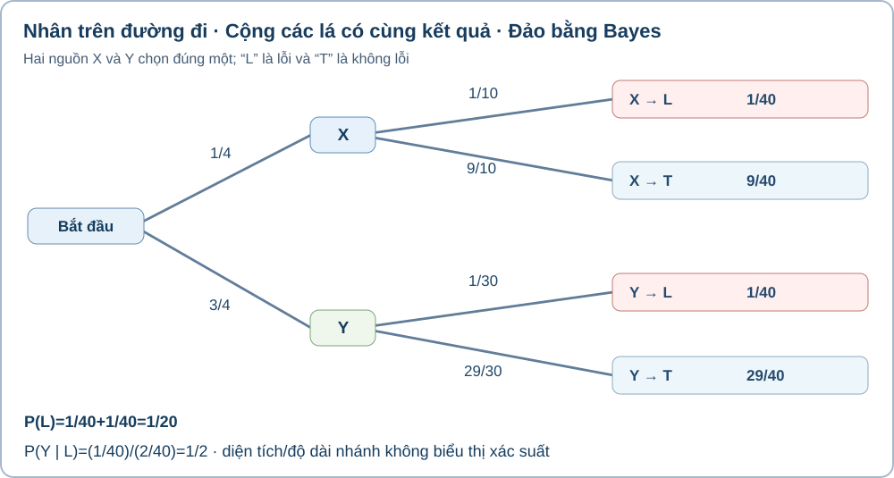

# Chuyên đề 21 · Xác suất có điều kiện, công thức toàn phần và Bayes

<!-- TOPIC_AUTHORING: PLAN22-21; CANDIDATE_R01; LEARNING_PATH: TOPIC; CONTENT_READY: NO; RUNTIME_TOPIC_ID: OWNER_UNASSIGNED -->

## 1. Kiến thức

Một kiện hàng lỗi có thể đến từ hai dây chuyền. Biết một dây chuyền có tỉ lệ lỗi cao **chưa đủ** để nói kiện lỗi vừa quan sát chắc đến từ dây chuyền đó. Em cần học cách thay đổi nhóm kết quả khi có thông tin mới, nhân theo nhánh, cộng các nguồn và đảo xác suất bằng Bayes.

**Chuẩn bị:** Không gian mẫu \(\Omega\) gồm các kết quả có thể xảy ra; biến cố là một tập con của \(\Omega\); \(A\cap B\) là phần cả A và B cùng xảy ra; \(\bar A\) là phần A không xảy ra. Độc lập nghĩa là \(P(A\cap B)=P(A)P(B)\), không đồng nghĩa với xung khắc. Xác suất cổ điển chỉ được tính bằng đếm khi các kết quả sơ cấp đồng khả năng. Mọi tiền đề này được nhắc tại đây, không yêu cầu mở Chuyên đề 20 để học phần bắt buộc.

**Cách học:** Đọc mục 1.x từ tình huống tới khung kiến thức chính thức và ví dụ, tự làm **Vận dụng**, rồi mới mở **Đối chiếu**. Đáp án công khai dùng để tự học, không phải kiểm tra độc lập.

### 1. Biết thêm thông tin là đổi nhóm đang xét

<!-- OUTCOME_ID: TOP21-O01; LEGACY_SGK_SKILL: G12-B18-CONDITIONAL_INTERPRETATION; LESSON_ID: G12-SGK-B18 -->

#### 1.1. Tình huống và kiến thức tiền đề

Trong một lớp có nhiều học sinh chơi thể thao, nhưng khi biết một bạn thuộc câu lạc bộ thì em không còn bốc thăm trên cả lớp. Thông tin mới thay đổi nhóm kết quả còn có thể xảy ra.

**Kiến thức đã có:** Nhắc lại: biến cố là tập con của không gian mẫu Ω; giao A∩B gồm kết quả cùng thỏa A và B; trong mô hình đồng khả năng, xác suất là tỉ lệ trường hợp thuận lợi trên toàn bộ trường hợp được xét.

#### 1.2. Khái niệm, tính chất và công thức cần ghi nhớ

Khi biết B đã xảy ra, ta chỉ xét các kết quả nằm trong B. Phần làm A đúng trong nhóm này là A∩B. Vì thế mẫu số của câu hỏi 'A khi đã biết B' là quy mô B, không phải quy mô toàn thể Ω. Nếu B không thể xảy ra, không có nhóm để chọn và phép tính điều kiện không xác định.

> **ĐỊNH NGHĨA — Xác suất khi đã biết một biến cố**
>
> Biết B xảy ra là chọn lại trong nhóm B: chỉ các kết quả thuộc B còn được xét; để xác suất điều kiện có nghĩa cần \(P(B)>0\). Không được đồng nhất \(P(A\mid B)\) và \(P(B\mid A)\).

**Phạm vi áp dụng:** Chọn trước biến cố ĐÃ BIẾT, khoanh nhóm đó; sau mới đếm giao của nhóm ấy với biến cố cần hỏi. Bảng 2 chiều hoặc sơ đồ tập hợp tốt hơn học thuộc một phép chia chưa hiểu.

#### 1.3. Ví dụ giải thích từng bước

Trong 20 học sinh có 8 bạn tham gia câu lạc bộ cờ, trong đó 5 bạn mang kính. Chọn đều một bạn và biết bạn ấy thuộc câu lạc bộ. Khi ấy P(mang kính | câu lạc bộ)=5/8, không phải 5/20. Nếu không giả thiết chọn đều hoặc không có dữ kiện tương đương về tần suất, không được tự suy mẫu số.

#### 1.4. Vận dụng — thực hiện trước khi đối chiếu

**Vận dụng 1.** Trong 24 vé khác nhau được chọn đều có 9 vé xanh, 6 trong 9 vé xanh có dấu sao. Đã biết vé rút ra là xanh. Hỏi xác suất vé đó có dấu sao?

<!-- ITEM_ID: THPT-TOP21-T01; ROLE: TOPIC_FIRST_TRY; LEARNER_LABEL: VAN_DUNG; PRIMARY_OUTCOME: TOP21-O01; CONTENT_VERSION: TOP21-R01; PUBLIC_FORMATIVE_NO_MASTERY -->

Đối chiếu lời giải Vận dụng 1 (chỉ mở sau khi làm)

Nhóm điều kiện gồm 9 vé xanh; có 6 vé trong nhóm đó có sao. Do đó P(sao | xanh)=6/9=2/3, không phải 6/24.

**Khi chưa đạt, tự khắc phục:** Nếu chia cho 24, em đã quên thu hẹp Ω khi biết màu vé. Tự gạch riêng 9 vé xanh, đánh dấu 6 vé sao rồi thử lại. Sau đó làm bài P01 cùng outcome, không dùng điểm tự đối chiếu làm Mastery.

### 2. Từ vùng giao đến công thức xác suất có điều kiện

<!-- OUTCOME_ID: TOP21-O02; LEGACY_SGK_SKILL: G12-B18-CONDITIONAL_FORMULA; LESSON_ID: G12-SGK-B18 -->

#### 2.1. Tình huống và kiến thức tiền đề

Một nhóm đôi khi không được cho bằng số người mà chỉ bằng các xác suất. Ta cần một cách tính chính xác nhưng vẫn nhớ ý nghĩa 'giao trong nhóm đã biết'.

**Kiến thức đã có:** Biết P(B), P(A∩B) và hiểu rằng B chính là phần không gian mẫu mới. Cần P(B)>0; nếu P(B)=0 thì công thức chia không xác định.

#### 2.2. Khái niệm, tính chất và công thức cần ghi nhớ

Vì phần A và B cùng xảy ra có xác suất P(A∩B), còn toàn bộ nhóm B có xác suất P(B), tỉ lệ xác suất của A bên trong B là P(A|B)=P(A∩B)/P(B). Công thức chỉ là cách chuẩn hóa vùng giao theo B, không phải phép hoán đổi nhãn tùy ý.

> **ĐỊNH NGHĨA – CÔNG THỨC — Xác suất có điều kiện**
>
> \[P(A\mid B)=\frac{P(A\cap B)}{P(B)},\qquad P(B)>0.\] \(P(A\cap B)\) là phần giao; \(P(B)\) là toàn bộ nhóm đã biết. Khi các phần tử của B đồng khả năng có thể dùng \(n(A\cap B)/n(B)\).

**Phạm vi áp dụng:** Nếu Ω ít phần tử và đồng khả năng, liệt kê B rồi giao; nếu đã có xác suất, dùng P(A∩B)/P(B). Luôn đánh dấu biến cố đứng SAU vạch điều kiện là mẫu số.

#### 2.3. Ví dụ giải thích từng bước

Chọn đều số nguyên từ 1 đến 10. A: số chẵn, B: chia hết cho 3. B={3,6,9}, A∩B={6}, nên P(A|B)=1/3. Có thể kiểm bằng (1/10)/(3/10)=1/3. Không dùng P(A)=5/10 làm mẫu số vì đề biết B.

#### 2.4. Vận dụng — thực hiện trước khi đối chiếu

**Vận dụng 2.** Gieo xúc xắc sáu mặt cân đối. A là 'chia hết cho 3', B là 'số chẵn'. Tính P(A|B).

<!-- ITEM_ID: THPT-TOP21-T02; ROLE: TOPIC_FIRST_TRY; LEARNER_LABEL: VAN_DUNG; PRIMARY_OUTCOME: TOP21-O02; CONTENT_VERSION: TOP21-R01; PUBLIC_FORMATIVE_NO_MASTERY -->

Đối chiếu lời giải Vận dụng 2 (chỉ mở sau khi làm)

B={2,4,6}, A∩B={6}; P(A|B)=(1/6)/(3/6)=1/3. Mẫu số P(B)=1/2>0.

**Khi chưa đạt, tự khắc phục:** Nếu viết 1/2, em đã lấy P(B) thay cho xác suất giao trong B. Nếu chia cho P(A), em đã đổi chiều thành P(B|A). Sau đó làm bài P02 cùng outcome, không dùng điểm tự đối chiếu làm Mastery.

### 3. Quy tắc nhân tổng quát cho các lượt phụ thuộc

<!-- OUTCOME_ID: TOP21-O03; LEGACY_SGK_SKILL: G12-B18-GENERAL_MULTIPLICATION; LESSON_ID: G12-SGK-B18 -->

#### 3.1. Tình huống và kiến thức tiền đề

Rút thẻ không hoàn lại làm cơ cấu túi thay đổi sau lượt đầu. Nhân hai xác suất ban đầu như thể không có gì thay đổi sẽ cho kết quả sai.

**Kiến thức đã có:** Nhớ biến cố giao A∩B là 'cả hai' và xác suất có điều kiện B khi A: P(B|A). Một đường đi có thứ tự trong cây gồm các bước phụ thuộc vào các lựa chọn trước đó.

#### 3.2. Khái niệm, tính chất và công thức cần ghi nhớ

Trước hết cần A xảy ra với xác suất P(A). Trong phần các trường hợp A đã xảy ra, B xuất hiện với xác suất P(B|A). Do đó xác suất đi hết nhánh A→B là P(A∩B)=P(A)P(B|A) (khi P(A)>0). Có thể đảo cách phân tích theo B trước nếu biết P(B)>0; KHÔNG luôn được thay P(B|A) bằng P(B).

> **CÔNG THỨC – QUY TẮC NHÂN — Xác suất đồng thời theo điều kiện**
>
> \[P(A\cap B)=P(A)P(B\mid A)\quad\text{khi }P(A)>0.\] Tương tự \(P(A\cap B)=P(B)P(A\mid B)\) nếu \(P(B)>0\). Khi rút không hoàn lại, phải cập nhật xác suất nhánh sau.

**Phạm vi áp dụng:** Dùng sơ đồ cây khi điều kiện thay đổi theo bước; trước mỗi phép nhân hãy tự nói rõ nhánh sau 'khi đã biết' sự kiện nào. Độc lập chỉ là trường hợp riêng.

#### 3.3. Ví dụ giải thích từng bước

Túi có 3 thẻ lục và 4 thẻ cam, rút lần lượt hai thẻ không hoàn lại, mỗi lượt chọn đều. Để được hai lục: P(lục lượt 1)=3/7, rồi P(lục lượt 2 | lượt 1 lục)=2/6; tích 1/7. Nếu nhân (3/7)² là đã coi lượt hai còn 3 thẻ lục trong 7.

#### 3.4. Vận dụng — thực hiện trước khi đối chiếu

**Vận dụng 3.** Có 4 thẻ đỏ và 5 thẻ xanh khác nhau; rút liên tiếp hai thẻ không hoàn lại, đều mỗi lượt. Tính P(lượt đầu đỏ và lượt sau xanh).

<!-- ITEM_ID: THPT-TOP21-T03; ROLE: TOPIC_FIRST_TRY; LEARNER_LABEL: VAN_DUNG; PRIMARY_OUTCOME: TOP21-O03; CONTENT_VERSION: TOP21-R01; PUBLIC_FORMATIVE_NO_MASTERY -->

Đối chiếu lời giải Vận dụng 3 (chỉ mở sau khi làm)

P(đỏ đầu)=4/9; sau đó còn 8 thẻ, 5 xanh nên P(xanh sau | đỏ đầu)=5/8. Giao = (4/9)(5/8)=5/18.

**Khi chưa đạt, tự khắc phục:** Nếu dùng (4/9)(5/9), em chưa đổi tổng số thẻ ở lượt hai từ 9 xuống 8. Vẽ một nhánh đỏ trước rồi ghi nội dung túi còn lại. Sau đó làm bài P03 cùng outcome, không dùng điểm tự đối chiếu làm Mastery.

### 4. Khi nào xác suất có điều kiện không thay đổi?

<!-- OUTCOME_ID: TOP21-O04; LEGACY_SGK_SKILL: G12-B18-INDEPENDENCE_CONNECTION; LESSON_ID: G12-SGK-B18 -->

#### 4.1. Tình huống và kiến thức tiền đề

Không phải cứ gọi hai tình huống bằng hai tên thì chúng độc lập; và cùng một phép thử cũng có thể chứa hai biến cố độc lập. Ta cần một phép kiểm dựa vào mô hình, không dựa vào trực giác.

**Kiến thức đã có:** Nhớ P(A∩B) là xác suất giao; P(A|B)=P(A∩B)/P(B) khi P(B)>0. Xung khắc có nghĩa giao rỗng, khác với độc lập.

#### 4.2. Khái niệm, tính chất và công thức cần ghi nhớ

Nếu biết B không ảnh hưởng đến khả năng A, thì P(A|B)=P(A). Với P(B)>0, điều này tương đương P(A∩B)=P(A)P(B). Tiêu chuẩn nhân sau cùng vẫn kiểm được trường hợp một biến cố có xác suất 0; đừng ép dùng P(A|B) khi P(B)=0.

> **TÍNH CHẤT — Tiêu chuẩn độc lập**
>
> \[A\text{ và }B\text{ độc lập}\iff P(A\cap B)=P(A)P(B).\] Khi \(P(B)>0\), độc lập tương đương \(P(A\mid B)=P(A)\). Hai biến cố xung khắc có xác suất dương không độc lập.

**Phạm vi áp dụng:** Kiểm một cách chắc chắn: lập P(A), P(B), P(A∩B), rồi so giao với tích. Đừng đánh đồng 'xung khắc' với 'độc lập'.

#### 4.3. Ví dụ giải thích từng bước

Hai xúc xắc cân đối và độc lập. A: xúc xắc thứ nhất chẵn, B: xúc xắc thứ hai lớn hơn 4. P(A)=1/2, P(B)=1/3; giao có 2·3? Có 3 lựa chọn chẵn của con thứ nhất và 2 lựa chọn >4 của con thứ hai, nên 6/36=1/6=(1/2)(1/3), độc lập.

#### 4.4. Vận dụng — thực hiện trước khi đối chiếu

**Vận dụng 4.** Tung hai đồng xu cân đối, độc lập. A: đồng xu đầu ngửa; B: có đúng một mặt ngửa trong cả hai lượt. A, B có độc lập không?

<!-- ITEM_ID: THPT-TOP21-T04; ROLE: TOPIC_FIRST_TRY; LEARNER_LABEL: VAN_DUNG; PRIMARY_OUTCOME: TOP21-O04; CONTENT_VERSION: TOP21-R01; PUBLIC_FORMATIVE_NO_MASTERY -->

Đối chiếu lời giải Vận dụng 4 (chỉ mở sau khi làm)

Ω={NN,NS,SN,SS}. P(A)=2/4, P(B)=2/4, P(A∩B)=1/4 (chỉ NS). Vì 1/4=(1/2)(1/2), A và B độc lập trong mô hình này.

**Khi chưa đạt, tự khắc phục:** Nếu kết luận phụ thuộc chỉ vì B có nhắc đồng xu đầu, em đã suy theo ngôn ngữ. Hãy đếm giao và tích; cả hai cùng bằng 1/4. Sau đó làm bài P04 cùng outcome, không dùng điểm tự đối chiếu làm Mastery.

### 5. Xác suất toàn phần: cộng các đường đi đến cùng kết quả

<!-- OUTCOME_ID: TOP21-O05; LEGACY_SGK_SKILL: G12-B19-TOTAL_PROBABILITY; LESSON_ID: G12-SGK-B19 -->

#### 5.1. Tình huống và kiến thức tiền đề

Một sản phẩm bị lỗi có thể đến từ nhiều dây chuyền. Không thể chỉ lấy tỉ lệ lỗi của một dây chuyền hoặc cộng các tỉ lệ lỗi điều kiện mà bỏ qua số lượng hàng từ từng nơi.

**Kiến thức đã có:** Hai nguồn X và Y phải phân chia hết các sản phẩm được chọn, không chồng nhau. Tỉ lệ đến từ nguồn là P(X), P(Y), tổng 1; P(L|X), P(L|Y) là xác suất lỗi KHI đã biết nguồn.

#### 5.2. Khái niệm, tính chất và công thức cần ghi nhớ

Biến cố L được tách thành hai phần rời nhau: (X∩L) và (Y∩L). Mỗi phần là một đường đi có xác suất nhân; vì hai đường không chồng nhau, xác suất L là tổng P(X)P(L|X)+P(Y)P(L|Y). Công thức không cần X,Y độc lập với L; trái lại các điều kiện thường khác nhau.

> **CÔNG THỨC — Xác suất toàn phần hai nhánh**
>
> Nếu \(X\cap Y=\varnothing\), \(X\cup Y=\Omega\) và \(P(X),P(Y)>0\) thì \[P(L)=P(X)P(L\mid X)+P(Y)P(L\mid Y).\] Đây là tổng hai **đường đi rời nhau**, không phải tổng trần hai xác suất điều kiện.

**Phạm vi áp dụng:** Hãy vẽ hai nhánh nguồn đủ 100%; viết xác suất trên từng cạnh, nhân theo đường lỗi, cộng các đường lỗi. Đảm bảo có P(X)>0 và P(Y)>0 khi sử dụng xác suất có điều kiện.

#### 5.3. Ví dụ giải thích từng bước

Hai nguồn: X đóng góp 30% kiện hàng, tỉ lệ lỗi 2%; Y đóng góp 70%, tỉ lệ lỗi 4%. P(lỗi)=0,3·0,02+0,7·0,04=0,034=17/500. Không lấy 2%+4%=6%.

#### 5.4. Vận dụng — thực hiện trước khi đối chiếu

**Vận dụng 5.** Nguồn X cung cấp 1/4 sản phẩm, tỉ lệ lỗi 1/10; nguồn Y cung cấp 3/4, tỉ lệ lỗi 1/30. Chọn đều một sản phẩm. Xác suất gặp lỗi?

<!-- ITEM_ID: THPT-TOP21-T05; ROLE: TOPIC_FIRST_TRY; LEARNER_LABEL: VAN_DUNG; PRIMARY_OUTCOME: TOP21-O05; CONTENT_VERSION: TOP21-R01; PUBLIC_FORMATIVE_NO_MASTERY -->

Đối chiếu lời giải Vận dụng 5 (chỉ mở sau khi làm)

P(lỗi)=(1/4)(1/10)+(3/4)(1/30)=1/40+1/40=1/20.

**Khi chưa đạt, tự khắc phục:** Nếu ra 1/10+1/30, em đã quên nhân tỉ trọng nguồn; làm lại từng đường 'chọn nguồn → lỗi' trước khi cộng. Sau đó làm bài P05 cùng outcome, không dùng điểm tự đối chiếu làm Mastery.

#### 5.5. Hình minh họa: cây xác suất và cách đọc từng đường

**Quan sát hình:** Nhánh gốc X có xác suất \(1/4\), Y có xác suất \(3/4\); xác suất lỗi theo từng nguồn lần lượt \(1/10\) và \(1/30\). **Nhân dọc** để được hai lá lỗi \(1/40\) và \(1/40\); hai lá không lỗi \(9/40\) và \(29/40\). Tổng bốn lá bằng 1. **Cộng lá lỗi** được \(P(L)=1/20\); **đảo** \(P(Y\mid L)=(1/40)/(2/40)=1/2\). Cạnh và nhãn xác suất, không phải độ dài đoạn hay diện tích, mới là dữ liệu toán.

**Giới hạn:** Cây chỉ hợp lệ khi các nhánh ở từng nút tạo phân hoạch. Hình này có số liệu ví dụ riêng để học cách đọc hình, không dùng số từ ví dụ nhà máy 30%/70% ở mục 5.3.

### 6. Bayes: đi từ kết quả quan sát ngược về nguồn

<!-- OUTCOME_ID: TOP21-O06; LEGACY_SGK_SKILL: G12-B19-BAYES_REVERSE; LESSON_ID: G12-SGK-B19 -->

#### 6.1. Tình huống và kiến thức tiền đề

Biết một kiện hàng bị lỗi, em cần biết khả năng nó đến từ dây chuyền nào. Tỉ lệ lỗi ở dây chuyền không phải xác suất dây chuyền khi đã biết lỗi.

**Kiến thức đã có:** Phân biệt chiều 'lỗi khi biết nguồn' với 'nguồn khi đã biết lỗi'. Biết giao = tỉ trọng nguồn × tỉ lệ lỗi của nguồn và biết toàn phần để tính xác suất lỗi chung.

#### 6.2. Khái niệm, tính chất và công thức cần ghi nhớ

Nếu đã thấy kết quả L, các sản phẩm không bị L bị loại; trong nhóm còn lại, phần từ nguồn Y là P(Y∩L). Vì vậy P(Y|L)=P(Y)P(L|Y)/P(L) với P(L)>0. Khi có hai nguồn, P(L) phải cộng cả hai nhánh nguồn.

> **CÔNG THỨC — Bayes – đảo chiều câu hỏi**
>
> \[P(Y\mid L)=\frac{P(Y)P(L\mid Y)}{P(L)},\qquad P(L)>0.\] Với hai nhánh X,Y phân hoạch, mẫu số là công thức toàn phần của L. Xác suất của nguồn **sau khi thấy L** không tự bằng xác suất thấy L **khi biết nguồn**.

**Phạm vi áp dụng:** Ba bước: (1) đặt tên sự kiện đã quan sát, (2) tính xác suất toàn phần của sự kiện ấy, (3) chia xác suất đường đi nguồn-mục tiêu cho toàn phần. Chỉ dùng tỉ lệ 'nguồn trước' nếu câu hỏi yêu cầu tỉ lệ nền.

#### 6.3. Ví dụ giải thích từng bước

Nguồn A chiếm 20% và cho dấu hiệu H ở 80% sản phẩm; nguồn B chiếm 80% và cho H ở 10%. P(H)=0,2·0,8+0,8·0,1=0,24. P(A|H)=0,16/0,24=2/3, không phải 80%.

#### 6.4. Vận dụng — thực hiện trước khi đối chiếu

**Vận dụng 6.** Nguồn X chiếm 2/5 sản phẩm, tỉ lệ lỗi 1/10; Y chiếm 3/5, tỉ lệ lỗi 1/5. Biết sản phẩm chọn ra bị lỗi, xác suất nó thuộc Y?

<!-- ITEM_ID: THPT-TOP21-T06; ROLE: TOPIC_FIRST_TRY; LEARNER_LABEL: VAN_DUNG; PRIMARY_OUTCOME: TOP21-O06; CONTENT_VERSION: TOP21-R01; PUBLIC_FORMATIVE_NO_MASTERY -->

Đối chiếu lời giải Vận dụng 6 (chỉ mở sau khi làm)

P(Y∩lỗi)=(3/5)(1/5)=3/25; P(X∩lỗi)=(2/5)(1/10)=1/25. P(lỗi)=4/25 nên P(Y|lỗi)=(3/25)/(4/25)=3/4.

**Khi chưa đạt, tự khắc phục:** Nếu trả lời 1/5, em mới tính xác suất lỗi khi đã biết Y, chưa đảo chiều. Cộng tất cả nhánh lỗi thành mẫu số rồi chia đường Y–lỗi. Sau đó làm bài P06 cùng outcome, không dùng điểm tự đối chiếu làm Mastery.

### 7. Đọc sơ đồ cây: nhân trên đường, cộng tại đích

<!-- OUTCOME_ID: TOP21-O07; LEGACY_SGK_SKILL: G12-B19-TREE_MODEL; LESSON_ID: G12-SGK-B19 -->

#### 7.1. Tình huống và kiến thức tiền đề

Sơ đồ cây không chỉ để trang trí. Nó giúp em kiểm kê những đường có thể xảy ra và nhận ra ngay việc bỏ sót một nguồn hoặc đọc nhầm xác suất điều kiện.

**Kiến thức đã có:** Mỗi nút phân nhánh có các xác suất điều kiện cộng thành 1. Xác suất tới một lá là tích các xác suất trên đường; các lá khác nhau là những kết quả rời nhau.

#### 7.2. Khái niệm, tính chất và công thức cần ghi nhớ

Một nhánh gốc chọn nguồn, nhánh kế tiếp chọn có/không sự kiện. Nhân các cạnh từ gốc đến lá để tìm xác suất đồng thời. Muốn tìm xác suất một kết quả chung thì cộng các lá dẫn đến kết quả đó; muốn đảo về nguồn khi đã thấy kết quả thì chia lá nguồn-kết quả cho tổng những lá cùng kết quả.

> **PHƯƠNG PHÁP — Ba thao tác đọc cây xác suất**
>
> Tại **mỗi nút**, tổng xác suất các nhánh ra bằng 1. **Nhân dọc** từ gốc đến lá để có xác suất giao; **cộng các lá rời nhau** đưa tới kết quả cần tính; khi đảo điều kiện, **chia lá mục tiêu cho tổng các lá đã quan sát**. Tổng toàn bộ các lá cuối phải bằng 1.

**Phạm vi áp dụng:** Trước khi tính Bayes, kiểm tra lá: tổng các lá phải bằng 1. Các nhánh chứa điều kiện cần ghi rõ, không dùng nhãn 'đến đúng giờ' như thể có cùng tỉ lệ trên mọi nguồn.

#### 7.3. Ví dụ giải thích từng bước

Chọn tuyến R với xác suất 3/5, tới đúng giờ với 4/5; tuyến S 2/5, tới đúng giờ với 1/2. Bốn lá lần lượt R-đúng=12/25, R-muộn=3/25, S-đúng=1/5, S-muộn=1/5. Tổng các lá bằng 1; P(đúng giờ)=12/25+1/5=17/25.

#### 7.4. Vận dụng — thực hiện trước khi đối chiếu

**Vận dụng 7.** Chọn lớp A với xác suất 3/5, trong A tỉ lệ thẻ đỏ là 3/10; lớp B với xác suất 2/5, trong B tỉ lệ đỏ 1/4. Lập bốn lá đỏ/không đỏ và tính P(đỏ).

<!-- ITEM_ID: THPT-TOP21-T07; ROLE: TOPIC_FIRST_TRY; LEARNER_LABEL: VAN_DUNG; PRIMARY_OUTCOME: TOP21-O07; CONTENT_VERSION: TOP21-R01; PUBLIC_FORMATIVE_NO_MASTERY -->

Đối chiếu lời giải Vận dụng 7 (chỉ mở sau khi làm)

A-đỏ=9/50, A-không đỏ=21/50; B-đỏ=1/10, B-không đỏ=3/10. Tổng bốn lá bằng 1, P(đỏ)=9/50+1/10=7/25.

**Khi chưa đạt, tự khắc phục:** Nếu bốn lá không cộng thành 1, hãy rà mỗi nút: đỏ và không đỏ trong A phải có tổng 1; tương tự B. Đừng cộng trực tiếp 3/10 và 1/4. Sau đó làm bài P07 cùng outcome, không dùng điểm tự đối chiếu làm Mastery.

### 8. Tỉ lệ nền và bẫy kết luận từ một dấu hiệu

<!-- OUTCOME_ID: TOP21-O08; LEGACY_SGK_SKILL: G12-B19-BASE_RATE_REASONING; LESSON_ID: G12-SGK-B19 -->

#### 8.1. Tình huống và kiến thức tiền đề

Một dấu hiệu có vẻ đáng tin nhưng nếu nhóm thực sự có đặc điểm đó rất hiếm, nhiều kết quả báo có dấu hiệu vẫn có thể đến từ nhóm còn lại. Điều này quan trọng khi đọc thông tin thống kê hoặc hệ thống kiểm tra chất lượng.

**Kiến thức đã có:** Nhớ phân loại: tỷ lệ nền P(H), khả năng báo dấu hiệu nếu đúng H là P(+|H), tỷ lệ báo nhầm nếu không H là P(+|không H). Đây là bài mô hình xác suất giả định, không phải lời khuyên chẩn đoán cá nhân.

#### 8.2. Khái niệm, tính chất và công thức cần ghi nhớ

Trong số các kết quả báo dấu hiệu, có hai nguồn: dương tính thật và báo nhầm. Xác suất thuộc H sau báo dấu hiệu là phần báo đúng chia tổng tất cả báo dấu hiệu. Dấu hiệu có tỷ lệ xuất hiện cao khi H chưa đủ để kết luận H nhiều khả năng khi thấy dấu hiệu; cần cả tỉ lệ nền và báo nhầm.

> **GHI NHỚ — Vai trò của tỉ lệ nền**
>
> \[P(H\mid +)=\frac{P(H)P(+\mid H)}{P(H)P(+\mid H)+P(\bar H)P(+\mid\bar H)}.\] Đây là mô hình xác suất; phải biết **tỉ lệ nền**, **tỉ lệ phát hiện khi đúng** và **tỉ lệ báo nhầm**. Không kết luận \(P(H\mid +)=P(+\mid H)\).

**Phạm vi áp dụng:** Chuyển phần trăm sang số trong một nhóm lớn (ví dụ 10.000 sản phẩm) để tự kiểm: bao nhiêu lỗi thật bị báo, bao nhiêu tốt bị báo nhầm? Tính tỉ lệ giữa hai số ấy rồi đối chiếu Bayes.

#### 8.3. Ví dụ giải thích từng bước

Giả định một lô có 1% hàng lỗi, máy nhận biết 95% hàng lỗi và báo nhầm 10% hàng tốt. P(báo lỗi)=0,01·0,95+0,99·0,10=0,1085; P(hàng thực sự lỗi | báo lỗi)=0,0095/0,1085=19/217≈8,76%. Đây là số liệu mô hình giả định, không mô tả máy cụ thể.

#### 8.4. Vận dụng — thực hiện trước khi đối chiếu

**Vận dụng 8.** Một hệ thống giả định có 2% hồ sơ thuộc nhóm H. Hệ thống báo dấu hiệu với 90% hồ sơ H và báo nhầm với 15% hồ sơ không H. Biết hồ sơ bị báo, xác suất nó thuộc H?

<!-- ITEM_ID: THPT-TOP21-T08; ROLE: TOPIC_FIRST_TRY; LEARNER_LABEL: VAN_DUNG; PRIMARY_OUTCOME: TOP21-O08; CONTENT_VERSION: TOP21-R01; PUBLIC_FORMATIVE_NO_MASTERY -->

Đối chiếu lời giải Vận dụng 8 (chỉ mở sau khi làm)

P(H∩báo)=0,02·0,90=0,018; P(không H∩báo)=0,98·0,15=0,147. Xác suất cần tìm là 0,018/(0,018+0,147)=18/165=6/55≈10,91%.

**Khi chưa đạt, tự khắc phục:** Nếu ra 90%, em đã nhầm 'báo khi biết H' với 'H khi đã báo'. Hãy lập bảng 10.000 hồ sơ: 200 H có 180 báo; 9.800 không H có 1.470 báo; tỉ lệ 180/(180+1470). Sau đó làm bài P08 cùng outcome, không dùng điểm tự đối chiếu làm Mastery.

## 2. Luyện tập — chuyển dạng, giải thích và tự đối chiếu

**Quy tắc thao tác:** Làm bài trên giấy; viết mẫu số/điều kiện và lý do chọn quy tắc; sau đó mới mở lời giải. Những lời giải công khai dưới đây là formative, không phải đáp án của một đề bảo mật. Phần tham chiếu 16 item G12 cũ chỉ là đường dẫn canonical từ Draft #810, không chép lại stem/key/rubric.

### P01 · Biết thêm thông tin là đổi nhóm đang xét

<!-- ITEM_ID: THPT-TOP21-P01; ROLE: TOPIC_PRACTICE; PRIMARY_OUTCOME: TOP21-O01; CONTENT_VERSION: TOP21-R00; PUBLIC_FORMATIVE_NO_MASTERY -->
Trong 40 thẻ vật lí khác nhau được chọn đều có 12 thẻ hình tam giác, trong đó đúng 5 thẻ đỏ. Biết đã chọn thẻ tam giác, tính xác suất thẻ đỏ và giải thích mẫu số.

Mở lời giải và hướng tự khắc phục

**Lời giải có lý do:** Nhóm điều kiện gồm 12 thẻ tam giác, có 5 thẻ đỏ nên P(đỏ | tam giác)=5/12. Mẫu số là 12, không phải 40.

**D6:** Nếu ra 5/40, hãy hỏi lại: đề đã cho biết thẻ mang hình gì? Mọi kết quả không phải tam giác đã bị loại khỏi nhóm xét.

### P02 · Từ vùng giao đến công thức xác suất có điều kiện

<!-- ITEM_ID: THPT-TOP21-P02; ROLE: TOPIC_PRACTICE; PRIMARY_OUTCOME: TOP21-O02; CONTENT_VERSION: TOP21-R00; PUBLIC_FORMATIVE_NO_MASTERY -->
Chọn đều một số trong 1,…,12. A: chia hết cho 4. B: lớn hơn 6. Tính P(A|B).

Mở lời giải và hướng tự khắc phục

**Lời giải có lý do:** B={7,8,9,10,11,12} có 6 phần tử. Giao A∩B={8,12} có 2 phần tử. Kết quả P(A|B)=2/6=1/3; P(B)>0.

**D6:** Nếu dùng 3/12, em đang tính P(A), không phải P(A|B). Hãy viết trọn tập B trước.

### P03 · Quy tắc nhân tổng quát cho các lượt phụ thuộc

<!-- ITEM_ID: THPT-TOP21-P03; ROLE: TOPIC_PRACTICE; PRIMARY_OUTCOME: TOP21-O03; CONTENT_VERSION: TOP21-R00; PUBLIC_FORMATIVE_NO_MASTERY -->
Hộp có 5 thẻ đỏ, 2 thẻ vàng. Rút đều ba thẻ liên tiếp không hoàn lại. Tính xác suất màu theo đúng thứ tự đỏ–vàng–đỏ.

Mở lời giải và hướng tự khắc phục

**Lời giải có lý do:** P(R,V,R)=(5/7)(2/6)(4/5)=4/21. Sau hai lượt đã lấy một đỏ và một vàng, còn 4 đỏ trong 5 thẻ.

**D6:** Nếu giữ 5/7 cho lượt thứ ba, em chưa cập nhật trạng thái túi; hãy ghi 'còn 6' rồi 'còn 5' trên các cạnh cây.

### P04 · Khi nào xác suất có điều kiện không thay đổi?

<!-- ITEM_ID: THPT-TOP21-P04; ROLE: TOPIC_PRACTICE; PRIMARY_OUTCOME: TOP21-O04; CONTENT_VERSION: TOP21-R00; PUBLIC_FORMATIVE_NO_MASTERY -->
Gieo một xúc xắc cân đối. A: mặt chẵn; B: mặt lớn hơn 3. Hai biến cố độc lập không?

Mở lời giải và hướng tự khắc phục

**Lời giải có lý do:** P(A)=3/6=1/2; P(B)=3/6=1/2; A∩B={4,6}, P(A∩B)=2/6=1/3 khác P(A)P(B)=1/4. Vì vậy không độc lập.

**D6:** Nếu coi độc lập vì cả hai đều xác suất 1/2, em chưa kiểm phần giao. Khoanh {4,6} trên Ω.

### P05 · Xác suất toàn phần: cộng các đường đi đến cùng kết quả

<!-- ITEM_ID: THPT-TOP21-P05; ROLE: TOPIC_PRACTICE; PRIMARY_OUTCOME: TOP21-O05; CONTENT_VERSION: TOP21-R00; PUBLIC_FORMATIVE_NO_MASTERY -->
Kho hàng nhập 2/5 kiện từ X với tỉ lệ hỏng 1/20 và 3/5 từ Y với tỉ lệ hỏng 1/10. Lấy ngẫu nhiên một kiện. Tính tỉ lệ hỏng chung.

Mở lời giải và hướng tự khắc phục

**Lời giải có lý do:** P(hỏng)=(2/5)(1/20)+(3/5)(1/10)=1/50+3/50=4/50=2/25.

**D6:** Nếu lấy trung bình cộng 1/20 và 1/10, em ngầm giả định hai nguồn 50%–50%; thực tế là 2/5 và 3/5.

### P06 · Bayes: đi từ kết quả quan sát ngược về nguồn

<!-- ITEM_ID: THPT-TOP21-P06; ROLE: TOPIC_PRACTICE; PRIMARY_OUTCOME: TOP21-O06; CONTENT_VERSION: TOP21-R00; PUBLIC_FORMATIVE_NO_MASTERY -->
Một lô gồm 1/4 sản phẩm từ H, 3/4 từ K. Xác suất mang nhãn xanh là 3/5 nếu từ H, 1/5 nếu từ K. Biết đã thấy nhãn xanh, tính xác suất sản phẩm thuộc H.

Mở lời giải và hướng tự khắc phục

**Lời giải có lý do:** P(H∩xanh)=(1/4)(3/5)=3/20; P(K∩xanh)=(3/4)(1/5)=3/20. P(xanh)=6/20, vậy P(H|xanh)=(3/20)/(6/20)=1/2.

**D6:** Nếu viết 3/5, em đã đảo câu hỏi. Muốn biết nguồn sau khi thấy nhãn, mẫu số gồm các cách có nhãn xanh từ cả H và K.

### P07 · Đọc sơ đồ cây: nhân trên đường, cộng tại đích

<!-- ITEM_ID: THPT-TOP21-P07; ROLE: TOPIC_PRACTICE; PRIMARY_OUTCOME: TOP21-O07; CONTENT_VERSION: TOP21-R00; PUBLIC_FORMATIVE_NO_MASTERY -->
Chọn tuyến R xác suất 2/5, xác suất thành công khi đi R là 3/4. Chọn tuyến S xác suất 3/5, xác suất thành công khi đi S là 1/2. Tính P(S và thất bại) và P(thành công).

Mở lời giải và hướng tự khắc phục

**Lời giải có lý do:** P(S∩thất bại)=(3/5)(1/2)=3/10. P(thành công)=(2/5)(3/4)+(3/5)(1/2)=3/10+3/10=3/5. Các lá đầy đủ: R tốt 3/10, R hỏng 1/10, S tốt 3/10, S hỏng 3/10, tổng 1.

**D6:** Nếu ra 1/2 cho S và thất bại, em dùng xác suất thất bại có điều kiện mà quên xác suất chọn S. Đọc từ gốc đến lá.

### P08 · Tỉ lệ nền và bẫy kết luận từ một dấu hiệu

<!-- ITEM_ID: THPT-TOP21-P08; ROLE: TOPIC_PRACTICE; PRIMARY_OUTCOME: TOP21-O08; CONTENT_VERSION: TOP21-R00; PUBLIC_FORMATIVE_NO_MASTERY -->
Trong mô hình kiểm tra 1.000 sản phẩm có đúng 20 sản phẩm lỗi. Thiết bị phát hiện 80% sản phẩm lỗi và báo nhầm 5% của 980 sản phẩm tốt. Nếu máy báo lỗi, xác suất sản phẩm thực sự lỗi là bao nhiêu?

Mở lời giải và hướng tự khắc phục

**Lời giải có lý do:** Máy báo đúng 20·80%=16 sản phẩm lỗi và báo nhầm 980·5%=49 sản phẩm tốt. Trong 65 sản phẩm bị báo, 16 thực sự lỗi. Xác suất 16/65≈24,62%.

**D6:** Nếu trả lời 80%, em chỉ nêu khả năng phát hiện khi đồ đã lỗi. Hãy đếm toàn bộ 65 lượt báo, gồm cả 49 lượt báo nhầm.

### Tự luận và rubric dùng chung (không phải RD1)

**W01 — Bảng 2 chiều và hai chiều điều kiện.** Một tập hợp 60 học sinh được chọn đều một học sinh: có 24 bạn thuộc câu lạc bộ C, trong đó 15 bạn đeo kính; trong 36 bạn không thuộc C có 18 bạn đeo kính. Hãy lập bảng 2×2, tính P(kính|C), P(C|kính), P(C∩kính) và giải thích vì sao hai xác suất có điều kiện không bằng nhau.

<!-- ITEM_ID: THPT-TOP21-W01; ROLE: TOPIC_WRITTEN; PRIMARY_OUTCOME: TOP21-O02; SECONDARY_OUTCOME: TOP21-O01; CONTENT_VERSION: TOP21-R00; PUBLIC_SELF_SCORED_NO_MASTERY -->

Mở lời giải và rubric /4 khi đã làm xong

Bảng: C&kính=15, C&không kính=9, không C&kính=18, không C&không kính=18. Tổng kính=33, tổng C=24, tổng toàn thể=60. P(kính|C)=15/24=5/8; P(C|kính)=15/33=5/11; P(C∩kính)=15/60=1/4. Hai điều kiện có mẫu số khác nhau.

**Rubric /4:** Bảng đủ bốn ô và tổng=60 (1); đúng P(kính|C)=5/8 (1); đúng P(C|kính)=5/11 (1); đúng xác suất giao 1/4 và giải thích khác mẫu số (1).

**D6:** Nếu đảo 5/8 và 5/11, gạch dưới từ **“biết”** rồi quay O01/T01/P01 và O02/T02/P02 trước khi làm lại.

**W02 — Toàn phần và Bayes hai nhánh.** Sản phẩm từ nguồn X chiếm 1/3, tỉ lệ lỗi 1/5; nguồn Y chiếm 2/3, tỉ lệ lỗi 1/10. Một sản phẩm được lấy ngẫu nhiên. (a) Vẽ hoặc mô tả bốn đường đi lỗi/không lỗi. (b) Tính P(lỗi). (c) Biết sản phẩm lỗi, tính P(X|lỗi).

<!-- ITEM_ID: THPT-TOP21-W02; ROLE: TOPIC_WRITTEN; PRIMARY_OUTCOME: TOP21-O06; SECONDARY_OUTCOME: TOP21-O05,TOP21-O07; CONTENT_VERSION: TOP21-R00; PUBLIC_SELF_SCORED_NO_MASTERY -->

Mở lời giải và rubric /4 khi đã làm xong

Bốn lá: X&lỗi=1/15, X&không lỗi=4/15, Y&lỗi=1/15, Y&không lỗi=3/5; tổng 1. P(lỗi)=1/15+1/15=2/15. Biết lỗi, P(X|lỗi)=(1/15)/(2/15)=1/2.

**Rubric /4:** Nêu hai nhánh X,Y đầy đủ và các điều kiện (1); tính đúng bốn xác suất lá/tổng 1 (1); cộng phần lỗi được 2/15 (1); đảo điều kiện Bayes được 1/2 và diễn giải nhóm đã biết lỗi (1).

**D6:** Nếu cho 1/5 ở (c), em vẫn đang trả lời lỗi khi X, không phải X khi lỗi; viết hai nhánh lỗi rồi quay O05/P05 và O06/P06.

**W03 — Tỉ lệ nền, giải bằng đếm tự nhiên.** Trong một hệ thống giả định 10.000 hồ sơ có 1% hồ sơ thuộc nhóm H. Bộ lọc nhận ra 80% hồ sơ H và báo nhầm 5% hồ sơ không H. (a) Tính số lần báo đúng và báo nhầm. (b) Tính P(H|báo). (c) Phản biện nhận định “máy chính xác 80%, vậy 80% hồ sơ bị báo thuộc H”.

<!-- ITEM_ID: THPT-TOP21-W03; ROLE: TOPIC_WRITTEN; PRIMARY_OUTCOME: TOP21-O08; SECONDARY_OUTCOME: TOP21-O06; CONTENT_VERSION: TOP21-R00; PUBLIC_SELF_SCORED_NO_MASTERY -->

Mở lời giải và rubric /4 khi đã làm xong

Có 100 hồ sơ H, 9.900 không H. Báo đúng 100×0,8=80; báo nhầm 9.900×0,05=495; tất cả báo=575. Do đó P(H|báo)=80/575=16/115≈13,91%. Nhận định 80% sai vì nó là P(báo|H) chứ không phải P(H|báo); tỷ lệ nền H chỉ 1% và báo nhầm từ nhóm lớn đáng kể.

**Rubric /4:** Phân nhóm nền 100/9.900 (1); báo đúng 80, báo nhầm 495 (1); P(H|báo)=16/115 (1); giải thích đảo điều kiện và tỷ lệ nền (1).

**D6:** Nếu ra 80%, hãy lập bảng 2×2 rồi nhìn mẫu số là **tổng hồ sơ đã bị báo =575**, không phải tổng hồ sơ H=100; quay O08/T08/P08.

## 3. Tự kiểm tra — tự đối chiếu công khai, KHÔNG giả vờ thi độc lập

Để tự ôn, học sinh có thể làm lại P01–P08 dưới dạng tám **placement** (không tạo ID mới). Vì đáp án đã xuất hiện ở Luyện tập, **đây không phải TOPIC_READINESS độc lập**, không gán điểm Mastery và không dùng làm đánh giá chính thức. Chỉ mở lời giải sau khi tự thực hiện; nếu đã xem trước, chọn bài khác hoặc ngừng coi lượt này là bằng chứng kiểm tra.

| Placement | Canonical item_id giữ nguyên | Outcome | Chế độ |
|---|---|---|---|
| R01 | `THPT-TOP21-P01` | TOP21-O01 | CLIENT_SELF_CHECK_NO_MASTERY |
| R02 | `THPT-TOP21-P02` | TOP21-O02 | CLIENT_SELF_CHECK_NO_MASTERY |
| R03 | `THPT-TOP21-P03` | TOP21-O03 | CLIENT_SELF_CHECK_NO_MASTERY |
| R04 | `THPT-TOP21-P04` | TOP21-O04 | CLIENT_SELF_CHECK_NO_MASTERY |
| R05 | `THPT-TOP21-P05` | TOP21-O05 | CLIENT_SELF_CHECK_NO_MASTERY |
| R06 | `THPT-TOP21-P06` | TOP21-O06 | CLIENT_SELF_CHECK_NO_MASTERY |
| R07 | `THPT-TOP21-P07` | TOP21-O07 | CLIENT_SELF_CHECK_NO_MASTERY |
| R08 | `THPT-TOP21-P08` | TOP21-O08 | CLIENT_SELF_CHECK_NO_MASTERY |

**An toàn Final Submit:** Không đưa private RD1 stem/key/rubric lên GitHub công khai, không hiển thị hint/đáp án/đúng-sai/Tutor **trước Final Submit** của bất kỳ kiểm tra chính thức nào. Việc nhấn mở lời giải ở luyện tập không cho phép ghi Skill Mastery. Quyết định runtime Topic ID, website và backend thuộc chủ dự án/RELEASE, không thuộc gói AUTHORING này.

<!-- AUTHORING_BLOCKED: Q01_PER_OUTCOME_ORIGINAL_S1_ACTIVITY_VERIFICATION; Q15_LEGACY_810_SOURCE_CUSTODY; Q18_FINAL_SELF_AUDIT; V2_READY_REGISTER_PENDING -->

### Nguồn tài liệu (cuối học liệu)

- **SGK Toán 12 Kết nối tri thức, Tập Hai:** Chương VI, Bài 18 *Xác suất có điều kiện*, trang in 64–71; Bài 19 *Công thức xác suất toàn phần và công thức Bayes*, trang in 72–78; cuối chương trang in 79–80.
- **SBT Toán 12 Kết nối tri thức, Tập Hai (tham khảo họ dạng):** Bài 18 trang in 40–42; Bài 19 trang in 43–44; cuối chương trang in 45–47.

<!-- AUTHORING_META_NOT_FOR_STUDENT: original SGK G12 T2 SHA256 3c642f2e80d86d699ea62bbcabd0c3074fd5118def96e4b3b8ce1f9ead7f97bb, PDF1 B18 66–73/B19 74–80; SBT SHA256 823b013adeb487639e55493b4a7c09edb9a21daabc058ea53e6fe92f7a0352f1, PDF1 B18 38–40/B19 41–42. Legacy G12 public ID collision 10/10, 16 old references quarantined in separate Q15 matrix. Original frozen R00 source blob 71daa75d5a3862926ddeedd01adb18a0886d8669 remains unmodified. No release; Q01/Q15/Q18 HOLD. -->
