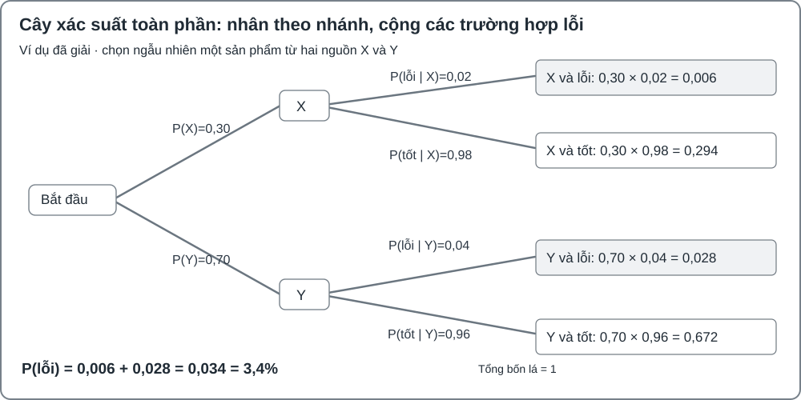

# Chuyên đề 21 · Xác suất có điều kiện, công thức toàn phần và Bayes

<!-- TOPIC_AUTHORING: PLAN22-21; CANDIDATE_R01; LEARNING_PATH: TOPIC; CONTENT_READY: NO; RUNTIME_TOPIC_ID: OWNER_UNASSIGNED -->

## 1. Kiến thức

Khi biết thêm thông tin, xác suất của một biến cố có thể thay đổi. Từ việc chỉ xét những kết quả còn phù hợp, em sẽ hiểu xác suất có điều kiện, cách nhân xác suất trên một đường đi, cách cộng các nguồn rời nhau và cách suy ngược thông tin bằng Bayes. Mỗi kiến thức được hình thành từ một tình huống cụ thể, sau đó có ví dụ đầy đủ và bài Vận dụng.

Những kiến thức cần thiết về không gian mẫu, biến cố, giao của hai biến cố, tính đồng khả năng và quy tắc nhân độc lập được nhắc lại ngay trong bài; không phải học xong Chuyên đề 20 mới có thể bắt đầu.

### 1. Biết thêm thông tin là đổi nhóm đang xét

<!-- OUTCOME_ID: TOP21-O01; LEGACY_SGK_SKILL: G12-B18-CONDITIONAL_INTERPRETATION; LESSON_ID: G12-SGK-B18 -->

**Khám phá kiến thức**

Khi rút ngẫu nhiên một học sinh trong cả lớp, ta xét mọi học sinh như những kết quả có thể xảy ra. Nhưng giả sử em đã biết người được rút thuộc câu lạc bộ cờ: lúc này những học sinh không tham gia câu lạc bộ không còn phù hợp với thông tin đã biết. Câu hỏi “người ấy có đeo kính không?” cần được trả lời **trong nhóm câu lạc bộ**, không phải trên toàn lớp.

Đó chính là ý tưởng của xác suất có điều kiện. Ta gọi \(B\) là biến cố đã biết và \(A\) là biến cố cần tìm. Trong những trường hợp thuộc \(B\), chỉ phần thuộc cả \(A\) và \(B\) là thuận lợi. Vì vậy, khi biết \(B\) xảy ra, nhóm được xét chuyển từ toàn bộ \(\Omega\) sang \(B\); không thể tự thay bằng xác suất thông thường của \(A\). Nếu \(P(B)=0\), cách xét “trong nhóm \(B\)” không xác định theo công thức điều kiện thông thường.

> **ĐỊNH NGHĨA — Xác suất khi đã biết một biến cố**
>
> Biết B xảy ra là chọn lại trong nhóm B: chỉ các kết quả thuộc B còn được xét; để xác suất điều kiện có nghĩa cần \(P(B)>0\). Không được đồng nhất \(P(A\mid B)\) và \(P(B\mid A)\).

**Ví dụ**

**Đề bài:** Một lớp có 20 học sinh, trong đó 8 bạn tham gia câu lạc bộ cờ và 5 trong 8 bạn ấy đeo kính. Chọn đều một học sinh, biết bạn được chọn thuộc câu lạc bộ cờ. Tính xác suất bạn ấy đeo kính.

**Lời giải:** Thông tin “thuộc câu lạc bộ cờ” giới hạn nhóm đang xét còn 8 bạn. Trong nhóm này có 5 bạn đeo kính, nên xác suất cần tìm là \(5/8\). Không lấy \(5/20\), vì 20 là quy mô cả lớp, không phải nhóm đã biết. Việc chọn đều là giả thiết cần thiết cho cách đếm theo số học sinh.

**Kiến thức cần ghi nhớ**

Một thông tin đã biết làm thay đổi nhóm kết quả đang xét. Biến cố cần hỏi là phần giao với nhóm đó; không đổi chiều hai biến cố.

**Vận dụng**

Trong 24 vé khác nhau được chọn đều có 9 vé xanh, 6 trong 9 vé xanh có dấu sao. Đã biết vé rút ra là xanh. Hỏi xác suất vé đó có dấu sao?

<!-- ITEM_ID: THPT-TOP21-T01; ROLE: TOPIC_FIRST_TRY; LEARNER_LABEL: VAN_DUNG; PRIMARY_OUTCOME: TOP21-O01; CONTENT_VERSION: TOP21-R01; PUBLIC_FORMATIVE_NO_MASTERY -->

Đối chiếu

Nhóm điều kiện gồm 9 vé xanh; có 6 vé trong nhóm đó có sao. Do đó P(sao | xanh)=6/9=2/3, không phải 6/24.

**Khi làm sai:** Nếu chia cho 24, em đã quên thu hẹp Ω khi biết màu vé. Tự gạch riêng 9 vé xanh, đánh dấu 6 vé sao rồi thử lại. Ôn lại mục Kiến thức 1 và bài Luyện tập 2.1.

### 2. Từ vùng giao đến công thức xác suất có điều kiện

<!-- OUTCOME_ID: TOP21-O02; LEGACY_SGK_SKILL: G12-B18-CONDITIONAL_FORMULA; LESSON_ID: G12-SGK-B18 -->

**Khám phá kiến thức**

Đôi khi ta không được cho số người hoặc số phiếu trong từng nhóm, mà chỉ biết các xác suất của biến cố. Ta vẫn muốn giữ đúng cách nhìn từ bài trước: khi biết \(B\) xảy ra, ta chỉ quan tâm phần \(B\), còn trường hợp vừa \(A\) vừa \(B\) chính là vùng giao \(A\cap B\). Lấy phần giao so với toàn bộ phần đã biết sẽ cho xác suất của \(A\) **trong điều kiện \(B\)**.

Nếu các kết quả ban đầu đồng khả năng, ta có thể dùng tỉ số \(n(A\cap B)/n(B)\). Khi dữ liệu cho dưới dạng xác suất, cùng ý tưởng ấy được viết bằng cách chia xác suất giao cho xác suất của biến cố đã biết. Điều kiện \(P(B)>0\) không thể bỏ qua vì không được chia cho 0. Chú ý vị trí sau vạch đứng: \(P(A\mid B)\) hỏi về \(A\) khi **đã biết \(B\)**, khác với \(P(B\mid A)\).

> **CÔNG THỨC — Xác suất có điều kiện**
>
> \[P(A\mid B)=\frac{P(A\cap B)}{P(B)},\qquad P(B)>0.\] \(P(A\cap B)\) là phần giao; \(P(B)\) là toàn bộ nhóm đã biết. Khi các phần tử của B đồng khả năng có thể dùng \(n(A\cap B)/n(B)\).

**Ví dụ**

**Đề bài:** Chọn ngẫu nhiên đều một số nguyên từ 1 đến 10. Gọi \(A\) là biến cố “số chẵn” và \(B\) là biến cố “số chia hết cho 3”. Tính \(P(A\mid B)\).

**Lời giải:** Do chọn đều, \(\Omega=\{1,2,\ldots,10\}\). Biến cố đã biết là \(B=\{3,6,9\}\), gồm ba số; giao \(A\cap B=\{6\}\) chỉ có một số. Vậy \(P(A\mid B)=n(A\cap B)/n(B)=1/3\). Kiểm bằng công thức: \(P(A\cap B)=1/10\), \(P(B)=3/10>0\), nên \(P(A\mid B)=(1/10)/(3/10)=1/3\). Không dùng \(P(A)=5/10\) làm mẫu số vì đề không cho biết \(A\) trước.

**Kiến thức cần ghi nhớ**

Muốn tính \(P(A\mid B)\), đặt đúng nhóm đã biết \(B\) làm mẫu số và phải có \(P(B)>0\).

**Vận dụng**

Gieo xúc xắc sáu mặt cân đối. A là 'chia hết cho 3', B là 'số chẵn'. Tính P(A|B).

<!-- ITEM_ID: THPT-TOP21-T02; ROLE: TOPIC_FIRST_TRY; LEARNER_LABEL: VAN_DUNG; PRIMARY_OUTCOME: TOP21-O02; CONTENT_VERSION: TOP21-R01; PUBLIC_FORMATIVE_NO_MASTERY -->

Đối chiếu

B={2,4,6}, A∩B={6}; P(A|B)=(1/6)/(3/6)=1/3. Mẫu số P(B)=1/2>0.

**Khi làm sai:** Nếu viết 1/2, em đã lấy P(B) thay cho xác suất giao trong B. Nếu chia cho P(A), em đã đổi chiều thành P(B|A). Ôn lại mục Kiến thức 2 và bài Luyện tập 2.2.

### 3. Quy tắc nhân tổng quát cho các lượt phụ thuộc

<!-- OUTCOME_ID: TOP21-O03; LEGACY_SGK_SKILL: G12-B18-GENERAL_MULTIPLICATION; LESSON_ID: G12-SGK-B18 -->

**Khám phá kiến thức**

Khi lấy hai thẻ liên tiếp mà không hoàn lại, chiếc thẻ thứ nhất thực sự làm thay đổi số thẻ còn lại. Chẳng hạn, rút được một thẻ màu xanh ở lượt đầu sẽ khiến số thẻ xanh và tổng số thẻ ở lượt sau đều giảm. Bởi thế, xác suất rút xanh ở lượt thứ hai **khi đã biết lượt đầu xanh** có thể khác xác suất xanh ở lần rút đầu.

Muốn tính xác suất hai sự việc \(A\) rồi \(B\) cùng xảy ra, trước hết ta tính khả năng đi vào nhánh \(A\). Sau đó, **trong chính nhánh đã xảy ra \(A\)**, ta tính khả năng đi tiếp tới \(B\). Tích hai xác suất ấy cho khả năng đi trọn đường \(A\to B\). Đây là quy tắc nhân có điều kiện: không cần giả sử hai lượt độc lập, nhưng phải cập nhật thông tin ở bước sau và nói rõ điều kiện đang xét.

> **CÔNG THỨC — Xác suất đồng thời theo điều kiện**
>
> \[P(A\cap B)=P(A)P(B\mid A)\quad\text{khi }P(A)>0.\] Tương tự \(P(A\cap B)=P(B)P(A\mid B)\) nếu \(P(B)>0\). Khi rút không hoàn lại, phải cập nhật xác suất nhánh sau.

**Ví dụ**

**Đề bài:** Một túi có 3 thẻ xanh lục và 4 thẻ cam, tất cả các thẻ phân biệt. Rút đều ngẫu nhiên hai thẻ liên tiếp không hoàn lại. Tính xác suất cả hai thẻ đều xanh lục.

**Lời giải:** Xác suất thẻ đầu xanh lục là \(3/7\). Sau khi đã rút xanh lục, túi còn 2 thẻ xanh lục trong tổng 6 thẻ, nên xác suất xanh lục ở lượt hai **khi lượt đầu xanh lục** là \(2/6\). Theo quy tắc nhân có điều kiện, xác suất cả hai xanh lục bằng \((3/7)(2/6)=1/7\). Không được dùng \((3/7)^2\) vì số thẻ đã thay đổi sau lượt đầu.

**Kiến thức cần ghi nhớ**

Nhân xác suất dọc một đường theo đúng điều kiện của từng lượt; không hoàn lại thường làm xác suất lượt sau thay đổi.

**Vận dụng**

Có 4 thẻ đỏ và 5 thẻ xanh khác nhau; rút liên tiếp hai thẻ không hoàn lại, đều mỗi lượt. Tính P(lượt đầu đỏ và lượt sau xanh).

<!-- ITEM_ID: THPT-TOP21-T03; ROLE: TOPIC_FIRST_TRY; LEARNER_LABEL: VAN_DUNG; PRIMARY_OUTCOME: TOP21-O03; CONTENT_VERSION: TOP21-R01; PUBLIC_FORMATIVE_NO_MASTERY -->

Đối chiếu

P(đỏ đầu)=4/9; sau đó còn 8 thẻ, 5 xanh nên P(xanh sau | đỏ đầu)=5/8. Giao = (4/9)(5/8)=5/18.

**Khi làm sai:** Nếu dùng (4/9)(5/9), em chưa đổi tổng số thẻ ở lượt hai từ 9 xuống 8. Vẽ một nhánh đỏ trước rồi ghi nội dung túi còn lại. Ôn lại mục Kiến thức 3 và bài Luyện tập 2.3.

### 4. Khi nào xác suất có điều kiện không thay đổi?

<!-- OUTCOME_ID: TOP21-O04; LEGACY_SGK_SKILL: G12-B18-INDEPENDENCE_CONNECTION; LESSON_ID: G12-SGK-B18 -->

**Khám phá kiến thức**

Ta có thể cảm thấy hai biến cố liên quan chỉ vì chúng cùng nhắc tới một phép thử, hoặc cảm thấy chúng độc lập chỉ vì tên gọi khác nhau. Cả hai trực giác ấy đều có thể sai. Điều cần kiểm tra là: nếu biết biến cố \(B\) đã xảy ra, xác suất của \(A\) có thay đổi hay không?

Khi \(P(B)>0\), nếu xác suất của \(A\) trong nhóm \(B\) bằng xác suất của \(A\) trên toàn bộ không gian mẫu, thông tin \(B\) không làm thay đổi khả năng của \(A\). Từ công thức xác suất có điều kiện, điều đó tương đương với \(P(A\cap B)=P(A)P(B)\). Đẳng thức tích này là tiêu chuẩn kiểm tra độc lập kể cả khi một biến cố có xác suất 0; còn xác suất có điều kiện thì không được viết nếu mẫu số bằng 0. Độc lập cũng không phải là xung khắc: hai biến cố xung khắc có xác suất dương không thể độc lập.

> **TÍNH CHẤT — Tiêu chuẩn độc lập**
>
> \[A\text{ và }B\text{ độc lập}\iff P(A\cap B)=P(A)P(B).\] Khi \(P(B)>0\), độc lập tương đương \(P(A\mid B)=P(A)\). Hai biến cố xung khắc có xác suất dương không độc lập.

**Ví dụ**

**Đề bài:** Gieo hai xúc xắc cân đối và độc lập. Gọi \(A\) là biến cố “xúc xắc thứ nhất ra số chẵn” và \(B\) là biến cố “xúc xắc thứ hai ra số lớn hơn 4”. Kiểm tra hai biến cố có độc lập không.

**Lời giải:** Trong 36 cặp số chấm đồng khả năng, \(A\) có xác suất \(3/6=1/2\), còn \(B\) có xác suất \(2/6=1/3\). Để đồng thời thỏa \(A\) và \(B\), xúc xắc thứ nhất có 3 lựa chọn chẵn và thứ hai có 2 lựa chọn lớn hơn 4, nên \(P(A\cap B)=6/36=1/6\). Vì \(P(A)P(B)=(1/2)(1/3)=1/6=P(A\cap B)\), hai biến cố độc lập. Kết luận đến từ đẳng thức xác suất, không chỉ từ việc chúng nhắc hai xúc xắc khác nhau.

**Kiến thức cần ghi nhớ**

Độc lập cần kiểm \(P(A\cap B)=P(A)P(B)\). Không đồng nhất với xung khắc; chú ý điều kiện dương khi nói bằng xác suất có điều kiện.

**Vận dụng**

Tung hai đồng xu cân đối, độc lập. A: đồng xu đầu ngửa; B: có đúng một mặt ngửa trong cả hai lượt. A, B có độc lập không?

<!-- ITEM_ID: THPT-TOP21-T04; ROLE: TOPIC_FIRST_TRY; LEARNER_LABEL: VAN_DUNG; PRIMARY_OUTCOME: TOP21-O04; CONTENT_VERSION: TOP21-R01; PUBLIC_FORMATIVE_NO_MASTERY -->

Đối chiếu

Ω={NN,NS,SN,SS}. P(A)=2/4, P(B)=2/4, P(A∩B)=1/4 (chỉ NS). Vì 1/4=(1/2)(1/2), A và B độc lập trong mô hình này.

**Khi làm sai:** Nếu kết luận phụ thuộc chỉ vì B có nhắc đồng xu đầu, em đã suy theo ngôn ngữ. Hãy đếm giao và tích; cả hai cùng bằng 1/4. Ôn lại mục Kiến thức 4 và bài Luyện tập 2.4.

### 5. Xác suất toàn phần: cộng các đường đi đến cùng kết quả

<!-- OUTCOME_ID: TOP21-O05; LEGACY_SGK_SKILL: G12-B19-TOTAL_PROBABILITY; LESSON_ID: G12-SGK-B19 -->

**Khám phá kiến thức**

Một sản phẩm bị lỗi có thể đến từ dây chuyền X hoặc dây chuyền Y. Nếu X làm ra ít sản phẩm nhưng có tỉ lệ lỗi cao, còn Y làm ra nhiều sản phẩm với tỉ lệ lỗi thấp, ta không thể cộng ngay hai tỉ lệ lỗi. Ta cần biết **tỉ trọng sản phẩm từ từng nguồn**, bởi một sản phẩm được chọn ngẫu nhiên phải đến từ một trong các nguồn trước khi có tình trạng lỗi hay không lỗi.

Gọi \(L\) là biến cố “sản phẩm lỗi”. Trong trường hợp hai nguồn X và Y phân chia toàn bộ sản phẩm, không chồng nhau, những sản phẩm lỗi chia thành hai nhóm rời nhau: “từ X và lỗi” hoặc “từ Y và lỗi”. Với mỗi nhóm ta **nhân** xác suất nguồn với xác suất lỗi khi biết nguồn; cuối cùng **cộng** hai đường lỗi, vì chúng không thể đồng thời xảy ra cho cùng một sản phẩm. Đó là bản chất của công thức xác suất toàn phần. Các xác suất điều kiện cần xác định trên nguồn có xác suất dương; không có yêu cầu nguồn phải độc lập với tình trạng lỗi.

> **CÔNG THỨC — Xác suất toàn phần hai nhánh**
>
> Nếu \(X\cap Y=\varnothing\), \(X\cup Y=\Omega\) và \(P(X),P(Y)>0\) thì \[P(L)=P(X)P(L\mid X)+P(Y)P(L\mid Y).\] Đây là tổng hai **đường đi rời nhau**, không phải tổng trần hai xác suất điều kiện.

**Ví dụ**

**Đề bài:** Nguồn X đóng góp 30% sản phẩm và có tỉ lệ lỗi 2%; nguồn Y đóng góp 70% sản phẩm và có tỉ lệ lỗi 4%. Chọn ngẫu nhiên đều một sản phẩm trong toàn bộ sản phẩm. Tính xác suất sản phẩm bị lỗi.

**Lời giải:** Vì một sản phẩm chỉ đến từ X hoặc Y và hai nguồn chiếm toàn bộ sản lượng, biến cố lỗi tách thành hai đường rời nhau. Đường “X rồi lỗi” có xác suất \(0{,}30\cdot0{,}02=0{,}006\); đường “Y rồi lỗi” có xác suất \(0{,}70\cdot0{,}04=0{,}028\). Cộng hai đường cho \(P(\text{lỗi})=0{,}006+0{,}028=0{,}034=3{,}4\%\). Không cộng trực tiếp 2% và 4%, vì hai nguồn có tỉ trọng sản lượng khác nhau.

**Hướng dẫn đọc hình:** Bắt đầu tại nhánh X hoặc Y theo tỉ trọng 30% và 70%; từ mỗi nguồn, đọc xác suất lỗi hoặc tốt **trong nguồn ấy**. Nhân hai cạnh trên một đường để tìm xác suất ở lá, rồi cộng hai lá lỗi được 0,034. Bốn lá có tổng bằng 1. **Hình minh họa cho Ví dụ đã giải, không phải bài Vận dụng phía dưới.**

**Kiến thức cần ghi nhớ**

Xác suất toàn phần là tổng các xác suất đường đi rời nhau. Trong mỗi đường đi, nhân xác suất nguồn với xác suất kết quả khi biết nguồn.

**Vận dụng**

Nguồn X cung cấp 1/4 sản phẩm, tỉ lệ lỗi 1/10; nguồn Y cung cấp 3/4, tỉ lệ lỗi 1/30. Chọn đều một sản phẩm. Xác suất gặp lỗi?

<!-- ITEM_ID: THPT-TOP21-T05; ROLE: TOPIC_FIRST_TRY; LEARNER_LABEL: VAN_DUNG; PRIMARY_OUTCOME: TOP21-O05; CONTENT_VERSION: TOP21-R01; PUBLIC_FORMATIVE_NO_MASTERY -->

Đối chiếu

P(lỗi)=(1/4)(1/10)+(3/4)(1/30)=1/40+1/40=1/20.

**Khi làm sai:** Nếu ra 1/10+1/30, em đã quên nhân tỉ trọng nguồn; làm lại từng đường 'chọn nguồn → lỗi' trước khi cộng. Ôn lại mục Kiến thức 5 và bài Luyện tập 2.5.

### 6. Bayes: đi từ kết quả quan sát ngược về nguồn

<!-- OUTCOME_ID: TOP21-O06; LEGACY_SGK_SKILL: G12-B19-BAYES_REVERSE; LESSON_ID: G12-SGK-B19 -->

**Khám phá kiến thức**

Một nhà máy cho biết sản phẩm từ dây chuyền A có xác suất mang dấu hiệu H là 80%. Khi bắt gặp một sản phẩm có dấu hiệu H, ta có thể kết luận nó đến từ A với xác suất 80% không? Chưa thể, vì ngoài A còn có các dây chuyền khác cũng có thể tạo ra dấu hiệu ấy. Câu hỏi đã **đảo chiều điều kiện**: từ “thấy H khi biết A” sang “thuộc A khi đã thấy H”.

Muốn trả lời, trước hết ta tính xác suất **mọi cách** tạo ra dấu hiệu H, sử dụng công thức toàn phần. Tiếp theo, ta tính riêng xác suất sản phẩm vừa đến từ A vừa có H. Trong số tất cả sản phẩm có H, phần thuộc A bằng xác suất đường “A rồi H” chia cho xác suất H chung. Tỉ số đó là công thức Bayes; mẫu số luôn là xác suất sự kiện **đã quan sát**, và phải dương.

> **CÔNG THỨC — Bayes – đảo chiều câu hỏi**
>
> \[P(Y\mid L)=\frac{P(Y)P(L\mid Y)}{P(L)},\qquad P(L)>0.\] Với hai nhánh X,Y phân hoạch, mẫu số là công thức toàn phần của L. Xác suất của nguồn **sau khi thấy L** không tự bằng xác suất thấy L **khi biết nguồn**.

**Ví dụ**

**Đề bài:** Nguồn A cung cấp 20% sản phẩm và cho dấu hiệu H ở 80% sản phẩm của mình; nguồn B cung cấp 80% còn lại và cho dấu hiệu H ở 10% sản phẩm của mình. Chọn ngẫu nhiên một sản phẩm. Biết sản phẩm có dấu hiệu H, tính xác suất nó đến từ A.

**Lời giải:** Gọi \(H\) là biến cố “có dấu hiệu”. Xác suất toàn phần là \(P(H)=0{,}2\cdot0{,}8+0{,}8\cdot0{,}1=0{,}16+0{,}08=0{,}24\). Riêng đường “A và H” có xác suất \(0{,}2\cdot0{,}8=0{,}16\). Do đó \(P(A\mid H)=0{,}16/0{,}24=2/3\). Kết quả khác 80% vì 80% trả lời câu hỏi ngược chiều: “có H khi biết nguồn A”.

**Kiến thức cần ghi nhớ**

Bayes đảo chiều điều kiện: lấy xác suất đường nguồn–kết quả chia cho xác suất của tất cả đường dẫn tới kết quả đã quan sát.

**Vận dụng**

Nguồn X chiếm 2/5 sản phẩm, tỉ lệ lỗi 1/10; Y chiếm 3/5, tỉ lệ lỗi 1/5. Biết sản phẩm chọn ra bị lỗi, xác suất nó thuộc Y?

<!-- ITEM_ID: THPT-TOP21-T06; ROLE: TOPIC_FIRST_TRY; LEARNER_LABEL: VAN_DUNG; PRIMARY_OUTCOME: TOP21-O06; CONTENT_VERSION: TOP21-R01; PUBLIC_FORMATIVE_NO_MASTERY -->

Đối chiếu

P(Y∩lỗi)=(3/5)(1/5)=3/25; P(X∩lỗi)=(2/5)(1/10)=1/25. P(lỗi)=4/25 nên P(Y|lỗi)=(3/25)/(4/25)=3/4.

**Khi làm sai:** Nếu trả lời 1/5, em mới tính xác suất lỗi khi đã biết Y, chưa đảo chiều. Cộng tất cả nhánh lỗi thành mẫu số rồi chia đường Y–lỗi. Ôn lại mục Kiến thức 6 và bài Luyện tập 2.6.

### 7. Đọc sơ đồ cây: nhân trên đường, cộng tại đích

<!-- OUTCOME_ID: TOP21-O07; LEGACY_SGK_SKILL: G12-B19-TREE_MODEL; LESSON_ID: G12-SGK-B19 -->

**Khám phá kiến thức**

Sơ đồ cây hữu ích nhất khi một quá trình diễn ra qua nhiều lựa chọn nối tiếp: chọn tuyến đường, rồi xét có đến đúng giờ hay không; chọn nguồn hàng, rồi xét hàng lỗi hay tốt. Mỗi nhánh xuất phát từ một nút biểu diễn một khả năng **trong điều kiện đã đi tới nút ấy**. Vì thế, tổng các xác suất rẽ ra từ cùng một nút phải bằng 1.

Một đường đi từ gốc đến lá tương ứng với một trường hợp đồng thời, nên ta **nhân các xác suất dọc đường**. Những đường đi kết thúc bằng cùng một kết quả như “đến đúng giờ” là các trường hợp rời nhau, nên ta **cộng xác suất các lá ấy**. Kiểm lại tổng toàn bộ lá bằng 1 giúp phát hiện nhánh bỏ sót hoặc xác suất ghi nhầm. Khi đã quan sát một kết quả, muốn truy ngược nguồn, ta lấy xác suất lá nguồn-kết quả chia cho tổng các lá có kết quả được quan sát.

> **PHƯƠNG PHÁP — Ba thao tác đọc cây xác suất**
>
> Tại **mỗi nút**, tổng xác suất các nhánh ra bằng 1. **Nhân dọc** từ gốc đến lá để có xác suất giao; **cộng các lá rời nhau** đưa tới kết quả cần tính; khi đảo điều kiện, **chia lá mục tiêu cho tổng các lá đã quan sát**. Tổng toàn bộ các lá cuối phải bằng 1.

**Ví dụ**

**Đề bài:** Một hành khách chọn tuyến R với xác suất \(3/5\), chọn tuyến S với xác suất \(2/5\). Nếu chọn R, xác suất đến đúng giờ là \(4/5\); nếu chọn S, xác suất đến đúng giờ là \(1/2\). Hãy tìm xác suất đến đúng giờ và kiểm tra tổng bốn lá trên cây.

**Lời giải:** Tại tuyến R, xác suất đến đúng là \((3/5)(4/5)=12/25\), muộn là \((3/5)(1/5)=3/25\). Tại tuyến S, xác suất đúng là \((2/5)(1/2)=1/5\), muộn cũng là \(1/5\). Bốn lá cộng thành \(12/25+3/25+1/5+1/5=1\), nên cây đã bao quát mọi trường hợp. Hai lá đúng giờ rời nhau, vì vậy \(P(\text{đúng giờ})=12/25+1/5=17/25\).

**Kiến thức cần ghi nhớ**

Tại mỗi nút, tổng nhánh ra bằng 1; nhân dọc đường, cộng các lá rời nhau dẫn tới cùng kết quả; tổng lá cuối bằng 1.

**Vận dụng**

Chọn lớp A với xác suất 3/5, trong A tỉ lệ thẻ đỏ là 3/10; lớp B với xác suất 2/5, trong B tỉ lệ đỏ 1/4. Lập bốn lá đỏ/không đỏ và tính P(đỏ).

<!-- ITEM_ID: THPT-TOP21-T07; ROLE: TOPIC_FIRST_TRY; LEARNER_LABEL: VAN_DUNG; PRIMARY_OUTCOME: TOP21-O07; CONTENT_VERSION: TOP21-R01; PUBLIC_FORMATIVE_NO_MASTERY -->

Đối chiếu

A-đỏ=9/50, A-không đỏ=21/50; B-đỏ=1/10, B-không đỏ=3/10. Tổng bốn lá bằng 1, P(đỏ)=9/50+1/10=7/25.

**Khi làm sai:** Nếu bốn lá không cộng thành 1, hãy rà mỗi nút: đỏ và không đỏ trong A phải có tổng 1; tương tự B. Đừng cộng trực tiếp 3/10 và 1/4. Ôn lại mục Kiến thức 7 và bài Luyện tập 2.7.

### 8. Tỉ lệ nền và bẫy kết luận từ một dấu hiệu

<!-- OUTCOME_ID: TOP21-O08; LEGACY_SGK_SKILL: G12-B19-BASE_RATE_REASONING; LESSON_ID: G12-SGK-B19 -->

**Khám phá kiến thức**

Một thiết bị nhận biết lỗi có thể phát hiện rất tốt những sản phẩm thực sự lỗi, nhưng kết quả “máy báo lỗi” chưa chắc đồng nghĩa với xác suất hàng lỗi cao. Nếu hàng lỗi rất hiếm, chỉ một tỉ lệ báo nhầm nhỏ trong nhóm hàng tốt đông đảo cũng có thể tạo ra nhiều thông báo lỗi. Để hiểu độ tin cậy **sau khi thấy dấu hiệu**, ta phải tính cả tỉ lệ hàng lỗi ban đầu, gọi là **tỉ lệ nền**.

Hãy chia sản phẩm thành hai nguồn: thật sự lỗi \(H\) và không lỗi \(\bar H\). Cả hai nguồn đều có thể đưa đến kết quả báo dấu hiệu \(+\): máy báo đúng từ nhóm \(H\) và báo nhầm từ nhóm \(\bar H\). Xác suất một sản phẩm thật sự lỗi **khi đã bị báo** bằng xác suất đi theo nhánh “lỗi rồi báo” chia cho tổng xác suất của **tất cả** các nhánh dẫn tới báo. Đây là công thức Bayes được nhìn bằng tần suất, không phải một công thức hoàn toàn mới.

> **KIẾN THỨC CẦN GHI NHỚ — Vai trò của tỉ lệ nền**
>
> \[P(H\mid +)=\frac{P(H)P(+\mid H)}{P(H)P(+\mid H)+P(\bar H)P(+\mid\bar H)}.\] Đây là mô hình xác suất; phải biết **tỉ lệ nền**, **tỉ lệ phát hiện khi đúng** và **tỉ lệ báo nhầm**. Không kết luận \(P(H\mid +)=P(+\mid H)\).

**Ví dụ**

**Đề bài:** Giả sử một lô hàng có 1% sản phẩm lỗi. Thiết bị báo lỗi ở 95% sản phẩm lỗi và báo nhầm ở 10% sản phẩm tốt. Chọn ngẫu nhiên một sản phẩm; biết thiết bị đã báo lỗi. Tính xác suất sản phẩm thực sự lỗi.

**Lời giải:** Gọi \(H\) là biến cố “thật sự lỗi”, \(+\) là “thiết bị báo lỗi”. Xác suất “lỗi và báo” là \(0{,}01\cdot0{,}95=0{,}0095\); xác suất “tốt nhưng báo nhầm” là \(0{,}99\cdot0{,}10=0{,}099\). Vì cả hai dẫn tới báo lỗi, \(P(+)=0{,}0095+0{,}099=0{,}1085\). Do đó \(P(H\mid +)=0{,}0095/0{,}1085=19/217\approx8{,}76\%\). Máy phát hiện 95% hàng lỗi không có nghĩa là 95% hàng bị báo là lỗi: nhóm tốt chiếm tới 99% nên số báo nhầm đáng kể. Đây chỉ là mô hình giả định.

**Vận dụng**

Một hệ thống giả định có 2% hồ sơ thuộc nhóm H. Hệ thống báo dấu hiệu với 90% hồ sơ H và báo nhầm với 15% hồ sơ không H. Biết hồ sơ bị báo, xác suất nó thuộc H?

<!-- ITEM_ID: THPT-TOP21-T08; ROLE: TOPIC_FIRST_TRY; LEARNER_LABEL: VAN_DUNG; PRIMARY_OUTCOME: TOP21-O08; CONTENT_VERSION: TOP21-R01; PUBLIC_FORMATIVE_NO_MASTERY -->

Đối chiếu

P(H∩báo)=0,02·0,90=0,018; P(không H∩báo)=0,98·0,15=0,147. Xác suất cần tìm là 0,018/(0,018+0,147)=18/165=6/55≈10,91%.

**Khi làm sai:** Nếu ra 90%, em đã nhầm 'báo khi biết H' với 'H khi đã báo'. Hãy lập bảng 10.000 hồ sơ: 200 H có 180 báo; 9.800 không H có 1.470 báo; tỉ lệ 180/(180+1470). Ôn lại mục Kiến thức 8 và bài Luyện tập 2.8.

## 2. Luyện tập

Hãy xác định rõ biến cố đã biết, giải thích vì sao chọn công thức và trình bày từng bước. Phần Lời giải giúp em kiểm tra cách suy luận và tìm lại kiến thức khi mắc lỗi.

### 2.1. Biết thêm thông tin là đổi nhóm đang xét

<!-- ITEM_ID: THPT-TOP21-P01; ROLE: TOPIC_PRACTICE; PRIMARY_OUTCOME: TOP21-O01; CONTENT_VERSION: TOP21-R00; PUBLIC_FORMATIVE_NO_MASTERY -->
Trong 40 thẻ vật lí khác nhau được chọn đều có 12 thẻ hình tam giác, trong đó đúng 5 thẻ đỏ. Biết đã chọn thẻ tam giác, tính xác suất thẻ đỏ và giải thích mẫu số.

Lời giải

**Lời giải:** Nhóm điều kiện gồm 12 thẻ tam giác, có 5 thẻ đỏ nên P(đỏ | tam giác)=5/12. Mẫu số là 12, không phải 40.

**Khi làm sai:** Nếu ra 5/40, hãy hỏi lại: đề đã cho biết thẻ mang hình gì? Mọi kết quả không phải tam giác đã bị loại khỏi nhóm xét.

### 2.2. Từ vùng giao đến công thức xác suất có điều kiện

<!-- ITEM_ID: THPT-TOP21-P02; ROLE: TOPIC_PRACTICE; PRIMARY_OUTCOME: TOP21-O02; CONTENT_VERSION: TOP21-R00; PUBLIC_FORMATIVE_NO_MASTERY -->
Chọn đều một số trong 1,…,12. A: chia hết cho 4. B: lớn hơn 6. Tính P(A|B).

Lời giải

**Lời giải:** B={7,8,9,10,11,12} có 6 phần tử. Giao A∩B={8,12} có 2 phần tử. Kết quả P(A|B)=2/6=1/3; P(B)>0.

**Khi làm sai:** Nếu dùng 3/12, em đang tính P(A), không phải P(A|B). Hãy viết trọn tập B trước.

### 2.3. Quy tắc nhân tổng quát cho các lượt phụ thuộc

<!-- ITEM_ID: THPT-TOP21-P03; ROLE: TOPIC_PRACTICE; PRIMARY_OUTCOME: TOP21-O03; CONTENT_VERSION: TOP21-R00; PUBLIC_FORMATIVE_NO_MASTERY -->
Hộp có 5 thẻ đỏ, 2 thẻ vàng. Rút đều ba thẻ liên tiếp không hoàn lại. Tính xác suất màu theo đúng thứ tự đỏ–vàng–đỏ.

Lời giải

**Lời giải:** P(R,V,R)=(5/7)(2/6)(4/5)=4/21. Sau hai lượt đã lấy một đỏ và một vàng, còn 4 đỏ trong 5 thẻ.

**Khi làm sai:** Nếu giữ 5/7 cho lượt thứ ba, em chưa cập nhật trạng thái túi; hãy ghi 'còn 6' rồi 'còn 5' trên các cạnh cây.

### 2.4. Khi nào xác suất có điều kiện không thay đổi?

<!-- ITEM_ID: THPT-TOP21-P04; ROLE: TOPIC_PRACTICE; PRIMARY_OUTCOME: TOP21-O04; CONTENT_VERSION: TOP21-R00; PUBLIC_FORMATIVE_NO_MASTERY -->
Gieo một xúc xắc cân đối. A: mặt chẵn; B: mặt lớn hơn 3. Hai biến cố độc lập không?

Lời giải

**Lời giải:** P(A)=3/6=1/2; P(B)=3/6=1/2; A∩B={4,6}, P(A∩B)=2/6=1/3 khác P(A)P(B)=1/4. Vì vậy không độc lập.

**Khi làm sai:** Nếu coi độc lập vì cả hai đều xác suất 1/2, em chưa kiểm phần giao. Khoanh {4,6} trên Ω.

### 2.5. Xác suất toàn phần: cộng các đường đi đến cùng kết quả

<!-- ITEM_ID: THPT-TOP21-P05; ROLE: TOPIC_PRACTICE; PRIMARY_OUTCOME: TOP21-O05; CONTENT_VERSION: TOP21-R00; PUBLIC_FORMATIVE_NO_MASTERY -->
Kho hàng nhập 2/5 kiện từ X với tỉ lệ hỏng 1/20 và 3/5 từ Y với tỉ lệ hỏng 1/10. Lấy ngẫu nhiên một kiện. Tính tỉ lệ hỏng chung.

Lời giải

**Lời giải:** P(hỏng)=(2/5)(1/20)+(3/5)(1/10)=1/50+3/50=4/50=2/25.

**Khi làm sai:** Nếu lấy trung bình cộng 1/20 và 1/10, em ngầm giả định hai nguồn 50%–50%; thực tế là 2/5 và 3/5.

### 2.6. Bayes: đi từ kết quả quan sát ngược về nguồn

<!-- ITEM_ID: THPT-TOP21-P06; ROLE: TOPIC_PRACTICE; PRIMARY_OUTCOME: TOP21-O06; CONTENT_VERSION: TOP21-R00; PUBLIC_FORMATIVE_NO_MASTERY -->
Một lô gồm 1/4 sản phẩm từ H, 3/4 từ K. Xác suất mang nhãn xanh là 3/5 nếu từ H, 1/5 nếu từ K. Biết đã thấy nhãn xanh, tính xác suất sản phẩm thuộc H.

Lời giải

**Lời giải:** P(H∩xanh)=(1/4)(3/5)=3/20; P(K∩xanh)=(3/4)(1/5)=3/20. P(xanh)=6/20, vậy P(H|xanh)=(3/20)/(6/20)=1/2.

**Khi làm sai:** Nếu viết 3/5, em đã đảo câu hỏi. Muốn biết nguồn sau khi thấy nhãn, mẫu số gồm các cách có nhãn xanh từ cả H và K.

### 2.7. Đọc sơ đồ cây: nhân trên đường, cộng tại đích

<!-- ITEM_ID: THPT-TOP21-P07; ROLE: TOPIC_PRACTICE; PRIMARY_OUTCOME: TOP21-O07; CONTENT_VERSION: TOP21-R00; PUBLIC_FORMATIVE_NO_MASTERY -->
Chọn tuyến R xác suất 2/5, xác suất thành công khi đi R là 3/4. Chọn tuyến S xác suất 3/5, xác suất thành công khi đi S là 1/2. Tính P(S và thất bại) và P(thành công).

Lời giải

**Lời giải:** P(S∩thất bại)=(3/5)(1/2)=3/10. P(thành công)=(2/5)(3/4)+(3/5)(1/2)=3/10+3/10=3/5. Các lá đầy đủ: R tốt 3/10, R hỏng 1/10, S tốt 3/10, S hỏng 3/10, tổng 1.

**Khi làm sai:** Nếu ra 1/2 cho S và thất bại, em dùng xác suất thất bại có điều kiện mà quên xác suất chọn S. Đọc từ gốc đến lá.

### 2.8. Tỉ lệ nền và bẫy kết luận từ một dấu hiệu

<!-- ITEM_ID: THPT-TOP21-P08; ROLE: TOPIC_PRACTICE; PRIMARY_OUTCOME: TOP21-O08; CONTENT_VERSION: TOP21-R00; PUBLIC_FORMATIVE_NO_MASTERY -->
Trong mô hình kiểm tra 1.000 sản phẩm có đúng 20 sản phẩm lỗi. Thiết bị phát hiện 80% sản phẩm lỗi và báo nhầm 5% của 980 sản phẩm tốt. Nếu máy báo lỗi, xác suất sản phẩm thực sự lỗi là bao nhiêu?

Lời giải

**Lời giải:** Máy báo đúng 20·80%=16 sản phẩm lỗi và báo nhầm 980·5%=49 sản phẩm tốt. Trong 65 sản phẩm bị báo, 16 thực sự lỗi. Xác suất 16/65≈24,62%.

**Khi làm sai:** Nếu trả lời 80%, em chỉ nêu khả năng phát hiện khi đồ đã lỗi. Hãy đếm toàn bộ 65 lượt báo, gồm cả 49 lượt báo nhầm.

### 2.9. Bài tập tự luận

#### 2.9.1. Bài tự luận 1: Bảng hai chiều và xác suất có điều kiện

Một tập hợp 60 học sinh được chọn đều một học sinh: có 24 bạn thuộc câu lạc bộ C, trong đó 15 bạn đeo kính; trong 36 bạn không thuộc C có 18 bạn đeo kính. Hãy lập bảng 2×2, tính P(kính|C), P(C|kính), P(C∩kính) và giải thích vì sao hai xác suất có điều kiện không bằng nhau.

<!-- ITEM_ID: THPT-TOP21-W01; ROLE: TOPIC_WRITTEN; PRIMARY_OUTCOME: TOP21-O02; SECONDARY_OUTCOME: TOP21-O01; CONTENT_VERSION: TOP21-R00; PUBLIC_SELF_SCORED_NO_MASTERY -->

Lời giải và rubric

Bảng: C&kính=15, C&không kính=9, không C&kính=18, không C&không kính=18. Tổng kính=33, tổng C=24, tổng toàn thể=60. P(kính|C)=15/24=5/8; P(C|kính)=15/33=5/11; P(C∩kính)=15/60=1/4. Hai điều kiện có mẫu số khác nhau.

**Rubric:** Bảng đủ bốn ô và tổng=60 (1); đúng P(kính|C)=5/8 (1); đúng P(C|kính)=5/11 (1); đúng xác suất giao 1/4 và giải thích khác mẫu số (1).

**Khi làm sai:** Nếu đảo 5/8 và 5/11, gạch dưới từ **“biết”** rồi quay mục Kiến thức 1 và Luyện tập 2.1 và mục Kiến thức 2 và Luyện tập 2.2 trước khi làm lại.

#### 2.9.2. Bài tự luận 2: Xác suất toàn phần và Bayes

Sản phẩm từ nguồn X chiếm 1/3, tỉ lệ lỗi 1/5; nguồn Y chiếm 2/3, tỉ lệ lỗi 1/10. Một sản phẩm được lấy ngẫu nhiên. (a) Vẽ hoặc mô tả bốn đường đi lỗi/không lỗi. (b) Tính P(lỗi). (c) Biết sản phẩm lỗi, tính P(X|lỗi).

<!-- ITEM_ID: THPT-TOP21-W02; ROLE: TOPIC_WRITTEN; PRIMARY_OUTCOME: TOP21-O06; SECONDARY_OUTCOME: TOP21-O05,TOP21-O07; CONTENT_VERSION: TOP21-R00; PUBLIC_SELF_SCORED_NO_MASTERY -->

Lời giải và rubric

Bốn lá: X&lỗi=1/15, X&không lỗi=4/15, Y&lỗi=1/15, Y&không lỗi=3/5; tổng 1. P(lỗi)=1/15+1/15=2/15. Biết lỗi, P(X|lỗi)=(1/15)/(2/15)=1/2.

**Rubric:** Nêu hai nhánh X,Y đầy đủ và các điều kiện (1); tính đúng bốn xác suất lá/tổng 1 (1); cộng phần lỗi được 2/15 (1); đảo điều kiện Bayes được 1/2 và diễn giải nhóm đã biết lỗi (1).

**Khi làm sai:** Nếu cho 1/5 ở (c), em vẫn đang trả lời lỗi khi X, không phải X khi lỗi; viết hai nhánh lỗi rồi quay mục Kiến thức 5 và Luyện tập 2.5 và mục Kiến thức 6 và Luyện tập 2.6.

#### 2.9.3. Bài tự luận 3: Tỉ lệ nền và phản biện kết luận

Trong một hệ thống giả định 10.000 hồ sơ có 1% hồ sơ thuộc nhóm H. Bộ lọc nhận ra 80% hồ sơ H và báo nhầm 5% hồ sơ không H. (a) Tính số lần báo đúng và báo nhầm. (b) Tính P(H|báo). (c) Phản biện nhận định “máy chính xác 80%, vậy 80% hồ sơ bị báo thuộc H”.

<!-- ITEM_ID: THPT-TOP21-W03; ROLE: TOPIC_WRITTEN; PRIMARY_OUTCOME: TOP21-O08; SECONDARY_OUTCOME: TOP21-O06; CONTENT_VERSION: TOP21-R00; PUBLIC_SELF_SCORED_NO_MASTERY -->

Lời giải và rubric

Có 100 hồ sơ H, 9.900 không H. Báo đúng 100×0,8=80; báo nhầm 9.900×0,05=495; tất cả báo=575. Do đó P(H|báo)=80/575=16/115≈13,91%. Nhận định 80% sai vì nó là P(báo|H) chứ không phải P(H|báo); tỷ lệ nền H chỉ 1% và báo nhầm từ nhóm lớn đáng kể.

**Rubric:** Phân nhóm nền 100/9.900 (1); báo đúng 80, báo nhầm 495 (1); P(H|báo)=16/115 (1); giải thích đảo điều kiện và tỷ lệ nền (1).

**Khi làm sai:** Nếu ra 80%, hãy lập bảng 2×2 rồi nhìn mẫu số là **tổng hồ sơ đã bị báo =575**, không phải tổng hồ sơ H=100; quay mục Kiến thức 8 và Luyện tập 2.8.

## 3. Tự kiểm tra

**Tự ôn:** Em có thể giải lại các bài Luyện tập 2.1–2.8, giải thích cách chọn công thức rồi mở Lời giải để đối chiếu. Vì đây là các câu đã xuất hiện ở Luyện tập, phần này **không phải một bài đánh giá độc lập**; kết quả tự đối chiếu không dùng để ghi nhận mức độ thành thạo chính thức.

<!-- AUTHORING_ONLY_Q15_Q16_REPLAY_MAP
| Placement | Canonical item_id giữ nguyên | Outcome | Chế độ |
|---|---|---|---|
| R01 | `THPT-TOP21-P01` | TOP21-O01 | CLIENT_SELF_CHECK_NO_MASTERY |
| R02 | `THPT-TOP21-P02` | TOP21-O02 | CLIENT_SELF_CHECK_NO_MASTERY |
| R03 | `THPT-TOP21-P03` | TOP21-O03 | CLIENT_SELF_CHECK_NO_MASTERY |
| R04 | `THPT-TOP21-P04` | TOP21-O04 | CLIENT_SELF_CHECK_NO_MASTERY |
| R05 | `THPT-TOP21-P05` | TOP21-O05 | CLIENT_SELF_CHECK_NO_MASTERY |
| R06 | `THPT-TOP21-P06` | TOP21-O06 | CLIENT_SELF_CHECK_NO_MASTERY |
| R07 | `THPT-TOP21-P07` | TOP21-O07 | CLIENT_SELF_CHECK_NO_MASTERY |
| R08 | `THPT-TOP21-P08` | TOP21-O08 | CLIENT_SELF_CHECK_NO_MASTERY |
END_AUTHORING_ONLY_Q15_Q16_REPLAY_MAP -->

<!-- AUTHORING_ONLY_Q16_SECURITY: Official protected assessment requires unseen owner-held items, no solutions/hints/correctness before Final Submit, no Mastery from public Practice, Written self-marking or replay; runtime contract belongs to RELEASE. -->
<!-- AUTHORING_BLOCKED: Q01_PER_OUTCOME_ORIGINAL_S1_ACTIVITY_VERIFICATION; Q15_LEGACY_810_SOURCE_CUSTODY; Q18_FINAL_SELF_AUDIT; V2_READY_REGISTER_PENDING -->

<!-- AUTHORING_META_NOT_FOR_STUDENT: original SGK G12 T2 SHA256 3c642f2e80d86d699ea62bbcabd0c3074fd5118def96e4b3b8ce1f9ead7f97bb, PDF1 B18 66–73/B19 74–80; SBT SHA256 823b013adeb487639e55493b4a7c09edb9a21daabc058ea53e6fe92f7a0352f1, PDF1 B18 38–40/B19 41–42. Legacy G12 public ID collision 10/10, 16 old references quarantined in separate Q15 matrix. Original frozen R00 source blob 71daa75d5a3862926ddeedd01adb18a0886d8669 remains unmodified. No release; Q01/Q15/Q18 HOLD. -->

**Nguồn tham khảo:** Học liệu được xây dựng dựa trên Chương VI của SGK Toán 12, Tập Hai – bộ sách *Kết nối tri thức với cuộc sống*.
