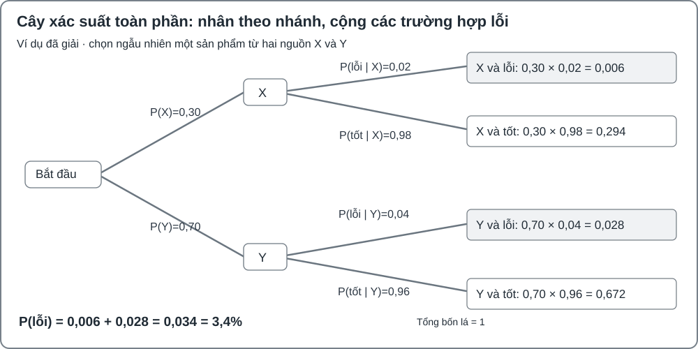
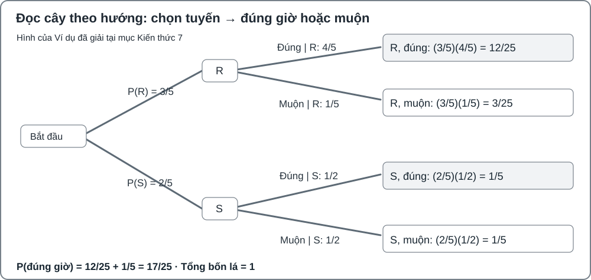

# Chuyên đề 21 · Xác suất có điều kiện, công thức toàn phần và Bayes

<!-- TOPIC_AUTHORING: PLAN22-21; CANDIDATE_R04; LEARNING_PATH: TOPIC; CONTENT_READY: AUTHORING_PREFLIGHT; RUNTIME_TOPIC_ID: OWNER_UNASSIGNED -->

<!-- TOP21_R05_EDITORIAL_SOURCE_EQUIVALENT; ORIGINAL_R04_BLOB: 2fa6557286aba05dd0eea972d4c4ac68371842d7; OWNER_HELD_RD1_NOT_PUBLIC; NO_NEW_CANONICAL_ID; AUTHORING_ONLY -->

# Kiến thức

Khi biết thêm thông tin, xác suất của một biến cố có thể thay đổi. Từ việc chỉ xét những kết quả còn phù hợp, em sẽ hiểu xác suất có điều kiện, cách nhân xác suất trên một đường đi, cách cộng các nguồn rời nhau và cách suy ngược thông tin bằng Bayes. Mỗi kiến thức được hình thành từ một tình huống cụ thể, sau đó có ví dụ đầy đủ và bài Vận dụng.

Những kiến thức cần thiết về không gian mẫu, biến cố, giao của hai biến cố, tính đồng khả năng và quy tắc nhân độc lập được nhắc lại ngay trong bài; không phải học xong Chuyên đề 20 mới có thể bắt đầu.

## 1. Biết thêm thông tin và xác suất có điều kiện

### 1.1. Biết thêm thông tin là đổi nhóm đang xét

<!-- OUTCOME_ID: TOP21-O01; LEGACY_SGK_SKILL: G12-B18-CONDITIONAL_INTERPRETATION; LESSON_ID: G12-SGK-B18 -->

Khi rút ngẫu nhiên một học sinh trong cả lớp, ta xét mọi học sinh như những kết quả có thể xảy ra. Nhưng giả sử em đã biết người được rút thuộc câu lạc bộ cờ: lúc này những học sinh không tham gia câu lạc bộ không còn phù hợp với thông tin đã biết. Câu hỏi “người ấy có đeo kính không?” cần được trả lời **trong nhóm câu lạc bộ**, không phải trên toàn lớp.

Đó chính là ý tưởng của xác suất có điều kiện. Ta gọi \(B\) là biến cố đã biết và \(A\) là biến cố cần tìm. Trong những trường hợp thuộc \(B\), chỉ phần thuộc cả \(A\) và \(B\) là thuận lợi. Vì vậy, khi biết \(B\) xảy ra, nhóm được xét chuyển từ toàn bộ \(\Omega\) sang \(B\); không thể tự thay bằng xác suất thông thường của \(A\). Nếu \(P(B)=0\), cách xét “trong nhóm \(B\)” không xác định theo công thức điều kiện thông thường.

> **ĐỊNH NGHĨA — Xác suất khi đã biết một biến cố**
>
> Biết B xảy ra là chọn lại trong nhóm B: chỉ các kết quả thuộc B còn được xét; để xác suất điều kiện có nghĩa cần \(P(B)>0\). Không được đồng nhất \(P(A\mid B)\) và \(P(B\mid A)\).

**Ví dụ**

**Đề bài:** Một lớp có 20 học sinh, trong đó 8 bạn tham gia câu lạc bộ cờ và 5 trong 8 bạn ấy đeo kính. Chọn đều một học sinh, biết bạn được chọn thuộc câu lạc bộ cờ. Tính xác suất bạn ấy đeo kính.

**Lời giải:** Thông tin “thuộc câu lạc bộ cờ” giới hạn nhóm đang xét còn 8 bạn. Trong nhóm này có 5 bạn đeo kính, nên xác suất cần tìm là \(\frac{5}{8}\). Không lấy \(\frac{5}{20}\), vì 20 là quy mô cả lớp, không phải nhóm đã biết. Việc chọn đều là giả thiết cần thiết cho cách đếm theo số học sinh.

**Kiến thức cần ghi nhớ**

Một thông tin đã biết làm thay đổi nhóm kết quả đang xét. Biến cố cần hỏi là phần giao với nhóm đó; không đổi chiều hai biến cố.

**Vận dụng**

Trong 24 vé khác nhau được chọn đều có 9 vé xanh, 6 trong 9 vé xanh có dấu sao. Đã biết vé rút ra là xanh. Hỏi xác suất vé đó có dấu sao?

<!-- ITEM_ID: THPT-TOP21-T01; ROLE: TOPIC_FIRST_TRY; LEARNER_LABEL: VAN_DUNG; PRIMARY_OUTCOME: TOP21-O01; CONTENT_VERSION: TOP21-R06; PUBLIC_FORMATIVE_NO_MASTERY -->

Đối chiếu

Nhóm điều kiện gồm 9 vé xanh; có 6 vé trong nhóm đó có sao. Do đó \(P(\text{sao}\mid\text{xanh})=\frac69=\frac23\), không phải \(\frac{6}{24}\).

**Kiểm lỗi**

Nếu chia cho 24, em đã quên thu hẹp Ω khi biết màu vé. Tự gạch riêng 9 vé xanh, đánh dấu 6 vé sao rồi thử lại. Ôn lại mục Kiến thức 1.1 (đổi nhóm đang xét) và Bài luyện 1 tại Luyện tập 1.1.

### 1.2. Từ vùng giao đến công thức xác suất có điều kiện

<!-- OUTCOME_ID: TOP21-O02; LEGACY_SGK_SKILL: G12-B18-CONDITIONAL_FORMULA; LESSON_ID: G12-SGK-B18 -->

Đôi khi ta không được cho số người hoặc số phiếu trong từng nhóm, mà chỉ biết các xác suất của biến cố. Ta vẫn muốn giữ đúng cách nhìn từ bài trước: khi biết \(B\) xảy ra, ta chỉ quan tâm phần \(B\), còn trường hợp vừa \(A\) vừa \(B\) chính là vùng giao \(A\cap B\). Lấy phần giao so với toàn bộ phần đã biết sẽ cho xác suất của \(A\) **trong điều kiện \(B\)**.

Nếu các kết quả ban đầu đồng khả năng, ta có thể dùng tỉ số \(\frac{n(A\cap B)}{n(B)}\). Khi dữ liệu cho dưới dạng xác suất, cùng ý tưởng ấy được viết bằng cách chia xác suất giao cho xác suất của biến cố đã biết. Điều kiện \(P(B)>0\) không thể bỏ qua vì không được chia cho 0.

Khi số liệu có **hai nhóm** và **hai đặc điểm**, ta có thể xếp số người hoặc số vật vào **bảng dữ liệu thống kê 2×2**. Mỗi ô cho biết số trường hợp thỏa **đồng thời** hai điều kiện; tổng của hàng hoặc cột cho biết có bao nhiêu trường hợp thuộc nhóm đã biết. Chẳng hạn, xét dữ liệu giả định về 30 học sinh như sau:

| Nhóm học sinh | Đeo kính | Không đeo kính | Tổng |
|---|---:|---:|---:|
| Tham gia câu lạc bộ cờ | 5 | 7 | 12 |
| Không tham gia câu lạc bộ cờ | 4 | 14 | 18 |
| **Tổng** | **9** | **21** | **30** |

Nếu chọn đều một học sinh và **biết bạn ấy thuộc câu lạc bộ cờ**, ta chỉ xét hàng 12 bạn: có 5 bạn đeo kính nên \(P(\text{đeo kính}\mid\text{câu lạc bộ cờ})=\frac{5}{12}\). Ngược lại, **biết bạn ấy đeo kính** thì phải xét cột 9 bạn: trong đó 5 bạn thuộc câu lạc bộ nên \(P(\text{câu lạc bộ cờ}\mid\text{đeo kính})=\frac{5}{9}\). Cùng một ô giao nhưng **mẫu số khác nhau**, vì thông tin đã biết đã đổi. Đây là bảng minh họa để học cách tính xác suất; không suy quan hệ nhân quả giữa việc tham gia câu lạc bộ và đeo kính. Chú ý vị trí sau vạch đứng: \(P(A\mid B)\) hỏi về \(A\) khi **đã biết \(B\)**, khác với \(P(B\mid A)\).

> **CÔNG THỨC — Xác suất có điều kiện**
>
> \(P(A\mid B)=\frac{P(A\cap B)}{P(B)},\qquad P(B)>0.\) \(P(A\cap B)\) là phần giao; \(P(B)\) là toàn bộ nhóm đã biết. Khi các phần tử của B đồng khả năng có thể dùng \(\frac{n(A\cap B)}{n(B)}\).

**Hai chiều điều kiện không được đánh tráo.** Với bảng 30 học sinh đã giới thiệu, 12 bạn thuộc câu lạc bộ cờ, 9 bạn đeo kính, 5 bạn ở cả hai nhóm. Đặt \(A=\{\text{đeo kính}\}\), \(B=\{\text{tham gia câu lạc bộ cờ}\}\). Khi ấy

\[
P(A\mid B)=\frac{\frac{5}{30}}{\frac{12}{30}}=\frac5{12},\qquad
P(B\mid A)=\frac{\frac{5}{30}}{\frac{9}{30}}=\frac59.
\]

**Vì sao khác nhau?** Tử số đều là phần **giao**; mẫu của xác suất điều kiện là phần **đã biết** sau dấu \(\mid\). Điều kiện B là chọn **hàng** câu lạc bộ, điều kiện A là chọn **cột** đeo kính. Không thể dùng \(\frac5{30}\) làm đáp số vì chưa thu hẹp mẫu. Nếu \(P(B)=0\), công thức \(P(A\mid B)\) không xác định; không tùy tiện đặt bằng 0.

**Ví dụ**

**Đề bài:** Chọn ngẫu nhiên đều một số nguyên từ 1 đến 10. Gọi \(A\) là biến cố “số chẵn” và \(B\) là biến cố “số chia hết cho 3”. Tính \(P(A\mid B)\).

**Lời giải:** Do chọn đều, \(\Omega=\{1,2,\ldots,10\}\). Biến cố đã biết là \(B=\{3,6,9\}\), gồm ba số; giao \(A\cap B=\{6\}\) chỉ có một số. Vậy \(P(A\mid B)=\frac{n(A\cap B)}{n(B)}=\frac{1}{3}\). Kiểm bằng công thức: \(P(A\cap B)=\frac{1}{10}\), \(P(B)=\frac{3}{10}>0\), nên \(P(A\mid B)=\frac{\frac{1}{10}}{\frac{3}{10}}=\frac{1}{3}\). Không dùng \(P(A)=\frac{5}{10}\) làm mẫu số vì đề không cho biết \(A\) trước.

**Kiến thức cần ghi nhớ**

Muốn tính \(P(A\mid B)\), đặt đúng nhóm đã biết \(B\) làm mẫu số và phải có \(P(B)>0\).

**Vận dụng**

Gieo xúc xắc sáu mặt cân đối. A là 'chia hết cho 3', B là 'số chẵn'. Tính \(P(A\mid B)\).

<!-- ITEM_ID: THPT-TOP21-T02; ROLE: TOPIC_FIRST_TRY; LEARNER_LABEL: VAN_DUNG; PRIMARY_OUTCOME: TOP21-O02; CONTENT_VERSION: TOP21-R06; PUBLIC_FORMATIVE_NO_MASTERY -->

Đối chiếu

\(B=\{2,4,6\},\ A\cap B=\{6\};\ P(A\mid B)=\frac{\frac16}{\frac36}=\frac13\). Mẫu số \(P(B)=\frac12>0\).

**Kiểm lỗi**

Nếu viết \(\dfrac12\), hãy kiểm tra hai khả năng: em đã lấy \(P(B)=\dfrac12\) làm đáp số, hoặc đã tính ngược \(P(B\mid A)=\dfrac12\). Cả hai đều không trả lời đề bài. Phải giữ B là nhóm đã biết: trong ba mặt chẵn chỉ có mặt 6 chia hết cho 3, nên \(P(A\mid B)=\dfrac13\). Ôn lại mục Kiến thức 1.2 (công thức xác suất có điều kiện) và Bài luyện 2 tại Luyện tập 1.2.

### 1.3. Quy tắc nhân tổng quát cho các lượt phụ thuộc

<!-- OUTCOME_ID: TOP21-O03; LEGACY_SGK_SKILL: G12-B18-GENERAL_MULTIPLICATION; LESSON_ID: G12-SGK-B18 -->

Khi lấy hai thẻ liên tiếp mà không hoàn lại, chiếc thẻ thứ nhất thực sự làm thay đổi số thẻ còn lại. Chẳng hạn, rút được một thẻ màu xanh ở lượt đầu sẽ khiến số thẻ xanh và tổng số thẻ ở lượt sau đều giảm. Bởi thế, xác suất rút xanh ở lượt thứ hai **khi đã biết lượt đầu xanh** có thể khác xác suất xanh ở lần rút đầu.

Muốn tính xác suất hai sự việc \(A\) rồi \(B\) cùng xảy ra, trước hết ta tính khả năng đi vào nhánh \(A\). Sau đó, **trong chính nhánh đã xảy ra \(A\)**, ta tính khả năng đi tiếp tới \(B\). Tích hai xác suất ấy cho khả năng đi trọn đường \(A\to B\). Đây là quy tắc nhân có điều kiện: không cần giả sử hai lượt độc lập, nhưng phải cập nhật thông tin ở bước sau và nói rõ điều kiện đang xét.

> **CÔNG THỨC — Xác suất đồng thời theo điều kiện**
>
> \(P(A\cap B)=P(A)P(B\mid A)\quad\text{khi }P(A)>0.\) Tương tự \(P(A\cap B)=P(B)P(A\mid B)\) nếu \(P(B)>0\). Khi rút không hoàn lại, phải cập nhật xác suất nhánh sau.

**Ví dụ**

**Đề bài:** Một túi có 3 thẻ xanh lục và 4 thẻ cam, tất cả các thẻ phân biệt. Rút đều ngẫu nhiên hai thẻ liên tiếp không hoàn lại. Tính xác suất cả hai thẻ đều xanh lục.

**Lời giải:** Xác suất thẻ đầu xanh lục là \(\frac{3}{7}\). Sau khi đã rút xanh lục, túi còn 2 thẻ xanh lục trong tổng 6 thẻ, nên xác suất xanh lục ở lượt hai **khi lượt đầu xanh lục** là \(\frac{2}{6}\). Theo quy tắc nhân có điều kiện, xác suất cả hai xanh lục bằng \((\frac{3}{7})( \frac{2}{6})=\frac{1}{7}\). Không được dùng \((\frac{3}{7})^2\) vì số thẻ đã thay đổi sau lượt đầu.

Nếu \(P(A)=0\), vì \(A\cap B\subseteq A\) nên chắc chắn \(P(A\cap B)=0\). Khi ấy **không** viết \(P(B\mid A)\) theo công thức thông thường vì mẫu \(P(A)\) bằng \(0\). Tương tự nếu \(P(B)=0\), giao có xác suất \(0\) nhưng không dùng \(P(A\mid B)\). Vì vậy, quy tắc nhân vẫn xử lý được trường hợp xác suất bằng \(0\), chỉ cần tách ra trước khi chia.

**Nhân xác suất theo ba bước phụ thuộc.** Với \(P(A)>0\), \(P(A\cap B)>0\), từ quy tắc nhân hai lần:

\[
P(A\cap B\cap C)=P(A)P(B\mid A)P(C\mid A\cap B).
\]

Tại bước ba, điều kiện gồm **cả hai bước trước**; không được nhân \(P(C)\) nếu quá trình không độc lập. Nhánh có xác suất 0 cho giao bằng 0 nhưng không được lập phân số điều kiện mẫu 0.

**Ví dụ bổ sung.** Trong túi có 4 bi đỏ và 3 bi xanh phân biệt, rút liên tiếp ba bi **không hoàn lại**. Xác suất tất cả đỏ là \(\frac47\cdot\frac36\cdot\frac25=\frac4{35}\). Kiểm bằng tổ hợp: \(\frac{\binom43}{\binom73}=\frac{4}{35}\). Hai cách khớp vì khi rút theo thứ tự ta cập nhật số viên còn lại, còn khi đếm nhóm không thứ tự ta dùng tổ hợp ở cả tử và mẫu. Lấy \((\frac{4}{7})^3\) là sai vì đã mặc định có hoàn lại.

**Kiến thức cần ghi nhớ**

Nhân xác suất dọc một đường theo đúng điều kiện của từng lượt; không hoàn lại thường làm xác suất lượt sau thay đổi.

**Vận dụng**

Có 4 thẻ đỏ và 5 thẻ xanh khác nhau; rút liên tiếp hai thẻ không hoàn lại, đều mỗi lượt. Tính \(P(\text{đỏ đầu}\cap\text{xanh sau})\).

<!-- ITEM_ID: THPT-TOP21-T03; ROLE: TOPIC_FIRST_TRY; LEARNER_LABEL: VAN_DUNG; PRIMARY_OUTCOME: TOP21-O03; CONTENT_VERSION: TOP21-R06; PUBLIC_FORMATIVE_NO_MASTERY -->

Đối chiếu

\(P(\text{đỏ đầu})=\frac49\); sau đó còn 8 thẻ, 5 xanh nên \(P(\text{xanh sau}\mid\text{đỏ đầu})=\frac58\). Giao = \(\frac49\cdot\frac58=\frac5{18}\).

**Kiểm lỗi**

Nếu dùng \(\frac49\cdot\frac59\), em chưa đổi tổng số thẻ ở lượt hai từ 9 xuống 8. Vẽ một nhánh đỏ trước rồi ghi nội dung túi còn lại. Ôn lại mục Kiến thức 1.3 (quy tắc nhân cho lượt phụ thuộc) và Bài luyện 3 tại Luyện tập 1.3.

### 1.4. Khi nào xác suất có điều kiện không thay đổi?

<!-- OUTCOME_ID: TOP21-O04; LEGACY_SGK_SKILL: G12-B18-INDEPENDENCE_CONNECTION; LESSON_ID: G12-SGK-B18 -->

Ta có thể cảm thấy hai biến cố liên quan chỉ vì chúng cùng nhắc tới một phép thử, hoặc cảm thấy chúng độc lập chỉ vì tên gọi khác nhau. Cả hai trực giác ấy đều có thể sai. Điều cần kiểm tra là: nếu biết biến cố \(B\) đã xảy ra, xác suất của \(A\) có thay đổi hay không?

Khi \(P(B)>0\), nếu xác suất của \(A\) trong nhóm \(B\) bằng xác suất của \(A\) trên toàn bộ không gian mẫu, thông tin \(B\) không làm thay đổi khả năng của \(A\). Từ công thức xác suất có điều kiện, điều đó tương đương với \(P(A\cap B)=P(A)P(B)\). Đẳng thức tích này là tiêu chuẩn kiểm tra độc lập kể cả khi một biến cố có xác suất 0; còn xác suất có điều kiện thì không được viết nếu mẫu số bằng 0. Độc lập cũng không phải là xung khắc: hai biến cố xung khắc có xác suất dương không thể độc lập.

> **TÍNH CHẤT — Tiêu chuẩn độc lập**
>
> \(A\text{ và }B\text{ độc lập}\iff P(A\cap B)=P(A)P(B).\) Khi \(P(B)>0\), độc lập tương đương \(P(A\mid B)=P(A)\). Hai biến cố xung khắc có xác suất dương không độc lập.

**Ví dụ**

**Đề bài:** Gieo hai xúc xắc cân đối và độc lập. Gọi \(A\) là biến cố “xúc xắc thứ nhất ra số chẵn” và \(B\) là biến cố “xúc xắc thứ hai ra số lớn hơn 4”. Kiểm tra hai biến cố có độc lập không.

**Lời giải:** Trong 36 cặp số chấm đồng khả năng, \(A\) có xác suất \(\frac{3}{6}=\frac{1}{2}\), còn \(B\) có xác suất \(\frac{2}{6}=\frac{1}{3}\). Để đồng thời thỏa \(A\) và \(B\), xúc xắc thứ nhất có 3 lựa chọn chẵn và thứ hai có 2 lựa chọn lớn hơn 4, nên \(P(A\cap B)=\frac{6}{36}=\frac{1}{6}\). Vì \(P(A)P(B)=(\frac{1}{2})( \frac{1}{3})=\frac{1}{6}=P(A\cap B)\), hai biến cố độc lập. Kết luận đến từ đẳng thức xác suất, không chỉ từ việc chúng nhắc hai xúc xắc khác nhau.

**Kiến thức cần ghi nhớ**

Độc lập cần kiểm \(P(A\cap B)=P(A)P(B)\). Không đồng nhất với xung khắc; chú ý điều kiện dương khi nói bằng xác suất có điều kiện.

**Vận dụng**

Tung hai đồng xu cân đối, độc lập. A: đồng xu đầu ngửa; B: có đúng một mặt ngửa trong cả hai lượt. A, B có độc lập không?

<!-- ITEM_ID: THPT-TOP21-T04; ROLE: TOPIC_FIRST_TRY; LEARNER_LABEL: VAN_DUNG; PRIMARY_OUTCOME: TOP21-O04; CONTENT_VERSION: TOP21-R06; PUBLIC_FORMATIVE_NO_MASTERY -->

Đối chiếu

\(\Omega=\{NN,NS,SN,SS\}\). \(P(A)=\frac24,\ P(B)=\frac24,\ P(A\cap B)=\frac14\) (chỉ NS). Vì \(\frac14=\frac12\cdot\frac12\), A và B độc lập trong mô hình này.

**Kiểm lỗi**

Nếu kết luận phụ thuộc chỉ vì B có nhắc đồng xu đầu, em đã suy theo ngôn ngữ. Hãy đếm giao và tích; cả hai cùng bằng \(\frac{1}{4}\). Ôn lại mục Kiến thức 1.4 (dấu hiệu độc lập) và Bài luyện 4 tại Luyện tập 1.4.

## 2. Xác suất toàn phần và công thức Bayes

### 2.1. Xác suất toàn phần: cộng các đường đi đến cùng kết quả

<!-- OUTCOME_ID: TOP21-O05; LEGACY_SGK_SKILL: G12-B19-TOTAL_PROBABILITY; LESSON_ID: G12-SGK-B19 -->

Một sản phẩm bị lỗi có thể đến từ dây chuyền X hoặc dây chuyền Y. Nếu X làm ra ít sản phẩm nhưng có tỉ lệ lỗi cao, còn Y làm ra nhiều sản phẩm với tỉ lệ lỗi thấp, ta không thể cộng ngay hai tỉ lệ lỗi. Ta cần biết **tỉ trọng sản phẩm từ từng nguồn**, bởi một sản phẩm được chọn ngẫu nhiên phải đến từ một trong các nguồn trước khi có tình trạng lỗi hay không lỗi.

Gọi \(L\) là biến cố “sản phẩm lỗi”. Trong trường hợp hai nguồn X và Y phân chia toàn bộ sản phẩm, không chồng nhau, những sản phẩm lỗi chia thành hai nhóm rời nhau: “từ X và lỗi” hoặc “từ Y và lỗi”. Với mỗi nhóm ta **nhân** xác suất nguồn với xác suất lỗi khi biết nguồn; cuối cùng **cộng** hai đường lỗi, vì chúng không thể đồng thời xảy ra cho cùng một sản phẩm. Đó là bản chất của công thức xác suất toàn phần. Các xác suất điều kiện cần xác định trên nguồn có xác suất dương; không có yêu cầu nguồn phải độc lập với tình trạng lỗi.

> **CÔNG THỨC — Xác suất toàn phần hai nhánh**
>
> Nếu \(X\cap Y=\varnothing\), \(X\cup Y=\Omega\) và \(P(X),P(Y)>0\) thì \(P(L)=P(X)P(L\mid X)+P(Y)P(L\mid Y).\) Đây là tổng hai **đường đi rời nhau**, không phải tổng trần hai xác suất điều kiện.

**Ví dụ**

**Đề bài:** Nguồn X đóng góp 30% sản phẩm và có tỉ lệ lỗi 2%; nguồn Y đóng góp 70% sản phẩm và có tỉ lệ lỗi 4%. Chọn ngẫu nhiên đều một sản phẩm trong toàn bộ sản phẩm. Tính xác suất sản phẩm bị lỗi.

**Lời giải:** Vì một sản phẩm chỉ đến từ X hoặc Y và hai nguồn chiếm toàn bộ sản lượng, biến cố lỗi tách thành hai đường rời nhau. Đường “X rồi lỗi” có xác suất \(0{,}30\cdot0{,}02=0{,}006\); đường “Y rồi lỗi” có xác suất \(0{,}70\cdot0{,}04=0{,}028\). Cộng hai đường cho \(P(\text{lỗi})=0{,}006+0{,}028=0{,}034=3{,}4\%\). Không cộng trực tiếp 2% và 4%, vì hai nguồn có tỉ trọng sản lượng khác nhau.

**Hướng dẫn đọc hình:** Từ điểm xuất phát, chọn nhánh X hoặc Y theo tỉ trọng 30% và 70%. Tại mỗi nguồn, tiếp tục theo nhánh lỗi hoặc tốt **trong nguồn ấy**. Nhân các xác suất trên một đường để tìm xác suất ở lá; cộng hai lá lỗi được 0,034. Tổng bốn lá bằng 1.

**Sơ đồ cây có thể có nhiều hơn hai nguồn (mở rộng cùng nguyên lí).** Nếu \(B_1,\ldots,B_m\) đôi một xung khắc, phủ toàn bộ \(\Omega\) và \(P(B_i)>0\), thì các biến cố \(L\cap B_i\) chia \(L\) thành những phần **không trùng nhau**, do đó:

\[
P(L)=\sum_{i=1}^{m}P(B_i)P(L\mid B_i).
\]

Nếu hai nguồn là một biến cố \(A\) và biến cố đối \(\overline A\), đặt \(B\) là kết quả đang xét. Khi \(0<P(A)<1\), công thức hai nguồn có dạng quen thuộc:

\[
P(B)=P(A)P(B\mid A)+P(\overline A)P(B\mid\overline A).
\]

Nếu một nguồn có xác suất 0 thì bỏ đường ấy vì xác suất giao bằng 0; không tính xác suất điều kiện có mẫu 0. Với hai nguồn, chỉ cần \(m=2\). Không cộng trần các xác suất điều kiện hoặc bỏ sót một nguồn.

**Ví dụ bổ sung.** Ba nguồn chiếm lần lượt \(20\%,30\%,50\%\) sản lượng, có tỷ lệ lỗi lần lượt \(1\%,2\%,4\%\). Một sản phẩm được chọn ngẫu nhiên đều từ toàn bộ lô, mỗi sản phẩm thuộc đúng một nguồn. Xác suất lỗi bằng \(0{,}2\cdot0{,}01+0{,}3\cdot0{,}02+0{,}5\cdot0{,}04=0{,}028=2{,}8\%\). Cộng \(1\%+2\%+4\%\) sai vì ba tỷ lệ có **mẫu nguồn khác nhau**.

**Kiến thức cần ghi nhớ**

Xác suất toàn phần là tổng các xác suất đường đi rời nhau. Trong mỗi đường đi, nhân xác suất nguồn với xác suất kết quả khi biết nguồn.

**Vận dụng**

Nguồn X cung cấp \(\frac{1}{4}\) sản phẩm, tỉ lệ lỗi \(\frac{1}{10}\); nguồn Y cung cấp \(\frac{3}{4}\), tỉ lệ lỗi \(\frac{1}{30}\). Chọn đều một sản phẩm. Xác suất gặp lỗi?

<!-- ITEM_ID: THPT-TOP21-T05; ROLE: TOPIC_FIRST_TRY; LEARNER_LABEL: VAN_DUNG; PRIMARY_OUTCOME: TOP21-O05; CONTENT_VERSION: TOP21-R06; PUBLIC_FORMATIVE_NO_MASTERY -->

Đối chiếu

\(P(\text{lỗi})=\frac14\cdot\frac1{10}+\frac34\cdot\frac1{30}=\frac1{40}+\frac1{40}=\frac1{20}\).

**Kiểm lỗi**

Nếu ra \(\frac1{10}+\frac1{30}\), em đã quên nhân tỉ trọng nguồn; làm lại từng đường 'chọn nguồn → lỗi' trước khi cộng. Ôn lại mục Kiến thức 2.1 (công thức xác suất toàn phần) và Bài luyện 5 tại Luyện tập 2.1.

### 2.2. Bayes: đi từ kết quả quan sát ngược về nguồn

<!-- OUTCOME_ID: TOP21-O06; LEGACY_SGK_SKILL: G12-B19-BAYES_REVERSE; LESSON_ID: G12-SGK-B19 -->

Một nhà máy cho biết sản phẩm từ dây chuyền A có xác suất mang dấu hiệu H là 80%. Khi bắt gặp một sản phẩm có dấu hiệu H, ta có thể kết luận nó đến từ A với xác suất 80% không? Chưa thể, vì ngoài A còn có các dây chuyền khác cũng có thể tạo ra dấu hiệu ấy. Câu hỏi đã **đảo chiều điều kiện**: từ “thấy H khi biết A” sang “thuộc A khi đã thấy H”.

Muốn trả lời, trước hết ta tính xác suất **mọi cách** tạo ra dấu hiệu H, sử dụng công thức toàn phần. Tiếp theo, ta tính riêng xác suất sản phẩm vừa đến từ A vừa có H. Trong số tất cả sản phẩm có H, phần thuộc A bằng xác suất đường “A rồi H” chia cho xác suất H chung. Tỉ số đó là công thức Bayes; mẫu số luôn là xác suất sự kiện **đã quan sát**, và phải dương.

> **CÔNG THỨC — Bayes – đảo chiều câu hỏi**
>
> \(P(Y\mid L)=\frac{P(Y)P(L\mid Y)}{P(L)},\qquad P(L)>0.\) Với hai nhánh X,Y phân hoạch, mẫu số là công thức toàn phần của L. Xác suất của nguồn **sau khi thấy L** không tự bằng xác suất thấy L **khi biết nguồn**.

**Ví dụ**

**Đề bài:** Nguồn A cung cấp 20% sản phẩm và cho dấu hiệu H ở 80% sản phẩm của mình; nguồn B cung cấp 80% còn lại và cho dấu hiệu H ở 10% sản phẩm của mình. Chọn ngẫu nhiên một sản phẩm. Biết sản phẩm có dấu hiệu H, tính xác suất nó đến từ A.

**Lời giải:** Gọi \(H\) là biến cố “có dấu hiệu”. Xác suất toàn phần là \(P(H)=0{,}2\cdot0{,}8+0{,}8\cdot0{,}1=0{,}16+0{,}08=0{,}24\). Riêng đường “A và H” có xác suất \(0{,}2\cdot0{,}8=0{,}16\). Do đó \(P(A\mid H)=\frac{0{,}16}{0{,}24}=\frac{2}{3}\). Kết quả khác 80% vì 80% trả lời câu hỏi ngược chiều: “có H khi biết nguồn A”. Khi hai nguồn là \(A\) và \(\overline A\), với \(0<P(A)<1\) và \(P(H)>0\), thế công thức toàn phần vào mẫu của Bayes:

\[
P(A\mid H)=\frac{P(A)P(H\mid A)}{P(A)P(H\mid A)+P(\overline A)P(H\mid\overline A)}.
\]

Mẫu số gồm cả hai nguồn có thể sinh ra dấu hiệu H; đây là lý do phải cộng trước khi chia.

**Kiểm kết quả Bayes bằng tổng hậu nghiệm.** Với ba nguồn ở mục 2.1, xác suất “nguồn 3 và lỗi” bằng \(0{,}5\cdot0{,}04=0{,}02\); tổng lỗi bằng \(0{,}028>0\). Do đó:

\[
P(B_3\mid L)=\frac{0{,}02}{0{,}028}=\frac57\approx71{,}43\%.
\]

Nguồn 3 tạo ra **50% sản phẩm** nhưng chiếm hơn **71% sản phẩm lỗi** trong mô hình này do tỷ lệ lỗi cao hơn. Hai nguồn còn lại có hậu nghiệm \(\frac{0{,}002}{0{,}028}=\frac{1}{14}\) và \(\frac{0{,}006}{0{,}028}=\frac{3}{14}\). Tổng \(\frac{1}{14}+\frac{3}{14}+\frac{5}{7}=1\), là phép kiểm toàn bộ nguồn đã phủ hết mẫu sau khi biết lỗi. Không nhầm xác suất **nguồn khi thấy lỗi** với tỷ lệ lỗi **khi biết nguồn**.

**Kiến thức cần ghi nhớ**

Bayes đảo chiều điều kiện: lấy xác suất đường nguồn–kết quả chia cho xác suất của tất cả đường dẫn tới kết quả đã quan sát.

**Vận dụng**

Nguồn X chiếm \(\frac{2}{5}\) sản phẩm, tỉ lệ lỗi \(\frac{1}{10}\); Y chiếm \(\frac{3}{5}\), tỉ lệ lỗi \(\frac{1}{5}\). Biết sản phẩm chọn ra bị lỗi, xác suất nó thuộc Y?

<!-- ITEM_ID: THPT-TOP21-T06; ROLE: TOPIC_FIRST_TRY; LEARNER_LABEL: VAN_DUNG; PRIMARY_OUTCOME: TOP21-O06; CONTENT_VERSION: TOP21-R06; PUBLIC_FORMATIVE_NO_MASTERY -->

Đối chiếu

\(P(Y\cap\text{lỗi})=\frac35\cdot\frac15=\frac3{25}\); \(P(X\cap\text{lỗi})=\frac25\cdot\frac1{10}=\frac1{25}\). \(P(\text{lỗi})=\frac4{25}\) nên \(P(Y\mid\text{lỗi})=\frac{\frac3{25}}{\frac4{25}}=\frac34\).

**Kiểm lỗi**

Nếu trả lời \(\frac{1}{5}\), em mới tính xác suất lỗi khi đã biết Y, chưa đảo chiều. Cộng tất cả nhánh lỗi thành mẫu số rồi chia đường Y–lỗi. Ôn lại mục Kiến thức 2.2 (Bayes) và Bài luyện 6 tại Luyện tập 2.2.

## 3. Sơ đồ cây và diễn giải xác suất

### 3.1. Đọc sơ đồ cây: nhân trên đường, cộng tại đích

<!-- OUTCOME_ID: TOP21-O07; LEGACY_SGK_SKILL: G12-B19-TREE_MODEL; LESSON_ID: G12-SGK-B19 -->

Sơ đồ cây hữu ích nhất khi một quá trình diễn ra qua nhiều lựa chọn nối tiếp: chọn tuyến đường, rồi xét có đến đúng giờ hay không; chọn nguồn hàng, rồi xét hàng lỗi hay tốt. Mỗi nhánh xuất phát từ một nút biểu diễn một khả năng **trong điều kiện đã đi tới nút ấy**. Vì thế, tổng các xác suất rẽ ra từ cùng một nút phải bằng 1.

Một đường đi từ gốc đến lá tương ứng với một trường hợp đồng thời, nên ta **nhân các xác suất dọc đường**. Những đường đi kết thúc bằng cùng một kết quả như “đến đúng giờ” là các trường hợp rời nhau, nên ta **cộng xác suất các lá ấy**. Kiểm lại tổng toàn bộ lá bằng 1 giúp phát hiện nhánh bỏ sót hoặc xác suất ghi nhầm. Khi đã quan sát một kết quả, muốn truy ngược nguồn, ta lấy xác suất lá nguồn-kết quả chia cho tổng các lá có kết quả được quan sát.

> **PHƯƠNG PHÁP — Ba thao tác đọc cây xác suất**
>
> Tại **mỗi nút**, tổng xác suất các nhánh ra bằng 1. **Nhân dọc** từ gốc đến lá để có xác suất giao; **cộng các lá rời nhau** đưa tới kết quả cần tính; khi đảo điều kiện, **chia lá mục tiêu cho tổng các lá đã quan sát**. Tổng toàn bộ các lá cuối phải bằng 1.

**Ví dụ**

**Đề bài:** Một hành khách chọn tuyến R với xác suất \(\frac{3}{5}\), chọn tuyến S với xác suất \(\frac{2}{5}\). Nếu chọn R, xác suất đến đúng giờ là \(\frac{4}{5}\); nếu chọn S, xác suất đến đúng giờ là \(\frac{1}{2}\). Hãy tìm xác suất đến đúng giờ và kiểm tra tổng bốn lá trên cây.

**Lời giải:** Gọi \(D\) là biến cố đến đúng giờ. Tại nút R, hai xác suất nhánh có điều kiện là \(P(D\mid R)=\dfrac45\) và \(P(\bar D\mid R)=\dfrac15\). Nhân với xác suất chọn R để được hai xác suất lá: \(P(R\cap D)=\dfrac35\cdot\dfrac45=\dfrac{12}{25}\), \(P(R\cap\bar D)=\dfrac35\cdot\dfrac15=\dfrac3{25}\). Tại nút S, mỗi xác suất nhánh có điều kiện bằng \(\dfrac12\), nên hai xác suất lá đều bằng \(\dfrac25\cdot\dfrac12=\dfrac15\). Bốn lá cộng thành \(\dfrac{12}{25}+\dfrac3{25}+\dfrac15+\dfrac15=1\). Hai lá đúng giờ rời nhau, vì vậy \(P(D)=\dfrac{12}{25}+\dfrac15=\dfrac{17}{25}\). Phân biệt xác suất nhánh (trong một tuyến) với xác suất lá (tính từ gốc).

**Hướng dẫn đọc hình:** Trước hết đọc xác suất chọn R hoặc S tại gốc. Trên từng tuyến, tổng hai nhánh đúng giờ và muộn bằng 1. Nhân các xác suất **trên cùng một đường**; khi hỏi khả năng đến đúng giờ, cộng hai lá R–đúng và S–đúng. Kiểm tra tổng bốn lá bằng 1.

**Kiến thức cần ghi nhớ**

Tại mỗi nút, tổng nhánh ra bằng 1; nhân dọc đường, cộng các lá rời nhau dẫn tới cùng kết quả; tổng lá cuối bằng 1.

**Vận dụng**

Chọn lớp A với xác suất \(\frac{3}{5}\), trong A tỉ lệ thẻ đỏ là \(\frac{3}{10}\); lớp B với xác suất \(\frac{2}{5}\), trong B tỉ lệ đỏ \(\frac{1}{4}\). Lập bốn lá đỏ/không đỏ và tính \(P(\text{đỏ})\).

<!-- ITEM_ID: THPT-TOP21-T07; ROLE: TOPIC_FIRST_TRY; LEARNER_LABEL: VAN_DUNG; PRIMARY_OUTCOME: TOP21-O07; CONTENT_VERSION: TOP21-R06; PUBLIC_FORMATIVE_NO_MASTERY -->

Đối chiếu

\(P(A\cap\text{đỏ})=\frac9{50}\), \(P(A\cap\text{không đỏ})=\frac{21}{50}\); \(P(B\cap\text{đỏ})=\frac1{10}\), \(P(B\cap\text{không đỏ})=\frac3{10}\). Tổng bốn lá bằng 1, \(P(\text{đỏ})=\frac9{50}+\frac1{10}=\frac7{25}\).

**Kiểm lỗi**

Nếu bốn lá không cộng thành 1, hãy rà mỗi nút: đỏ và không đỏ trong A phải có tổng 1; tương tự B. Đừng cộng trực tiếp \(\frac{3}{10}\) và \(\frac{1}{4}\). Ôn lại mục Kiến thức 3.1 (đọc sơ đồ cây) và Bài luyện 7 tại Luyện tập 3.1.

### 3.2. Tỉ lệ nền và bẫy kết luận từ một dấu hiệu

<!-- OUTCOME_ID: TOP21-O08; LEGACY_SGK_SKILL: G12-B19-BASE_RATE_REASONING; LESSON_ID: G12-SGK-B19 -->

Một thiết bị nhận biết lỗi có thể phát hiện rất tốt những sản phẩm thực sự lỗi, nhưng kết quả “máy báo lỗi” chưa chắc đồng nghĩa với xác suất hàng lỗi cao. Nếu hàng lỗi rất hiếm, chỉ một tỉ lệ báo nhầm nhỏ trong nhóm hàng tốt đông đảo cũng có thể tạo ra nhiều thông báo lỗi. Để hiểu độ tin cậy **sau khi thấy dấu hiệu**, ta phải tính cả tỉ lệ hàng lỗi ban đầu, gọi là **tỉ lệ nền**.

Hãy chia sản phẩm thành hai nguồn: thật sự lỗi \(H\) và không lỗi \(\bar H\). Cả hai nguồn đều có thể đưa đến kết quả báo dấu hiệu \(+\): máy báo đúng từ nhóm \(H\) và báo nhầm từ nhóm \(\bar H\). Xác suất một sản phẩm thật sự lỗi **khi đã bị báo** bằng xác suất đi theo nhánh “lỗi rồi báo” chia cho tổng xác suất của **tất cả** các nhánh dẫn tới báo. Đây là công thức Bayes được nhìn bằng tần suất, không phải một công thức hoàn toàn mới.

> **CÔNG THỨC — Bayes có xét tỉ lệ nền**
>
> \(P(H\mid +)=\frac{P(H)P(+\mid H)}{P(H)P(+\mid H)+P(\bar H)P(+\mid\bar H)},\qquad P(+)>0.\) Cần biết **tỉ lệ nền**, **khả năng phát hiện khi thực sự H** và **tỉ lệ báo nhầm khi không H**. Không kết luận \(P(H\mid +)=P(+\mid H)\); nếu không có trường hợp được báo thì xác suất điều kiện ấy không xác định bằng công thức này.

**Ví dụ**

**Đề bài:** Giả sử một lô hàng có 1% sản phẩm lỗi. Thiết bị báo lỗi ở 95% sản phẩm lỗi và báo nhầm ở 10% sản phẩm tốt. Chọn ngẫu nhiên một sản phẩm; biết thiết bị đã báo lỗi. Tính xác suất sản phẩm thực sự lỗi.

**Lời giải bằng tần số:** Hãy biểu diễn các tỉ lệ giả định trên 10.000 sản phẩm tương ứng: 100 sản phẩm lỗi, trong đó 95 bị báo; 9.900 sản phẩm tốt, trong đó 990 bị báo nhầm. Số sản phẩm được báo là \(95+990=1085\). Trong nhóm đã biết máy báo lỗi, chỉ 95 sản phẩm thật sự lỗi. Vậy \(P(H\mid +)=\dfrac{95}{1085}=\dfrac{19}{217}\approx8{,}76\%\), đúng với cách tính bằng Bayes. Máy phát hiện 95% hàng lỗi không có nghĩa 95% hàng bị báo là lỗi: nhóm hàng tốt đông hơn rất nhiều. Các số đếm này minh họa mô hình tỉ lệ đã cho, không phải dữ liệu đo thực tế.

**Giữ độ nhạy và tỷ lệ báo nhầm cố định nhưng thay tỷ lệ nền.** Thiết bị báo đúng ở \(95\%\) sản phẩm thật sự lỗi, báo nhầm ở \(10\%\) sản phẩm tốt. Nếu nền lỗi \(1\%\), xác suất thật sự lỗi sau khi máy báo là:

\[
\frac{0{,}01\cdot0{,}95}{0{,}01\cdot0{,}95+0{,}99\cdot0{,}10}
=\frac{0{,}0095}{0{,}1085}\approx8{,}76\%.
\]

Nếu nền lỗi \(20\%\) nhưng chất lượng thiết bị **giữ nguyên**, xác suất ấy thành

\[
\frac{0{,}20\cdot0{,}95}{0{,}20\cdot0{,}95+0{,}80\cdot0{,}10}
=\frac{0{,}19}{0{,}27}\approx70{,}37\%.
\]

Phần báo nhầm đến từ **nhóm hàng tốt** có quy mô rất khác nhau khi tỷ lệ nền thay đổi. Đây là số liệu **giả định để học Bayes**, không phải đánh giá thiết bị cụ thể. Không kết luận độ nhạy đã tăng, vì giả thiết độ nhạy không đổi.

**Vận dụng**

Một hệ thống giả định có 2% hồ sơ thuộc nhóm H. Hệ thống báo dấu hiệu với 90% hồ sơ H và báo nhầm với 15% hồ sơ không H. Biết hồ sơ bị báo, xác suất nó thuộc H?

<!-- ITEM_ID: THPT-TOP21-T08; ROLE: TOPIC_FIRST_TRY; LEARNER_LABEL: VAN_DUNG; PRIMARY_OUTCOME: TOP21-O08; CONTENT_VERSION: TOP21-R06; PUBLIC_FORMATIVE_NO_MASTERY -->

Đối chiếu

\(P(H\cap\text{báo})=0{,}02\cdot0{,}90=0{,}018\); \(P(\bar H\cap\text{báo})=0{,}98\cdot0{,}15=0{,}147\). Xác suất cần tìm là \(\frac{0{,}018}{0{,}018+0{,}147}=\frac{18}{165}=\frac6{55}\approx10{,}91\%\).

**Kiểm lỗi**

Nếu ra 90%, em đã nhầm 'báo khi biết H' với 'H khi đã báo'. Hãy lập bảng 10.000 hồ sơ: 200 H có 180 báo; 9.800 không H có 1.470 báo; tỉ lệ \(\frac{180}{180+1470}\). Ôn lại mục Kiến thức 3.2 (tỉ lệ nền) và Bài luyện 8 tại Luyện tập 3.2.

# Luyện tập

Hãy xác định rõ biến cố đã biết, giải thích vì sao chọn công thức và trình bày từng bước. Em hãy giải trước, sau đó mới mở Lời giải để đối chiếu.

## 1. Xác suất có điều kiện và quy tắc nhân

### 1.1. Biết thêm thông tin là đổi nhóm đang xét

**Bài luyện 1.**

<!-- ITEM_ID: THPT-TOP21-P01; ROLE: TOPIC_PRACTICE; PRIMARY_OUTCOME: TOP21-O01; CONTENT_VERSION: TOP21-R03; PUBLIC_FORMATIVE_NO_MASTERY -->
Trong 40 thẻ vật lí khác nhau được chọn đều có 12 thẻ hình tam giác, trong đó đúng 5 thẻ đỏ. Biết đã chọn thẻ tam giác, tính xác suất thẻ đỏ và giải thích mẫu số.

Lời giải

**Lời giải:** Khi chưa biết gì thêm, phép thử có 40 thẻ vật lí đồng khả năng. Nhưng đề đã cho biết **thẻ được chọn mang hình tam giác**, nên chỉ xét 12 thẻ tam giác. Trong nhóm này có đúng 5 thẻ đỏ, vì vậy \(P(\text{đỏ}\mid\text{tam giác})=\frac{5}{12}\). Mẫu số 12 là số kết quả còn phù hợp với điều kiện, không phải 40 thẻ ban đầu.

**Khi làm sai:** Nếu ra \(\frac{5}{40}\), hãy hỏi lại: đề đã cho biết thẻ mang hình gì? Mọi kết quả không phải tam giác đã bị loại khỏi nhóm xét.

### 1.2. Từ vùng giao đến công thức xác suất có điều kiện

**Bài luyện 2.**

<!-- ITEM_ID: THPT-TOP21-P02; ROLE: TOPIC_PRACTICE; PRIMARY_OUTCOME: TOP21-O02; CONTENT_VERSION: TOP21-R03; PUBLIC_FORMATIVE_NO_MASTERY -->
Chọn đều một số trong 1,…,12. A: chia hết cho 4. B: lớn hơn 6. Tính \(P(A\mid B)\).

Lời giải

**Lời giải:** Gọi \(B\) là biến cố đã biết “số lớn hơn 6”; khi chọn đều trong 1–12, \(B=\{7,8,9,10,11,12\}\) gồm 6 số. Biến cố \(A\) “chia hết cho 4” có các kết quả 4, 8, 12; giao \(A\cap B=\{8,12\}\) gồm 2 số. Vì \(P(B)=\frac{6}{12}>0\), xác suất điều kiện là \(P(A\mid B)=\frac{n(A\cap B)}{n(B)}=\frac{2}{6}=\frac{1}{3}\). Chỉ có các phần tử của \(B\) được đưa vào mẫu số.

**Khi làm sai:** Nếu dùng \(\frac{3}{12}\), em đang tính \(P(A)\), không phải \(P(A\mid B)\). Hãy viết trọn tập B trước.

### 1.3. Quy tắc nhân tổng quát cho các lượt phụ thuộc

**Bài luyện 3.**

<!-- ITEM_ID: THPT-TOP21-P03; ROLE: TOPIC_PRACTICE; PRIMARY_OUTCOME: TOP21-O03; CONTENT_VERSION: TOP21-R03; PUBLIC_FORMATIVE_NO_MASTERY -->
Hộp có 5 thẻ đỏ, 2 thẻ vàng. Rút đều ba thẻ liên tiếp không hoàn lại. Tính xác suất màu theo đúng thứ tự đỏ–vàng–đỏ.

Lời giải

**Lời giải:** Vì **không hoàn lại**, ta phải cập nhật thành phần hộp sau mỗi lượt. Xác suất đỏ đầu tiên là \(\frac{5}{7}\); khi đỏ đã rút, hộp còn 4 đỏ và 2 vàng trong 6 thẻ, nên xác suất vàng thứ hai là \(\frac{2}{6}\). Sau hai lượt đỏ–vàng, hộp còn 4 đỏ trong 5 thẻ, nên xác suất đỏ ở lượt ba là \(\frac{4}{5}\). Theo quy tắc nhân theo các điều kiện liên tiếp, \(P(\text{đỏ–vàng–đỏ})=\dfrac57\cdot\dfrac26\cdot\dfrac45=\dfrac4{21}\). Không nhân ba xác suất dựa trên hộp ban đầu.

**Khi làm sai:** Nếu giữ \(\frac{5}{7}\) cho lượt thứ ba, em chưa cập nhật trạng thái túi; hãy ghi 'còn 6' rồi 'còn 5' trên các cạnh cây.

### 1.4. Khi nào xác suất có điều kiện không thay đổi?

**Bài luyện 4.**

<!-- ITEM_ID: THPT-TOP21-P04; ROLE: TOPIC_PRACTICE; PRIMARY_OUTCOME: TOP21-O04; CONTENT_VERSION: TOP21-R03; PUBLIC_FORMATIVE_NO_MASTERY -->
Gieo một xúc xắc cân đối. A: mặt chẵn; B: mặt lớn hơn 3. Hai biến cố độc lập không?

Lời giải

**Lời giải:** Với một xúc xắc cân đối, \(A=\{2,4,6\}\), \(B=\{4,5,6\}\). Ta có \(P(A)=P(B)=\frac{3}{6}=\frac{1}{2}\) nhưng \(A\cap B=\{4,6\}\), nên \(P(A\cap B)=\frac{2}{6}=\frac{1}{3}\). Để kiểm **độc lập**, cần so sánh xác suất giao với tích: \(P(A)P(B)=(\frac{1}{2})( \frac{1}{2})=\frac{1}{4}\). Vì \(\frac{1}{3}\ne\frac{1}{4}\), hai biến cố **không độc lập**. Cùng có xác suất \(\frac{1}{2}\) không đủ để kết luận độc lập.

**Khi làm sai:** Nếu coi độc lập vì cả hai đều xác suất \(\frac{1}{2}\), em chưa kiểm phần giao. Khoanh \(\{4,6\}\) trên Ω.

## 2. Xác suất toàn phần và Bayes

### 2.1. Xác suất toàn phần: cộng các đường đi đến cùng kết quả

**Bài luyện 5.**

<!-- ITEM_ID: THPT-TOP21-P05; ROLE: TOPIC_PRACTICE; PRIMARY_OUTCOME: TOP21-O05; CONTENT_VERSION: TOP21-R03; PUBLIC_FORMATIVE_NO_MASTERY -->
Kho hàng nhập \(\frac{2}{5}\) kiện từ X với tỉ lệ hỏng \(\frac{1}{20}\) và \(\frac{3}{5}\) từ Y với tỉ lệ hỏng \(\frac{1}{10}\). Lấy ngẫu nhiên một kiện. Tính tỉ lệ hỏng chung.

Lời giải

**Lời giải:** Một kiện hàng được chọn có thể đến từ **X hoặc Y**, hai nguồn rời nhau và chiếm toàn bộ kho. Xác suất đi theo đường “X rồi hỏng” là \((\frac{2}{5})( \frac{1}{20})=\frac{1}{50}\); đường “Y rồi hỏng” là \((\frac{3}{5})( \frac{1}{10})=\frac{3}{50}\). Hai đường không chồng nhau nên cộng lại: \(P(\text{hỏng})=\frac{1}{50}+\frac{3}{50}=\frac{4}{50}=\frac{2}{25}\). Không tính trung bình cộng đơn giản của hai tỉ lệ hỏng vì hai nguồn đóng góp lượng hàng khác nhau.

**Khi làm sai:** Nếu lấy trung bình cộng \(\frac{1}{20}\) và \(\frac{1}{10}\), em ngầm giả định hai nguồn 50%–50%; thực tế là \(\frac{2}{5}\) và \(\frac{3}{5}\).

### 2.2. Bayes: đi từ kết quả quan sát ngược về nguồn

**Bài luyện 6.**

<!-- ITEM_ID: THPT-TOP21-P06; ROLE: TOPIC_PRACTICE; PRIMARY_OUTCOME: TOP21-O06; CONTENT_VERSION: TOP21-R03; PUBLIC_FORMATIVE_NO_MASTERY -->
Một lô gồm \(\frac{1}{4}\) sản phẩm từ H, \(\frac{3}{4}\) từ K. Xác suất mang nhãn xanh là \(\frac{3}{5}\) nếu từ H, \(\frac{1}{5}\) nếu từ K. Biết đã thấy nhãn xanh, tính xác suất sản phẩm thuộc H.

Lời giải

**Lời giải:** Biết sản phẩm có **nhãn xanh**, ta phải xét tất cả nguồn có thể tạo ra nhãn xanh. Đường “H rồi xanh” có xác suất \(P(H\cap\text{xanh})=(\frac{1}{4})( \frac{3}{5})=\frac{3}{20}\). Đường “K rồi xanh” có xác suất \((\frac{3}{4})( \frac{1}{5})=\frac{3}{20}\). Xác suất thấy nhãn xanh từ hai nguồn là \(P(\text{xanh})=\frac{3}{20}+\frac{3}{20}=\frac{6}{20}\). Vì vậy xác suất sản phẩm thuộc H **khi đã thấy xanh** là \(P(H\mid\text{xanh})=\frac{\frac{3}{20}}{\frac{6}{20}}=\frac{1}{2}\). Số \(\frac{3}{5}\) là xác suất xanh khi biết H, tức câu hỏi ngược chiều.

**Khi làm sai:** Nếu viết \(\frac{3}{5}\), em đã đảo câu hỏi. Muốn biết nguồn sau khi thấy nhãn, mẫu số gồm các cách có nhãn xanh từ cả H và K.

## 3. Sơ đồ cây, tỉ lệ nền và tự luận tổng hợp

### 3.1. Đọc sơ đồ cây: nhân trên đường, cộng tại đích

**Bài luyện 7.**

<!-- ITEM_ID: THPT-TOP21-P07; ROLE: TOPIC_PRACTICE; PRIMARY_OUTCOME: TOP21-O07; CONTENT_VERSION: TOP21-R03; PUBLIC_FORMATIVE_NO_MASTERY -->
Chọn tuyến R xác suất \(\frac{2}{5}\), xác suất thành công khi đi R là \(\frac{3}{4}\). Chọn tuyến S xác suất \(\frac{3}{5}\), xác suất thành công khi đi S là \(\frac{1}{2}\). Tính \(P(S\cap\text{thất bại})\) và \(P(\text{thành công})\).

Lời giải

**Lời giải:** Cây có hai nhánh gốc: R xác suất \(\frac{2}{5}\) và S xác suất \(\frac{3}{5}\). Sau khi chọn S, xác suất thất bại là \(1-\frac{1}{2}=\frac{1}{2}\), nên đường **S rồi thất bại** có xác suất \((\frac{3}{5})( \frac{1}{2})=\frac{3}{10}\). Muốn tính xác suất thành công, cộng hai lá thành công rời nhau: R thành công \((\frac{2}{5})( \frac{3}{4})=\frac{3}{10}\), S thành công \((\frac{3}{5})( \frac{1}{2})=\frac{3}{10}\), nên \(P(\text{thành công})=\frac{3}{5}\). Hai lá thất bại còn lại có xác suất R thất bại \(\frac{1}{10}\) và S thất bại \(\frac{3}{10}\); cả bốn lá cộng thành 1.

**Khi làm sai:** Nếu ra \(\frac{1}{2}\) cho S và thất bại, em dùng xác suất thất bại có điều kiện mà quên xác suất chọn S. Đọc từ gốc đến lá.

### 3.2. Tỉ lệ nền và bẫy kết luận từ một dấu hiệu

**Bài luyện 8.**

<!-- ITEM_ID: THPT-TOP21-P08; ROLE: TOPIC_PRACTICE; PRIMARY_OUTCOME: TOP21-O08; CONTENT_VERSION: TOP21-R03; PUBLIC_FORMATIVE_NO_MASTERY -->
Trong mô hình kiểm tra 1.000 sản phẩm có đúng 20 sản phẩm lỗi. Thiết bị phát hiện 80% sản phẩm lỗi và báo nhầm 5% của 980 sản phẩm tốt. Nếu máy báo lỗi, xác suất sản phẩm thực sự lỗi là bao nhiêu?

Lời giải

**Lời giải:** Trong 1.000 sản phẩm, có 20 sản phẩm lỗi và 980 sản phẩm tốt. Máy phát hiện \(80\%\) trong 20 sản phẩm lỗi nên báo đúng \(20\cdot0{,}8=16\) sản phẩm; đồng thời báo nhầm \(5\%\) trong 980 sản phẩm tốt, tức \(980\cdot0{,}05=49\) sản phẩm. Khi máy đã báo lỗi, nhóm đang xét có \(16+49=65\) sản phẩm bị báo, nhưng chỉ 16 thật sự lỗi. Xác suất cần tìm là \(\frac{16}{65}\approx24{,}62\%\). Mẫu số là tổng **mọi trường hợp bị báo**, không phải số sản phẩm thật sự lỗi.

**Khi làm sai:** Nếu trả lời 80%, em chỉ nêu khả năng phát hiện khi đồ đã lỗi. Hãy đếm toàn bộ 65 lượt báo, gồm cả 49 lượt báo nhầm.

**Bài tự luận tổng hợp:** Hãy trình bày lời giải và giải thích ý nghĩa xác suất trước khi tự kiểm rubric.

### 3.3. Bảng hai chiều và xác suất có điều kiện

**Bài luyện 9.**

Một tập hợp 60 học sinh được chọn đều một học sinh: có 24 bạn thuộc câu lạc bộ C, trong đó 15 bạn đeo kính; trong 36 bạn không thuộc C có 18 bạn đeo kính. Hãy lập bảng 2×2, tính \(P(\text{kính}\mid C)\), \(P(C\mid\text{kính})\), \(P(C\cap\text{kính})\) và giải thích vì sao hai xác suất có điều kiện không bằng nhau.

<!-- ITEM_ID: THPT-TOP21-W01; ROLE: TOPIC_WRITTEN; PRIMARY_OUTCOME: TOP21-O02; SECONDARY_OUTCOME: TOP21-O01; CONTENT_VERSION: TOP21-R06; PUBLIC_SELF_SCORED_NO_MASTERY -->

Lời giải và rubric

**Lời giải:**

(a) Có 24 học sinh thuộc câu lạc bộ C, trong đó 15 đeo kính và \(24-15=9\) không kính. Ngoài C có 36 học sinh, trong đó 18 đeo kính và \(36-18=18\) không kính. Bảng hai chiều là:

| | Đeo kính | Không đeo kính | Tổng |
|---|---:|---:|---:|
| Thuộc C | 15 | 9 | 24 |
| Không thuộc C | 18 | 18 | 36 |
| Tổng | 33 | 27 | 60 |

(b) Khi **biết thuộc C**, ta chỉ xét 24 học sinh thuộc C; có 15 đeo kính nên \(P(\text{kính}\mid C)=\frac{15}{24}=\frac{5}{8}\).

(c) Khi **biết đeo kính**, nhóm xét gồm 33 học sinh đeo kính; 15 trong số đó thuộc C nên \(P(C\mid\text{kính})=\frac{15}{33}=\frac{5}{11}\).

(d) Trên toàn bộ 60 học sinh, giao “thuộc C và đeo kính” có 15 học sinh, nên \(P(C\cap\text{kính})=\frac{15}{60}=\frac{1}{4}\). Hai xác suất có điều kiện ở (b), (c) khác nhau vì **hai nhóm đã biết khác nhau**, dẫn tới mẫu số 24 và 33 khác nhau.

**Rubric:** Bảng đủ bốn ô và tổng=60 (1); đúng \(P(\text{kính}\mid C)=\frac58\) (1); đúng \(P(C\mid\text{kính})=\frac5{11}\) (1); đúng xác suất giao \(\frac{1}{4}\) và giải thích khác mẫu số (1).

**Khi làm sai:** Nếu đảo \(\frac{5}{8}\) và \(\frac{5}{11}\), hãy gạch dưới từ **“biết”**, xem lại Kiến thức 1.1–1.2 và làm lại Bài luyện 1–2 (Luyện tập 1.1–1.2).

### 3.4. Xác suất toàn phần và Bayes

**Bài luyện 10.**

Sản phẩm từ nguồn X chiếm \(\frac{1}{3}\), tỉ lệ lỗi \(\frac{1}{5}\); nguồn Y chiếm \(\frac{2}{3}\), tỉ lệ lỗi \(\frac{1}{10}\). Một sản phẩm được lấy ngẫu nhiên. (a) Vẽ hoặc mô tả bốn đường đi lỗi/không lỗi. (b) Tính \(P(\text{lỗi})\). (c) Biết sản phẩm lỗi, tính \(P(X\mid\text{lỗi})\).

<!-- ITEM_ID: THPT-TOP21-W02; ROLE: TOPIC_WRITTEN; PRIMARY_OUTCOME: TOP21-O06; SECONDARY_OUTCOME: TOP21-O05,TOP21-O07; CONTENT_VERSION: TOP21-R06; PUBLIC_SELF_SCORED_NO_MASTERY -->

Lời giải và rubric

**Lời giải:**

(a) Vì hai nguồn X, Y phân chia toàn bộ sản phẩm, từ mỗi nguồn tách thành “lỗi” và “không lỗi”. Bốn lá có xác suất:
- X và lỗi: \((\frac{1}{3})( \frac{1}{5})=\frac{1}{15}\).
- X và không lỗi: \((\frac{1}{3})( \frac{4}{5})=\frac{4}{15}\).
- Y và lỗi: \((\frac{2}{3})( \frac{1}{10})=\frac{1}{15}\).
- Y và không lỗi: \((\frac{2}{3})( \frac{9}{10})=\frac{3}{5}\).

Tổng bốn lá bằng \(\frac{1}{15}+\frac{4}{15}+\frac{1}{15}+\frac{3}{5}=1\), nên không bỏ sót trường hợp.

(b) “Lỗi” xảy ra theo **hai đường rời nhau**: X–lỗi và Y–lỗi. Do đó \(P(\text{lỗi})=\frac{1}{15}+\frac{1}{15}=\frac{2}{15}\).

(c) Khi **biết đã lỗi**, chỉ còn hai lá lỗi; trong đó đường đến từ X có xác suất \(\frac{1}{15}\). Vì vậy \(P(X\mid\text{lỗi})=\frac{\frac{1}{15}}{\frac{2}{15}}=\frac{1}{2}\). Không dùng \(\frac{1}{5}\) vì đó là tỉ lệ lỗi **khi đã biết X**, trái chiều với câu hỏi.

**Rubric:** Nêu hai nhánh X,Y đầy đủ và các điều kiện (1); tính đúng bốn xác suất lá/tổng 1 (1); cộng phần lỗi được \(\frac{2}{15}\) (1); đảo điều kiện Bayes được \(\frac{1}{2}\) và diễn giải nhóm đã biết lỗi (1).

**Khi làm sai:** Nếu cho \(\frac{1}{5}\) ở (c), em vẫn đang trả lời lỗi khi X, không phải X khi lỗi; viết hai nhánh lỗi, ôn Kiến thức 2.1–2.2 rồi làm lại Bài luyện 5–6 (Luyện tập 2.1–2.2).

### 3.5. Tỉ lệ nền và phản biện kết luận

**Bài luyện 11.**

Trong một hệ thống giả định 10.000 hồ sơ có 1% hồ sơ thuộc nhóm H. Bộ lọc nhận ra 80% hồ sơ H và báo nhầm 5% hồ sơ không H. (a) Tính số lần báo đúng và báo nhầm. (b) Tính \(P(H\mid\text{báo})\). (c) Phản biện nhận định “máy chính xác 80%, vậy 80% hồ sơ bị báo thuộc H”.

<!-- ITEM_ID: THPT-TOP21-W03; ROLE: TOPIC_WRITTEN; PRIMARY_OUTCOME: TOP21-O08; SECONDARY_OUTCOME: TOP21-O06; CONTENT_VERSION: TOP21-R06; PUBLIC_SELF_SCORED_NO_MASTERY -->

Lời giải và rubric

**Lời giải:**

(a) Trong 10.000 hồ sơ, nhóm H chiếm \(1\%\) nên có 100 hồ sơ H và 9.900 hồ sơ không thuộc H. Bộ lọc nhận biết \(80\%\) của nhóm H, tức **80 hồ sơ báo đúng**; đồng thời báo nhầm \(5\%\) của 9.900 hồ sơ ngoài H, tức **495 hồ sơ báo nhầm**.

(b) Như vậy tổng số hồ sơ bị báo là \(80+495=575\), nhưng chỉ 80 thuộc H. Xác suất một hồ sơ thật sự thuộc H **khi đã bị báo** là \(P(H\mid\text{báo})=\frac{80}{575}=\frac{16}{115}\approx13{,}91\%\).

(c) Nhận định “80% hồ sơ bị báo thuộc H” là sai. **80%** ở đề bài là xác suất bộ lọc báo khi hồ sơ đã thuộc H, còn câu hỏi yêu cầu xác suất hồ sơ thuộc H khi đã bị báo. Nhóm không H đông gấp nhiều lần nên dù báo nhầm ở tỉ lệ 5%, vẫn tạo ra 495 lượt báo nhầm, nhiều hơn 80 lượt báo đúng.

**Rubric:** Phân nhóm nền 100 và 9.900 (1); báo đúng 80, báo nhầm 495 (1); \(P(H\mid\text{báo})=\frac{16}{115}\) (1); giải thích đảo điều kiện và tỷ lệ nền (1).

**Khi làm sai:** Nếu ra 80%, hãy lập bảng 2×2 rồi nhìn mẫu số là **tổng hồ sơ đã bị báo =575**, không phải tổng hồ sơ H=100; xem lại mục Kiến thức 3.2 (tỉ lệ nền) và Bài luyện 8 (Luyện tập 3.2).

# Tự kiểm tra

Tám câu dưới đây dùng lại bài đã xuất hiện trong Luyện tập, nhằm giúp em tự ôn. Hãy làm trên giấy trước khi quay lại bài gốc để mở Lời giải. Kết quả tự ôn không phải điểm đánh giá độc lập.

## 1. Câu hỏi tự ôn

<!-- DISPLAY_ONLY_CANONICAL: THPT-TOP21-P01; PRIMARY_OUTCOME: TOP21-O01; PLACEMENT: PUBLIC_SELF_CHECK_QUESTION_ONLY; ASSESSMENT_MODE: CLIENT_SELF_CHECK_NO_MASTERY; NO_NEW_ITEM_ID -->
**Câu 1.** Trong 40 thẻ vật lí khác nhau được chọn đều có 12 thẻ hình tam giác, trong đó đúng 5 thẻ đỏ. Biết đã chọn thẻ tam giác, tính xác suất thẻ đỏ và giải thích mẫu số.

<!-- DISPLAY_ONLY_CANONICAL: THPT-TOP21-P02; PRIMARY_OUTCOME: TOP21-O02; PLACEMENT: PUBLIC_SELF_CHECK_QUESTION_ONLY; ASSESSMENT_MODE: CLIENT_SELF_CHECK_NO_MASTERY; NO_NEW_ITEM_ID -->
**Câu 2.** Chọn đều một số trong 1,…,12. A: chia hết cho 4. B: lớn hơn 6. Tính \(P(A\mid B)\).

<!-- DISPLAY_ONLY_CANONICAL: THPT-TOP21-P03; PRIMARY_OUTCOME: TOP21-O03; PLACEMENT: PUBLIC_SELF_CHECK_QUESTION_ONLY; ASSESSMENT_MODE: CLIENT_SELF_CHECK_NO_MASTERY; NO_NEW_ITEM_ID -->
**Câu 3.** Hộp có 5 thẻ đỏ, 2 thẻ vàng. Rút đều ba thẻ liên tiếp không hoàn lại. Tính xác suất màu theo đúng thứ tự đỏ–vàng–đỏ.

<!-- DISPLAY_ONLY_CANONICAL: THPT-TOP21-P04; PRIMARY_OUTCOME: TOP21-O04; PLACEMENT: PUBLIC_SELF_CHECK_QUESTION_ONLY; ASSESSMENT_MODE: CLIENT_SELF_CHECK_NO_MASTERY; NO_NEW_ITEM_ID -->
**Câu 4.** Gieo một xúc xắc cân đối. A: mặt chẵn; B: mặt lớn hơn 3. Hai biến cố độc lập không?

<!-- DISPLAY_ONLY_CANONICAL: THPT-TOP21-P05; PRIMARY_OUTCOME: TOP21-O05; PLACEMENT: PUBLIC_SELF_CHECK_QUESTION_ONLY; ASSESSMENT_MODE: CLIENT_SELF_CHECK_NO_MASTERY; NO_NEW_ITEM_ID -->
**Câu 5.** Kho hàng nhập \(\frac{2}{5}\) kiện từ X với tỉ lệ hỏng \(\frac{1}{20}\) và \(\frac{3}{5}\) từ Y với tỉ lệ hỏng \(\frac{1}{10}\). Lấy ngẫu nhiên một kiện. Tính tỉ lệ hỏng chung.

<!-- DISPLAY_ONLY_CANONICAL: THPT-TOP21-P06; PRIMARY_OUTCOME: TOP21-O06; PLACEMENT: PUBLIC_SELF_CHECK_QUESTION_ONLY; ASSESSMENT_MODE: CLIENT_SELF_CHECK_NO_MASTERY; NO_NEW_ITEM_ID -->
**Câu 6.** Một lô gồm \(\frac{1}{4}\) sản phẩm từ H, \(\frac{3}{4}\) từ K. Xác suất mang nhãn xanh là \(\frac{3}{5}\) nếu từ H, \(\frac{1}{5}\) nếu từ K. Biết đã thấy nhãn xanh, tính xác suất sản phẩm thuộc H.

<!-- DISPLAY_ONLY_CANONICAL: THPT-TOP21-P07; PRIMARY_OUTCOME: TOP21-O07; PLACEMENT: PUBLIC_SELF_CHECK_QUESTION_ONLY; ASSESSMENT_MODE: CLIENT_SELF_CHECK_NO_MASTERY; NO_NEW_ITEM_ID -->
**Câu 7.** Chọn tuyến R xác suất \(\frac{2}{5}\), xác suất thành công khi đi R là \(\frac{3}{4}\). Chọn tuyến S xác suất \(\frac{3}{5}\), xác suất thành công khi đi S là \(\frac{1}{2}\). Tính \(P(S\cap\text{thất bại})\) và \(P(\text{thành công})\).

<!-- DISPLAY_ONLY_CANONICAL: THPT-TOP21-P08; PRIMARY_OUTCOME: TOP21-O08; PLACEMENT: PUBLIC_SELF_CHECK_QUESTION_ONLY; ASSESSMENT_MODE: CLIENT_SELF_CHECK_NO_MASTERY; NO_NEW_ITEM_ID -->
**Câu 8.** Trong mô hình kiểm tra 1.000 sản phẩm có đúng 20 sản phẩm lỗi. Thiết bị phát hiện 80% sản phẩm lỗi và báo nhầm 5% của 980 sản phẩm tốt. Nếu máy báo lỗi, xác suất sản phẩm thực sự lỗi là bao nhiêu?

Đối chiếu

Sau khi **tự làm đủ tám câu**, em tìm lại đúng bài trong phần Luyện tập và tự mở **Lời giải** để sửa bài. Mỗi dòng dưới đây dẫn về **cùng một câu hỏi đã có**, không phải đáp án của đề kiểm tra độc lập.

| Câu tự ôn | Bài có lời giải trong Luyện tập |
| --- | --- |
| Câu 1 | Bài luyện 1 |
| Câu 2 | Bài luyện 2 |
| Câu 3 | Bài luyện 3 |
| Câu 4 | Bài luyện 4 |
| Câu 5 | Bài luyện 5 |
| Câu 6 | Bài luyện 6 |
| Câu 7 | Bài luyện 7 |
| Câu 8 | Bài luyện 8 |

**Nguồn tài liệu:** SGK Toán 12, Tập Hai, Chương VI (Bài 18–19), bộ sách *Kết nối tri thức với cuộc sống*.
