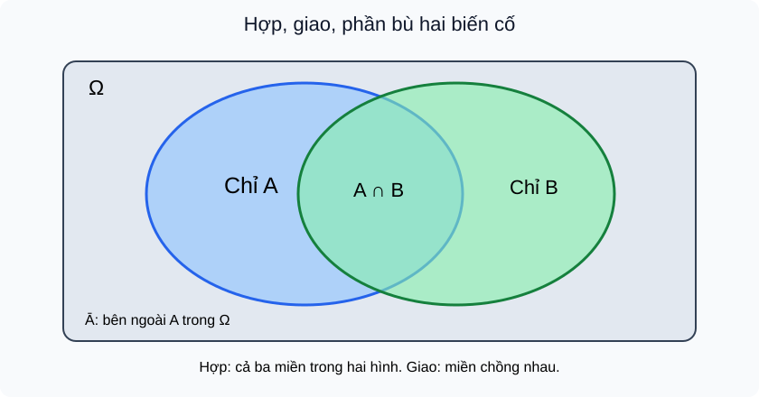
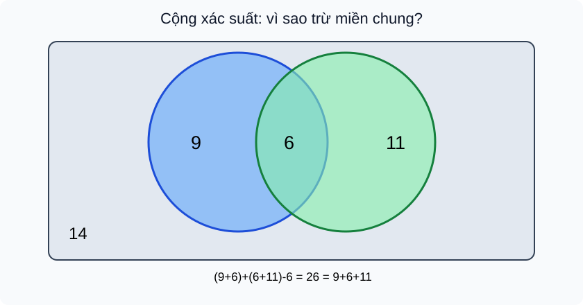
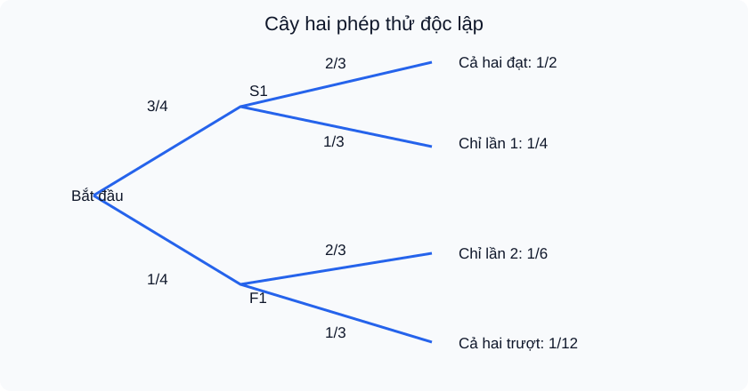

# TEMP — Toán 11 KNTT Tập 2, Chương VIII: Các quy tắc tính xác suất — PUBLIC D1–D6 R00

**PACKET_ID:** `THPT-G11-CHVIII-B28-B30-WHOLE-CHAPTER-AUTHORING-R00-20261101` · **PUBLIC_VERSION:** R00 · **LEARNING_PATH:** `SGK_CHAPTER`; independent assessment `SGK_CHAPTER_READINESS:G11:CHVIII` lives ONLY in a private separate file, not `TOPIC_READINESS`.  
**Snapshot date:** 2026-11-01 · **STATUS:** `AUTHOR_REVIEW_CANDIDATE_NOT_NOTEBOOKLM_PASSED` · **AUTHORING_BRANCH:** `content/thpt-g11-chviii-b28-b30-whole-chapter-20261101`. No merge, deploy, grading, Readiness/Mastery authorization.  
**SGK/SBT source fences (S1 to reconfirm by NotebookLM):**
- SGK Toán 11 KNTT Tập 2, **tham chiếu mục lục công khai**: Bài 28 trang in 66–71; Bài 29 trang 72–75; Bài 30 trang 76–78; Bài tập cuối chương VIII trang 79–80. Chương IX bắt đầu trang 81. **NotebookLM cần xác minh lại bằng nguồn S1 gốc.**
- SBT Toán 11 KNTT Tập 2, tham chiếu mục lục/các số trang bài tập công khai: Bài 28 khoảng p44–46 (bài 8.1 p45), Bài 29 khoảng p47–49 (bài 8.6 p48), Bài 30 khoảng p50–51 (bài 8.9 p51); bài tập cuối ChVIII p51–53. **Các khoảng theo bài là ước lượng, không tự coi SOURCE_RECEIPT=PASS**. Không sao chép nguyên đề SGK/SBT.
- 5 Permanent Sources THPT NotebookLM v2.0, Project Sources 08,06,07. Không chọn cả v1.0 và v2.0.

**Mandate PED1–PED6:** WHY cần ý tưởng → WHAT khái niệm là gì → HOW hình thành và vì sao điều kiện đúng → công thức có nguồn gốc → ví dụ có giải thích → tự thử → Core/Practice/Application, Written/Anchor và HELP. **Không** coi 20 outcome hay số lượng câu là bằng chứng đã đủ độ sâu.

**Canonical registry:** 20 RD0 outcomes; 16 D2 worked examples; 39 D3 original public canonical Core/Practice; 8 Written (4 Anchor role labels, không tạo ngân hàng thứ hai); 3 SVG D5; 8 HELP; 20 held-out RD1 **chỉ trong tệp PRIVATE**. Tổng 47 public +20 protected canonical items, 16 guided examples separate. Reviewer must check each answer, structure, rubric and S1 match. All answers below apply **after public formative attempt**, never to private RD1 before Final Submit.

---

## RD0 — ma trận outcomes (20 mục tiêu)

| skill_id / outcome_id | Bài | Đích năng lực tự học và suy luận |
|---|---|---|
| `G11-B28-SAMPLE_SPACE` | B28 | Mô tả phép thử, kết quả và Ω; phân biệt giả định đồng khả năng với chỉ đếm được kết quả |
| `G11-B28-EVENT_MODEL` | B28 | Đọc biến cố như một tập con của Ω, xác định đúng phần tử thỏa điều kiện |
| `G11-B28-UNION` | B28 | Hiểu A∪B nghĩa là A hoặc B hoặc cả hai, không dùng hoặc độc quyền |
| `G11-B28-INTERSECTION` | B28 | Hiểu A∩B gồm kết quả A và B đồng thời; khác với A∪B |
| `G11-B28-COMPLEMENT` | B28 | Hiểu Ā xảy ra đúng khi A không xảy ra, với Ā=Ω\A |
| `G11-B28-DISJOINT` | B28 | Phân biệt xung khắc A∩B=∅ và hai biến cố có thể cùng xảy ra |
| `G11-B28-INDEPENDENCE` | B28 | Hiểu độc lập là biết A xảy ra không làm đổi cơ hội B, kiểm bằng P(A∩B)=P(A)P(B) |
| `G11-B29-ADDITION_OVERLAP` | B29 | Giải thích vì sao phải trừ P(A∩B) khi cộng hai xác suất có phần chung |
| `G11-B29-ADDITION_DISJOINT` | B29 | Từ công thức cộng suy ra P(A∪B)=P(A)+P(B) chỉ khi xung khắc |
| `G11-B29-COMPLEMENT_PROB` | B29 | Dùng P(Ā)=1−P(A) và giải thích vì sao hiệu đúng |
| `G11-B29-VENN_COUNTS` | B29 | Chuyển số lượng/các miền sơ đồ Venn thành xác suất trong mô hình đồng khả năng |
| `G11-B29-PROBABILITY_BOUNDS` | B29 | Kiểm tính hợp lý 0≤P≤1 và P(A∩B)≤min(P(A),P(B)) |
| `G11-B29-REAL_APPLICATION` | B29 | Dùng quy tắc cộng trong khảo sát và dữ liệu thực, nêu mẫu số/tổng mẫu rõ ràng |
| `G11-B30-MULTIPLY_INDEPENDENT` | B30 | Suy ra xác suất đồng thời P(A∩B)=P(A)P(B) khi đã có giả thiết độc lập |
| `G11-B30-VERIFY_INDEPENDENCE` | B30 | Kiểm tra độc lập bằng số liệu, không suy từ khác tên hay khác loại biến cố |
| `G11-B30-REPEATED_TRIALS` | B30 | Tính xác suất nhiều phép thử độc lập lặp lại, nêu điều kiện và tích |
| `G11-B30-AT_LEAST_ONE` | B30 | Giải ít nhất một bằng biến cố đối và tích xác suất tất cả không xảy ra |
| `G11-B30-INDEPENDENT_VS_DISJOINT` | B30 | Phân biệt độc lập với xung khắc, biết không thể vừa độc lập vừa xung khắc nếu cả hai P>0 |
| `G11-B30-REAL_CONTEXT` | B30 | Mô hình hóa độ tin cậy/sản phẩm độc lập, chỉ sử dụng tích khi có giả định xác đáng |
| `G11-CHVIII-INTEGRATED` | CHVIII | Kết nối phép toán biến cố → cộng xác suất có chồng lấp → nhân xác suất độc lập và lựa chọn phương pháp |

---

## D1 — Bài học concept-first, tự đủ theo SGK

## Bài 28 — Biến cố hợp, biến cố giao, biến cố độc lập

### §1. WHY: Tại sao một biến cố đơn lẻ chưa đủ?
Ở lớp trước em biết xác suất để lấy được thẻ màu đỏ. Nhưng một câu hỏi như “rút được thẻ đỏ **hoặc** thẻ mang số chẵn”, hay “vừa đỏ **vừa** chẵn” đòi phối hợp **hai biến cố**. Nếu chỉ cộng số trường hợp ta có thể đếm trùng một thẻ vừa đỏ vừa chẵn. Chương này học ngôn ngữ biến cố trước, sau đó mới tính xác suất; học sinh không phải học thuộc công thức khi chưa hiểu vùng kết quả.

### §2. WHAT: Phép thử, không gian mẫu, biến cố (nhắc nền tảng)
**Phép thử ngẫu nhiên** là thao tác với kết quả chưa biết trước (chẳng hạn lấy ngẫu nhiên một thẻ). **Không gian mẫu** Ω là tập *mọi kết quả có thể xảy ra* của phép thử; **biến cố** A là tập con Ω. Với Ω={1,2,3,4,5,6} khi chọn số từ sáu thẻ đánh số, A="số chẵn"={2,4,6}; B="số lớn hơn 3"={4,5,6}. Trong mô hình sáu kết quả **đồng khả năng**, P(A)=3/6. Nếu cách chọn khiến các kết quả không đồng khả năng, tuyệt đối không dùng số phần tử/6 mà phải có xác suất của từng kết quả.

### §3. HOW: "Hoặc" và "đồng thời" là hai tập khác nhau
**Hợp** A∪B có kết quả thuộc A **hoặc** B, kể cả khi cả hai xảy ra. Ví dụ A∪B={2,4,5,6}. **Giao** A∩B có kết quả thuộc **cả A lẫn B**, ở ví dụ là {4,6}. **Phần bù** Ā=Ω\\A={1,3,5}, nghĩa là A không xảy ra. **Xung khắc** nếu A∩B=∅, không thể xảy ra đồng thời. Hai biến cố có phần giao không rỗng là **không xung khắc**. Xem FIG-G11-CHVIII-B28-01; vùng giao ở giữa được tính **một lần** trong hợp.

### §4. Độc lập không phải xung khắc
Hai biến cố **độc lập** khi việc một biến cố xảy ra **không làm thay đổi xác suất** của biến cố kia. Một phép kiểm trong mô hình có số liệu xác suất là **P(A∩B)=P(A)P(B)**; trong bài này nêu ý nghĩa, bài 30 dùng công thức nhân để tính. Ví dụ gieo **hai đồng xu công bằng độc lập**, A="xu thứ nhất ngửa", B="xu thứ hai ngửa": mỗi biến cố xác suất 1/2 và cả hai cùng ngửa là 1/4. Ngược lại, trong *một* lần gieo xúc xắc, A="ra 2", B="ra 5" xung khắc nhưng **không độc lập**, do biết A xảy ra thì B chắc chắn không thể xảy ra. **Không được** chỉ vì hai câu chuyện nghe không liên quan mà kết luận độc lập; cần giả thiết hoặc xác minh mô hình.

### §5. Đọc hình, suy luận và lỗi dễ mắc

**D5:** Hãy đặt một kết quả vào vùng chỉ A, chỉ B, cả hai hoặc ngoài cả hai. Vùng A∪B gồm ba vùng trong hai hình tròn, còn A∩B chỉ vùng chồng nhau. Việc A và B *không cùng xảy ra* là xung khắc, không phải bằng chứng độc lập.

### §6. Tự thử trước luyện tập
Với Ω={1,2,3,4,5,6}, A={2,4,6}, B={4,5,6}, em hãy viết A∪B, A∩B và Ā; hỏi hai biến cố này xung khắc không và giải thích. **Tự đối chiếu sau khi làm:** {2,4,5,6}; {4,6}; {1,3,5}; không xung khắc vì giao khác rỗng.

---

## Bài 29 — Công thức cộng xác suất

### §1. WHY: Tại sao cộng hai cơ hội dễ sai?
Trong một nhóm 40 học sinh, 15 bạn thích vẽ, 17 bạn thích thể thao, có 6 bạn thích **cả hai**. Cộng 15+17=32 đã đếm mỗi bạn thích cả hai **hai lần**. Muốn xác suất “thích vẽ hoặc thể thao”, cần trừ sáu bạn được đếm trùng. Đây không phải mẹo đại số: chính sơ đồ vùng giải thích vì sao.

### §2. HOW: Chứng minh bằng ba miền rời nhau
Mọi kết quả thuộc A∪B nằm trong đúng một của ba miền **chỉ A**, **A∩B**, **chỉ B**. Vì vậy P(A∪B)=P(chỉ A)+P(A∩B)+P(chỉ B). Nhưng P(A)=P(chỉ A)+P(A∩B), P(B)=P(chỉ B)+P(A∩B), nên

**P(A∪B)=P(A)+P(B)−P(A∩B).**

Đẳng thức áp dụng cho **mọi hai biến cố của cùng một phép thử/mô hình xác suất**, không đòi độc lập. Khi **xung khắc** A∩B=∅ và P(A∩B)=0 thì công thức rút còn P(A∪B)=P(A)+P(B). **Cẩn thận:** không được dùng công thức rút gọn chỉ vì hai biến cố được đặt tên khác nhau.

### §3. Bù và các giới hạn giúp tự phát hiện sai
Vì A và Ā xung khắc, hợp là toàn bộ Ω, ta có **P(Ā)=1−P(A)**. Mọi xác suất đều nằm trong [0,1], giao nằm trong từng biến cố nên **0≤P(A∩B)≤min(P(A),P(B))**. Nếu tính xác suất hợp lớn hơn 1 hoặc nhỏ hơn P(A), hãy kiểm lại mẫu số và phần giao.

### §4. Ví dụ dẫn đến phương pháp
Dùng số người trong §1: chỉ vẽ=15−6=9, chỉ thể thao=17−6=11, cả hai=6, không thích cả hai=40−(9+6+11)=14. P(A∪B)=26/40=13/20. Nếu học sinh dùng (15+17)/40=4/5 thì đã đếm lặp 6/40. **Chưa biết dữ liệu chọn ngẫu nhiên hay không**, xác suất 26/40 chỉ đúng nếu *chọn đều một học sinh trong 40*.

### §5. D5 đọc hình

Mỗi số trong một miền biểu thị số người, tổng 9+6+11+14=40. Hợp A∪B gồm 9+6+11, *không* đếm lại số 6. Tập người ở ngoài cả hai có 14 người.

### §6. Tự thử
Một câu lạc bộ 30 bạn: A có 14 bạn, B có 12 bạn, có 5 bạn thuộc cả A và B. Tính số bạn thuộc ít nhất một câu lạc bộ và số không thuộc cả hai. **Đối chiếu sau thử:** 14+12−5=21 và 30−21=9. Hãy nói vì sao không dùng 14+12 trực tiếp.

---

## Bài 30 — Công thức nhân xác suất cho hai biến cố độc lập

### §1. WHY: Cần biết cơ hội "cả hai" thay vì "ít nhất một"
Hai khâu sản xuất được kiểm tra riêng: nếu xác suất sản phẩm qua khâu 1 là 3/4 và qua khâu 2 là 2/3, em muốn biết **qua cả hai khâu**. Đây là **giao** chứ không phải **hợp**. Trong mô hình hai khâu độc lập, cơ hội thành công cả hai bằng 3/4 × 2/3=1/2. Không thể cộng 3/4+2/3 (>1): con số đó không thể là xác suất.

### §2. HOW: Vì sao được nhân **khi độc lập**?
Nếu A và B độc lập, phần B xảy ra trong các trường hợp A xảy ra có **cùng tỉ lệ** P(B) như tổng thể (ý nghĩa không thay đổi khả năng). Vì vậy phần giao có tỉ lệ P(A)×P(B): **P(A∩B)=P(A)P(B)**. Đây chính là công thức nhân cho hai biến cố độc lập. **Không được nhân hai xác suất khi chưa có giả thiết độc lập**. Chẳng hạn nếu rút hai thẻ liên tiếp **không hoàn lại**, xác suất màu của lần hai thay đổi theo lần một; quy tắc đơn giản không áp dụng một cách tự động. Công thức này khác với quy tắc cộng, vốn áp dụng cho mọi cặp biến cố.

### §3. Kiểm tra độc lập và phân biệt xung khắc
Nếu đã biết P(A), P(B), P(A∩B), ta kiểm độc lập bằng đẳng thức P(A∩B)=P(A)P(B). Nếu hai biến cố xung khắc và **cả hai có xác suất dương**, thì P(A∩B)=0 còn P(A)P(B)>0, suy ra chúng **không độc lập**. Ngoại lệ P=0 cần tách riêng, vì khi đó có thể vừa xung khắc vừa độc lập. Đừng kết luận "độc lập = không xảy ra cùng lúc" — đó là nhầm khái niệm.

### §4. "Ít nhất một" dùng bù và nhân
Với hai biến cố **độc lập** có P(A)=a, P(B)=b, xác suất *không xảy ra cái nào* là (1−a)(1−b). Do đó **P(ít nhất một)=1−(1−a)(1−b)**. Đây là quy tắc bù áp dụng cho giao của hai biến cố đối; chỉ nhân khi giả thiết độc lập hợp lệ. Với hai phép thử độc lập cùng cơ hội thành công p, xác suất hai lần đều thành công là p²; ít nhất một thành công là 1−(1−p)². Không mở rộng tùy tiện thành mô hình các phép thử phụ thuộc.

### §5. D5 đọc cây biến cố

Tại mỗi nút, xác suất của hai nhánh cộng bằng 1. Nhánh thành công phép 2 có 2/3 **ở cả hai nhánh của phép 1** vì đã giả thiết độc lập. Xác suất của một lá là tích các xác suất trên đường đi; bốn lá 1/2+1/4+1/6+1/12=1. Đó là phép kiểm tổng xác suất rất hữu ích.

### §6. Tự thử
Hai cảm biến **hoạt động độc lập**, có xác suất phát hiện lần lượt 4/5 và 3/4. Tính (i) cùng phát hiện, (ii) ít nhất một phát hiện. **Đối chiếu sau thử:** (i) 3/5, (ii) 1−(1/5)(1/4)=19/20. Hãy giải thích vì sao phải dùng tích ở (i), bù ở (ii).

---

## D2 — Ví dụ dẫn dắt: lựa chọn phương pháp, điều kiện, kiểm tra

### B28 — 5 ví dụ

#### EX-G11-CHVIII-B28-01: Đọc biến cố từ tập số

**Nhiệm vụ:** Chọn đều một thẻ từ {1,2,3,4,5,6}; A="số chẵn", B="từ 4 trở lên". Tìm A∩B, A∪B.

**Đáp án và lời giải:** A={2,4,6}, B={4,5,6}; A∩B={4,6}, A∪B={2,4,5,6}.

**Tại sao cách làm đúng:** Giao là chữ "và"; hợp là chữ "hoặc" gồm cả trường hợp đồng thời. Không nhân xác suất khi đề chỉ yêu cầu tập hợp.

#### EX-G11-CHVIII-B28-02: Đếm bù đúng

**Nhiệm vụ:** Có Ω={a,b,c,d,e}, A={a,d}. Hỏi "không thuộc A" là tập nào?

**Đáp án và lời giải:** Ā={b,c,e}.

**Tại sao cách làm đúng:** Bù luôn xét tương đối với Ω; không tự lấy phần bù trong một tập không nêu.

#### EX-G11-CHVIII-B28-03: Hai biến cố xung khắc trong cùng phép thử

**Nhiệm vụ:** Gieo một xúc xắc: A="ra 2", B="ra 5". Xung khắc hay độc lập?

**Đáp án và lời giải:** A∩B=∅, P(A)=P(B)=1/6>0, P(A∩B)=0≠1/36. Xung khắc, không độc lập.

**Tại sao cách làm đúng:** Chỉ một kết quả được rút nên không thể vừa ra 2 vừa ra 5. Hai biến cố xác suất dương và xung khắc thì không độc lập.

#### EX-G11-CHVIII-B28-04: Cùng ngửa nhưng hai phép thử

**Nhiệm vụ:** Hai đồng xu độc lập cân bằng: A="xu đầu ngửa", B="xu sau ngửa".

**Đáp án và lời giải:** Ω={NN,NS,SN,SS}; P(A)=P(B)=1/2, P(A∩B)=1/4=(1/2)^2.

**Tại sao cách làm đúng:** Cần giả thiết hai lần thử công bằng, độc lập. Cả hai cùng xảy ra vẫn có thể độc lập.

#### EX-G11-CHVIII-B28-05: Phân biệt hai tầng mô hình

**Nhiệm vụ:** Bốc số 1–4 đều, A="số lớn hơn 2", B="số lẻ".

**Đáp án và lời giải:** A={3,4}, B={1,3}; A∩B={3}, A∪B={1,3,4}.

**Tại sao cách làm đúng:** Kết quả đơn lẻ số 3 nằm cả hai biến cố; không được chỉ dùng chữ "hoặc" như loại trừ.

### B29 — 5 ví dụ

#### EX-G11-CHVIII-B29-01: Tổng hai nhóm có phần chung

**Nhiệm vụ:** Trong 50 vé khảo sát, 23 vé chọn X, 19 vé chọn Y, 8 vé chọn cả hai. Chọn đều 1 vé: P(X∪Y)?

**Đáp án và lời giải:** (23+19−8)/50=34/50=17/25.

**Tại sao cách làm đúng:** Trừ vùng giao đã cộng hai lần. Xác suất = số phiếu hợp/50 vì chọn đều.

#### EX-G11-CHVIII-B29-02: Trường hợp xung khắc

**Nhiệm vụ:** Gieo xúc xắc đều: A="ra 1", B="ra 6". Tính P(A∪B).

**Đáp án và lời giải:** 1/6+1/6=1/3.

**Tại sao cách làm đúng:** A∩B=∅ nên công thức cộng không có phần trừ.

#### EX-G11-CHVIII-B29-03: Bù hỗ trợ tính nhanh

**Nhiệm vụ:** Một thử nghiệm có P(A)=7/20. Tính xác suất A không xảy ra.

**Đáp án và lời giải:** 13/20.

**Tại sao cách làm đúng:** A và Ā chia toàn bộ Ω không trùng lặp; lấy 1−7/20.

#### EX-G11-CHVIII-B29-04: Rút phần giao từ hợp

**Nhiệm vụ:** Biết P(A)=0,6, P(B)=0,5, P(A∪B)=0,8. Tìm P(A∩B).

**Đáp án và lời giải:** 0,6+0,5−0,8=0,3.

**Tại sao cách làm đúng:** Biến đổi công thức cộng, không giả định độc lập để nhân.

#### EX-G11-CHVIII-B29-05: Xét tính hợp lý

**Nhiệm vụ:** Bạn tính P(A)=0,4, P(B)=0,7, P(A∩B)=0,5. Vì sao dữ kiện vô lí?

**Đáp án và lời giải:** Vì P(A∩B)≤P(A)=0,4 mà được cho 0,5.

**Tại sao cách làm đúng:** Giao nằm trong A và B; xác suất không thể tăng khi lấy tập con.

### B30 — 6 ví dụ

#### EX-G11-CHVIII-B30-01: Nhân hai xác suất độc lập

**Nhiệm vụ:** Hai thiết bị hoạt động độc lập, tỉ lệ không lỗi lần lượt 4/5 và 7/10. Tính cả hai không lỗi.

**Đáp án và lời giải:** (4/5)(7/10)=14/25.

**Tại sao cách làm đúng:** Nhân vì giả thiết độc lập; sự kiện "cả hai" là giao.

#### EX-G11-CHVIII-B30-02: Độc lập có thể giao khác rỗng

**Nhiệm vụ:** Biết P(A)=2/5, P(B)=1/2 và P(A∩B)=1/5. Hai biến cố độc lập không?

**Đáp án và lời giải:** Có, vì 2/5·1/2=1/5.

**Tại sao cách làm đúng:** Giao dương không ngăn độc lập; phân biệt với xung khắc.

#### EX-G11-CHVIII-B30-03: Không độc lập dù cùng tỉ lệ biên

**Nhiệm vụ:** Biết P(A)=1/2, P(B)=1/3 nhưng P(A∩B)=1/12. Độc lập?

**Đáp án và lời giải:** Không; tích biên phải là 1/6, khác 1/12.

**Tại sao cách làm đúng:** Độc lập phải chứng minh bằng giả thiết hoặc đẳng thức, không dựa vào tên.

#### EX-G11-CHVIII-B30-04: Ít nhất một qua bù

**Nhiệm vụ:** Hai lần kiểm độc lập, mỗi lần tỉ lệ đạt 3/5. Tính xác suất ít nhất một lần đạt.

**Đáp án và lời giải:** 1−(2/5)^2=21/25.

**Tại sao cách làm đúng:** Tính bù là hai lần đều trượt: 2/5·2/5.

#### EX-G11-CHVIII-B30-05: Ba phép thử độc lập

**Nhiệm vụ:** Ba công đoạn độc lập có xác suất hoàn thành 1/2, 3/4, 4/5. Cả ba hoàn thành?

**Đáp án và lời giải:** (1/2)(3/4)(4/5)=3/10.

**Tại sao cách làm đúng:** Nhân theo điều kiện độc lập của cả ba; nói rõ cần độc lập đồng thời, không chỉ từng cặp.

#### EX-G11-CHVIII-B30-06: Vì sao không dùng phép nhân khi phụ thuộc

**Nhiệm vụ:** Hộp có 3 thẻ xanh và 2 đỏ; rút hai thẻ không hoàn lại. Hai biến cố "lần đầu xanh" và "lần hai xanh" có độc lập?

**Đáp án và lời giải:** Không. Nếu lần đầu xanh, P(lần hai xanh)=2/4=1/2; ban đầu P(lần hai xanh)=3/5.

**Tại sao cách làm đúng:** Lấy đi thẻ làm thay đổi thành phần hộp. Ví dụ đối chứng chỉ yêu cầu nhận biết không độc lập; công thức tổng quát phụ thuộc không thuộc Core B30.


---

## D3 — Core / Practice / Application (canonical, formative)

### B28 — 13 câu

#### THPT-G11-CHVIII-B28-C01 · skill_id=`G11-B28-SAMPLE_SPACE` · placement=`SGK_CORE`

**Đề:** Một túi chứa các thẻ đánh số 1, 2, 3. Mỗi lần lấy đúng một thẻ. Viết Ω.

**Đáp án (sau Submit formative):** Ω={1,2,3}.

**Lời giải và vì sao:** Không gian mẫu là mọi kết quả có thể xảy ra, không gồm bộ đôi vì chỉ lấy một thẻ.

#### THPT-G11-CHVIII-B28-C02 · skill_id=`G11-B28-EVENT_MODEL` · placement=`SGK_CORE`

**Đề:** Với Ω={1,2,3,4,5}, viết biến cố A="chọn được số nguyên tố".

**Đáp án (sau Submit formative):** A={2,3,5}.

**Lời giải và vì sao:** Số 1 không phải số nguyên tố; biến cố là tập con của Ω.

#### THPT-G11-CHVIII-B28-C03 · skill_id=`G11-B28-UNION` · placement=`SGK_CORE`

**Đề:** Ω={1,2,3,4,5}, A={1,3}, B={3,5}. Tìm A∪B.

**Đáp án (sau Submit formative):** {1,3,5}.

**Lời giải và vì sao:** Hợp chứa mọi kết quả thuộc ít nhất một trong hai tập; số 3 chỉ viết một lần.

#### THPT-G11-CHVIII-B28-C04 · skill_id=`G11-B28-INTERSECTION` · placement=`SGK_CORE`

**Đề:** Ω={1,2,3,4,5}, A={2,3,4}, B={1,3,5}. Tìm A∩B.

**Đáp án (sau Submit formative):** {3}.

**Lời giải và vì sao:** Giao là phần tử thuộc cả A lẫn B.

#### THPT-G11-CHVIII-B28-C05 · skill_id=`G11-B28-COMPLEMENT` · placement=`SGK_CORE`

**Đề:** Ω={0,1,2,3,4}, A={0,2,4}. Tìm Ā.

**Đáp án (sau Submit formative):** {1,3}.

**Lời giải và vì sao:** Phần bù lấy tất cả phần tử trong Ω không thuộc A.

#### THPT-G11-CHVIII-B28-C06 · skill_id=`G11-B28-DISJOINT` · placement=`SGK_CORE`

**Đề:** Một xúc xắc gieo một lần. A="ra số nhỏ hơn 3", B="ra số lớn hơn 4". A,B có xung khắc?

**Đáp án (sau Submit formative):** Có.

**Lời giải và vì sao:** A={1,2}, B={5,6}; giao rỗng.

#### THPT-G11-CHVIII-B28-C07 · skill_id=`G11-B28-INDEPENDENCE` · placement=`SGK_CORE`

**Đề:** Hai biến cố có P(A)=1/2, P(B)=1/3 và P(A∩B)=1/6. Có độc lập không?

**Đáp án (sau Submit formative):** Có.

**Lời giải và vì sao:** Tích xác suất riêng bằng giao: 1/2·1/3=1/6.

#### THPT-G11-CHVIII-B28-P01 · skill_id=`G11-B28-UNION` · placement=`SGK_PRACTICE`

**Đề:** Khi chọn đều 1 thẻ từ 1 đến 8, A="bội của 2", B="bội của 3". Viết A∪B.

**Đáp án (sau Submit formative):** {2,3,4,6,8}.

**Lời giải và vì sao:** A={2,4,6,8}, B={3,6}; hợp không lặp số 6.

#### THPT-G11-CHVIII-B28-P02 · skill_id=`G11-B28-INTERSECTION` · placement=`SGK_PRACTICE`

**Đề:** Với cùng 8 thẻ, A="số chẵn", B="số lớn hơn 5". Tìm A∩B.

**Đáp án (sau Submit formative):** {6,8}.

**Lời giải và vì sao:** B={6,7,8}; cùng chẵn và lớn hơn 5 có hai giá trị.

#### THPT-G11-CHVIII-B28-P03 · skill_id=`G11-B28-EVENT_MODEL` · placement=`SGK_PRACTICE`

**Đề:** Một hộp có 3 thẻ đỏ, 1 thẻ xanh. Vì sao khi chọn đều 1 thẻ không được gộp Ω={đỏ,xanh} rồi kết luận P(đỏ)=1/2?

**Đáp án (sau Submit formative):** Vì hai màu không đồng khả năng; P(đỏ)=3/4.

**Lời giải và vì sao:** Không gian mẫu màu có thể dùng nếu gán đúng xác suất; không được chia đều cho 2 màu.

#### THPT-G11-CHVIII-B28-P04 · skill_id=`G11-B28-DISJOINT` · placement=`SGK_PRACTICE`

**Đề:** A và B xung khắc với P(A)=1/4 và P(B)=2/5. Chúng có thể độc lập không?

**Đáp án (sau Submit formative):** Không.

**Lời giải và vì sao:** P(A∩B)=0 nhưng P(A)P(B)=1/10>0.

#### THPT-G11-CHVIII-B28-P05 · skill_id=`G11-B28-INDEPENDENCE` · placement=`SGK_PRACTICE`

**Đề:** Biết P(A)=1/2, P(B)=3/5, P(A∩B)=1/5. Kiểm tra tính độc lập.

**Đáp án (sau Submit formative):** Không độc lập.

**Lời giải và vì sao:** 1/2·3/5=3/10 khác 1/5.

#### THPT-G11-CHVIII-B28-P06 · skill_id=`G11-B28-COMPLEMENT` · placement=`SGK_PRACTICE`

**Đề:** Ω={a,b,c,d,e,f}, A={b,e}. Viết Ā và số phần tử của nó.

**Đáp án (sau Submit formative):** {a,c,d,f}; 4 phần tử.

**Lời giải và vì sao:** Bù trong Ω, không phải chỉ phần bên ngoài sơ đồ khi chưa rõ Ω.

### B29 — 12 câu

#### THPT-G11-CHVIII-B29-C01 · skill_id=`G11-B29-ADDITION_OVERLAP` · placement=`SGK_CORE`

**Đề:** P(A)=2/5, P(B)=1/2, P(A∩B)=1/5. Tính P(A∪B).

**Đáp án (sau Submit formative):** 7/10.

**Lời giải và vì sao:** 2/5+1/2−1/5=7/10; phải trừ phần giao.

#### THPT-G11-CHVIII-B29-C02 · skill_id=`G11-B29-ADDITION_DISJOINT` · placement=`SGK_CORE`

**Đề:** A,B xung khắc, P(A)=1/8, P(B)=3/8. Tính P(A∪B).

**Đáp án (sau Submit formative):** 1/2.

**Lời giải và vì sao:** Giao rỗng nên cộng trực tiếp 1/8+3/8.

#### THPT-G11-CHVIII-B29-C03 · skill_id=`G11-B29-COMPLEMENT_PROB` · placement=`SGK_CORE`

**Đề:** P(K)=9/25. Tính P(K̄).

**Đáp án (sau Submit formative):** 16/25.

**Lời giải và vì sao:** Biến cố và bù tạo thành Ω, nên 1−9/25.

#### THPT-G11-CHVIII-B29-C04 · skill_id=`G11-B29-VENN_COUNTS` · placement=`SGK_CORE`

**Đề:** Một lớp 25 học sinh: chỉ thích trà có 6, thích cả trà và cà phê có 4, chỉ thích cà phê có 5. Chọn đều 1 bạn: P(thích ít nhất một loại)?

**Đáp án (sau Submit formative):** 3/5.

**Lời giải và vì sao:** Có 6+4+5=15 bạn thuộc hợp, xác suất 15/25=3/5.

#### THPT-G11-CHVIII-B29-C05 · skill_id=`G11-B29-PROBABILITY_BOUNDS` · placement=`SGK_CORE`

**Đề:** Nếu P(A)=0,3 mà P(A∩B)=0,4, dữ liệu có thể đúng không?

**Đáp án (sau Submit formative):** Không.

**Lời giải và vì sao:** Giao là tập con A nên P(A∩B)≤0,3.

#### THPT-G11-CHVIII-B29-C06 · skill_id=`G11-B29-REAL_APPLICATION` · placement=`SGK_CORE`

**Đề:** Trong 60 phiếu, 26 chọn kênh A, 24 chọn B, 10 chọn cả hai. Chọn đều một phiếu, P(chọn A hoặc B)?

**Đáp án (sau Submit formative):** 2/3.

**Lời giải và vì sao:** (26+24−10)/60=40/60=2/3.

#### THPT-G11-CHVIII-B29-P01 · skill_id=`G11-B29-ADDITION_OVERLAP` · placement=`SGK_PRACTICE`

**Đề:** P(A∪B)=3/4, P(A)=1/2 và P(B)=3/5. Tìm P(A∩B).

**Đáp án (sau Submit formative):** 7/20.

**Lời giải và vì sao:** P(A∩B)=1/2+3/5−3/4=10/20+12/20−15/20=7/20.

#### THPT-G11-CHVIII-B29-P02 · skill_id=`G11-B29-ADDITION_DISJOINT` · placement=`SGK_PRACTICE`

**Đề:** A,B xung khắc có P(A)=0,45, P(B)=0,65. Dữ liệu có hợp lý?

**Đáp án (sau Submit formative):** Không.

**Lời giải và vì sao:** Xung khắc ⇒ P(A∪B)=1,10>1, trái giới hạn xác suất.

#### THPT-G11-CHVIII-B29-P03 · skill_id=`G11-B29-COMPLEMENT_PROB` · placement=`SGK_PRACTICE`

**Đề:** Một phép thử có xác suất lỗi 1/20. Xác suất không lỗi là bao nhiêu?

**Đáp án (sau Submit formative):** 19/20.

**Lời giải và vì sao:** Hai biến cố lỗi và không lỗi là bù nhau.

#### THPT-G11-CHVIII-B29-P04 · skill_id=`G11-B29-VENN_COUNTS` · placement=`SGK_PRACTICE`

**Đề:** Trong 100 người, 40 thích A, 35 thích B và 15 thích cả hai. Hỏi bao nhiêu người không thích A lẫn B?

**Đáp án (sau Submit formative):** 40 người.

**Lời giải và vì sao:** Hợp có 40+35−15=60 người; ngoài hợp 100−60=40.

#### THPT-G11-CHVIII-B29-P05 · skill_id=`G11-B29-PROBABILITY_BOUNDS` · placement=`SGK_PRACTICE`

**Đề:** P(A)=0,4, P(B)=0,5, P(A∩B)=0,2. Tính hợp và kiểm nó không nhỏ hơn xác suất riêng.

**Đáp án (sau Submit formative):** 0,7.

**Lời giải và vì sao:** Hợp=0,4+0,5−0,2=0,7≥0,5 và ≥0,4.

#### THPT-G11-CHVIII-B29-P06 · skill_id=`G11-B29-REAL_APPLICATION` · placement=`SGK_PRACTICE`

**Đề:** Một nhóm 48 bạn có 21 bạn học vẽ, 18 bạn học nhạc, 8 bạn học cả hai. Chọn đều một bạn, xác suất không học môn nào?

**Đáp án (sau Submit formative):** 17/48.

**Lời giải và vì sao:** Hợp=21+18−8=31; không học môn nào=48−31=17.

### B30 — 13 câu

#### THPT-G11-CHVIII-B30-C01 · skill_id=`G11-B30-MULTIPLY_INDEPENDENT` · placement=`SGK_CORE`

**Đề:** A,B độc lập; P(A)=3/10, P(B)=2/5. Tính P(A∩B).

**Đáp án (sau Submit formative):** 3/25.

**Lời giải và vì sao:** Nhân 3/10·2/5=6/50=3/25 do giả thiết độc lập.

#### THPT-G11-CHVIII-B30-C02 · skill_id=`G11-B30-VERIFY_INDEPENDENCE` · placement=`SGK_CORE`

**Đề:** P(A)=3/4, P(B)=1/3, P(A∩B)=1/4. Độc lập không?

**Đáp án (sau Submit formative):** Có.

**Lời giải và vì sao:** 3/4·1/3=1/4, đúng tiêu chuẩn.

#### THPT-G11-CHVIII-B30-C03 · skill_id=`G11-B30-REPEATED_TRIALS` · placement=`SGK_CORE`

**Đề:** Ba lần thử độc lập, mỗi lần xác suất đạt 1/2. Tính cả ba lần đạt.

**Đáp án (sau Submit formative):** 1/8.

**Lời giải và vì sao:** (1/2)^3=1/8, cần ba lần độc lập, không chỉ có cùng tỉ lệ.

#### THPT-G11-CHVIII-B30-C04 · skill_id=`G11-B30-AT_LEAST_ONE` · placement=`SGK_CORE`

**Đề:** Hai cảm biến độc lập, mỗi cảm biến có xác suất thất bại 1/5. Tính xác suất ít nhất một cảm biến hoạt động.

**Đáp án (sau Submit formative):** 24/25.

**Lời giải và vì sao:** Bù của ít nhất một hoạt động là cả hai thất bại: 1−(1/5)^2=24/25.

#### THPT-G11-CHVIII-B30-C05 · skill_id=`G11-B30-INDEPENDENT_VS_DISJOINT` · placement=`SGK_CORE`

**Đề:** Hai biến cố xung khắc có P(A)=1/3, P(B)=1/4. Chúng độc lập không?

**Đáp án (sau Submit formative):** Không.

**Lời giải và vì sao:** P(A∩B)=0 khác (1/3)(1/4)=1/12.

#### THPT-G11-CHVIII-B30-C06 · skill_id=`G11-B30-REAL_CONTEXT` · placement=`SGK_CORE`

**Đề:** Hai máy in hoạt động độc lập, cơ hội in thành công lần lượt 4/5 và 5/6. P(cả hai thành công)?

**Đáp án (sau Submit formative):** 2/3.

**Lời giải và vì sao:** 4/5·5/6=2/3; độc lập được nêu rõ trong đề.

#### THPT-G11-CHVIII-B30-P01 · skill_id=`G11-B30-MULTIPLY_INDEPENDENT` · placement=`SGK_PRACTICE`

**Đề:** Hai sự kiện độc lập, P(A)=7/10, P(B)=3/7. Tính P(A∩B).

**Đáp án (sau Submit formative):** 3/10.

**Lời giải và vì sao:** 7/10·3/7=3/10; triệt tiêu 7.

#### THPT-G11-CHVIII-B30-P02 · skill_id=`G11-B30-VERIFY_INDEPENDENCE` · placement=`SGK_PRACTICE`

**Đề:** P(A)=0,6, P(B)=0,5 nhưng P(A∩B)=0,2. Độc lập?

**Đáp án (sau Submit formative):** Không.

**Lời giải và vì sao:** 0,6·0,5=0,3 khác 0,2.

#### THPT-G11-CHVIII-B30-P03 · skill_id=`G11-B30-REPEATED_TRIALS` · placement=`SGK_PRACTICE`

**Đề:** Ba công tắc độc lập, xác suất bật lần lượt 1/2, 2/3, 3/4. Xác suất cả ba bật?

**Đáp án (sau Submit formative):** 1/4.

**Lời giải và vì sao:** Tích 1/2·2/3·3/4=1/4.

#### THPT-G11-CHVIII-B30-P04 · skill_id=`G11-B30-AT_LEAST_ONE` · placement=`SGK_PRACTICE`

**Đề:** Hai lời nhắc độc lập có xác suất được nhận lần lượt 3/5 và 1/2. Tính xác suất ít nhất một lời nhắc được nhận.

**Đáp án (sau Submit formative):** 4/5.

**Lời giải và vì sao:** 1−(2/5)(1/2)=1−1/5=4/5.

#### THPT-G11-CHVIII-B30-P05 · skill_id=`G11-B30-INDEPENDENT_VS_DISJOINT` · placement=`SGK_PRACTICE`

**Đề:** A,B độc lập với P(A)=1/2, P(B)=1/2. Có thể A∩B rỗng không?

**Đáp án (sau Submit formative):** Không.

**Lời giải và vì sao:** Độc lập cho giao có xác suất 1/4>0 nên không thể rỗng.

#### THPT-G11-CHVIII-B30-P06 · skill_id=`G11-B30-REAL_CONTEXT` · placement=`SGK_PRACTICE`

**Đề:** Một thiết bị có hai môđun kiểm lỗi độc lập với xác suất phát hiện lần lượt 0,8 và 0,7. Xác suất cả hai cùng phát hiện?

**Đáp án (sau Submit formative):** 0,56.

**Lời giải và vì sao:** 0,8×0,7=0,56; xác suất không phải 1,5.

#### THPT-G11-CHVIII-B30-P07 · skill_id=`G11-B30-AT_LEAST_ONE` · placement=`SGK_PRACTICE`

**Đề:** Ba phép thử độc lập có xác suất lỗi 1/2, 1/3, 1/4. Xác suất ít nhất một lần không lỗi?

**Đáp án (sau Submit formative):** 23/24.

**Lời giải và vì sao:** Bù là cả ba lỗi: 1−(1/2)(1/3)(1/4)=23/24.

### CHVIII — 1 câu

#### THPT-G11-CHVIII-CHVIII-P01 · skill_id=`G11-CHVIII-INTEGRATED` · placement=`SGK_PRACTICE`

**Đề:** Hai biến cố độc lập có P(A)=2/5, P(B)=1/4. Tính P(A∩B), P(A∪B) và chỉ ra công thức nào dùng trước.

**Đáp án (sau Submit formative):** P(A∩B)=1/10; P(A∪B)=11/20.

**Lời giải và vì sao:** Dùng nhân cho giao vì độc lập, rồi cộng có trừ giao: 2/5+1/4−1/10=8/20+5/20−2/20=11/20.


---

## D4 — Written / Anchor: một thư viện tự luận, 4 điểm mỗi câu

### THPT-G11-CHVIII-B28-W01 · skill_id=`G11-B28-UNION` · placement=`SGK_WRITTEN` · role=`WRITTEN`

**Đề tự luận:** Một phép thử chọn đều một số trong Ω={1,2,3,4,5,6,7,8,9}. Đặt A="bội của 3", B="số lớn hơn 5". Liệt kê A, B, A∪B, A∩B; giải thích một kết quả thuộc giao.

**Hướng giải tự đối chiếu SAU KHI tự làm:** A={3,6,9}; B={6,7,8,9}; A∪B={3,6,7,8,9}; A∩B={6,9}.

**Rubric — 4 tiêu chí, mỗi tiêu chí 1 điểm:**
1. Xác định Ω và viết đúng A — 1 điểm.
2. Viết B đúng — 1 điểm.
3. Viết A∪B không lặp phần tử — 1 điểm.
4. Viết A∩B và nói vì sao 6 thuộc cả hai — 1 điểm.

### THPT-G11-CHVIII-B28-W02-ANCHOR · skill_id=`G11-B28-INDEPENDENCE` · placement=`SGK_WRITTEN` · role=`ANCHOR_TAG`

**Đề tự luận:** Từ 4 thẻ 1–4 chọn đều một thẻ; A="số chẵn", B="số lớn hơn 2". Viết A,B, giao; kiểm định độc lập bằng xác suất và giải thích sự khác biệt với xung khắc.

**Hướng giải tự đối chiếu SAU KHI tự làm:** A={2,4},B={3,4},giao={4}; P(A)=P(B)=1/2,P(giao)=1/4 nên độc lập; không xung khắc do giao có 4.

**Rubric — 4 tiêu chí, mỗi tiêu chí 1 điểm:**
1. Xác định đúng hai biến cố — 1 điểm.
2. Xác định đúng giao và các xác suất — 1 điểm.
3. Kiểm tích P(A)P(B)=P(giao) — 1 điểm.
4. Phân biệt độc lập với xung khắc bằng giao không rỗng — 1 điểm.

### THPT-G11-CHVIII-B29-W01 · skill_id=`G11-B29-ADDITION_OVERLAP` · placement=`SGK_WRITTEN` · role=`WRITTEN`

**Đề tự luận:** Khảo sát 80 phiếu chọn đồng đều: 38 phiếu chọn sách A, 31 chọn sách B, 12 chọn cả hai. Tính hợp và phần bù; giải thích vì sao không cộng thẳng 38+31.

**Hướng giải tự đối chiếu SAU KHI tự làm:** Hợp=38+31−12=57; không chọn A/B=23; xác suất 57/80,23/80.

**Rubric — 4 tiêu chí, mỗi tiêu chí 1 điểm:**
1. Ghi nhận đúng phần giao 12 — 1 điểm.
2. Tính hợp 57 — 1 điểm.
3. Tính bù 23 và xác suất có mẫu số 80 — 1 điểm.
4. Giải thích vùng giao bị đếm hai lần khi cộng — 1 điểm.

### THPT-G11-CHVIII-B29-W02-ANCHOR · skill_id=`G11-B29-PROBABILITY_BOUNDS` · placement=`SGK_WRITTEN` · role=`ANCHOR_TAG`

**Đề tự luận:** Cho P(A)=3/5, P(B)=1/2, P(A∩B)=1/4. Tính P(A∪B), P(Ā), kiểm tính hợp lý các kết quả và nêu có thể áp dụng công thức xung khắc không.

**Hướng giải tự đối chiếu SAU KHI tự làm:** P(hợp)=3/5+1/2−1/4=17/20; P(Ā)=2/5; 0≤1/4≤1/2 và 17/20≤1; không xung khắc vì P(giao)>0.

**Rubric — 4 tiêu chí, mỗi tiêu chí 1 điểm:**
1. Đặt được đúng công thức trừ giao — 1 điểm.
2. Tính P(hợp)=17/20 — 1 điểm.
3. Tính P(Ā)=2/5 — 1 điểm.
4. Nêu giới hạn và lý do không xung khắc — 1 điểm.

### THPT-G11-CHVIII-B29-W03 · skill_id=`G11-B29-REAL_APPLICATION` · placement=`SGK_WRITTEN` · role=`WRITTEN`

**Đề tự luận:** Trong 36 người, có 17 người chọn kênh C, 14 người chọn D, 6 người chọn cả hai. Chọn đều một người, tính xác suất chọn chỉ C, chỉ D, cả hai hoặc không chọn cả hai.

**Hướng giải tự đối chiếu SAU KHI tự làm:** Chỉ C=11/36; chỉ D=8/36; cả hai=6/36; ngoài cả hai=(36−(17+14−6))/36=11/36; tổng=1.

**Rubric — 4 tiêu chí, mỗi tiêu chí 1 điểm:**
1. Phân tách miền chỉ C =11 — 1 điểm.
2. Phân tách miền chỉ D =8 và giao =6 — 1 điểm.
3. Tính ngoài cả hai =11 — 1 điểm.
4. Chia đúng cho 36 và kiểm bốn xác suất cộng bằng 1 — 1 điểm.

### THPT-G11-CHVIII-B30-W01 · skill_id=`G11-B30-MULTIPLY_INDEPENDENT` · placement=`SGK_WRITTEN` · role=`WRITTEN`

**Đề tự luận:** Ba thử nghiệm độc lập có xác suất thành công 1/2, 2/5, 3/4. Tính xác suất cả ba thành công; nếu bỏ giả thiết độc lập thì vì sao tích chưa đủ căn cứ?

**Hướng giải tự đối chiếu SAU KHI tự làm:** (1/2)(2/5)(3/4)=3/20; không biết sự phụ thuộc thì không thể lấy tích các xác suất riêng.

**Rubric — 4 tiêu chí, mỗi tiêu chí 1 điểm:**
1. Phân biệt sự kiện giao của ba biến cố — 1 điểm.
2. Giải thích dùng tích vì độc lập — 1 điểm.
3. Tính 3/20 chính xác — 1 điểm.
4. Nêu nếu phụ thuộc thì dữ kiện biên không đủ — 1 điểm.

### THPT-G11-CHVIII-B30-W02-ANCHOR · skill_id=`G11-B30-AT_LEAST_ONE` · placement=`SGK_WRITTEN` · role=`ANCHOR_TAG`

**Đề tự luận:** Hai bộ phát tín hiệu độc lập có xác suất phát đúng lần lượt 4/5 và 2/3. Tính xác suất cả hai phát đúng, cả hai phát sai, ít nhất một phát đúng; kiểm tổng các trường hợp.

**Hướng giải tự đối chiếu SAU KHI tự làm:** Cả hai đúng=8/15; cả hai sai=(1/5)(1/3)=1/15; ít nhất một đúng=14/15; hai trạng thái "ít nhất một đúng" và "cả hai sai" cộng 1.

**Rubric — 4 tiêu chí, mỗi tiêu chí 1 điểm:**
1. Xác định độc lập, tính cả hai đúng=8/15 — 1 điểm.
2. Tính cả hai sai=1/15 — 1 điểm.
3. Dùng bù tính ít nhất một=14/15 — 1 điểm.
4. Kiểm tính hợp lý và nêu rõ hai biến cố đối — 1 điểm.

### THPT-G11-CHVIII-CHVIII-W01-ANCHOR · skill_id=`G11-CHVIII-INTEGRATED` · placement=`SGK_WRITTEN` · role=`ANCHOR_TAG`

**Đề tự luận:** Một thử nghiệm có A,B độc lập với P(A)=3/5 và P(B)=2/5. Tính xác suất (i) cả hai, (ii) chỉ A, (iii) ít nhất một, (iv) không cái nào. Giải thích khi nào dùng nhân, khi nào cộng, khi nào lấy bù.

**Hướng giải tự đối chiếu SAU KHI tự làm:** (i) 6/25; (ii) 3/5·3/5=9/25; (iii) 3/5+2/5−6/25=19/25; (iv) 6/25; kiểm 19/25+6/25=1.

**Rubric — 4 tiêu chí, mỗi tiêu chí 1 điểm:**
1. Nhân để tính P(giao)=6/25 do độc lập — 1 điểm.
2. Tính chỉ A bằng A∩B̄=9/25 — 1 điểm.
3. Dùng cộng trừ giao tính ít nhất một=19/25 — 1 điểm.
4. Dùng biến cố bù tính không cái nào=6/25 và kiểm tổng — 1 điểm.


---

## D5 — SVG trực quan (mã nguồn và cách đọc)

### FIG-G11-CHVIII-B28-01


**XML tự chứa để NotebookLM đối chiếu đồ thị và nhãn:**

```xml
<svg xmlns="http://www.w3.org/2000/svg" viewBox="0 0 840 440" role="img" aria-labelledby="title desc"><title id="title">FIG-G11-CHVIII-B28-01: Hợp, giao, phần bù hai biến cố</title><desc id="desc">Khung Ω chứa A và B cắt nhau; điểm ở miền A giao B thuộc cả hai; hợp là mọi điểm trong A hoặc B; phần bù của A là ngoài A trong Ω.</desc><rect width="840" height="440" rx="12" fill="#f8fafc"/><text x="420" y="34" font-size="22" text-anchor="middle" font-family="Arial" fill="#0f172a">Hợp, giao, phần bù hai biến cố</text><rect x="70" y="68" width="700" height="310" rx="14" fill="#e2e8f0" stroke="#334155" stroke-width="2"/><ellipse cx="337" cy="215" rx="175" ry="123" fill="#93c5fd" fill-opacity=".65" stroke="#2563eb" stroke-width="3"/><ellipse cx="505" cy="215" rx="175" ry="123" fill="#86efac" fill-opacity=".6" stroke="#15803d" stroke-width="3"/><text x="98" y="105" font-family="Arial" font-size="23">Ω</text><text x="248" y="214" font-family="Arial" font-size="25">Chỉ A</text><text x="391" y="218" font-family="Arial" font-size="22">A ∩ B</text><text x="564" y="215" font-family="Arial" font-size="22">Chỉ B</text><text x="94" y="360" font-family="Arial" font-size="16">Ā: bên ngoài A trong Ω</text><text x="420" y="412" text-anchor="middle" font-family="Arial" font-size="16">Hợp: cả ba miền trong hai hình. Giao: miền chồng nhau.</text></svg>
```

### FIG-G11-CHVIII-B29-01


**XML tự chứa để NotebookLM đối chiếu đồ thị và nhãn:**

```xml
<svg xmlns="http://www.w3.org/2000/svg" viewBox="0 0 840 440" role="img" aria-labelledby="title desc"><title id="title">FIG-G11-CHVIII-B29-01: Cộng xác suất: vì sao trừ miền chung?</title><desc id="desc">Venn có bốn miền rời nhau: chỉ A 9 người, A giao B 6 người, chỉ B 11 người, ngoài cả hai 14 người; tổng 40. P(A hợp B)=26/40, không phải 32/40.</desc><rect width="840" height="440" rx="12" fill="#f8fafc"/><text x="420" y="34" font-size="22" text-anchor="middle" font-family="Arial" fill="#0f172a">Cộng xác suất: vì sao trừ miền chung?</text><rect x="70" y="60" width="700" height="315" rx="12" fill="#e2e8f0" stroke="#334155" stroke-width="2"/><circle cx="343" cy="205" r="129" fill="#60a5fa" fill-opacity=".6" stroke="#1d4ed8" stroke-width="3"/><circle cx="498" cy="205" r="129" fill="#86efac" fill-opacity=".6" stroke="#15803d" stroke-width="3"/><text x="275" y="215" font-family="Arial" font-size="27">9</text><text x="409" y="215" font-family="Arial" font-size="27">6</text><text x="556" y="215" font-family="Arial" font-size="27">11</text><text x="99" y="345" font-family="Arial" font-size="24">14</text><text x="422" y="405" text-anchor="middle" font-family="Arial" font-size="17">(9+6)+(6+11)-6 = 26 = 9+6+11</text></svg>
```

### FIG-G11-CHVIII-B30-01


**XML tự chứa để NotebookLM đối chiếu đồ thị và nhãn:**

```xml
<svg xmlns="http://www.w3.org/2000/svg" viewBox="0 0 840 440" role="img" aria-labelledby="title desc"><title id="title">FIG-G11-CHVIII-B30-01: Cây hai phép thử độc lập</title><desc id="desc">Hai phép thử độc lập: phép 1 thành công 3/4, thất bại 1/4; phép 2 thành công 2/3, thất bại 1/3 ở cả hai nhánh. Bốn lá có xác suất 1/2,1/4,1/6,1/12, tổng bằng 1.</desc><rect width="840" height="440" rx="12" fill="#f8fafc"/><text x="420" y="34" font-size="22" text-anchor="middle" font-family="Arial" fill="#0f172a">Cây hai phép thử độc lập</text><g stroke="#2563eb" stroke-width="3" fill="none"><path d="M105 220 L270 120 L485 70 M270 120 L485 165 M105 220 L270 320 L485 285 M270 320 L485 385"/></g><g font-family="Arial" font-size="17" fill="#0f172a"><text x="80" y="226">Bắt đầu</text><text x="165" y="125">3/4</text><text x="165" y="320">1/4</text><text x="365" y="77">2/3</text><text x="363" y="165">1/3</text><text x="365" y="287">2/3</text><text x="365" y="380">1/3</text><text x="515" y="76">Cả hai đạt: 1/2</text><text x="515" y="167">Chỉ lần 1: 1/4</text><text x="515" y="291">Chỉ lần 2: 1/6</text><text x="515" y="392">Cả hai trượt: 1/12</text><text x="280" y="108">S1</text><text x="280" y="341">F1</text></g></svg>
```

---

## D6 — HELP 5 bước: chẩn đoán → bản chất → gỡ lỗi → tự thử → quay lại canonical

### HELP-G11-CHVIII-B28-01 · skill_id=`G11-B28-UNION` · return_item=`THPT-G11-CHVIII-B28-C03`

1. **Chẩn đoán lỗi:** Nhầm hoặc với loại trừ.
2. **Nhắc khái niệm/điều kiện:** A∪B bao gồm cả giao, một kết quả viết một lần.
3. **Giải thích vì sao:** Đọc lại phần D1 của B28, vẽ tập hợp/nhánh xác suất tương ứng, rồi nói lại bằng lời trước khi thay số.
4. **Tự thử có dẫn:** A={a,c},B={b,c}; hợp chứa c không? **Đối chiếu sau thử:** Có; {a,b,c}.
5. **Quay về câu nguồn:** Tự làm lại `THPT-G11-CHVIII-B28-C03` từ đầu, ghi lý do chọn công thức. Không tính lời giải đã xem là bằng chứng Mastery.

### HELP-G11-CHVIII-B28-02 · skill_id=`G11-B28-INTERSECTION` · return_item=`THPT-G11-CHVIII-B28-C04`

1. **Chẩn đoán lỗi:** Viết giao bằng tất cả phần tử xuất hiện.
2. **Nhắc khái niệm/điều kiện:** Giao chỉ chứa phần tử thuộc hai biến cố đồng thời.
3. **Giải thích vì sao:** Đọc lại phần D1 của B28, vẽ tập hợp/nhánh xác suất tương ứng, rồi nói lại bằng lời trước khi thay số.
4. **Tự thử có dẫn:** A={1,3},B={2,3}; giao là? **Đối chiếu sau thử:** {3}.
5. **Quay về câu nguồn:** Tự làm lại `THPT-G11-CHVIII-B28-C04` từ đầu, ghi lý do chọn công thức. Không tính lời giải đã xem là bằng chứng Mastery.

### HELP-G11-CHVIII-B28-03 · skill_id=`G11-B28-INDEPENDENCE` · return_item=`THPT-G11-CHVIII-B28-P04`

1. **Chẩn đoán lỗi:** Đánh đồng xung khắc và độc lập.
2. **Nhắc khái niệm/điều kiện:** Nếu P(A),P(B)>0 và A,B xung khắc thì không độc lập.
3. **Giải thích vì sao:** Đọc lại phần D1 của B28, vẽ tập hợp/nhánh xác suất tương ứng, rồi nói lại bằng lời trước khi thay số.
4. **Tự thử có dẫn:** Với P(A)=1/2,P(B)=1/4 và giao rỗng, tích là? **Đối chiếu sau thử:** 1/8>0, khác giao 0.
5. **Quay về câu nguồn:** Tự làm lại `THPT-G11-CHVIII-B28-P04` từ đầu, ghi lý do chọn công thức. Không tính lời giải đã xem là bằng chứng Mastery.

### HELP-G11-CHVIII-B29-01 · skill_id=`G11-B29-ADDITION_OVERLAP` · return_item=`THPT-G11-CHVIII-B29-C01`

1. **Chẩn đoán lỗi:** Cộng hai biến cố có phần chung thành xác suất lớn.
2. **Nhắc khái niệm/điều kiện:** Trừ phần giao vì đã được cộng hai lần.
3. **Giải thích vì sao:** Đọc lại phần D1 của B29, vẽ tập hợp/nhánh xác suất tương ứng, rồi nói lại bằng lời trước khi thay số.
4. **Tự thử có dẫn:** A=0,6;B=0,5;giao=0,2: hợp=? **Đối chiếu sau thử:** 0,9.
5. **Quay về câu nguồn:** Tự làm lại `THPT-G11-CHVIII-B29-C01` từ đầu, ghi lý do chọn công thức. Không tính lời giải đã xem là bằng chứng Mastery.

### HELP-G11-CHVIII-B29-02 · skill_id=`G11-B29-PROBABILITY_BOUNDS` · return_item=`THPT-G11-CHVIII-B29-C05`

1. **Chẩn đoán lỗi:** Nhận số xác suất ngoài [0,1].
2. **Nhắc khái niệm/điều kiện:** Giao ⊆ A và B; hợp ⊆ Ω nên P(giao)≤min và P(hợp)≤1.
3. **Giải thích vì sao:** Đọc lại phần D1 của B29, vẽ tập hợp/nhánh xác suất tương ứng, rồi nói lại bằng lời trước khi thay số.
4. **Tự thử có dẫn:** P(A)=0,3, giao=0,4 có thể? **Đối chiếu sau thử:** Không.
5. **Quay về câu nguồn:** Tự làm lại `THPT-G11-CHVIII-B29-C05` từ đầu, ghi lý do chọn công thức. Không tính lời giải đã xem là bằng chứng Mastery.

### HELP-G11-CHVIII-B30-01 · skill_id=`G11-B30-MULTIPLY_INDEPENDENT` · return_item=`THPT-G11-CHVIII-B30-C01`

1. **Chẩn đoán lỗi:** Nhân dù không có giả thiết độc lập.
2. **Nhắc khái niệm/điều kiện:** Tích P(A)P(B) chỉ khi đã biết độc lập.
3. **Giải thích vì sao:** Đọc lại phần D1 của B30, vẽ tập hợp/nhánh xác suất tương ứng, rồi nói lại bằng lời trước khi thay số.
4. **Tự thử có dẫn:** P(A)=1/2,P(B)=1/3 nhưng giao=1/9; độc lập? **Đối chiếu sau thử:** Không, tích đúng phải là 1/6.
5. **Quay về câu nguồn:** Tự làm lại `THPT-G11-CHVIII-B30-C01` từ đầu, ghi lý do chọn công thức. Không tính lời giải đã xem là bằng chứng Mastery.

### HELP-G11-CHVIII-B30-02 · skill_id=`G11-B30-AT_LEAST_ONE` · return_item=`THPT-G11-CHVIII-B30-C04`

1. **Chẩn đoán lỗi:** Tính ít nhất một bằng tích xác suất thành công.
2. **Nhắc khái niệm/điều kiện:** Lấy bù cả hai thất bại; nhân xác suất thất bại khi độc lập.
3. **Giải thích vì sao:** Đọc lại phần D1 của B30, vẽ tập hợp/nhánh xác suất tương ứng, rồi nói lại bằng lời trước khi thay số.
4. **Tự thử có dẫn:** Hai máy độc lập cùng tỉ lệ lỗi 1/4: ít nhất một thành công? **Đối chiếu sau thử:** 1−1/16=15/16.
5. **Quay về câu nguồn:** Tự làm lại `THPT-G11-CHVIII-B30-C04` từ đầu, ghi lý do chọn công thức. Không tính lời giải đã xem là bằng chứng Mastery.

### HELP-G11-CHVIII-B30-03 · skill_id=`G11-B30-VERIFY_INDEPENDENCE` · return_item=`THPT-G11-CHVIII-B30-P02`

1. **Chẩn đoán lỗi:** Dựa tên gọi mà đoán độc lập.
2. **Nhắc khái niệm/điều kiện:** Đối chiếu đúng P(giao) với tích hai xác suất riêng.
3. **Giải thích vì sao:** Đọc lại phần D1 của B30, vẽ tập hợp/nhánh xác suất tương ứng, rồi nói lại bằng lời trước khi thay số.
4. **Tự thử có dẫn:** Nếu 0,5 và 0,4 mà giao 0,2 thì? **Đối chiếu sau thử:** Độc lập vì 0,5·0,4=0,2.
5. **Quay về câu nguồn:** Tự làm lại `THPT-G11-CHVIII-B30-P02` từ đầu, ghi lý do chọn công thức. Không tính lời giải đã xem là bằng chứng Mastery.

---

## Kiểm toán S1, D1–D6 và PED1–PED6 — yêu cầu phản biện độc lập

- **Bài 28:** Phép thử và Ω, biến cố, hợp/giao/bù, xung khắc vs độc lập. D2/D3 có đủ câu diễn giải để em tự phân biệt *hoặc*, *và*, *không*, đồng khả năng. Kiểm tra các điều kiện độc lập và ngoại lệ xác suất bằng 0.
- **Bài 29:** Công thức cộng cho biến cố bất kỳ, xung khắc là trường hợp đặc biệt; sơ đồ Venn cho lý do trừ phần giao; bù, cận xác suất, mô hình khảo sát và mẫu số.
- **Bài 30:** Công thức nhân **chỉ với độc lập**; bằng chứng không tự động độc lập khi chọn không hoàn lại; xác suất ít nhất một qua biến cố bù và tích xác suất lỗi; kiểm tổng nhánh cây bằng 1.
- **Tích hợp:** Đi từ diễn giải tập hợp đến chọn phép cộng hay nhân theo điều kiện; phân biệt dự kiện độc lập vs xung khắc. Không sử dụng nguyên câu luyện tập làm RD1.
- **Mọi item:** kiểm 39 D3, 8 Written và rubric, 20 PRIVATE RD1 (trong file khác), skill_id canonical 20 mục tiêu, 3 SVG hiển thị đúng và 8 HELP quay về đúng ID. Đánh giá độ độc lập câu PRIVATE so với D3/D4 và câu SGK/SBT gốc bằng cấu trúc, không chỉ trùng văn bản.
- **PED1–PED6 riêng:** Vì sao? Kiến thức nền? Khái niệm và điều kiện? Hình dạy chứ không trang trí? Tại sao chọn cách giải? Sau tự thử thì khắc phục được lỗi gì? Trả theo bài, outcome, item; không dùng nội dung RD1 kín làm bằng chứng đã dạy.
- **Verdicts riêng:** `ACADEMIC_CHAPTER_VIII=PASS/FIX/BLOCK` và `PEDAGOGICAL_SELF_LEARNING_READY=PASS/FIX/BLOCK`; kèm `SOURCE_RECEIPT_SGK/SBT`, `OUTCOME_MATRIX_20`, `ITEM_REGISTER_47_PUBLIC_20_PRIVATE`, `EXPOSURE_STRUCTURAL_VERDICT`, P0/P1/P2, MINIMAL_DELTA, sửa cụ thể theo ID. `RELEASE_AUTHORIZATION=NO`, `MASTERY_ACTIVATION=NO`, `EXPOSURE_SYSTEM_VERDICT=SYSTEM_HOLD`.