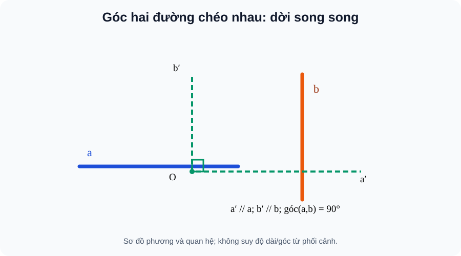
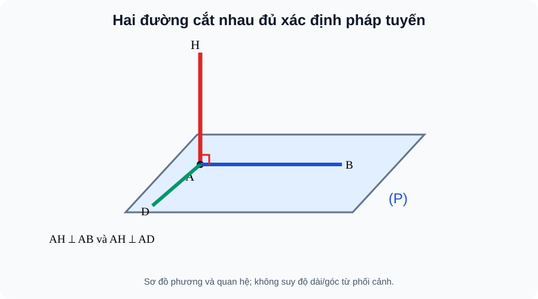
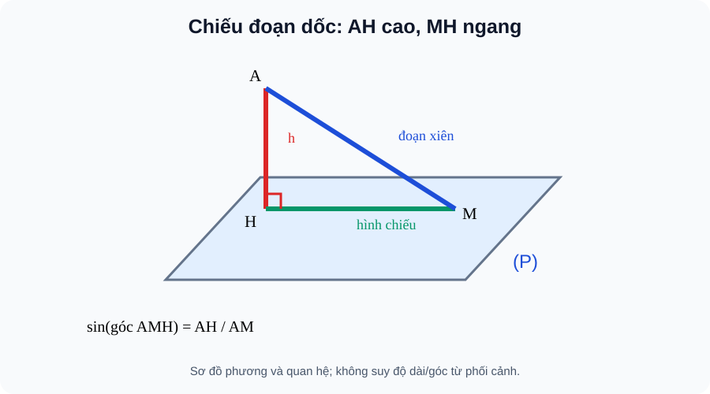
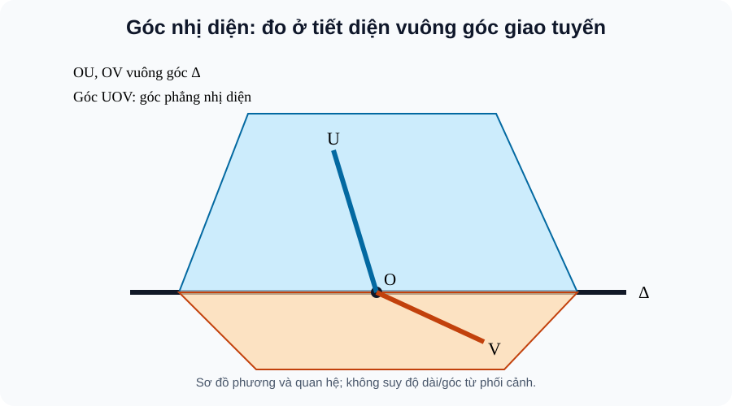
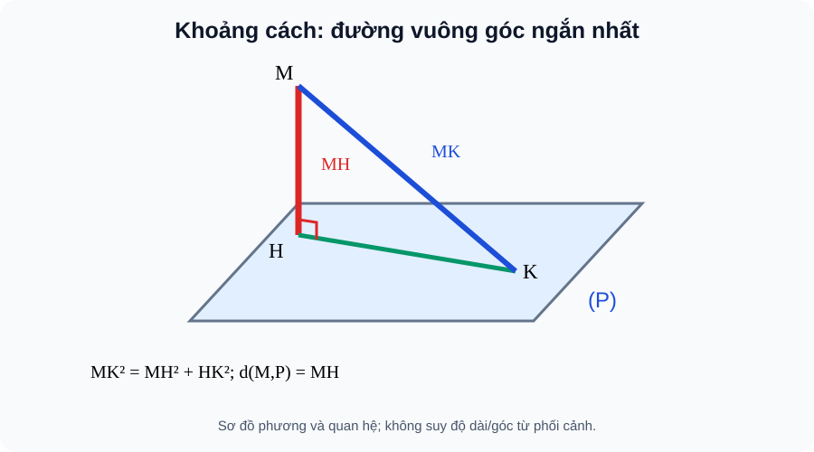
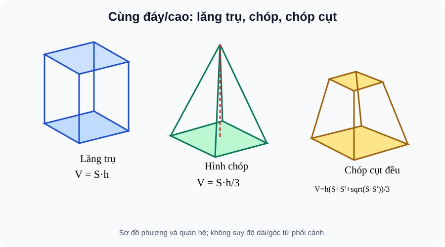

# Toán 11 KNTT Tập 2 — Chương VII: Quan hệ vuông góc trong không gian

**PACKET_ID:** `THPT-G11-CHVII-B22-B27-WHOLE-CHAPTER-AUTHORING-R00-20261101` · **LEARNING_PATH:** `SGK_CHAPTER` · **PUBLIC_REV:** R00 · **PRIVATE_RD1_REV:** R00 · **Ngày:** 01/11/2026.
**TRẠNG THÁI:** GÓI TÁC GIẢ GỬI PHẢN BIỆN ĐỘC LẬP (chưa có Academic/PED PASS, chưa CONTENT_READY, chưa phát hành).
**Nguồn S1 đối chiếu:** SGK Toán 11 KNTT Tập 2, Chương VII: B22 tr.27–30; B23 tr.31–37; B24 tr.38–43; B25 tr.44–53; B26 tr.54–60; B27 tr.61–63; bài tập cuối chương tr.64–65. SBT Toán 11 KNTT Tập 2: B22 tr.24–25; B23 tr.26–28; B24 tr.29–30; B25 tr.31–34; B26 tr.35–37; B27 tr.38–40; bài tập cuối chương tr.41–43; lời giải chương VII từ tr.86. **Đối chiếu trực tiếp tài liệu S1 với NotebookLM; chưa tuyên bố Source PASS độc lập.**
**Nguồn truy nguyên:** https://thuvienhoclieu.com/wp-content/uploads/2026/05/thuvienhoclieu.com-SGK-Toan-11-tu-nam-2026-Tap-2.pdf ; https://file.toan9.edu.vn/file-pdf/sach-bai-tap-toan-11-tap-2-ket-noi-tri-thuc-voi-cuoc-song.pdf . SGK/SBT xác nhận qua nội dung mục lục và thuật ngữ; PDF screenshot của trình duyệt không tải được; không nhận là đã QA hình gốc.
**Nguồn kiến trúc:** 08 v2.0 (hai hành trình độc lập), 06 NotebookLM handoff v1.0, 07 batch/delta v1.1; chuẩn concept-first và PED1–PED6, D1–D6. Không lẫn Chuyên đề và Readiness cuối CHƯƠNG.

## Giữ ranh giới học và đánh giá

PUBLIC D1–D6: giải thích + luyện tập đã nộp mới xem đáp án; D4 tự luận chỉ tự đối chiếu, không làm tăng Skill Mastery. PRIVATE RD1 là bộ độc lập, chỉ đánh giá ở trạng thái được phát hành chính thức sau kiểm chứng Final Submit; **trước Final Submit tuyệt đối không tiết lộ đáp án, đúng/sai, hint hay AI Tutor**. Bản demo không ghi điểm và không cập nhật Mastery. Một `item_id` canonical dùng nhiều placement, không sao chép thành ID mới. Không đưa nguyên văn câu kín sang GitHub/JS.


## 0. Ma trận outcomes RD0 (canonical skill_id)

| skill_id | Bài | Năng lực giải thích độc lập | D1–D6 evidence |
|---|---|---|---|

| `G11-B22-ANGLE_LINES` | B22 | Dựng góc giữa hai đường kể cả chéo nhau bằng tịnh tiến song song và lấy góc nhỏ 0°–90° | D1 concept-first, D2, D3/Written, HELP; nguồn kín RD1 theo cùng skill_id (chỉ ID, không nội dung) |

| `G11-B22-PERP_SKEW` | B22 | Nhận ra hai đường không cắt nhau vẫn có thể vuông góc theo phương | D1 concept-first, D2, D3/Written, HELP; nguồn kín RD1 theo cùng skill_id (chỉ ID, không nội dung) |

| `G11-B22-PARALLEL_DIRECTION` | B22 | Suy được quan hệ góc vuông khi thay đường bằng đường song song | D1 concept-first, D2, D3/Written, HELP; nguồn kín RD1 theo cùng skill_id (chỉ ID, không nội dung) |

| `G11-B22-PROOF_CONTEXT` | B22 | Lập chứng minh ngắn và diễn giải kiến trúc thực tiễn, không tin nét vẽ | D1 concept-first, D2, D3/Written, HELP; nguồn kín RD1 theo cùng skill_id (chỉ ID, không nội dung) |

| `G11-B23-PERP_PLANE_DEF` | B23 | Hiểu d⊥(P) là vuông góc mọi đường trong (P), không chỉ một đường | D1 concept-first, D2, D3/Written, HELP; nguồn kín RD1 theo cùng skill_id (chỉ ID, không nội dung) |

| `G11-B23-TWO_INTERSECT` | B23 | Dùng đúng tiêu chí vuông góc với hai đường cắt nhau trong một mặt phẳng | D1 concept-first, D2, D3/Written, HELP; nguồn kín RD1 theo cùng skill_id (chỉ ID, không nội dung) |

| `G11-B23-PARALLEL_TRANSFER` | B23 | Chuyển quan hệ vuông góc qua đường thẳng/mặt phẳng song song đúng điều kiện | D1 concept-first, D2, D3/Written, HELP; nguồn kín RD1 theo cùng skill_id (chỉ ID, không nội dung) |

| `G11-B23-PLANE_PROPERTY` | B23 | Nhận biết duy nhất đường vuông góc mặt phẳng qua một điểm và hai đường cùng vuông góc mặt phẳng thì song song | D1 concept-first, D2, D3/Written, HELP; nguồn kín RD1 theo cùng skill_id (chỉ ID, không nội dung) |

| `G11-B23-PRACTICAL_POST` | B23 | Giải thích cột thẳng đứng bằng hai phương kiểm tra độc lập trên nền | D1 concept-first, D2, D3/Written, HELP; nguồn kín RD1 theo cùng skill_id (chỉ ID, không nội dung) |

| `G11-B24-POINT_PROJECTION` | B24 | Dựng hình chiếu điểm H lên (P) từ đường AH vuông góc (P) | D1 concept-first, D2, D3/Written, HELP; nguồn kín RD1 theo cùng skill_id (chỉ ID, không nội dung) |

| `G11-B24-LINE_PROJECTION` | B24 | Tìm hình chiếu đường thẳng từ hình chiếu hai điểm, tách trường hợp đường vuông góc thành điểm | D1 concept-first, D2, D3/Written, HELP; nguồn kín RD1 theo cùng skill_id (chỉ ID, không nội dung) |

| `G11-B24-THREE_PERP` | B24 | Dùng định lí ba đường vuông góc có đủ giả thiết hình chiếu | D1 concept-first, D2, D3/Written, HELP; nguồn kín RD1 theo cùng skill_id (chỉ ID, không nội dung) |

| `G11-B24-LINE_PLANE_ANGLE` | B24 | Xác định góc giữa đường và mặt phẳng qua hình chiếu, miền 0°–90° | D1 concept-first, D2, D3/Written, HELP; nguồn kín RD1 theo cùng skill_id (chỉ ID, không nội dung) |

| `G11-B24-ANGLE_APPLICATION` | B24 | Tính độ dốc, chiều cao và góc từ tam giác vuông có hình chiếu | D1 concept-first, D2, D3/Written, HELP; nguồn kín RD1 theo cùng skill_id (chỉ ID, không nội dung) |

| `G11-B25-PLANE_ANGLE` | B25 | Định nghĩa góc nhọn/ vuông giữa hai mặt phẳng bằng pháp tuyến hoặc thiết diện vuông góc giao tuyến | D1 concept-first, D2, D3/Written, HELP; nguồn kín RD1 theo cùng skill_id (chỉ ID, không nội dung) |

| `G11-B25-DIHEDRAL` | B25 | Phân biệt góc nhị diện theo hai nửa mặt phẳng với góc giữa hai mặt phẳng không định hướng | D1 concept-first, D2, D3/Written, HELP; nguồn kín RD1 theo cùng skill_id (chỉ ID, không nội dung) |

| `G11-B25-PERP_PLANES` | B25 | Chứng minh hai mặt phẳng vuông góc bằng một đường thuộc mặt phẳng này vuông góc mặt kia | D1 concept-first, D2, D3/Written, HELP; nguồn kín RD1 theo cùng skill_id (chỉ ID, không nội dung) |

| `G11-B25-PERP_PLANE_RULE` | B25 | Sử dụng tính chất đường trong mặt phẳng thứ nhất vuông góc giao tuyến thì vuông góc mặt phẳng kia khi hai mặt phẳng vuông góc | D1 concept-first, D2, D3/Written, HELP; nguồn kín RD1 theo cùng skill_id (chỉ ID, không nội dung) |

| `G11-B25-RIGHT_PRISM` | B25 | Mô tả lăng trụ đứng, lăng trụ đều, hộp chữ nhật, lập phương và tính chất cạnh bên | D1 concept-first, D2, D3/Written, HELP; nguồn kín RD1 theo cùng skill_id (chỉ ID, không nội dung) |

| `G11-B25-REGULAR_PYRAMID` | B25 | Mô tả chóp đều: đáy đa giác đều, chân đường cao ở tâm đáy, cạnh bên bằng nhau | D1 concept-first, D2, D3/Written, HELP; nguồn kín RD1 theo cùng skill_id (chỉ ID, không nội dung) |

| `G11-B25-REGULAR_FRUSTUM` | B25 | Nhận biết chóp cụt đều: hai đáy song song đồng dạng, đường cao và các mặt bên hình thang cân | D1 concept-first, D2, D3/Written, HELP; nguồn kín RD1 theo cùng skill_id (chỉ ID, không nội dung) |

| `G11-B26-POINT_LINE` | B26 | Khoảng cách điểm–đường là đoạn vuông góc ngắn nhất | D1 concept-first, D2, D3/Written, HELP; nguồn kín RD1 theo cùng skill_id (chỉ ID, không nội dung) |

| `G11-B26-POINT_PLANE` | B26 | Khoảng cách điểm–mặt phẳng là đoạn vuông góc ngắn nhất; 0 khi thuộc mặt phẳng | D1 concept-first, D2, D3/Written, HELP; nguồn kín RD1 theo cùng skill_id (chỉ ID, không nội dung) |

| `G11-B26-PARALLEL_LINE_PLANE` | B26 | Khoảng cách đường // mặt phẳng bằng khoảng cách từ một điểm bất kỳ trên đường | D1 concept-first, D2, D3/Written, HELP; nguồn kín RD1 theo cùng skill_id (chỉ ID, không nội dung) |

| `G11-B26-PARALLEL_PLANES` | B26 | Khoảng cách giữa hai mặt phẳng song song xác định bởi đường vuông góc chung | D1 concept-first, D2, D3/Written, HELP; nguồn kín RD1 theo cùng skill_id (chỉ ID, không nội dung) |

| `G11-B26-SKEW_COMMON_PERP` | B26 | Đoạn vuông góc chung nối hai đường chéo nhau và độ dài biểu diễn khoảng cách | D1 concept-first, D2, D3/Written, HELP; nguồn kín RD1 theo cùng skill_id (chỉ ID, không nội dung) |

| `G11-B26-HEIGHT_APPLICATION` | B26 | Chiều cao khối đa diện là khoảng cách vuông góc, không dùng cạnh xiên | D1 concept-first, D2, D3/Written, HELP; nguồn kín RD1 theo cùng skill_id (chỉ ID, không nội dung) |

| `G11-B27-PRISM_VOLUME` | B27 | Giải thích V=S_đáy h cho lăng trụ, h vuông góc đáy | D1 concept-first, D2, D3/Written, HELP; nguồn kín RD1 theo cùng skill_id (chỉ ID, không nội dung) |

| `G11-B27-PYRAMID_VOLUME` | B27 | Giải thích V=(1/3)S_đáy h cho chóp cùng đáy/chiều cao | D1 concept-first, D2, D3/Written, HELP; nguồn kín RD1 theo cùng skill_id (chỉ ID, không nội dung) |

| `G11-B27-BOX_VOLUME` | B27 | Tính thể tích hộp chữ nhật, lập phương và đơn vị khối | D1 concept-first, D2, D3/Written, HELP; nguồn kín RD1 theo cùng skill_id (chỉ ID, không nội dung) |

| `G11-B27-FRUSTUM_VOLUME` | B27 | Dùng đúng V=h(S+S′+sqrt(SS′))/3 cho chóp cụt đều | D1 concept-first, D2, D3/Written, HELP; nguồn kín RD1 theo cùng skill_id (chỉ ID, không nội dung) |

| `G11-B27-VOLUME_APPLICATION` | B27 | Chọn đúng khối, đơn vị, h và điều kiện khi giải bài toán thực tế | D1 concept-first, D2, D3/Written, HELP; nguồn kín RD1 theo cùng skill_id (chỉ ID, không nội dung) |

| `G11-CHVII-INTEGRATED` | CHVII | Liên kết hướng vuông góc → hình chiếu → độ dài ngắn nhất → chiều cao → thể tích và điều kiện chứng minh | D1 concept-first, D2, D3/Written, HELP; nguồn kín RD1 theo cùng skill_id (chỉ ID, không nội dung) |


---


## D1–D2 · Bài 22 — Hai đường thẳng vuông góc

### 1. Vì sao cần học (WHY)
Trong căn nhà có nhiều thanh không giao nhau. Muốn biết phương của hai thanh có vuông góc không, không thể đo một góc ngay tại giao điểm không tồn tại. Ta cần cách chuyển phương song song về chung một điểm.

### 2. Khái niệm thực chất (WHAT)
Qua O bất kì dựng a′//a và b′//b; góc giữa a,b là góc nhỏ giữa hai đường a′,b′, thuộc [0°,90°]. Nếu bằng 90°, gọi a⊥b; hai đường có thể chéo nhau.

### 3. Hình thành và lập luận (HOW)
Phép tịnh tiến giữ phương; góc không đổi khi chọn O khác. Hai đường giao nhau là trường hợp đặc biệt. Nếu a//a₁ thì (a,b)=(a₁,b), nên có thể thay bằng cạnh song song trong hình hộp.

### 4. Điều kiện, giới hạn, lỗi thường gặp (FORMAL)
Không lấy góc tù 120° làm góc giữa **đường thẳng**: lấy 60°. Hai đường song song có góc 0°, chéo nhau có thể vuông góc. Hai đường cùng vuông góc với đường thứ ba không nhất thiết song song trong không gian.

### 5. Hình dẫn giải D5



**Hướng dẫn đọc hình:** Hai đường chéo nhau vẫn có thể vuông góc theo phương; tịnh tiến một đường tới chung điểm O. Hình là sơ đồ giải thích phương pháp, **không được suy góc hay độ dài từ nét vẽ phối cảnh**. Điều kiện vuông góc phải có chứng minh.

### 6. Tự thử trước bài luyện tập
Hình hộp chữ nhật có cạnh AB theo phương ngang và CC′ theo phương thẳng đứng. Chúng không cắt nhau; vì CC′//AA′ và AB⊥AA′, suy ra (AB,CC′)=90°. Vì sao không cần AB gặp CC′?

### 7. Ví dụ có hướng dẫn D2 (giải thích vì sao chọn phương pháp)


#### EX-G11-CHVII-B22-01 — Góc hai đường trong hình hộp

**Nhiệm vụ:** Hộp chữ nhật ABCD.A′B′C′D′: AB⊥CC′ mặc dù không cắt nhau.

**Lập luận để tự đối chiếu sau khi thử:** CC′//AA′, AB⊥AA′ (cạnh đứng vuông góc đáy) nên góc giữa AB và CC′ là 90°. Đưa về chung điểm theo song song, không đo theo nét vẽ.


#### EX-G11-CHVII-B22-02 — Góc nhọn giữa hai phương

**Nhiệm vụ:** Hai đường trong hai mặt phẳng khác nhau có phương tạo góc 120° theo hai tia đã chọn. Góc giữa hai đường là bao nhiêu?

**Lập luận để tự đối chiếu sau khi thử:** 60° vì góc giữa đường lấy góc không tù, min(120°,180°−120°)=60°.


#### EX-G11-CHVII-B22-03 — Đường chéo hình vuông và cạnh đáy

**Nhiệm vụ:** Hình hộp có đáy ABCD là hình vuông; tính góc giữa AC và AB.

**Lập luận để tự đối chiếu sau khi thử:** 45° do tam giác ABC vuông cân tại B/đường chéo hình vuông phân giác góc tại A.


#### EX-G11-CHVII-B22-04 — Không suy vuông góc dây thứ ba

**Nhiệm vụ:** Hai đường a,b cùng vuông góc c trong không gian. Có suy a//b?

**Lập luận để tự đối chiếu sau khi thử:** Không. Chẳng hạn hai trục Ox,Oy cùng vuông góc Oz nhưng Ox⊥Oy. Cần thêm điều kiện cùng nằm trong mặt phẳng vuông góc c hoặc định hướng phù hợp.


---


## D1–D2 · Bài 23 — Đường thẳng vuông góc với mặt phẳng

### 1. Vì sao cần học (WHY)
Một cột dựng đứng phải vuông góc cả nền nhà chứ không chỉ vuông góc với một vạch sơn trên nền. Một phương duy nhất chưa xác định được tư thế của cả mặt phẳng.

### 2. Khái niệm thực chất (WHAT)
d⊥(P) khi d vuông góc **mọi đường thẳng** trong (P). Đường d cắt (P) tại chân H.

### 3. Hình thành và lập luận (HOW)
Nếu d⊥a và d⊥b với a,b cắt nhau thuộc (P), thì d⊥(P). Vì hai phương cắt nhau sinh mọi phương trong mặt phẳng, phép kiểm hai phương đủ. Từ d⊥(P), mọi đường d′//d cũng ⊥(P); qua một điểm có đúng một đường vuông góc (P).

### 4. Điều kiện, giới hạn, lỗi thường gặp (FORMAL)
Hai đường a,b phải **cắt nhau** trong (P); hai đường song song không đủ. Một đường thuộc (P) không thể đồng thời là đường vuông góc (P). Nếu (Q)//(P), d⊥(P) ⇒ d⊥(Q).

### 5. Hình dẫn giải D5



**Hướng dẫn đọc hình:** Cột AH được xác nhận vuông góc mặt nền bởi AH⊥AB và AH⊥AD, AB,AD cắt nhau tại A. Hình là sơ đồ giải thích phương pháp, **không được suy góc hay độ dài từ nét vẽ phối cảnh**. Điều kiện vuông góc phải có chứng minh.

### 6. Tự thử trước bài luyện tập
Biết cột k vuông góc hai vạch sàn song song: đã đủ nói k⊥sàn chưa? Chưa; cần hai vạch có phương không song song và cắt nhau.

### 7. Ví dụ có hướng dẫn D2 (giải thích vì sao chọn phương pháp)


#### EX-G11-CHVII-B23-01 — Hai phương sàn đủ để dựng cột

**Nhiệm vụ:** Nếu d⊥AB, d⊥AD với AB và AD cắt nhau tại A trong (ABCD), suy ra?

**Lập luận để tự đối chiếu sau khi thử:** d⊥(ABCD). Hai phương cắt nhau đủ xác định mặt; không đòi kiểm vô hạn đường.


#### EX-G11-CHVII-B23-02 — Kiểm giả thiết cắt nhau

**Nhiệm vụ:** d⊥a và d⊥b nhưng a//b trong (P). Có được d⊥(P)?

**Lập luận để tự đối chiếu sau khi thử:** Không được kết luận. Thiếu hai phương độc lập cắt nhau. Có thể d vuông góc phương a nhưng nằm nghiêng trong phương khác của P.


#### EX-G11-CHVII-B23-03 — Cạnh SA dựng đứng

**Nhiệm vụ:** Hình chóp S.ABC, SA⊥AB, SA⊥AC. Chứng minh SA⊥BC.

**Lập luận để tự đối chiếu sau khi thử:** AB, AC cắt nhau tại A và thuộc (ABC), suy SA⊥(ABC), rồi SA⊥BC.


#### EX-G11-CHVII-B23-04 — Tính chuyển song song

**Nhiệm vụ:** Nếu k⊥(P), k′//k và (Q)//(P), thì quan hệ của k′ và (Q)?

**Lập luận để tự đối chiếu sau khi thử:** k′⊥(Q), vì k′ giữ cùng phương pháp tuyến và hai mặt song song có cùng các phương mặt.


---


## D1–D2 · Bài 24 — Phép chiếu vuông góc. Góc giữa đường thẳng và mặt phẳng

### 1. Vì sao cần học (WHY)
Khi đi trên đoạn dốc, chiều dài đường đi lớn hơn chiều dài nhìn từ trên mặt đất. Để tách đoạn dốc thành phần nằm ngang và độ cao, ta cần hình chiếu vuông góc.

### 2. Khái niệm thực chất (WHAT)
H là hình chiếu vuông góc của A lên (P) khi AH⊥(P). Hình chiếu của một đường không vuông góc (P) là đường qua hình chiếu của hai điểm phân biệt; đường ⊥(P) có hình chiếu chỉ là một điểm.

### 3. Hình thành và lập luận (HOW)
Nếu đường a cắt (P) tại M và A∈a, H là hình chiếu A thì góc giữa a và (P) là góc nhọn giữa MA và MH: ∠AMH∈[0°,90°]; đường ⊥(P) tạo góc 90° theo quy ước. Trong tam giác vuông AMH: sinθ=AH/AM; tanθ=AH/MH (MH>0). Định lí ba đường vuông góc: nếu a nằm trong (P), b không vuông góc (P), b′ là hình chiếu của b thì a⊥b ⇔ a⊥b′, khi a và b′ cắt nhau đúng tại điểm đang xét / xét theo phương.

### 4. Điều kiện, giới hạn, lỗi thường gặp (FORMAL)
Không lấy góc giữa đường xiên và đường vuông góc làm góc với mặt phẳng; đó là góc phụ. Không đánh đồng độ dài đoạn dốc với chiều cao vuông góc. Muốn dùng ba đường vuông góc phải xác định đúng hình chiếu.

### 5. Hình dẫn giải D5



**Hướng dẫn đọc hình:** Tam giác AMH vuông tại H: AM là đoạn dốc, MH hình chiếu, AH độ cao. Hình là sơ đồ giải thích phương pháp, **không được suy góc hay độ dài từ nét vẽ phối cảnh**. Điều kiện vuông góc phải có chứng minh.

### 6. Tự thử trước bài luyện tập
Đường dốc dài 10m, hình chiếu trên nền dài 8m, chênh cao =√(10²−8²)=6m; sin góc dốc bằng 6/10, không phải 8/10.

### 7. Ví dụ có hướng dẫn D2 (giải thích vì sao chọn phương pháp)


#### EX-G11-CHVII-B24-01 — Hình chiếu đoạn dốc

**Nhiệm vụ:** A cao 6m trên (P), H là chân vuông góc, B∈(P), HB=8m; tính AB và sin∠ABH.

**Lập luận để tự đối chiếu sau khi thử:** AB=10m (Pythagore), sin∠ABH=AH/AB=3/5. ∠ABH là góc AB với (P), vì HB là hình chiếu AB.


#### EX-G11-CHVII-B24-02 — Đường vuông góc mặt

**Nhiệm vụ:** Nếu đường d⊥(P), hình chiếu của cả d lên (P) là gì?

**Lập luận để tự đối chiếu sau khi thử:** Một điểm duy nhất (chân đường); góc đường với mặt bằng 90°, không dùng công thức góc với một hình chiếu là đường.


#### EX-G11-CHVII-B24-03 — Ba đường vuông góc

**Nhiệm vụ:** Cho đường xiên b có hình chiếu b′ lên (P). Với đường a⊂(P) vuông góc b′, kết luận gì?

**Lập luận để tự đối chiếu sau khi thử:** a⊥b theo định lí ba đường vuông góc; giải thích bằng phân tích thành phần b′ trong mặt và thành phần vuông góc mặt.


#### EX-G11-CHVII-B24-04 — Độ dốc đo bằng tang

**Nhiệm vụ:** Đường dốc lên 1,5m sau quãng nằm ngang 6m; tính tan góc dốc.

**Lập luận để tự đối chiếu sau khi thử:** tanθ=1,5/6=1/4; θ≈14,04°. Chiều dài đường dốc không được dùng thay quãng nằm ngang 6m.


---


## D1–D2 · Bài 25 — Hai mặt phẳng vuông góc

### 1. Vì sao cần học (WHY)
Cánh cửa với tường, hai mái nhà và mặt đáy của chóp tạo ra góc giữa **hai mặt**, không thể đo bằng cách lấy tùy tiện hai cạnh trên mặt.

### 2. Khái niệm thực chất (WHAT)
Góc giữa hai mặt phẳng là góc nhọn/vuông giữa hai đường pháp tuyến, thuộc [0°,90°]. Hai mặt phẳng vuông góc nếu góc bằng 90°. Góc nhị diện đo theo hai nửa mặt phẳng, có thể là góc tù; góc phẳng nhị diện tạo bởi hai tia cùng vuông góc giao tuyến tại một điểm.

### 3. Hình thành và lập luận (HOW)
Để đo góc phẳng nhị diện, cắt bởi một mặt phẳng vuông góc với giao tuyến, thu được hai tia thuộc hai nửa mặt. Nếu (P) chứa đường a vuông góc (Q), thì (P)⊥(Q). Nếu (P)⊥(Q) theo giao tuyến Δ và a∈(P) vuông góc Δ, thì a⊥(Q).

### 4. Điều kiện, giới hạn, lỗi thường gặp (FORMAL)
Không suy hai mặt phẳng vuông góc chỉ từ hai đường bất kì vuông góc, mỗi đường thuộc một mặt. Với hình chóp đều: đáy là đa giác đều, chân đường cao ở tâm đáy; lăng trụ đứng: cạnh bên vuông góc đáy; lăng trụ đều = lăng trụ đứng có đáy đa giác đều; chóp cụt đều có hai đáy đa giác đều song song, đồng dạng và mặt bên là hình thang cân.

### 5. Hình dẫn giải D5



**Hướng dẫn đọc hình:** Góc giữa hai mặt phải đo trong một tiết diện vuông góc giao tuyến; đánh dấu 90° của hai mặt bằng điều kiện vuông góc đường–mặt. Hình là sơ đồ giải thích phương pháp, **không được suy góc hay độ dài từ nét vẽ phối cảnh**. Điều kiện vuông góc phải có chứng minh.

### 6. Tự thử trước bài luyện tập
Hình chóp S.ABCD có SA⊥(ABCD). Vì SA⊂(SAB), hai mặt (SAB) và (ABCD) vuông góc. Nhưng không suy mọi mặt bên của hình chóp đều đều vuông góc đáy.

### 7. Ví dụ có hướng dẫn D2 (giải thích vì sao chọn phương pháp)


#### EX-G11-CHVII-B25-01 — Tiết diện đo góc hai mặt

**Nhiệm vụ:** Hai mặt (P),(Q) cắt nhau theo Δ. Một tiết diện vuông góc Δ tạo các tia m⊂(P), n⊂(Q) cùng gốc; góc giữa hai mặt lấy thế nào?

**Lập luận để tự đối chiếu sau khi thử:** Lấy góc nhỏ giữa hai đường m,n, thuộc [0°,90°]. Với hai nửa mặt định hướng, góc nhị diện có thể là góc lớn hơn 90°.


#### EX-G11-CHVII-B25-02 — Một đường vuông góc mặt đủ

**Nhiệm vụ:** a⊂(P), a⊥(Q). Kết luận (P) và (Q)?

**Lập luận để tự đối chiếu sau khi thử:** (P)⊥(Q). Đây là tiêu chí đường nằm trong một mặt và vuông góc mặt kia.


#### EX-G11-CHVII-B25-03 — Góc nhị diện khác góc hai mặt

**Nhiệm vụ:** Hai nửa mặt phẳng tạo góc phẳng nhị diện 120°. Góc giữa hai mặt phẳng chứa chúng là bao nhiêu?

**Lập luận để tự đối chiếu sau khi thử:** 60°. Góc không định hướng giữa mặt lấy góc nhọn/ vuông của hai mặt, min(120°,60°).


#### EX-G11-CHVII-B25-04 — Hình lăng trụ đều

**Nhiệm vụ:** Một lăng trụ đứng có đáy tam giác đều cạnh 4 và chiều cao 6. Diện tích đáy?

**Lập luận để tự đối chiếu sau khi thử:** S=4²√3/4=4√3. Nó là lăng trụ đều vì đứng và đáy đều; cạnh bên là chiều cao 6.


#### EX-G11-CHVII-B25-05 — Đỉnh chóp đều và chân cao

**Nhiệm vụ:** Hình chóp đều S.ABCD đáy hình vuông tâm O, cạnh đáy 6; đường cao SO=4. Tính cạnh bên SA.

**Lập luận để tự đối chiếu sau khi thử:** OA=3√2, SA=√(SO²+OA²)=√34. Vì chân chiều cao của chóp đều là tâm O, tam giác SOA vuông tại O.


---


## D1–D2 · Bài 26 — Khoảng cách

### 1. Vì sao cần học (WHY)
Đo khoảng cách từ đèn treo tới sàn phải đo theo phương ngắn nhất, không đo theo dây xiên. Giữa hai thanh chéo nhau, phải tìm đoạn nối vừa chạm hai đường vừa vuông góc cả hai.

### 2. Khái niệm thực chất (WHAT)
d(M,a)=MH với H là hình chiếu M lên a; d(M,(P))=MH với MH⊥(P). Nếu a//(P) thì d(a,(P))=d(M,(P)) với M∈a. Nếu hai mặt song song, dùng khoảng cách từ một điểm mặt này đến mặt kia. Với hai đường chéo nhau, khoảng cách là độ dài đoạn vuông góc chung.

### 3. Hình thành và lập luận (HOW)
Trong tam giác vuông MHK với H là chân đường vuông góc và K nằm trên đường/mặt: MK²=MH²+HK²≥MH². Đó là lý do “ngắn nhất”. Muốn tìm đoạn vuông góc chung phải kiểm cả hai đầu thuộc đúng hai đường và vuông góc **cả hai**, không phải chỉ một.

### 4. Điều kiện, giới hạn, lỗi thường gặp (FORMAL)
Nếu điểm đã thuộc mặt thì khoảng cách bằng 0. Nếu hai đường song song, dùng đoạn nối vuông góc giữa chúng; khái niệm chéo nhau yêu cầu không đồng phẳng và không cắt nhau. Chiều cao hình chóp là khoảng cách đỉnh–mặt đáy, không phải cạnh bên.

### 5. Hình dẫn giải D5



**Hướng dẫn đọc hình:** Dựng MH⊥(P) và đoạn MK xiên: so sánh chiều dài; đoạn vuông góc chung giữa hai đường chéo nhau. Hình là sơ đồ giải thích phương pháp, **không được suy góc hay độ dài từ nét vẽ phối cảnh**. Điều kiện vuông góc phải có chứng minh.

### 6. Tự thử trước bài luyện tập
Chóp có SA=5, hình chiếu S trên đáy là H, AH=4: SH=3. Tại sao chiều cao là 3 chứ không phải 5?

### 7. Ví dụ có hướng dẫn D2 (giải thích vì sao chọn phương pháp)


#### EX-G11-CHVII-B26-01 — Đường vuông góc là đường ngắn nhất

**Nhiệm vụ:** Từ M tới mặt (P) có MH=3 là đoạn vuông góc; điểm K∈(P) có HK=4. Tính MK và xác định d(M,(P)).

**Lập luận để tự đối chiếu sau khi thử:** MK=5, d(M,(P))=3. Pythagore cho MK²=MH²+HK² nên MK≥MH.


#### EX-G11-CHVII-B26-02 — Chóp và chiều cao

**Nhiệm vụ:** SA=13, H là hình chiếu S lên đáy, AH=12. Tính chiều cao SH.

**Lập luận để tự đối chiếu sau khi thử:** SH=√(13²−12²)=5. Cạnh bên 13 không phải chiều cao.


#### EX-G11-CHVII-B26-03 — Khoảng cách đường song song mặt

**Nhiệm vụ:** Đường a//(P). Hai điểm M,N∈a có d(M,(P))=4. Tính d(N,(P)) và d(a,(P)).

**Lập luận để tự đối chiếu sau khi thử:** Cả hai bằng 4 do khoảng cách từ mọi điểm của đường song song tới mặt đều như nhau.


#### EX-G11-CHVII-B26-04 — Hai đường chéo nhau

**Nhiệm vụ:** Trong hệ trục minh họa, a={(t,0,0)}, b={(2,s,3)}. Nêu đoạn vuông góc chung và khoảng cách giữa a,b.

**Lập luận để tự đối chiếu sau khi thử:** Đoạn từ A=(2,0,0)∈a đến B=(2,0,3)∈b có phương Oz vuông góc phương Ox và Oy, dài 3; d(a,b)=3.


#### EX-G11-CHVII-B26-05 — Hai mặt phẳng song song

**Nhiệm vụ:** Hai sàn phẳng song song (P),(Q) cách nhau 2,7m; điểm M bất kì trên (P). Tính d(M,(Q)).

**Lập luận để tự đối chiếu sau khi thử:** 2,7m vì đoạn vuông góc nối hai mặt song song có độ dài không phụ thuộc vị trí M.


---


## D1–D2 · Bài 27 — Thể tích

### 1. Vì sao cần học (WHY)
Hai thùng có cùng diện tích đáy và cùng độ cao nhưng hình dạng khác nhau có thể chứa lượng khác nhau. Thể tích cần phân biệt lăng trụ và chóp, và dùng đúng chiều cao vuông góc.

### 2. Khái niệm thực chất (WHAT)
V lăng trụ = S_đáy·h; V hộp chữ nhật = dài·rộng·cao; V chóp = S_đáy·h/3. Chóp cụt đều với diện tích hai đáy S, S′ và chiều cao h: V=h(S+S′+√(SS′))/3.

### 3. Hình thành và lập luận (HOW)
Lăng trụ có các thiết diện song song đáy cùng diện tích nên thể tích là diện tích đáy nhân chiều cao. Chóp cùng S,h chỉ chiếm 1/3 thể tích lăng trụ tương ứng (ghép/cắt); chóp cụt là hiệu hai chóp đồng dạng, từ đó xuất hiện căn √(SS′). Nếu S′=0, công thức về chóp; nếu S′=S, về lăng trụ.

### 4. Điều kiện, giới hạn, lỗi thường gặp (FORMAL)
Chiều cao **vuông góc** hai đáy, không tự dùng cạnh xiên. Đơn vị thể tích m³, cm³; 1m³=1000L. Chóp cụt đều đòi hai mặt đáy đồng dạng song song trong một hình chóp đều, không áp cho hai hình tùy ý.

### 5. Hình dẫn giải D5



**Hướng dẫn đọc hình:** Ba khối có cùng diện tích đáy và chiều cao; phân biệt hình chóp, lăng trụ và chóp cụt đều. Hình là sơ đồ giải thích phương pháp, **không được suy góc hay độ dài từ nét vẽ phối cảnh**. Điều kiện vuông góc phải có chứng minh.

### 6. Tự thử trước bài luyện tập
Đáy 18cm², cao 5cm: lăng trụ V=90cm³, chóp V=30cm³. Chóp cụt đáy 16cm² và 4cm², cao 3cm: V=28cm³.

### 7. Ví dụ có hướng dẫn D2 (giải thích vì sao chọn phương pháp)


#### EX-G11-CHVII-B27-01 — Cùng đáy cùng cao khác thể tích

**Nhiệm vụ:** Hai khối cùng S=24 cm², h=9 cm, một là lăng trụ, một là chóp. Tính mỗi thể tích.

**Lập luận để tự đối chiếu sau khi thử:** V_lăng trụ=216cm³; V_chóp=72cm³. Hệ số 1/3 do chóp thu nhỏ tiết diện về đỉnh.


#### EX-G11-CHVII-B27-02 — Tứ diện vuông ba cạnh

**Nhiệm vụ:** Tứ diện OABC có OA=3,OB=4,OC=5 đôi một vuông góc. Tính V.

**Lập luận để tự đối chiếu sau khi thử:** V=(3·4·5)/6=10 đơn vị³: đáy OBC có diện tích 4·5/2, chiều cao OA=3.


#### EX-G11-CHVII-B27-03 — Chóp cụt đều

**Nhiệm vụ:** Chóp cụt đều có diện tích đáy lớn 36cm², đáy bé 9cm², h=4cm. Tính V.

**Lập luận để tự đối chiếu sau khi thử:** V=4(36+9+√324)/3=4(45+18)/3=84cm³. Không lấy trung bình cộng diện tích hai đáy rồi nhân h.


#### EX-G11-CHVII-B27-04 — Đổi đơn vị

**Nhiệm vụ:** Bồn dạng hộp chữ nhật 1,2m × 0,8m × 0,5m. Tính lít nước tối đa nếu không có phần rỗng khác.

**Lập luận để tự đối chiếu sau khi thử:** V=0,48m³=480L. Ghi rõ giả thiết hộp kín đáy và không trừ thành bồn.


#### EX-G11-CHVII-B27-05 — Hộp đáy vuông

**Nhiệm vụ:** Hộp đáy vuông cạnh 5cm cao 8cm. Tính thể tích và so với chóp cùng đáy, cùng chiều cao.

**Lập luận để tự đối chiếu sau khi thử:** V_hộp=25·8=200cm³; V_chóp=200/3cm³, không phải 200cm³.


## Mạch tư duy xuyên Chương VII

1. Đo góc giữa **phương** của hai đường ở B22, kể cả khi chéo nhau; từ đó mới chứng minh một đường vuông góc **cả mặt** ở B23.
2. Khi đã có đường vuông góc mặt, dựng được **hình chiếu** và góc đường–mặt ở B24; nhờ đó đọc **góc giữa hai mặt/góc nhị diện** và phân biệt các khối đứng/đều ở B25.
3. Đo theo hướng vuông góc thì được **khoảng cách ngắn nhất** và **chiều cao** B26, vốn là đại lượng bắt buộc trong **thể tích** B27.
4. **Tự kiểm tra ý nghĩa:** Hai hình chóp có cùng diện tích đáy và cùng *cạnh bên xiên* có nhất thiết cùng thể tích không? **Không**: phải có cùng chiều cao vuông góc. Đừng thay độ dài xiên cho chiều cao.

### Giới hạn phương pháp

Các ví dụ sử dụng hệ trục minh họa để kiểm chứng phương vuông góc là ví dụ **giải thích**, không thêm riêng một chương tọa độ Oxyz nâng cao vào Core SGK. Không chuyển khái niệm song song từ Chương IV thành yêu cầu học lại cả chương. Tất cả kết quả phải dựa vào giả thiết hình học, không dựa vào cảm giác hình vẽ. Bài tập cuối chương phải liên kết các kỹ năng trong cùng trục SGK; chuyên đề là hành trình khác, không thay thế nội dung bắt buộc.


## D3 — Core / Practice / Application có item_id duy nhất (đáp án chỉ dùng sau Submit luyện tập)


### B22 — các câu Core theo outcome


### B23 — các câu Core theo outcome


### B24 — các câu Core theo outcome


### B25 — các câu Core theo outcome


### B26 — các câu Core theo outcome


### B27 — các câu Core theo outcome


### CHVII — các câu Core theo outcome


### B22 — các câu Practice/Vận dụng


### B23 — các câu Practice/Vận dụng


### B24 — các câu Practice/Vận dụng


### B25 — các câu Practice/Vận dụng


### B26 — các câu Practice/Vận dụng


### B27 — các câu Practice/Vận dụng


### B22 — Item nguồn công khai


#### THPT-G11-CHVII-B22-C01 | skill_id=`G11-B22-ANGLE_LINES` | placement=`SGK_CORE`

**Đề:** Hai đường có góc giữa hai tia cùng phương được chọn là 145°. Góc giữa hai đường thẳng là bao nhiêu?

**Đáp án sau Submit luyện tập:** 35°

**Lời giải và vì sao:** Góc giữa hai đường thẳng là góc không tù: 180°−145°=35°.


#### THPT-G11-CHVII-B22-C02 | skill_id=`G11-B22-PERP_SKEW` | placement=`SGK_CORE`

**Đề:** Có thể có a⊥b nhưng a và b không có điểm chung không?

**Đáp án sau Submit luyện tập:** Có

**Lời giải và vì sao:** Góc vuông là quan hệ giữa phương; đường chéo nhau vẫn có thể có hai phương vuông góc.


#### THPT-G11-CHVII-B22-C03 | skill_id=`G11-B22-PARALLEL_DIRECTION` | placement=`SGK_CORE`

**Đề:** Nếu a//a′ và a⊥b thì góc giữa a′ và b bằng bao nhiêu?

**Đáp án sau Submit luyện tập:** 90°

**Lời giải và vì sao:** Đường song song giữ phương nên giữ góc với b.


#### THPT-G11-CHVII-B22-C04 | skill_id=`G11-B22-PROOF_CONTEXT` | placement=`SGK_CORE`

**Đề:** Hai thanh thép cách nhau, một theo phương Đông–Tây, một thẳng đứng. Chúng có vuông góc theo định nghĩa không?

**Đáp án sau Submit luyện tập:** Có, góc giữa hai phương bằng 90°

**Lời giải và vì sao:** Chuyển một thanh bằng đường song song đến cùng điểm; không cần chúng cắt nhau.


#### THPT-G11-CHVII-B22-P01 | skill_id=`G11-B22-ANGLE_LINES` | placement=`SGK_PRACTICE`

**Đề:** Nêu cách xác định góc của hai đường chéo nhau mà không phải kéo chúng tới chỗ gặp nhau.

**Đáp án sau Submit luyện tập:** Qua một điểm chung dựng hai đường lần lượt song song hai đường ban đầu, đo góc không tù giữa chúng.

**Lời giải và vì sao:** Hình thức tịnh tiến hướng, không biến hai đường thật thành đồng phẳng.


#### THPT-G11-CHVII-B22-P02 | skill_id=`G11-B22-PERP_SKEW` | placement=`SGK_PRACTICE`

**Đề:** Trong hộp chữ nhật, AB và D′C′ có góc giữa là bao nhiêu?

**Đáp án sau Submit luyện tập:** 0°

**Lời giải và vì sao:** AB//D′C′, hai đường song song trong không gian.


#### THPT-G11-CHVII-B22-P03 | skill_id=`G11-B22-PARALLEL_DIRECTION` | placement=`SGK_PRACTICE`

**Đề:** Một bạn nói hai đường vuông góc phải gặp nhau. Nêu một phản ví dụ chính xác.

**Đáp án sau Submit luyện tập:** Trong hộp chữ nhật AB⊥CC′ dù không cắt nhau.

**Lời giải và vì sao:** Vì CC′//AA′ và AA′⊥AB.


### B23 — Item nguồn công khai


#### THPT-G11-CHVII-B23-C01 | skill_id=`G11-B23-PERP_PLANE_DEF` | placement=`SGK_CORE`

**Đề:** Một cột chỉ vuông góc một đường trong mặt sân, có đủ kết luận cột vuông góc sân?

**Đáp án sau Submit luyện tập:** Chưa đủ

**Lời giải và vì sao:** Định nghĩa đòi vuông góc mọi phương nằm trong mặt; một phương chưa đủ.


#### THPT-G11-CHVII-B23-C02 | skill_id=`G11-B23-TWO_INTERSECT` | placement=`SGK_CORE`

**Đề:** Trong mặt (P), a,b cắt nhau. d⊥a và d⊥b thì d quan hệ gì với (P)?

**Đáp án sau Submit luyện tập:** d⊥(P)

**Lời giải và vì sao:** Hai phương cắt nhau đủ theo điều kiện xác định đường vuông góc mặt phẳng.


#### THPT-G11-CHVII-B23-C03 | skill_id=`G11-B23-PARALLEL_TRANSFER` | placement=`SGK_CORE`

**Đề:** d⊥(P) và e//d. e có vuông góc (P)?

**Đáp án sau Submit luyện tập:** Có

**Lời giải và vì sao:** Đường e giữ phương vuông góc (P) của d.


#### THPT-G11-CHVII-B23-C04 | skill_id=`G11-B23-PLANE_PROPERTY` | placement=`SGK_CORE`

**Đề:** Hai đường d,e cùng vuông góc một mặt phẳng, chúng có thể cắt nhau mà không trùng nhau không?

**Đáp án sau Submit luyện tập:** Không; d//e hoặc d=e

**Lời giải và vì sao:** Hai đường cùng phương pháp tuyến. Nếu cùng đi qua một điểm thì chúng trùng, nếu khác đường thì song song.


#### THPT-G11-CHVII-B23-C05 | skill_id=`G11-B23-PRACTICAL_POST` | placement=`SGK_CORE`

**Đề:** Chân giá treo đỡ cột theo hai thanh nằm trên nền mà hai thanh cắt nhau. Cột vuông góc cả hai thanh. Kết luận?

**Đáp án sau Submit luyện tập:** Cột vuông góc nền

**Lời giải và vì sao:** Vì hai thanh thuộc nền cắt nhau và cột vuông góc cả hai.


#### THPT-G11-CHVII-B23-P01 | skill_id=`G11-B23-PERP_PLANE_DEF` | placement=`SGK_PRACTICE`

**Đề:** d⊥(P) và (P)//(Q). d có vuông góc (Q)?

**Đáp án sau Submit luyện tập:** Có.

**Lời giải và vì sao:** Mặt song song có các phương trong mặt giống nhau; pháp tuyến chung.


#### THPT-G11-CHVII-B23-P02 | skill_id=`G11-B23-TWO_INTERSECT` | placement=`SGK_PRACTICE`

**Đề:** Nếu một đường d vuông góc hai đường song song trong (P), kết luận d⊥(P) có chắc đúng?

**Đáp án sau Submit luyện tập:** Không chắc.

**Lời giải và vì sao:** Thiếu hai phương cắt nhau/độc lập trong mặt phẳng.


#### THPT-G11-CHVII-B23-P03 | skill_id=`G11-B23-PARALLEL_TRANSFER` | placement=`SGK_PRACTICE`

**Đề:** Có thể có hai đường phân biệt, cắt nhau và đều vuông góc (P)?

**Đáp án sau Submit luyện tập:** Không.

**Lời giải và vì sao:** Hai đường cùng vuông góc một mặt chỉ có thể song song hoặc trùng nhau.


### B24 — Item nguồn công khai


#### THPT-G11-CHVII-B24-C01 | skill_id=`G11-B24-POINT_PROJECTION` | placement=`SGK_CORE`

**Đề:** M nằm cách (P) 7cm qua đường MH⊥(P). H là gì?

**Đáp án sau Submit luyện tập:** H là hình chiếu vuông góc của M lên (P)

**Lời giải và vì sao:** Vị trí chân đường vuông góc xác định hình chiếu.


#### THPT-G11-CHVII-B24-C02 | skill_id=`G11-B24-LINE_PROJECTION` | placement=`SGK_CORE`

**Đề:** Đường l vuông góc (P). Hình chiếu của l trên (P) là đường hay điểm?

**Đáp án sau Submit luyện tập:** Một điểm

**Lời giải và vì sao:** Mọi điểm trên l chiếu đến cùng chân l∩(P).


#### THPT-G11-CHVII-B24-C03 | skill_id=`G11-B24-THREE_PERP` | placement=`SGK_CORE`

**Đề:** a nằm trong (P), b là đường xiên có hình chiếu b′ trên (P). Biết a⊥b′; suy gì?

**Đáp án sau Submit luyện tập:** a⊥b

**Lời giải và vì sao:** Định lí ba đường vuông góc cho phép chuyển góc với hình chiếu sang góc với đường xiên.


#### THPT-G11-CHVII-B24-C04 | skill_id=`G11-B24-LINE_PLANE_ANGLE` | placement=`SGK_CORE`

**Đề:** Đường AB xiên xuống (P), AC là hình chiếu của AB. Góc AB và (P) được xác định ở đâu?

**Đáp án sau Submit luyện tập:** Góc giữa AB và AC (góc nhỏ)

**Lời giải và vì sao:** Hình chiếu đưa bài toán 3D về góc trong tam giác phẳng chứa đường xiên.


#### THPT-G11-CHVII-B24-C05 | skill_id=`G11-B24-ANGLE_APPLICATION` | placement=`SGK_CORE`

**Đề:** Đoạn xiên dài 13m, chiều cao 5m. Tính sin góc với mặt đất.

**Đáp án sau Submit luyện tập:** 5/13

**Lời giải và vì sao:** sinθ=h/độ dài xiên=5/13, không lấy h/độ dài hình chiếu.


#### THPT-G11-CHVII-B24-P01 | skill_id=`G11-B24-POINT_PROJECTION` | placement=`SGK_PRACTICE`

**Đề:** Một tia tạo góc 35° với mặt nền. Góc tia đó với phương thẳng đứng bằng bao nhiêu (cùng mặt phẳng đứng chứa tia)?

**Đáp án sau Submit luyện tập:** 55°.

**Lời giải và vì sao:** Hai góc phụ nhau do phương thẳng đứng vuông góc mặt nền.


#### THPT-G11-CHVII-B24-P02 | skill_id=`G11-B24-LINE_PROJECTION` | placement=`SGK_PRACTICE`

**Đề:** Cầu trượt có độ cao 3m, độ dài trượt 5m. Tính độ dài hình chiếu lên nền.

**Đáp án sau Submit luyện tập:** 4m.

**Lời giải và vì sao:** Tam giác vuông, cạnh hình chiếu bằng √(25−9)=4m.


#### THPT-G11-CHVII-B24-P03 | skill_id=`G11-B24-THREE_PERP` | placement=`SGK_PRACTICE`

**Đề:** Có thể dùng đoạn hình chiếu nằm trên mặt nền để biểu diễn độ cao AH?

**Đáp án sau Submit luyện tập:** Không.

**Lời giải và vì sao:** Hình chiếu là thành phần nằm trong mặt; AH là thành phần vuông góc.


### B25 — Item nguồn công khai


#### THPT-G11-CHVII-B25-C01 | skill_id=`G11-B25-PLANE_ANGLE` | placement=`SGK_CORE`

**Đề:** Góc giữa hai đường pháp tuyến của hai mặt phẳng là 75°. Góc hai mặt là bao nhiêu?

**Đáp án sau Submit luyện tập:** 75°

**Lời giải và vì sao:** Góc hai mặt là góc không tù giữa các pháp tuyến.


#### THPT-G11-CHVII-B25-C02 | skill_id=`G11-B25-DIHEDRAL` | placement=`SGK_CORE`

**Đề:** Góc phẳng của một góc nhị diện bằng 125°. Góc giữa hai mặt phẳng chứa nó?

**Đáp án sau Submit luyện tập:** 55°

**Lời giải và vì sao:** Hai mặt chứa hai nửa mặt tạo góc không tù bằng 180°−125°.


#### THPT-G11-CHVII-B25-C03 | skill_id=`G11-B25-PERP_PLANES` | placement=`SGK_CORE`

**Đề:** a⊂(P), a⊥(Q) thì (P) và (Q) có vuông góc?

**Đáp án sau Submit luyện tập:** Có

**Lời giải và vì sao:** Tiêu chí đủ: một mặt chứa đường vuông góc với mặt kia.


#### THPT-G11-CHVII-B25-C04 | skill_id=`G11-B25-PERP_PLANE_RULE` | placement=`SGK_CORE`

**Đề:** (P)⊥(Q) theo giao tuyến Δ; a⊂(P), a⊥Δ. Có suy a⊥(Q)?

**Đáp án sau Submit luyện tập:** Có

**Lời giải và vì sao:** Định lí quan hệ vuông góc giữa hai mặt đã vuông góc; kiểm a nằm trong (P).


#### THPT-G11-CHVII-B25-C05 | skill_id=`G11-B25-RIGHT_PRISM` | placement=`SGK_CORE`

**Đề:** Lăng trụ đứng đáy ngũ giác đều có phải lăng trụ đều?

**Đáp án sau Submit luyện tập:** Có

**Lời giải và vì sao:** Định nghĩa lăng trụ đều: lăng trụ đứng có đáy đa giác đều.


#### THPT-G11-CHVII-B25-C06 | skill_id=`G11-B25-REGULAR_PYRAMID` | placement=`SGK_CORE`

**Đề:** Trong chóp đều có đáy hình vuông tâm O, chân đường cao kẻ từ S nằm ở đâu?

**Đáp án sau Submit luyện tập:** Tại O

**Lời giải và vì sao:** Đường cao chóp đều đi qua tâm đa giác đáy.


#### THPT-G11-CHVII-B25-C07 | skill_id=`G11-B25-REGULAR_FRUSTUM` | placement=`SGK_CORE`

**Đề:** Hai đáy của chóp cụt đều có quan hệ nào?

**Đáp án sau Submit luyện tập:** Song song, đồng dạng, đều

**Lời giải và vì sao:** Các mặt cắt song song đáy của một chóp đều tạo các đa giác đều đồng dạng.


#### THPT-G11-CHVII-B25-P01 | skill_id=`G11-B25-PLANE_ANGLE` | placement=`SGK_PRACTICE`

**Đề:** Có thể khẳng định góc giữa hai mặt phẳng là 130°?

**Đáp án sau Submit luyện tập:** Không.

**Lời giải và vì sao:** Góc hai mặt phẳng theo định nghĩa nằm trong [0°,90°]; 130° có thể là góc phẳng của góc nhị diện.


#### THPT-G11-CHVII-B25-P02 | skill_id=`G11-B25-DIHEDRAL` | placement=`SGK_PRACTICE`

**Đề:** Hình chóp đều có cạnh bên luôn vuông góc đáy?

**Đáp án sau Submit luyện tập:** Không.

**Lời giải và vì sao:** Đường cao qua đỉnh S tới tâm O đáy mới vuông góc đáy; cạnh SA thường xiên.


#### THPT-G11-CHVII-B25-P03 | skill_id=`G11-B25-PERP_PLANES` | placement=`SGK_PRACTICE`

**Đề:** Hình lăng trụ đứng có đáy hình thang bất kỳ có là lăng trụ đều không?

**Đáp án sau Submit luyện tập:** Không.

**Lời giải và vì sao:** Lăng trụ đều còn đòi đáy là đa giác đều.


### B26 — Item nguồn công khai


#### THPT-G11-CHVII-B26-C01 | skill_id=`G11-B26-POINT_LINE` | placement=`SGK_CORE`

**Đề:** Nếu H là hình chiếu M trên a, với K∈a khác H thì MH và MK so sánh thế nào?

**Đáp án sau Submit luyện tập:** MH<MK

**Lời giải và vì sao:** Tam giác MHK vuông tại H cho MK²=MH²+HK².


#### THPT-G11-CHVII-B26-C02 | skill_id=`G11-B26-POINT_PLANE` | placement=`SGK_CORE`

**Đề:** Nếu M thuộc (P), d(M,(P)) là bao nhiêu?

**Đáp án sau Submit luyện tập:** 0

**Lời giải và vì sao:** M là hình chiếu chính nó; không có khoảng cách dương.


#### THPT-G11-CHVII-B26-C03 | skill_id=`G11-B26-PARALLEL_LINE_PLANE` | placement=`SGK_CORE`

**Đề:** a//(P). Khoảng cách từ hai điểm M,N∈a tới (P) có bằng nhau?

**Đáp án sau Submit luyện tập:** Bằng nhau

**Lời giải và vì sao:** Cả đường có cùng phương song song nên độ cao vuông góc tới mặt không đổi.


#### THPT-G11-CHVII-B26-C04 | skill_id=`G11-B26-PARALLEL_PLANES` | placement=`SGK_CORE`

**Đề:** Hai mặt phẳng song song cách nhau h=4,5m. M trên mặt thứ nhất, d(M,mặt thứ hai)?

**Đáp án sau Submit luyện tập:** 4,5m

**Lời giải và vì sao:** Khoảng cách hai mặt song song đo theo pháp tuyến không đổi.


#### THPT-G11-CHVII-B26-C05 | skill_id=`G11-B26-SKEW_COMMON_PERP` | placement=`SGK_CORE`

**Đề:** Đoạn nối hai đường chéo nhau chỉ vuông góc đường đầu, không vuông góc đường hai. Có là đoạn vuông góc chung?

**Đáp án sau Submit luyện tập:** Không

**Lời giải và vì sao:** Phải nối hai điểm thuộc hai đường và vuông góc **cả hai** phương.


#### THPT-G11-CHVII-B26-C06 | skill_id=`G11-B26-HEIGHT_APPLICATION` | placement=`SGK_CORE`

**Đề:** Trong chóp S.ABC, SA=10, SH=8 với H là hình chiếu S lên đáy. Chiều cao chóp?

**Đáp án sau Submit luyện tập:** 8

**Lời giải và vì sao:** Độ cao là khoảng cách vuông góc SH, không phải cạnh bên SA.


#### THPT-G11-CHVII-B26-P01 | skill_id=`G11-B26-POINT_LINE` | placement=`SGK_PRACTICE`

**Đề:** Chóp có cạnh xiên tới một đỉnh đáy 17cm, hình chiếu ngang tới đỉnh đó 15cm. Tính chiều cao.

**Đáp án sau Submit luyện tập:** 8cm.

**Lời giải và vì sao:** h=√(17²−15²)=8cm.


#### THPT-G11-CHVII-B26-P02 | skill_id=`G11-B26-POINT_PLANE` | placement=`SGK_PRACTICE`

**Đề:** Vì sao d(M,(P)) không thể âm?

**Đáp án sau Submit luyện tập:** Vì là độ dài đoạn vuông góc MH≥0.

**Lời giải và vì sao:** Độ dài đoạn thẳng không âm; =0 khi M∈(P).


#### THPT-G11-CHVII-B26-P03 | skill_id=`G11-B26-PARALLEL_LINE_PLANE` | placement=`SGK_PRACTICE`

**Đề:** Hai đường chéo nhau có thể có khoảng cách 0 khi chúng là hai đường phân biệt cố định?

**Đáp án sau Submit luyện tập:** Không.

**Lời giải và vì sao:** Hai đường chéo nhau cố định có đoạn vuông góc chung độ dài dương; giao nhau mới cho khoảng cách 0.


### B27 — Item nguồn công khai


#### THPT-G11-CHVII-B27-C01 | skill_id=`G11-B27-PRISM_VOLUME` | placement=`SGK_CORE`

**Đề:** Lăng trụ có diện tích đáy 15cm², chiều cao vuông góc 7cm. Thể tích?

**Đáp án sau Submit luyện tập:** 105cm³

**Lời giải và vì sao:** V=S·h=15×7=105cm³.


#### THPT-G11-CHVII-B27-C02 | skill_id=`G11-B27-PYRAMID_VOLUME` | placement=`SGK_CORE`

**Đề:** Chóp có S_đáy=21cm², chiều cao 6cm. Thể tích?

**Đáp án sau Submit luyện tập:** 42cm³

**Lời giải và vì sao:** V=S·h/3=21×6/3=42cm³.


#### THPT-G11-CHVII-B27-C03 | skill_id=`G11-B27-BOX_VOLUME` | placement=`SGK_CORE`

**Đề:** Hộp chữ nhật 2m×3m×4m chứa tối đa bao nhiêu m³?

**Đáp án sau Submit luyện tập:** 24m³

**Lời giải và vì sao:** V=dài×rộng×cao=24m³ nếu hộp trống hoàn toàn.


#### THPT-G11-CHVII-B27-C04 | skill_id=`G11-B27-FRUSTUM_VOLUME` | placement=`SGK_CORE`

**Đề:** Chóp cụt đều có S=25cm²,S′=4cm²,h=3cm. Thể tích?

**Đáp án sau Submit luyện tập:** 39cm³

**Lời giải và vì sao:** V=3(25+4+√100)/3=39cm³.


#### THPT-G11-CHVII-B27-C05 | skill_id=`G11-B27-VOLUME_APPLICATION` | placement=`SGK_CORE`

**Đề:** Thể tích khối là 0,36m³. Đổi ra lít?

**Đáp án sau Submit luyện tập:** 360 lít

**Lời giải và vì sao:** 1m³=1000L nên 0,36m³=360L.


#### THPT-G11-CHVII-B27-P01 | skill_id=`G11-B27-PRISM_VOLUME` | placement=`SGK_PRACTICE`

**Đề:** Chóp S.ABC có S đáy 12dm², cao 9dm. Tính V theo dm³.

**Đáp án sau Submit luyện tập:** 36dm³.

**Lời giải và vì sao:** 12×9/3=36dm³.


#### THPT-G11-CHVII-B27-P02 | skill_id=`G11-B27-PYRAMID_VOLUME` | placement=`SGK_PRACTICE`

**Đề:** Chóp cụt đều S=16,S′=9,h=6 (cm). Tính V.

**Đáp án sau Submit luyện tập:** 74cm³.

**Lời giải và vì sao:** 6(16+9+√144)/3=2(25+12)=74cm³.


#### THPT-G11-CHVII-B27-P03 | skill_id=`G11-B27-BOX_VOLUME` | placement=`SGK_PRACTICE`

**Đề:** Một bạn dùng h là cạnh xiên bên để tính thể tích chóp cụt đều. Nhận xét.

**Đáp án sau Submit luyện tập:** Sai trừ trường hợp cạnh đó vuông góc hai đáy.

**Lời giải và vì sao:** Chiều cao phải là khoảng cách vuông góc giữa hai đáy song song.


### CHVII — Item nguồn công khai


#### THPT-G11-CHVII-CHVII-C01 | skill_id=`G11-CHVII-INTEGRATED` | placement=`SGK_CORE`

**Đề:** Đỉnh S cao 6cm trên đáy có diện tích 24cm². Một bạn dùng cạnh xiên 10cm tính V chóp. Chọn chiều cao và kết quả đúng.

**Đáp án sau Submit luyện tập:** h=6cm, V=48cm³

**Lời giải và vì sao:** Độ cao là khoảng cách vuông góc S tới mặt đáy; V=24×6/3=48, không dùng cạnh xiên.


## D4 — Thư viện Written dùng chung, Anchor chỉ là nhãn của Written


### THPT-G11-CHVII-B22-W01 | skill_id=`G11-B22-ANGLE_LINES` | placement=`SGK_WRITTEN` | role=`WRITTEN`

**Đề:** Hình hộp chữ nhật ABCD.A′B′C′D′: chứng minh AB⊥DD′ và nêu tại sao không cần giao điểm.

**Bài giải tự đối chiếu sau khi tự làm:** DD′//AA′, AA′⊥(ABCD) nên AA′⊥AB; thay phương song song suy góc (AB,DD′)=90°.

**Rubric 4 điểm:**
1. Nêu đúng AA′⊥(ABCD) (1) — **1 điểm**.
2. Suy AA′⊥AB (1) — **1 điểm**.
3. Dùng DD′//AA′ (1) — **1 điểm**.
4. Kết luận góc theo phương dù không cắt (1) — **1 điểm**.


### THPT-G11-CHVII-B22-W02-ANCHOR | skill_id=`G11-B22-PARALLEL_DIRECTION` | placement=`SGK_WRITTEN` | role=`ANCHOR_TAG`

**Đề:** Hai đường a,b chéo nhau; qua O dựng a′//a,b′//b và biết góc giữa hai tia đã chọn là 135°. Tính góc giữa a,b, nêu vì sao độc lập O.

**Bài giải tự đối chiếu sau khi tự làm:** Góc giữa hai đường là 45°. Phép chọn O khác chỉ tịnh tiến phương của hai đường nên góc không đổi.

**Rubric 4 điểm:**
1. Dựng/nhận đúng a′,b′ và phương (1) — **1 điểm**.
2. Hiểu góc đường lấy góc không tù (1) — **1 điểm**.
3. Tính 45° từ 180°−135° (1) — **1 điểm**.
4. Giải thích độc lập O (1) — **1 điểm**.


### THPT-G11-CHVII-B23-W01 | skill_id=`G11-B23-TWO_INTERSECT` | placement=`SGK_WRITTEN` | role=`WRITTEN`

**Đề:** Trong tam giác ABC, đường d qua A vuông góc AB và AC. Hãy chứng minh d vuông góc BC và mọi đường thuộc (ABC).

**Bài giải tự đối chiếu sau khi tự làm:** AB,AC cắt nhau tại A nên d⊥(ABC); suy d⊥BC và mọi đường trong đáy.

**Rubric 4 điểm:**
1. Nêu AB,AC cùng nằm đáy (1) — **1 điểm**.
2. Nêu AB,AC cắt nhau tại A (1) — **1 điểm**.
3. Áp dụng tiêu chí đủ d⊥(ABC) (1) — **1 điểm**.
4. Suy đúng d⊥BC và mọi đường trong mặt (1) — **1 điểm**.


### THPT-G11-CHVII-B23-W02-ANCHOR | skill_id=`G11-B23-PLANE_PROPERTY` | placement=`SGK_WRITTEN` | role=`ANCHOR_TAG`

**Đề:** Hai cột k,m khác nhau đều vuông góc nền phẳng (P); một bạn nói chúng có thể cắt nhau tạo góc nhọn. Hãy phản biện và mô tả phương của chúng.

**Bài giải tự đối chiếu sau khi tự làm:** k và m cùng phương pháp tuyến (P), nên song song nếu khác nhau; không thể cắt tạo góc nhọn.

**Rubric 4 điểm:**
1. Giải thích hai cột là phương pháp tuyến (1) — **1 điểm**.
2. Suy k//m hoặc trùng (1) — **1 điểm**.
3. Loại tình huống góc nhọn (1) — **1 điểm**.
4. Nêu phân biệt với hai đường chỉ vuông góc một vạch sàn (1) — **1 điểm**.


### THPT-G11-CHVII-B24-W01 | skill_id=`G11-B24-LINE_PLANE_ANGLE` | placement=`SGK_WRITTEN` | role=`WRITTEN`

**Đề:** Trong tam giác vuông AHB tại H, AH=9m vuông góc nền và HB=12m. Chứng minh HB là hình chiếu AB, tính góc AB–nền.

**Bài giải tự đối chiếu sau khi tự làm:** AB=15m, HB là hình chiếu vì H là chân A và B nằm nền; sinθ=9/15=3/5, θ≈36,87°.

**Rubric 4 điểm:**
1. Xác định H là hình chiếu của A (1) — **1 điểm**.
2. Nêu HB là hình chiếu đoạn AB (1) — **1 điểm**.
3. Tính AB=15m (1) — **1 điểm**.
4. Tính sinθ=3/5 và θ≈36,87° (1) — **1 điểm**.


### THPT-G11-CHVII-B24-W02-ANCHOR | skill_id=`G11-B24-THREE_PERP` | placement=`SGK_WRITTEN` | role=`ANCHOR_TAG`

**Đề:** b là đường xiên với hình chiếu b′ trên (P); a thuộc (P), a⊥b′. Một bạn cho rằng kết luận a⊥b chỉ đúng nếu a,b cắt nhau. Hãy phân tích theo định nghĩa góc hai đường trong không gian.

**Bài giải tự đối chiếu sau khi tự làm:** Định lí ba đường vuông góc dùng quan hệ giữa phương: a⊥b khi a⊥b′, miễn b′ là hình chiếu đúng. Hai đường trong không gian có thể chéo nhau; hình chiếu về cùng phương.

**Rubric 4 điểm:**
1. Xác định đúng b′ là hình chiếu b (1) — **1 điểm**.
2. Nêu a⊥b′ là giả thiết (1) — **1 điểm**.
3. Áp dụng ba đường vuông góc (1) — **1 điểm**.
4. Giải thích quan hệ góc theo phương, không cần giao thực (1) — **1 điểm**.


### THPT-G11-CHVII-B25-W01 | skill_id=`G11-B25-DIHEDRAL` | placement=`SGK_WRITTEN` | role=`WRITTEN`

**Đề:** Góc phẳng một góc nhị diện là 112°. Tính góc giữa hai mặt phẳng chứa hai nửa mặt và giải thích vì sao khác 112°.

**Bài giải tự đối chiếu sau khi tự làm:** Góc hai mặt =68°, vì lấy góc không tù giữa hai mặt, trong khi góc nhị diện 112° đo hai nửa mặt có hướng.

**Rubric 4 điểm:**
1. Phân biệt nhị diện với góc hai mặt (1) — **1 điểm**.
2. Nêu góc giữa hai mặt ≤90° (1) — **1 điểm**.
3. Tính 180°−112°=68° (1) — **1 điểm**.
4. Giải thích cơ sở chọn góc nhọn (1) — **1 điểm**.


### THPT-G11-CHVII-B25-W02-ANCHOR | skill_id=`G11-B25-REGULAR_PYRAMID` | placement=`SGK_WRITTEN` | role=`ANCHOR_TAG`

**Đề:** Chóp đều S.ABCD đáy vuông cạnh 8, chân đường cao O tâm đáy, SO=6. Tính AO, SA và giải thích tại sao SA không phải chiều cao.

**Bài giải tự đối chiếu sau khi tự làm:** AO=4√2, SA=√(36+32)=2√17; SO=6 là đường cao vì SO⊥đáy, SA xiên.

**Rubric 4 điểm:**
1. Nêu O là tâm và chân đường cao (1) — **1 điểm**.
2. Tính AO=4√2 (1) — **1 điểm**.
3. Tính SA=2√17 (1) — **1 điểm**.
4. Phân biệt SO với SA theo phương vuông góc (1) — **1 điểm**.


### THPT-G11-CHVII-B26-W01 | skill_id=`G11-B26-POINT_PLANE` | placement=`SGK_WRITTEN` | role=`WRITTEN`

**Đề:** Điểm M ngoài (P), H là hình chiếu, MH=5cm; K∈(P), HK=12cm. Tính MK và chứng minh MH là khoảng cách ngắn nhất từ M tới (P).

**Bài giải tự đối chiếu sau khi tự làm:** MK=13cm; với mọi K trong P, MK²=MH²+HK²≥MH²; MH ngắn nhất.

**Rubric 4 điểm:**
1. Nêu MH⊥(P) (1) — **1 điểm**.
2. Dựng tam giác MHK vuông tại H (1) — **1 điểm**.
3. Tính MK=13 (1) — **1 điểm**.
4. Chứng minh bất đẳng thức cho mọi K∈(P) (1) — **1 điểm**.


### THPT-G11-CHVII-B26-W02-ANCHOR | skill_id=`G11-B26-SKEW_COMMON_PERP` | placement=`SGK_WRITTEN` | role=`ANCHOR_TAG`

**Đề:** a={(t,0,0)}, b={(5,s,4)} (t,s thực) là hai đường chéo nhau. Chỉ ra hai chân nối, chứng minh đoạn nối vuông góc chung và tính khoảng cách.

**Bài giải tự đối chiếu sau khi tự làm:** A=(5,0,0)∈a, B=(5,0,4)∈b; AB phương Oz vuông góc cả Ox và Oy; d=4.

**Rubric 4 điểm:**
1. Chọn đúng A∈a (1) — **1 điểm**.
2. Chọn đúng B∈b (1) — **1 điểm**.
3. Chứng minh AB⊥a và ⊥b (1) — **1 điểm**.
4. Tính AB=4 (1) — **1 điểm**.


### THPT-G11-CHVII-B27-W01 | skill_id=`G11-B27-PYRAMID_VOLUME` | placement=`SGK_WRITTEN` | role=`WRITTEN`

**Đề:** Lăng trụ và chóp có cùng đáy diện tích 18cm² và cùng chiều cao vuông góc 12cm. Tính hai thể tích, so sánh và giải thích hệ số 1/3.

**Bài giải tự đối chiếu sau khi tự làm:** Lăng trụ 216cm³, chóp 72cm³; chóp bằng 1/3 vì tiết diện thu nhỏ dần về đỉnh.

**Rubric 4 điểm:**
1. Nêu đúng chiều cao vuông góc (1) — **1 điểm**.
2. Tính lăng trụ 216 (1) — **1 điểm**.
3. Tính chóp 72 (1) — **1 điểm**.
4. Giải thích tỷ lệ 1/3 theo hình học (1) — **1 điểm**.


### THPT-G11-CHVII-B27-W02-ANCHOR | skill_id=`G11-B27-FRUSTUM_VOLUME` | placement=`SGK_WRITTEN` | role=`ANCHOR_TAG`

**Đề:** Chóp cụt đều có đáy lớn 49cm², đáy bé 16cm², cao 6cm. Tính V, thử thay đáy bé bằng 0 và giải thích ý nghĩa giới hạn công thức.

**Bài giải tự đối chiếu sau khi tự làm:** V=6(49+16+√784)/3=2(49+16+28)=186cm³. Khi đáy bé 0 còn V=49·6/3=98cm³ là chóp.

**Rubric 4 điểm:**
1. Nêu đúng công thức chóp cụt đều (1) — **1 điểm**.
2. Tính √(49·16)=28 (1) — **1 điểm**.
3. Tính V=186cm³ (1) — **1 điểm**.
4. Kiểm trường hợp đáy bé 0 và giải thích (1) — **1 điểm**.


## D5 — Sáu hình học liệu SVG độc lập, có chữ mô tả và kiểm toán hình


### FIG-G11-CHVII-B22-01 — Hình B22

**Mô tả học thuật:** Hai đường chéo nhau vẫn có thể vuông góc theo phương; tịnh tiến một đường tới chung điểm O.

**Nguồn SVG XML nguyên gốc, tự chứa:**

```xml
<svg xmlns="http://www.w3.org/2000/svg" viewBox="0 0 900 500" role="img" aria-labelledby="title desc" width="900" height="500">
<title id="title">FIG-G11-CHVII-B22-01: Góc hai đường chéo nhau: dời song song</title><desc id="desc">Hai đường a và b không cắt nhau được biểu diễn cùng phương trên các cặp song song; tại O hai phương vuông góc, dù đường thật chéo nhau.</desc>
<rect width="900" height="500" fill="#f8fafc" rx="18"/>
<text x="450" y="42" text-anchor="middle" font-family="Arial,sans-serif" font-size="25" font-weight="700" fill="#0f172a">Góc hai đường chéo nhau: dời song song</text>
<path d="M155 325 L465 325" stroke="#1d4ed8" stroke-width="7" stroke-linecap="round"/><text x="170" y="305" font-size="22" fill="#1d4ed8">a</text><path d="M590 145 L590 390" stroke="#ea580c" stroke-width="7" stroke-linecap="round"/><text x="612" y="181" font-size="22" fill="#9a3412">b</text><path d="M375 150 L375 335 L705 335" stroke="#059669" stroke-width="4" fill="none" stroke-dasharray="10 6"/><text x="338" y="139" font-size="19">b′</text><text x="703" y="356" font-size="19">a′</text><rect x="375" y="312" width="22" height="23" fill="none" stroke="#059669" stroke-width="3"/><circle cx="375" cy="335" r="5" fill="#059669"/><text x="330" y="352" font-size="19">O</text><text x="450" y="414" font-size="19">a′ // a; b′ // b; góc(a,b) = 90°</text>
<text x="450" y="476" text-anchor="middle" font-family="Arial,sans-serif" font-size="15" fill="#475569">Sơ đồ phương và quan hệ; không suy độ dài/góc từ phối cảnh.</text>
</svg>
```


### FIG-G11-CHVII-B23-01 — Hình B23

**Mô tả học thuật:** Cột AH được xác nhận vuông góc mặt nền bởi AH⊥AB và AH⊥AD, AB,AD cắt nhau tại A.

**Nguồn SVG XML nguyên gốc, tự chứa:**

```xml
<svg xmlns="http://www.w3.org/2000/svg" viewBox="0 0 900 500" role="img" aria-labelledby="title desc" width="900" height="500">
<title id="title">FIG-G11-CHVII-B23-01: Hai đường cắt nhau đủ xác định pháp tuyến</title><desc id="desc">Cột AH vuông góc hai đường AB và AD cắt nhau ở A trong mặt P, nên AH vuông góc cả mặt P.</desc>
<rect width="900" height="500" fill="#f8fafc" rx="18"/>
<text x="450" y="42" text-anchor="middle" font-family="Arial,sans-serif" font-size="25" font-weight="700" fill="#0f172a">Hai đường cắt nhau đủ xác định pháp tuyến</text>
<polygon points="210,355 590,355 710,225 330,225" fill="#dbeafe" fill-opacity="0.75" stroke="#64748b" stroke-width="3"/><text x="650" y="340" font-family="Arial" font-size="24" fill="#1d4ed8">(P)</text><path d="M335 275 L335 88" stroke="#dc2626" stroke-width="7"/><circle cx="335" cy="275" r="6" fill="#111827"/><text x="319" y="82" font-size="21">H</text><text x="310" y="302" font-size="21">A</text><path d="M335 275 L572 275" stroke="#1d4ed8" stroke-width="6"/><path d="M335 275 L255 344" stroke="#059669" stroke-width="6"/><text x="578" y="282" font-size="19">B</text><text x="236" y="360" font-size="19">D</text><path d="M350 276 V259 H335" fill="none" stroke="#dc2626" stroke-width="3"/><text x="82" y="406" font-size="19">AH ⟂ AB và AH ⟂ AD</text>
<text x="450" y="476" text-anchor="middle" font-family="Arial,sans-serif" font-size="15" fill="#475569">Sơ đồ phương và quan hệ; không suy độ dài/góc từ phối cảnh.</text>
</svg>
```


### FIG-G11-CHVII-B24-01 — Hình B24

**Mô tả học thuật:** Tam giác AMH vuông tại H: AM là đoạn dốc, MH hình chiếu, AH độ cao.

**Nguồn SVG XML nguyên gốc, tự chứa:**

```xml
<svg xmlns="http://www.w3.org/2000/svg" viewBox="0 0 900 500" role="img" aria-labelledby="title desc" width="900" height="500">
<title id="title">FIG-G11-CHVII-B24-01: Chiếu đoạn dốc: AH cao, MH ngang</title><desc id="desc">A ở cao, H là chân vuông góc trên mặt P, M nằm trên mặt P; góc AMH là góc đường AM với mặt P, tam giác AHM vuông tại H.</desc>
<rect width="900" height="500" fill="#f8fafc" rx="18"/>
<text x="450" y="42" text-anchor="middle" font-family="Arial,sans-serif" font-size="25" font-weight="700" fill="#0f172a">Chiếu đoạn dốc: AH cao, MH ngang</text>
<polygon points="210,355 590,355 710,225 330,225" fill="#dbeafe" fill-opacity="0.75" stroke="#64748b" stroke-width="3"/><text x="650" y="340" font-family="Arial" font-size="24" fill="#1d4ed8">(P)</text><path d="M337 265 L337 112" stroke="#dc2626" stroke-width="6"/><path d="M337 265 L577 265" stroke="#059669" stroke-width="6"/><path d="M337 112 L577 265" stroke="#1d4ed8" stroke-width="6"/><path d="M337 246 H356 V265" fill="none" stroke="#dc2626" stroke-width="3"/><text x="316" y="103" font-size="21">A</text><text x="310" y="288" font-size="21">H</text><text x="586" y="278" font-size="21">M</text><text x="365" y="181" font-size="18" fill="#dc2626">h</text><text x="452" y="291" font-size="18" fill="#059669">hình chiếu</text><text x="505" y="178" font-size="18" fill="#1d4ed8">đoạn xiên</text><text x="110" y="421" font-size="20">sin(góc AMH) = AH / AM</text>
<text x="450" y="476" text-anchor="middle" font-family="Arial,sans-serif" font-size="15" fill="#475569">Sơ đồ phương và quan hệ; không suy độ dài/góc từ phối cảnh.</text>
</svg>
```


### FIG-G11-CHVII-B25-01 — Hình B25

**Mô tả học thuật:** Góc giữa hai mặt phải đo trong một tiết diện vuông góc giao tuyến; đánh dấu 90° của hai mặt bằng điều kiện vuông góc đường–mặt.

**Nguồn SVG XML nguyên gốc, tự chứa:**

```xml
<svg xmlns="http://www.w3.org/2000/svg" viewBox="0 0 900 500" role="img" aria-labelledby="title desc" width="900" height="500">
<title id="title">FIG-G11-CHVII-B25-01: Góc nhị diện: đo ở tiết diện vuông góc giao tuyến</title><desc id="desc">Hai nửa mặt chung đường giao tuyến Delta; tiết diện vuông góc Delta cho hai tia OU và OV; góc UOV là góc phẳng nhị diện; góc hai mặt là góc không tù.</desc>
<rect width="900" height="500" fill="#f8fafc" rx="18"/>
<text x="450" y="42" text-anchor="middle" font-family="Arial,sans-serif" font-size="25" font-weight="700" fill="#0f172a">Góc nhị diện: đo ở tiết diện vuông góc giao tuyến</text>
<path d="M160 360 H770" stroke="#111827" stroke-width="6"/><text x="785" y="367" font-size="21">Δ</text><polygon points="220,360 710,360 610,140 305,140" fill="#bae6fd" fill-opacity="0.7" stroke="#0369a1" stroke-width="2"/><polygon points="220,360 710,360 620,455 315,455" fill="#fed7aa" fill-opacity="0.7" stroke="#c2410c" stroke-width="2"/><circle cx="463" cy="360" r="7" fill="#111827"/><path d="M463 360 L410 185" stroke="#0369a1" stroke-width="6"/><path d="M463 360 L595 421" stroke="#c2410c" stroke-width="6"/><text x="472" y="351" font-size="21">O</text><text x="402" y="178" font-size="22">U</text><text x="600" y="437" font-size="22">V</text><text x="90" y="95" font-size="18">OU, OV vuông góc Δ</text><text x="90" y="125" font-size="18">Góc UOV: góc phẳng nhị diện</text>
<text x="450" y="476" text-anchor="middle" font-family="Arial,sans-serif" font-size="15" fill="#475569">Sơ đồ phương và quan hệ; không suy độ dài/góc từ phối cảnh.</text>
</svg>
```


### FIG-G11-CHVII-B26-01 — Hình B26

**Mô tả học thuật:** Dựng MH⊥(P) và đoạn MK xiên: so sánh chiều dài; đoạn vuông góc chung giữa hai đường chéo nhau.

**Nguồn SVG XML nguyên gốc, tự chứa:**

```xml
<svg xmlns="http://www.w3.org/2000/svg" viewBox="0 0 900 500" role="img" aria-labelledby="title desc" width="900" height="500">
<title id="title">FIG-G11-CHVII-B26-01: Khoảng cách: đường vuông góc ngắn nhất</title><desc id="desc">Điểm M bên ngoài mặt phẳng P, H chân vuông góc và K điểm khác trong P; MH vuông góc mặt, MK xiên dài hơn MH.</desc>
<rect width="900" height="500" fill="#f8fafc" rx="18"/>
<text x="450" y="42" text-anchor="middle" font-family="Arial,sans-serif" font-size="25" font-weight="700" fill="#0f172a">Khoảng cách: đường vuông góc ngắn nhất</text>
<polygon points="210,355 590,355 710,225 330,225" fill="#dbeafe" fill-opacity="0.75" stroke="#64748b" stroke-width="3"/><text x="650" y="340" font-family="Arial" font-size="24" fill="#1d4ed8">(P)</text><path d="M330 260 L330 95" stroke="#dc2626" stroke-width="7"/><path d="M330 260 L570 300" stroke="#059669" stroke-width="5"/><path d="M330 95 L570 300" stroke="#1d4ed8" stroke-width="6"/><path d="M330 243 L350 246 L350 265" fill="none" stroke="#dc2626" stroke-width="3"/><text x="304" y="88" font-size="23">M</text><text x="297" y="285" font-size="23">H</text><text x="578" y="308" font-size="23">K</text><text x="355" y="188" font-size="20" fill="#dc2626">MH</text><text x="477" y="174" font-size="20" fill="#1d4ed8">MK</text><text x="100" y="418" font-size="20">MK² = MH² + HK²; d(M,P) = MH</text>
<text x="450" y="476" text-anchor="middle" font-family="Arial,sans-serif" font-size="15" fill="#475569">Sơ đồ phương và quan hệ; không suy độ dài/góc từ phối cảnh.</text>
</svg>
```


### FIG-G11-CHVII-B27-01 — Hình B27

**Mô tả học thuật:** Ba khối có cùng diện tích đáy và chiều cao; phân biệt hình chóp, lăng trụ và chóp cụt đều.

**Nguồn SVG XML nguyên gốc, tự chứa:**

```xml
<svg xmlns="http://www.w3.org/2000/svg" viewBox="0 0 900 500" role="img" aria-labelledby="title desc" width="900" height="500">
<title id="title">FIG-G11-CHVII-B27-01: Cùng đáy/cao: lăng trụ, chóp, chóp cụt</title><desc id="desc">Ba hình có cùng cách đo chiều cao vuông góc, công thức tương ứng V=Sh, V=Sh/3 và V=h(S+S′+sqrt(S S′))/3.</desc>
<rect width="900" height="500" fill="#f8fafc" rx="18"/>
<text x="450" y="42" text-anchor="middle" font-family="Arial,sans-serif" font-size="25" font-weight="700" fill="#0f172a">Cùng đáy/cao: lăng trụ, chóp, chóp cụt</text>
<polygon points="90,250 190,225 260,265 160,290" fill="#bfdbfe" stroke="#1d4ed8" stroke-width="3"/><polygon points="90,110 190,85 260,125 160,150" fill="#bfdbfe" fill-opacity="0.8" stroke="#1d4ed8" stroke-width="3"/><path d="M90 110 V250 M190 85 V225 M260 125 V265 M160 150 V290" stroke="#1d4ed8" stroke-width="3"/><text x="162" y="328" font-size="21">Lăng trụ</text><text x="151" y="360" font-size="22">V = S·h</text><polygon points="345,275 450,245 540,290 435,318" fill="#bbf7d0" stroke="#047857" stroke-width="3"/><path d="M445 90 L345 275 M445 90 L450 245 M445 90 L540 290 M445 90 L435 318" stroke="#047857" stroke-width="3"/><path d="M445 90 V282" stroke="#dc2626" stroke-width="3" stroke-dasharray="7 5"/><text x="414" y="343" font-size="21">Hình chóp</text><text x="398" y="377" font-size="22">V = S·h/3</text><polygon points="630,280 731,255 825,292 716,324" fill="#fde68a" stroke="#a16207" stroke-width="3"/><polygon points="666,160 720,145 774,166 716,184" fill="#fde68a" stroke="#a16207" stroke-width="3"/><path d="M630 280 L666 160 M731 255 L720 145 M825 292 L774 166 M716 324 L716 184" stroke="#a16207" stroke-width="3"/><text x="697" y="351" font-size="21">Chóp cụt đều</text><text x="636" y="388" font-size="16">V=h(S+S′+sqrt(S·S′))/3</text>
<text x="450" y="476" text-anchor="middle" font-family="Arial,sans-serif" font-size="15" fill="#475569">Sơ đồ phương và quan hệ; không suy độ dài/góc từ phối cảnh.</text>
</svg>
```


## D6 — Thẻ HELP khắc phục lỗ hổng theo 5 bước


### HELP-G11-CHVII-B22-01 | skill_id=`G11-B22-PERP_SKEW` | return_item=`THPT-G11-CHVII-B22-C02`

1. **Nhận diện lỗ hổng:** Tưởng hai đường vuông góc phải cắt nhau.
2. **Nhắc đúng bản chất:** Hãy dựng hai đường qua một điểm song song hai phương ban đầu.
3. **Nhìn lại kiến thức và hình:** Đọc lại phần WHY/WHAT/HOW của B22, tự phát biểu điều kiện bằng lời và kiểm tra đúng hình SVG của bài, không suy luận từ phối cảnh.
4. **Tự luyện có hướng dẫn:** Hộp chữ nhật: một đường nằm ngang và cạnh bên đứng ở đỉnh khác có góc bao nhiêu? **Sau khi tự làm mới đối chiếu:** 90°, dù chúng không cắt nhau.
5. **Quay về câu gốc:** `THPT-G11-CHVII-B22-C02`; giải lại và giải thích mỗi bước. HELP chỉ hiện sau nộp câu *luyện tập*, tuyệt đối không hiện trong RD1 trước Final Submit.


### HELP-G11-CHVII-B22-02 | skill_id=`G11-B22-ANGLE_LINES` | return_item=`THPT-G11-CHVII-B22-C01`

1. **Nhận diện lỗ hổng:** Lấy góc tù giữa hai tia thay cho góc giữa hai đường.
2. **Nhắc đúng bản chất:** Góc hai đường trong [0°,90°], góc bù có thể là cách đọc khác của tia.
3. **Nhìn lại kiến thức và hình:** Đọc lại phần WHY/WHAT/HOW của B22, tự phát biểu điều kiện bằng lời và kiểm tra đúng hình SVG của bài, không suy luận từ phối cảnh.
4. **Tự luyện có hướng dẫn:** Góc tia 154° thì góc đường là? **Sau khi tự làm mới đối chiếu:** 26°.
5. **Quay về câu gốc:** `THPT-G11-CHVII-B22-C01`; giải lại và giải thích mỗi bước. HELP chỉ hiện sau nộp câu *luyện tập*, tuyệt đối không hiện trong RD1 trước Final Submit.


### HELP-G11-CHVII-B23-01 | skill_id=`G11-B23-TWO_INTERSECT` | return_item=`THPT-G11-CHVII-B23-C02`

1. **Nhận diện lỗ hổng:** Dùng hai đường song song để kết luận d⊥mặt.
2. **Nhắc đúng bản chất:** Hai đường kiểm phải cắt nhau cùng nằm trong mặt.
3. **Nhìn lại kiến thức và hình:** Đọc lại phần WHY/WHAT/HOW của B23, tự phát biểu điều kiện bằng lời và kiểm tra đúng hình SVG của bài, không suy luận từ phối cảnh.
4. **Tự luyện có hướng dẫn:** d⊥hai vạch cùng phương đủ chưa? **Sau khi tự làm mới đối chiếu:** Chưa; chọn hai vạch cắt nhau.
5. **Quay về câu gốc:** `THPT-G11-CHVII-B23-C02`; giải lại và giải thích mỗi bước. HELP chỉ hiện sau nộp câu *luyện tập*, tuyệt đối không hiện trong RD1 trước Final Submit.


### HELP-G11-CHVII-B23-02 | skill_id=`G11-B23-PERP_PLANE_DEF` | return_item=`THPT-G11-CHVII-B23-C01`

1. **Nhận diện lỗ hổng:** Tưởng d⊥mặt chỉ cần d⊥một đường.
2. **Nhắc đúng bản chất:** Định nghĩa là d vuông góc mọi đường trong mặt.
3. **Nhìn lại kiến thức và hình:** Đọc lại phần WHY/WHAT/HOW của B23, tự phát biểu điều kiện bằng lời và kiểm tra đúng hình SVG của bài, không suy luận từ phối cảnh.
4. **Tự luyện có hướng dẫn:** Có thể d⊥một phương nhưng nghiêng theo phương khác của mặt? **Sau khi tự làm mới đối chiếu:** Có.
5. **Quay về câu gốc:** `THPT-G11-CHVII-B23-C01`; giải lại và giải thích mỗi bước. HELP chỉ hiện sau nộp câu *luyện tập*, tuyệt đối không hiện trong RD1 trước Final Submit.


### HELP-G11-CHVII-B24-01 | skill_id=`G11-B24-LINE_PLANE_ANGLE` | return_item=`THPT-G11-CHVII-B24-C04`

1. **Nhận diện lỗ hổng:** Nhầm góc nghiêng với góc so phương đứng.
2. **Nhắc đúng bản chất:** Góc giữa d và mặt là góc d với hình chiếu lên mặt.
3. **Nhìn lại kiến thức và hình:** Đọc lại phần WHY/WHAT/HOW của B24, tự phát biểu điều kiện bằng lời và kiểm tra đúng hình SVG của bài, không suy luận từ phối cảnh.
4. **Tự luyện có hướng dẫn:** Cáp dài 5, cao 3, sin góc với nền? **Sau khi tự làm mới đối chiếu:** 3/5.
5. **Quay về câu gốc:** `THPT-G11-CHVII-B24-C04`; giải lại và giải thích mỗi bước. HELP chỉ hiện sau nộp câu *luyện tập*, tuyệt đối không hiện trong RD1 trước Final Submit.


### HELP-G11-CHVII-B24-02 | skill_id=`G11-B24-THREE_PERP` | return_item=`THPT-G11-CHVII-B24-C03`

1. **Nhận diện lỗ hổng:** Không dựng hình chiếu mà đo đường xiên trực tiếp.
2. **Nhắc đúng bản chất:** Đường trong mặt vuông góc hình chiếu của đường xiên thì cũng vuông góc đường xiên.
3. **Nhìn lại kiến thức và hình:** Đọc lại phần WHY/WHAT/HOW của B24, tự phát biểu điều kiện bằng lời và kiểm tra đúng hình SVG của bài, không suy luận từ phối cảnh.
4. **Tự luyện có hướng dẫn:** Đường g trong mặt ⊥hình chiếu b, suy gì? **Sau khi tự làm mới đối chiếu:** g⊥b.
5. **Quay về câu gốc:** `THPT-G11-CHVII-B24-C03`; giải lại và giải thích mỗi bước. HELP chỉ hiện sau nộp câu *luyện tập*, tuyệt đối không hiện trong RD1 trước Final Submit.


### HELP-G11-CHVII-B25-01 | skill_id=`G11-B25-DIHEDRAL` | return_item=`THPT-G11-CHVII-B25-C02`

1. **Nhận diện lỗ hổng:** Nhầm góc nhị diện với góc hai mặt.
2. **Nhắc đúng bản chất:** Góc nhị diện có thể tù, góc không định hướng giữa hai mặt ≤90°.
3. **Nhìn lại kiến thức và hình:** Đọc lại phần WHY/WHAT/HOW của B25, tự phát biểu điều kiện bằng lời và kiểm tra đúng hình SVG của bài, không suy luận từ phối cảnh.
4. **Tự luyện có hướng dẫn:** Góc phẳng nhị diện 116°, góc giữa hai mặt? **Sau khi tự làm mới đối chiếu:** 64°.
5. **Quay về câu gốc:** `THPT-G11-CHVII-B25-C02`; giải lại và giải thích mỗi bước. HELP chỉ hiện sau nộp câu *luyện tập*, tuyệt đối không hiện trong RD1 trước Final Submit.


### HELP-G11-CHVII-B25-02 | skill_id=`G11-B25-REGULAR_PYRAMID` | return_item=`THPT-G11-CHVII-B25-C06`

1. **Nhận diện lỗ hổng:** Dùng cạnh bên làm đường cao chóp đều.
2. **Nhắc đúng bản chất:** Chân đường cao ở tâm đa giác đáy.
3. **Nhìn lại kiến thức và hình:** Đọc lại phần WHY/WHAT/HOW của B25, tự phát biểu điều kiện bằng lời và kiểm tra đúng hình SVG của bài, không suy luận từ phối cảnh.
4. **Tự luyện có hướng dẫn:** Chóp đều đáy vuông: đường cao hạ từ S đến đâu? **Sau khi tự làm mới đối chiếu:** Tâm O đáy.
5. **Quay về câu gốc:** `THPT-G11-CHVII-B25-C06`; giải lại và giải thích mỗi bước. HELP chỉ hiện sau nộp câu *luyện tập*, tuyệt đối không hiện trong RD1 trước Final Submit.


### HELP-G11-CHVII-B26-01 | skill_id=`G11-B26-HEIGHT_APPLICATION` | return_item=`THPT-G11-CHVII-B26-C06`

1. **Nhận diện lỗ hổng:** Nhầm độ dài cạnh xiên với chiều cao ngắn nhất.
2. **Nhắc đúng bản chất:** Chiều cao chóp là đoạn từ đỉnh vuông góc mặt đáy.
3. **Nhìn lại kiến thức và hình:** Đọc lại phần WHY/WHAT/HOW của B26, tự phát biểu điều kiện bằng lời và kiểm tra đúng hình SVG của bài, không suy luận từ phối cảnh.
4. **Tự luyện có hướng dẫn:** Cạnh bên 5, hình chiếu dài 4, chiều cao? **Sau khi tự làm mới đối chiếu:** 3.
5. **Quay về câu gốc:** `THPT-G11-CHVII-B26-C06`; giải lại và giải thích mỗi bước. HELP chỉ hiện sau nộp câu *luyện tập*, tuyệt đối không hiện trong RD1 trước Final Submit.


### HELP-G11-CHVII-B27-01 | skill_id=`G11-B27-FRUSTUM_VOLUME` | return_item=`THPT-G11-CHVII-B27-C04`

1. **Nhận diện lỗ hổng:** Lấy trung bình cộng diện tích đáy rồi nhân h cho chóp cụt.
2. **Nhắc đúng bản chất:** Phải có thêm √SS′ trong công thức chóp cụt đều.
3. **Nhìn lại kiến thức và hình:** Đọc lại phần WHY/WHAT/HOW của B27, tự phát biểu điều kiện bằng lời và kiểm tra đúng hình SVG của bài, không suy luận từ phối cảnh.
4. **Tự luyện có hướng dẫn:** S=16,S′=4,h=3, V? **Sau khi tự làm mới đối chiếu:** 28.
5. **Quay về câu gốc:** `THPT-G11-CHVII-B27-C04`; giải lại và giải thích mỗi bước. HELP chỉ hiện sau nộp câu *luyện tập*, tuyệt đối không hiện trong RD1 trước Final Submit.


## Bảng yêu cầu reviewer NotebookLM — D1–D6 + PED1–PED6

- **Academic:** Xác minh đúng 33 outcomes, 27 ví dụ hướng dẫn, 51 câu Core/Practice/Vận dụng, 12 Written (6 Anchor-tags), 6 SVG, 10 HELP và **33 câu RD1 kín riêng**; kiểm toán định lý, điều kiện, số liệu, đáp án, rubric, định dạng và độ sâu từng bài, từng outcome, từng item; so với SGK/SBT KNTT S1 Tập 2 tr.27–65 / 24–43 và lời giải SBT bắt đầu tr.86.
- **Pedagogy:** Kiểm PED1 WHY, PED2 điều kiện tiên quyết, PED3 bản chất định nghĩa, PED4 hình ảnh chính xác/dễ hiểu, PED5 suy luận cách giải, PED6 tự thử–sửa lỗ hổng. Chỉ ghi nhận nội dung **thực sự có trong PUBLIC**; ví dụ RD1 kín không được coi là chứng cứ đã dạy công khai.
- **Source & exposure:** Nêu cụ thể SOURCE_RECEIPT theo bản SGK/SBT gốc và giới hạn phạm vi, phát hiện tương đồng cấu trúc thật với SBT, đặc biệt bài dùng hình hộp/chóp quen thuộc. `EXPOSURE_STRUCTURAL_VERDICT` tách `EXPOSURE_SYSTEM_VERDICT=SYSTEM_HOLD`; có điều kiện về số câu học sinh đã nhìn thấy.
- **Reviewer output:** `ACADEMIC_CHAPTER_VII=PASS/FIX/BLOCK` và `PEDAGOGICAL_SELF_LEARNING_READY=PASS/FIX/BLOCK` độc lập; kèm `OUTCOME_MATRIX_33`, `PUBLIC_ITEMS_VERDICT_63`, `PRIVATE_RD1_ITEMS_VERDICT_33`, `FIGURE_SVG_VERDICT_6`, `HELP_VERDICT_10`, ID discrepancy, P0/P1/P2 và `MINIMAL_DELTA` theo ID cụ thể. Hãy chỉ rõ nếu thiếu phạm vi/kiểu tư duy mà không dựa vào số lượng câu.
- **Release safety:** `RELEASE_AUTHORIZATION=NO`, `MASTERY_ACTIVATION=NO`; NotebookLM PASS học thuật chưa phải CI hay QA chấm điểm đã sẵn sàng. Không tạo PR phát hành hay sao chép đề kín lên nguồn web.