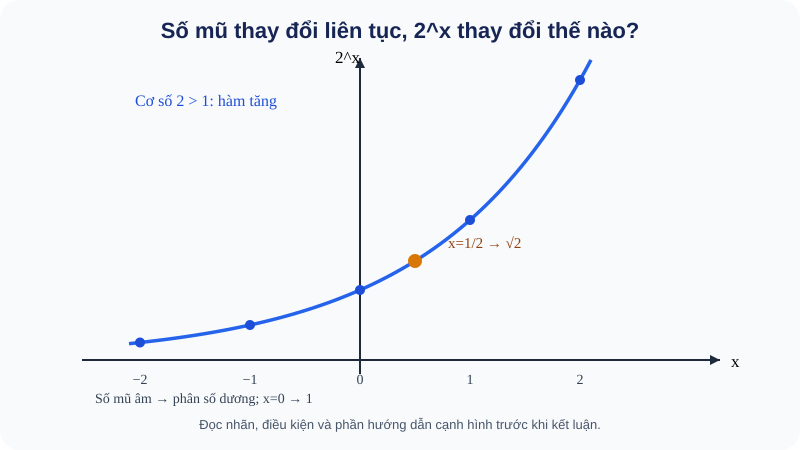
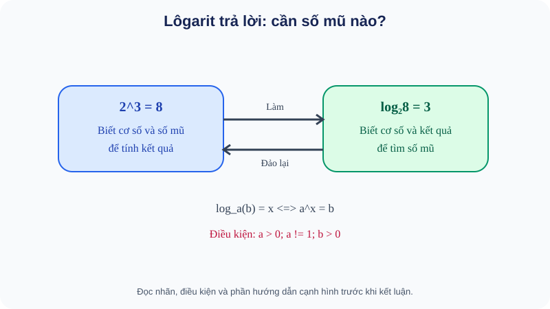
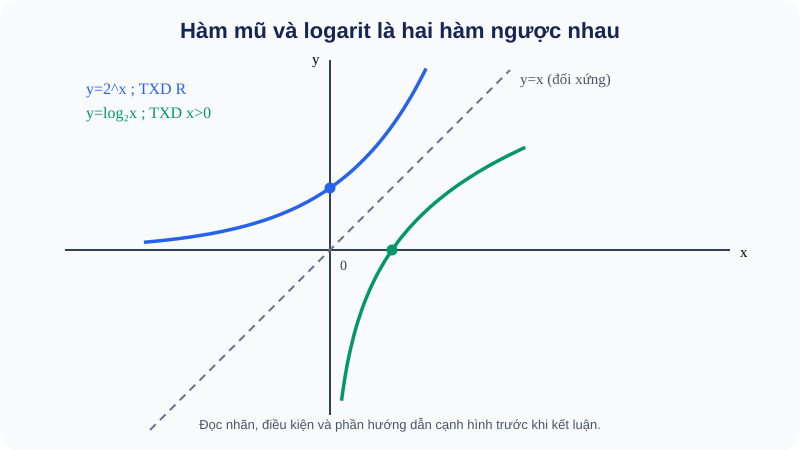
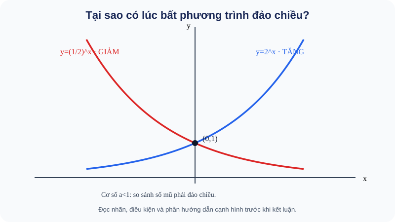

> **VERSION CONTROL:** Original NotebookLM-reviewed PUBLIC R01 remains immutable at Git blob `f37113dc2a3a002511bc6b53ec53e049537f1947`; this is a separate **POSTPASS_DELTA_B equivalent display-corrected** public snapshot. Only `EX-G11-B18-06` and `THPT-G11-CHVI-B18-P07` use corrected decimal comma formatting. Intended quantities and original solutions were `4,2×10^{-6}` and `7,5×10^{-6}` both before/after; no item/skill ID, conditions, keys, rubric, SVG, count, structure or PED material changed. No new NotebookLM academic verdict is claimed for this file; the original owner-reported PASS and narrowly logged equivalence are separate evidence. Source fidelity of original reviewer report remains pending. **NOT RELEASED.**

# Temp — Toán 11 KNTT Tập 2 · Chương VI B18–B21 · FULL PUBLIC D1–D6 / PED22 AUTHOR REVIEW CANDIDATE R01

**PACKET_ID:** `THPT-G11-CHVI-B18-B21-WHOLE-CHAPTER-AUTHORING-R00-20261101` · **PUBLIC_REVIEW_VERSION:** R01 + reviewed-meaning-equivalent postpass decimal display correction `DELTA_B` · **PRIVATE_RD1_CONTENT_VERSION:** R00 (unchanged original) · **SNAPSHOT_DATE:** 2026-11-01.  
**STATUS:** `OWNER_NOTEBOOKLM_DUAL_PASS_REPORTED__SOURCE_FIDELITY_FOLLOWUP_PENDING`; **OWNER NOTEBOOKLM ACADEMIC/PED PASS REPORTED FOR ORIGINAL R01; EXACT REVIEWER-SOURCE FIDELITY PENDING**. Review the exact supplied two Temp files; any PASS applies only to that snapshot.  
**Scope:** SGK KNTT Toán 11 **Tập 2** Chương VI B18–B21 & bài tập cuối ChVI; **SGK_CHAPTER_READINESS** private scope is **not** TOPIC_READINESS. B22+ (ChVII) and experiential after ChIX explicitly excluded.  
**S1 source receipt author:** confirmed public SGK KNTT Tập 2 TOC B18 p4, B19 p10, B20 p16, B21 p20, end ChVI p25–26 (public PDF text `https://thuvienhoclieu.com/wp-content/uploads/2026/05/thuvienhoclieu.com-SGK-Toan-11-tu-nam-2026-Tap-2.pdf`); supplemental `https://sgkvn.com/lop-11-14/ket-noi-tri-thuc-voi-cuoc-song-3/toan-tap-2-1193.html`. SBT Tập 2 estimated chapter printed pages p4–23 from public scanned TOC `https://file.toan9.edu.vn/file-pdf/sach-bai-tap-toan-11-tap-2-ket-noi-tri-thuc-voi-cuoc-song.pdf`, **still awaiting NotebookLM direct verification against original S1 SGK/SBT**. Author PDF screenshot could not be retrieved: no claim of page-image visual audit; SBT printed-page mapping must be reconciled by the reviewer.  
**Contents:** **22 RD0 outcomes**, **19 D2 explained examples**, **41 canonical D3 Core/Practice/Application**, **8 canonical D4 Written (4 Anchor tags)** = **49 public items**, **4 D5 original SVG XML**, **8 D6 five-step HELP**. Separate confidential **22 private RD1 with 4-point rubrics** (one per outcome), **NEVER** included in this public Markdown.  
**Pedagogical contract (owner #691):** before formulas teach **WHY concept necessary → WHAT it actually is → HOW derived/formed → formal conditions → when and why use it → worked reasoning → self-try → practice & repair**. Independent reviewer must separately verdict `ACADEMIC_CHAPTER_VI` and `PEDAGOGICAL_SELF_LEARNING_READY`.  
**Canonical boundary:** Same item_id across roles/placements; no item duplications. Written/Anchor is one bank. Public formative feedback only; no RD1 answer/hint/correctness before Final Submit; demo readiness never records scores or updates Skill Mastery.  
**Files and exact Git content hashes:**
- `prototypes/thpt/content-drafts/G11_CHVI_B18_B21_S1_RD0_AUTHORING_R00_20261101.md` · blob `26ba1a9617a1cca966578090b426fa96952327f2`.
- `prototypes/thpt/content-drafts/G11_CHVI_B18_B21_D1_D2_CONCEPT_FIRST_R00_20261101.md` · blob `2d29e5e9684177294489822a76137ba60e7d3d79`.
- `prototypes/thpt/content-drafts/G11_CHVI_B18_B21_D3_PUBLIC_CORE_PRACTICE_R00_20261101.md` · blob `215bc34fcd501030042d7dae25c268c4821297a2`.
- `prototypes/thpt/content-drafts/G11_CHVI_B18_B21_D4_WRITTEN_D6_HELP_R00_20261101.md` · blob `15a137147a6264e23e829a05334bbc132892fe53`.
- `prototypes/thpt/content-drafts/G11_CHVI_B18_B21_PED22_OUTCOME_EVIDENCE_LEDGER_R01_20261101.md` · blob `b49b9232c81a8beffaeea08ed951ef089946596d`.
- `prototypes/thpt/content-drafts/svg/FIG-G11-CHVI-B18-01_R00.svg` · blob `79528bcd2c87eb40b1b54f18c697b0ae3458e642`.
- `prototypes/thpt/content-drafts/svg/FIG-G11-CHVI-B19-01_R00.svg` · blob `fe2895ac101dcc4cf4046d57428181ad0f448dc8`.
- `prototypes/thpt/content-drafts/svg/FIG-G11-CHVI-B20-01_R00.svg` · blob `64bcb465bd6d809095a4ca2b910555e314badb69`.
- `prototypes/thpt/content-drafts/svg/FIG-G11-CHVI-B21-01_R00.svg` · blob `6d43f842d096b974eb70af21e6751f1ec70eea00`.

---
## PART A · Source fence / RD0 outcomes

# G11 KNTT Tập 2 — Chương VI: S1 source scope + RD0 outcome register R00

**PACKET_ID:** `THPT-G11-CHVI-B18-B21-WHOLE-CHAPTER-AUTHORING-R00-20261101`.  
**LEARNING_PATH:** `SGK_CHAPTER`; `READINESS_SCOPE=SGK_CHAPTER_READINESS:G11:CHVI` (**NOT TOPIC_READINESS**).  
**STATUS:** `AUTHORING_R00`; **not** reviewed/approved/integrated/QA PASS/released.  
**Original pedagogical requirement:** Owner Issue #691 — **WHY → WHAT → HOW FORMED → formal definition, conditions → when it is useful → reasoned examples → try → Core/Practice/Application/D6**. No “formula first” shortcuts, no repeated prerequisites already taught unless needed. Whole chapter must pass PED1–PED6 separately from D1–D6 in one independent NotebookLM batch.

## 1. Phạm vi bắt buộc (Chapter VI SGK KNTT Toán 11 **Tập 2**)

| Bài | SGK trang in **tham chiếu công khai** | SBT Tập 2 trang in **tham chiếu từ mục lục scan** | Nội dung |
|---|---|---|---|
| B18 — Lũy thừa với số mũ thực | 4–9 | 4–7 | Số mũ nguyên, hữu tỉ, vô tỉ/thực, quy tắc và mô hình |
| B19 — Lôgarit | 10–15 | 8–10 | Định nghĩa đảo, điều kiện, tính chất, đổi cơ số, vận dụng |
| B20 — Hàm số mũ và hàm số lôgarit | 16–19 | 11–15 | Hàm, TXĐ/TGT, biến thiên, đồ thị, tương quan ngược nhau |
| B21 — Phương trình, bất phương trình mũ và lôgarit | 20–24 | 16–19 | Phương trình/bất phương trình dạng cơ bản; điều kiện, chiều bất đẳng thức, ứng dụng |
| Bài tập cuối Chương VI | 25–26 | 20–23 | Liên hệ tổng hợp, tập hợp kỹ năng trọn chương |

**SOURCE_RECEIPT STATUS:** SGK indexes from Toan11.edu.vn/SGKVN and SBT PDF Toán 11 KNTT Tập 2 accessed via web `https://file.toan9.edu.vn/file-pdf/sach-bai-tap-toan-11-tap-2-ket-noi-tri-thuc-voi-cuoc-song.pdf`, PDF extracted table of contents for SBT pages p4/8/11/16/20; original owner-specific SGK/SBT PDFs and their exact printed page labels **MUST be reconfirmed in NotebookLM S1**, and competing third-party indices are not permission to modify Core. Public PDF screenshot retrieval did not succeed, so **DO NOT claim visual scan QA PASS**. All questions authored original; no copying textbook stems.

**Scope fence:** B22–B27 belong Chapter VII (not Chapter VI). “Một vài mô hình toán học sử dụng hàm số mũ và hàm số lôgarit” is a later experiential section of the volume, not automatically Chapter VI Core. Do not import Topic Practice or advanced calculus.

## 2. 22 RD0 outcomes — canonical single skill register

| outcome_id = skill_id | Bài | Học sinh cần tự hiểu/giải thích được | Teaching readiness |
|---|---|---|---|
| `G11-B18-POWER_INTEGER` | B18 | Lũy thừa số mũ nguyên: cùng cơ số, số mũ 0 và số mũ âm; điều kiện a≠0 nếu số mũ ≤0 | D1 WHY/WHAT→D2→D3; PED **PENDING** |
| `G11-B18-POWER_RATIONAL` | B18 | Căn bậc n, lũy thừa số mũ hữu tỉ của cơ số dương, lý do a^(m/n)=căn bậc n của a^m | D1 WHY/WHAT→D2→D3; PED **PENDING** |
| `G11-B18-POWER_REAL` | B18 | Vì sao cần lũy thừa số mũ vô tỉ; xấp xỉ bởi dãy hữu tỉ và tính nhất quán với quy tắc cũ | D1 WHY/WHAT→D2→D3; PED **PENDING** |
| `G11-B18-POWER_LAWS` | B18 | Các quy tắc nhân, chia, lũy thừa của lũy thừa; phát biểu đúng điều kiện cơ số | D1 WHY/WHAT→D2→D3; PED **PENDING** |
| `G11-B18-GROWTH_MODEL` | B18 | Dùng nhân lặp trong bài toán tăng trưởng/lãi kép và giới hạn ý nghĩa của mô hình | D1 WHY/WHAT→D2→D3; PED **PENDING** |
| `G11-B19-LOG_DEFINITION` | B19 | Lôgarit là số mũ cần tìm trong a^y=b; khái niệm đảo của lũy thừa | D1 WHY/WHAT→D2→D3; PED **PENDING** |
| `G11-B19-LOG_DOMAIN` | B19 | Điều kiện a>0, a≠1, b>0; giải thích vì sao và các lỗi ghi log(0), log(âm) | D1 WHY/WHAT→D2→D3; PED **PENDING** |
| `G11-B19-LOG_LAWS` | B19 | Tại sao log(ab)=log a+log b; log(a/b), log(a^r) với điều kiện | D1 WHY/WHAT→D2→D3; PED **PENDING** |
| `G11-B19-LOG_BASE_CHANGE` | B19 | Tại sao công thức đổi cơ số đúng; phân biệt cơ số a, b và đối số | D1 WHY/WHAT→D2→D3; PED **PENDING** |
| `G11-B19-LOG_APPLICATION` | B19 | Tìm thời gian/số chu kỳ khi biết mức tăng theo hàm mũ và kiểm đơn vị | D1 WHY/WHAT→D2→D3; PED **PENDING** |
| `G11-B20-EXP_FUNCTION` | B20 | Hàm số mũ y=a^x: biến nào ở số mũ, TXĐ R, TGT (0,+∞), đường qua (0,1) | D1 WHY/WHAT→D2→D3; PED **PENDING** |
| `G11-B20-EXP_MONOTONIC` | B20 | Vì sao a>1 tăng, 0<a<1 giảm; tiệm cận ngang y=0, tập điểm quan sát | D1 WHY/WHAT→D2→D3; PED **PENDING** |
| `G11-B20-LOG_FUNCTION` | B20 | Hàm số lôgarit y=log_a x: TXĐ x>0, TGT R, qua (1,0) | D1 WHY/WHAT→D2→D3; PED **PENDING** |
| `G11-B20-LOG_MONOTONIC` | B20 | Vì sao đồng/nghịch biến theo cơ số; tiệm cận đứng x=0 | D1 WHY/WHAT→D2→D3; PED **PENDING** |
| `G11-B20-INVERSE_GRAPH` | B20 | Hai hàm là hàm ngược; điểm (x,y) ↔ (y,x), đối xứng qua y=x; liên hệ mô hình | D1 WHY/WHAT→D2→D3; PED **PENDING** |
| `G11-B21-EXP_EQUATION` | B21 | Phương trình mũ cơ bản a^{f(x)}=a^{g(x)}, đơn ánh và số mũ bằng nhau | D1 WHY/WHAT→D2→D3; PED **PENDING** |
| `G11-B21-LOG_EQUATION` | B21 | Phương trình log_a f(x)=log_a g(x), phải đặt f,g>0 | D1 WHY/WHAT→D2→D3; PED **PENDING** |
| `G11-B21-EXP_INEQUALITY` | B21 | Bất phương trình mũ: giữ/đổi chiều phụ thuộc a>1 hay 0<a<1 | D1 WHY/WHAT→D2→D3; PED **PENDING** |
| `G11-B21-LOG_INEQUALITY` | B21 | Bất phương trình lôgarit: điều kiện đối số dương và biến đổi chiều theo cơ số | D1 WHY/WHAT→D2→D3; PED **PENDING** |
| `G11-B21-DOMAIN_CHECK` | B21 | Nghiệm ngoại lai khi biến đổi, log(a)=log(b) không cho phép bỏ điều kiện a,b>0 | D1 WHY/WHAT→D2→D3; PED **PENDING** |
| `G11-B21-REAL_CONTEXT` | B21 | Giải bài toán thời gian đạt ngưỡng tăng/giảm mũ, ràng buộc biến thời gian không âm/nguyên nếu có | D1 WHY/WHAT→D2→D3; PED **PENDING** |
| `G11-CHVI-INTEGRATED` | CHVI | Sợi dây nhân lặp → số mũ thực → câu hỏi số mũ → logarit → hàm và đồ thị → giải phương trình thực tế | D1 WHY/WHAT→D2→D3; PED **PENDING** |

**COUNT:** B18=5, B19=5, B20=5, B21=6, chapter integrated=1 → **22 distinct**. These are proposed RD0 candidate IDs, subject to matching S1 outcomes. Preserve canonical `item_id` and `skill_id` across placements; no duplicates for SGK Core vs Topic. All public D3 feedback formative only; RD1 not written to any public GitHub path.

## 3. Development/QA gate

- D1: complete concept-first teaching with prerequisites *appropriately* recalled, each first-use term explained, conditions and rationale before laws.
- D2: student can follow every choice of transformation and see common wrong attempts.
- D3/D4: **all distinct original items**; one Written/Anchor library, with rubric; prove outcome depth and diversity, not only total quantity.
- D5/D6: figures must be mathematically precise and **teaching** (guided interpretation); HELP diagnosable and actionable after formative submission, never RD1 before Final Submit.
- RD1: private held-out independent one-per-outcome minimum, **with different structure** from D3/SBT, answer and rubric stored outside public repo; owner Library preferred.
- S1 original source receipt, math/anti-clone QA, PED1–PED6 per outcome, full-chapter NotebookLM reviewer verdict `ACADEMIC_CHAPTER_VI` and `PEDAGOGICAL_SELF_LEARNING_READY` on exact public/private snapshot **before A6**.
- Release lane handles R1–R5/AP1–AP5/P1/P2 and only explicit owner approval can merge/deploy; independent PASS not a scoring/Mastery activation.

**Source links for traceability:** SGK Toán 11 KNTT Tập 2 `https://toan11.edu.vn/sgk-toan-11-ket-noi-tri-thuc`; SBT original scan public `https://file.toan9.edu.vn/file-pdf/sach-bai-tap-toan-11-tap-2-ket-noi-tri-thuc-voi-cuoc-song.pdf`. Project authority: 08/06/07, Issue #675 and Issue #691.

---

## PART B · D1 meaning-first teaching / D2 worked examples

# G11 SGK KNTT Chương VI — D1 Kiến thức tự học + D2 Ví dụ có suy luận · R00

**PACKET_ID:** `THPT-G11-CHVI-B18-B21-WHOLE-CHAPTER-AUTHORING-R00-20261101` · SGK KNTT 11 **Tập 2** ChVI B18–B21.  
**STATUS:** `D1_D2_AUTHOR_DRAFT_NOT_REVIEWED`. **PED rule #691:** A first-time learner must know **why the idea is needed**, **what it means**, **how formed**, **when the formula applies**, then see a reasoned example and self-try. Not a formula sheet.  
**Study prerequisites:** Exponents with positive integer powers, square/cube roots, real numbers, function notation/graphs, inequalities and preceding G11 Chapter V sequence limits. Assume only these prerequisites; explain new terminology at first use.

## Bài 18 — Lũy thừa với số mũ thực

**Hình D5 — quan sát trước khi tính:** 

**Cách đọc và phát hiện:** Hình B18 giúp em nhìn thấy cùng một quy tắc 2^x từ số mũ âm qua 0 đến số mũ phân số: đọc các điểm trên trục và so sánh chấm màu cam tại x=1/2 (√2). Đừng chỉ chép hình: hãy nêu vì sao 2^(−2)=1/4 vẫn là một số **dương**.

### 1. Tại sao phải mở rộng số mũ? (WHY)

Em đã biết `2³=2·2·2=8`: số mũ 3 đếm ba thừa số 2. Nhưng nếu hỏi **cạnh hình vuông** có diện tích 2 thì cạnh phải dài bao nhiêu? Ta cần một số dương mà **bình phương bằng 2**, tức `√2`. Có thể viết nó là `2^(1/2)` để bảo toàn cách tính `(2^(1/2))²=2`. Không thể giải thích số mũ `1/2` là “nhân số 2 với nhau nửa lần”; đó là một **định nghĩa mở rộng phù hợp các quy tắc đã có**.

Lãi kép hay biến đổi liên tục cũng nảy sinh số mũ không nguyên: `P(t)=P₀(1+r)^t` (khi mô hình cho phép thời gian t là số thực). Vì thế toán học cần định nghĩa có nghĩa cho `a^{1/2}, a^{-2}` và `a^{√2}`. Bài này xây dựng các bước mở rộng ấy.

### 2. Từ số mũ nguyên dương đến 0 và âm (WHAT/HOW)

Với n nguyên dương, `a^n` là tích n thừa số a. Nhìn `2³=8, 2²=4, 2¹=2`: giảm số mũ một đơn vị thì chia 2; để giữ quy luật đó, `2⁰=1` và `2^{-1}=1/2`. Tổng quát, **khi a≠0**: `a⁰=1`, `a^{-n}=1/a^n`.

**Vì sao cấm a=0 khi số mũ âm/0?** `0^{-1}=1/0` không xác định. `0⁰` không được định nghĩa trong khuôn khổ này. Với n nguyên dương, `0^n=0` vẫn có nghĩa. **Sai thường gặp:** `a^{-2}` là `1/a²`, không phải `−a²`.

### 2A. Căn bậc n: vì sao phải phân biệt n chẵn và n lẻ?

**Căn bậc n của số a** là số b thỏa `b^n=a`. Khi `n` lẻ, mỗi số thực a có đúng một căn bậc n thực (ví dụ `∛(−8)=−2` vì `(−2)^3=−8`). Khi `n` chẵn, số dương a có hai căn bậc n thực đối nhau, nhưng ký hiệu `ⁿ√a` **chỉ căn không âm**; `√9=3`, còn phương trình `x²=9` có **hai nghiệm** `x=±3`. Số âm không có căn bậc chẵn thực. Với a=0, căn bậc n là 0.

**Tự thử trước khi chuyển sang số mũ phân số:** `∛(−27)` bằng bao nhiêu? `√(−9)` có là số thực không? `√(x²)` có luôn bằng `x` không? **Đối chiếu:** −3; không; `√(x²)=|x|` (bằng `x` khi x≥0). Đừng suy từ việc `∛(−27)` có nghĩa sang `(−27)^t` có nghĩa cho mọi t thực.

### 3. Số mũ phân số và số mũ vô tỉ

Với `a>0`, `n≥2` nguyên dương và `m` nguyên, định nghĩa `a^{m/n}=ⁿ√(a^m)`. Đây là số dương có lũy thừa bậc n bằng `a^m`; ví dụ `8^{2/3}=(³√8)²=4`. **Tại sao cơ số phải dương trong quy tắc chung?** Căn bậc chẵn của số âm không là số thực; khi số mũ thay đổi liên tục, định nghĩa thống nhất cho mọi số thực đòi a>0. Một vài biểu thức với cơ số âm và số mũ hữu tỉ cụ thể có nghĩa, nhưng **không** suy ra `a^x` cho mọi x thực khi a<0.

Muốn tính `2^{√2}`, trước hết xấp xỉ `√2` bằng các số hữu tỉ `1,4; 1,41; 1,414;...`. Các giá trị `2^{1,4};2^{1,41};...` tiến tới một số dương xác định; ta gọi đó là `2^{√2}`. Định nghĩa chính xác dựa vào giới hạn của dãy số hữu tỉ tiến tới số mũ vô tỉ; giới hạn **không phụ thuộc** cách xấp xỉ. Đây là chỗ liên hệ thật với giới hạn Chương V, nhưng học sinh không cần chứng minh giải tích ngoài phạm vi SGK.

### 4. Các quy tắc và điều kiện (FORMAL / WHY RULE)

Với `a,b>0`, `x,y∈ℝ`:
- `a^x a^y = a^{x+y}`: cùng cơ số, phép nhân gộp số mũ.
- `a^x/a^y=a^{x−y}` (mẫu luôn dương).
- `(a^x)^y=a^{xy}`, `(ab)^x=a^x b^x`, `(a/b)^x=a^x/b^x`.

**Không có quy tắc** `a^x+a^y=a^{x+y}`! Kiểm nhanh `2²+2³=12`, khác `2⁵=32`. Với số mũ thực bất kỳ, **kiểm tra cơ số dương trước khi biến đổi**.

### 5. Tự thử trước Core

1. Vì sao `4^{-1}` là `1/4`, không phải `−4`?
2. `27^{2/3}` bằng bao nhiêu, tại sao?
3. Trong `P(t)=500(1,06)^t`, yếu tố `1,06` có ý nghĩa gì? Nếu số tiền được cập nhật hằng năm, t nên là số nguyên hay số thực?

**Tự đối chiếu sau khi thử:** (1) giảm số mũ một đơn vị tương ứng chia cho 4; (2) `(³√27)²=9`; (3) hệ số tăng 6% mỗi năm, với cập nhật mỗi năm dùng t nguyên không âm; dùng t thực cần mô hình phù hợp.

### D2 — Giáo viên làm mẫu B18

**EX-G11-B18-01 (ý nghĩa số mũ âm).** Tính `(3/2)^{-2}`. **Chọn quy tắc nào?** Số mũ âm nghĩa là lấy nghịch đảo: `(2/3)²=4/9`; dấu trừ không được giữ thành hệ số `−`.

**EX-G11-B18-02 (vì sao phân số liên quan căn).** `16^{3/4}=(⁴√16)^3=2³=8`. **Vì sao được đổi?** `a^{m/n}` là căn bậc n của `a^m` khi a>0; không tách một cơ số âm thành lũy thừa thực tùy ý.

**EX-G11-B18-03 (rút gọn bằng luật, không đoán).** Với a>0, `a^{5/3}·a^{-2/3}/a^{1/2}=a^{5/3−2/3−1/2}=a^{1/2}=√a`. **Điều kiện** a>0 bảo đảm tất cả số mũ thực có nghĩa.

**EX-G11-B18-04 (tăng trưởng).** Vốn `100` triệu đồng tăng 5% mỗi năm, lãi gộp cuối năm: `P(n)=100·1,05^n` triệu. Sau 2 năm `P(2)=110,25` triệu. **Vì sao nhân thay vì cộng?** Năm thứ hai lấy 5% của **số tiền sau năm đầu**, không phải 5% của vốn ban đầu. Mô hình giả sử lãi suất cố định, không có phí/thuế.


**EX-G11-B18-05 (căn lẻ của cơ số âm, không suy rộng tùy tiện).** Giải phương trình `x³=−125` trong tập thực. Do hàm `x³` tăng trên ℝ và `(−5)^3=−125`, nghiệm duy nhất là `x=−5`, viết `∛(−125)=−5`. **Giới hạn của kết luận:** điều này không cho phép định nghĩa `(−125)^{√2}` như lũy thừa số mũ thực với cơ số âm.

**EX-G11-B18-06 (kí hiệu khoa học và ý nghĩa số mũ âm).** Một độ dài `0,0000042` mét được viết `4,2×10^{-6}` mét. **Tại sao?** Đưa dấu phẩy sang phải 6 vị trí để được `4,2` thì phải nhân ngược `10^{-6}` để giá trị không đổi. **Điều kiện của kí hiệu khoa học:** phần hệ số có trị tuyệt đối thuộc `[1,10)`, số mũ nguyên. Khi dùng máy tính cầm tay để tính `2^{1,3}`, cần nhập đủ dấu ngoặc/số mũ và đánh dấu kết quả là **gần đúng**, không tráo với giá trị chính xác.


---

## Bài 19 — Lôgarit

**Hình D5 — quan sát trước khi tính:** 

**Cách đọc và phát hiện:** Hình B19 không phải bảng công thức: hãy đọc từ trái qua phải để tính 2³=8, rồi đọc ngược để thấy log₂8=3 trả lời câu hỏi “số mũ nào?”. Kiểm điều kiện cơ số, đối số ngay dưới sơ đồ.

### 1. Vấn đề dẫn đến lôgarit: ta muốn tìm **số mũ** (WHY)

Nhân 2 liên tiếp: `2¹=2, 2²=4, 2³=8`. Nếu đã biết kết quả 8, hỏi **cần bao nhiêu lần nhân đôi để được 8?**, câu trả lời là 3. Với 10 hoặc 7, câu hỏi khó hơn: `2^x=10` thì x bằng bao nhiêu? Không thể chỉ thử số nguyên. Để trả lời loại câu hỏi “số mũ nào tạo ra số này?”, ta đặt ra **lôgarit**.

### 2. Lôgarit là gì (WHAT), trước khi học quy tắc

Với `a>0, a≠1, b>0`, **`log_a b` là số thực x duy nhất sao cho `a^x=b`**. Viết tương đương `log_a b=x ⇔ a^x=b`. `a` là **cơ số**, `b` là **đối số**; chúng giữ vai trò khác nhau. Ví dụ `log₂8=3` vì `2³=8`; `log₃(1/9)=−2` vì `3^{-2}=1/9`. Logarit **không phải** phép chia b/a.

**Vì sao những điều kiện?** `a=1` cho `1^x=1` với mọi x nên không thể tìm số mũ duy nhất; `a≤0` không tạo ra một hàm lũy thừa thực xác định tốt với mọi x; `a^x` với a>0 luôn dương, nên không thể có `b≤0`.

### 3. Hình thành quy tắc từ ý nghĩa “số mũ”

`log_a 1=0` do `a⁰=1`; `log_a a=1`; `a^{log_a b}=b` (b>0); `log_a(a^x)=x`.

Đặt `u=log_a M`, `v=log_a N` với M,N>0. Vì `a^u=M` và `a^v=N`, `MN=a^{u+v}`, suy ra **`log_a(MN)=log_a M+log_a N`**. Tương tự `log_a(M/N)=log_a M−log_a N` (N>0), `log_a(M^r)=r·log_a M` (M>0, r thực). **Không** có quy tắc `log_a(M+N)=log_a M+log_a N` (phản ví dụ M=N=1: trái `log_a2`, phải 0).

### 4. Đổi cơ số và máy tính

Đặt `x=log_a b` nên `a^x=b`. Lấy `log_c` hai vế với `c>0,c≠1`: `x log_c a=log_c b`, suy ra `log_a b=log_c b/log_c a`. Điều kiện `a≠1` làm mẫu khác 0. `lg x=log₁₀x`, `ln x=log_e x` (e là hằng số dương đặc biệt, xấp xỉ 2,71828). Máy tính có thể cho giá trị gần đúng, **không thay thế điều kiện đối số dương**.

### 5. Tự thử

Nếu `log₅125=3`, em phát biểu lại một đẳng thức lũy thừa. Giải thích vì sao `log₄0` vô nghĩa và vì sao `log₂(4+4)` không bằng `log₂4+log₂4` (kiểm `log₂8=3`, vế sau 4).

### D2 — Giáo viên làm mẫu B19

**EX-G11-B19-01 (đọc đúng ý nghĩa).** `log₄(1/16)=−2` vì `4^{-2}=1/16`. **Không lấy** `1/16÷4`.

**EX-G11-B19-02 (điều kiện trước khi rút gọn).** `log₃((x−1)(x+2))` xác định khi `(x−1)(x+2)>0`, tức `x<−2` hoặc `x>1`. **Không tách thành `log₃(x−1)+log₃(x+2)` trên toàn miền này**, vì khi x<−2 hai thừa số đều âm và log riêng không xác định. Quy tắc tách tích đòi **mỗi thừa số dương**; đây là bẫy học thuật quan trọng.

**EX-G11-B19-03 (quy tắc có giải thích).** `log₂(32/4)=log₂32−log₂4=5−2=3`; điều kiện hai đối số 32,4 dương. Có thể đối chiếu `log₂8=3`.

**EX-G11-B19-04 (đổi cơ số).** `log₃7=(ln7)/(ln3)`, kiểm `3>0,3≠1,7>0`, cho xấp xỉ 1,771; **không** phải `ln(7/3)`.

---

## Bài 20 — Hàm số mũ và hàm số lôgarit

**Hình D5 — quan sát trước khi tính:** 

**Cách đọc và phát hiện:** Hình B20 đặt hai hàm trên **cùng hệ trục và cùng tỉ lệ**, để thấy điểm (0,1) của y=2^x tương ứng (1,0) của y=log₂x. Hãy tìm thêm cặp (1,2) ↔ (2,1); đường nét đứt y=x biểu diễn trục đối xứng, không phải một hàm cần giải.

### 1. Tại sao phải học đồ thị và hàm chứ không chỉ một giá trị?

Lũy thừa `2³` trả lời cho một mốc; nhưng lượng vi khuẩn sau **mọi** khoảng thời gian t cần một quy tắc `N(t)=N₀·2^t`. Khi t thay đổi, kết quả thay đổi ra sao? Ta xét **hàm số mũ**. Nếu biết số lượng vi khuẩn và muốn suy thời gian, ta cần đi ngược lại bằng lôgarit — **hàm số lôgarit**.

### 2. Hàm số mũ là gì, đồ thị nói điều gì

Với `a>0, a≠1`, hàm `f(x)=a^x` là hàm số mũ: **biến x nằm ở số mũ**, không giống `x²` với biến ở cơ số. Mọi x thực đều được nhận (**TXĐ `ℝ`**), `f(x)>0` (**tập giá trị `(0,+∞)`**), đồ thị qua `(0,1)` và `(1,a)`.

Quan sát `2^{-2}=1/4;2^{-1}=1/2;2⁰=1;2¹=2;2²=4`. Đi sang phải một đơn vị thì gấp đôi; hàm tăng **khi a>1**. Với `a=1/2`, mỗi bước sang phải chia đôi → **giảm**. Cả hai đường không cắt trục hoành vì `a^x>0`, và tiến sát trục `y=0` ở phía x→−∞ nếu a>1 (hoặc x→+∞ nếu 0<a<1). Đó là **tiệm cận ngang y=0** — một đường đồ thị tiến sát, không nhất thiết chạm.

### 3. Hàm logarit là gì, vì sao điều kiện x>0?

`g(x)=log_a x`, với a>0,a≠1. Vì `a^y=x>0`, **TXĐ g: (0,+∞)**; mọi số thực y có thể là logarit của một x dương, nên **tập giá trị ℝ**. Đồ thị qua `(1,0)` và `(a,1)`. Nếu a>1 nó tăng; nếu 0<a<1 nó giảm. Khi x→0⁺, đồ thị tiến sát đường thẳng `x=0` (**tiệm cận đứng**), nhưng không chạm do x>0.

### 4. Hai hàm là “làm” và “làm ngược”

Nếu `y=2^x` thì `x=log₂y`. Trên đồ thị, mỗi điểm `(x,y)` của hàm mũ ứng với `(y,x)` của logarit; hai đồ thị đối xứng qua đường `y=x`. **Vì sao quan trọng?** Khi bài toán cho thời gian, dùng hàm mũ; khi cho mức đã đạt và cần tìm thời gian, dùng logarit.

### 5. Tự thử

Vì sao `y=3^x` không thể bằng −5? Nếu `log₂8=3`, hãy tìm hai điểm tương ứng trên hai đồ thị. Vì sao `log_{1/2}x` nghịch biến?

### D2 — Giáo viên làm mẫu B20

**EX-G11-B20-01 (phân biệt hai loại hàm).** `f(x)=3^x` có TXĐ ℝ, tập giá trị (0,+∞), qua (0,1),(1,3) và tăng. `h(x)=x³` **không** là hàm mũ vì biến ở cơ số; không áp dụng máy móc tập giá trị (0,+∞) cho `x³`.

**EX-G11-B20-02 (đồ thị ngược).** Nếu `y=2^x` qua (2,4), thì `y=log₂x` qua (4,2). Đó là đổi vai trò đầu vào/đầu ra, không phải phép đảo dấu một tọa độ.

**EX-G11-B20-03 (giải thích cơ số <1).** `g(x)=(1/3)^x`: từ x=0 đến x=1 giá trị giảm 1→1/3. Vì `0<1/3<1`, g giảm trên ℝ. `log_{1/3}x` cũng giảm trên (0,+∞).

**EX-G11-B20-04 (mô hình gấp đôi).** `N(t)=50·2^t`, t tính bằng kỳ. `N(0)=50`, `N(3)=400`. **Tại sao** giá trị tăng x8? Qua 3 kỳ mỗi kỳ nhân đôi nên nhân `2³`. Nếu hỏi N=400 xảy ra ở kỳ nào, cần `t=log₂(400/50)=3`.

---

## Bài 21 — Phương trình, bất phương trình mũ và lôgarit

**Hình D5 — quan sát trước khi tính:** 

**Cách đọc và phát hiện:** Hình B21 giải thích bản chất “đảo chiều”: cùng tăng x, đường y=2^x đi lên nhưng y=(1/2)^x đi xuống. Hãy dùng điều này để tự nói vì sao (1/2)^u>(1/2)^v thì u<v, trước khi học quy trình giải bất phương trình.

### 1. Vì sao phải giải loại phương trình này? (WHY)

Các phương trình `x²=9` tìm **cơ số** x. Nhưng `2^x=16` lại tìm **số mũ** x; đây là dạng khác, cần hiểu hàm mũ đơn ánh và logarit là phép ngược. Bất phương trình như `2^x>10` hỏi phải tăng qua bao nhiêu kỳ để vượt một ngưỡng. Trước khi viết công thức, ta cần biết hàm **tăng hay giảm**, vì đó là lý do dấu bất đẳng thức được giữ hay đảo.

### 2. Phương trình mũ cơ bản

Với `a>0,a≠1`: `a^{u(x)}=a^{v(x)} ⇔ u(x)=v(x)` vì hàm mũ đơn ánh (hai số mũ khác nhau không thể cho cùng một giá trị). `a^{u(x)}=b`: nếu b>0 thì `u(x)=log_a b`; nếu b≤0 thì vô nghiệm thực vì `a^{u(x)}>0`. Đừng “lấy log” của số âm.

### 3. Phương trình logarit cơ bản và điều kiện

`log_a f(x)=c` tương đương `f(x)=a^c`, **với** `f(x)>0`. `log_a f(x)=log_a g(x)` ⇔ `f(x)=g(x)` **và** `f(x)>0,g(x)>0`. **Lý do:** logarit chỉ nhận đối số dương; bỏ điều kiện có thể tạo nghiệm ngoại lai.

### 4. Bất phương trình: quan sát chiều biến thiên trước

- Nếu `a>1`: `a^{u(x)}>a^{v(x)} ⇔ u(x)>v(x)`; `log_a f(x)>log_a g(x) ⇔ f(x)>g(x)>0`.
- Nếu `0<a<1`: `a^{u(x)}>a^{v(x)} ⇔ u(x)<v(x)`; `log_a f(x)>log_a g(x) ⇔ 0<f(x)<g(x)`.
- Với dấu `≥,≤`, áp dụng tương tự nhưng luôn đảm bảo điều kiện logarit. **Không đổi chiều vì “có log”**; đổi chiều vì **hàm theo cơ số 0<a<1 nghịch biến**.

### 5. Quy trình và giới hạn phương pháp

Bước 1: xác định cơ số, miền đầu vào và điều kiện xác định của mọi logarit. Bước 2: nhận biết hàm tăng/giảm. Bước 3: biến đổi tương đương sang phương trình/bất phương trình quen thuộc. Bước 4: đối chiếu nghiệm với điều kiện và bài toán thực tế. **Chỉ dùng các dạng cơ bản theo SGK**; bài nâng cao đa thức lôgarit/mẹo đặt ẩn phụ tùy S1 phạm vi, không tự đẩy Core.

### 6. Tự thử

Giải thích vì sao `(1/2)^x> (1/2)^3` cho `x<3`, không phải x>3. Nếu `log₂(x−1)=3`, vì sao trước tiên cần x>1?

### D2 — Giáo viên làm mẫu B21

**EX-G11-B21-01 (mũ, dùng đơn ánh).** `3^{2x−1}=27=3³` ⇒ `2x−1=3` ⇒ x=2. Lý do: hàm `3^t` tăng và mỗi đầu ra dương chỉ có một số mũ.

**EX-G11-B21-02 (log, điều kiện bắt buộc).** `log₂(x−1)=3`. Trước hết `x−1>0` tức x>1. Đổi sang `x−1=2³=8`, x=9 thỏa. Không ghi nghiệm chưa kiểm điều kiện.

**EX-G11-B21-03 (cơ số 1/2 làm đổi chiều).** `(1/2)^{x+1}≥(1/2)^3`. Hàm giảm vì cơ số 0,5<1, nên `x+1≤3`, tức x≤2. **Sai thường gặp:** x≥2.

**EX-G11-B21-04 (log giảm và miền).** `log_{1/3}(x−1)<log_{1/3}4`. Điều kiện x>1. Vì log cơ số 1/3 giảm, bất phương trình tương đương `x−1>4` ⇒ x>5; kiểm tự động thỏa x>1.

**EX-G11-B21-05 (mô hình ngưỡng).** `P(n)=100(1,1)^n` triệu, n nguyên không âm, khi nào **vượt** 133,1 triệu? `(1,1)^n>1,331=(1,1)^3` ⇒ n>3 ⇒ kỳ đầu vượt là **n=4**. **Bẫy:** tại n=3 chỉ **bằng** 133,1; điều kiện “vượt” là dấu >, và n phải nguyên trong cập nhật cuối kỳ.

---

## Kết nối toàn chương — học sinh giải thích mạch nguyên nhân

- Sự nhân lặp dẫn đến số mũ nguyên; nhu cầu căn và giá trị giữa các kỳ dẫn đến số mũ phân số/thực.
- Hỏi “kết quả của số mũ là bao nhiêu?” dùng `a^x`; hỏi “muốn ra kết quả b cần số mũ nào?” dùng `log_a b`.
- Xem mối quan hệ cho **mọi** x là học **hàm số mũ/logarit**; hỏi khi nào đạt/ngưỡng vượt b là **giải phương trình/bất phương trình**.
- **Micro-check tích hợp:** Nếu số lượng ban đầu là 10 và sau t kỳ tăng gấp 3 mỗi kỳ, hãy (i) viết hàm N(t), (ii) tìm t để N=270, (iii) giải N(t)>270 khi t là nguyên không âm. **Đối chiếu sau tự thử:** `N(t)=10·3^t`, t=3 cho 270; “vượt” đòi `t>3`, kỳ nguyên đầu tiên t=4.
- **Không dùng câu này làm RD1 kín**; đây chỉ là hoạt động hướng dẫn công khai, không tạo Skill Mastery.

## Author QA / NotebookLM requirements

D1–D2 above are *author text*, not verbatim SGK quotations. Independently verify correctness and S1 scope, especially a<0 vs rational/irrational exponents, product log requiring both positive, sign flip for 0<a<1, and strict thresholds for discrete models. **PED1–PED6 must be evaluated by B18/B19/B20/B21 and each RD0**, including a first-time learner who does not know why logarithms exist; do not mark READY from 22 outcome counts or 17 worked examples. Exact S1 PDFs and SBT printed-page receipts remain pending. No G10 retrospective work or publishing.

---

## PART C · D3 public Core, Practice & Application

# G11 Chương VI B18–B21 — D3 Public Core / Practice / Application R00

**PACKET_ID:** `THPT-G11-CHVI-B18-B21-WHOLE-CHAPTER-AUTHORING-R00-20261101`. **STATUS:** DRAFT_FORMATIVE_NOT_REVIEWED. **Teaching order:** read D1 why/what/how and D2 worked examples **first**, then answer CORE and PRACTICE. Written and private RD1 are separate. Feedback below must be gated until formative submission if integrated. No hint, correctness or score in protected final Chapter Readiness before Final Submit. No Mastery.

**One canonical `item_id` per stem.** Placement marks role only; no cloning when reusing later in Topic. Original material, not copied from SBT. Reviewer must verify not only answer but instructional depth, assumptions and structural variety.

## Canonical item register (41 candidates)

### B18 — Lũy thừa số mũ thực

#### THPT-G11-CHVI-B18-C01 · placement=SGK_CORE · skill_id=G11-B18-POWER_INTEGER

**Đề:** Tại sao (2/5)^(-2) không phải số âm? Tính giá trị.

**Đáp án:** 25/4.

**Giải thích:** Số mũ âm nói lấy nghịch đảo, không phải dấu âm trước lũy thừa: (2/5)^(-2)=(5/2)^2=25/4.

#### THPT-G11-CHVI-B18-C02 · placement=SGK_CORE · skill_id=G11-B18-POWER_RATIONAL

**Đề:** Giải thích ý nghĩa của 81^(3/4) và tính kết quả.

**Đáp án:** 27.

**Giải thích:** Cơ số dương, căn bậc 4 của 81 bằng 3; lấy lũy thừa bậc 3 được 27.

#### THPT-G11-CHVI-B18-C03 · placement=SGK_CORE · skill_id=G11-B18-POWER_INTEGER

**Đề:** 0^(-2) có nghĩa trong tập số thực không? Vì sao?

**Đáp án:** Không.

**Giải thích:** Nếu dùng quy tắc số mũ âm sẽ là 1/0², phép chia cho 0 không xác định.

#### THPT-G11-CHVI-B18-C04 · placement=SGK_CORE · skill_id=G11-B18-POWER_REAL

**Đề:** Một bạn nói: “2^(√2) không có nghĩa, vì √2 không thể đếm số lần nhân 2”. Em giải thích bạn đang hiểu sai điều gì và mô tả cách số này được hình thành.

**Đáp án:** 2^(√2) có nghĩa vì cơ số 2>0; số mũ thực không còn được hiểu là số lần nhân nguyên. Nó được định nghĩa bằng giới hạn của dãy giá trị 2^r khi các số hữu tỉ r tiến đến √2.

**Giải thích:** Các số mũ hữu tỉ gần √2 như 1,4;1,41;1,414,… đã có định nghĩa bằng căn/lũy thừa. Khi các giá trị 2^r tiến đến một số xác định không phụ thuộc dãy xấp xỉ, ta gọi đó là 2^(√2). Đây là mở rộng nhất quán của khái niệm, không phải “nhân số 2 √2 lần”.

#### THPT-G11-CHVI-B18-C05 · placement=SGK_CORE · skill_id=G11-B18-POWER_RATIONAL

**Đề:** Phân biệt hai yêu cầu: tìm `√25` và giải `x²=25`. Nếu chuyển sang `∛(−27)`, kết quả ra sao? Giải thích vai trò của căn bậc chẵn/lẻ.

**Đáp án:** `√25=5` là căn không âm; phương trình `x²=25` có hai nghiệm `x=5` và `x=−5`; `∛(−27)=−3`.

**Giải thích:** Ký hiệu căn bậc chẵn lấy giá trị không âm, còn phương trình `x²=25` yêu cầu tìm **mọi** số bình phương bằng 25. Căn bậc lẻ của số âm tồn tại trong ℝ vì `(−3)³=−27`. Không suy rộng cơ số âm sang mọi số mũ thực.

#### THPT-G11-CHVI-B18-P01 · placement=SGK_PRACTICE · skill_id=G11-B18-POWER_LAWS

**Đề:** Với a>0, rút gọn a^(-1/2)·a^(3/2).

**Đáp án:** a.

**Giải thích:** Cộng các số mũ do cùng cơ số dương: a^((-1/2)+(3/2))=a^1=a.

#### THPT-G11-CHVI-B18-P02 · placement=SGK_PRACTICE · skill_id=G11-B18-POWER_RATIONAL

**Đề:** Tính 64^(-1/3).

**Đáp án:** 1/4.

**Giải thích:** Căn bậc ba của 64 là 4; số mũ âm lấy nghịch đảo.

#### THPT-G11-CHVI-B18-P03 · placement=SGK_PRACTICE · skill_id=G11-B18-POWER_RATIONAL

**Đề:** Tính 16^(3/4) theo căn bậc bốn.

**Đáp án:** 8.

**Giải thích:** Căn bậc 4 của 16 là 2, sau đó lấy 2³=8.

#### THPT-G11-CHVI-B18-P04 · placement=SGK_PRACTICE · skill_id=G11-B18-POWER_LAWS

**Đề:** Với a>0, rút gọn (a^(2/3))^(3/2).

**Đáp án:** a.

**Giải thích:** Nhân số mũ 2/3·3/2=1 với cơ số dương để mọi phép tính hợp lệ.

#### THPT-G11-CHVI-B18-P05 · placement=SGK_APPLICATION · skill_id=G11-B18-GROWTH_MODEL

**Đề:** Vốn 400 triệu tăng 5% mỗi năm, lãi nhập gốc. Sau 2 năm có bao nhiêu triệu đồng (bỏ qua phí)?

**Đáp án:** 441 triệu đồng.

**Giải thích:** 400·1,05²=441. Năm thứ hai tính lãi trên số vốn đã tăng sau năm đầu.

#### THPT-G11-CHVI-B18-P06 · placement=SGK_PRACTICE · skill_id=G11-B18-POWER_LAWS

**Đề:** Bạn viết 2²+2³=2⁵. Hãy nêu lỗi và kết quả đúng.

**Đáp án:** 12; quy tắc cộng số mũ không áp dụng cho tổng hai lũy thừa.

**Giải thích:** 2²+2³=4+8=12; 2⁵=32 chỉ bằng 2²·2³.

#### THPT-G11-CHVI-B18-P07 · placement=SGK_PRACTICE · skill_id=G11-B18-POWER_INTEGER

**Đề:** Viết `0,0000075` dưới dạng kí hiệu khoa học, rồi giải thích dấu của số mũ và vì sao không được viết `75×10^{-7}` làm **dạng chuẩn** dù giá trị bằng nhau.

**Đáp án:** `7,5×10^{-6}`. Biểu thức `75×10^{-7}` cũng bằng cùng giá trị nhưng hệ số 75 không thuộc đoạn `[1,10)` nên không phải dạng chuẩn.

**Giải thích:** Số rất nhỏ hơn 1 nên số mũ của 10 âm; chuyển dấu phẩy sáu chữ số để có phần hệ số 7,5, nhân `10^{-6}` để giữ đúng giá trị. Kí hiệu khoa học chuẩn có phần trị tuyệt đối hệ số từ 1 đến dưới 10.

### B19 — Lôgarit

#### THPT-G11-CHVI-B19-C01 · placement=SGK_CORE · skill_id=G11-B19-LOG_DEFINITION

**Đề:** log₅125 là số nào và vì sao?

**Đáp án:** 3.

**Giải thích:** 5³=125, logarit là số mũ cần tìm.

#### THPT-G11-CHVI-B19-C02 · placement=SGK_CORE · skill_id=G11-B19-LOG_DEFINITION

**Đề:** Giải thích log₂(1/8)=-3 bằng lũy thừa.

**Đáp án:** −3.

**Giải thích:** 2^(−3)=1/8. Giá trị logarit có thể âm dù đối số phải dương.

#### THPT-G11-CHVI-B19-C03 · placement=SGK_CORE · skill_id=G11-B19-LOG_DOMAIN

**Đề:** log₂(−4) có nghĩa trong ℝ không?

**Đáp án:** Không.

**Giải thích:** Với cơ số 2>0, 2^x luôn dương nên không thể bằng −4.

#### THPT-G11-CHVI-B19-P01 · placement=SGK_PRACTICE · skill_id=G11-B19-LOG_LAWS

**Đề:** Tính log₃(81/3), chỉ rõ điều kiện dùng quy tắc thương.

**Đáp án:** 3.

**Giải thích:** 81/3=27 và log₃27=3; hoặc log₃81−log₃3=4−1=3, các đối số đều dương.

#### THPT-G11-CHVI-B19-P02 · placement=SGK_PRACTICE · skill_id=G11-B19-LOG_LAWS

**Đề:** Tính log₂8+log₂4 và diễn giải bằng quy tắc tích.

**Đáp án:** 5.

**Giải thích:** log₂8=3, log₂4=2; tổng là log₂(8·4)=log₂32=5.

#### THPT-G11-CHVI-B19-P03 · placement=SGK_PRACTICE · skill_id=G11-B19-LOG_DEFINITION

**Đề:** Tính log₄64 và log₄(√4).

**Đáp án:** 3 và 1/2.

**Giải thích:** 4³=64 và 4^(1/2)=√4=2.

#### THPT-G11-CHVI-B19-P04 · placement=SGK_PRACTICE · skill_id=G11-B19-LOG_DOMAIN

**Đề:** Tìm điều kiện xác định của log₂((x−1)(x+2)); có luôn tách thành tổng hai log không?

**Đáp án:** x<−2 hoặc x>1; không tách được trên toàn miền.

**Giải thích:** Tích dương khi hai thừa số cùng dấu. Trên x<−2, từng thừa số âm nên hai log riêng không có nghĩa.

#### THPT-G11-CHVI-B19-P05 · placement=SGK_PRACTICE · skill_id=G11-B19-LOG_BASE_CHANGE

**Đề:** Viết log₂7 theo lôgarit tự nhiên và nêu điều kiện cơ số.

**Đáp án:** ln7/ln2.

**Giải thích:** Đổi cơ số: log₂7=(ln7)/(ln2); 2>0,2≠1,7>0 và ln2≠0.

#### THPT-G11-CHVI-B19-P06 · placement=SGK_APPLICATION · skill_id=G11-B19-LOG_APPLICATION

**Đề:** 50 đơn vị tăng gấp đôi mỗi kỳ. Sau bao nhiêu kỳ (cho phép thời gian thực) thì đạt 800 đơn vị?

**Đáp án:** 4 kỳ.

**Giải thích:** 50·2^t=800 ⇒ 2^t=16 ⇒ t=log₂16=4; t≥0.

### B20 — Hàm số mũ/lôgarit

#### THPT-G11-CHVI-B20-C01 · placement=SGK_CORE · skill_id=G11-B20-EXP_FUNCTION

**Đề:** Hàm f(x)=5^x có TXĐ, tập giá trị và điểm cắt trục tung là gì?

**Đáp án:** TXĐ ℝ; tập giá trị (0,+∞); đi qua (0,1).

**Giải thích:** Số mũ x được nhận mọi số thực; 5^x luôn dương; f(0)=1.

#### THPT-G11-CHVI-B20-C02 · placement=SGK_CORE · skill_id=G11-B20-EXP_MONOTONIC

**Đề:** Hàm (1/5)^x đồng biến hay nghịch biến và tại sao?

**Đáp án:** Nghịch biến trên ℝ.

**Giải thích:** Mỗi khi x tăng 1, giá trị hàm nhân 1/5, tức giảm; 0<1/5<1.

#### THPT-G11-CHVI-B20-C03 · placement=SGK_CORE · skill_id=G11-B20-LOG_FUNCTION

**Đề:** Hàm g(x)=log₃(x−2) xác định khi nào?

**Đáp án:** x>2.

**Giải thích:** Đối số của logarit phải dương: x−2>0.

#### THPT-G11-CHVI-B20-C04 · placement=SGK_CORE · skill_id=G11-B20-INVERSE_GRAPH

**Đề:** Nếu y=3^x đi qua (3,27), đồ thị y=log₃x có điểm nào tương ứng?

**Đáp án:** (27,3).

**Giải thích:** Hai hàm ngược nhau, hoán đổi tọa độ x và y.

#### THPT-G11-CHVI-B20-P01 · placement=SGK_PRACTICE · skill_id=G11-B20-LOG_FUNCTION

**Đề:** Tìm x>0 sao cho log₂x=−1.

**Đáp án:** x=1/2.

**Giải thích:** Chuyển về lũy thừa x=2^(−1)=1/2 >0.

#### THPT-G11-CHVI-B20-P02 · placement=SGK_PRACTICE · skill_id=G11-B20-EXP_MONOTONIC

**Đề:** So sánh 3^(1/2) và 3^1 mà không dùng máy tính.

**Đáp án:** 3^(1/2)<3.

**Giải thích:** Hàm 3^x tăng vì 3>1; số mũ 1/2<1.

#### THPT-G11-CHVI-B20-P03 · placement=SGK_PRACTICE · skill_id=G11-B20-LOG_MONOTONIC

**Đề:** Tính log_(1/2)2 và giải thích dấu.

**Đáp án:** −1.

**Giải thích:** (1/2)^(−1)=2, nên log_(1/2)2=−1. Cơ số thuộc (0,1) hợp lệ.

#### THPT-G11-CHVI-B20-P04 · placement=SGK_APPLICATION · skill_id=G11-B20-INVERSE_GRAPH

**Đề:** Mô hình N(t)=20·(3/2)^t, t≥0 (kỳ). Tính N(2) và giải thích tại sao theo t tăng thì N tăng.

**Đáp án:** 45; N tăng vì cơ số 3/2>1.

**Giải thích:** 20·(3/2)²=45; mỗi kỳ lượng tăng theo hệ số 1,5 của kỳ trước (mô hình lý tưởng).

### B21 — Phương trình, bất phương trình

#### THPT-G11-CHVI-B21-C01 · placement=SGK_CORE · skill_id=G11-B21-EXP_EQUATION

**Đề:** Giải 2^(x+1)=16.

**Đáp án:** x=3.

**Giải thích:** 16=2⁴, hàm 2^t đơn ánh nên x+1=4.

#### THPT-G11-CHVI-B21-C02 · placement=SGK_CORE · skill_id=G11-B21-LOG_EQUATION

**Đề:** Giải log₃(x−2)=2 kèm điều kiện xác định.

**Đáp án:** x=11.

**Giải thích:** Điều kiện x>2; x−2=3²=9 ⇒ x=11, hợp lệ.

#### THPT-G11-CHVI-B21-C03 · placement=SGK_CORE · skill_id=G11-B21-EXP_INEQUALITY

**Đề:** Giải (1/2)^x>(1/2)^2.

**Đáp án:** x<2.

**Giải thích:** Hàm cơ số 1/2 nghịch biến: đảo chiều khi so sánh số mũ.

#### THPT-G11-CHVI-B21-C04 · placement=SGK_CORE · skill_id=G11-B21-LOG_INEQUALITY

**Đề:** Giải log₂(x−1)≥log₂3.

**Đáp án:** x≥4.

**Giải thích:** Điều kiện x>1; cơ số 2>1 tăng, suy ra x−1≥3 ⇒ x≥4.

#### THPT-G11-CHVI-B21-P01 · placement=SGK_PRACTICE · skill_id=G11-B21-EXP_EQUATION

**Đề:** Giải 5^(2x−1)=1/25.

**Đáp án:** x=−1/2.

**Giải thích:** 1/25=5^(−2), nên 2x−1=−2 ⇒ x=−1/2.

#### THPT-G11-CHVI-B21-P02 · placement=SGK_PRACTICE · skill_id=G11-B21-LOG_EQUATION

**Đề:** Giải log_(1/2)(x+2)=−2.

**Đáp án:** x=2.

**Giải thích:** x+2>0; x+2=(1/2)^(−2)=4 ⇒ x=2 hợp lệ.

#### THPT-G11-CHVI-B21-P03 · placement=SGK_PRACTICE · skill_id=G11-B21-EXP_INEQUALITY

**Đề:** Giải (1/3)^(2x−1)≤(1/3)^3.

**Đáp án:** x≥2.

**Giải thích:** Vì 0<1/3<1, đảo chiều số mũ: 2x−1≥3 ⇒ x≥2.

#### THPT-G11-CHVI-B21-P04 · placement=SGK_PRACTICE · skill_id=G11-B21-LOG_INEQUALITY

**Đề:** Giải log_(1/4)(x−1)>log_(1/4)4.

**Đáp án:** 1<x<5.

**Giải thích:** Điều kiện x>1; hàm log cơ số 1/4 giảm, nên 0<x−1<4 ⇒ 1<x<5.

#### THPT-G11-CHVI-B21-P05 · placement=SGK_PRACTICE · skill_id=G11-B21-DOMAIN_CHECK

**Đề:** Giải log₃(x−4)=log₃(2−x) trên ℝ.

**Đáp án:** Vô nghiệm.

**Giải thích:** Điều kiện x−4>0 tức x>4 và 2−x>0 tức x<2 đồng thời; bất khả. Không giải x−4=2−x rồi nhận x=3.

#### THPT-G11-CHVI-B21-P06 · placement=SGK_APPLICATION · skill_id=G11-B21-REAL_CONTEXT

**Đề:** Vốn 100 triệu tăng 10% cuối mỗi năm; n nguyên không âm. Năm đầu tiên vốn **vượt** 121 triệu là năm nào?

**Đáp án:** Cuối năm 3.

**Giải thích:** 100·1,1²=121 nên năm 2 mới bằng, chưa vượt; n>2 ⇒ n nguyên đầu tiên bằng 3.

#### THPT-G11-CHVI-B21-P07 · placement=SGK_PRACTICE · skill_id=G11-B21-EXP_EQUATION

**Đề:** Phương trình 2^x=−1 có nghiệm thực không? Vì sao?

**Đáp án:** Không có.

**Giải thích:** 2^x>0 với mọi x thực; không thể bằng −1.

#### THPT-G11-CHVI-B21-P08 · placement=SGK_PRACTICE · skill_id=G11-CHVI-INTEGRATED

**Đề:** Một bạn phát biểu: “log₂(2^x)=2x và y=log₂x xác định với mọi x thực vì hàm y=2^x có TXĐ ℝ”. Hãy tìm và sửa **hai lỗi khái niệm**, sau đó giải thích hàm nào thực hiện phép ngược của hàm nào.

**Đáp án:** log₂(2^x)=x với mọi x thực, không phải 2x. Hàm y=log₂x chỉ xác định với x>0. Hai hàm y=2^x và y=log₂x là hai hàm ngược: đầu ra của hàm mũ là đầu vào hợp lệ của hàm logarit.

**Giải thích:** Logarit trả lại **số mũ** đã tạo ra kết quả, không nhân cơ số với số mũ. Hàm 2^x nhận mọi x thực nhưng **cho ra số dương**; chính tập giá trị (0,+∞) đó trở thành TXĐ của hàm ngược log₂x. Nhầm TXĐ của hàm gốc với TXĐ của hàm ngược là lỗi bản chất.

## QA/ledger (AUTHOR ONLY)

- B18: 12; B19: 9; B20: 8; B21: 12. Total **41 unique canonical stems** in this public formative draft.
- D3 outcome coverage: `G11-B18-POWER_INTEGER`, `G11-B18-POWER_RATIONAL`, `G11-B18-POWER_LAWS`, `G11-B18-GROWTH_MODEL`, `G11-B19-LOG_DEFINITION`, `G11-B19-LOG_DOMAIN`, `G11-B19-LOG_LAWS`, `G11-B19-LOG_BASE_CHANGE`, `G11-B19-LOG_APPLICATION`, `G11-B20-EXP_FUNCTION`, `G11-B20-EXP_MONOTONIC`, `G11-B20-LOG_FUNCTION`, `G11-B20-INVERSE_GRAPH`, `G11-B20-LOG_MONOTONIC`, `G11-B21-EXP_EQUATION`, `G11-B21-LOG_EQUATION`, `G11-B21-EXP_INEQUALITY`, `G11-B21-LOG_INEQUALITY`, `G11-B21-DOMAIN_CHECK`, `G11-B21-REAL_CONTEXT`.
- Integrated `G11-CHVI-INTEGRATED` requires chapter-level D1 microcheck, cross-skill Written and **different private RD1**. Do not claim total 22/22 unique outcomes covered merely because there are 41 items.
- **Reviewer focus:** real exponents a>0; log of product vs log of each negative factor; a in (0,1) reverses inequality; LOG arguments >0; discrete strict > threshold. PED1–PED6 reviewer to check teaching ability, not mere result.
- **Never** use these public stems as private RD1 evidence without preventing learner exposure; private stems and solution rubrics stay in protected Library only.

---

## PART D · D4 Written/Anchor + D6 five-step remediation

# G11 SGK Chương VI — D4 Written/Anchor + D6 HELP R00 (single canonical library)

**PACKET_ID:** `THPT-G11-CHVI-B18-B21-WHOLE-CHAPTER-AUTHORING-R00-20261101` · **STATUS:** DRAFT_NOT_ACADEMIC_PASS. **Pedagogy contract:** explanation of WHY, WHAT and legitimate conditions before solution. Written/Anchor is ONE library; `ANCHOR` is only a role/tag for three-dimensional placement, not duplicate item content.

## D4 original public formative Written (8; 4 marks each)

### THPT-G11-CHVI-B18-W01 · placement=SGK_WRITTEN · role=WRITTEN · skill_id=G11-B18-POWER_LAWS

**Đề:** Với a>0: (a) rút gọn E=a^(3/2)·a^(−1/2)/a^(1/3); (b) tính 64^(2/3); (c) giải thích tại sao điều kiện a>0 được giữ trong E.

**Giải thích & lời giải để tự đối chiếu sau khi làm:** (a) E=a^(3/2−1/2−1/3)=a^(2/3); (b) ³√64=4, bình phương là 16; (c) cần a>0 để các lũy thừa có số mũ thực/hữu tỉ được dùng nhất quán và mẫu khác 0.

**Rubric 4 điểm:**
1. Kiểm đúng a>0 và nêu ý nghĩa hợp lệ phép chia — **1 điểm**.
2. Đưa E về một lũy thừa bằng cách cộng/trừ số mũ đúng — **1 điểm**.
3. Kết luận E=a^(2/3) không bỏ điều kiện — **1 điểm**.
4. Tính 64^(2/3)=16 và giải thích qua căn bậc ba — **1 điểm**.

### THPT-G11-CHVI-B18-W02-ANCHOR · placement=SGK_WRITTEN · role=ANCHOR_TAG · skill_id=G11-B18-GROWTH_MODEL

**Đề:** Vốn 200 triệu đồng gửi lãi gộp 8%/năm, không có phí và rút cuối năm thứ 3. (a) Lập công thức P(n); (b) tính P(3); (c) so với mô hình lãi đơn 8%/năm; (d) giải thích bản chất khác biệt.

**Giải thích & lời giải để tự đối chiếu sau khi làm:** P(n)=200(1,08)^n triệu; P(3)=200·1,259712=251,9424 triệu. Lãi đơn sau 3 năm 200(1+0,08·3)=248 triệu. Chênh 3,9424 triệu. Khác biệt do lãi gộp trên cả phần lãi đã sinh từ các năm trước.

**Rubric 4 điểm:**
1. Xác định đúng tỉ lệ nhân 1,08 và công thức lãi kép — **1 điểm**.
2. Tính P(3)=251,9424 triệu kèm đơn vị — **1 điểm**.
3. Tính đúng vốn lãi đơn 248 triệu, chênh 3,9424 — **1 điểm**.
4. Giải thích cơ chế nhập lãi, phạm vi mô hình không phí — **1 điểm**.

### THPT-G11-CHVI-B19-W01 · placement=SGK_WRITTEN · role=WRITTEN · skill_id=G11-B19-LOG_DOMAIN

**Đề:** Giải phương trình log₂(x−1)+log₂(x+1)=3. Viết rõ miền xác định, vì sao được gộp log, các nghiệm đại số và nghiệm nhận.

**Giải thích & lời giải để tự đối chiếu sau khi làm:** Điều kiện x−1>0 và x+1>0, tức x>1. Quy tắc tổng cho log₂((x−1)(x+1))=3, suy ra x²−1=8 ⇒ x=±3; chỉ x=3 thỏa x>1.

**Rubric 4 điểm:**
1. Tìm đúng điều kiện x>1 trước biến đổi — **1 điểm**.
2. Chỉ ra vì sao phép gộp log hợp lệ khi hai đối số dương — **1 điểm**.
3. Suy ra x²=9 và xét x=±3 — **1 điểm**.
4. Loại −3, chốt x=3 và thế kiểm tra — **1 điểm**.

### THPT-G11-CHVI-B19-W02-ANCHOR · placement=SGK_WRITTEN · role=ANCHOR_TAG · skill_id=G11-B19-LOG_LAWS

**Đề:** (a) Tính A=log₃81−2log₃3. (b) Tìm miền xác định của log₂((x−2)(x+3)) và giải thích vì sao tách thành log₂(x−2)+log₂(x+3) chỉ đúng trên một phần miền.

**Giải thích & lời giải để tự đối chiếu sau khi làm:** (a) A=4−2=2. (b) (x−2)(x+3)>0 ⇔ x<−3 hoặc x>2. Trên x>2 cả hai thừa số dương nên tách hợp lệ. Trên x<−3 cả hai thừa số âm, log riêng không xác định dù log tích có nghĩa.

**Rubric 4 điểm:**
1. Tính đúng A=2 — **1 điểm**.
2. Giải đúng bất phương trình tích, được hai khoảng — **1 điểm**.
3. Chỉ ra trên x>2 tách log hợp lệ — **1 điểm**.
4. Giải thích trên x<−3 không thể tách log vì đối số âm — **1 điểm**.

### THPT-G11-CHVI-B20-W01 · placement=SGK_WRITTEN · role=WRITTEN · skill_id=G11-B20-INVERSE_GRAPH

**Đề:** Lập bảng ba điểm của f(x)=2^x ứng với x=0,1,2 và ba điểm tương ứng của g(x)=log₂x; nêu TXĐ/TGT, sự đối xứng đồ thị và cách đọc ý nghĩa hai hàm.

**Giải thích & lời giải để tự đối chiếu sau khi làm:** f có (0,1),(1,2),(2,4); g có (1,0),(2,1),(4,2). f: TXĐ ℝ, TGT (0,+∞); g: TXĐ (0,+∞), TGT ℝ. Mỗi điểm (x,y) hoán đổi thành (y,x) khi lấy hàm ngược, nên đồ thị đối xứng qua y=x.

**Rubric 4 điểm:**
1. Lập đúng ba tọa độ của f — **1 điểm**.
2. Lập đúng ba tọa độ của g — **1 điểm**.
3. Nêu đủ TXĐ/TGT mỗi hàm — **1 điểm**.
4. Giải thích ngược nhau/đối xứng qua y=x bằng hoán đổi vai trò — **1 điểm**.

### THPT-G11-CHVI-B20-W02-ANCHOR · placement=SGK_WRITTEN · role=ANCHOR_TAG · skill_id=G11-B20-INVERSE_GRAPH

**Đề:** Một mẫu giảm còn một nửa sau mỗi kỳ: N(t)=80(1/2)^t với t≥0. (a) Tính N(3); (b) tìm t để N(t)=5; (c) giải thích ý nghĩa logarit và lý do hàm giảm.

**Giải thích & lời giải để tự đối chiếu sau khi làm:** N(3)=80/8=10. N(t)=5 ⇒ (1/2)^t=1/16=(1/2)^4 ⇒ t=4; hoặc t=log_(1/2)(1/16)=4. Vì cơ số giữa 0 và 1, mỗi kỳ nhân một số nhỏ hơn 1 nên hàm giảm. Mô hình lý tưởng liên tục nếu t được cho phép thực.

**Rubric 4 điểm:**
1. Tính N(3)=10 kèm đơn vị mô hình — **1 điểm**.
2. Lập đúng phương trình N(t)=5 và tìm t=4 — **1 điểm**.
3. Giải thích log là số mũ cần tìm — **1 điểm**.
4. Nêu cơ số 1/2 làm hàm giảm và phạm vi t≥0 — **1 điểm**.

### THPT-G11-CHVI-B21-W01 · placement=SGK_WRITTEN · role=WRITTEN · skill_id=G11-B21-DOMAIN_CHECK

**Đề:** (a) Giải log₂(x−1)=log₂(7−x); (b) giải log_(1/2)(x+1)≥log_(1/2)4; kiểm điều kiện log ở cả hai ý.

**Giải thích & lời giải để tự đối chiếu sau khi làm:** (a) Điều kiện x>1, x<7; x−1=7−x ⇒ x=4 hợp lệ. (b) Điều kiện x+1>0 ⇒ x>−1. Do log cơ số 1/2 nghịch biến, x+1≤4 ⇒ x≤3, kết hợp −1<x≤3.

**Rubric 4 điểm:**
1. Viết đủ miền (1,7) ý a, tìm nghiệm x=4 — **1 điểm**.
2. Kiểm x=4 hợp lệ và giải thích tính đơn ánh — **1 điểm**.
3. Viết điều kiện x>−1 và lý do đảo chiều ý b — **1 điểm**.
4. Kết luận −1<x≤3 không lấy x=−1 — **1 điểm**.

### THPT-G11-CHVI-B21-W02-ANCHOR · placement=SGK_WRITTEN · role=ANCHOR_TAG · skill_id=G11-B21-REAL_CONTEXT

**Đề:** Mô hình P(n)=60(1,2)^n triệu đồng, n nguyên không âm. (a) Năm đầu tiên đạt ít nhất 103,68 triệu? (b) năm đầu tiên **vượt** 103,68 triệu? (c) giải thích sự khác biệt ≥ và > ở mốc n nguyên.

**Giải thích & lời giải để tự đối chiếu sau khi làm:** 1,2³=1,728 nên P(3)=103,68. Do cơ số >1, P(n) tăng; lần đầu đạt mức ≥ là n=3, lần đầu vượt nghiêm ngặt là n=4. n chỉ nhận 0,1,2,… nên không chọn số thực tùy ý để làm kết luận thời điểm cuối năm.

**Rubric 4 điểm:**
1. Thiết lập đúng bất đẳng thức với ngưỡng 103,68 — **1 điểm**.
2. Tính đúng 1,2³=1,728 và P(3)=103,68 — **1 điểm**.
3. Kết luận lần đầu ≥ ở n=3 và > ở n=4 — **1 điểm**.
4. Giải thích cơ số tăng, dấu chặt và n nguyên không âm — **1 điểm**.

## D6 HELP five-step remediation (8; public formative ONLY)

### HELP-G11-CHVI-B18-01 · skill_id=G11-B18-POWER_INTEGER · return_item=THPT-G11-CHVI-B18-C01

1. **Chẩn đoán lỗi:** Nhầm số mũ âm thành kết quả âm.
2. **Nhắc bản chất & điều kiện:** a^(−n)=1/a^n khi a≠0; dấu trừ nói về nghịch đảo.
3. **Tìm lại lý do:** Hãy phát biểu bằng lời vì sao quy tắc hợp lệ, đọc lại D1 tương ứng trước khi thay số hoặc biến đổi.
4. **Tự thử có dẫn dắt:** Tính (2/3)^(−1) trước rồi so với −(2/3). **Đối chiếu sau khi thử:** 3/2, khác −2/3.
5. **Quay về bài canonical:** THPT-G11-CHVI-B18-C01; tự giải lại và nêu lý do từng bước, không chỉ ghi đáp số.

### HELP-G11-CHVI-B18-02 · skill_id=G11-B18-POWER_RATIONAL · return_item=THPT-G11-CHVI-B18-C02

1. **Chẩn đoán lỗi:** Không hiểu tại sao phân số số mũ liên quan căn.
2. **Nhắc bản chất & điều kiện:** Với a>0, a^(m/n)=ⁿ√(a^m); trước tiên căn rồi nâng m.
3. **Tìm lại lý do:** Hãy phát biểu bằng lời vì sao quy tắc hợp lệ, đọc lại D1 tương ứng trước khi thay số hoặc biến đổi.
4. **Tự thử có dẫn dắt:** Tính 27^(2/3) theo căn bậc ba. **Đối chiếu sau khi thử:** (³√27)²=3²=9.
5. **Quay về bài canonical:** THPT-G11-CHVI-B18-C02; tự giải lại và nêu lý do từng bước, không chỉ ghi đáp số.

### HELP-G11-CHVI-B19-01 · skill_id=G11-B19-LOG_DEFINITION · return_item=THPT-G11-CHVI-B19-C01

1. **Chẩn đoán lỗi:** Nhầm logarit với phép chia hoặc căn.
2. **Nhắc bản chất & điều kiện:** log_a b là số mũ x cần nâng a lên để được b, không phải phép chia.
3. **Tìm lại lý do:** Hãy phát biểu bằng lời vì sao quy tắc hợp lệ, đọc lại D1 tương ứng trước khi thay số hoặc biến đổi.
4. **Tự thử có dẫn dắt:** Số mũ m nào thoả 3^m=81?. **Đối chiếu sau khi thử:** m=4 ⇒ log₃81=4.
5. **Quay về bài canonical:** THPT-G11-CHVI-B19-C01; tự giải lại và nêu lý do từng bước, không chỉ ghi đáp số.

### HELP-G11-CHVI-B19-02 · skill_id=G11-B19-LOG_DOMAIN · return_item=THPT-G11-CHVI-B19-P04

1. **Chẩn đoán lỗi:** Tách log của tích hai số âm thành hai log riêng.
2. **Nhắc bản chất & điều kiện:** log_a(MN) có nghĩa khi MN>0; công thức tách cần M>0 và N>0 riêng.
3. **Tìm lại lý do:** Hãy phát biểu bằng lời vì sao quy tắc hợp lệ, đọc lại D1 tương ứng trước khi thay số hoặc biến đổi.
4. **Tự thử có dẫn dắt:** Có thể tách log₂((-3)(-4)) không?. **Đối chiếu sau khi thử:** Không: log₂12 xác định, nhưng log₂(−3), log₂(−4) không xác định.
5. **Quay về bài canonical:** THPT-G11-CHVI-B19-P04; tự giải lại và nêu lý do từng bước, không chỉ ghi đáp số.

### HELP-G11-CHVI-B20-01 · skill_id=G11-B20-EXP_MONOTONIC · return_item=THPT-G11-CHVI-B20-C02

1. **Chẩn đoán lỗi:** Nói mọi hàm mũ đều tăng.
2. **Nhắc bản chất & điều kiện:** a^x tăng khi a>1, giảm khi 0<a<1; tại x=0 luôn bằng 1.
3. **Tìm lại lý do:** Hãy phát biểu bằng lời vì sao quy tắc hợp lệ, đọc lại D1 tương ứng trước khi thay số hoặc biến đổi.
4. **Tự thử có dẫn dắt:** So sánh (1/2)^1 và (1/2)^2. **Đối chiếu sau khi thử:** 1/2>1/4, nên giảm khi x tăng.
5. **Quay về bài canonical:** THPT-G11-CHVI-B20-C02; tự giải lại và nêu lý do từng bước, không chỉ ghi đáp số.

### HELP-G11-CHVI-B20-02 · skill_id=G11-B20-INVERSE_GRAPH · return_item=THPT-G11-CHVI-B20-C04

1. **Chẩn đoán lỗi:** Đọc đồ thị hàm ngược như đổi dấu.
2. **Nhắc bản chất & điều kiện:** Hàm ngược hoán đổi đầu vào và đầu ra: (u,v) ↔ (v,u).
3. **Tìm lại lý do:** Hãy phát biểu bằng lời vì sao quy tắc hợp lệ, đọc lại D1 tương ứng trước khi thay số hoặc biến đổi.
4. **Tự thử có dẫn dắt:** Nếu 2³=8, điểm nào nằm trên y=log₂x?. **Đối chiếu sau khi thử:** (8,3), không phải (−3,−8).
5. **Quay về bài canonical:** THPT-G11-CHVI-B20-C04; tự giải lại và nêu lý do từng bước, không chỉ ghi đáp số.

### HELP-G11-CHVI-B21-01 · skill_id=G11-B21-DOMAIN_CHECK · return_item=THPT-G11-CHVI-B21-P05

1. **Chẩn đoán lỗi:** Giải đại số xong mới quên điều kiện log.
2. **Nhắc bản chất & điều kiện:** Phải bảo đảm từng đối số logarit dương trước biến đổi, kể cả khi log hai vế bằng nhau.
3. **Tìm lại lý do:** Hãy phát biểu bằng lời vì sao quy tắc hợp lệ, đọc lại D1 tương ứng trước khi thay số hoặc biến đổi.
4. **Tự thử có dẫn dắt:** Xét điều kiện log₂(x−5)=log₂(1−x). **Đối chiếu sau khi thử:** Không có x đồng thời >5 và <1, nên vô nghiệm.
5. **Quay về bài canonical:** THPT-G11-CHVI-B21-P05; tự giải lại và nêu lý do từng bước, không chỉ ghi đáp số.

### HELP-G11-CHVI-B21-02 · skill_id=G11-B21-LOG_INEQUALITY · return_item=THPT-G11-CHVI-B21-P04

1. **Chẩn đoán lỗi:** Quên đảo dấu khi cơ số trong (0,1).
2. **Nhắc bản chất & điều kiện:** log_a x nghịch biến khi 0<a<1; vẫn giữ miền x>0.
3. **Tìm lại lý do:** Hãy phát biểu bằng lời vì sao quy tắc hợp lệ, đọc lại D1 tương ứng trước khi thay số hoặc biến đổi.
4. **Tự thử có dẫn dắt:** Giải log_(1/2)x ≥ log_(1/2)8. **Đối chiếu sau khi thử:** 0<x≤8.
5. **Quay về bài canonical:** THPT-G11-CHVI-B21-P04; tự giải lại và nêu lý do từng bước, không chỉ ghi đáp số.

## QA author check and preservation

- 8 Written canonical IDs, 4 Anchor tags, 8 four-point rubrics; 8 HELP_ID, 5-step with valid D3 return pointers (B18 2, B19 2, B20 2, B21 2).
- D4 / D6 are explicitly public formative; no hint/solution shown during independent protected RD1 test before Final Submit. No self-graded Written evidence automatically increments Mastery.
- Not yet NotebookLM reviewed, needs full mathematical/semantic/rubric audit and S1 source receipts. Do not confuse quantity of Written with breadth of thinking.

---

## PART E · 22-outcome PED1–PED6 independent reviewer evidence locator

# G11 ChVI — PED1–PED6 evidence ledger: 22/22 RD0 skills, author candidate R01

**Scope:** SGK Toán 11 KNTT Tập 2, Chương VI, B18–B21 và bài tập cuối chương. **PACKET_ID:** `THPT-G11-CHVI-B18-B21-WHOLE-CHAPTER-AUTHORING-R00-20261101`; **PUBLIC_REV=R01**, **PRIVATE_RD1_REV=R00**; not yet NotebookLM reviewed.

The table is a **locator for independent critical review**, not a claim PED1–PED6 PASS. Reviewer should ask a hypothetical first-time learner to explain **WHY→WHAT→HOW→FORMAL→WHEN→SELF TRY** and explicitly identify missing transitions.

| Canonical skill_id | WHY/WHAT/HOW self-learning evidence target | Actual public teaching and item locations; private ID only | Concrete PED failure test |
|---|---|---|---|
| `G11-B18-POWER_INTEGER` | Nhận ra số mũ âm/0 là phần tiếp nối quy luật chia cùng cơ số; 0^0 và 0^(-n) bị loại | D1 B18 §2; EX-B18-01; C01,C03,P07; RD1-01 | Giải thích âm của số mũ ≠ dấu âm của giá trị; khoa học 10^-n |
| `G11-B18-POWER_RATIONAL` | Phân biệt căn bậc n chẵn/lẻ, căn không âm, n phân số và cách lấy căn | D1 B18 §2A–3; EX-B18-02,05; C02,C05,P02,P03; RD1-02 | Không suy căn bậc n âm chẵn, kiểm √(x²)=|x| |
| `G11-B18-POWER_REAL` | Vì sao số mũ √2 có nghĩa từ các xấp xỉ hữu tỉ, không phải nhân √2 lần | D1 B18 §3; C04; RD1-03 | Không đòi chứng minh giải tích ngoài S1; không suy cơ số âm hợp lệ cho mọi số mũ |
| `G11-B18-POWER_LAWS` | Luật số mũ bảo toàn ý nghĩa phép nhân/chia và cần cơ số dương khi số mũ thực | D1 B18 §4; EX-B18-03; P01,P04,P06; W01; RD1-04 | Phản ví dụ a^m+a^n ≠ a^(m+n) |
| `G11-B18-GROWTH_MODEL` | Phân biệt lãi kép/lãi đơn, t nguyên và thực, điều kiện mô hình | D1 B18 §1; EX-B18-04; P05; W02-ANCHOR; RD1-05 | Đơn vị, giả định lãi suất, không kết luận thời gian thực nếu chỉ cập nhật năm |
| `G11-B19-LOG_DEFINITION` | Đặt câu hỏi ngược số mũ: từ 2^3=8 đến log₂8=3 | D1 B19 §1–2, FIG-B19; EX-B19-01; C01,C02,P03; RD1-06 | Giải thích log là số mũ, không là phép chia |
| `G11-B19-LOG_DOMAIN` | Vì sao a>0,a≠1,b>0, điều kiện tích dương khác từng thừa số dương | D1 B19 §2–3; EX-B19-02; C03,P04; W01; D6; RD1-07 | Không gộp/tách log nếu đối số riêng ≤0 |
| `G11-B19-LOG_LAWS` | Tính chất tích/thương/lũy thừa được suy từ số mũ, không chép bảng | D1 B19 §3; EX-B19-03; P01,P02; W02-ANCHOR; RD1-08 | Log của tổng không bằng tổng log; điều kiện M,N>0 |
| `G11-B19-LOG_BASE_CHANGE` | Đổi cơ số có từ x=log_a b, log_c(a^x)=log_c b | D1 B19 §4; EX-B19-04; P05; RD1-09 | ln2≠0, cơ số khác 1; log_a b ≠ log(b/a) |
| `G11-B19-LOG_APPLICATION` | Hỏi phải nhân bao nhiêu kỳ để đạt lượng b thay vì chỉ tính số cuối | D1 B19 WHY; P06; RD1-10 | Kiểm tính liên tục/nguyên của t và chiều giảm/tăng |
| `G11-B20-EXP_FUNCTION` | Hàm mũ biến ở số mũ; mọi x thực cho giá trị >0 | D1 B20 §2, FIG-B20; EX-B20-01; C01; RD1-11 | Không nhầm y=a^x với y=x^a |
| `G11-B20-EXP_MONOTONIC` | Cơ số a>1 làm tăng, 0<a<1 làm giảm từ quan sát bảng điểm | D1 B20 §2, FIG-B20; EX-B20-03; C02,P02; RD1-12 | Giải thích tiệm cận ngang, không chạm y=0 |
| `G11-B20-LOG_FUNCTION` | Hàm log là hàm đảo trên (0,+∞), qua (1,0), có x>0 | D1 B20 §3, FIG-B20; C03,P01; RD1-13 | TXĐ log khác TXĐ hàm mũ, tiệm cận x=0 |
| `G11-B20-LOG_MONOTONIC` | Tăng/giảm cùng theo tính đơn điệu của hàm mũ đảo | D1 B20 §3; EX-B20-03; P03; RD1-14 | Cơ số 1/3 cho log giảm, đối số luôn dương |
| `G11-B20-INVERSE_GRAPH` | Cặp điểm (x,y) ↔ (y,x); trục đối xứng y=x | D1 B20 §4, FIG-B20; EX-B20-02; C04,P04; W01,W02; RD1-15 | Phân biệt hoán vị tọa độ với phép đổi dấu |
| `G11-B21-EXP_EQUATION` | Cùng cơ số dương ≠1, tính đơn ánh cho bằng số mũ | D1 B21 §2; EX-B21-01; C01,P01,P07; RD1-16 | Bất khả nếu vế phải không dương |
| `G11-B21-LOG_EQUATION` | Trước khi đặt đối số bằng nhau phải kiểm >0 | D1 B21 §3; EX-B21-02; C02,P02; RD1-17 | Nghiệm ngoại lai khi bỏ điều kiện |
| `G11-B21-EXP_INEQUALITY` | Dấu giữ nếu a>1, đảo nếu 0<a<1 vì tính đơn điệu | D1 B21 §4, FIG-B21; EX-B21-03; C03,P03; RD1-18 | Cơ số hợp lệ, không đảo chiều theo trực giác sai |
| `G11-B21-LOG_INEQUALITY` | Miền log và tính giảm của cơ số trong (0,1) đồng thời | D1 B21 §4; EX-B21-04; C04,P04; RD1-19 | Viết nghiệm dạng khoảng đúng giới hạn biên |
| `G11-B21-DOMAIN_CHECK` | Điều kiện từng log phải giao trước khi biến đổi | D1 B21 §5; EX-B21-02,04; P05; W01; RD1-20 | Không giải giả khi hai miền điều kiện rỗng |
| `G11-B21-REAL_CONTEXT` | Phân biệt vừa đạt và vượt ngưỡng, thời gian nguyên và thực | D1 B21 §1,5; EX-B21-05; P06; W02-ANCHOR; RD1-21 | Kỳ đầu tiên và dấu < >, đơn vị/giới hạn mô hình |
| `G11-CHVI-INTEGRATED` | Nhân lặp → số mũ thực → tìm số mũ → đồ thị/hàm đảo → thời điểm đạt ngưỡng | D1 Kết nối toàn chương; P08; RD1-22 | Thấy khi nào dùng mũ và khi nào log, độc lập từ luyện tập |

## Mandatory independent review interpretation

**D1:** Explanation starts by connecting a real problem to the concept; for B18 distinguish integer/rational/irrational exponents and nth roots odd/even; B19 inverse question "which exponent?", B20 varying input and inverse graph, B21 domain and direction of inequality. **D2:** Worked examples must explain rule choice and identify conditions. **D3/D4:** 41 distinct public Core/Practice/Application + 8 Written = 49, with real conceptual diversity; reviewer checks every item and rubric, not only aggregate count. **D5:** Four original SVGs must be mathematically plotted and visually legible; inspect chart semantics and teachable captions. **D6:** Eight five-step remediation cards with valid return pointers; do not leak into protected RD1.

**PRIVATE RD1:** 22 author candidates, one per skill, kept in separate file in ChatGPT Library. Compare their question structures with 49 public stems + original SGK/SBT activities for exposure. *This ledger names private IDs only*, not private stems, solutions or rubrics; public formative practice and self-graded Written do not grant Skill Mastery.

**Verdict format:** `ACADEMIC_CHAPTER_VI=PASS/FIX/BLOCK` independently from `PEDAGOGICAL_SELF_LEARNING_READY=PASS/FIX/BLOCK`. Return per-lesson/per-outcome/per-item findings, `SOURCE_RECEIPT` original SGK/SBT printed pages, `EXPOSURE_STRUCTURAL_VERDICT`, `P0/P1/P2`, `MINIMAL_DELTA`. No PASS assumed; no owner deployment or Mastery authorization.

---

## PART F · D5 teaching SVG XML sources and alt text

### FIG-G11-CHVI-B18-01 · prototypes/thpt/content-drafts/svg/FIG-G11-CHVI-B18-01_R00.svg

```xml
<svg xmlns="http://www.w3.org/2000/svg" role="img" aria-labelledby="title desc" viewBox="0 0 800 450" width="800" height="450">
<title id="title">FIG-G11-CHVI-B18-01: Số mũ thay đổi liên tục, 2^x thay đổi thế nào?</title><desc id="desc">Các điểm đúng tọa độ (-2,1/4), (-1,1/2), (0,1), (1,2), (2,4) trên trục x và trục 2^x, minh họa vì sao số mũ âm cho phân số, 0 cho 1 và x tăng thì 2^x tăng. Dấu căn cho điểm x=1/2 có y=√2.</desc>
<rect width="800" height="450" fill="#f8fafc" rx="20"/>
<text x="400" y="38" font-size="22" font-weight="700" text-anchor="middle" fill="#172554" font-family="Arial">Số mũ thay đổi liên tục, 2^x thay đổi thế nào?</text>
<line x1="82" y1="360" x2="720" y2="360" stroke="#1e293b" stroke-width="2"/><path d="M720 360 l-10 -5 v10 z" fill="#1e293b"/>
<line x1="360" y1="374" x2="360" y2="58" stroke="#1e293b" stroke-width="2"/><path d="M360 58 l-5 10 h10 z" fill="#1e293b"/>
<text x="731" y="367" font-size="17">x</text><text x="335" y="63" font-size="17">2^x</text><polyline points="129.00,343.67 134.78,343.07 140.55,342.44 146.32,341.79 152.10,341.11 157.87,340.41 163.65,339.69 169.43,338.93 175.20,338.15 180.97,337.34 186.75,336.50 192.53,335.63 198.30,334.73 204.07,333.79 209.85,332.82 215.63,331.82 221.40,330.77 227.18,329.69 232.95,328.57 238.72,327.40 244.50,326.19 250.27,324.94 256.05,323.64 261.82,322.29 267.60,320.89 273.38,319.45 279.15,317.94 284.92,316.38 290.70,314.77 296.48,313.09 302.25,311.35 308.02,309.55 313.80,307.68 319.57,305.74 325.35,303.73 331.13,301.65 336.90,299.48 342.68,297.24 348.45,294.91 354.23,292.50 360.00,290.00 365.78,287.41 371.55,284.72 377.32,281.93 383.10,279.03 388.88,276.03 394.65,272.92 400.43,269.69 406.20,266.35 411.98,262.87 417.75,259.27 423.53,255.54 429.30,251.67 435.08,247.66 440.85,243.49 446.63,239.17 452.40,234.70 458.18,230.05 463.95,225.24 469.73,220.24 475.50,215.06 481.27,209.69 487.05,204.12 492.82,198.34 498.60,192.35 504.38,186.14 510.15,179.70 515.93,173.01 521.70,166.08 527.48,158.90 533.25,151.45 539.02,143.72 544.80,135.70 550.58,127.39 556.35,118.77 562.13,109.83 567.90,100.56 573.68,90.94 579.45,80.97 585.23,70.63 591.00,59.90" fill="none" stroke="#2563eb" stroke-width="3.5"/><circle cx="140" cy="342.5" r="5" fill="#1d4ed8"/><text x="140" y="384" font-size="14" text-anchor="middle" fill="#334155">-2</text><circle cx="250" cy="325" r="5" fill="#1d4ed8"/><text x="250" y="384" font-size="14" text-anchor="middle" fill="#334155">-1</text><circle cx="360" cy="290" r="5" fill="#1d4ed8"/><text x="360" y="384" font-size="14" text-anchor="middle" fill="#334155">0</text><circle cx="470" cy="220" r="5" fill="#1d4ed8"/><text x="470" y="384" font-size="14" text-anchor="middle" fill="#334155">1</text><circle cx="580" cy="80" r="5" fill="#1d4ed8"/><text x="580" y="384" font-size="14" text-anchor="middle" fill="#334155">2</text><circle cx="415" cy="261.0" r="7" fill="#d97706"/><text x="448" y="248" font-size="15" fill="#92400e">x=1/2: sqrt(2)</text>
<text x="150" y="327" font-size="13" fill="#1d4ed8">1/4</text>
<text x="262" y="317" font-size="13" fill="#1d4ed8">1/2</text>
<text x="372" y="283" font-size="13" fill="#1d4ed8">1</text>
<text x="482" y="212" font-size="13" fill="#1d4ed8">2</text>
<text x="595" y="75" font-size="13" fill="#1d4ed8">4</text>
<text x="135" y="106" font-size="16" fill="#1d4ed8">Cơ số 2 &gt; 1: hàm tăng</text>
<text x="95" y="403" font-size="14" fill="#334155">Số mũ âm cho phân số dương; x=0 cho 1</text><text x="400" y="429" font-size="13" text-anchor="middle" fill="#475569" font-family="Arial">Đọc nhãn, điều kiện và phần hướng dẫn cạnh hình trước khi kết luận.</text></svg>

```

### FIG-G11-CHVI-B19-01 · prototypes/thpt/content-drafts/svg/FIG-G11-CHVI-B19-01_R00.svg

```xml
<svg xmlns="http://www.w3.org/2000/svg" role="img" aria-labelledby="title desc" viewBox="0 0 800 450" width="800" height="450">
<title id="title">FIG-G11-CHVI-B19-01: Lôgarit trả lời: cần số mũ nào?</title><desc id="desc">Sơ đồ luồng hai chiều: từ cơ số 2, mũ 3 tạo ra 8; quay ngược từ kết quả 8, logarit cơ số 2 trả về số mũ 3. Cơ số phải dương, khác 1; đối số phải dương.</desc>
<rect width="800" height="450" fill="#f8fafc" rx="20"/>
<text x="400" y="38" font-size="22" font-weight="700" text-anchor="middle" fill="#172554" font-family="Arial">Lôgarit trả lời: cần số mũ nào?</text>
<rect x="85" y="125" width="240" height="125" rx="20" fill="#dbeafe" stroke="#2563eb" stroke-width="2"/>
<rect x="470" y="125" width="240" height="125" rx="20" fill="#dcfce7" stroke="#059669" stroke-width="2"/>
<text x="205" y="162" text-anchor="middle" font-size="20" font-weight="700" fill="#1e40af">2^3 = 8</text>
<text x="205" y="195" text-anchor="middle" font-size="16" fill="#1e40af">Biết cơ số và số mũ</text><text x="205" y="221" text-anchor="middle" font-size="16" fill="#1e40af">để tính kết quả</text>
<text x="590" y="162" text-anchor="middle" font-size="20" font-weight="700" fill="#065f46">log₂8 = 3</text>
<text x="590" y="195" text-anchor="middle" font-size="16" fill="#065f46">Biết cơ số và kết quả</text><text x="590" y="221" text-anchor="middle" font-size="16" fill="#065f46">để tìm số mũ</text>
<path d="M325 174 H470 M460 167 L470 174 L460 181" fill="none" stroke="#334155" stroke-width="3"/>
<path d="M470 218 H325 M335 211 L325 218 L335 225" fill="none" stroke="#334155" stroke-width="3"/>
<text x="400" y="160" text-anchor="middle" font-size="14" fill="#334155">Làm</text><text x="400" y="242" text-anchor="middle" font-size="14" fill="#334155">Đảo lại</text>
<text x="400" y="309" text-anchor="middle" font-size="17" fill="#334155">log_a(b) = x &lt;=&gt; a^x = b</text>
<text x="400" y="346" text-anchor="middle" font-size="16" fill="#be123c">Điều kiện: a &gt; 0; a != 1; b &gt; 0</text><text x="400" y="429" font-size="13" text-anchor="middle" fill="#475569" font-family="Arial">Đọc nhãn, điều kiện và phần hướng dẫn cạnh hình trước khi kết luận.</text></svg>

```

### FIG-G11-CHVI-B20-01 · prototypes/thpt/content-drafts/svg/FIG-G11-CHVI-B20-01_R00.svg

```xml
<svg xmlns="http://www.w3.org/2000/svg" role="img" aria-labelledby="title desc" viewBox="0 0 800 450" width="800" height="450">
<title id="title">FIG-G11-CHVI-B20-01: Hàm mũ và logarit là hai hàm ngược nhau</title><desc id="desc">Cùng một hệ trục có đường y=x nét đứt, đường y=2^x màu xanh và y=log cơ số 2 của x màu xanh lục. Các điểm (0,1),(1,2),(2,4) hoán đổi với (1,0),(2,1),(4,2) nếu ngoài phạm vi hình. Các đường đối xứng theo y=x.</desc>
<rect width="800" height="450" fill="#f8fafc" rx="20"/>
<text x="400" y="38" font-size="22" font-weight="700" text-anchor="middle" fill="#172554" font-family="Arial">Hàm mũ và logarit là hai hàm ngược nhau</text>
<line x1="65" y1="250" x2="730" y2="250" stroke="#334155" stroke-width="2"/>
<line x1="330" y1="415" x2="330" y2="60" stroke="#334155" stroke-width="2"/>
<text x="740" y="257" font-size="15">x</text><text x="312" y="64" font-size="15">y</text>
<line x1="150" y1="430" x2="510" y2="70" stroke="#64748b" stroke-width="2" stroke-dasharray="8 6"/>
<text x="520" y="84" font-size="15" fill="#475569">y=x (đối xứng)</text><polyline points="144.0,242.3 147.1,242.0 150.2,241.7 153.3,241.4 156.4,241.1 159.5,240.8 162.6,240.5 165.7,240.1 168.8,239.8 171.9,239.4 175.0,239.0 178.1,238.7 181.2,238.3 184.3,237.8 187.4,237.4 190.5,237.0 193.6,236.5 196.7,236.0 199.8,235.5 202.9,235.0 206.0,234.5 209.1,234.0 212.2,233.4 215.3,232.8 218.4,232.2 221.5,231.6 224.6,230.9 227.7,230.2 230.8,229.5 233.9,228.8 237.0,228.1 240.1,227.3 243.2,226.5 246.3,225.7 249.4,224.8 252.5,223.9 255.6,223.0 258.7,222.1 261.8,221.1 264.9,220.1 268.0,219.0 271.1,217.9 274.2,216.8 277.3,215.6 280.4,214.4 283.5,213.1 286.6,211.8 289.7,210.5 292.8,209.1 295.9,207.7 299.0,206.2 302.1,204.6 305.2,203.0 308.3,201.4 311.4,199.6 314.5,197.9 317.6,196.0 320.7,194.1 323.8,192.2 326.9,190.1 330.0,188.0 333.1,185.8 336.2,183.6 339.3,181.2 342.4,178.8 345.5,176.3 348.6,173.7 351.7,171.0 354.8,168.2 357.9,165.3 361.0,162.3 364.1,159.2 367.2,156.0 370.3,152.7 373.4,149.3 376.5,145.7 379.6,142.1 382.7,138.2 385.8,134.3 388.9,130.2 392.0,126.0 395.1,121.6 398.2,117.1 401.3,112.4 404.4,107.6 407.5,102.5 410.6,97.3 413.7,92.0 416.8,86.4 419.9,80.6 423.0,74.6 426.1,68.5" fill="none" stroke="#2563eb" stroke-width="3.5"/>
<polyline points="341.5,400.7 343.4,387.2 345.3,375.4 347.1,365.1 349.0,355.8 350.9,347.4 352.8,339.7 354.6,332.6 356.5,326.0 358.4,319.9 360.3,314.2 362.1,308.8 364.0,303.7 365.9,298.9 367.8,294.4 369.6,290.0 371.5,285.9 373.4,281.9 375.3,278.1 377.1,274.5 379.0,271.0 380.9,267.7 382.8,264.4 384.6,261.3 386.5,258.3 388.4,255.4 390.3,252.5 392.1,249.8 394.0,247.1 395.9,244.6 397.8,242.0 399.6,239.6 401.5,237.2 403.4,234.9 405.3,232.7 407.1,230.5 409.0,228.3 410.9,226.2 412.8,224.2 414.6,222.2 416.5,220.2 418.4,218.3 420.3,216.4 422.1,214.6 424.0,212.8 425.9,211.0 427.8,209.3 429.6,207.6 431.5,205.9 433.4,204.3 435.3,202.6 437.2,201.1 439.0,199.5 440.9,198.0 442.8,196.5 444.7,195.0 446.5,193.6 448.4,192.1 450.3,190.7 452.2,189.3 454.0,188.0 455.9,186.6 457.8,185.3 459.7,184.0 461.5,182.7 463.4,181.5 465.3,180.2 467.2,179.0 469.0,177.8 470.9,176.6 472.8,175.4 474.7,174.2 476.5,173.1 478.4,171.9 480.3,170.8 482.2,169.7 484.0,168.6 485.9,167.5 487.8,166.4 489.7,165.4 491.5,164.3 493.4,163.3 495.3,162.3 497.2,161.3 499.0,160.3 500.9,159.3 502.8,158.3 504.7,157.4 506.5,156.4 508.4,155.5 510.3,154.5 512.2,153.6 514.0,152.7 515.9,151.8 517.8,150.9 519.7,150.0 521.5,149.1 523.4,148.2 525.3,147.4" fill="none" stroke="#059669" stroke-width="3.5"/>
<circle cx="330" cy="188" r="5.5" fill="#2563eb"/>
<circle cx="392" cy="250" r="5.5" fill="#059669"/>
<text x="86" y="94" font-size="16" fill="#2563eb">y=2^x ; TXD R</text>
<text x="86" y="118" font-size="16" fill="#059669">y=log₂x ; TXD x&gt;0</text>
<text x="340" y="270" font-size="14" fill="#334155">0</text><text x="400" y="429" font-size="13" text-anchor="middle" fill="#475569" font-family="Arial">Đọc nhãn, điều kiện và phần hướng dẫn cạnh hình trước khi kết luận.</text></svg>

```

### FIG-G11-CHVI-B21-01 · prototypes/thpt/content-drafts/svg/FIG-G11-CHVI-B21-01_R00.svg

```xml
<svg xmlns="http://www.w3.org/2000/svg" role="img" aria-labelledby="title desc" viewBox="0 0 800 450" width="800" height="450">
<title id="title">FIG-G11-CHVI-B21-01: Tại sao có lúc bất phương trình đảo chiều?</title><desc id="desc">Hai đồ thị cùng hệ trục: y=2^x (cơ số lớn hơn 1) tăng và y=(1/2)^x (cơ số giữa 0 với 1) giảm. Cả hai qua (0,1), đều luôn dương. Dùng tính đơn điệu để suy dấu khi so sánh các số mũ.</desc>
<rect width="800" height="450" fill="#f8fafc" rx="20"/>
<text x="400" y="38" font-size="22" font-weight="700" text-anchor="middle" fill="#172554" font-family="Arial">Tại sao có lúc bất phương trình đảo chiều?</text>
<line x1="70" y1="360" x2="720" y2="360" stroke="#334155" stroke-width="2"/>
<line x1="395" y1="372" x2="395" y2="55" stroke="#334155" stroke-width="2"/>
<text x="735" y="367" font-size="16">x</text><text x="378" y="57" font-size="16">y</text><polyline points="175.00,342.50 178.67,342.09 182.33,341.67 186.00,341.24 189.67,340.81 193.33,340.36 197.00,339.90 200.67,339.43 204.33,338.95 208.00,338.45 211.67,337.95 215.33,337.44 219.00,336.91 222.67,336.37 226.33,335.82 230.00,335.25 233.67,334.67 237.33,334.08 241.00,333.47 244.67,332.85 248.33,332.22 252.00,331.57 255.67,330.91 259.33,330.23 263.00,329.53 266.67,328.82 270.33,328.09 274.00,327.34 277.67,326.58 281.33,325.80 285.00,325.00 288.67,324.18 292.33,323.34 296.00,322.49 299.67,321.61 303.33,320.71 307.00,319.80 310.67,318.86 314.33,317.89 318.00,316.91 321.67,315.90 325.33,314.87 329.00,313.82 332.67,312.74 336.33,311.63 340.00,310.50 343.67,309.35 347.33,308.16 351.00,306.95 354.67,305.71 358.33,304.44 362.00,303.14 365.67,301.81 369.33,300.45 373.00,299.06 376.67,297.64 380.33,296.18 384.00,294.69 387.67,293.16 391.33,291.60 395.00,290.00 398.67,288.36 402.33,286.69 406.00,284.98 409.67,283.22 413.33,281.43 417.00,279.59 420.67,277.71 424.33,275.79 428.00,273.82 431.67,271.81 435.33,269.74 439.00,267.63 442.67,265.48 446.33,263.27 450.00,261.01 453.67,258.69 457.33,256.32 461.00,253.90 464.67,251.42 468.33,248.88 472.00,246.28 475.67,243.63 479.33,240.91 483.00,238.12 486.67,235.27 490.33,232.36 494.00,229.38 497.67,226.32 501.33,223.20 505.00,220.00 508.67,216.73 512.33,213.38 516.00,209.95 519.67,206.44 523.33,202.86 527.00,199.18 530.67,195.42 534.33,191.58 538.00,187.64 541.67,183.61 545.33,179.49 549.00,175.27 552.67,170.95 556.33,166.53 560.00,162.01 563.67,157.38 567.33,152.65 571.00,147.80 574.67,142.84 578.33,137.76 582.00,132.57 585.67,127.25 589.33,121.81 593.00,116.25 596.67,110.55 600.33,104.72 604.00,98.75 607.67,92.64 611.33,86.40 615.00,80.00" fill="none" stroke="#2563eb" stroke-width="3.5"/>
<polyline points="175.00,80.00 178.67,86.40 182.33,92.64 186.00,98.75 189.67,104.72 193.33,110.55 197.00,116.25 200.67,121.81 204.33,127.25 208.00,132.57 211.67,137.76 215.33,142.84 219.00,147.80 222.67,152.65 226.33,157.38 230.00,162.01 233.67,166.53 237.33,170.95 241.00,175.27 244.67,179.49 248.33,183.61 252.00,187.64 255.67,191.58 259.33,195.42 263.00,199.18 266.67,202.86 270.33,206.44 274.00,209.95 277.67,213.38 281.33,216.73 285.00,220.00 288.67,223.20 292.33,226.32 296.00,229.38 299.67,232.36 303.33,235.27 307.00,238.12 310.67,240.91 314.33,243.63 318.00,246.28 321.67,248.88 325.33,251.42 329.00,253.90 332.67,256.32 336.33,258.69 340.00,261.01 343.67,263.27 347.33,265.48 351.00,267.63 354.67,269.74 358.33,271.81 362.00,273.82 365.67,275.79 369.33,277.71 373.00,279.59 376.67,281.43 380.33,283.22 384.00,284.98 387.67,286.69 391.33,288.36 395.00,290.00 398.67,291.60 402.33,293.16 406.00,294.69 409.67,296.18 413.33,297.64 417.00,299.06 420.67,300.45 424.33,301.81 428.00,303.14 431.67,304.44 435.33,305.71 439.00,306.95 442.67,308.16 446.33,309.35 450.00,310.50 453.67,311.63 457.33,312.74 461.00,313.82 464.67,314.87 468.33,315.90 472.00,316.91 475.67,317.89 479.33,318.86 483.00,319.80 486.67,320.71 490.33,321.61 494.00,322.49 497.67,323.34 501.33,324.18 505.00,325.00 508.67,325.80 512.33,326.58 516.00,327.34 519.67,328.09 523.33,328.82 527.00,329.53 530.67,330.23 534.33,330.91 538.00,331.57 541.67,332.22 545.33,332.85 549.00,333.47 552.67,334.08 556.33,334.67 560.00,335.25 563.67,335.82 567.33,336.37 571.00,336.91 574.67,337.44 578.33,337.95 582.00,338.45 585.67,338.95 589.33,339.43 593.00,339.90 596.67,340.36 600.33,340.81 604.00,341.24 607.67,341.67 611.33,342.09 615.00,342.50" fill="none" stroke="#dc2626" stroke-width="3.5"/>
<circle cx="395" cy="290" r="6" fill="#0f172a"/>
<text x="410" y="286" font-size="16" fill="#0f172a">(0,1)</text>
<text x="122" y="110" font-size="16" fill="#dc2626">y=(1/2)^x · GIẢM</text>
<text x="518" y="110" font-size="16" fill="#2563eb">y=2^x · TĂNG</text>
<text x="205" y="399" font-size="14" fill="#334155">Cơ số a&lt;1: so sánh số mũ phải đảo chiều.</text><text x="400" y="429" font-size="13" text-anchor="middle" fill="#475569" font-family="Arial">Đọc nhãn, điều kiện và phần hướng dẫn cạnh hình trước khi kết luận.</text></svg>

```

---

## PART G · Whole-chapter NotebookLM critical verdict checklist

1. Compare S1 original SGK/SBT Tập 2: printed pages, terms, exercise boundaries, omitted knowledge, risk of unlicensed advanced Topic intrusion. Return `SOURCE_RECEIPT`; if missing material, mark HOLD, not PASS.
2. Verify D1 conceptual progression at B18–B21: Why a fraction/irrational exponent is meaningful; odd/even nth root and principal root; logarithm as *which exponent?*, domain and conditional laws; graph inverse and monotonicity; log inequalities and discrete strict thresholds.
3. Verify each `OUTCOME_ID` (22), worked example (19), public canonical `item_id` (49), protected RD1 `item_id` (22), D5 graph (4), D6 HELP (8); review statements, answers, method selection, rubrics/conditions, real applications, diversity and treatment of misconceptions. 0 exact prompt-match by author check does **not** suffice for structural anti-exposure verdict.
4. Audit SVG mathematical coordinates, labels, mobile/desktop readability and explanatory captions, PED1–PED6 by lesson/outcome. Distinguish actually present content from merely plausible illustrations; give grounded IDs and quotations.
5. Return **two independent machine verdicts**: `ACADEMIC_CHAPTER_VI=PASS/FIX/BLOCK` and `PEDAGOGICAL_SELF_LEARNING_READY=PASS/FIX/BLOCK` with `P0/P1/P2`, `MINIMAL_DELTA`, `SOURCE_RECEIPT`, `ID_RECONCILIATION`, `EXPOSURE_STRUCTURAL_VERDICT` and per-item/per-outcome specific fixes. Academic PASS never authorizes GitHub merge/deploy or Mastery activation.

**AUTHOR STATUS:** REVIEW_CANDIDATE; no NotebookLM review yet. `RELEASE_AUTHORIZATION=NO`, `MASTERY_ACTIVATION=NO`, `SYSTEM_HOLD=YES`.
