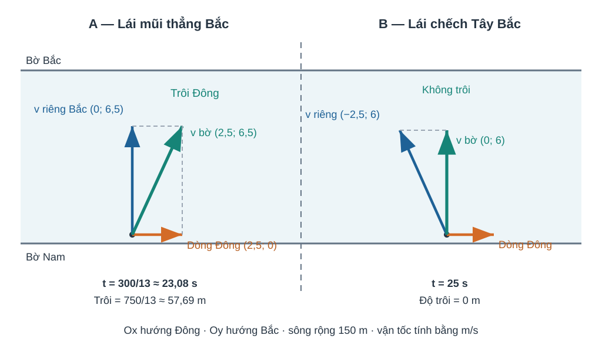

# Bài 10. Vectơ trong mặt phẳng tọa độ

## 1. Khám phá kiến thức

### Cùng tìm hiểu

Một mũi tên trên bản đồ có thể được mô tả bằng hai điều: đi **bao nhiêu đơn vị theo chiều ngang** và **bao nhiêu đơn vị theo chiều dọc**. Nếu một người đi từ \(A(1,2)\) đến \(B(5,5)\), họ đã dịch chuyển \(4\) đơn vị theo phương ngang và \(3\) đơn vị theo phương đứng. Vì thế, tọa độ của vectơ độ dời được tính bằng **điểm cuối trừ điểm đầu**: \(\overrightarrow{AB}=(4,3)\).

Khi đã biết tọa độ, việc cộng hai độ dời không còn đòi hỏi vẽ lại từng mũi tên: ta cộng từng thành phần, tương tự cách ghép hai lần di chuyển. Nhưng tọa độ của **một điểm** và tọa độ của **một vectơ** không phải cùng một đối tượng. Vectơ \(\overrightarrow{AB}\) có thể chuyển sang một vị trí khác mà không đổi hai thành phần của nó.

Bài học cũng giải thích vì sao độ dài vectơ phải dùng căn của **tổng bình phương** hai tọa độ, cách kiểm hai vectơ cùng phương và cách tìm trung điểm, trọng tâm từ tọa độ các đỉnh.

### Thuật ngữ, kiến thức và kỹ năng

**Thuật ngữ:** Vectơ tọa độ, vectơ đơn vị trên trục, điểm đầu/điểm cuối, độ dài, cùng phương, tọa độ trung điểm/trọng tâm.

**Sau bài học, em cần làm được:** Tính (overrightarrow{AB}) bằng tọa độ điểm cuối trừ đầu; cộng, trừ, nhân vectơ theo tọa độ; tính độ dài; kiểm cùng phương và tìm tọa độ trung điểm/trọng tâm.

## 2. Kiến thức SGK

### Vì sao lấy điểm cuối trừ điểm đầu?

Trên bản đồ tọa độ, muốn biết bạn đã dịch chuyển bao xa theo Đông–Tây và Bắc–Nam từ A đến B, chỉ cần nhìn sự thay đổi tọa độ.

Đã biết trục Ox, Oy và điểm A(xA;yA), B(xB;yB); quy ước đổi theo chiều dương của hai trục. 

Độ dời theo trục x là 'x đến − x đi', theo trục y là 'y đến − y đi'. Hai số đó ghép thành tọa độ vectơ \(\overrightarrow{AB}\); điểm đặt có thể khác nhưng cùng cặp độ dời tạo vectơ bằng nhau.

Viết 'cuối trừ đầu' thành hai bước độc lập, đừng lấy luôn tọa độ B. Đổi sang BA thì cả hai thành phần đổi dấu.

**Em vận dụng.** Cho A(-3;2), B(2;-1). Tìm tọa độ \(\overrightarrow{AB}\) và \(\overrightarrow{BA}\).

??? question "Em tự mở đối chiếu sau khi đã thử làm"

    **Kết quả:** \(\overrightarrow{AB}=(5;-3)\), \(\overrightarrow{BA}=(-5;3)\).

    **Vì sao:** 2−(−3)=5 và −1−2=−3. Đảo điểm đầu/cuối làm vectơ đối.

### Tọa độ giữ phép cộng vectơ dễ tính

Từ hai lần dịch chuyển đã mô tả bằng (ngang; dọc), ta muốn ghép chúng mà không phải vẽ lại từng mũi tên.

Biết cộng hai vectơ theo thành phần ngang/dọc B08, nhân một số B09; cặp số (x;y) biểu diễn hai thành phần theo trục. 

Đi thêm 2 đơn vị ngang và −1 dọc rồi tiếp thêm −1 ngang và 3 dọc nghĩa là cộng các độ dời ngang với nhau, dọc với nhau. Vì vậy phép cộng/trừ và nhân số được thực hiện theo từng tọa độ.

Chọn đại số theo tọa độ khi đã có cặp số; không cộng chéo x với y, và đặt ngoặc đúng khi trừ một vectơ.

**Em vận dụng.** \(\vec u=(2;-1)\), \(\vec v=(-1;3)\). Tính \(2\vec u-\vec v\).

??? question "Em tự mở đối chiếu sau khi đã thử làm"

    **Kết quả:** \((5;-5)\).

    **Vì sao:** 2u=(4;−2); trừ v=(-1;3) nghĩa là (4−(−1);−2−3)=(5;−5).

### Khoảng cách là độ dài mũi tên, không phải tổng hai ô

Đi 3 ô sang Đông và 4 ô lên Bắc có quãng đường theo lưới 7 ô nhưng khoảng cách thẳng chỉ 5 ô.

Đã biết tam giác vuông và Pitago; tọa độ vectơ AB=(Δx;Δy) là hai cạnh góc vuông. 

Đường nối trực tiếp A–B là cạnh huyền: \(AB=\sqrt{(\Delta x)^2+(\Delta y)^2}\). Đó là độ dài vectơ, luôn không âm; không cộng |Δx|+|Δy| trừ khi đang hỏi đường đi theo lưới.

Dùng Pitago khi hỏi độ dài vectơ/khoảng cách giữa hai điểm, không nhầm với quãng đường đi theo cạnh ô.

**Em vận dụng.** Cho A(1;2), B(4;6). Khoảng cách AB là 7 hay 5 đơn vị?

??? question "Em tự mở đối chiếu sau khi đã thử làm"

    **Kết quả:** 5 đơn vị.

    **Vì sao:** AB=(3;4), nên AB=√(3²+4²)=5. 7 là tổng chặng theo hai trục, không phải khoảng cách thẳng.

### Hai cặp số có cùng hướng hình học khi nào?

Trong bản đồ, (2 ô Đông,1 ô Bắc) và (6 ô Đông,3 ô Bắc) cùng đường đi nhưng khác độ dài.

Đã biết bội vô hướng và điều kiện khác vectơ-không của B09; tọa độ vectơ biểu diễn hai thành phần. 

Nếu \(\vec v=k\vec u\) thì cả hai tọa độ đều nhân cùng k, nên hai mũi tên song song. Nếu không có cùng một k cho cả hai thành phần thì khác phương.

Tìm cùng hệ số k ở cả hai tọa độ; trường hợp một tọa độ bằng 0 cần đối chiếu trực tiếp, không chia cho số 0.

**Em vận dụng.** Với \(\vec u=(2;1)\), \(\vec v=(6;3)\), \(\vec w=(6;4)\). Vectơ nào cùng phương với u (biết cả ba đều khác 0)?

??? question "Em tự mở đối chiếu sau khi đã thử làm"

    **Kết quả:** Chỉ \(\vec v\) cùng phương với \(\vec u\), vì \(\vec v=3\vec u\); \(\vec w\) không cùng phương.

    **Vì sao:** Cặp (6,4) có tỉ số x=3 nhưng y=4, không thể tìm cùng k cho hai tọa độ.

### Tọa độ điểm cân bằng là trung bình các đỉnh

Trung điểm đoạn thẳng nằm cân giữa hai đầu, trọng tâm tam giác nằm cân giữa ba đỉnh khi xét tọa độ theo mỗi trục.

Đã biết trung điểm M của AB và trọng tâm G của tam giác; phép cộng vectơ và số trung bình cộng. 

Vì trung điểm có vectơ MA+MB=0, tọa độ trung bình của A,B cho M. Tương tự GA+GB+GC=0 cho trọng tâm, nên tọa độ G là trung bình của ba tọa độ đỉnh.

Dùng trung bình tọa độ theo từng trục cho M hoặc G, kiểm G nằm trong tam giác và M nằm trên AB; không nhầm chia 2 và chia 3.

**Em vận dụng.** Cho A(-2;4), B(4;0), C(1;5). Tính trung điểm M của AB và trọng tâm G của ABC.

??? question "Em tự mở đối chiếu sau khi đã thử làm"

    **Kết quả:** \(M=(1;2)\), \(G=(1;3)\).

    **Vì sao:** M: ((−2+4)/2;(4+0)/2)=(1;2); G: ((−2+4+1)/3;(4+0+5)/3)=(1;3).

### Ứng dụng: Ca nô: vận tốc theo bờ và điều kiện không trôi

Mũi thuyền đang hướng Bắc nhưng dòng nước kéo sang Đông: **hướng mũi thuyền không trùng quỹ đạo theo bờ**. Muốn cập đúng điểm đối diện, phải chủ động hướng thuyền ngược dòng.

**Kiến thức tiền đề:** B08 cộng/trừ vectơ, B10 tọa độ `(x;y)` và độ dài vectơ; định nghĩa vận tốc là vectơ (m/s), phân biệt **vận tốc riêng so với nước** với **vận tốc theo bờ**.

Nếu chọn Ox về Đông, Oy về Bắc: `v_bờ=v_thuyền/nước+v_dòng`. Thời gian qua sông bằng **bề rộng chia thành phần Bắc dương** của `v_bờ` (không tự động chia cho độ lớn tốc độ riêng). Dịch chuyển ngang bằng `v_bờ,x·t`.

**Hướng dẫn đọc hình:** Vẽ mũi tên dòng nước sang phải, mũi tên lái về phía bờ (có thể hơi chếch trái), và đường chéo vận tốc thực. Khoảng cách hai bờ đo dọc Oy; trôi dạt đo dọc Ox. Không coi đồ thị tốc độ–thời gian là sơ đồ hai bờ.

Để **không trôi**, giải `v_thuyền/nước,x=−v_dòng,x` rồi chọn thành phần Bắc dương từ độ lớn đã cho. Điều kiện **`|v_dòng|<|v_thuyền/nước|`** cần thiết để vẫn có thành phần Bắc dương (dòng bằng tốc độ riêng thì không vượt qua bờ). Giả định dòng đều, vận tốc riêng có độ lớn không đổi, hai bờ thẳng song song.

**Em vận dụng.** Sông rộng 60 m, nước chảy **3 m/s về Đông**; ca nô chạy **5 m/s so với nước**, lái thẳng về Bắc. Ca nô sẽ trôi bao nhiêu mét về Đông khi tới bờ bên kia? Hãy thử trước khi mở.

??? question "Tự mở đối chiếu kết quả"

    `v_bờ=(3;5)` m/s; thành phần qua sông 5 m/s, nên `t=60/5=12 s` và độ trôi Đông `3·12=36 m`. Độ lớn vận tốc thực `√34` m/s, **không phải** tốc độ Bắc 5 m/s. Nếu dùng `60/√34`, xem `HELP-G10-CHIV-RIVER-TR01`.

#### Ví dụ có hướng dẫn — EX-G10-B10-RIVER-TR01

Sông rộng 96 m, dòng chảy đều 3 m/s về Đông; thuyền chạy 5 m/s so với nước. So sánh (i) giữ mũi thuyền thẳng Bắc và (ii) chọn hướng để cập đúng điểm đối diện.

1. **Lập hệ:** Ox về Đông, Oy về Bắc. Vận tốc dòng `(3;0)` m/s. 
2. **Trường hợp (i):** vận tốc riêng `(0;5)` m/s; theo bờ `(3;5)` m/s. Thời gian `96/5=19,2 s`; trôi Đông `3·19,2=57,6 m`.
3. **Trường hợp (ii):** yêu cầu vận tốc thực không có thành phần Đông, tức vận tốc riêng `(-3;v_y)`; vì độ lớn là 5, `(-3)²+v_y²=25` ⇒ lấy **`v_y=+4` m/s** để qua bờ. Vận tốc thực `(0;4)`; qua sông hết `96/4=24 s`, không trôi ngang.
4. **So sánh:** đi đúng điểm đối diện tốn **nhiều thời gian hơn** do một phần tốc độ riêng dùng để khử dòng. Không lấy nghiệm `v_y=-4` vì nó hướng **ra xa bờ đích**.

**Tại sao không dùng định lí Pitago làm toàn bộ bài?** Pitago giúp tìm độ lớn/thành phần, nhưng không thay bước thiết lập quan hệ **vectơ vận tốc tương đối** và điều kiện “đúng điểm đối diện”.

??? tip "Tự khắc phục trong năm bước"

    1. **Nhận diện:** em đang dùng tốc độ tổng thay cho thành phần qua sông, hay quên cộng vectơ dòng nước?

    2. **Chẩn đoán:** vẽ 3 mũi tên từ cùng gốc; mũi tên nào chỉ đường đi thực khi đứng trên bờ?

    3. **Lấp nền:** quay B08 cộng/trừ, B10 tọa độ và định lí độ dài vectơ, giải nghĩa hai hệ quy chiếu “nước” và “bờ”.

    4. **Tự sửa:** viết `v_bờ,y>0`, áp `t=bề_rộng/v_bờ,y`, đặt `v_bờ,x=0` khi không trôi; kiểm điều kiện căn không âm và v_y dương.

    5. **Luyện lại:** B10-P01/P02 → Tự thử `THPT-G10-CHIV-TRY-RIVER-TR01` mới (đã xem đáp án thì không làm bằng chứng độc lập) → D2 mới.

### Kiến thức SGK

### 1. Hệ tọa độ và vectơ

**Cách đọc hình.** Đọc mũi tên từ điểm A đến B; lấy hoành độ và tung độ điểm cuối trừ điểm đầu, rồi đối chiếu chiều chuyển động trên trục.

<figure class="thpt-r4-plot thpt-r4-probability-figure"><figcaption>Tọa độ vectơ AB bằng tọa độ điểm cuối trừ điểm đầu.</figcaption></figure>

 Trong hệ tọa độ vuông góc $Oxy$ với hai vectơ đơn vị $\vec i=(1;0)$ và $\vec j=(0;1)$, vectơ $\vec u=(u_x;u_y)=u_x\vec i+u_y\vec j$. Nếu $A(x_A;y_A)$, $B(x_B;y_B)$, thì

\[
\overrightarrow{AB}=(x_B-x_A;\ y_B-y_A).
\]

**Lưu ý:** Tọa độ vectơ $\overrightarrow{AB}$ **không phải** tọa độ điểm $B$ trừ khi $A=O$.

### 2. Các phép toán tọa độ

 Với $\vec u=(a;b)$, $\vec v=(c;d)$, $t\in\mathbb R$:

\[
\vec u+\vec v=(a+c;b+d),\quad \vec u-\vec v=(a-c;b-d),\quad t\vec u=(ta;tb).
\]

$|\vec u|=\sqrt{a^2+b^2}$, $AB=\sqrt{(x_B-x_A)^2+(y_B-y_A)^2}$.

**Điều kiện cùng phương:** Hai vectơ **khác không** cùng phương khi $ad-bc=0$; với vectơ không cần nêu quy ước KNTT riêng.

### 3. Tọa độ trung điểm và trọng tâm

 $M$ là trung điểm $AB$ khi

\[
M\left(\frac{x_A+x_B}{2};\frac{y_A+y_B}{2}\right).
\]

Trọng tâm tam giác $ABC$ là

\[
G\left(\frac{x_A+x_B+x_C}{3};\frac{y_A+y_B+y_C}{3}\right).
\]

**Điều kiện:** Chỉ dùng công thức trọng tâm khi $ABC$ là tam giác không suy biến. Kiểm tra lại bằng $\overrightarrow{GA}+\overrightarrow{GB}+\overrightarrow{GC}=\vec0$.

### 4. Ứng dụng

**Cách đọc hình.** Đọc vectơ vận tốc theo bờ như tổng hai chuyển động của ca nô và dòng nước. Phân biệt trục dọc bờ với trục qua sông; kiểm điều kiện không trôi bằng thành phần ngang.

<figure class="thpt-r4-plot thpt-r4-probability-figure"><figcaption>Hai bờ song song: thời gian phụ thuộc thành phần Bắc của vận tốc theo bờ.</figcaption></figure>

 Định vị/chuyển động trong bản đồ Oxy phải xác định trục, đơn vị và phân biệt độ dài đường đi thực tế với khoảng cách thẳng giữa hai vị trí.

## 3. Ví dụ giải toán

Trước khi xem lời giải, hãy xác định dữ kiện, điều phải tìm và lý do chọn cách giải. Sau đó kiểm tra lại điều kiện áp dụng và kết quả, thay vì chỉ nhìn phép tính cuối cùng.

### Ví dụ 1. Tọa độ vectơ từ hai điểm

**Đề:** Cho $A(-1;2)$, $B(3;5)$. Tìm $\overrightarrow{AB}$ và $AB$.  
**Giải:** $\overrightarrow{AB}=(3-(-1);5-2)=(4;3)$, do đó $AB=\sqrt{4^2+3^2}=5$.  
**Tự kiểm:** $\overrightarrow{BA}=(-4;-3)$, không phải $(4;3)$.

### Ví dụ 2. Tính tọa độ biểu thức vectơ

**Đề:** Cho $\vec u=(2;-1)$, $\vec v=(-3;4)$. Tính $2\vec u-\vec v$.  
**Giải:** $2\vec u=(4;-2)$, vậy $2\vec u-\vec v=(4-(-3);-2-4)=(7;-6)$.  
**Tự kiểm:** Nhân hệ số lên cả hai thành phần.

### Ví dụ 3. Tọa độ trung điểm và trọng tâm

**Đề:** Cho $A(1;3)$, $B(5;-1)$, $C(-2;4)$. Tìm trung điểm $M$ của $AB$ và trọng tâm $G$ của tam giác.  
**Giải:** $M=(3;1)$; $G=((1+5-2)/3;(3-1+4)/3)=(4/3;2)$.  
**Tự kiểm:** Trọng tâm chia cho 3, không phải 2.

## 4. Lỗi thường gặp và cách tự khắc phục

Lấy nhầm tọa độ B làm tọa độ AB
<ul><li>Điểm nghẽn: Quên lấy tọa độ cuối trừ đầu.</li><li>Bản chất cần sửa: Tọa độ AB = B−A, không phải B.</li><li>Quy trình 5 bước: 1. Gạch điểm đầu A/cuối B. 2. Trừ hoành độ, tung độ. 3. Đảo chiều để tự kiểm BA=−AB. 4. Kiểm bằng độ dài. 5. Làm B10-P02.</li><li>Liên kết item có sẵn: B10-C01, B10-P02. Không clone câu hoặc giải vào HELP_ID.</li><li>Assessment safety: hỗ trợ chỉ tại Knowledge/Practice, không hiển thị trong phiên Tự kiểm tra trước Final Submit.</li></ul>
<a href="../luyen-tap/">Quay lại luyện tập</a>

Nhầm công thức trung điểm/trọng tâm và kiểm cùng phương
<ul><li>Điểm nghẽn: Chia 2 khi có ba đỉnh hoặc bỏ điều kiện vectơ khác không.</li><li>Bản chất cần sửa: Trung điểm lấy trung bình 2 điểm, trọng tâm 3 đỉnh.</li><li>Quy trình 5 bước: 1. Đếm số điểm. 2. Viết công thức hoành/tung. 3. Kiểm tổng GA+GB+GC. 4. Xét vectơ không riêng. 5. Luyện B10-P04/P05.</li><li>Liên kết item có sẵn: B10-P03, B10-P04, B10-P05. Không clone câu hoặc giải vào HELP_ID.</li><li>Assessment safety: hỗ trợ chỉ tại Knowledge/Practice, không hiển thị trong phiên Tự kiểm tra trước Final Submit.</li></ul>
<a href="../luyen-tap/">Quay lại luyện tập</a>

**Học tiếp:** [Core và Luyện tập](../luyen-tap/) · [Tự kiểm tra cuối chương](../tu-kiem-tra-chuong/).

Nguồn toán học: SGK Toán 10 Kết nối tri thức với cuộc sống và học liệu SLM hiện hành. Lời giảng được biên tập nhằm hỗ trợ tự học độc lập.

