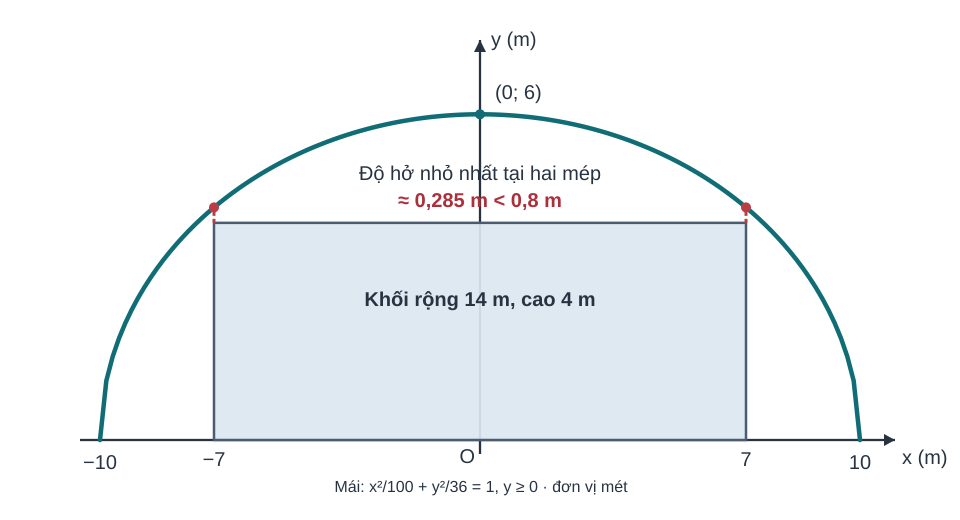
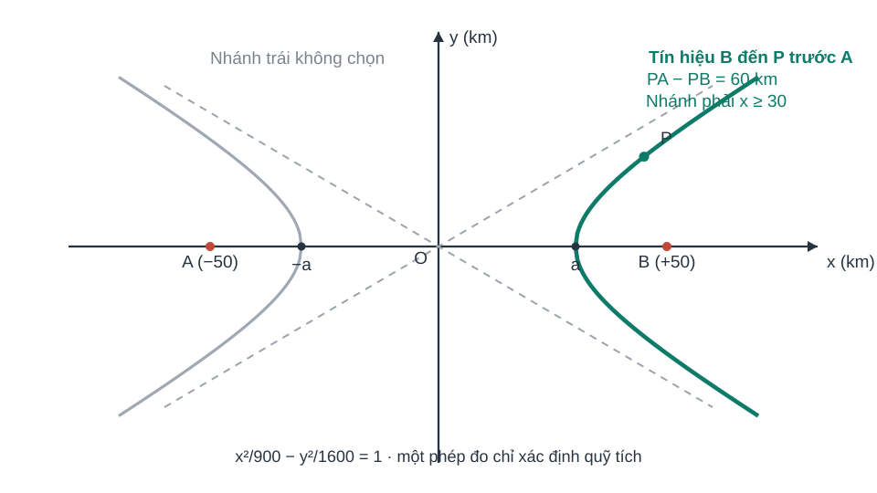
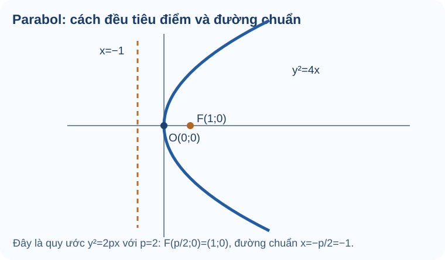

# Bài 22. Ba đường conic

## 1. Khám phá kiến thức

### Cùng tìm hiểu

Một điểm di chuyển trên mặt phẳng có thể bị ràng buộc bởi **khoảng cách đến những điểm hoặc đường cố định**. Nếu tổng khoảng cách đến hai điểm cố định không đổi, ta có **elip**; nếu trị tuyệt đối hiệu hai khoảng cách ấy không đổi, ta gặp **hypebol**. Nếu khoảng cách đến một điểm cố định luôn bằng khoảng cách đến một đường thẳng cố định, ta có **parabol**.

Ba đường đều có thể được mô tả bằng phương trình, nhưng **dấu và mẫu số trong phương trình không thể thay thế cho việc hiểu định nghĩa hình học**. Em cần nhận ra tiêu điểm, trục đối xứng, bán trục và điều kiện tham số trước khi tính. Khi gặp hình của một elip có trục lớn nằm ngang, ta không được tự dùng đúng công thức đó cho một elip quay hoặc đổi trục.

Bài học sẽ đi từ đặc điểm hình học đến ba phương trình chính tắc đúng quy ước SGK. Các hình minh họa đi cạnh từng loại đường, không gom chung ở cuối để học sinh khỏi so nhầm tiêu điểm hay trục.

### Thuật ngữ, kiến thức và kỹ năng

**Thuật ngữ:** Elip, hypebol, parabol, tiêu điểm, đường chuẩn, tâm, bán trục, trục thực, tiệm cận và phương trình chính tắc.

**Sau bài học, em cần làm được:** Nhận diện loại conic từ điều kiện khoảng cách và phương trình; tìm tiêu điểm/trục đúng tham số; phân biệt c²=a²−b² với c²=a²+b²; đọc tiêu điểm và đường chuẩn parabol theo quy ước y²=2px.

## 2. Kiến thức SGK

Đọc vì sao cần học, tự làm Tự thử trước khi mở đáp án và chỉ quay lại Core sau khi đã đối chiếu. Các câu này là luyện tập không ghi điểm thành thạo.

### Elip và ý nghĩa hai tiêu điểm

Một số đường bao có đặc điểm tổng quãng đường đến hai địa điểm cố định không đổi; tập hợp đó là đường elip.

**Kiến thức tiền đề:** Nhắc phương trình khoảng cách hai điểm, điều kiện a>b>0 cho elip có trục lớn là Ox.

**Bản chất trước công thức:** Tổng MF1+MF2=2a tạo ra elip. Với dạng x²/a²+y²/b²=1 có a>b>0, hai tiêu điểm cách tâm c với c²=a²−b², nên c<a.

**Hướng dẫn đọc hình:** Vẽ elip dẹt theo trục Ox, đánh dấu hai đỉnh (±a,0), hai tiêu điểm (±c,0) nằm bên trong đường bao; phân biệt c và b.

Đọc mẫu lớn hơn là a² khi trục lớn nằm trên Ox, tìm b², tính c²=a²−b² rồi viết tiêu điểm. **Tâm sai e=c/a là phần nâng cao, không dùng làm Core thay cho mục tiêu tiêu điểm/trục.**

**Em vận dụng.** Với elip x²/25+y²/16=1, tìm a, b, c và hai tiêu điểm.

Tự mở đáp án sau khi đã tự làm

**Đáp án:** a=5, b=4, c=3; F1(−3,0), F2(3,0).

**Lý do:** a²=25>b²=16, c²=25−16=9 ⇒ c=3; elip có trục lớn Ox.

**Nếu chưa đúng:** xem hướng khắc phục `HELP-G10-CHVII-TRY18` bên dưới; quay lại câu luyện tập tương ứng khi đã hiểu kiến thức.

Tự khắc phục theo năm bước

1. **Nhận diện lỗi:** Nếu dùng c²=a²+b², em đã nhầm công thức hypebol; nếu chọn B22-C01 tâm sai làm Core, em đang lệch kỹ năng SGK.

2. **Quay lại bản chất:** Tổng MF1+MF2=2a tạo ra elip. Với dạng x²/a²+y²/b²=1 có a>b>0, hai tiêu điểm cách tâm c với c²=a²−b², nên c<a.

3. **Tự sửa:** Quan sát dấu cộng giữa hai phân thức và kiểm 0<c<a; luyện đúng bài elip Core B22-P01.

4. **Tự đối chiếu:** xem lại lời giải trên sau khi em tự làm; kiểm các điều kiện và dữ kiện của bài vừa Tự thử.

5. **Luyện tiếp cùng kỹ năng:** quay lại `THPT-G10-B22-P01` trong phần Core/Luyện tập; không coi câu vừa mở lời giải là chứng cứ đánh giá độc lập.

<a href="../luyen-tap/?item=THPT-G10-B22-P01">Mở câu luyện tập tương ứng để tự luyện</a>

### Hypebol: chênh lệch khoảng cách và hai nhánh

Đường có chênh lệch khoảng cách tới hai điểm cố định không đổi tạo hình khác elip: hai nhánh kéo ra vô hạn.

**Kiến thức tiền đề:** Nhắc c²=a²−b² của elip để thấy hypebol dùng dấu trừ và có c²=a²+b².

**Bản chất trước công thức:** Dạng x²/a²−y²/b²=1 có hai nhánh mở theo ±Ox; c²=a²+b² nên tiêu điểm xa tâm hơn các đỉnh (c>a).

**Hướng dẫn đọc hình:** Trên hình đánh dấu hai nhánh mở trái và phải, các đỉnh ±a và tiêu điểm ±c xa hơn; không nối hai nhánh thành oval như elip.

Đọc đúng dấu trừ và vị trí mẫu dưới x²: a² ở mẫu số hạng dương; b² mẫu số hạng âm; tìm c> a từ a²+b².

**Em vận dụng.** Hypebol x²/16−y²/9=1 có các đỉnh và hai tiêu điểm tọa độ nào?

Tự mở đáp án sau khi đã tự làm

**Đáp án:** Đỉnh A1(−4,0), A2(4,0); tiêu điểm F1(−5,0), F2(5,0).

**Lý do:** a=4, b=3, c²=a²+b²=16+9=25 ⇒ c=5; trục thực Ox.

**Nếu chưa đúng:** xem hướng khắc phục `HELP-G10-CHVII-TRY19` bên dưới; quay lại câu luyện tập tương ứng khi đã hiểu kiến thức.

Tự khắc phục theo năm bước

1. **Nhận diện lỗi:** Nếu lấy c=√7 hoặc vẽ oval kín, em đang áp dụng công thức và hình elip.

2. **Quay lại bản chất:** Dạng x²/a²−y²/b²=1 có hai nhánh mở theo ±Ox; c²=a²+b² nên tiêu điểm xa tâm hơn các đỉnh (c>a).

3. **Tự sửa:** Kiểm c>a và vẽ hai nhánh qua hai đỉnh ±4, không khép kín.

4. **Tự đối chiếu:** xem lại lời giải trên sau khi em tự làm; kiểm các điều kiện và dữ kiện của bài vừa Tự thử.

5. **Luyện tiếp cùng kỹ năng:** quay lại `THPT-G10-B22-C02` trong phần Core/Luyện tập; không coi câu vừa mở lời giải là chứng cứ đánh giá độc lập.

<a href="../luyen-tap/?item=THPT-G10-B22-C02">Mở câu luyện tập tương ứng để tự luyện</a>

### Tiệm cận của hypebol biểu diễn hướng hai nhánh ở xa

Hai nhánh hypebol càng đi xa càng gần những đường thẳng cố định; chúng cho hướng hình học khi không thể vẽ toàn bộ đường cong.

**Kiến thức tiền đề:** Ôn tỉ số b/a từ dạng x²/a²−y²/b²=1 và tính chất đường thẳng đi qua gốc.

**Bản chất trước công thức:** Khi |x| lớn, hệ thức y²=(b²/a²)(x²−a²) cho |y/x| tiến gần b/a. Hai đường y=±(b/a)x là tiệm cận, không phải các nhánh thực của hypebol.

**Hướng dẫn đọc hình:** Vẽ hai đường chéo qua O và hai nhánh hypebol tiến sát chúng nhưng không chạm ở vùng xa; nhấn mạnh tiệm cận không phải trục đối xứng x/y.

Chỉ áp dụng công thức y=±(b/a)x cho dạng chính tắc tâm O, trục thực Ox. Trường hợp tịnh tiến/đổi trục cần biến đổi trước.

**Em vận dụng.** Hypebol x²/25−y²/4=1 có hai đường tiệm cận nào?

Tự mở đáp án sau khi đã tự làm

**Đáp án:** y=(2/5)x và y=−(2/5)x.

**Lý do:** a²=25 ⇒ a=5; b²=4 ⇒ b=2. Hệ số góc tiệm cận là ±b/a=±2/5.

**Nếu chưa đúng:** xem hướng khắc phục `HELP-G10-CHVII-TRY20` bên dưới; quay lại câu luyện tập tương ứng khi đã hiểu kiến thức.

Tự khắc phục theo năm bước

1. **Nhận diện lỗi:** Nếu lấy hệ số ±5/2, em đã đảo tỉ số a/b; nếu vẽ thẳng là đồ thị hypebol, em nhầm tiệm cận với đường cong.

2. **Quay lại bản chất:** Khi |x| lớn, hệ thức y²=(b²/a²)(x²−a²) cho |y/x| tiến gần b/a. Hai đường y=±(b/a)x là tiệm cận, không phải các nhánh thực của hypebol.

3. **Tự sửa:** Đánh dấu hai giao điểm với Ox (±5,0) của hypebol và hai đường chéo có hệ số ±0,4.

4. **Tự đối chiếu:** xem lại lời giải trên sau khi em tự làm; kiểm các điều kiện và dữ kiện của bài vừa Tự thử.

5. **Luyện tiếp cùng kỹ năng:** quay lại `THPT-G10-B22-C02` trong phần Core/Luyện tập; không coi câu vừa mở lời giải là chứng cứ đánh giá độc lập.

<a href="../luyen-tap/?item=THPT-G10-B22-C02">Mở câu luyện tập tương ứng để tự luyện</a>

### Parabol và quan hệ tiêu điểm – đường chuẩn

Một chảo phản xạ có mặt cắt parabol vì vị trí của các điểm trên đường cong có quan hệ hình học đặc biệt với tiêu điểm và đường chuẩn.

**Kiến thức tiền đề:** Ôn khoảng cách điểm đến điểm, điểm đến đường thẳng; lưu ý dự án dùng quy ước y²=2px với p>0.

**Bản chất trước công thức:** Điểm M trên parabol có MF bằng khoảng cách vuông góc từ M đến đường chuẩn. Với y²=2px, p>0, tiêu điểm F(p/2,0) và đường chuẩn x=−p/2; **không** lấy F(p,0).

**Hướng dẫn đọc hình:** Vẽ đỉnh O, tiêu điểm F ở bên phải và đường chuẩn ở bên trái cách O cùng p/2; từ M trên đường cong, so hai đoạn dài bằng nhau.

Từ hệ số của x suy 2p, tính p rồi lấy p/2 cho tiêu điểm và đường chuẩn. Phải dùng đúng một quy ước công thức cho cả hai.

**Em vận dụng.** Cho parabol y²=8x với x≥0. Xác định tiêu điểm, đường chuẩn; M(2,4) có thuộc parabol không?

Tự mở đáp án sau khi đã tự làm

**Đáp án:** p=4; F(2,0), đường chuẩn x=−2; M(2,4) thuộc vì 4²=8·2.

**Lý do:** 2p=8 ⇒ p=4, F=(p/2,0)=(2,0), đường chuẩn x=−p/2=−2. M có MF=4 và khoảng cách đến x=−2 là 4.

**Nếu chưa đúng:** xem hướng khắc phục `HELP-G10-CHVII-TRY21` bên dưới; quay lại câu luyện tập tương ứng khi đã hiểu kiến thức.

Tự khắc phục theo năm bước

1. **Nhận diện lỗi:** Nếu đặt F=(4,0), em đã nhầm p với p/2; nếu không thử M, em chỉ kiểm công thức chứ chưa đọc đồ thị.

2. **Quay lại bản chất:** Điểm M trên parabol có MF bằng khoảng cách vuông góc từ M đến đường chuẩn. Với y²=2px, p>0, tiêu điểm F(p/2,0) và đường chuẩn x=−p/2; **không** lấy F(p,0).

3. **Tự sửa:** Thử ngay y²=8x ở M và so MF với khoảng cách ngang từ M đến x=−2.

4. **Tự đối chiếu:** xem lại lời giải trên sau khi em tự làm; kiểm các điều kiện và dữ kiện của bài vừa Tự thử.

5. **Luyện tiếp cùng kỹ năng:** quay lại `THPT-G10-B22-P03` trong phần Core/Luyện tập; không coi câu vừa mở lời giải là chứng cứ đánh giá độc lập.

<a href="../luyen-tap/?item=THPT-G10-B22-P03">Mở câu luyện tập tương ứng để tự luyện</a>

### Điểm và đường thẳng cắt conic

Để xác định chỗ một tuyến đường thẳng đi qua một đường bao conic, ta tìm các tọa độ thỏa cả hai điều kiện.

**Kiến thức tiền đề:** Ôn giải hệ và thế phương trình đường thẳng vào công thức elip/hypebol/parabol.

**Bản chất trước công thức:** Giao điểm là nghiệm chung; số nghiệm thực phụ thuộc vị trí, chứ không được kết luận luôn có hai giao điểm.

**Hướng dẫn đọc hình:** Vẽ elip và trục Oy đi qua hai điểm trên và dưới; so với đường ngoài elip có thể không có giao điểm.

Thế phương trình đường vào conic, giải phương trình còn lại và kiểm từng nghiệm thực. Nghiệm hình học phải thỏa tất cả điều kiện.

**Em vận dụng.** Đường x=0 cắt elip x²/9+y²/4=1 tại những điểm nào?

Tự mở đáp án sau khi đã tự làm

**Đáp án:** (0,2) và (0,−2).

**Lý do:** Thế x=0 được y²/4=1 ⇒ y²=4 ⇒ y=±2; cả hai tọa độ thỏa phương trình gốc.

**Nếu chưa đúng:** xem hướng khắc phục `HELP-G10-CHVII-TRY22` bên dưới; quay lại câu luyện tập tương ứng khi đã hiểu kiến thức.

Tự khắc phục theo năm bước

1. **Nhận diện lỗi:** Nếu chỉ ghi y=2, em bỏ mất nghiệm âm vì căn của bình phương; nếu kết luận hai điểm theo hình mà không tính, chứng cứ chưa đủ.

2. **Quay lại bản chất:** Giao điểm là nghiệm chung; số nghiệm thực phụ thuộc vị trí, chứ không được kết luận luôn có hai giao điểm.

3. **Tự sửa:** Giải đủ hai dấu của y rồi thay lại từng cặp tọa độ.

4. **Tự đối chiếu:** xem lại lời giải trên sau khi em tự làm; kiểm các điều kiện và dữ kiện của bài vừa Tự thử.

5. **Luyện tiếp cùng kỹ năng:** quay lại `THPT-G10-B22-P05` trong phần Core/Luyện tập; không coi câu vừa mở lời giải là chứng cứ đánh giá độc lập.

<a href="../luyen-tap/?item=THPT-G10-B22-P05">Mở câu luyện tập tương ứng để tự luyện</a>

### Ứng dụng kích thước của parabol

Trong thiết kế máng phản xạ hoặc cổng cong, bản vẽ có thể dùng parabol để tính độ rộng tại một vị trí đã định.

**Kiến thức tiền đề:** Nhắc phương trình y²=2px; trục đối xứng là Ox, tại x cố định các giá trị y đối xứng nhau.

**Bản chất trước công thức:** Tại một hoành độ x≥0, hai điểm biên của parabol có tung độ ±√(2px); độ rộng theo phương vuông góc trục là hiệu hai tung độ, bằng 2√(2px).

**Hướng dẫn đọc hình:** Vẽ parabol mở phải, đoạn thẳng đứng tại x=5 giao hai nhánh; chiều rộng là khoảng cách từ y âm đến y dương, không phải chỉ một tung độ.

Giải y²=2px tại x cụ thể, lấy cả ±y rồi trừ hai tung độ. Gắn đơn vị và chỉ dùng trong phạm vi mô hình thực tế phù hợp.

**Em vận dụng.** Mặt cắt một máng giả sử có dạng y²=20x (x,y tính bằng cm). Bề rộng của máng tại x=5 cm là bao nhiêu?

Tự mở đáp án sau khi đã tự làm

**Đáp án:** 20 cm.

**Lý do:** Thế x=5 được y²=100 ⇒ y=±10 cm. Độ rộng là 10−(−10)=20 cm.

**Nếu chưa đúng:** xem hướng khắc phục `HELP-G10-CHVII-TRY23` bên dưới; quay lại câu luyện tập tương ứng khi đã hiểu kiến thức.

Tự khắc phục theo năm bước

1. **Nhận diện lỗi:** Nếu đáp 10 cm, em chỉ lấy khoảng cách từ trục đối xứng đến một bên mép mà quên cả hai nhánh.

2. **Quay lại bản chất:** Tại một hoành độ x≥0, hai điểm biên của parabol có tung độ ±√(2px); độ rộng theo phương vuông góc trục là hiệu hai tung độ, bằng 2√(2px).

3. **Tự sửa:** Vẽ đoạn thẳng đứng từ (5,−10) tới (5,10) và tính hiệu hai tung độ.

4. **Tự đối chiếu:** xem lại lời giải trên sau khi em tự làm; kiểm các điều kiện và dữ kiện của bài vừa Tự thử.

5. **Luyện tiếp cùng kỹ năng:** quay lại `THPT-G10-B22-P04` trong phần Core/Luyện tập; không coi câu vừa mở lời giải là chứng cứ đánh giá độc lập.

<a href="../luyen-tap/?item=THPT-G10-B22-P04">Mở câu luyện tập tương ứng để tự luyện</a>

### Ứng dụng nửa elip: độ hở an toàn

Cùng chiều cao giữa đỉnh mái và nền **không đảm bảo** một thiết bị có bề rộng lớn đi lọt: phải xem độ cao thấp nhất của mái **trên toàn bề rộng thiết bị**.  

**Kiến thức tiền đề:** Elip chính tắc `(x²/a²)+(y²/b²)=1`, a,b>0 (không luôn bắt buộc a>b nếu ta chỉ dùng tên **bán trục theo Ox/Oy**); trục tọa độ và đoạn thẳng. Phân biệt **bán bề rộng** với bề rộng toàn phần.  

**Bản chất trước công thức:** Lấy tâm nền làm O, Ox dọc nền, Oy thẳng đứng. Mái **nửa trên** elip có `y≥0`, chiều rộng toàn phần `2a_x`, cao tại tâm `b_y`. Công thức tính trục theo hướng x/y là `x²/a_x²+y²/b_y²=1`; với chiều cao ở vị trí x, chỉ chọn **nghiệm y≥0**. Với thiết bị hình chữ nhật đặt giữa, cần kiểm độ cao tại **hai mép trên** chứ không chỉ tại tâm.  

**Hướng dẫn đọc hình:** Vẽ hai chân mái tại `(-a_x;0)` và `(a_x;0)`, đỉnh `(0;b_y)`; hình chữ nhật có mép x=±w/2, chiều cao h. Độ hở tối thiểu đo theo Oy từ đỉnh hai góc của vật lên mái. Đồ thị nửa elip thấp dần khi |x| tăng trong `[0,a_x]`.  

**Vì sao chọn phương pháp và giới hạn:** Dựng **trục theo số đo vật lý trước**, dùng phương trình elip để tính mái tại mép; kiểm `|x|≤a_x`, `y≥0` và yêu cầu an toàn. Mô hình giả sử mặt cắt phẳng, đối xứng và vật đặt chính giữa; không suy tính an toàn 3D nếu dữ kiện chỉ có mặt cắt.  

**Em vận dụng.** Mái nửa elip rộng **12 m**, cao **4 m** tại tâm. Đặt O ở giữa nền, Ox dọc nền. (a) Viết phương trình elip đầy đủ và điều kiện miền mái. (b) Tại x=3 m, mái cao bao nhiêu? Tự làm rồi mở kết quả.

Tự mở kết quả sau khi đã thử

Bán trục ngang 6, bán trục đứng 4: `x²/36+y²/16=1`, **y≥0**, |x|≤6. Tại x=3, `y=4√(1−9/36)=2√3≈3,464 m`. Không lấy y âm hoặc dùng a=12. Nếu sai, xem `HELP-G10-CHVII-ELLIPSE-TR01`.

#### Ví dụ giải có hướng dẫn — EX-G10-B22-ELLIPSE-TR01

**Tình huống khác câu D4:** Một mái che nửa elip có bề rộng **30 m**, cao tại tâm **10 m**. Người đứng cách chân mái bên phải **6 m về phía trong**. Tính độ cao mái ở vị trí đó.

1. **Vì sao chọn hệ trục này:** Đặt O ở giữa hai chân, Ox dọc mặt đất; khi đó bề rộng 30 m cho bán trục ngang `a_x=15`, cao 10 m cho bán trục đứng `b_y=10`.
2. **Dựng mô hình:** `x²/225+y²/100=1`, chỉ xét **nửa trên y≥0**. Chân phải x=15, cách chân vào trong 6m ⇒ **x=15−6=9**, **không phải x=6**.
3. **Tìm chiều cao:** `y=10√(1−81/225)=10√(144/225)=8 m`.
4. **Kiểm:** y=8 m nằm giữa 0 và 10m; càng đi từ chân vào giữa, chiều cao phải tăng. Nếu ra chiều cao lớn hơn 10 thì đã đọc sai trục/công thức.

**Tại sao là D2 mới:** Điểm khó nằm ở **dịch điều kiện thực tế “cách chân mái” thành hoành độ** và giới hạn nửa elip; cách dựng từ tiêu điểm trong `THPT-G10-B22-P01` không tự thay chuỗi này.

Tự khắc phục theo năm bước

1. **Nhận diện:** sai bán trục, sai x mép, quên nửa elip, hay quên yêu cầu an toàn?  

2. **Chẩn đoán:** đánh dấu −10, −7, 0, 7, 10 trên Ox; khoanh hai góc trên khối và khoảng hở thẳng đứng cần kiểm.  

3. **Lấp nền:** elip chính tắc theo **bán trục ngang/dọc**, hình đối xứng; điểm trên mái thỏa `y≥0`.  

4. **Tự sửa:** thay x=7 vào phương trình; so `y(7)−4` với **0,8**, sau đó giải ngược điều kiện độ hở theo w.  

5. **Luyện đúng nguồn:** B22-P01 → B22-P05 → D2 mới; bài D4 đã xem lời giải không được tính làm kiểm tra độc lập.

### Ứng dụng hypebol: hai trạm tín hiệu

Hai trạm đồng phát cùng tín hiệu, tín hiệu đến người thu khác thời điểm vì **khoảng cách khác nhau**. Chênh lệch thời gian buộc người thu nằm trên một **quỹ tích hypebol**, không xác định duy nhất vị trí.  

**Kiến thức tiền đề:** `quãng đường = vận tốc × thời gian` với cùng đơn vị; tọa độ hai trạm; định nghĩa hypebol bằng **giá trị tuyệt đối hiệu hai khoảng cách** bằng 2a; `c²=a²+b²`, `2c=AB`.  

**Bản chất trước công thức:** Với trạm A và B cùng truyền với tốc độ v tại cùng thời điểm, nếu tín hiệu B đến trước A một khoảng Δt>0 thì **`PA−PB=vΔt>0`**. Mỗi điểm trên nhánh phía B **gần B hơn**; việc chọn nhánh không được suy từ dấu “−” trong phương trình chính tắc (phương trình chứa cả hai nhánh).  

**Hướng dẫn đọc hình:** O trung điểm AB; đặt A bên trái x<0, B bên phải x>0. Hai đỉnh `(±a,0)` nằm trong hai tiêu điểm `(±c,0)` vì `0<a<c`. Nhánh phải là phía gần B; không nối hai nhánh thành oval.  

**Vì sao chọn phương pháp và giới hạn:** Dùng thời gian→hiệu quãng đường **trước** khi lập hypebol; phải kiểm **`0<vΔt<AB`** để hypebol không suy biến và có vị trí phù hợp. Một cặp trạm chỉ cho **một nhánh quỹ tích**, không xác định duy nhất điểm nhận; cần dữ liệu thêm để định vị.  

**Em vận dụng.** Hai trạm cách nhau 60 km, phát tín hiệu đồng thời; sóng truyền 100.000 km/s. Chênh thời gian tới máy thu là 0,0002 s. Tính `2a`, `c`, `b²` cho hypebol tương ứng và kiểm điều kiện có nghiệm hình học, rồi mở đối chiếu.

Tự mở kết quả sau khi đã thử

Hiệu quãng đường `vΔt=100000·0,0002=20 km`, nên `2a=20`, `a=10 km`, `2c=60`, `c=30 km`, `b²=c²−a²=900−100=800 km²`. Vì `0<20<60`, dữ kiện hình học phù hợp hypebol. **Chưa đủ thông tin trạm nào nhận trước** nên chưa thể chọn nhánh. Nếu quên điều kiện này, xem `HELP-G10-CHVII-HYPERBOLA-TR01`.

#### Ví dụ giải có hướng dẫn — EX-G10-B22-HYPERBOLA-TR01

**Khác số với bài SGK/đề D4:** Trạm A ở `(-40;0)` km, trạm B ở `(40;0)` km, đồng phát tín hiệu tốc độ **100.000 km/s**. Máy thu P nhận từ **A sớm hơn từ B** 0,0004 s. Xác định phương trình quỹ tích và nhánh.

1. **Đặt nguồn c:** AB=80km ⇒ c=40km; kiểm đơn vị. Chênh quãng đường `vΔt=100000·0,0004=40 km` ⇒ `2a=40km`, a=20km.
2. **Kiểm hợp lệ:** 0<40<80, nên tồn tại hypebol thật. `b²=c²−a²=1600−400=1200` km².
3. **Phương trình toàn hypebol:** **`x²/400−y²/1200=1`**, gồm hai nhánh. Vì **A đến trước**, P gần A hơn ⇒ P phải ở **nhánh trái, x≤−20**.
4. **Giới hạn:** Không thể suy một tọa độ P chính xác từ một chênh thời gian; còn vô số điểm trên nhánh này. Hai trạm phải **đồng bộ thời điểm phát** để suy hiệu khoảng cách chỉ từ hiệu thời gian nhận.

Tự khắc phục theo năm bước

1. **Nhận diện:** nhầm c với a, quên vΔt, sai nhánh hay cố lập hypebol từ chênh quãng đường quá lớn?  

2. **Chẩn đoán:** vẽ A trái/B phải; chọn điểm P bên B, kiểm ai gần hơn, viết `PA−PB` với dấu dương.  

3. **Lấp nền:** ôn định nghĩa giá trị tuyệt đối hiệu khoảng cách bằng `2a`, trục thực và quan hệ hypebol **`c²=a²+b²`**; nhắc bất đẳng thức tam giác `|PA−PB|≤AB`.  

4. **Tự sửa:** ghi bảng `2c=AB`, `2a=vΔt`, `b²=c²−a²`, `0<2a<2c`; sau đó mới dùng thông tin trạm đến trước để chọn nhánh.  

5. **Luyện đúng nguồn:** B22-C02/P02 → First Try mới nếu chưa mở đáp án → D2 mới; đã xem đáp án D4 thì không tái dùng D4 cho RD1.

### Elip — trục lớn trùng \(Ox\)

**Cách đọc hình.** Đọc hai tiêu điểm và độ dài các bán trục trong hình elip; điểm trên elip có tổng khoảng cách đến hai tiêu điểm không đổi.

<figure class="thpt-r4-plot thpt-r4-probability-figure"><figcaption>Hình minh họa độ hở theo phương đứng tại hai mép khối, không chỉ tại tâm.</figcaption></figure>

Dạng chính tắc \(\dfrac{x^2}{a^2}+\dfrac{y^2}{b^2}=1\), với \(a>b>0\). Đặt \(c^2=a^2-b^2\), hai tiêu điểm là \((\pm c;0)\), các đỉnh \((\pm a;0)\) và \((0;\pm b)\).

**Ví dụ:** \(\dfrac{x^2}{25}+\dfrac{y^2}{9}=1\) có \(a=5\), \(b=3\), \(c=4\), tiêu điểm \((\pm4;0)\); tổng khoảng cách từ một điểm trên elip đến hai tiêu điểm bằng \(2a=10\).

### Hypebol — trục thực trùng \(Ox\)

**Cách đọc hình.** Đọc hai nhánh hypebol, hai tiêu điểm và đường tiệm cận; đừng tráo công thức c²=a²+b² thành elip.

<figure class="thpt-r4-plot thpt-r4-probability-figure"><figcaption>Hình minh họa quỹ tích hai nhánh; B nhận trước chọn nhánh gần B, không phải một điểm duy nhất.</figcaption></figure>

Dạng chính tắc \(\dfrac{x^2}{a^2}-\dfrac{y^2}{b^2}=1\), \(a,b>0\). Khi đó \(c^2=a^2+b^2\), hai tiêu điểm \((\pm c;0)\), các đỉnh \((\pm a;0)\), các tiệm cận \(y=\pm\dfrac ba x\).

**Ví dụ:** \(\dfrac{x^2}{9}-\dfrac{y^2}{16}=1\): \(a=3,b=4,c=5\), hai tiệm cận \(y=\pm4x/3\).

### Parabol — quy ước \(y^2=2px,\ p>0\)

**Cách đọc hình.** Trên parabol y²=4x, đỉnh là O, F(1,0), đường chuẩn x=-1; điểm trên đường cách đều tiêu điểm và đường chuẩn.

<figure class="thpt-r4-plot thpt-r4-concept-figure"><figcaption>Với **(y^2=4x)** và quy ước **(y^2=2px)**, ta có (p=2), (F(1,0)), đường chuẩn (x=-1). Đây là hình tự dựng cho đúng phương trình này.</figcaption></figure>

Parabol có đỉnh \(O(0;0)\), tiêu điểm \(F(p/2;0)\), đường chuẩn \(x=-p/2\). Mọi điểm \(M\) trên parabol có khoảng cách đến tiêu điểm bằng khoảng cách đến đường chuẩn.

**Ví dụ:** \(y^2=12x\), suy ra \(p=6\), \(F(3;0)\), đường chuẩn \(x=-3\). Điểm \(M(3;6)\) thuộc parabol vì \(36=12\cdot3\); hai khoảng cách đều bằng \(6\).

### Phân biệt công thức và phạm vi

| Đường conic | Công thức liên hệ | Chú ý |
|---|---|---|
| Elip | \(c^2=a^2-b^2\) | \(a>b>0\) trong dạng trục lớn \(Ox\) |
| Hypebol | \(c^2=a^2+b^2\) | Tiệm cận \(y=\pm bx/a\) |
| Parabol | \(y^2=2px\) | Tiêu điểm \((p/2;0)\), không phải \((p;0)\) |

Kiến thức mở rộng: tâm sai

Tâm sai là kiến thức nâng cao tự chọn, không thuộc phần Core bắt buộc. Hãy học vững phương trình chính tắc trước khi luyện thêm.

## 3. Ví dụ giải toán

Trước khi xem lời giải, hãy xác định dữ kiện, điều phải tìm và lý do chọn cách giải. Sau đó kiểm tra lại điều kiện áp dụng và kết quả, thay vì chỉ nhìn phép tính cuối cùng.

### Ví dụ 1 — Tính tiêu điểm của elip

**Đề bài.** Cho \(\frac{x^2}{9}+\frac{y^2}{4}=1\). Tìm hai tiêu điểm.

**Vì sao chọn cách này?** Hai phân thức cùng dấu cộng, mẫu số lớn hơn nằm dưới \(x^2\), phù hợp elip có trục lớn theo \(Ox\).

**Giải.** \(a^2=9,\ b^2=4\), nên \(c^2=a^2-b^2=5\); hai tiêu điểm là \(F_1(-\sqrt5,0)\), \(F_2(\sqrt5,0)\).

### Ví dụ 2 — Tiệm cận của hypebol

**Đề bài.** Cho \(\frac{x^2}{9}-\frac{y^2}{4}=1\). Tìm tiêu điểm và hai đường tiệm cận.

**Vì sao chọn cách này?** Dấu trừ giữa hai bình phương cho hypebol đúng quy ước trục thực là \(Ox\), khác elip trong ví dụ trên.

**Giải.** \(a=3,b=2,c=\sqrt{a^2+b^2}=\sqrt{13}\). Hai tiêu điểm \(F_1(-\sqrt{13},0)\), \(F_2(\sqrt{13},0)\); các tiệm cận \(y=\pm\frac23x\).

### Ví dụ 3 — Từ đường chuẩn đến phương trình parabol

**Đề bài.** Với \(y^2=4x\) theo quy ước \(y^2=2px\), tìm tiêu điểm và đường chuẩn.

**Vì sao chọn cách này?** Trong hệ quy ước hiện tại, hệ số \(2p\) đứng trước \(x\), không phải \(4p\). Cần đọc đúng quy ước rồi mới tìm tọa độ.

**Giải.** \(2p=4\Rightarrow p=2\). Tiêu điểm \(F(\frac p2,0)=(1,0)\), đường chuẩn \(x=-\frac p2=-1\). **Kiểm lại:** đỉnh \(O(0,0)\) cách F và đường chuẩn cùng một đơn vị.

## 4. Lỗi thường gặp và cách tự khắc phục

Đảo dấu quan hệ c² của conic

<strong>Dấu hiệu:</strong> Dùng c²=a²+b² cho elip hoặc c²=a²−b² cho hypebol.

<strong>Bản chất toán:</strong> Trong dạng chính tắc trục Ox: elip x²/a²+y²/b²=1, a&gt;b&gt;0: c²=a²−b²; hypebol x²/a²−y²/b²=1, a,b&gt;0: c²=a²+b².

<strong>Tự sửa:</strong> Ôn B22 mục 1–2: đọc dấu trước y² rồi mới xác định a²,b²,c²; elip có c&lt;a, hypebol có c&gt;a.

<strong>Kiến thức cần ôn:</strong> Phương trình chính tắc; B22 mục 1–2.

<strong>Luyện lại bài đã có:</strong> <a data-thpt-formative-id="THPT-G10-B22-C02" href="../luyen-tap/?item=THPT-G10-B22-C02">Luyện lại câu 22-C02</a> · <a data-thpt-formative-id="THPT-G10-B22-P01" href="../luyen-tap/?item=THPT-G10-B22-P01">Luyện lại câu 22-P01</a> · <a data-thpt-formative-id="THPT-G10-B22-P02" href="../luyen-tap/?item=THPT-G10-B22-P02">Luyện lại câu 22-P02</a> · <a data-thpt-formative-id="THPT-G10-CHVII-W22-01" href="../../../thu-vien/tu-luan-chuong-vii/#thpt-g10-chvii-w22-01">Bài tự luận liên quan</a>

Nhầm p với tọa độ tiêu điểm parabol

<strong>Dấu hiệu:</strong> Từ y²=2px ghi tiêu điểm F(p;0), đường chuẩn x=−p.

<strong>Bản chất toán:</strong> Theo quy ước B22 mục 3 (p&gt;0): F(p/2;0), đường chuẩn x=−p/2. Với y²=Kx, phải giải 2p=K.

<strong>Tự sửa:</strong> Ôn B22 mục 3: tính p từ hệ số 2p, xác nhận khoảng cách từ điểm thuộc parabol tới tiêu điểm và đường chuẩn bằng nhau.

<strong>Kiến thức cần ôn:</strong> B20 khoảng cách điểm–đường, B22 mục 3.

<strong>Luyện lại bài đã có:</strong> <a data-thpt-formative-id="THPT-G10-B22-P03" href="../luyen-tap/?item=THPT-G10-B22-P03">Luyện lại câu 22-P03</a> · <a data-thpt-formative-id="THPT-G10-B22-P04" href="../luyen-tap/?item=THPT-G10-B22-P04">Luyện lại câu 22-P04</a> · <a data-thpt-formative-id="THPT-G10-B22-P06" href="../luyen-tap/?item=THPT-G10-B22-P06">Luyện lại câu 22-P06</a>

**Học tiếp:** [Core và Luyện tập](../luyen-tap/) · [Tự kiểm tra cuối chương](../tu-kiem-tra-chuong/).

Nguồn toán học: SGK Toán 10 Kết nối tri thức với cuộc sống và học liệu SLM hiện hành. Lời giảng được biên tập nhằm hỗ trợ tự học độc lập.

