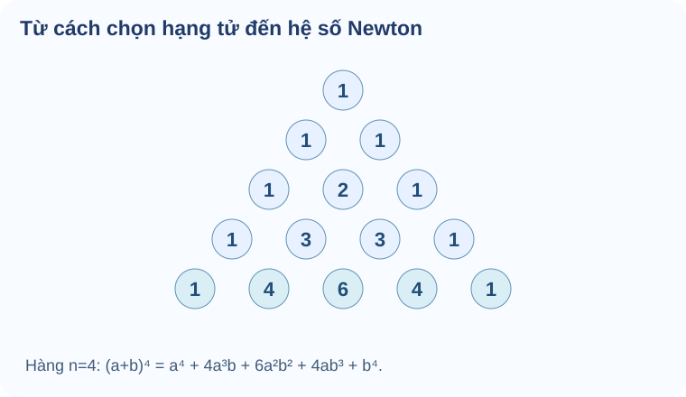

# Bài 25. Nhị thức Newton

## 1. Khám phá kiến thức

### Cùng tìm hiểu

Khi nhân \((a+b)^4\), mỗi trong bốn thừa số \((a+b)\) buộc em chọn **một trong hai hạng tử**. Để tạo hạng tử \(a^2b^2\), ta phải chọn \(b\) đúng **hai lần**, còn hai lần chọn \(a\). Số cách chọn vị trí cho hai chữ \(b\) trong bốn thừa số là \(\binom42=6\), vì thế hệ số của \(a^2b^2\) là 6.

Đây là ý nghĩa của **nhị thức Newton**: hệ số không xuất hiện từ một mẹo nhớ, mà là số cách chọn vị trí khi khai triển tích nhiều thừa số giống nhau. Các hệ số xếp thành **tam giác Pascal**; ở mỗi hàng, hai số liền kề của hàng trước cộng lại thành số ở giữa hàng sau.

Khi nhị thức có dấu âm hoặc chứa \(x\) với số mũ âm, em phải theo dõi **số lần chọn từng hạng tử** và **số mũ của \(x\)**, không tự đoán dấu xen kẽ. Muốn tính tổng hệ số của đa thức, cách nhanh là thay \(x=1\), nhưng chỉ sau khi xác nhận biểu thức thực sự là đa thức theo \(x\).

### Thuật ngữ, kiến thức và kỹ năng

**Thuật ngữ:** Nhị thức Newton, hệ số nhị thức, tổ hợp, tam giác Pascal, số hạng tổng quát, hệ số, số hạng không chứa (x).

**Sau bài học, em cần làm được:** Giải thích hệ số bằng chọn vị trí; viết khai triển đúng dấu/số mũ; tìm một hệ số hoặc số hạng tự do; tính tổng hệ số bằng thay giá trị thích hợp.

## 2. Kiến thức SGK

### Từ năm nhân tử đến hệ số Newton

Khai triển (a+b)⁵ bằng nhân từng cặp dài; hãy hiểu vì sao hệ số của a³b² xuất hiện nhiều lần.

**Tiền đề:** Ôn C₅² là số cách chọn 2 vị trí khác nhau trong 5 vị trí; từ mỗi nhân tử (a+b), lấy a hoặc b.

Đơn thức a³b² xuất hiện khi chọn b từ đúng hai trong năm nhân tử; ba nhân tử còn lại chọn a. Có C₅²=10 cách chọn vị trí b.

**Hướng dẫn đọc hình/sơ đồ:** Vẽ năm ô (a+b), đánh dấu hai ô lấy b, ba ô lấy a; đổi cặp ô đánh dấu cho các tích cùng a³b².

**Lý do chọn phương pháp, điều kiện và giới hạn:** Với SGK Core n=4 hoặc n=5, số mũ của a và b cộng bằng n. Hệ số a^(n−k)b^k bằng C(n,k); không dùng n lớn làm nội dung bắt buộc.

**Em vận dụng.** Trong khai triển (a+b)⁵, hệ số của a³b² là bao nhiêu? Giải thích bằng cách chọn nhân tử.

Tự mở đáp án sau khi đã tự làm

**Đáp án:** 10.

**Lập luận:** Chọn hai trong năm nhân tử cho b theo C₅²=5!/(2!3!)=10 cách; ba nhân tử còn lại cho a.

**Nếu chưa đúng:** xem hướng dẫn tự sửa tương ứng, sau đó luyện câu liên quan ở phần Luyện tập (không dùng câu đã xem lời giải làm chứng cứ tự kiểm tra độc lập).

<a href="#help-g10-chviii-try09">Đến hướng dẫn tự sửa</a>

Nếu chưa làm được — khắc phục 5 bước

1. **Nhận diện lỗi:** Nếu đáp 5, em nhầm số mũ với số cách chọn; nếu 20, em đếm thứ tự hai vị trí b không cần thiết.
2. **Quay lại bản chất:** Đơn thức a³b² xuất hiện khi chọn b từ đúng hai trong năm nhân tử; ba nhân tử còn lại chọn a. Có C₅²=10 cách chọn vị trí b.
3. **Tự làm lại:** Vẽ năm vị trí, đánh dấu hai vị trí b hoặc tính C₅².
4. **Đối chiếu tự nguyện:** tự mở lời giải trong fold và giải thích lại mỗi điều kiện, không tính điểm thành thạo.
5. **Luyện tiếp:** `THPT-G10-B25-C01`, câu luyện tập cùng kỹ năng; nếu làm câu này sau khi đã xem lời giải thì chỉ tính luyện tập, không chứng nhận đánh giá độc lập.

<a href="../luyen-tap/?item=THPT-G10-B25-C01">Mở câu luyện tập đã được kiểm tra</a>

### Dấu hệ số phụ thuộc hạng tử âm được chọn bao nhiêu lần

Trong (2−x)⁴, có số hạng dương và âm; nhầm dấu có thể làm sai cả hệ số dù tổ hợp tính đúng.

**Tiền đề:** Ôn (−x)^k=(−1)^k x^k, dấu âm mũ lẻ giữ dấu trừ; chọn k nhân tử (−x) từ n nhân tử.

Hệ số x^k gồm ba phần: số cách chọn k vị trí là C(n,k), phần số 2^(n−k) từ các vị trí còn lại và dấu (−1)^k. Dấu không tùy ý.

**Hướng dẫn đọc hình/sơ đồ:** Dùng bốn ô (2−x), đánh dấu ba ô lấy −x và một ô lấy 2; mỗi tích chọn có ba dấu trừ nên kết quả âm.

**Lý do chọn phương pháp, điều kiện và giới hạn:** Trong n=4 Core, hệ số x³ của (2−x)⁴ là C(4,3)·2¹·(−1)³. Kiểm đúng số mũ x trước khi tính, không mở rộng cấp số tùy chọn n lớn.

**Em vận dụng.** Tìm hệ số của x³ trong (2−x)⁴.

Tự mở đáp án sau khi đã tự làm

**Đáp án:** −8.

**Lập luận:** Chọn −x từ ba trong bốn nhân tử có C₄³=4 cách; mỗi tích là 2·(−x)³=−2x³. Tổng −8x³.

**Nếu chưa đúng:** xem hướng dẫn tự sửa tương ứng, sau đó luyện câu liên quan ở phần Luyện tập (không dùng câu đã xem lời giải làm chứng cứ tự kiểm tra độc lập).

<a href="#help-g10-chviii-try10">Đến hướng dẫn tự sửa</a>

Nếu chưa làm được — khắc phục 5 bước

1. **Nhận diện lỗi:** Nếu đáp +8, em đã bỏ dấu (−1)³; nếu đáp −4, em quên nhân hệ số 2 ở nhân tử còn lại.
2. **Quay lại bản chất:** Hệ số x^k gồm ba phần: số cách chọn k vị trí là C(n,k), phần số 2^(n−k) từ các vị trí còn lại và dấu (−1)^k. Dấu không tùy ý.
3. **Tự làm lại:** Viết riêng C₄³, 2¹, (−1)³ rồi nhân từng phần.
4. **Đối chiếu tự nguyện:** tự mở lời giải trong fold và giải thích lại mỗi điều kiện, không tính điểm thành thạo.
5. **Luyện tiếp:** `THPT-G10-B25-P01`, câu luyện tập cùng kỹ năng; nếu làm câu này sau khi đã xem lời giải thì chỉ tính luyện tập, không chứng nhận đánh giá độc lập.

<a href="../luyen-tap/?item=THPT-G10-B25-P01">Mở câu luyện tập đã được kiểm tra</a>

### Số hạng tự do chỉ khi không chọn thừa số có x

Trong (2x+3)⁴, không cần khai triển hết để biết số hạng không chứa x: chỉ cần nhận ra tích nào không lấy 2x lần nào.

**Tiền đề:** Ôn mỗi nhân tử (2x+3) cho hai lựa chọn 2x hoặc 3; số mũ x là số lần chọn 2x.

Số hạng không chứa x đòi số mũ x bằng 0: lấy 3 ở tất cả bốn nhân tử. Đây là phạm vi SGK Core n=4; biểu thức 1/x hoặc n lớn thuộc phần hỗ trợ/mở rộng, không bắt làm Tự thử bắt buộc.

**Hướng dẫn đọc hình/sơ đồ:** Vẽ bốn ô (2x+3) và khoanh 3 trong cả bốn ô, thấy tích 3⁴ không có x.

**Lý do chọn phương pháp, điều kiện và giới hạn:** Dùng số hạng C(4,k)(2x)^k·3^(4−k), cho k=0; không giải bài có số mũ âm ngoài phạm vi SGK Core.

**Em vận dụng.** Trong khai triển (2x+3)⁴, số hạng không chứa x bằng bao nhiêu?

Tự mở đáp án sau khi đã tự làm

**Đáp án:** 81.

**Lập luận:** Chọn 3 từ cả bốn nhân tử: C₄⁰(2x)⁰3⁴=81. Với k≥1, số hạng chứa x^k nên không là hằng số.

**Nếu chưa đúng:** xem hướng dẫn tự sửa tương ứng, sau đó luyện câu liên quan ở phần Luyện tập (không dùng câu đã xem lời giải làm chứng cứ tự kiểm tra độc lập).

<a href="#help-g10-chviii-try11">Đến hướng dẫn tự sửa</a>

Nếu chưa làm được — khắc phục 5 bước

1. **Nhận diện lỗi:** Nếu đáp 16, em lấy hệ số bậc x⁴; nếu chỉ 3, em quên tích của cả bốn nhân tử.
2. **Quay lại bản chất:** Số hạng không chứa x đòi số mũ x bằng 0: lấy 3 ở tất cả bốn nhân tử. Đây là phạm vi SGK Core n=4; biểu thức 1/x hoặc n lớn thuộc phần hỗ trợ/mở rộng, không bắt làm Tự thử bắt buộc.
3. **Tự làm lại:** Lập bảng k=0,1,2,3,4 và số mũ x là k, chọn k=0.
4. **Đối chiếu tự nguyện:** tự mở lời giải trong fold và giải thích lại mỗi điều kiện, không tính điểm thành thạo.
5. **Luyện tiếp:** `THPT-G10-B25-P07`, câu luyện tập cùng kỹ năng; nếu làm câu này sau khi đã xem lời giải thì chỉ tính luyện tập, không chứng nhận đánh giá độc lập.

<a href="../luyen-tap/?item=THPT-G10-B25-P07">Mở câu luyện tập đã được kiểm tra</a>

### Tổng hệ số bằng giá trị đa thức tại x=1

Cộng riêng từng hệ số khai triển (1+2x)⁴ dễ sai; thay x=1 làm mọi lũy thừa x bằng 1.

**Tiền đề:** Nhắc P(x)=a₀+a₁x+...+a₄x⁴ có P(1)=a₀+...+a₄; chỉ dùng n=4 trong học liệu Core này.

Thay x=1, tất cả x^k=1 nên giá trị P(1) chính là tổng hệ số. Tách tổng hệ số lẻ/chẵn bằng P(−1) là nhánh mở rộng tự chọn, không thay phần SGK bắt buộc.

**Hướng dẫn đọc hình/sơ đồ:** Vẽ bảng bậc 0..4 và hệ số tương ứng, rồi cho x=1 để từng hạng đóng góp đúng hệ số của nó.

**Lý do chọn phương pháp, điều kiện và giới hạn:** Hỏi tổng mọi hệ số thì tính P(1). Chỉ khi tự chọn học thêm tổng lẻ/chẵn mới dùng (P(1)−P(−1))/2, không dùng bài n=7 nâng cao làm Core.

**Em vận dụng.** Tổng tất cả hệ số của đa thức (1+2x)⁴ là bao nhiêu?

Tự mở đáp án sau khi đã tự làm

**Đáp án:** 81.

**Lập luận:** P(x)=(1+2x)⁴, tổng hệ số =P(1)=(1+2)⁴=3⁴=81.

**Nếu chưa đúng:** xem hướng dẫn tự sửa tương ứng, sau đó luyện câu liên quan ở phần Luyện tập (không dùng câu đã xem lời giải làm chứng cứ tự kiểm tra độc lập).

<a href="#help-g10-chviii-try12">Đến hướng dẫn tự sửa</a>

Nếu chưa làm được — khắc phục 5 bước

1. **Nhận diện lỗi:** Nếu đáp 16, em nhầm (1+2x)⁴ với (1+x)⁴, bỏ hệ số 2.
2. **Quay lại bản chất:** Thay x=1, tất cả x^k=1 nên giá trị P(1) chính là tổng hệ số. Tách tổng hệ số lẻ/chẵn bằng P(−1) là nhánh mở rộng tự chọn, không thay phần SGK bắt buộc.
3. **Tự làm lại:** Viết rõ P(1)=(1+2·1)⁴ và tính 3⁴; không cần khai triển.
4. **Đối chiếu tự nguyện:** tự mở lời giải trong fold và giải thích lại mỗi điều kiện, không tính điểm thành thạo.
5. **Luyện tiếp:** `THPT-G10-CHVIII-W25-01`, câu luyện tập cùng kỹ năng; nếu làm câu này sau khi đã xem lời giải thì chỉ tính luyện tập, không chứng nhận đánh giá độc lập.

<a href="../../../thu-vien/tu-luan-chuong-viii/">Mở câu luyện tập đã được kiểm tra</a>

### Khái niệm, điều kiện và công thức

**Cách đọc hình.** Đọc từng hàng hệ số theo n từ 0 đến 4; hệ số giữa bằng tổng hai hệ số ở trên. Hàng n=4 là 1,4,6,4,1 ứng với khai triển (a+b)⁴.

<figure class="thpt-r4-plot thpt-r4-concept-figure"><figcaption>Các hệ số \(1,4,6,4,1\) của \((a+b)^4\) xuất phát từ số cách chọn hạng tử \(b\) đúng \(k\) lần trong bốn thừa số.</figcaption></figure>

**Công thức.** Với \(n\) là số nguyên không âm,

\[
(a+b)^n=\sum_{k=0}^{n}\binom{n}{k}a^{n-k}b^k.
\]

Có n+1 số hạng trước khi thu gọn các số hạng đồng dạng. Hệ số tổ hợp \(\binom nk=\binom n{n-k}\) và \(\binom nk=\binom{n-1}{k-1}+\binom{n-1}k\) với \(1\le k\le n-1\). Khi \(b\) là một biểu thức âm, dấu âm ở \(b^k\) phải được giữ: \((-1)^k\) khác nhau cho số mũ chẵn/lẻ.

**Đọc hệ số.** Trong \((a+bx)^n\), hệ số của \(x^r\) là \(\binom nr a^{n-r}b^r\) (\(0\le r\le n\)), với a,b là hằng số. Với biểu thức có các lũy thừa x khác nhau hoặc \(x^{-1}\), phải viết số mũ tổng quát, giải phương trình số mũ cần tìm, và kiểm tra điều kiện xác định \(x\ne0\) nếu có.

## 3. Ví dụ giải toán

Trước khi xem lời giải, hãy xác định dữ kiện, điều phải tìm và lý do chọn cách giải. Sau đó kiểm tra lại điều kiện áp dụng và kết quả, thay vì chỉ nhìn phép tính cuối cùng.

### Ví dụ — Tìm hệ số từ số lần chọn hạng tử

**Đề bài.** Tìm hệ số của \(x^2\) trong \((1+2x)^4\), rồi tính tổng mọi hệ số của đa thức.

**Vì sao chọn cách này?** Để có \(x^2\), trong bốn thừa số phải chọn \(2x\) đúng hai lần; số cách chọn vị trí là \(\binom42\).

**Giải.** Hệ số của \(x^2\) bằng \(\binom42\cdot2^2=6\cdot4=24\). Tổng tất cả hệ số bằng giá trị đa thức tại \(x=1\): \((1+2)^4=81\).

**Kiểm lại:** Hệ số 24 không phải 6 vì mỗi lần chọn \(2x\) còn đóng góp thừa số 2.

**Ví dụ 1.** Hệ số x² trong (1-2x)^5 là C(5,2)×(-2)^2=10×4=40; dấu dương do mũ chẵn. Hệ số x³ là C(5,3)×(-2)^3=10×(-8)=-80.

**Ví dụ 2.** Tổng tất cả hệ số của đa thức f(x)=(2+x)^4 bằng f(1)=3^4=81. Tổng có trọng số dấu luân phiên bằng f(-1)=1. Dùng thay x=1 chỉ khi biết f(x) là đa thức hữu hạn và hiểu rõ hệ số cần cộng.

Luyện tập mở rộng và chuyên sâu

Các câu có nhãn “hỗ trợ mở rộng” hoặc “chuyên sâu tự chọn” không thuộc yêu cầu bắt buộc của phần Core. Hãy nắm chắc cách khai triển và xác định hệ số trước khi luyện nâng cao.

**Lỗi hay gặp.** Nhầm k và n-k; bỏ hệ số b^k; quên dấu âm với số mũ lẻ; đọc hệ số x^r sai khi a hoặc b còn chứa x; tự áp dụng f(1) cho tổng *một số* hệ số không thích hợp.

## 4. Lỗi thường gặp và cách tự khắc phục

Sai dấu và vị trí hệ số Newton

<strong>Dấu hiệu:</strong> Nhầm k với n−k, thiếu hệ số tổ hợp hoặc quên dấu trong (−bx)^k.

<strong>Bản chất toán:</strong> Với a,b hằng số, n nguyên không âm, hệ số x^r trong (a+bx)^n (0≤r≤n) là C(n,r)a^(n−r)b^r; nếu b âm, dấu phụ thuộc tính chẵn/lẻ của r.

<strong>Tự sửa:</strong> Ôn B25 mục 1: xác định phần mang x, viết số hạng tổng quát \(C_n^r a^{n-r}b^r x^r\) rồi mới chọn r; nếu b âm, soát dấu theo tính chẵn/lẻ của r. Theo nhận xét reviewer, ví dụ Core SGK KNTT lớp 10 tập trung \(n=4,5\); công thức vẫn đúng với mọi n nguyên không âm.

<strong>Kiến thức cần ôn:</strong> B24 tổ hợp, số mũ; B25 mục 1.

<strong>Luyện lại bài đã có:</strong> <a data-thpt-formative-id="THPT-G10-B25-C01" href="../luyen-tap/?item=THPT-G10-B25-C01">Luyện lại câu 25-C01</a> · <a data-thpt-formative-id="THPT-G10-B25-C02" href="../luyen-tap/?item=THPT-G10-B25-C02">Luyện lại câu 25-C02</a> · <a data-thpt-formative-id="THPT-G10-B25-P01" href="../luyen-tap/?item=THPT-G10-B25-P01">Luyện lại câu 25-P01</a> · <a data-thpt-formative-id="THPT-G10-B25-P03" href="../luyen-tap/?item=THPT-G10-B25-P03">Luyện lại câu 25-P03</a> · <a data-thpt-formative-id="THPT-G10-B25-P04" href="../luyen-tap/?item=THPT-G10-B25-P04">Luyện lại câu 25-P04</a> · <a data-thpt-formative-id="THPT-G10-CHVIII-W25-01" href="../../../thu-vien/tu-luan-chuong-viii/#thpt-g10-chviii-w25-01">Bài tự luận liên quan</a>

Số hạng tự do và bài mở rộng chứa x⁻¹

<strong>Dấu hiệu:</strong> Khai triển toàn bộ để tìm hạng không chứa x trong (a+bx)^n, hoặc tự động coi bài chứa x⁻¹ là Core bắt buộc.

<strong>Bản chất toán:</strong> Trong (a+bx)^n (a,b là hằng số), hạng không chứa x là a^n. Nếu chứa x⁻¹ phải giải số mũ tổng quát bằng 0 và giữ điều kiện x≠0; đây là dạng mở rộng của bank hiện tại.

<strong>Tự sửa:</strong> Ôn B25 mục 1–2 và P07 để củng cố Core. P02/P05 là hỗ trợ mở rộng, P06 chuyên sâu tự chọn, không dùng làm yêu cầu đánh giá Core bắt buộc.

<strong>Kiến thức cần ôn:</strong> Số hạng tổng quát; điều kiện x≠0; B25 mục 1–2.

<strong>Luyện lại bài đã có:</strong> <a data-thpt-formative-id="THPT-G10-B25-P07" href="../luyen-tap/?item=THPT-G10-B25-P07">Luyện lại câu 25-P07</a> · <a data-thpt-formative-id="THPT-G10-B25-P02" href="../luyen-tap/?item=THPT-G10-B25-P02">Luyện lại câu 25-P02</a> · <a data-thpt-formative-id="THPT-G10-B25-P05" href="../luyen-tap/?item=THPT-G10-B25-P05">Luyện lại câu 25-P05</a> · <a data-thpt-formative-id="THPT-G10-B25-P06" href="../luyen-tap/?item=THPT-G10-B25-P06">Luyện lại câu 25-P06</a>

**Học tiếp:** [Core và Luyện tập](../luyen-tap/) · [Tự kiểm tra cuối chương](../tu-kiem-tra-chuong/).

Nguồn toán học: SGK Toán 10 Kết nối tri thức với cuộc sống và học liệu SLM hiện hành. Lời giảng được biên tập nhằm hỗ trợ tự học độc lập.

